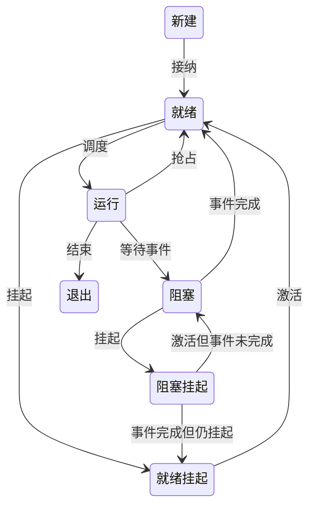

# 《操作系统》20-21-1学期复习知识点

原件仅一页，是 2020—2021 学年第一学期《操作系统 A》的历史复习清单：前 18 项是填空、选择和简答考点，后 6 项是大题考点。原件只有题名，没有给出具体题面或答案。下文依原顺序解释机制，补充例子不是原卷题目，也不代表当前考试范围。

## 一、填空、选择与简答知识点

### 1. 操作系统功能与特征

操作系统的功能包括：处理机管理、存储管理、设备管理、文件管理和用户接口。

操作系统四大特征为：并发、共享、虚拟、异步。

知识点：[操作系统的主要功能（处理机管理、存储管理、设备管理、文件管理、用户接口）](../../../topics/操作系统/操作系统功能.md)、[现代操作系统的特征（并发、共享、虚拟、异步）](../../../topics/操作系统/操作系统特征.md)

### 2. 进程、线程与程序的区别

- **进程与线程**：进程是资源分配的基本单位，线程是CPU调度的基本单位；进程拥有独立的地址空间，线程共享所属进程的地址空间；同进程线程切换通常省去切换地址空间这一步，但仍须保存执行现场；实际开销依实现与负载而变。
- **进程与程序**：程序是静态的指令集合，进程是动态的执行过程；同一个程序可启动多个进程；有创建、调度、阻塞与退出生命周期的是运行实例，而非静态指令本身。

知识点：[进程的定义与特征（动态性、并发性、独立性、制约性、异步性、结构性）](../../../topics/操作系统/进程定义与特征.md)、[进程与程序的区别与联系](../../../topics/操作系统/进程与程序区别.md)、[线程的概念及与进程的区别](../../../topics/操作系统/线程概念.md)

### 3. 进程状态转化与控制

原件只列“进程的七态转化及进程控制模块”，没有画模型。常见七态把**新建、就绪、运行、阻塞、退出**五态再扩充为**就绪挂起、阻塞挂起**两态。“唤醒”是事件触发的转换，不是第六种状态。内核用进程控制块保留身份、现场、状态等，进程控制原语据此创建、撤销、阻塞、唤醒、挂起和激活进程。

图只列典型边，不穷尽所有实现可走的变迁。关键是把==事件是否满足==和==是否已激活并可参与调度==分开：阻塞挂起者等到了事件，只应转为就绪挂起，不能直接变运行。

知识点：[进程的基本状态（就绪、执行、阻塞）及状态转换](../../../topics/操作系统/进程状态转换.md)、[原语的概念与进程控制原语（创建、撤销、阻塞、唤醒）](../../../topics/操作系统/原语.md)、[进程的定义与特征（动态性、并发性、独立性、制约性、异步性、结构性）](../../../topics/操作系统/进程定义与特征.md)

### 4. 原语的概念

原语是由若干条指令组成的完成特定功能的程序段，其可观察效果是原子的，不把中间状态暴露给竞争者。关中断是某些单核实现的一种方法，在多核上仅关闭本核中断不能阻止其他核同时操作。

知识点：[原语的概念与进程控制原语（创建、撤销、阻塞、唤醒）](../../../topics/操作系统/原语.md)

### 5. 信号量与临界区

- **信号量的值**：在课内常用的负值计数模型中，$S>0$ 表示还有可用许可；$S=0$ 表示无可用许可；$S<0$ 时 $-S$ 表示等待者数。不要把一种教学记法当成所有系统接口会返回负值。
- **临界区**：进程中访问共享资源的那段代码。要求同一时刻只有一个进程进入临界区。

知识点：[信号量机制与P、V操作的定义](../../../topics/操作系统/信号量与PV操作.md)、[临界区、临界资源与互斥的概念](../../../topics/操作系统/临界区与互斥.md)

### 6. 通道的概念和作用

通道是一种专用的I/O处理器，能独立执行通道程序以控制I/O操作。作用是减轻CPU负担，提高I/O效率，使CPU与I/O设备并行工作。

知识点：[通道的概念与作用](../../../topics/操作系统/通道概念.md)

### 7. 预防死锁的方式

通过破坏死锁产生的四个必要条件之一来预防：
- 破坏互斥条件（如将独占资源改为共享）。
- 破坏请求与保持条件（一次性申请所有资源）。
- 破坏不剥夺条件（允许强制剥夺已分配资源）。
- 破坏循环等待条件（资源有序分配策略）。

知识点：[死锁的预防方法与避免方法（银行家算法）](../../../topics/操作系统/死锁预防与避免.md)、[死锁的定义与四个必要条件（互斥、请求保持、不可剥夺、循环等待）](../../../topics/操作系统/死锁概念与必要条件.md)

### 8. 避免死锁的方式

在资源分配过程中，利用安全性算法判断系统是否处于安全状态，仅当分配后系统仍处于安全状态时才进行分配，从而避免死锁。

知识点：[死锁的预防方法与避免方法（银行家算法）](../../../topics/操作系统/死锁预防与避免.md)

### 9. 可变分区分配算法

| 策略 | 在所有合格空洞中选哪一个 |
| --- | --- |
| 首次适应 | 从表头扫描，选遇到的第一个足够大的空洞 |
| 最佳适应 | 选容量最小但装得下的空洞 |
| 最坏适应 | 选最大的空洞 |
| 循环首次适应（Next Fit） | 从上次扫描结束的位置接着找，必要时回绕 |

**补充验算：**空洞按地址顺序为 8、20、12、25 KiB，请求 10 KiB。首次适应选 20，最佳适应选 12，最坏适应选 25；若循环首次适应从 12 KiB 那项起查，也选 12。所有空洞总容量很大也不代表最大连续空洞足够。

知识点：[可变分区分配算法（首次适应、最佳适应、最差适应）](../../../topics/操作系统/可变分区分配算法.md)

### 10. 分段和分页的区别

- **分页**：页按系统选用、硬件支持的粒度定长划分；程序通常看见线性逻辑地址。分页不要求全进程连续，但页内仍可能产生内部碎片。
- **分段**：段按代码、数据等有语义的区间组织，长度可变；使用段号与段内偏移，便于按段施加保护和共享。连续放置各变长段时可能出现外部碎片。

知识点：[分页与分段的区别](../../../topics/操作系统/分页与分段区别.md)、[页式存储管理的基本原理与地址转换](../../../topics/操作系统/分页存储管理.md)、[段式存储管理的基本原理与地址转换](../../../topics/操作系统/分段存储管理.md)

### 11. 局部性原理与虚拟存储器

- **局部性原理**：时间局部性（刚被访问的指令/数据很可能再次被访问）和空间局部性（靠近刚被访问的指令/数据的指令/数据很可能很快被访问）。
- **虚拟存储器实现原理**：基于局部性原理，允许部分页面或段驻留，按访问需要建立、调入或置换。磁盘后备只是一种来源，并非每一页都有磁盘副本，首次访问的匿名页可按需清零。
- **特征**：离散性、多次性、对换性、虚拟性。

知识点：[虚拟存储器的基本思想与局部性原理](../../../topics/操作系统/虚拟存储器.md)、[页式存储管理的基本原理与地址转换](../../../topics/操作系统/分页存储管理.md)

### 12. 什么是虚拟设备

虚拟设备是指通过SPOOLing技术，将独占设备改造成共享设备的设备。它使得多个用户可以同时提交请求，但同一台物理设备仍按它的能力依次处理它们。

知识点：[SPOOLing系统的组成与虚拟设备原理](../../../topics/操作系统/SPOOLing系统.md)、[设备的分类（按资源分配角度：独享、共享、虚拟设备）](../../../topics/操作系统/设备分类.md)

### 13. I/O控制方式的比较

- **程序直接控制方式**：处理机轮询设备状态，并负责传送；短等待时不一定比中断更贵。
- **中断驱动方式**：设备准备好时发中断，处理机不必一直轮询；逐字节触发中断仍可能很贵。
- **DMA方式**：控制器在内存与设备间批量搬运，处理机设置传输并处理完成或异常。
- **通道方式**：通道可执行 I/O 程序、组织设备操作，处理机通常仍负责提交与处理结束状态；没有跨设备与负载的绝对性能排序。

知识点：[I/O控制方式（程序查询、中断、DMA、通道）及比较](../../../topics/操作系统/IO控制方式.md)、[DMA控制器的组成与四种寄存器的作用](../../../topics/操作系统/DMA控制器.md)

### 14. 分时系统工作原理

分时系统将CPU时间划分成一个个时间片，按时间片大小轮流分配给各联机用户使用。每个用户感觉像是独占计算机，系统通过多路复用为交互用户反复提供服务机会；是否公平、响应多久取决于调度和负载，不能把它理解为实时截止期保证。

知识点：[分时系统的工作原理与特征](../../../topics/操作系统/分时系统工作原理.md)、[操作系统三种基本类型（批处理、分时、实时）及其主要目标](../../../topics/操作系统/操作系统基本类型.md)、[现代操作系统的特征（并发、共享、虚拟、异步）](../../../topics/操作系统/操作系统特征.md)

### 15. 文件的逻辑结构和物理结构

- **逻辑结构**：从用户角度看到的文件结构，如无结构文件（流式文件）、记录式文件（定长/变长）。
- **物理结构**：文件在外存上的存储组织方式，如连续分配、链接分配（隐式/显式）、索引分配。

知识点：[文件的逻辑结构（流式文件、记录式文件）](../../../topics/操作系统/文件逻辑结构.md)、[文件的物理结构（连续、链接、索引、混合索引）](../../../topics/操作系统/文件物理结构.md)

### 16. Spooling 系统的组成

Spooling系统由三部分组成：
- 输入井和输出井（磁盘上的一块区域）
- 输入缓冲区和输出缓冲区（内存中的一块区域）
- 输入进程和输出进程（分别协调外设、内存缓冲与外存井之间的传输）

知识点：[SPOOLing系统的组成与虚拟设备原理](../../../topics/操作系统/SPOOLing系统.md)

### 17. 设备分配的步骤

1. 检查设备是否可用。
2. 根据设备类型和请求，分配设备（可能需要分配控制器、通道）。
3. 修改相关数据结构（如设备控制表、控制器控制表、通道控制表）。
4. 启动设备。

知识点：[设备分配的过程（分配设备、分配控制器、分配通道）](../../../topics/操作系统/设备分配步骤.md)、[I/O控制方式（程序查询、中断、DMA、通道）及比较](../../../topics/操作系统/IO控制方式.md)、[设备的分类（按资源分配角度：独享、共享、虚拟设备）](../../../topics/操作系统/设备分类.md)

### 18. 常用文件目录的特点

- **单级目录**：命名空间只有一层，文件名全局不能重复；搜索速度还取决于目录实现。
- **两级目录**：各用户有各自的目录，可以在不同用户下复用同名；层级能力有限。
- **多级目录（树形）**：支持层次化命名，支持按路径逐级导航，同名只要出现在不同父目录下就不冲突。
- **无环图目录**：允许多个父目录，灵活但复杂。

知识点：[文件目录结构（单级、二级、多级目录）及特点](../../../topics/操作系统/文件目录结构.md)

## 二、大题知识点

### 19. 磁盘调度算法

常见的磁盘调度算法包括：
- 先来先服务（FCFS）
- 最短寻道时间优先（SSTF）
- 扫描（SCAN，电梯算法）
- 循环扫描（C-SCAN）
- LOOK 和 C-LOOK：该方向没有请求即可转向或跳转；若题目约定经典 SCAN 要到物理端点再折返，端点虽然没有服务请求，来回寻道也必须计入。

知识点：[磁盘调度算法（FCFS、SSTF、SCAN、CSCAN）](../../../topics/操作系统/磁盘调度算法.md)

### 20. 分段、分页中的地址转换

**订正：**先前转写把表项地址和数据地址加在一起；原件只列题名，没有给出这一错误公式。

| 模型 | 查表时得到的值 | 最终数据地址 |
| --- | --- | --- |
| 分页 | 按页号 $p$ 查页表，获得有效、驻留映射的页框号 $f$ | $fB+d$，$B$ 为页大小，$d$ 为页内偏移 |
| 分段 | 按段号查段表，获得段基址 $b$ 与段长 $l$，先判断 $0\le d<l$ | 通过界限检查后为 $b+d$ |
| 段页式 | 先按段取得该段页表和范围，再按段内页号找页框 | 检查范围和权限后，用页框地址与页内偏移组成数据地址 |

> [!TIP]
> 问==表项在哪里==才用“表基址＋下标×表项长度”；问==数据在哪里==则用查出的页框或段基址。这两步访问的对象完全不同。

**补充验算：**页大小 1,024 字节，逻辑偏移 3,200 得页号 3、偏移 128。若页表第 3 项给出页框 7，数据地址是 $7\times1024+128=7296$。即使页表在内存中被搬到别处，只要页框映射不变，数据地址仍是 7,296。

知识点：[分页](../../../topics/操作系统/分页存储管理.md)、[分段](../../../topics/操作系统/分段存储管理.md)、[段页式](../../../topics/操作系统/段页式存储管理.md)

### 21. 进程调度算法

- **先来先服务（FCFS）**：按照进入就绪队列的顺序非抢占地服务；短作业排在长作业后面时响应会变差。
- **短作业优先（SJF）**：非抢占，在所有作业同时就绪且运行时间已知等简化条件下可最小化平均等待时间；长作业仍可能在不断有短作业到达时长期等待。
- **高响应比优先（HRRN）**：在就绪作业中用 $(等待时间+服务时间)/服务时间$ 选响应比高者。
- **时间片轮转（RR）**：抢占式，适合分时系统，响应快。
- **优先级调度**：可抢占或非抢占，关键任务优先。

知识点：[进程调度算法（FCFS、SJF、优先级、时间片轮转、多级反馈队列）](../../../topics/操作系统/进程调度算法.md)

### 22. 信号量及PV操作

- **原子的 P 操作（wait）**：$S := S - 1$；若 $S < 0$，则当前进程阻塞。
- **原子的 V 操作（signal）**：$S := S + 1$；若 $S \le 0$，则唤醒一个等待进程。
- **应用**：实现进程互斥（初始值 1）或先后同步（常用初始值 0）。若等待的进程握着另一方必须取得的锁，可能使制造所需事件的进程也阻塞。

知识点：[信号量机制与P、V操作的定义](../../../topics/操作系统/信号量与PV操作.md)、[临界区、临界资源与互斥的概念](../../../topics/操作系统/临界区与互斥.md)、[经典进程同步问题（生产者-消费者、读者-写者、哲学家进餐）](../../../topics/操作系统/经典同步问题.md)

### 23. 页面置换算法

- **最优置换（OPT）**：淘汰未来最久不使用的页面，已知完整未来引用串时给出理论最优，在线运行时不能预知这一串。
- **最近最久未使用（LRU）**：淘汰最近最久未使用的页面，利用时间局部性，不保证每条引用串都优于 FIFO。
- **先进先出（FIFO）**：淘汰最早进入内存的页面，可能出现Belady异常。
- **时钟置换（Clock/Second Chance）**：近似LRU，易于实现。

知识点：[页面置换算法（OPT、FIFO、LRU、Clock、LFU）](../../../topics/操作系统/页面置换算法.md)、[页式存储管理的基本原理与地址转换](../../../topics/操作系统/分页存储管理.md)、[虚拟存储器的基本思想与局部性原理](../../../topics/操作系统/虚拟存储器.md)

### 24. 银行家算法

- **核心思想**：在分配资源前，检查分配后系统是否处于安全状态。
- **数据结构**：Available（可用资源）、Max（最大需求）、Allocation（已分配）、Need（尚需）。
- **步骤**：
    1. 逐项检查请求量不超过该进程的剩余申报量 Need，也不超过系统当前 Available；前者违反申报时不能进入安全试算，后者不足时需等待。
    2. 试扣 Available，试增该进程 Allocation 并减少 Need。
    3. 从试分配后的可用量设 Work。找到其 Need 逐项不超过 Work 的未完成进程，模拟它完成，将已占的 Allocation 计回 Work，再重复。所有进程都能撤出才构成安全序列。
    4. 若安全才真正分配；否则回滚试算并暂缓。不安全意味着无法保证所有进程完成，并不等于实际死锁已出现。

知识点：[死锁的预防方法与避免方法（银行家算法）](../../../topics/操作系统/死锁预防与避免.md)
