# 《操作系统》习题练习与操作系统概念（课件）

原件的每一页，下面附识别出的文字。

### 习 题 练 习

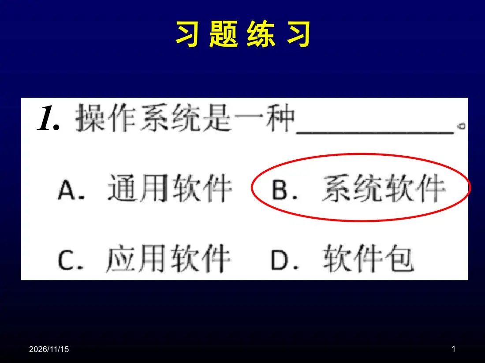

原文：

习 题 练 习

1. 操作系统是一种 A. 通用软件 B. 系统软件C. 应用软件 D. 软件包

2026/11/15

1

### 1.1 操作系统概念

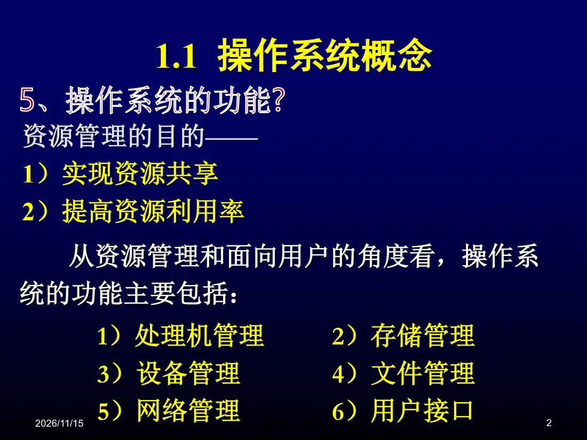

原文：

1.1 操作系统概念

5、操作系统的功能?资源管理的目的—

1）实现资源共享

2）提高资源利用率

从资源管理和面向用户的角度看，操作系统的功能主要包括：

1）处理机管理

3）设备管理

5）网络管理

2）存储管理

4）文件管理

6）用户接口

2026/11/15

2

### 1.1 操作系统概念

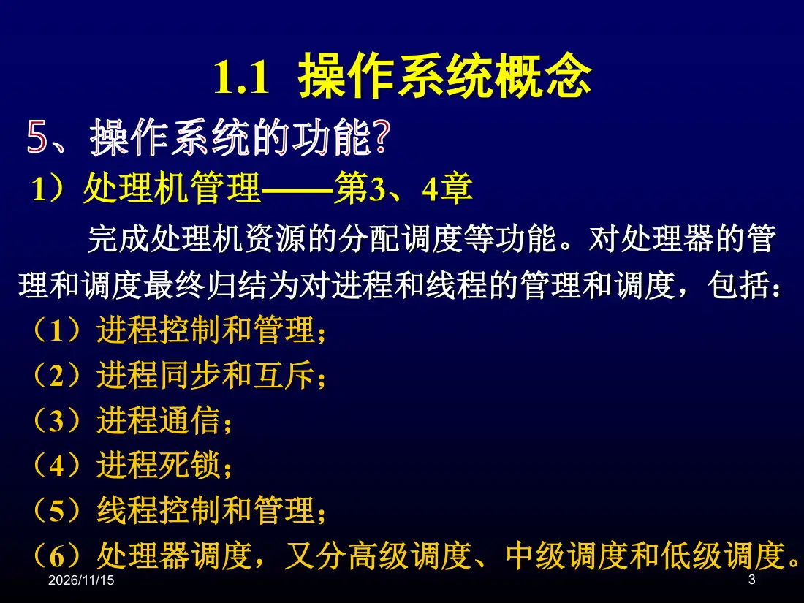

原文：

1.1 操作系统概念

5、操作系统的功能?

1）处理机管理——第3、4章

完成处理机资源的分配调度等功能。对处理器的管理和调度最终归结为对进程和线程的管理和调度，包括：

（1）进程控制和管理；

（2）进程同步和互斥；

（3）进程通信；

（4）进程死锁；

（5）线程控制和管理；

（6）处理器调度，又分高级调度、中级调度和低级调度。

2026/11/15

3

### 习 题 练 习

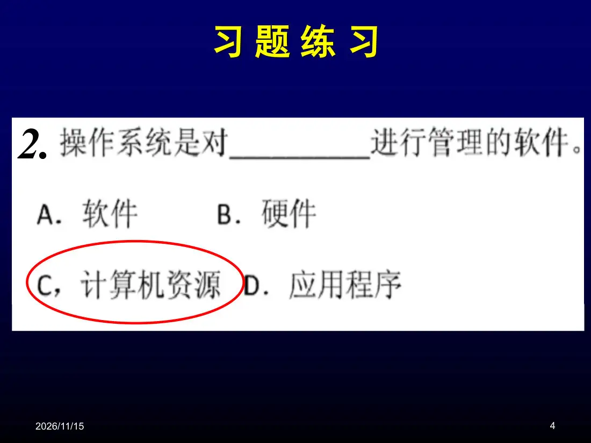

原文：

习 题 练 习

2. 操作系统是对 进行管理的软件。A. 软件 B. 硬件

C，计算机资源 D. 应用程序

2026/11/15

4

### 习 题 练 习

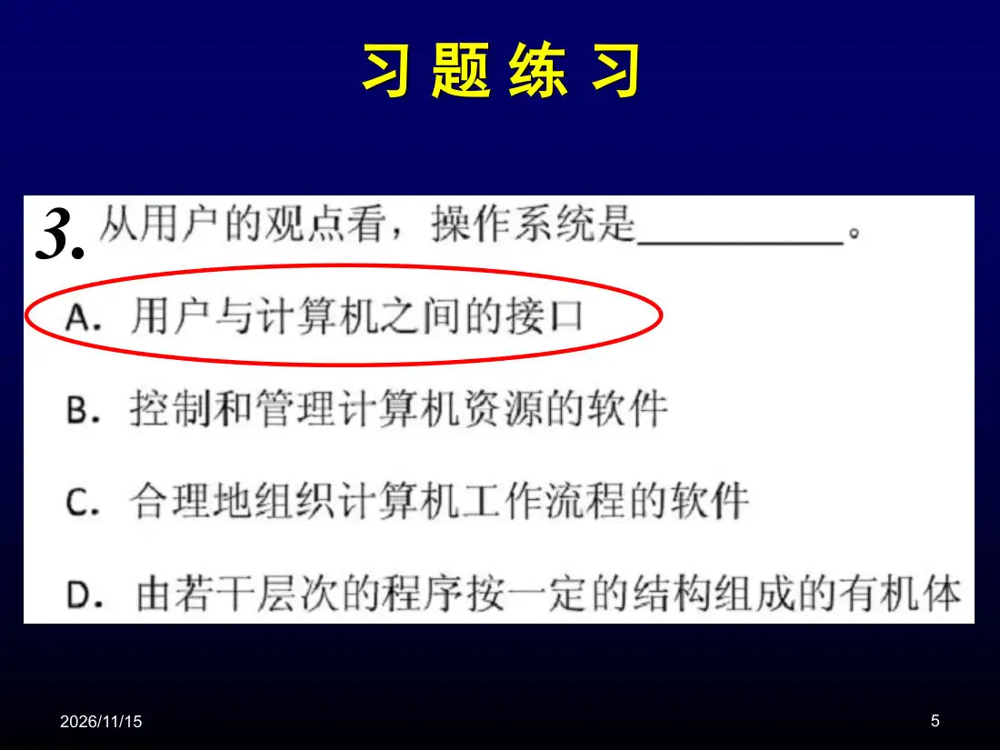

原文：

习 题 练 习

3.从用户的观点看，操作系统是A. 用户与计算机之间的接口B. 控制和管理计算机资源的软件C. 合理地组织计算机工作流程的软件D. 由若干层次的程序按一定的结构组成的有机体

2026/11/15

5

### 习 题 练 习

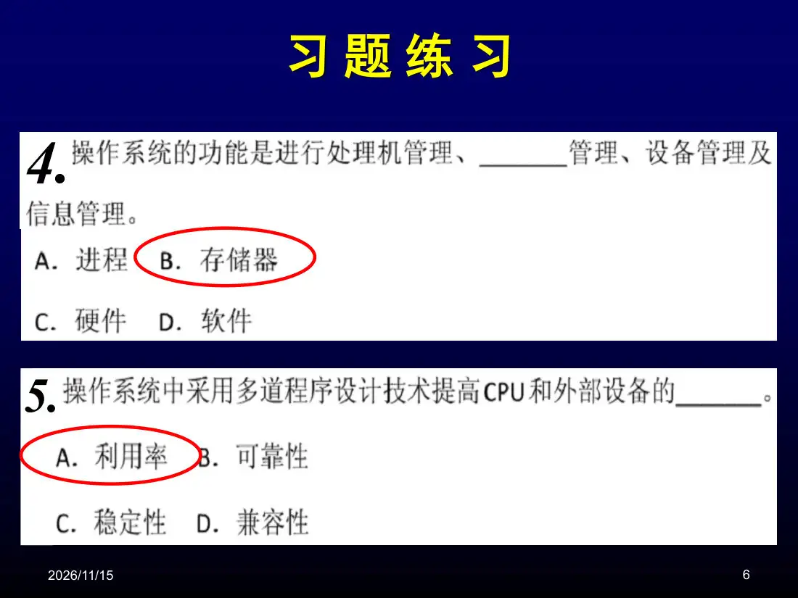

原文：

习 题 练 习

操作系统的功能是进行处理机管理、 管理、设备管理及信息管理。A. 进程B. 存储器C. 硬件 D. 软件

5操作系统中采用多道程序设计技术提高CPU和外部设备的A. 利用率 B. 可靠性C. 稳定性 D. 兼容性

2026/11/15

6

### 1.1 操作系统概念 6、操作系统的特性?

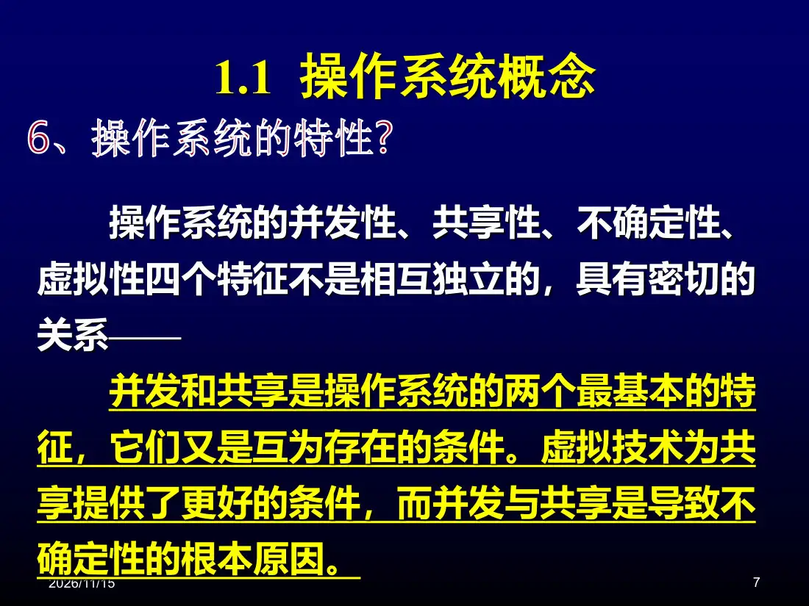

原文：

1.1 操作系统概念 6、操作系统的特性?

操作系统的并发性、共享性、不确定性、虚拟性四个特征不是相互独立的，具有密切的关系—

并发和共享是操作系统的两个最基本的特征，它们又是互为存在的条件。虚拟技术为共享提供了更好的条件，而并发与共享是导致不确定性的根本原因。

2026/11/15

7

### 3.1 中央处理器

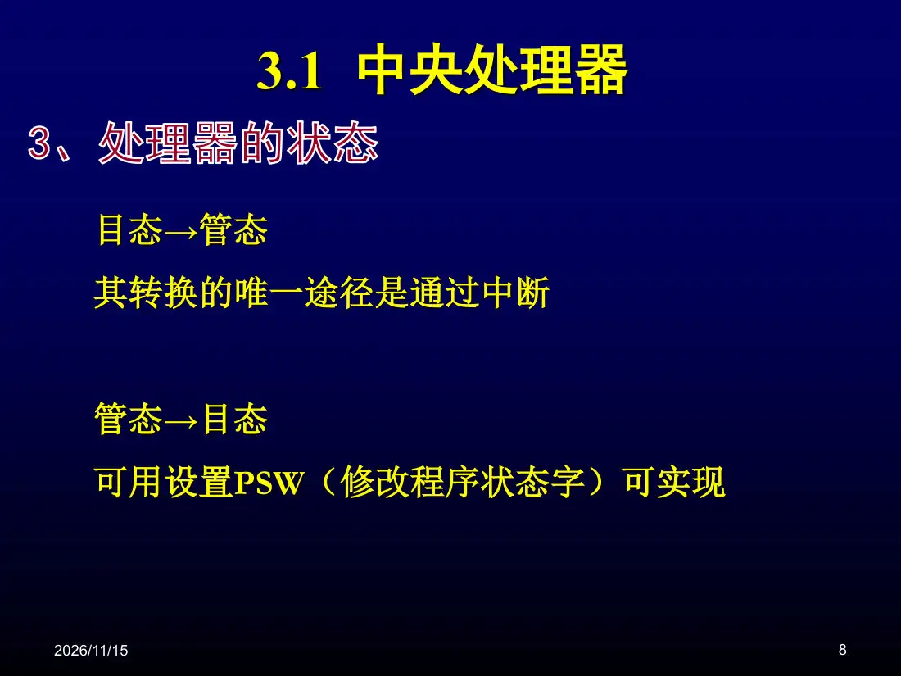

原文：

3.1 中央处理器

3、处理器的状态

目态→管态

其转换的唯一途径是通过中断

管态→目态

可用设置PSW（修改程序状态字）可实现

2026/11/15

8

### 3.1 中央处理器

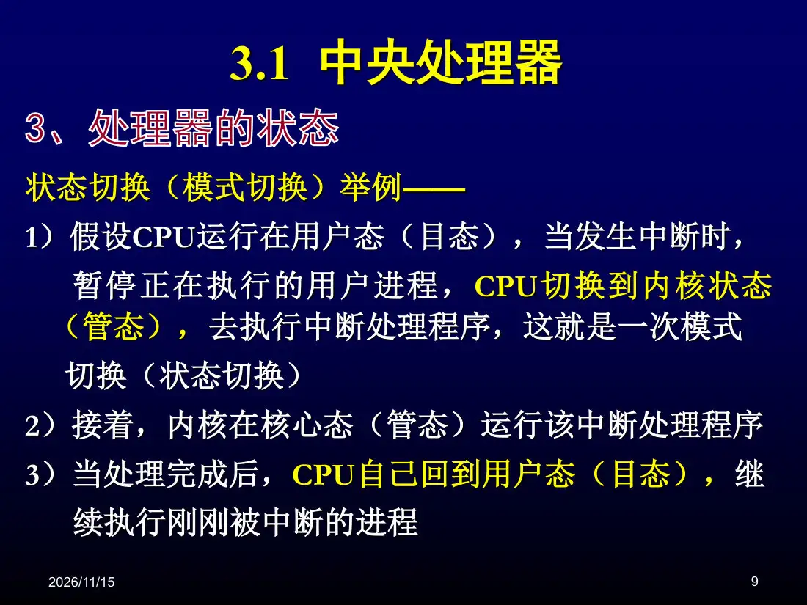

原文：

3.1 中央处理器

3、处理器的状态

状态切换（模式切换）举例—

1）假设CPU运行在用户态（目态），当发生中断时，暂停正在执行的用户进程，CPU切换到内核状态（管态），去执行中断处理程序，这就是一次模式切换（状态切换）

2）接着，内核在核心态（管态）运行该中断处理程序

3）当处理完成后，CPU自己回到用户态（目态），继续执行刚刚被中断的进程

2026/11/15

9

### 3.2 中断

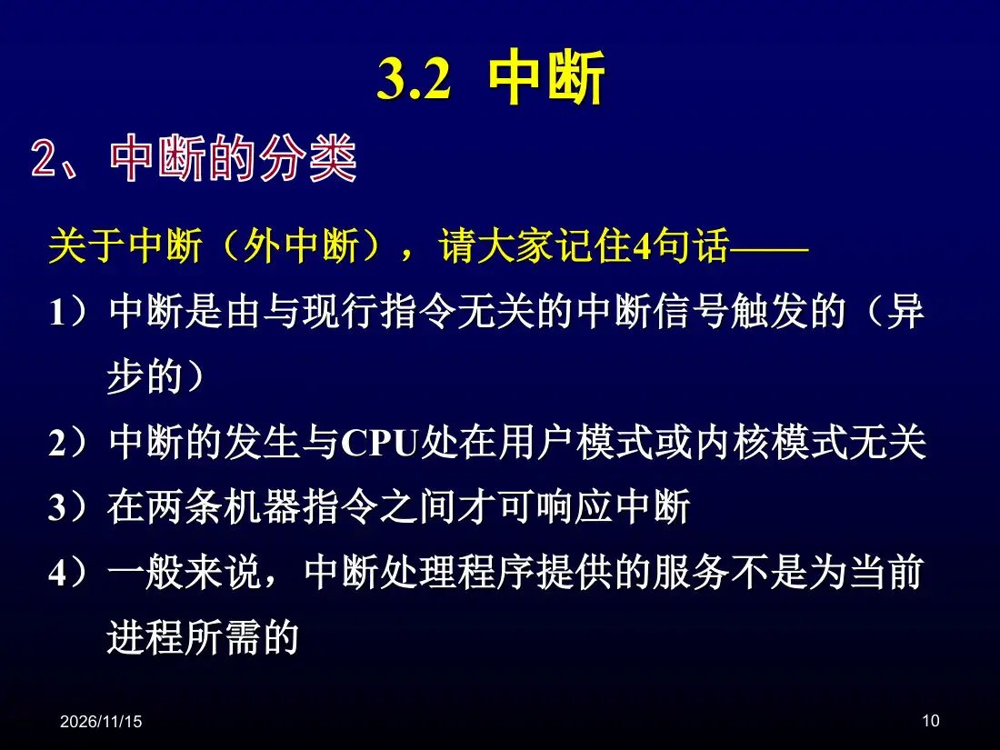

原文：

3.2 中断

2、中断的分类

关于中断（外中断），请大家记住4句话——

1）中断是由与现行指令无关的中断信号触发的（异步的）

2）中断的发生与CPU处在用户模式或内核模式无关

3）在两条机器指令之间才可响应中断

4）一般来说，中断处理程序提供的服务不是为当前进程所需的

2026/11/15

10

### 文件() 选项(@) 查看() 关机() 帮助(H)

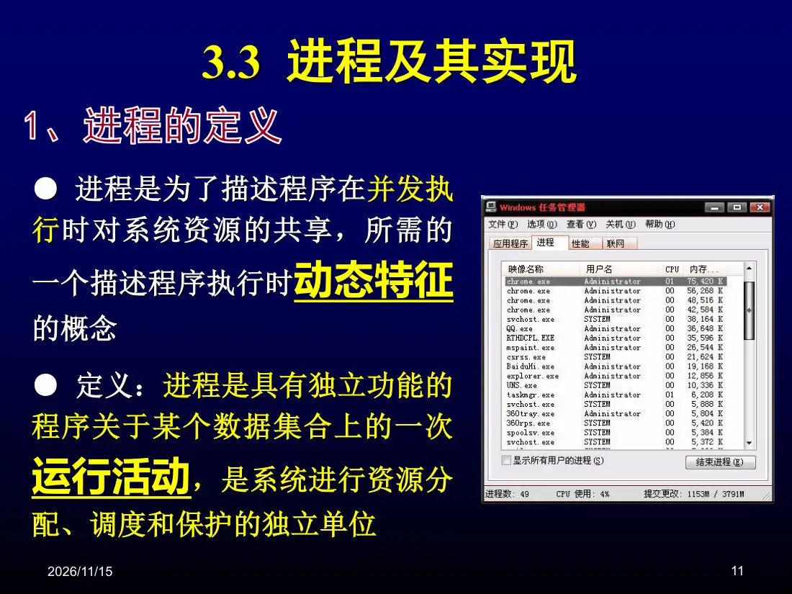

原文：

进程是为了描述程序在并发执行时对系统资源的共享，所需的一个描述程序执行时动态特征的概念

定义：进程是具有独立功能的程序关于某个数据集合上的一次运行活动，是系统进行资源分配、调度和保护的独立单位

文件() 选项(@) 查看() 关机() 帮助(H)

应用程序 进程性能联网

<table><tr><td>映像名称</td><td>用户名</td><td>CPU</td><td>内存...</td></tr><tr><td>chrome.exe</td><td>Administrator</td><td>01</td><td>75,420 K</td></tr><tr><td>chrome.exe</td><td>Administrator</td><td>00</td><td>56,268 K</td></tr><tr><td>chrome.exe</td><td>Administrator</td><td>00</td><td>48,516 K</td></tr><tr><td>chrome.exe</td><td>Administrator</td><td>00</td><td>42,584 K</td></tr><tr><td>svchost.exe</td><td>SYSTEM</td><td>00</td><td>38,164 K</td></tr><tr><td>QQ.exe</td><td>Administrator</td><td>00</td><td>36,648 K</td></tr><tr><td>RTHDCPL.EXE</td><td>Administrator</td><td>00</td><td>35,596 K</td></tr><tr><td>mspaint.exe</td><td>Administrator</td><td>00</td><td>26,544 K</td></tr><tr><td>csrss.exe</td><td>SYSTEM</td><td>00</td><td>21,624 K</td></tr><tr><td>BaiduHi.exe</td><td>Administrator</td><td>00</td><td>19,168 K</td></tr><tr><td>explorer.exe</td><td>Administrator</td><td>00</td><td>12,856 K</td></tr><tr><td>UNS.exe</td><td>SYSTEM</td><td>00</td><td>10,336 K</td></tr><tr><td>taskmgr.exe</td><td>Administrator</td><td>01</td><td>6,208 K</td></tr><tr><td>svchost.exe</td><td>SYSTEM</td><td>00</td><td>5,888 K</td></tr><tr><td>360tray.exe</td><td>Administrator</td><td>00</td><td>5,804 K</td></tr><tr><td>360rps.exe</td><td>SYSTEM</td><td>00</td><td>5,420 K</td></tr><tr><td>spoolsv.exe</td><td>SYSTEM</td><td>00</td><td>5,384 K</td></tr><tr><td>svchost.exe</td><td>SYSTEM</td><td>00</td><td>5,372 K</td></tr></table>

显示所有用户的进程（）

结束进程(E)

进程数：49CPU 使用：4%

提交更改: 1153M / 3791M

Ox

3.3 进程及其实现

1、进程的定义

Windows 任务管理器

2026/11/15

11

### 3.3 进程及其实现

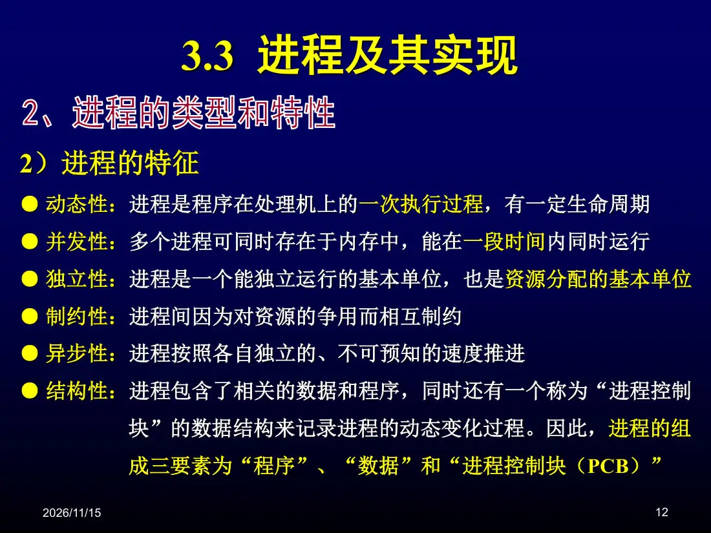

原文：

3.3 进程及其实现

2、进程的类型和特性

2）进程的特征

● 动态性：进程是程序在处理机上的一次执行过程，有一定生命周期

● 并发性：多个进程可同时存在于内存中，能在一段时间内同时运行

● 独立性：进程是一个能独立运行的基本单位，也是资源分配的基本单位

● 制约性：进程间因为对资源的争用而相互制约

● 异步性：进程按照各自独立的、不可预知的速度推进

● 结构性：进程包含了相关的数据和程序，同时还有一个称为“进程控制块”的数据结构来记录进程的动态变化过程。因此，进程的组成三要素为“程序”、“数据”和“进程控制块（PCB）

2026/11/15

12

### 3.3 进程及其实现

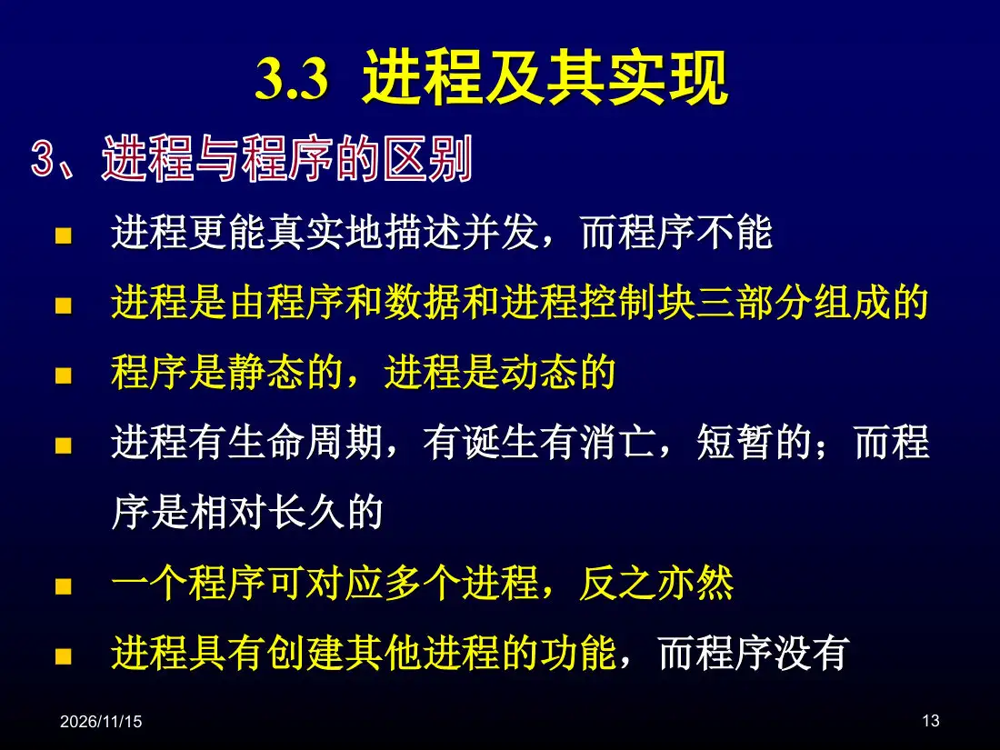

原文：

3.3 进程及其实现

3、进程与程序的区别

◼ 进程更能真实地描述并发，而程序不能

◼ 进程是由程序和数据和进程控制块三部分组成的

◼ 程序是静态的，进程是动态的

进程有生命周期，有诞生有消亡，短暂的；而程序是相对长久的

◼ 一个程序可对应多个进程，反之亦然

◼ 进程具有创建其他进程的功能，而程序没有

2026/11/15

13

### 3.3 进程及其实现

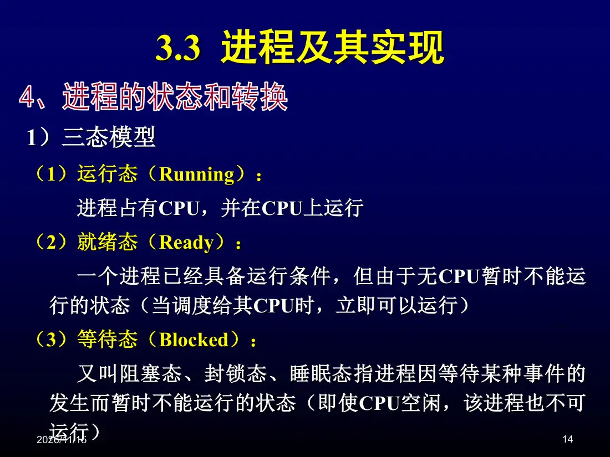

原文：

3.3 进程及其实现

4、进程的状态和转换

1）三态模型

（1）运行态（Running）：进程占有CPU，并在CPU上运行

（2）就绪态（Ready）：

一个进程已经具备运行条件，但由于无CPU暂时不能运行的状态（当调度给其CPU时，立即可以运行）

（3）等待态（Blocked）：

又叫阻塞态、封锁态、睡眠态指进程因等待某种事件的发生而暂时不能运行的状态（即使CPU空闲，该进程也不可2026/11/15运行） 14

### 3.3 进程及其实现

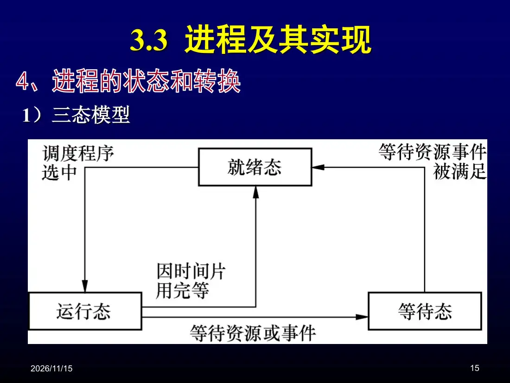

原文：

3.3 进程及其实现

4、进程的状态和转换

1）三态模型

2026/11/15

15

### 3.3 进程及其实现

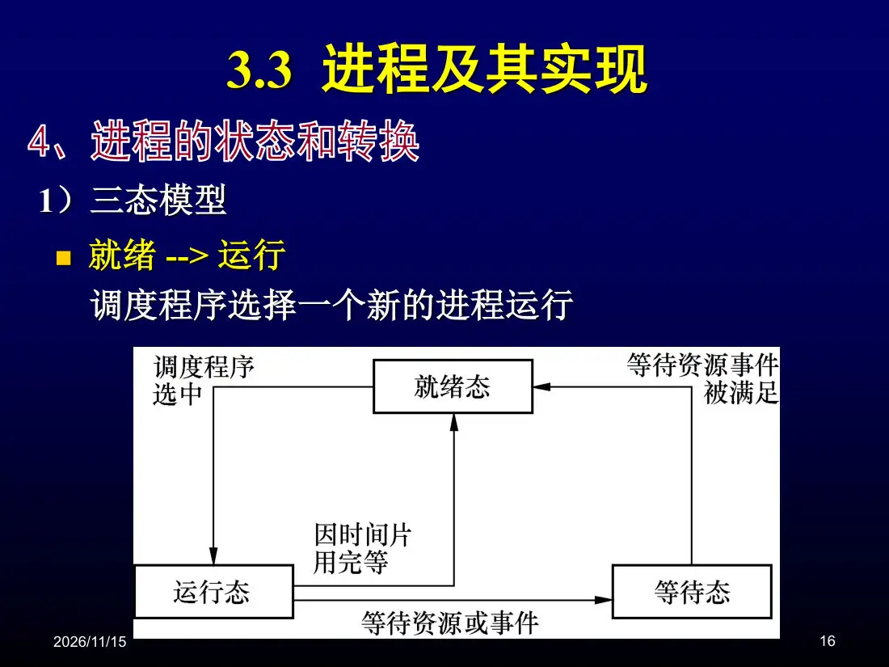

原文：

3.3 进程及其实现

4、进程的状态和转换

1）三态模型

就绪 --> 运行调度程序选择一个新的进程运行

2026/11/15

16

### 3.3 进程及其实现

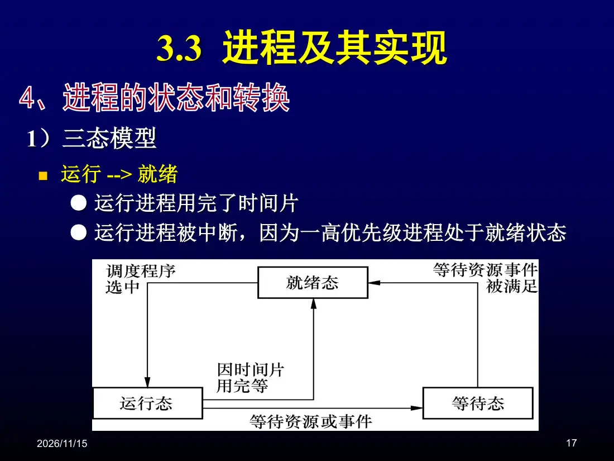

原文：

3.3 进程及其实现

4、进程的状态和转换

1）三态模型

◼ 运行 --> 就绪

● 运行进程用完了时间片

● 运行进程被中断，因为一高优先级进程处于就绪状态

2026/11/15

17

### 3.3 进程及其实现

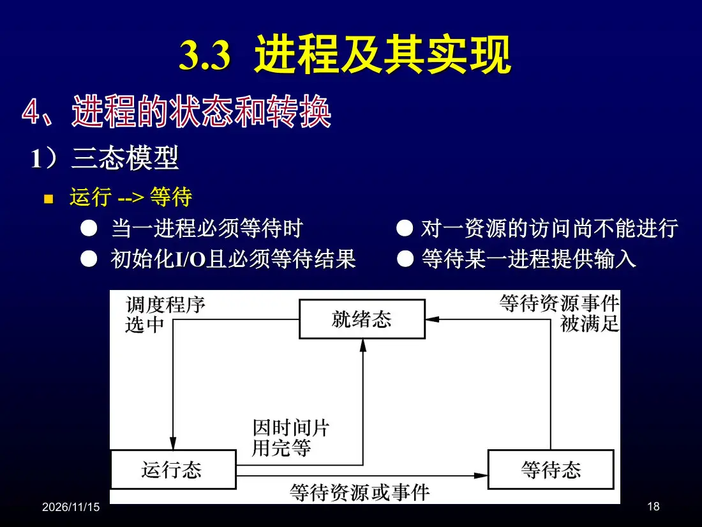

原文：

3.3 进程及其实现

4、进程的状态和转换

1）三态模型

◼ 运行 --> 等待

● 当一进程必须等待时

● 初始化I/O且必须等待结果

● 对一资源的访问尚不能进行

● 等待某一进程提供输入

2026/11/15

18

### 3.3 进程及其实现

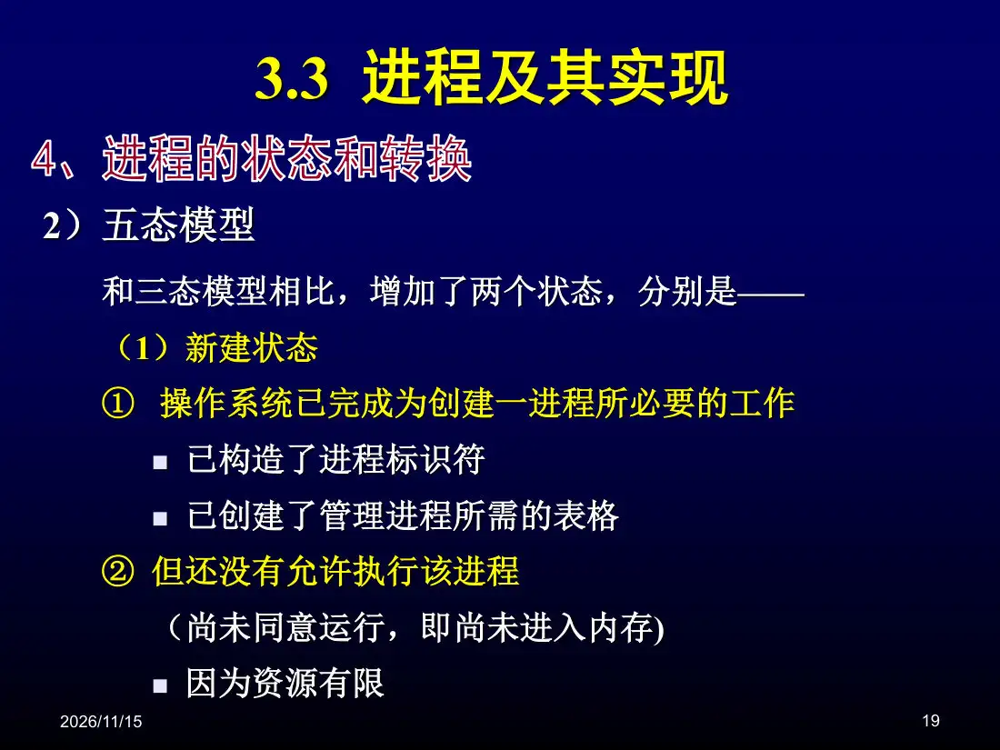

原文：

3.3 进程及其实现

4、进程的状态和转换

2）五态模型

和三态模型相比，增加了两个状态，分别是——

（1）新建状态

① 操作系统已完成为创建一进程所必要的工作

◼ 已构造了进程标识符

◼ 已创建了管理进程所需的表格

② 但还没有允许执行该进程

（尚未同意运行，即尚未进入内存)

◼ 因为资源有限

2026/11/15

19

### 3.3 进程及其实现

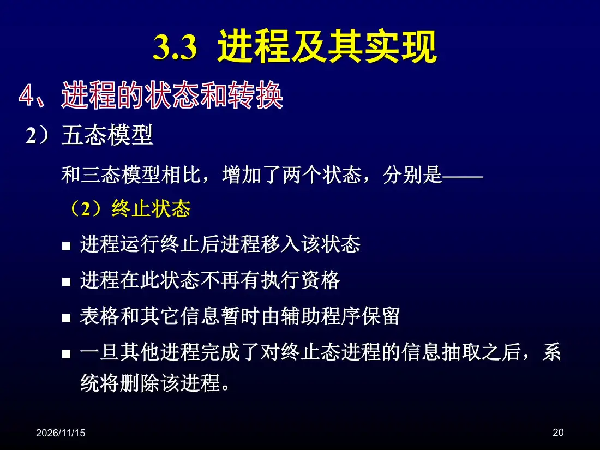

原文：

3.3 进程及其实现

4、进程的状态和转换

2）五态模型

和三态模型相比，增加了两个状态，分别是—

（2）终止状态

◼ 进程运行终止后进程移入该状态

◼ 进程在此状态不再有执行资格

◼ 表格和其它信息暂时由辅助程序保留

一旦其他进程完成了对终止态进程的信息抽取之后，系统将删除该进程。

2026/11/15

20

### 3.3 进程及其实现

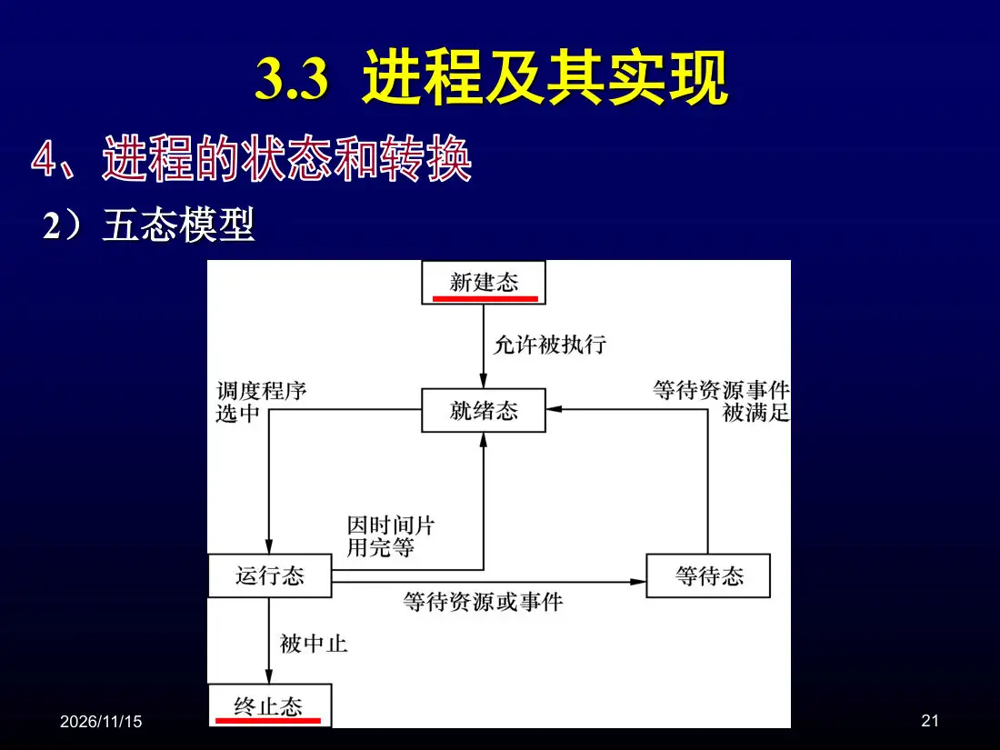

原文：

3.3 进程及其实现

4、进程的状态和转换

2）五态模型

2026/11/15

21

### 3.3 进程及其实现

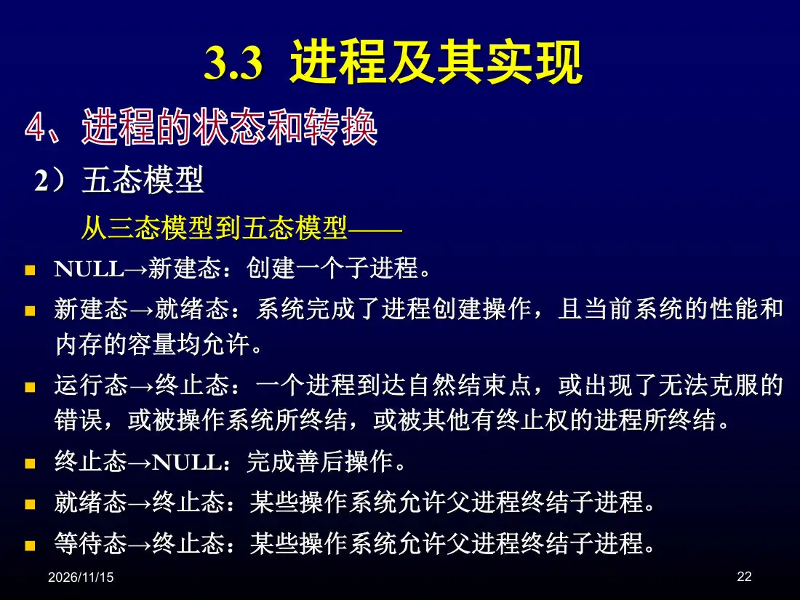

原文：

3.3 进程及其实现

4、进程的状态和转换

2）五态模型

从三态模型到五态模型

◼ NULL→新建态：创建一个子进程。

新建态→就绪态：系统完成了进程创建操作，且当前系统的性能和内存的容量均允许。

运行态→终止态：一个进程到达自然结束点，或出现了无法克服的错误，或被操作系统所终结，或被其他有终止权的进程所终结。

◼ 终止态→NULL：完成善后操作。

◼ 就绪态→终止态：某些操作系统允许父进程终结子进程。

◼ 等待态→终止态：某些操作系统允许父进程终结子进程。

2026/11/15

22

### 3.3 进程及其实现

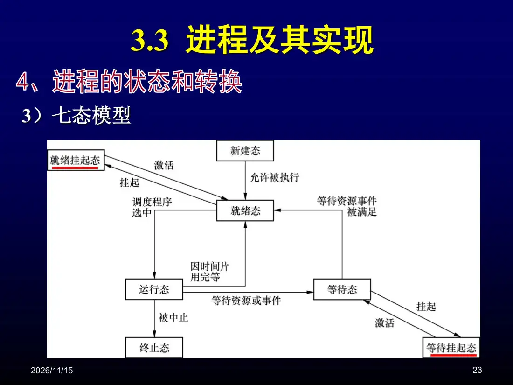

原文：

3.3 进程及其实现

4、进程的状态和转换

3）七态模型

2026/11/15

23

### 3.3 进程及其实现

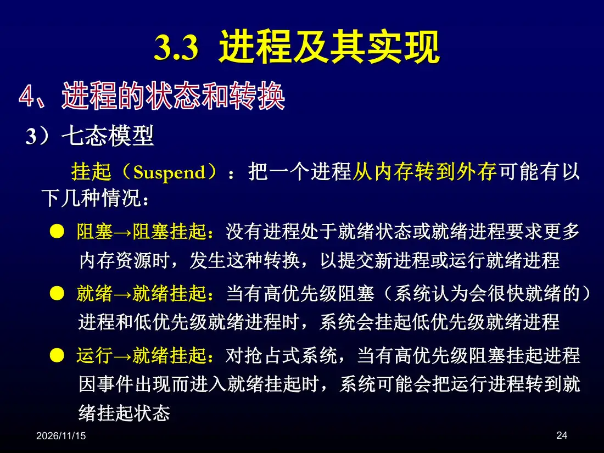

原文：

3.3 进程及其实现

4、进程的状态和转换

3）七态模型

挂起（Suspend）：把一个进程从内存转到外存可能有以下几种情况：

阻塞→阻塞挂起：没有进程处于就绪状态或就绪进程要求更多内存资源时，发生这种转换，以提交新进程或运行就绪进程

就绪→就绪挂起：当有高优先级阻塞（系统认为会很快就绪的）进程和低优先级就绪进程时，系统会挂起低优先级就绪进程

运行→就绪挂起：对抢占式系统，当有高优先级阻塞挂起进程因事件出现而进入就绪挂起时，系统可能会把运行进程转到就绪挂起状态

2026/11/15

24

### 3.3 进程及其实现

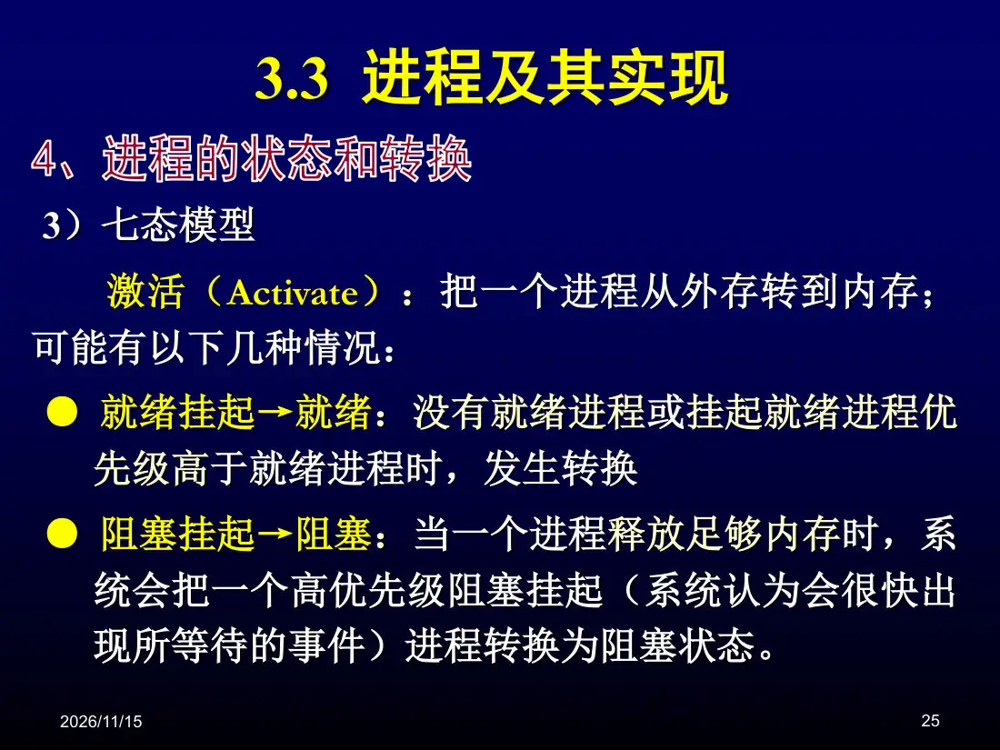

原文：

3.3 进程及其实现

4、进程的状态和转换

3）七态模型

激活（Activate）：把一个进程从外存转到内存；可能有以下几种情况：

就绪挂起→就绪：没有就绪进程或挂起就绪进程优先级高于就绪进程时，发生转换

阻塞挂起→阻塞：当一个进程释放足够内存时，系统会把一个高优先级阻塞挂起（系统认为会很快出现所等待的事件）进程转换为阻塞状态。

2026/11/15

25

### 3.3 进程及其实现

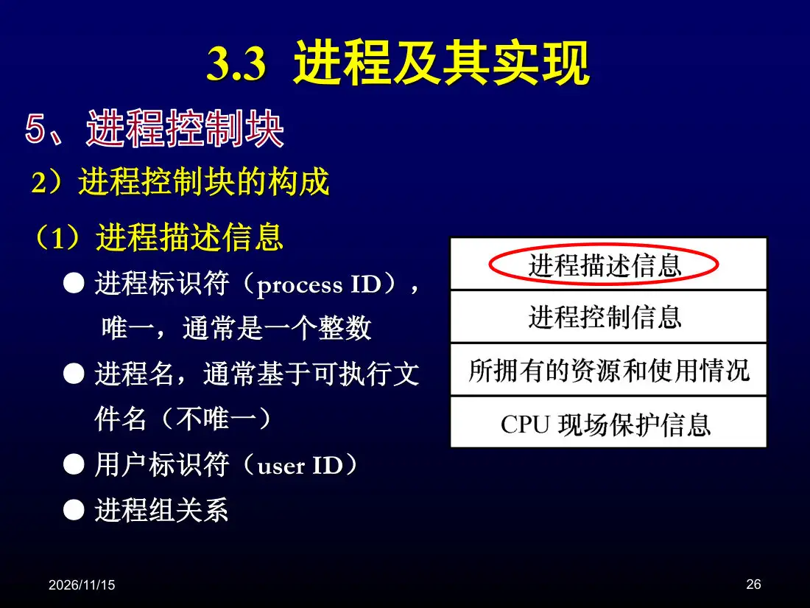

原文：

3.3 进程及其实现

5、进程控制块

2）进程控制块的构成

（1）进程描述信息

● 进程标识符（process ID），唯一，通常是一个整数

进程名，通常基于可执行文件名（不唯一）

● 用户标识符（user ID）

● 进程组关系

进程描述信息

进程控制信息

所拥有的资源和使用情况

CPU现场保护信息

2026/11/15

26

### 3.3 进程及其实现

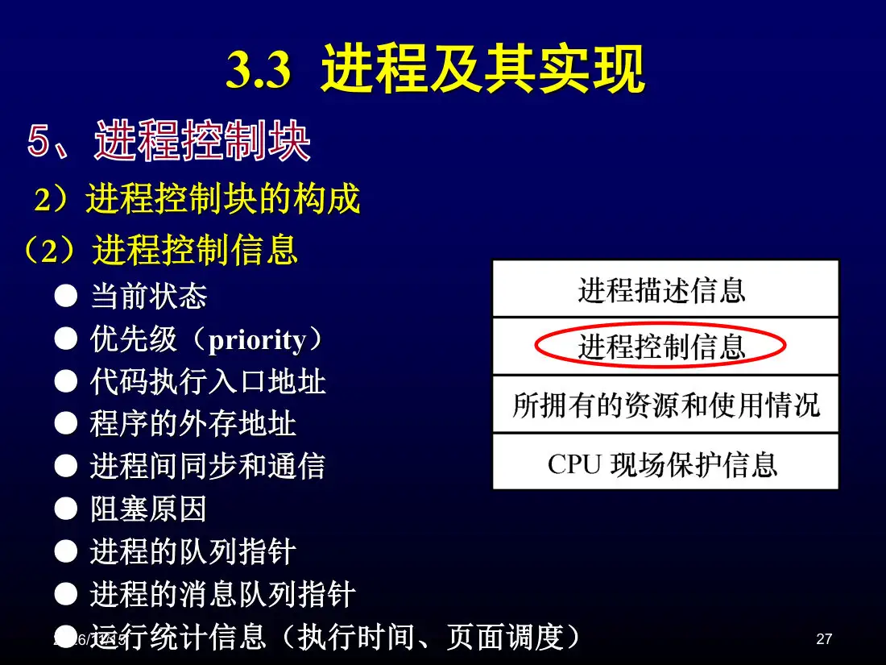

原文：

3.3 进程及其实现

5、进程控制块

2）进程控制块的构成

（2）进程控制信息

● 当前状态

● 优先级（priority）

● 代码执行入口地址

程序的外存地址

● 进程间同步和通信

阻塞原因

进程的队列指针

进程的消息队列指针

2026/11/15 ● 运行统计信息（执行时间、页面调度）

进程描述信息

进程控制信息

所拥有的资源和使用情况

CPU现场保护信息

27

### 3.3 进程及其实现

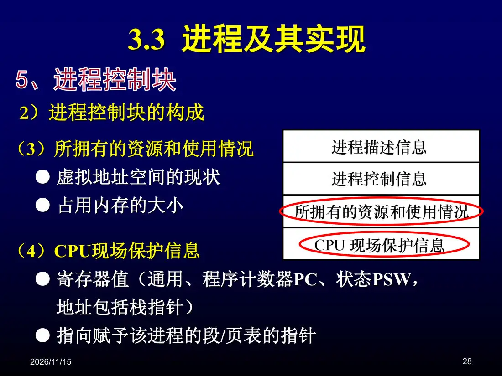

原文：

3.3 进程及其实现

5、进程控制块

2）进程控制块的构成

（3）所拥有的资源和使用情况

● 虚拟地址空间的现状

● 占用内存的大小

（4）CPU现场保护信息

进程描述信息

进程控制信息

所拥有的资源和使用情况

CPU现场保护信息

● 寄存器值（通用、程序计数器PC、状态PSW，地址包括栈指针）

● 指向赋予该进程的段/页表的指针

2026/11/15

28

### 4.1 并发进程

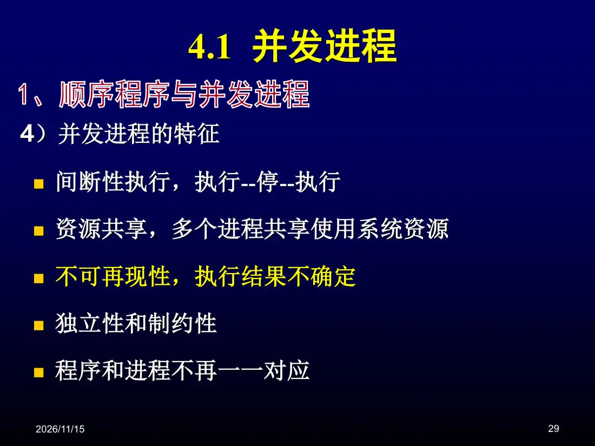

原文：

4.1 并发进程

、顺序程序与并发进程

4）并发进程的特征

◼ 间断性执行，执行--停--执行

◼ 资源共享，多个进程共享使用系统资源

◼ 不可再现性，执行结果不确定

◼ 独立性和制约性

◼ 程序和进程不再一一对应

2026/11/15

29

### 4.1 并发进程

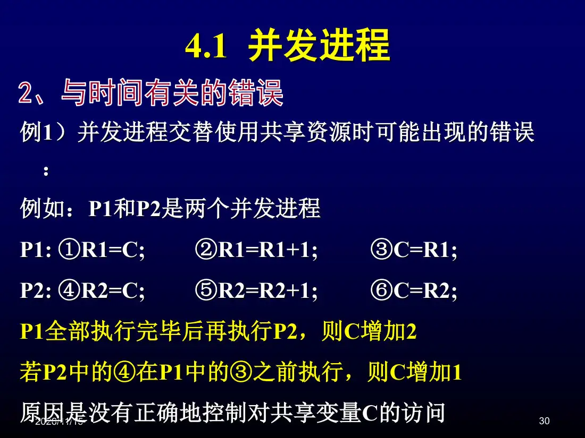

原文：

4.1 并发进程

2、与时间有关的错误

例1）并发进程交替使用共享资源时可能出现的错误

例如：P1和P2是两个并发进程

P1: ①R1=C;

P2: ④R2=C;

②R1=R1+1;

⑤R2=R2+1;

③C=R1;

$$
⑥ \mathrm{C} = \mathrm{R2};
$$

P1全部执行完毕后再执行P2，则C增加2

若P2中的④在P1中的③之前执行，则C增加1

原因是没有正确地控制对共享变量C的访问

30

### 4.1 并发进程

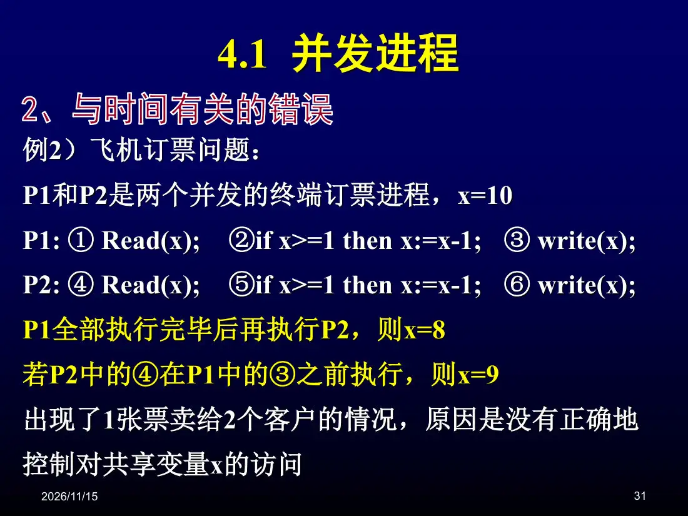

原文：

4.1 并发进程

2、与时间有关的错误例2）飞机订票问题：P1和P2是两个并发的终端订票进程，x=10P1: ① Read(x); ②if x>=1 then x:=x-1; ③ write(x);P2: ④ Read(x); ⑤if x>=1 then x:=x-1; ⑥ write(x);P1全部执行完毕后再执行P2，则x=8若P2中的④在P1中的③之前执行，则x=9出现了1张票卖给2个客户的情况，原因是没有正确地控制对共享变量x的访问

2026/11/15

31

### 4.2 临界区管理

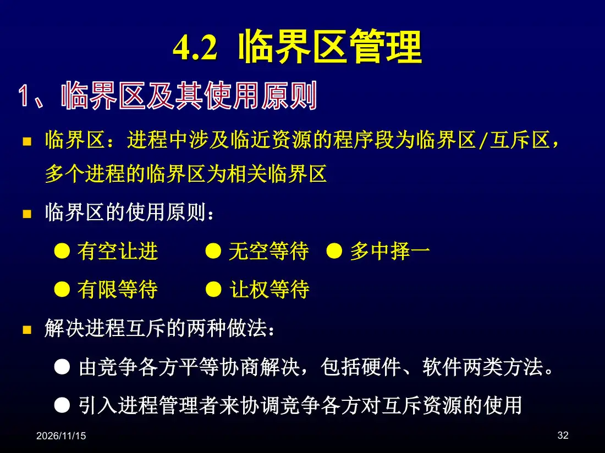

原文：

4.2 临界区管理

1、临界区及其使用原则

临界区：进程中涉及临近资源的程序段为临界区/互斥区，多个进程的临界区为相关临界区

◼ 临界区的使用原则：

● 有空让进 ● 无空等待 ● 多中择一

有限等待

● 让权等待

◼ 解决进程互斥的两种做法：

● 由竞争各方平等协商解决，包括硬件、软件两类方法。

● 引入进程管理者来协调竞争各方对互斥资源的使用

2026/11/15

32

### 4.2 临界区管理

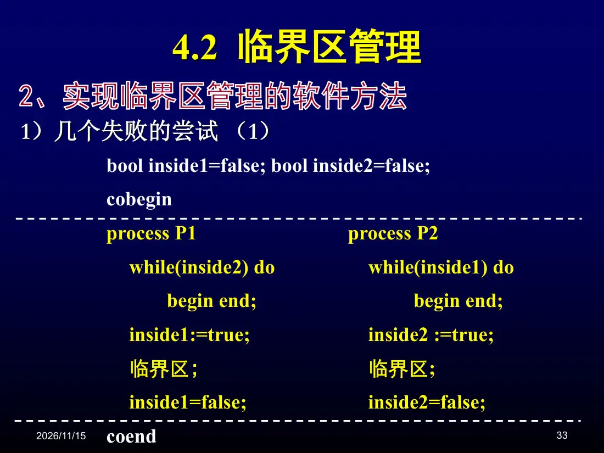

原文：

4.2 临界区管理

2、实现临界区管理的软件方法

1）几个失败的尝试 （1）

bool inside1=false; bool inside2=false;

cobegin

process P1

process P2

while(inside2) do

while(inside1) do

begin end;

begin end;

inside1:=true;

inside2 :=true;

临界区；

临界区;

inside1=false;

inside2=false;

2026/11/15 coend

33

### 4.2 临界区管理

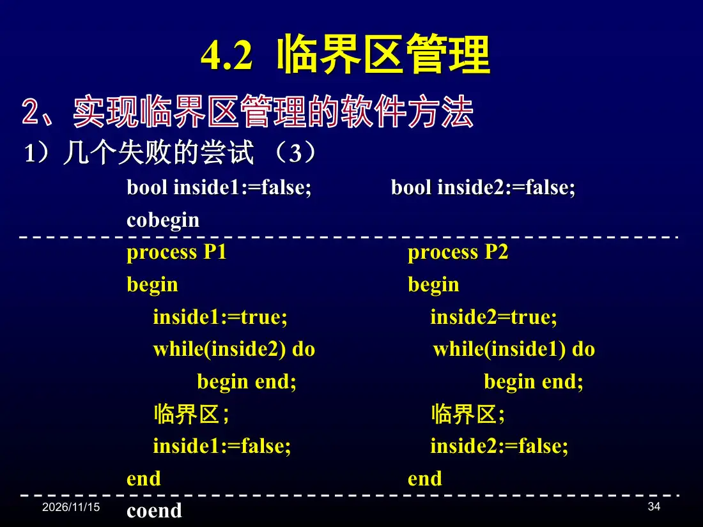

原文：

4.2 临界区管理

2、实现临界区管理的软件方法

1）几个失败的尝试 （3）

bool inside1:=false;

bool inside2:=false;

cobegin

process P1

process P2

begin

begin

inside1:=true;

while(inside2) do

begin end;

inside2=true;

while(inside1) do

临界区；

begin end;

inside1:=false;

临界区;

inside2:=false;

end

end

2026/11/15

coend

34

### 4.3 信号量与P、V操作

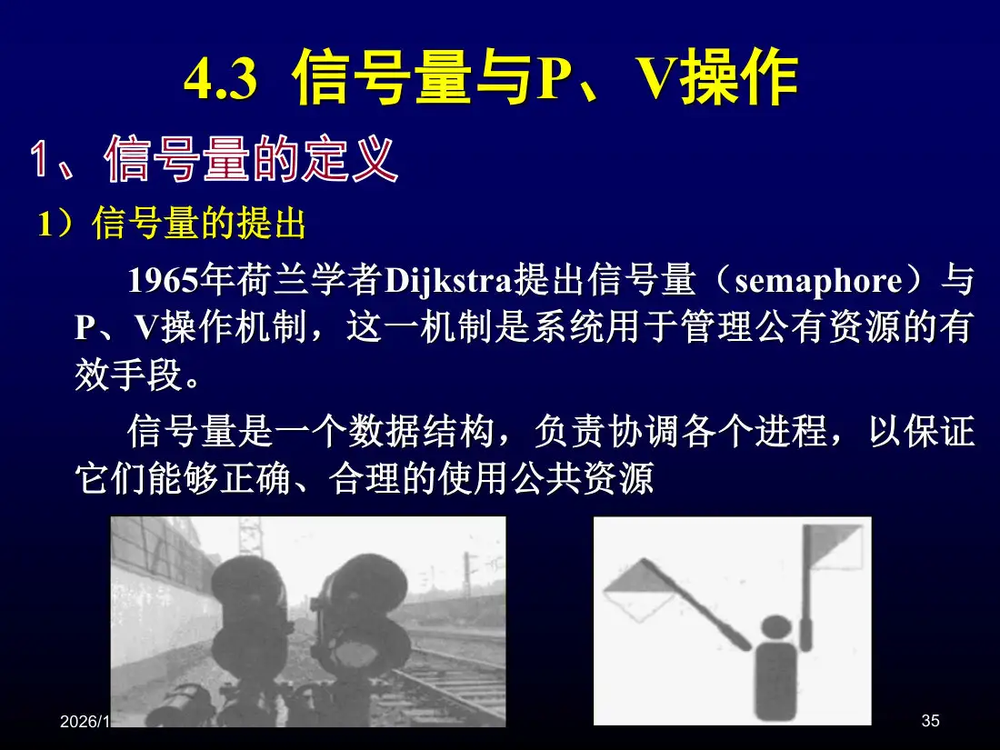

原文：

4.3 信号量与P、V操作

1、信号量的定义

1）信号量的提出

1965年荷兰学者Dijkstra提出信号量（semaphore）与P、V操作机制，这一机制是系统用于管理公有资源的有效手段。

信号量是一个数据结构，负责协调各个进程，以保证它们能够正确、合理的使用公共资源

2026/1

35

### 4.3 信号量与P、V操作

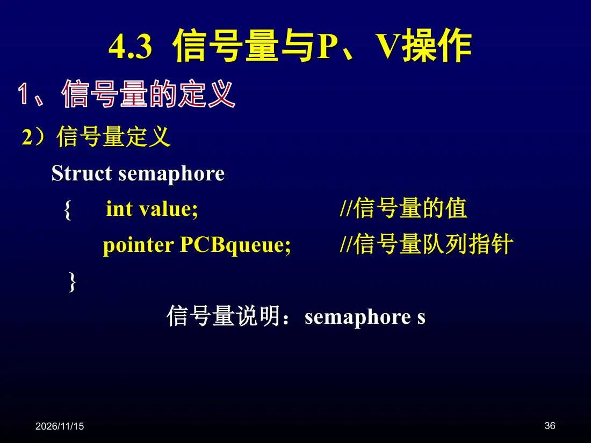

原文：

4.3 信号量与P、V操作

1、信号量的定义

2）信号量定义

Struct semaphore

{ int value;

pointer PCBqueue;

//信号量的值

//信号量队列指针

信号量说明：semaphore s

2026/11/15

36

### 4.3 信号量与P、V操作

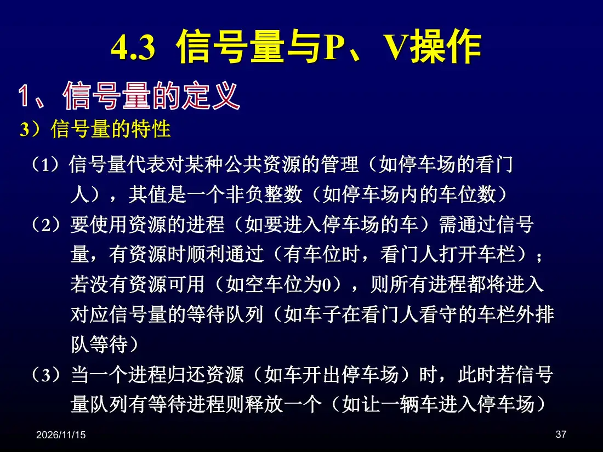

原文：

4.3 信号量与P、V操作

1、信号量的定义

3）信号量的特性

（1）信号量代表对某种公共资源的管理（如停车场的看门人），其值是一个非负整数（如停车场内的车位数）

（2）要使用资源的进程（如要进入停车场的车）需通过信号量，有资源时顺利通过（有车位时，看门人打开车栏）若没有资源可用（如空车位为0），则所有进程都将进入对应信号量的等待队列（如车子在看门人看守的车栏外排队等待）

（3）当一个进程归还资源（如车开出停车场）时，此时若信号量队列有等待进程则释放一个（如让一辆车进入停车场）

2026/11/15

37

### 4.3 信号量与P、V操作

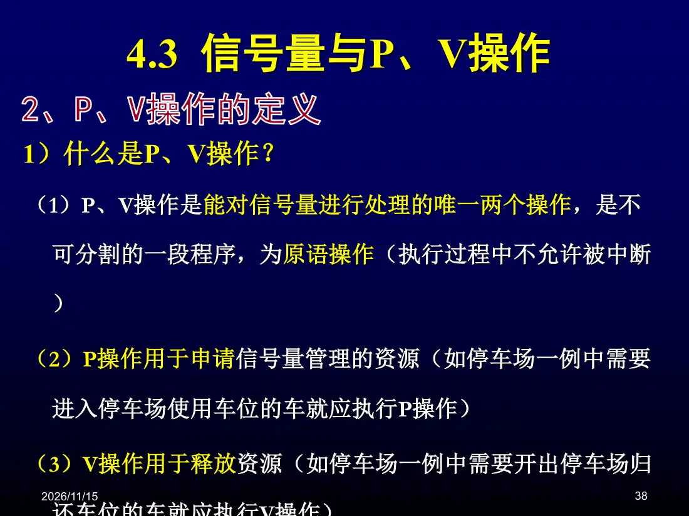

原文：

4.3 信号量与P、V操作

2、P、V操作的定义

1）什么是P、V操作？

（1）P、V操作是能对信号量进行处理的唯一两个操作，是不可分割的一段程序，为原语操作（执行过程中不允许被中断

（2）P操作用于申请信号量管理的资源（如停车场一例中需要进入停车场使用车位的车就应执行P操作）

（3）V操作用于释放资源（如停车场一例中需要开出停车场归

2026/11/15还车位的车就应执行V操作）

38

### 4.3 信号量与P、V操作2、P、V操作的定义

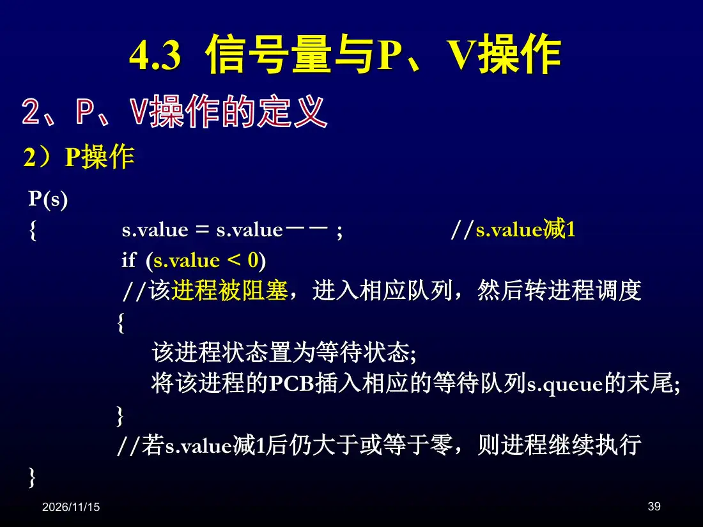

原文：

4.3 信号量与P、V操作2、P、V操作的定义

2）P操作

s.value = s.value－－ ;

//s.value减1

if (s.value < 0)

//该进程被阻塞，进入相应队列，然后转进程调度

该进程状态置为等待状态;将该进程的PCB插入相应的等待队列s.queue的末尾;

//若s.value减1后仍大于或等于零，则进程继续执行

2026/11/15

39

### 4.3 信号量与P、V操作2、P、V操作的定义

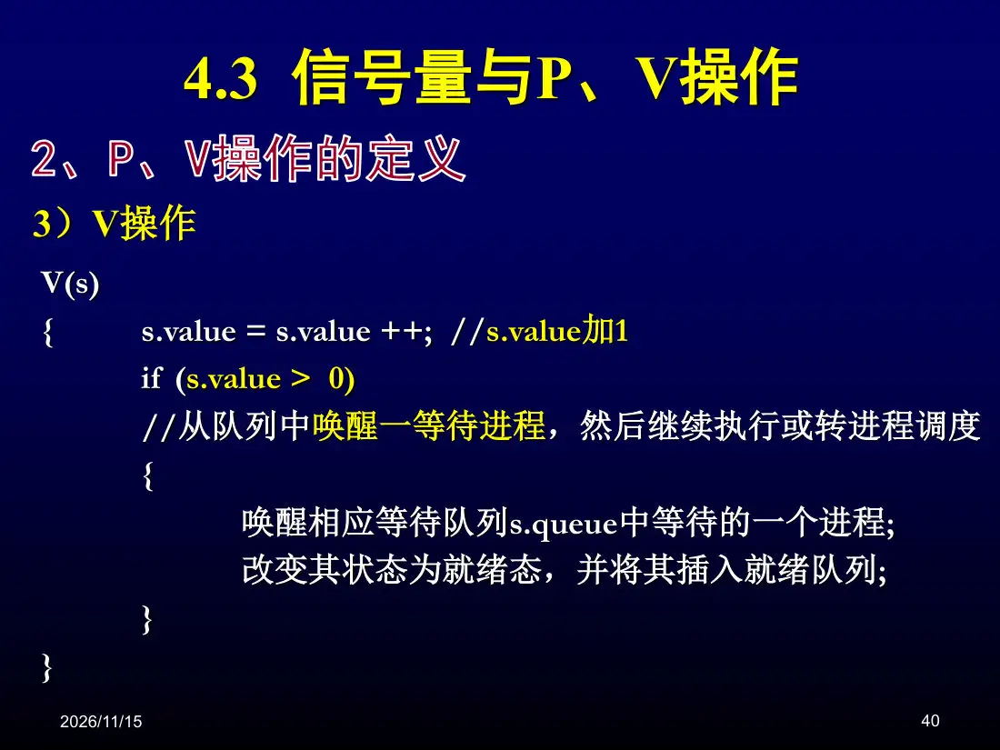

原文：

4.3 信号量与P、V操作2、P、V操作的定义

3）V操作

V(s)

s.value = s.value ++; //s.value加1

if (s.value > 0)

//从队列中唤醒一等待进程，然后继续执行或转进程调度

唤醒相应等待队列s.queue中等待的一个进程;

改变其状态为就绪态，并将其插入就绪队列;

2026/11/15

40

### 4.3 信号量与P、V操作

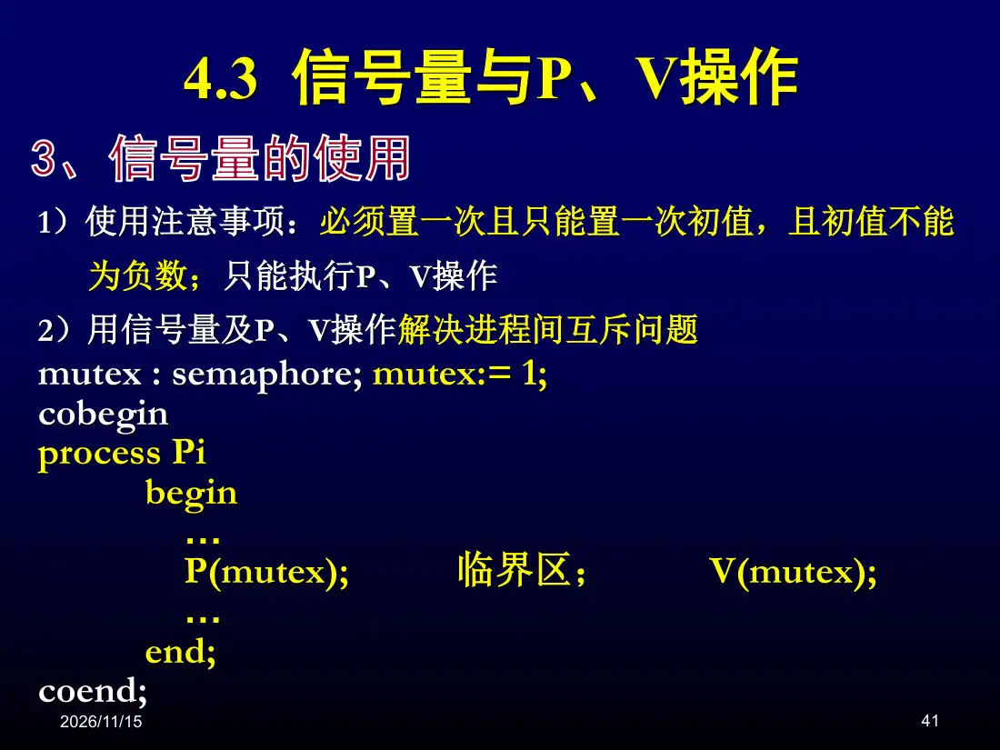

原文：

4.3 信号量与P、V操作

3、信号量的使用

1）使用注意事项：必须置一次且只能置一次初值，且初值不能为负数；只能执行P、V操作

2）用信号量及P、V操作解决进程间互斥问题 mutex : semaphore; mutex:= 1; cobegin process Pi begin

P(mutex);

临界区；

V(mutex);

end;

coend; 2026/11/15

41

### 4.3 信号量与P、V操作

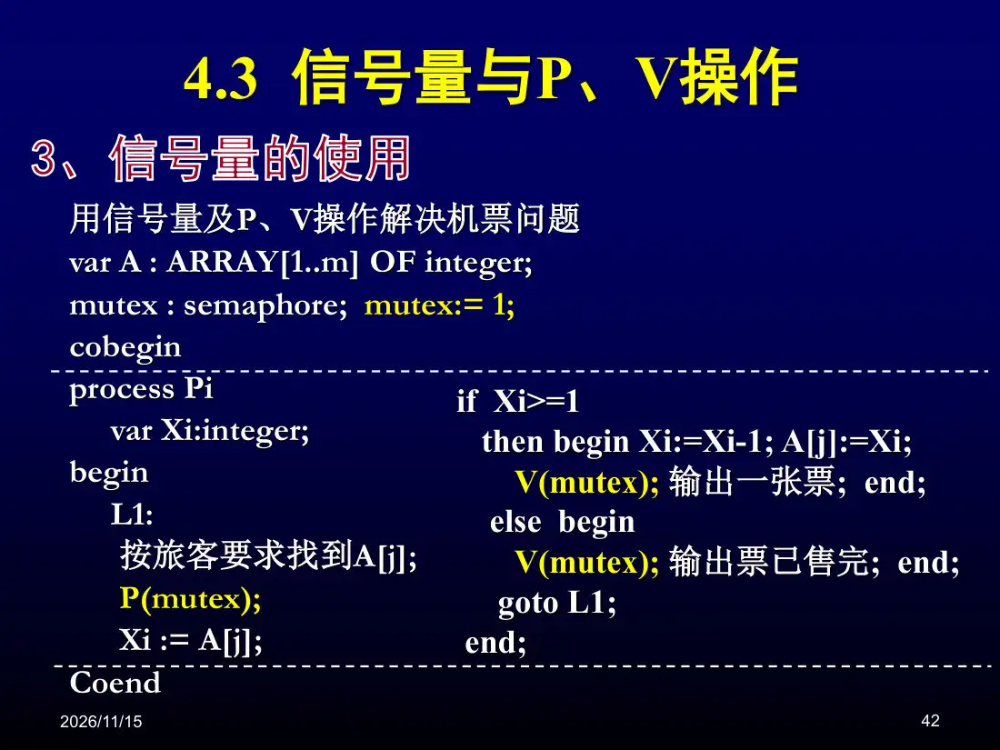

原文：

4.3 信号量与P、V操作

3、信号量的使用

用信号量及P、V操作解决机票问题

var A : ARRAY[1..m] OF integer;

mutex : semaphore; mutex:= 1;

cobegin

process Pi

var Xi:integer;

begin

L1:

按旅客要求找到A[j];

P(mutex);

Xi := A[j];

if Xi>=1

then begin Xi:=Xi-1; A[j]:=Xi;

V(mutex); 输出一张票; end;

else begin

V(mutex); 输出票已售完; end;

goto L1;

end;

Coend

2026/11/15

42

### 4.3 信号量与P、V操作

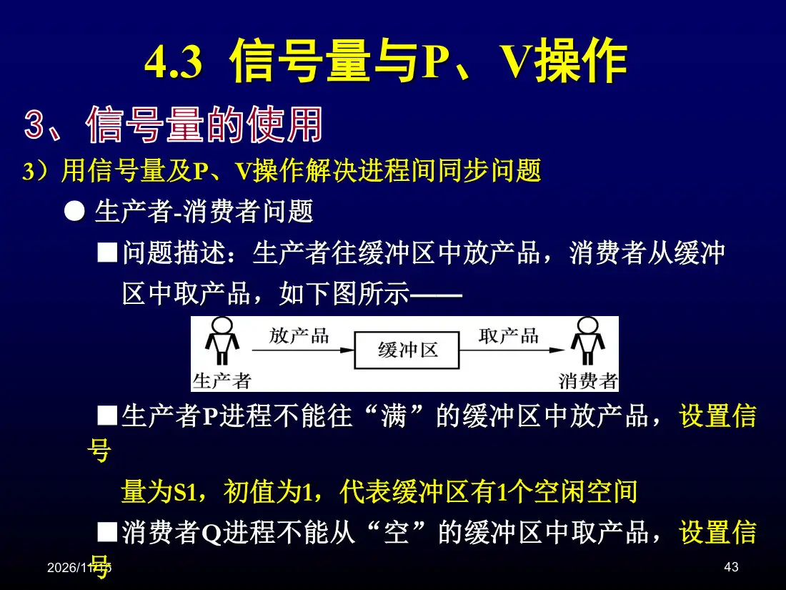

原文：

4.3 信号量与P、V操作

3、信号量的使用

3）用信号量及P、V操作解决进程间同步问题

● 生产者-消费者问题

■问题描述：生产者往缓冲区中放产品，消费者从缓冲区中取产品，如下图所示—

■生产者P进程不能往“满”的缓冲区中放产品，设置信号

量为S1，初值为1，代表缓冲区有1个空闲空间

■消费者Q进程不能从“空”的缓冲区中取产品，设置信

2026/11/15 号

43

### 4.3 信号量与P、V操作

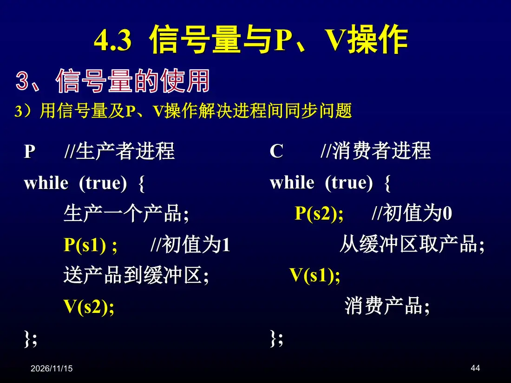

原文：

4.3 信号量与P、V操作

3、信号量的使用

3）用信号量及P、V操作解决进程间同步问题

P //生产者进程

while (true) {

生产一个产品;

P(s1) ; //初值为1

送产品到缓冲区;

V(s2);

C //消费者进程

while (true) {

P(s2); //初值为0

从缓冲区取产品;

V(s1);

消费产品;

2026/11/15

44

### 4.3 信号量与P、V操作

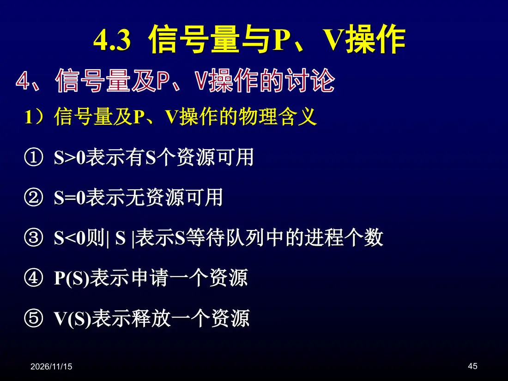

原文：

4.3 信号量与P、V操作

4、信号量及P、V操作的讨论

1）信号量及P、V操作的物理含义

① S>0表示有S个资源可用

② S=0表示无资源可用

③ S<0则| S |表示S等待队列中的进程个数

④ P(S)表示申请一个资源

⑤ V(S)表示释放一个资源

2026/11/15

45

### 4.3 信号量与P、V操作

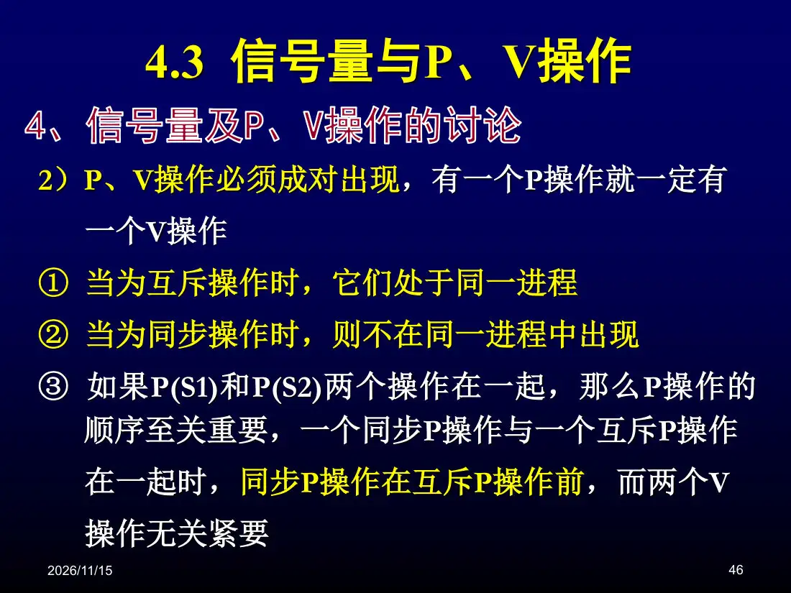

原文：

4.3 信号量与P、V操作

4、信号量及P、V操作的讨论

2）P、V操作必须成对出现，有一个P操作就一定有一个V操作

① 当为互斥操作时，它们处于同一进程

② 当为同步操作时，则不在同一进程中出现

如果P(S1)和P(S2)两个操作在一起，那么P操作的顺序至关重要，一个同步P操作与一个互斥P操作在一起时，同步P操作在互斥P操作前，而两个V操作无关紧要

2026/11/15

46

### 4、信号量及P、V操作的讨论

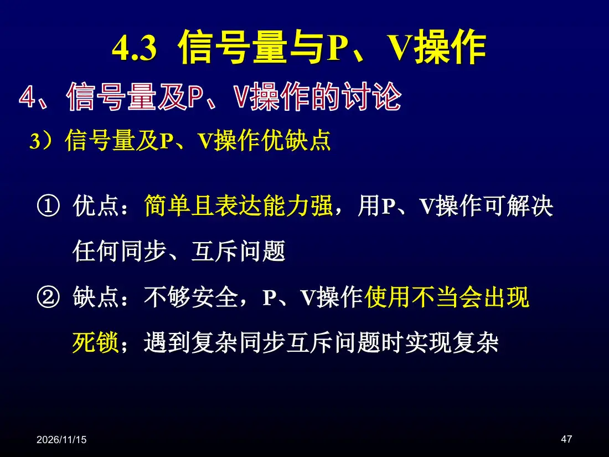

原文：

4、信号量及P、V操作的讨论

3）信号量及P、V操作优缺点

① 优点：简单且表达能力强，用P、V操作可解决任何同步、互斥问题

② 缺点：不够安全，P、V操作使用不当会出现

死锁；遇到复杂同步互斥问题时实现复杂

2026/11/15

47

### 4.3 信号量与P、V操作5、P、V操作经典问题

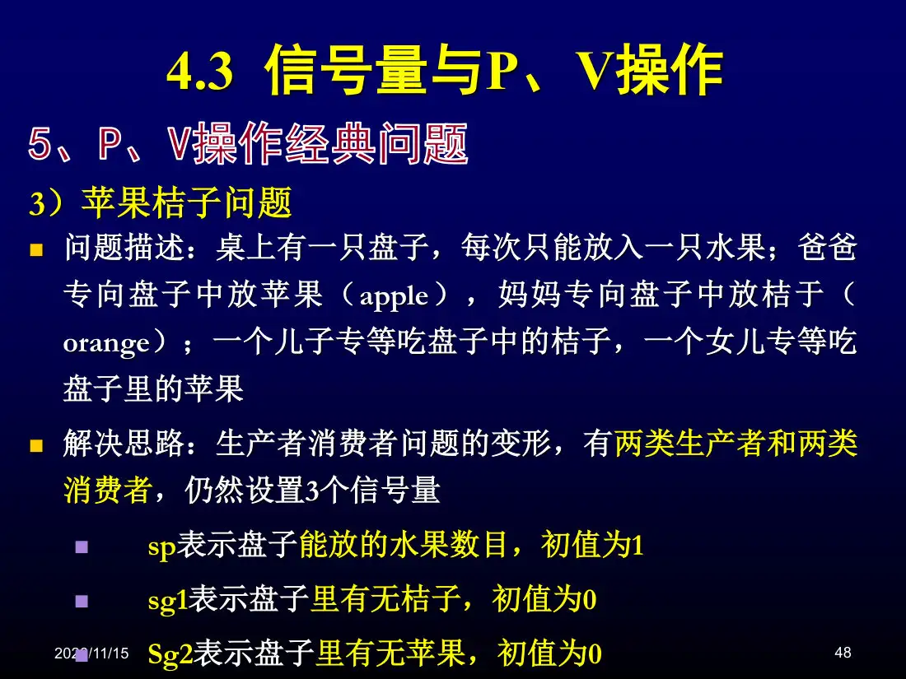

原文：

4.3 信号量与P、V操作5、P、V操作经典问题

3）苹果桔子问题

问题描述：桌上有一只盘子，每次只能放入一只水果；爸爸专向盘子中放苹果（apple），妈妈专向盘子中放桔于（orange）；一个儿子专等吃盘子中的桔子，一个女儿专等吃盘子里的苹果

解决思路：生产者消费者问题的变形，有两类生产者和两类消费者，仍然设置3个信号量

sp表示盘子能放的水果数目，初值为1

sg1表示盘子里有无桔子，初值为0

2026/11/15 ◼ Sg2表示盘子里有无苹果，初值为0sp, sg1, sg2: semaphore; sp := 1; sg1, := 0; sg2 := 0;cobegin

48

### process father

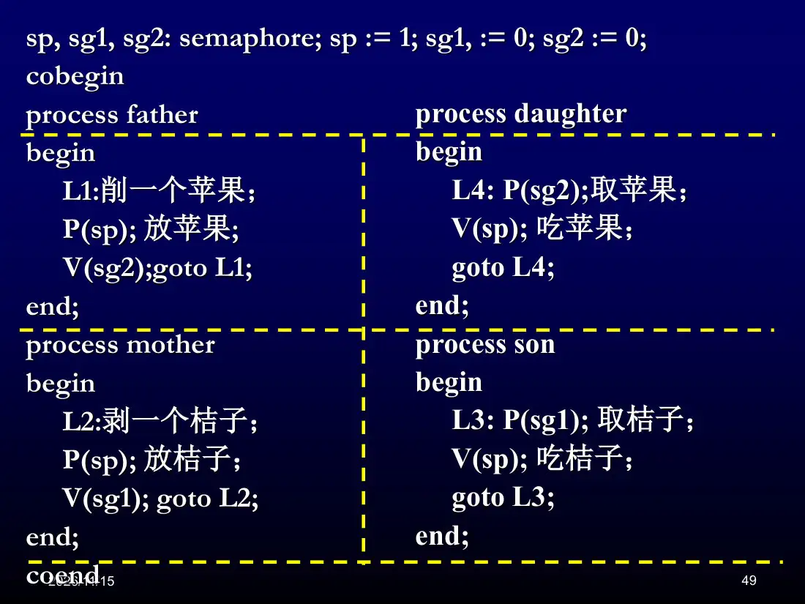

原文：

process father

begin

L1:削一个苹果；P(sp); 放苹果;V(sg2);goto L1;

end;

process mother

begin

L2:剥一个桔子；

P(sp); 放桔子；

V(sg1); goto L2;

end;

process daughter

begin

L4: P(sg2);取苹果；

V(sp); 吃苹果；

goto L4;

end;

process son

begin

L3: P(sg1); 取桔子；

V(sp); 吃桔子；

goto L3;

end;

2026/11/15 coend

49

### 习 题 练 习

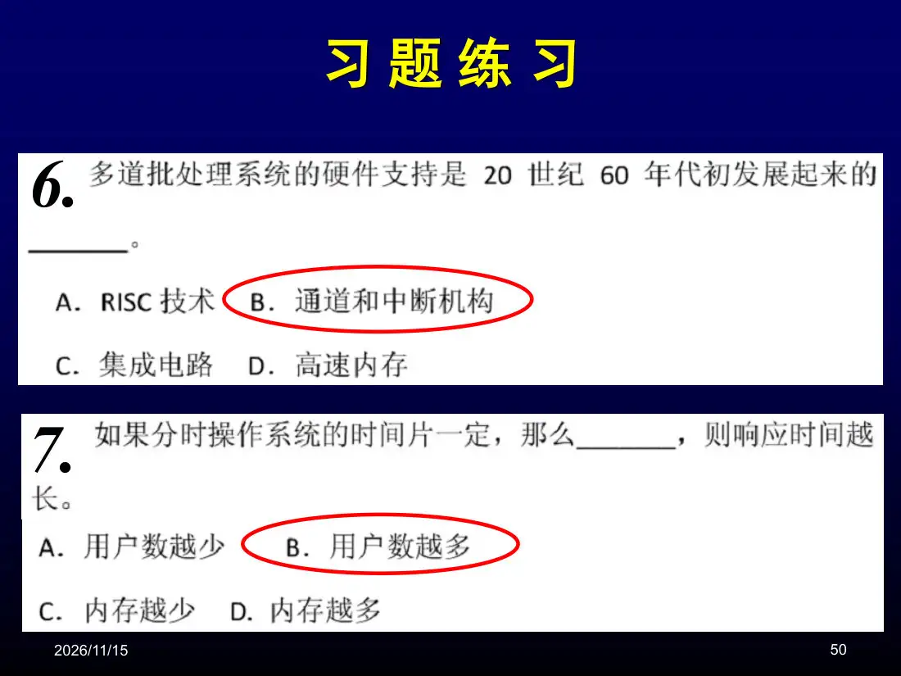

原文：

习 题 练 习

多道批处理系统的硬件支持是20世纪60年代初发展起来的0A. RISC 技术 B. 通道和中断机构C. 集成电路 D. 高速内存

7. 如果分时操作系统的时间片一定，那么，则响应时间越A. 用户数越少 B. 用户数越多C. 内存越少 D. 内存越多

2026/11/15

50

### 习 题 练 习

原文：

习 题 练 习

8.\_操作系统允许用户把若干个作业提交给计算机系统。A. 单用户 B，分布式C. 批处理 D. 监督

不属于操作系统所管理的资源。A. 程序 B. 内存 C.CPU D. 中断

### 小练习

原文：

小练习

11. 假设下述四个作业同时到达，当使用最高优先数优先调度算法时，作业的平均周转时间为 小时。

作业 所需运行时间 优先数1 2 42 5 93 8 14 3 8

A. 4.5 B. 10.5 C. 4.75D. 10.25

2026/11/15

52

### 小练习

原文：

小练习

12. 下述作业调度算法中， 调度算法与作业的估计运行时间有关。A. 先来先服务 B. 短作业优先C. 均衡 D. 时间片轮转

7.既考虑作业等待时间，又考虑作业执行时间的调度算法是A. 响应比高者优先 B. 短作业优先C. 优先级调度 D. 先来先服务

### 小练习

原文：

小练习

4. 一个作业可以分成若干顺序处理的加工步骤，每个加工步骤称为一个

16. 下面对进程的描述中，错误的是A. 进程是动态的概念 B. 进程执行需要处理机C. 进程是有生命期的 D. 进程是指令的集合

2026/11/15

54

### 小练习

原文：

小练习

11. 设有一组作业，它们的提交时间及运行时间如下：

作业号 提交时间 运行时间(分钟)

在单道方式下，采用短作业优先调度算法，作业的执行顺序是

### 小练习

原文：

小练习

1. 是作业存在的惟一标志。A. 作业名 B. 进程控制块C作业控制块 D. 程序名

7.既考虑作业等待时间，又考虑作业执行时间的调度算法是A. 响应比高者优先 B. 短作业优先C. 优先级调度 D. 先来先服务

### 小练习

原文：

小练习

8. 作业调度程序从处于 状态的队列中选取适当的作业投入运行。A. 运行 B. 提交 C. 完成 D. 后备

9. 是指从作业提交给系统到作业完成的时间间隔。A. 周转时间  B. 响应时间C. 等待时间 D. 运行时间

2026/11/15

57

### 小练习

原文：

小练习

11. 假设下述四个作业同时到达，当使用最高优先数优先调度算法时，作业的平均周转时间为 小时。

作业 所需运行时间 优先数1 2 42 5 93 8 14 3 8

A. 4.5 B. 10.5 C. 4.75D. 10.25

2026/11/15

58

### 小练习

原文：

小练习

2. 分配到必要的资源并获得处理机时的状态是A. 就绪状态 B. 执行状态C. 阻塞状态 D. 撒消状态

9. 下列的进程状态变化中， 变化是不可能发生的，A. 运行→就绪 B. 运行→等待C. 等待→运行 D. 等待→就绪

2026/11/15

59

### 小练习

原文：

小练习

10.一个运行的进程用完了分配给它的时间片后，它的状态变为A. 就绪 B. 等待C. 运行 D. 由用户自己确定

27. 一个进程被唤醒意味着A. 该进程重新占有了 CPU B. 它的优先权变为最大C. 其 PCB 移至等待队列队首D. 进程变为就绪状态

2026/11/15

60

### 4.5 死锁

原文：

4.5 死锁

4、死锁的检测与解除

2）死锁的检测

检测思路：检测“进程-资源分配图”是否可完全简化（能经过一系列简化使所有进程成为孤立结点，则该图是可完全简化的；否则则称该图是不可完全简化的）

◼ 检测步骤：

①在图中找一个只有分配边的非孤立进程结点，去掉分配边，将其变为孤立结点；若找不到则转③

②将相应的资源分配给一个等待该资源的进程，即将某进程的申请边变为分配边，转①

③此时若图中有进程不是孤立结点，则此图不可完全简化，满足死锁的充分条件，系统为死锁状态（死锁定理）

2026/11/15

61

### 4.5 死锁

原文：

4.5 死锁

4、死锁的检测与解除

2）死锁的检测

找不到只有分配边的非孤立进程结点，2026/11/15 不可完全简化，死锁

可完全简化，无死锁

62

### 4.5 死锁

原文：

4.5 死锁

4、死锁的检测与解除

3）死锁的解除——以最小的代价恢复系统的运行

资源剥夺法：当发现死锁后，从其他进程那里剥夺足够数量的资源给死锁进程，以解除死锁状态

撤消进程法：

撤消全部死锁进程，使系统恢复到正常状态。最简单但代价太大

按照某种顺序逐个撤消死锁进程，直到有足够的资源供其他未被撤消的进程使用，消除死锁状态为止

2026/11/15

63

### 4.5 死锁

原文：

4.5 死锁

4、死锁的检测与解除

3）死锁的解除——以最小的代价恢复系统的运行

单独使用处理死锁的某种方法（预防、避免、检测与解除）并不能全面解决操作系统中遇到的所有死锁问题。

妥善的解决办法是将系统中的资源按层次分为若干类，对每一类资源使用最适合它的办法解决死锁问题。

2026/11/15

64

### 5.3 页式存储管理

原文：

5.3 页式存储管理

8、多级页表

1）为什么要引入多级页表在现代操作系统中，页表会占用相当大的存储空间

例如，对于具有32位逻辑地址空间的页式管理系统，规定每个页面大小4KB，即212B。那么，4GB（232）的虚地址空间有1M个页组成，若以每个页表项占用4个字节计算，则需要占用4MB连续内存空间存放页表，这还只是一个进程的地址空间，系统中有许多进程，这样做存储开销太大。

2026/11/15

65

### 2026/11/15

原文：

11.在固定分区分配中，每个分区的大小是A. 相同 B. 随作业长度变化C. 可以不同但预先固定 D. 可以不同但根据作业长度固定

12. 实现虚拟存储器的目的是 0A. 实现存储保护 B. 实现程序浮动C. 扩充辅存容量D. 扩充主存容量

2026/11/15

66

### 2026/11/15

原文：

15.把作业地址空间中使用的逻辑地址变成内存中物理地址的过程称为A. 重定位 B. 物理化C. 逻辑化 D. 加载

17. 在分页系统环境下，程序员编制的程序，其地址空间是连续的，分页是由 完成的。A. 程序员 B. 编译地址C. 用户 D. 系统

2026/11/15

67

### 2. 分区分配中的存储保护通常采用 方法。

原文：

20. 虚拟存储管理系统的基础是程序的 理论。A. 局部性 B. 全局性C. 动态性 D. 虚拟性

2. 分区分配中的存储保护通常采用 方法。

5. 段表表目的主要内容包括 0

2026/11/15

68

### 23. 在一个页式存储管理系统中，页表内容如下所示：

原文：

23. 在一个页式存储管理系统中，页表内容如下所示：

<table><tr><td>页号</td><td>块号</td></tr><tr><td>0</td><td>2</td></tr><tr><td>1</td><td>1</td></tr><tr><td>2</td><td>6</td></tr><tr><td>3</td><td>3</td></tr><tr><td>4</td><td>7</td></tr></table>

若页的大小为4K，则地址转换机构将逻辑地址0转换成的物理地址为 。026/11/15 B. 4096 C. 2048 D. 1024

### 19. 在虚拟段式存储管理中，若逻辑地址的段内地址大于段表中该段的段长，则发生0

原文：

19. 在虚拟段式存储管理中，若逻辑地址的段内地址大于段表中该段的段长，则发生0

16. 若选用的 算法不合适，可能会出现抖动现象。

假设某计算机的存储系统由Cache和主存组成，某程序执行过程中访存1000次，其中访问Cache缺失（未命中）50次，则Cache的命中率是 aA．5% B．9.5%2026/11/15C．50% D．95% 70在一个分页存储管理系统中，某作业的页表如图。已知页面大小为1024B，试将1011、2148、3000、5012转化成相应的物理地址。

### 页号块号02132136

原文：

<table><tr><td>页号</td><td>块号</td></tr><tr><td>0</td><td>2</td></tr><tr><td>1</td><td>3</td></tr><tr><td>2</td><td>1</td></tr><tr><td>3</td><td>6</td></tr></table>

2026/11/15

71

### 2026/11/15

原文：

采用段式存储管理的系统中，若地址用24位表示，其中8位表示段号，则允许每段的最大长度是（ ）

在某个基本分页系统中，物理内存为256MB，在256页的逻辑地址空间，且页的大小为1KB，则逻辑地址有（ ）位，每个物理块的大小为（ ）字节。

某系统使用两级页表，页的大小是212B，逻辑地址是32位，若地址的前8位用于做一级页表的索引，则需要（）位来指定二级索引。

2026/11/15

72

### 页号页框号装入时刻07130142302220039160

原文：

3、设某计算机的逻辑地址空间和物理地址空间均为64KB，按字节编制。若某进程最多需要6页（Page）数据存储空间，页的大小为1KB，操作系统采用固定分配局部置换策略为此进程分配4个页框（PageFrame)。在时刻260前的该进程访问情况如下表示（访问位即使用位）。

<table><tr><td>页号</td><td>页框号</td><td>装入时刻</td></tr><tr><td>0</td><td>7</td><td>130</td></tr><tr><td>1</td><td>4</td><td>230</td></tr><tr><td>2</td><td>2</td><td>200</td></tr><tr><td>3</td><td>9</td><td>160</td></tr></table>

该进程执行到时刻260时，要访问逻辑地址为17CAH的数据。请问下列问题：

（1）该逻辑地址对应的页号是多少？

（2）若采用先进先出（FIFO）置换算法，该逻辑地址对应的物理地址是多少？要求给出计算过程。

2026/11/15

73

### （1）该逻辑地址对应的页号是0001 01（B），用十进制表示是5。

原文：

（1）该逻辑地址对应的页号是0001 01（B），用十进制表示是5。

该页面不在内存中，根据表格可知，0号页面时最先进入系统的，0号页面是要淘汰的页面。淘汰后将5号页面装入7（0001 11B）号页框中，该逻辑地址对应的物理地址是

0001 1111 1100 1010 （B）用十六进制表示是1FCA（H）

2026/11/15

74

### 页号块号02132638

原文：

在页式存储管理系统中，页表如图。若页的大小为2K，则逻辑地址3206对应的物理地址为（ ）

<table><tr><td>页号</td><td>块号</td></tr><tr><td>0</td><td>2</td></tr><tr><td>1</td><td>3</td></tr><tr><td>2</td><td>6</td></tr><tr><td>3</td><td>8</td></tr></table>

2026/11/15

75

### 2026/11/15

原文：

引入缓冲的主要目的是 A. 改善CPU和I/0设备之间速度不匹配的情况B. 节省内存C. 提高 CPU 的利用率D. 提高1/0设备的效率

2026/11/15

76

### 2026/11/15

原文：

5. 通过硬件和软件的功能扩充，把原来独立的设备改造成能为若干用户共享的设备，这种设备称为A. 存储设备 B. 系统设备C. 用户设备 D. 虚拟设备

6. 常用的1/0控制方式有程序直接控制方式、中断控制方式、\_\_①\_\_和\_\_②\_\_。

2026/11/15

77

### 2026/11/15

原文：

6. 如果I/0设备与存储设备进行数据交换不经过CPU来完成，这种数据交换方式是A. 程序查询 B. 中断方式C. DMA 方式 D. 无条件存取方式

2026/11/15

78

### 答：A

原文：

11. 设备管理程序对设备的管理是借助一些数据结构来进行的，下面的 不属于设备管理数据结构。A. JCB B. DCT C. COCT D. CHCT

答：A

2. 设备管理中采用的数据结构有\_①\_、\_②、\_③、\_④等四种。

2026/11/15

79

### 2026/11/15

原文：

17. 操作系统中的 SPOOLING技术，实质是将 转化为共享设备的技术。A. 虚拟设备 B. 独占设备C. 脱机设备 D. 块设备

19. 在操作系统中， 指的是一种硬件机制。A. 通道技术B. 缓冲池C.SPOOLING 技术 D. 内存覆盖技术

2026/11/15

80

### 2026/11/15

原文：

23. 算法是设备分配常用的一种算法。A.短作业优先 B. 最佳适应C. 先来先服务 D. 首次适应

26. 通道是一种A. I/O 端口 B. 数据通道C. I/O 专用处理器D. 软件工具

2026/11/15

81

### 10. 虚拟设备是通过①\_技术把\_②\_设备变成能为若干用户③的设备。

原文：

10. 虚拟设备是通过①\_技术把\_②\_设备变成能为若干用户③的设备。

11. 实现SPOOLING系统时，必须在磁盘上开辟出称为①和②的专门区域以存放作业信息和作业执行结果。

2026/11/15

82

### 3、从资源分配的角度，设备可以分为（ ）、（ ）和虚拟设备。独享 共享

原文：

1、I/O设备的控制方式中比DMA方式效率高的是（ ）。CA.询问方式 B.中断方式 C. 通道方式 D. 以上都不是

2、Spooling技术是一种实现虚拟（ ）的技术。BA. 处理器 B. 设备 C. 存储器 D. 链路

3、从资源分配的角度，设备可以分为（ ）、（ ）和虚拟设备。独享 共享

4、程序员利用系统调用打开I/O设备时，通常使用的设备标识是（ ）AA．逻辑设备名 B．物理设备名C．主设备号 D．从设备号

5、下列算法中用于磁盘移臂调度的是( )AA．最短寻道时间优先算法 B．LRU算法C．时间片轮转法 D．优先级高者优先算法

2026/11/15

83
