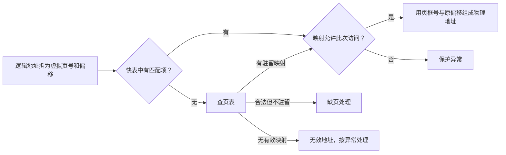

# 《操作系统》十个核心知识点总结

原件三页，是带教材页码提示的十问复习提纲，不是一套选择题或试卷。以下按原来的十问顺序整理主旨、纠正原件可见笔误；帮助区分概念的新例均标为补充。

## 1. 现代操作系统有哪些特征

- **并发**：多个活动在同一时间段内交错推进；它们也可能真正在不同处理机上并行，但不是必要条件。
- **共享**：多个执行主体使用同一资源。若同一时刻只许一方占用，资源仍可按时间顺序共享；能同时安全访问时则可并发共享。
- **异步**：进程的推进速度和交错次序不是程序可以凭主观预期固定下来的。若正确性依赖特定次序，就需要显式同步。
- **虚拟**：把物理资源映射成一个或多个逻辑资源，隐藏底层具体分配。单个处理机分时向不同进程提供执行机会就是一例。

**补充：**一个任务等磁盘时让另一个任务占用处理机，可以减少处理机空闲，却没有消除前一任务等待磁盘的事实。原件“消除相互等待”的表述不能理解为并发自动移除依赖。参见 [操作系统特征](../../../topics/操作系统/操作系统特征.md)。

## 2. 分时系统为何能让用户感觉同时使用一台机器

原件列出同时性、独立性、及时性、交互性。系统用时间片等机制在可运行的任务间切换，给多个终端反复提供运行机会（同时性）；隔离执行状态和资源访问（独立性）；让交互请求一般能较快获得服务（及时性）；用户看到反馈后继续发出操作（交互性）。若许多任务都可运行，轮到下一次的时间也会增长，分时并不等于硬实时截止期保证。参见 [分时系统工作原理](../../../topics/操作系统/分时系统工作原理.md)。

## 3. 批处理、分时、实时，优先目标各是什么

| 类型 | 优先满足的需求 | 问题变难时首先观察 |
| --- | --- | --- |
| 批处理 | 批量完成任务，提高吞吐量和资源利用率 | 单位时间完成量，任务排队开销 |
| 分时 | 为多个交互用户提供可接受的响应 | 输入到反馈的延迟，用户之间的隔离 |
| 实时 | 对指定事件保证或尽量符合时限，视实时系统类型而定 | 关键任务能否在截止期前完成，而非只看平均延迟 |

在同一台机器上，这些目标可以部分并存；分类描述的是设计的优先目标。参见 [操作系统基本类型](../../../topics/操作系统/操作系统基本类型.md)。

## 4. 进程和程序为何不是同一个东西

程序是可以保存和重复启动的指令；进程是程序在某次运行中的活动实例，拥有单独的执行状态以及操作系统管理的资源。课件用程序、数据、进程控制块（PCB）刻画进程。动态性对应创建到退出的生命周期；并发性和异步性说明多个执行进度能交错；独立性说明各实例有可区分的上下文；制约性来自对共享资源的竞争或通信协作；结构性对应内核可记录和恢复的状态。两次运行同一个程序不必共享同一个 PCB。原件“独立调度单位”应放在单线程进程模型下理解；支持线程的系统可把线程作为处理机调度单位。参见 [进程定义与特征](../../../topics/操作系统/进程定义与特征.md)、[进程控制块](../../../topics/操作系统/进程控制块.md)、[线程](../../../topics/操作系统/线程概念.md)。

## 5. 死锁为什么不只是“某个进程等很久”

互斥使用是资源不能同时给所有请求者；请求并保持意味着等待新资源时不放已有资源；不可剥夺使其他进程不能强行拿走所需实例；循环等待使一组进程彼此等候对方释放。仅看到资源紧张、甚至在多实例资源分配图上看到一个环，也不足以判断实际死锁；要检查是否有可用实例、是否有能继续运行并释放资源的进程。**补充：**要求所有进程按同一资源顺序申请，可破坏循环等待的条件，却不等于消除任何等待。参见 [死锁必要条件](../../../topics/操作系统/死锁概念与必要条件.md)、[死锁预防与避免](../../../topics/操作系统/死锁预防与避免.md)。

## 6. 带快表的地址变换怎样进行

将逻辑地址拆为虚拟页号和页内偏移。快表（TLB）缓存地址映射：找到匹配且允许本次访问的项时，用页框号和原偏移组成物理地址；未找到时查页表。查出驻留且允许访问的有效映射后可回填快表，必要时替换已有快表项，而不是因此换出物理页。原件第 2 步“相匹配的面呈”、第 3 步“示找到”按语义分别订正为“匹配的页号”“未找到”。不同硬件的快表组织和页表遍历细节可不同，原件的并行查找指其教学模型。

> [!TIP]
> 看到==快表未命中==先查页表，不要直接答“发生缺页”。快表可能没缓存某个仍在内存的页面；权限失败也不是换个页框就能解决的缺页。

**补充验算：**页大小 4,096 字节，逻辑地址 9,000 的页号和偏移分别为 2、808。若合法映射把第 2 页放在页框 5，物理地址是 $5\times4096+808=21288$；不管这个映射取自快表还是来自页表，组成物理地址的结果相同。参见 [快表机制](../../../topics/操作系统/快表机制.md)、[分页存储管理](../../../topics/操作系统/分页存储管理.md)。

## 7. 虚拟存储怎样运行大于当前可用物理内存的程序

局部性意味着程序在一段时间内通常只频繁访问少量页面。按需装入可以只让活动页面驻留；后续访问合法但未驻留的页面时，系统再处理缺页，必要时选择受害页置换。原件以其余部分在磁盘的情况说明后备存储；并非每一合法的虚拟页都有一份既存的磁盘数据，例如按需清零页可由系统初始化。原件“部分兑换”按机制表述为“部分置换”。**补充：**活动集合长期大于可分配页框时，频繁回收与重读会导致抖动；逻辑空间大不是性能保证。参见 [虚拟存储与局部性](../../../topics/操作系统/虚拟存储器.md)。

## 8. 设备从分配角度怎样分类

**独占设备**在分配期间只向一个进程或作业开放，例如一个尚未做任务排队的独占外设；**共享设备**可将多用户请求交错排程，磁盘是课件的例子，不代表同一个机械部件能同一时刻处理多个不同位置；**虚拟设备**以软件接口、缓冲和排队把物理设备能力呈现为多个用户可分别使用的逻辑设备。例如打印假脱机先接收多份文件，再序列化交给同一台打印机。参见 [设备分类](../../../topics/操作系统/设备分类.md)、[假脱机系统](../../../topics/操作系统/SPOOLing系统.md)。

## 9. DMA 控制器的四类寄存器各保存什么

| 教学模型中的寄存器 | 作用 |
| --- | --- |
| 命令/状态寄存器（CR） | 指定方向、启动等控制信息，读取完成或错误等状态 |
| 内存地址寄存器（MAR） | 输入时指向内存目的位置，输出时指向内存源位置 |
| 数据寄存器（DR） | 在控制器内暂存传输中的数据 |
| 数据计数器（DC） | 指明初始传输量并跟踪剩余量，具体按字节、字或其他单位计取由控制器规定 |

**订正：**原件“丰旗帜内存到设备的内存源地址”是损坏文字，按输入/输出对称关系，应为“存放内存到设备传输的内存源地址”。“CPU 要读写的字节数”容易误以为 CPU 逐个搬字节；DMA 的特点恰是 CPU 设置参数后控制器传输，完成时再通知。**补充：**按字节寻址、地址递增且一次成功转移一字节时，从地址 1,000 开始，计数初值 4，四次后覆盖 1,000–1,003，剩余计数 0。表中的寄存器名称不要求每款控制器都同名。参见 [DMA 控制器](../../../topics/操作系统/DMA控制器.md)、[I/O 控制方式](../../../topics/操作系统/IO控制方式.md)。

## 10. 连续文件为什么既容易访问又难扩长

连续分配用起始块与长度描述一段连续盘块。逻辑块号从 0 开始时，知道起始盘块 $B$，第 $j$ 个逻辑块的物理盘块号就是 $B+j$；例如占用第 50 至 54 块时，逻辑块 3 对应 53。它既便于顺序访问，也便于按位置直接访问，在机械磁盘上常减少寻道；但不能保证永远是“最快”，物理设备、缓存和重映射都会改变效果。经典连续分配通常要事先估计所需长度；若下一盘块已被占用，就难以原地增长；若现有空洞都比请求短，空闲量总和再大也分配不出足够长的连续区。原件“估计文件的升序”应为“估计文件的长度”。参见 [连续分配的取舍](../../../topics/操作系统/连续文件优缺点.md)、[文件物理结构](../../../topics/操作系统/文件物理结构.md)。
