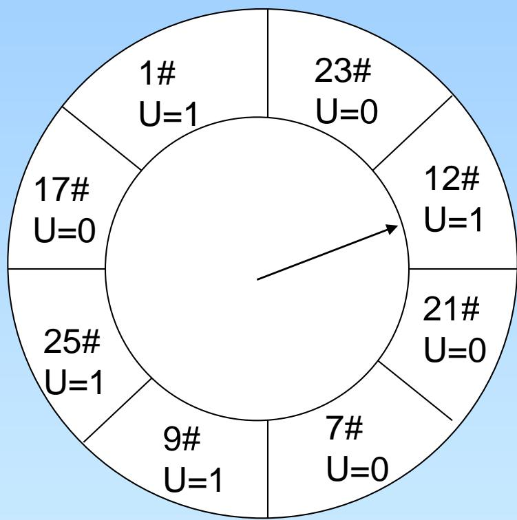

# 《操作系统》总复习（18-19-1）

原件经识别和整理；“参考解答”是我们补的。

本资料由识别工具读取整理，包含实验安排、答疑信息、考试说明及第七章章复习提纲。页眉页脚、页码等无关内容已去除。

## 实验与答疑

### 实验安排

实验地点与时间如下：

- **B16**：
    - 11-14周：周三 T89 3-4节
    - 15周：周三 3-4节；周五 3-4节（图6）
    - 16周：周三 3-4节 T89
- **B17-18**：
    - 14周：周三 T89 6-7节
    - 15周：周三 6-7节（图6）；周五 6-7节 T8/T9
    - 16周：周二 6-7节 T89

### 实验报告要求

请两位班长在 **12月28号** 之前收齐所在班级的实验报告。
- 格式：按照老师提供的格式书写，最好打印，也可手写，但必须严格符合格式要求。
- 内容：包括两个题目，请参考实验大纲要求。

知识点：[操作系统的定义与主要目标](../../../topics/操作系统/操作系统定义与目标.md)、[操作系统的用户界面（命令接口、程序接口、图形接口）](../../../topics/操作系统/用户界面.md)

### 答疑安排

- **时间**：第17周周五（12月28日）10:00 - 12:00
- **地点**：有线楼319
- 欢迎大家过来交流！

## 考试相关

### 考试形式

闭卷考试。

知识点：[现代操作系统的特征（并发、共享、虚拟、异步）](../../../topics/操作系统/操作系统特征.md)、[分时系统的工作原理与特征](../../../topics/操作系统/分时系统工作原理.md)、[操作系统三种基本类型（批处理、分时、实时）及其主要目标](../../../topics/操作系统/操作系统基本类型.md)

### 考试内容

教材及课件内容，以课件为主。

知识点：[进程的基本状态（就绪、执行、阻塞）及状态转换](../../../topics/操作系统/进程状态转换.md)、[原语的概念与进程控制原语（创建、撤销、阻塞、唤醒）](../../../topics/操作系统/原语.md)、[死锁的定义与四个必要条件（互斥、请求保持、不可剥夺、循环等待）](../../../topics/操作系统/死锁概念与必要条件.md)

### 考试时间

待定。

知识点：[分时系统的工作原理与特征](../../../topics/操作系统/分时系统工作原理.md)

### 考试题型

- 选择题（20分）
- 判断题（20分）
- 填空题（20分）
- 计算题（40分）

## 复习提纲

第一章、操作系统概论
第二章、进程描述与控制
第三章、进程同步与通信
第四章、调度与死锁
第五章、存储管理
第六章、设备管理
第七章、文件管理

## 第一章 操作系统概论

知识点：[操作系统的定义与主要目标](../../../topics/操作系统/操作系统定义与目标.md)、[进程的基本状态（就绪、执行、阻塞）及状态转换](../../../topics/操作系统/进程状态转换.md)、[死锁的定义与四个必要条件（互斥、请求保持、不可剥夺、循环等待）](../../../topics/操作系统/死锁概念与必要条件.md)

### 知识点 1

**计算机系统层次结构**

硬件、操作系统、系统软件、应用程序。

知识点：[文件的逻辑结构（流式文件、记录式文件）](../../../topics/操作系统/文件逻辑结构.md)、[文件目录结构（单级、二级、多级目录）及特点](../../../topics/操作系统/文件目录结构.md)

### 知识点 2

**多道程序设计**

内存存放多个程序，宏观上并行，微观上串行。

知识点：[文件的物理结构（连续、链接、索引、混合索引）](../../../topics/操作系统/文件物理结构.md)、[文件目录结构（单级、二级、多级目录）及特点](../../../topics/操作系统/文件目录结构.md)、[文件存储空间的管理方法（位示图法、空闲表法、空闲链表法）](../../../topics/操作系统/文件存储空间管理.md)

### 知识点 3

**操作系统的定义**

从三个视角理解：
1. 软件视角
2. 资源管理器视角
3. 虚拟机视角

知识点：[文件的逻辑结构（流式文件、记录式文件）](../../../topics/操作系统/文件逻辑结构.md)

### 知识点 4

**操作系统的类型**

批处理、分时及实时系统。要求具体了解各类系统的优缺点。

知识点：[文件的物理结构（连续、链接、索引、混合索引）](../../../topics/操作系统/文件物理结构.md)

### 知识点 5

**操作系统的特征**

并发性、共享性、虚拟性及不确定性。

知识点：[磁盘调度算法（FCFS、SSTF、SCAN、CSCAN）](../../../topics/操作系统/磁盘调度算法.md)

### 知识点 6

**操作系统的主要功能**

包括处理机管理、存储器管理、设备管理和文件管理。

知识点：[文件的物理结构（连续、链接、索引、混合索引）](../../../topics/操作系统/文件物理结构.md)、[文件存储空间的管理方法（位示图法、空闲表法、空闲链表法）](../../../topics/操作系统/文件存储空间管理.md)

### 知识点 7

**操作系统的接口**

命令接口和程序接口。

## 第二章 进程描述与控制

知识点：[文件存储空间的管理方法（位示图法、空闲表法、空闲链表法）](../../../topics/操作系统/文件存储空间管理.md)

### 知识点 1

**程序的顺序与并发**

- **顺序**：顺序性、封闭性、可再现性。
- **并发**：简单性、失去封闭性、不可再现性。

知识点：[文件的逻辑结构（流式文件、记录式文件）](../../../topics/操作系统/文件逻辑结构.md)、[文件目录结构（单级、二级、多级目录）及特点](../../../topics/操作系统/文件目录结构.md)

### 知识点 2

**进程的概念与特征**

进程是程序在一个数据集合上的运行过程，是系统进行资源分配和调度的独立单位。
特征：动态性、并发性、独立性、异步性、结构性。

知识点：[文件的物理结构（连续、链接、索引、混合索引）](../../../topics/操作系统/文件物理结构.md)、[文件目录结构（单级、二级、多级目录）及特点](../../../topics/操作系统/文件目录结构.md)、[文件存储空间的管理方法（位示图法、空闲表法、空闲链表法）](../../../topics/操作系统/文件存储空间管理.md)

### 知识点 3

**进程控制块（PCB）**

进程控制块是描述进程属性的数据结构。

知识点：[文件的逻辑结构（流式文件、记录式文件）](../../../topics/操作系统/文件逻辑结构.md)

### 知识点 4

**进程的状态及转换**

进程的七种状态及其转换情况。

知识点：[文件的物理结构（连续、链接、索引、混合索引）](../../../topics/操作系统/文件物理结构.md)

### 知识点 5

**操作系统内核与原语**

了解原语的概念。

知识点：[磁盘调度算法（FCFS、SSTF、SCAN、CSCAN）](../../../topics/操作系统/磁盘调度算法.md)

### 知识点 6

**进程的原语操作**

创建、撤销、阻塞、唤醒。

知识点：[文件的物理结构（连续、链接、索引、混合索引）](../../../topics/操作系统/文件物理结构.md)、[文件存储空间的管理方法（位示图法、空闲表法、空闲链表法）](../../../topics/操作系统/文件存储空间管理.md)

### 知识点 7

**核心态与用户态**

- **核心态**：操作系统管理程序执行时机器的状态。
- **用户态**：用户程序执行时机器的状态。

知识点：[文件存储空间的管理方法（位示图法、空闲表法、空闲链表法）](../../../topics/操作系统/文件存储空间管理.md)

### 知识点 8

**线程**

线程的概念，以及线程与进程的区别。

## 第三章 进程同步与通信

知识点：[文件目录结构（单级、二级、多级目录）及特点](../../../topics/操作系统/文件目录结构.md)、[操作系统的主要功能（处理机管理、存储管理、设备管理、文件管理、用户接口）](../../../topics/操作系统/操作系统功能.md)、[操作系统的用户界面（命令接口、程序接口、图形接口）](../../../topics/操作系统/用户界面.md)

### 知识点 1

**进入临界区的条件**

空闲让进、忙则等待、有限等待、让权等待。

知识点：[文件的逻辑结构（流式文件、记录式文件）](../../../topics/操作系统/文件逻辑结构.md)、[文件目录结构（单级、二级、多级目录）及特点](../../../topics/操作系统/文件目录结构.md)

### 知识点 2

**同步与互斥的差别**

- **同步**：我和某个同学的关系（协作关系）。
- **互斥**：两个同学的关系（竞争资源）。

知识点：[文件的物理结构（连续、链接、索引、混合索引）](../../../topics/操作系统/文件物理结构.md)、[文件目录结构（单级、二级、多级目录）及特点](../../../topics/操作系统/文件目录结构.md)、[文件存储空间的管理方法（位示图法、空闲表法、空闲链表法）](../../../topics/操作系统/文件存储空间管理.md)

### 知识点 3

**实现互斥的方法**

软件方法、硬件方法、锁机制。了解每一种方法的思想。

知识点：[文件的逻辑结构（流式文件、记录式文件）](../../../topics/操作系统/文件逻辑结构.md)

### 知识点 4

**信号量**

信号量的含义与操作。信号量需要定义才能使用，注意：信号量实际上就是资源。

知识点：[文件的物理结构（连续、链接、索引、混合索引）](../../../topics/操作系统/文件物理结构.md)

### 知识点 5

**P、V原语**

P、V原语实际上就是对信号量的操作：
- **P**：申请资源。
- **V**：释放资源。

知识点：[磁盘调度算法（FCFS、SSTF、SCAN、CSCAN）](../../../topics/操作系统/磁盘调度算法.md)

### 知识点 6

**经典同步问题**

掌握用信号量解决同步问题，几个经典同步问题：
1. 生产者消费者问题
2. 读者写者问题
3. 哲学家问题

知识点：[文件的物理结构（连续、链接、索引、混合索引）](../../../topics/操作系统/文件物理结构.md)、[文件存储空间的管理方法（位示图法、空闲表法、空闲链表法）](../../../topics/操作系统/文件存储空间管理.md)

### 知识点 7

**高级进程通信方式**

共享存储器系统、消息传递系统和管道通信系统。

## 第四章 调度与死锁

知识点：[文件存储空间的管理方法（位示图法、空闲表法、空闲链表法）](../../../topics/操作系统/文件存储空间管理.md)

### 知识点 1

**作业**

用户程序，所需数据和命令。

知识点：[文件的逻辑结构（流式文件、记录式文件）](../../../topics/操作系统/文件逻辑结构.md)、[文件目录结构（单级、二级、多级目录）及特点](../../../topics/操作系统/文件目录结构.md)

### 知识点 2

**调度的三个层次**

作业调度、进程调度、中级调度。

知识点：[文件的物理结构（连续、链接、索引、混合索引）](../../../topics/操作系统/文件物理结构.md)、[文件目录结构（单级、二级、多级目录）及特点](../../../topics/操作系统/文件目录结构.md)、[文件存储空间的管理方法（位示图法、空闲表法、空闲链表法）](../../../topics/操作系统/文件存储空间管理.md)

### 知识点 3

**调度性能的评价准则**

CPU利用率、系统吞吐量、周转时间、响应时间。

知识点：[文件的逻辑结构（流式文件、记录式文件）](../../../topics/操作系统/文件逻辑结构.md)

### 知识点 4

**作业的状态**

提交、后备、运行、完成。

知识点：[文件的物理结构（连续、链接、索引、混合索引）](../../../topics/操作系统/文件物理结构.md)

### 知识点 5

**作业控制块**

知识点：[磁盘调度算法（FCFS、SSTF、SCAN、CSCAN）](../../../topics/操作系统/磁盘调度算法.md)

### 知识点 6

**常见调度算法**

FIFO（先来先服务）、短作业优先、优先级调度算法、时间片轮转算法、高响应比优先调度算法、多级队列调度算法、多级反馈队列调度算法。

知识点：[文件的物理结构（连续、链接、索引、混合索引）](../../../topics/操作系统/文件物理结构.md)、[文件存储空间的管理方法（位示图法、空闲表法、空闲链表法）](../../../topics/操作系统/文件存储空间管理.md)

### 知识点 7

**死锁的定义**

死锁是指多个进程竞争系统资源或相互通信而永久阻塞，无外力不能向前推进。

知识点：[文件存储空间的管理方法（位示图法、空闲表法、空闲链表法）](../../../topics/操作系统/文件存储空间管理.md)

### 知识点 8

**死锁产生的原因**

竞争资源、推进顺序不当。

知识点：[文件目录结构（单级、二级、多级目录）及特点](../../../topics/操作系统/文件目录结构.md)、[操作系统的主要功能（处理机管理、存储管理、设备管理、文件管理、用户接口）](../../../topics/操作系统/操作系统功能.md)、[操作系统的用户界面（命令接口、程序接口、图形接口）](../../../topics/操作系统/用户界面.md)

### 知识点 9

**死锁产生的必要条件**

互斥、不剥夺、请求和保持、循环等待。

知识点：[文件目录结构（单级、二级、多级目录）及特点](../../../topics/操作系统/文件目录结构.md)、[进程控制块（PCB）的作用与内容](../../../topics/操作系统/进程控制块.md)、[信号量机制与P、V操作的定义](../../../topics/操作系统/信号量与PV操作.md)

### 知识点 10

**死锁的处理方法**

预防和避免的原理。

知识点：[虚拟存储器的基本思想与局部性原理](../../../topics/操作系统/虚拟存储器.md)

### 知识点 11

**银行家算法**

知识点：[虚拟存储器的基本思想与局部性原理](../../../topics/操作系统/虚拟存储器.md)、[中断的概念、类型与处理过程](../../../topics/操作系统/中断机制.md)、[页面置换算法（OPT、FIFO、LRU、Clock、LFU）](../../../topics/操作系统/页面置换算法.md)

### 知识点 12

**资源分配图**

## 第五章 存储管理

知识点：[页面置换算法（OPT、FIFO、LRU、Clock、LFU）](../../../topics/操作系统/页面置换算法.md)

### 知识点 1

**存储分配三种方式**

知识点：[文件的逻辑结构（流式文件、记录式文件）](../../../topics/操作系统/文件逻辑结构.md)、[文件目录结构（单级、二级、多级目录）及特点](../../../topics/操作系统/文件目录结构.md)

### 知识点 2

**地址空间与存储空间**

知识点：[文件的物理结构（连续、链接、索引、混合索引）](../../../topics/操作系统/文件物理结构.md)、[文件目录结构（单级、二级、多级目录）及特点](../../../topics/操作系统/文件目录结构.md)、[文件存储空间的管理方法（位示图法、空闲表法、空闲链表法）](../../../topics/操作系统/文件存储空间管理.md)

### 知识点 3

**地址变换及重定位**

知识点：[文件的逻辑结构（流式文件、记录式文件）](../../../topics/操作系统/文件逻辑结构.md)

### 知识点 4

**连续分配方式**

单一连续分配、固定分区和动态分区。

知识点：[文件的物理结构（连续、链接、索引、混合索引）](../../../topics/操作系统/文件物理结构.md)

### 知识点 5

**动态分区分配算法**

知识点：[磁盘调度算法（FCFS、SSTF、SCAN、CSCAN）](../../../topics/操作系统/磁盘调度算法.md)

### 知识点 6

**碎片和拼接**

知识点：[文件的物理结构（连续、链接、索引、混合索引）](../../../topics/操作系统/文件物理结构.md)、[文件存储空间的管理方法（位示图法、空闲表法、空闲链表法）](../../../topics/操作系统/文件存储空间管理.md)

### 知识点 7

**存储保护**

知识点：[文件存储空间的管理方法（位示图法、空闲表法、空闲链表法）](../../../topics/操作系统/文件存储空间管理.md)

### 知识点 8

**覆盖与交换**

什么是覆盖？什么是交换？

知识点：[文件目录结构（单级、二级、多级目录）及特点](../../../topics/操作系统/文件目录结构.md)、[操作系统的主要功能（处理机管理、存储管理、设备管理、文件管理、用户接口）](../../../topics/操作系统/操作系统功能.md)、[操作系统的用户界面（命令接口、程序接口、图形接口）](../../../topics/操作系统/用户界面.md)

### 知识点 9

**分页、分段与段页式存储管理系统**

知识点：[文件目录结构（单级、二级、多级目录）及特点](../../../topics/操作系统/文件目录结构.md)、[进程控制块（PCB）的作用与内容](../../../topics/操作系统/进程控制块.md)、[信号量机制与P、V操作的定义](../../../topics/操作系统/信号量与PV操作.md)

### 知识点 10

**虚拟存储器与局部性原理**

知识点：[虚拟存储器的基本思想与局部性原理](../../../topics/操作系统/虚拟存储器.md)

### 知识点 11

**缺页中断**

知识点：[虚拟存储器的基本思想与局部性原理](../../../topics/操作系统/虚拟存储器.md)、[中断的概念、类型与处理过程](../../../topics/操作系统/中断机制.md)、[页面置换算法（OPT、FIFO、LRU、Clock、LFU）](../../../topics/操作系统/页面置换算法.md)

### 知识点 12

**页面置换算法**

知识点：[页面置换算法（OPT、FIFO、LRU、Clock、LFU）](../../../topics/操作系统/页面置换算法.md)

### 知识点 13

**抖动**

## 第六章 设备管理

知识点：[虚拟存储器的基本思想与局部性原理](../../../topics/操作系统/虚拟存储器.md)、[页面置换算法（OPT、FIFO、LRU、Clock、LFU）](../../../topics/操作系统/页面置换算法.md)

### 知识点 1

**设备的分类**

块设备和字符设备。

知识点：[文件的逻辑结构（流式文件、记录式文件）](../../../topics/操作系统/文件逻辑结构.md)、[文件目录结构（单级、二级、多级目录）及特点](../../../topics/操作系统/文件目录结构.md)

### 知识点 2

**设备控制器与通道**

知识点：[文件的物理结构（连续、链接、索引、混合索引）](../../../topics/操作系统/文件物理结构.md)、[文件目录结构（单级、二级、多级目录）及特点](../../../topics/操作系统/文件目录结构.md)、[文件存储空间的管理方法（位示图法、空闲表法、空闲链表法）](../../../topics/操作系统/文件存储空间管理.md)

### 知识点 3

**I/O控制方式**

知识点：[文件的逻辑结构（流式文件、记录式文件）](../../../topics/操作系统/文件逻辑结构.md)

### 知识点 4

**中断分类及处理**

知识点：[文件的物理结构（连续、链接、索引、混合索引）](../../../topics/操作系统/文件物理结构.md)

### 知识点 5

**缓冲技术**

知识点：[磁盘调度算法（FCFS、SSTF、SCAN、CSCAN）](../../../topics/操作系统/磁盘调度算法.md)

### 知识点 6

**设备分配技术**

知识点：[文件的物理结构（连续、链接、索引、混合索引）](../../../topics/操作系统/文件物理结构.md)、[文件存储空间的管理方法（位示图法、空闲表法、空闲链表法）](../../../topics/操作系统/文件存储空间管理.md)

### 知识点 7

**Spooling系统的构成**

知识点：[文件存储空间的管理方法（位示图法、空闲表法、空闲链表法）](../../../topics/操作系统/文件存储空间管理.md)

### 知识点 8

**I/O软件的层次结构**

## 第七章 文件管理

知识点：[文件目录结构（单级、二级、多级目录）及特点](../../../topics/操作系统/文件目录结构.md)、[操作系统的主要功能（处理机管理、存储管理、设备管理、文件管理、用户接口）](../../../topics/操作系统/操作系统功能.md)、[操作系统的用户界面（命令接口、程序接口、图形接口）](../../../topics/操作系统/用户界面.md)

### 知识点 1

**文件与文件系统**

- **文件**：是一组相关信息的集合。
- **文件系统**：是操作系统中文件管理有关的软件和数据的集合。

知识点：[文件的逻辑结构（流式文件、记录式文件）](../../../topics/操作系统/文件逻辑结构.md)、[文件目录结构（单级、二级、多级目录）及特点](../../../topics/操作系统/文件目录结构.md)

### 知识点 2

**文件系统的功能层次**

文件系统四个层次的功能。

知识点：[文件的物理结构（连续、链接、索引、混合索引）](../../../topics/操作系统/文件物理结构.md)、[文件目录结构（单级、二级、多级目录）及特点](../../../topics/操作系统/文件目录结构.md)、[文件存储空间的管理方法（位示图法、空闲表法、空闲链表法）](../../../topics/操作系统/文件存储空间管理.md)

### 知识点 3

**文件分类**

知识点：[文件的逻辑结构（流式文件、记录式文件）](../../../topics/操作系统/文件逻辑结构.md)

### 知识点 4

**文件物理结构**

顺序、链接和索引。

知识点：[文件的物理结构（连续、链接、索引、混合索引）](../../../topics/操作系统/文件物理结构.md)

### 知识点 5

**磁盘调度算法**

掌握磁盘调度算法。

知识点：[磁盘调度算法（FCFS、SSTF、SCAN、CSCAN）](../../../topics/操作系统/磁盘调度算法.md)

### 知识点 6

**文件物理空间的分配**

知识点：[文件的物理结构（连续、链接、索引、混合索引）](../../../topics/操作系统/文件物理结构.md)、[文件存储空间的管理方法（位示图法、空闲表法、空闲链表法）](../../../topics/操作系统/文件存储空间管理.md)

### 知识点 7

**空闲区的管理**

空闲文件目录、空闲链块和位示图。

知识点：[文件存储空间的管理方法（位示图法、空闲表法、空闲链表法）](../../../topics/操作系统/文件存储空间管理.md)

### 知识点 8

**文件目录结构**

知识点：[文件目录结构（单级、二级、多级目录）及特点](../../../topics/操作系统/文件目录结构.md)、[操作系统的主要功能（处理机管理、存储管理、设备管理、文件管理、用户接口）](../../../topics/操作系统/操作系统功能.md)、[操作系统的用户界面（命令接口、程序接口、图形接口）](../../../topics/操作系统/用户界面.md)

### 知识点 9

**文件的共享**

文件的共享是如何实现的。

## P、V原语应用示例

知识点：[文件目录结构（单级、二级、多级目录）及特点](../../../topics/操作系统/文件目录结构.md)、[进程控制块（PCB）的作用与内容](../../../topics/操作系统/进程控制块.md)、[信号量机制与P、V操作的定义](../../../topics/操作系统/信号量与PV操作.md)

### 问题描述

有一个阅览室，共有100个座位，读者进入时必须先在一张登记表上登记（该表为i，每一个座位列一表目，包括座号和读者姓名等），读者离开时消除登记的信息。请问：

1. 为描述读者的动作，应如何设置信号量？
2. 试用P、V操作描述读者进程之间的同步关系。

知识点：[临界区、临界资源与互斥的概念](../../../topics/操作系统/临界区与互斥.md)、[信号量机制与P、V操作的定义](../../../topics/操作系统/信号量与PV操作.md)、[进程的基本状态（就绪、执行、阻塞）及状态转换](../../../topics/操作系统/进程状态转换.md)

### 解答

#### (1) 信号量设置

读者有两种活动：一是填表进入阅览室，检查是否有座位；二是阅读完离开阅览室。设置三种信号量：

- `seats`：表示阅览室是否有座位，初值为100。
- `reads`：表示阅览室的读者数，初值为0。
- `mutex`：读者登记表的互斥访问信号量，初值为1。

#### (2) P、V操作描述

**读者进入过程：**

```c
While(true){
    P(seats); // 无座则等待/离开
    P(mutex); // 进入临界区
    填写登记表；
    进入阅览室；
    V(mutex); // 离开临界区
    V(reads)
}
```

**读者离开过程：**

```c
While(true){
    P(reads); // 是否有读者（此处逻辑需结合具体同步需求，通常离开时需通知其他等待者或更新计数，原题代码逻辑可能针对特定场景）
    P(mutex); // 进入临界区
    消掉登记；
    离开阅览室；
    V(mutex); // 离开临界区
    V(seats) // 释放座位
}
```

> **注**：原题给出的代码中 `P(reads)` 在离开过程中可能存在逻辑歧义，通常读者离开时应执行 `V(seats)` 释放座位，并可能涉及对 `reads` 计数的更新（如 `V(reads)` 或其他同步机制），具体需根据完整的同步协议理解。此处仅按原文整理。

## 调度算法计算示例

知识点：[信号量机制与P、V操作的定义](../../../topics/操作系统/信号量与PV操作.md)、[经典进程同步问题（生产者-消费者、读者-写者、哲学家进餐）](../../../topics/操作系统/经典同步问题.md)

### 先来先服务（FCFS）调度

选择最先进入队列的作业/进程来执行。

| | 提交时间 | 运行时间 | 开始时间 | 完成时间 | 周转时间 | 带权周转时间 |
|---|---|---|---|---|---|---|
| 1 | 8 | 2 | 8 | 10 | 2 | 1 |
| 2 | 8.4 | 1 | 10 | 11 | 2.6 | 2.6 |
| 3 | 8.8 | 0.5 | 11 | 11.5 | 2.7 | 5.4 |
| 4 | 9 | 0.2 | 11.5 | 11.7 | 2.7 | 13.5 |

- 平均周转时间 = 2.5
- 平均带权周转时间 = 5.625

知识点：[作业调度算法及性能评价（周转时间、带权周转时间）](../../../topics/操作系统/作业调度算法.md)、[进程调度算法（FCFS、SJF、优先级、时间片轮转、多级反馈队列）](../../../topics/操作系统/进程调度算法.md)

### 短作业优先（SJF）调度

选择估计运行时间最短的作业/进程来执行。

| | 提交时间 | 运行时间 | 开始时间 | 完成时间 | 周转时间 | 带权周转时间 |
|---|---|---|---|---|---|---|
| 1 | 8 | 2 | 8 | 10 | 2 | 1 |
| 2 | 8.4 | 1 | 10.7 | 11.7 | 3.3 | 3.3 |
| 3 | 8.8 | 0.5 | 10.2 | 10.7 | 1.9 | 3.8 |
| 4 | 9 | 0.2 | 10 | 10.2 | 1.2 | 6 |

- 平均周转时间 = 2.1
- 平均带权周转时间 = 3.525

## 银行家算法示例

知识点：[进程调度算法（FCFS、SJF、优先级、时间片轮转、多级反馈队列）](../../../topics/操作系统/进程调度算法.md)、[作业调度算法及性能评价（周转时间、带权周转时间）](../../../topics/操作系统/作业调度算法.md)

### 初始状态（T0时刻）

| | Max (R1, R2, R3) | Allocation (R1, R2, R3) | Need (R1, R2, R3) | Available (R1, R2, R3) |
|---|---|---|---|---|
| P1 | 3, 2, 2 | 1, 0, 0 | 2, 2, 2 | 1, 1, 2 |
| P2 | 6, 1, 3 | 5, 1, 1 | 1, 0, 2 | |
| P3 | 3, 1, 4 | 2, 1, 1 | 1, 0, 3 | |
| P4 | 4, 2, 2 | 0, 0, 2 | 4, 2, 0 | |

#### 1. T0时刻是否安全？

Available可以满足P2的需求。
- P2运行结束（分配1,0,2? 原文标注为102，应为1,0,2或类似，根据Need推断P2 Need为1,0,2，Allocation为5,1,1，Max为6,1,3。原文表格中P2 Allocation为5,1,1，Need为1,0,2。Available初始为1,1,2。P2 Need(1,0,2) <= Available(1,1,2)，满足。
- P2运行结束，释放占有的资源（5,1,1）。
- 资源空闲数量 Available = 原有Available + P2 Allocation = (1,1,2) + (5,1,1) = (6,2,3)。

 *银行家算法安全性检查示意图*

- Available(6,2,3)可以满足P1的需求(Need 2,2,2)。
- P1运行结束，释放占有的资源（1,0,0）。
- 资源空闲数量 Available = (6,2,3) + (1,0,0) = (7,2,3)。

……P3运行结束，空闲 (9,3,4)。
P4运行结束，空闲 (9,3,6)。

存在安全序列 **P2 → P1 → P3 → P4**，所以T0时刻是安全的。

#### 2. P2申请（1，0，1）能否同意分配？

假设同意分配，系统状态将变为：

| | Max (R1, R2, R3) | Allocation (R1, R2, R3) | Need (R1, R2, R3) | Available (R1, R2, R3) |
|---|---|---|---|---|
| P1 | 3, 2, 2 | 1, 0, 0 | 2, 2, 2 | 0, 1, 1 |
| P2 | 6, 1, 3 | 6, 1, 2 | 0, 0, 1 | |
| P3 | 3, 1, 4 | 2, 1, 1 | 1, 0, 3 | |
| P4 | 4, 2, 2 | 0, 0, 2 | 4, 2, 0 | |

*(注：Available变化：原Available(1,1,2) - 申请(1,0,1) = (0,1,1))*

- P2运行结束，空闲 (6,2,3) *(释放P2当前的Allocation 6,1,2)*
- P1运行结束，空闲 (7,2,3) *(释放P1 Allocation 1,0,0)*
- P3运行结束，空闲 (9,3,4) *(释放P3 Allocation 2,1,1)*
- P4运行结束，空闲 (9,3,6) *(释放P4 Allocation 0,0,2)*

存在安全序列 **P2 → P1 → P3 → P4**，所以分配后的状态是安全的 → **同意分配**。

## 银行家算法

知识点：[死锁的预防方法与避免方法（银行家算法）](../../../topics/操作系统/死锁预防与避免.md)、[死锁的定义与四个必要条件（互斥、请求保持、不可剥夺、循环等待）](../../../topics/操作系统/死锁概念与必要条件.md)

### 3－P1申请（1，0，1）能否同意分配？

分配前的系统状态：

| | max | | | allocation | | | need | | | available | | |
| :---: | :---: | :---: | :---: | :---: | :---: | :---: | :---: | :---: | :---: | :---: | :---: | :---: | :---: |
| | **R1** | **R2** | **R3** | **R1** | **R2** | **R3** | **R1** | **R2** | **R3** | **R1** | **R2** | **R3** |
| P1 | 3 | 2 | 2 | 1 | 0 | 0 | 2 | 2 | 2 | 0 | 1 | 1 |
| P2 | 6 | 1 | 3 | 6 | 1 | 2 | 0 | 0 | 1 | | | |
| P3 | 3 | 1 | 4 | 2 | 1 | 1 | 1 | 0 | 3 | | | |
| P4 | 4 | 2 | 2 | 0 | 0 | 2 | 4 | 2 | 0 | | | |

申请量 $(1, 0, 1) >$ 空闲量 $(0, 1, 1)$，无法分配。

知识点：[死锁的定义与四个必要条件（互斥、请求保持、不可剥夺、循环等待）](../../../topics/操作系统/死锁概念与必要条件.md)、[死锁的预防方法与避免方法（银行家算法）](../../../topics/操作系统/死锁预防与避免.md)、[进程通信方式（共享存储、消息传递、管道通信）](../../../topics/操作系统/进程通信.md)

### 4－P3申请（0，0，1）能否同意分配？

假设同意分配，系统状态将变为：

| | max | | | allocation | | | need | | | available | | |
| :---: | :---: | :---: | :---: | :---: | :---: | :---: | :---: | :---: | :---: | :---: | :---: | :---: | :---: |
| | **R1** | **R2** | **R3** | **R1** | **R2** | **R3** | **R1** | **R2** | **R3** | **R1** | **R2** | **R3** |
| P1 | 3 | 2 | 2 | 1 | 0 | 0 | 2 | 2 | 2 | 0 | 1 | 0 |
| P2 | 6 | 1 | 3 | 6 | 1 | 2 | 0 | 0 | 1 | | | |
| P3 | 3 | 1 | 4 | 2 | 1 | 2 | 1 | 0 | 2 | | | |
| P4 | 4 | 2 | 2 | 0 | 0 | 2 | 4 | 2 | 0 | | | |

空闲资源数量无法满足某个进程的需要。

$\checkmark$ 4个进程都不能执行。

找不到安全序列，所以分配后的状态不安全 $\rightarrow$ 拒绝分配。

## 页面置换算法

知识点：[死锁的预防方法与避免方法（银行家算法）](../../../topics/操作系统/死锁预防与避免.md)、[信号量机制与P、V操作的定义](../../../topics/操作系统/信号量与PV操作.md)、[死锁的定义与四个必要条件（互斥、请求保持、不可剥夺、循环等待）](../../../topics/操作系统/死锁概念与必要条件.md)

### 最佳置换算法 (OPT)

淘汰在最久的将来才会用到的页面作为评价的标准。

| 页面走向 | 4 | 3 | 2 | 1 | 4 | 3 | 5 | 4 | 3 | 2 | 3 | 5 |
| :---: | :---: | :---: | :---: | :---: | :---: | :---: | :---: | :---: | :---: | :---: | :---: | :---: |
| 块1 | 4 | 4 | 4 | 4 | | | 4 | | | 2 | | |
| 块2 | | 3 | 3 | 3 | | | 3 | | | 3 | | |
| 块3 | | | 2 | 1 | | | 5 | | | 5 | | |
| 缺页 | 缺 | 缺 | 缺 | 缺 | | | 缺 | | | 缺 | | |

缺页率 $= 6/12 = 50\%$

知识点：[页面置换算法（OPT、FIFO、LRU、Clock、LFU）](../../../topics/操作系统/页面置换算法.md)、[虚拟存储器的基本思想与局部性原理](../../../topics/操作系统/虚拟存储器.md)

### 先进先出算法 (FIFO)

淘汰最早进入内存的页面。

| 页面走向 | 1 | 2 | 3 | 4 | 1 | 2 | 5 | 1 | 2 | 3 | 4 | 5 |
| :---: | :---: | :---: | :---: | :---: | :---: | :---: | :---: | :---: | :---: | :---: | :---: | :---: |
| 块1 | 1 | 1 | 1 | 4 | 4 | 4 | 5 | | | 5 | 5 | |
| 块2 | | 2 | 2 | 2 | 1 | 1 | 1 | | | 3 | 3 | |
| 块3 | | | 3 | 3 | 3 | 2 | 2 | | | 2 | 4 | |
| 缺页 | 缺 | 缺 | 缺 | 缺 | 缺 | 缺 | 缺 | | | 缺 | 缺 | |

*(注：此处原文似乎重复了标题“先进先出算法”并给出了另一个表格，根据上下文推测第二个表格可能对应不同的物理块数或示例，但内容仍标记为FIFO相关逻辑，以下按原文整理)*

| 页面走向 | 1 | 2 | 3 | 4 | 1 | 2 | 5 | 1 | 2 | 3 | 4 | 5 |
| :---: | :---: | :---: | :---: | :---: | :---: | :---: | :---: | :---: | :---: | :---: | :---: | :---: |
| 块1 | 1 | 1 | 1 | 1 | | | 5 | 5 | 5 | 5 | 4 | 4 |
| 块2 | | 2 | 2 | 2 | | | 2 | 1 | 1 | 1 | 1 | 5 |
| 块3 | | | 3 | 3 | | | 3 | 3 | 2 | 2 | 2 | 2 |
| 块4 | | | | 4 | | | 4 | 4 | 4 | 3 | 3 | 3 |
| 缺页 | 缺 | 缺 | 缺 | 缺 | 缺 | 缺 | 缺 | | | 缺 | 缺 | 缺 |

知识点：[页式存储管理的基本原理与地址转换](../../../topics/操作系统/分页存储管理.md)、[虚拟存储器的基本思想与局部性原理](../../../topics/操作系统/虚拟存储器.md)、[页面置换算法（OPT、FIFO、LRU、Clock、LFU）](../../../topics/操作系统/页面置换算法.md)

### 最近最久未用算法 (LRU)

淘汰最近一段时间内最久没用过的页面。

$$
\begin{array}{c} \hline 5 \\ \hline 8 \\ \hline 3 \\ \hline 9 \\ \hline \end{array}
$$

每次将刚访问过的页号移到栈顶，淘汰栈底的页面。

| 页号 | 二进制计数 |
| :---: | :---: |
| 9 | 0110100 |
| 11 | 1101100 |
| 8 | 0101100 |
| 3 | 1101010 |

为每个页面设立一个寄存器，访问页面时将高位置1，定期右移，高位补0，淘汰数值最小的页面。

知识点：[页面置换算法（OPT、FIFO、LRU、Clock、LFU）](../../../topics/操作系统/页面置换算法.md)、[虚拟存储器的基本思想与局部性原理](../../../topics/操作系统/虚拟存储器.md)、[存储管理的基本功能与地址转换（地址重定位）](../../../topics/操作系统/存储管理功能.md)

### 时钟算法



知识点：[页面置换算法（OPT、FIFO、LRU、Clock、LFU）](../../../topics/操作系统/页面置换算法.md)、[虚拟存储器的基本思想与局部性原理](../../../topics/操作系统/虚拟存储器.md)

### 最不常用算法 (LFU)

为每页设置一个计数器，访问页面时计数器加1，淘汰计数最小的页面，所有计数清0。

## 磁盘调度算法

知识点：[页面置换算法（OPT、FIFO、LRU、Clock、LFU）](../../../topics/操作系统/页面置换算法.md)、[磁盘调度算法（FCFS、SSTF、SCAN、CSCAN）](../../../topics/操作系统/磁盘调度算法.md)

### 扫描算法 SCAN (电梯调度)

寻道性能好，避免饥饿。
$\checkmark$ 对两端磁道的请求不利。

知识点：[磁盘调度算法（FCFS、SSTF、SCAN、CSCAN）](../../../topics/操作系统/磁盘调度算法.md)

### 循环扫描算法 CSCAN

磁头单向移动。
消除了对两端磁道请求的不公平。

**示例：**
请求序列：86, 147, 91, 177, 94, 150, 102, 175, 130，如何调度？
磁头当前位置在 143 磁道，向磁道号增加方向移动。

知识点：[磁盘调度算法（FCFS、SSTF、SCAN、CSCAN）](../../../topics/操作系统/磁盘调度算法.md)

### 磁盘调度对比

| FCFS | | | | |
| :---: | :---: | :---: | :---: | :---: |
| | 访问次序 | 移动道数 | 访问次序 | 移动道数 |
| | 86 | 57 | 147 | 4 |
| | 147 | 61 | 150 | 3 |
| | 91 | 56 | 130 | 20 |
| | 177 | 86 | 102 | 28 |
| | 94 | 83 | 94 | 8 |
| | 150 | 56 | 91 | 3 |
| | 102 | 48 | 86 | 5 |
| | 175 | 73 | 175 | 89 |
| | 130 | 45 | 177 | 2 |
| | <td colspan="2">平均寻道长度: 62.8</td> | <td colspan="2">平均寻道长度: 18</td> |

*(注：上表右侧数据似乎属于另一种算法或排版错误，根据下文“磁盘调度对比”的第二张表，左侧可能是FCFS，右侧可能是SSTF或其他，但原文第一张表结构混乱，第二张表更清晰地展示了两种算法对比。以下保留原文两张表的结构)*

知识点：[磁盘调度算法（FCFS、SSTF、SCAN、CSCAN）](../../../topics/操作系统/磁盘调度算法.md)、[设备的分类（按资源分配角度：独享、共享、虚拟设备）](../../../topics/操作系统/设备分类.md)、[操作系统的主要功能（处理机管理、存储管理、设备管理、文件管理、用户接口）](../../../topics/操作系统/操作系统功能.md)

### 磁盘调度对比

| | | | |
| :---: | :---: | :---: | :---: |
| 访问次序 | 移动道数 | 访问次序 | 移动道数 |
| 147 | 4 | 147 | 4 |
| 150 | 3 | 150 | 3 |
| 175 | 25 | 175 | 25 |
| 177 | 2 | 177 | 2 |
| 130 | 47 | 86 | 91 |
| 102 | 28 | 91 | 5 |
| 94 | 8 | 94 | 3 |
| 91 | 3 | 102 | 8 |
| 86 | 5 | 130 | 28 |
| <td colspan="2">平均寻道长度: 13.9</td> | <td colspan="2">平均寻道长度: 18.8</td> |

## 谢 谢！

知识点：[磁盘调度算法（FCFS、SSTF、SCAN、CSCAN）](../../../topics/操作系统/磁盘调度算法.md)、[设备的分类（按资源分配角度：独享、共享、虚拟设备）](../../../topics/操作系统/设备分类.md)、[操作系统的主要功能（处理机管理、存储管理、设备管理、文件管理、用户接口）](../../../topics/操作系统/操作系统功能.md)
