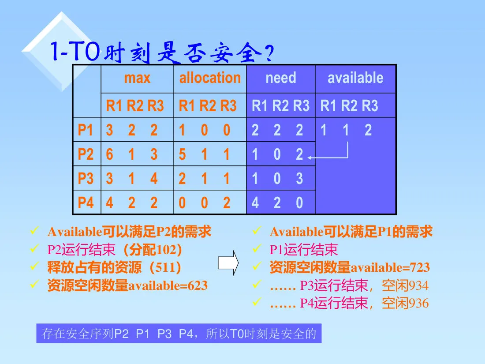

# 《操作系统》总复习（18-19-1）

原件共 39 页。第 1 页为封面，第 2–3 页为当年实验与答疑通知，第 4 页记载当年闭卷、教材及课件为范围（以课件为主）、时间待定；选择、判断、填空各 20 分，计算 40 分。第 5 页是七章目录，第 6–19 页是知识提纲，第 20–38 页是练习与算法，第 39 页结束。历史安排不适用于当前学期。以下将原题、原表与作者补充或订正区分。

## 七章复习提纲（原件第 6–19 页）

| 页 | 章节 | 原件列出的内容 |
| --- | --- | --- |
| 6–7 | 操作系统概论 | 计算机层次结构、多道程序设计；从软件、资源管理器与虚拟机三种角度理解操作系统；批处理、分时、实时；并发、共享、虚拟、不确定性；四类管理功能及命令／程序接口。参见[定义与目标](../../../topics/操作系统/操作系统定义与目标.md)。 |
| 8–9 | 进程描述与控制 | 顺序和并发执行、进程特征、PCB、进程七状态、内核与原语、进程创建／撤销／阻塞／唤醒、核心态和用户态、线程与进程。参见[进程状态转换](../../../topics/操作系统/进程状态转换.md)。 |
| 10–11 | 进程同步与通信 | 临界区原则、同步与互斥、软件／硬件／锁机制；P/V 与生产者消费者、读者写者、哲学家例；共享存储、消息与管道。参见[经典同步问题](../../../topics/操作系统/经典同步问题.md)。 |
| 12–14 | 调度与死锁 | 作业、作业状态及作业控制块；三级调度、评价准则；先来先服务、短作业优先、优先级、轮转、高响应比、多级队列和多级反馈队列；死锁成因、必要条件、预防与避免、银行家、资源分配图。参见[调度级别](../../../topics/操作系统/处理机调度级别.md)、[死锁概念与必要条件](../../../topics/操作系统/死锁概念与必要条件.md)。 |
| 15–16 | 存储管理 | 地址空间及重定位；连续、固定与动态分区及分配算法、碎片、拼接、保护；覆盖与交换；分页、分段、段页式；局部性、缺页、置换、抖动。参见[存储管理功能](../../../topics/操作系统/存储管理功能.md)、[虚拟存储器](../../../topics/操作系统/虚拟存储器.md)。 |
| 17 | 设备管理 | 块／字符设备、控制器、通道、I/O 控制、中断、缓冲、分配、SPOOLing、I/O 软件层次。参见[I/O 控制方式](../../../topics/操作系统/IO控制方式.md)。 |
| 18–19 | 文件管理 | 文件与文件系统、各级功能、文件分类、顺序／链接／索引结构、磁盘调度、物理空间分配、空闲区管理、目录及共享。参见[文件物理结构](../../../topics/操作系统/文件物理结构.md)、[文件存储空间管理](../../../topics/操作系统/文件存储空间管理.md)。 |

**订正（第 8、10 页）：**原件把并发的一个特征列为「简单性」，但多个执行流可交错是区分点，不保证更简单；有恰当同步时输出也不一定不可再现。原件把信号量直接比作资源；信号量是对资源许可或事件的记账及等待机制，不是资源本体。

## 第 20–22 页：阅览室 P/V

**原题：**100 个座位，共用一张登记表，入室前登记座号和姓名，离室时删除记录。原页拆出入、出两个循环，设空座 `seats=100`、读者计数 `reads=0` 和登记表互斥量 `mutex=1`。

**订正：**第 22 页的 `V(readers)` 应与 `P(reads)` 同名；通常 `P(seats)` 在没有资源时阻塞，不是「无座离开」。若题目改成无座便离开，应另用不阻塞的申请。若采用两个独立角色，`reads` 只能保证存在一个已登记名额，不能指出哪一条属于当前要离开的读者。

**参考解答：**更直接的是让每位读者的进程完成自己的一次入室和离室。用 `seats` 管容量，`mutex` 管登记表；读者记住自己的座号，不用额外的 `reads` 确认自己是否登记过。参见[信号量与 P/V](../../../topics/操作系统/信号量与PV操作.md)。

```text
P(seats)
P(mutex)
  选择空座并登记，记住座号
V(mutex)

在座位上阅读

P(mutex)
  离席并删除自己的登记
V(mutex)
V(seats)
```


> [!IMPORTANT]
> ==座位许可跨越整个停留过程，登记锁只围住表的修改==。如果空座已用完，后来者先锁表再等待座位，在座者就无法获得锁删除记录并归还座位。用一个座位、两名读者即可构成这个反例。

## 第 23–24 页：先来先服务与短作业优先

原件四个作业的（到达，运行）时间依次为：1（8，2）、2（8.4，1）、3（8.8，0.5）、4（9，0.2）。两页都是一次运行到完成的算例。短作业优先只在处理机空出时比较**此时已到达**的作业，不能把未来才到的最短作业提前。参见[作业调度算法](../../../topics/操作系统/作业调度算法.md)和[进程调度算法](../../../topics/操作系统/进程调度算法.md)。

**复算：**设到达 $A$、服务时间 $S$、完成 $C$；周转 $T=C-A$，带权周转 $W=T/S$。

| 算法 | 执行序列 | 作业 1/2/3/4 的完成时刻 | 作业 1/2/3/4 的周转 | 作业 1/2/3/4 的带权周转 | 平均周转 / 平均带权周转 |
| --- | --- | --- | --- | --- | --- |
| FCFS | 1、2、3、4 | 10、11、11.5、11.7 | 2、2.6、2.7、2.7 | 1、2.6、5.4、13.5 | 2.5 / 5.625 |
| 非抢占 SJF | 1、4、3、2 | 10、11.7、10.7、10.2 | 2、3.3、1.9、1.2 | 1、3.3、3.8、6 | 2.1 / 3.525 |

作业 1 从 8 运行到 10。为什么作业 4 不在 9 到达时抢占？因为本题采用非抢占规则；等到 10，这时 2、3、4 都到了，才可选 4。

## 第 25–29 页：银行家算法

原件初始 `Available=(1,1,2)`。四个进程的向量如下，分量依次为 R1、R2、R3。

| 进程 | Max | Allocation | Need |
| --- | --- | --- | --- |
| P1 | (3,2,2) | (1,0,0) | (2,2,2) |
| P2 | (6,1,3) | (5,1,1) | (1,0,2) |
| P3 | (3,1,4) | (2,1,1) | (1,0,3) |
| P4 | (4,2,2) | (0,0,2) | (4,2,0) |



**复算（按原件顺序处理请求）：**先算 $\mathrm{Need}=\mathrm{Max}-\mathrm{Allocation}$。在安全性检查中用虚拟工作向量 `Work`；一旦一个进程能完成，直接给 `Work` 加回其已占有的 `Allocation`，因为临时补足的需求在该模拟步骤内借出又退还，不应再加一次。向量比较逐分量进行。参见[死锁预防和避免](../../../topics/操作系统/死锁预防与避免.md)。

| 原页 | 测试 | 判定 |
| --- | --- | --- |
| 26 | 初始状态 | 选 P2、P1、P3、P4。Work 依次由 (1,1,2) 增至 (6,2,3)、(7,2,3)、(9,3,4)、(9,3,6)，安全。 |
| 27 | P2 请求 (1,0,1) | 试分配后 Available=(0,1,1)，P2 的 Need=(0,0,1)，Allocation=(6,1,2)。仍可按 P2、P1、P3、P4 完成，安全，故提交分配。 |
| 28 | P1 请求 (1,0,1) | 承接上一次真分配。R1 请求 1 而只剩 0，不满足 Available 条件，不进入安全性试算。 |
| 29 | P3 请求 (0,0,1) | 请求未超 Need 和 Available，但试分配后 Work=(0,1,0)。P2 缺 R3，P1、P3、P4 缺 R1，第一步无人能完成，故撤销试分配。 |

> [!TIP]
> ==请求没有超量，只说明可以试分配，不说明安全==。反过来，不安全是无法保证所有进程按最大需求完成，不意味着眼下已经发生死锁。仿真检查里的「完成并释放」不是实际调度命令，不能让下一小问误用最后的 (9,3,6)。

## 第 30–35 页：页面置换

**原表复核：**页框初始为空。下面列出缺页列号（从 1 开始）而不是照抄表中的空格；命中列有些在原件省略重复状态。参见[页面置换算法](../../../topics/操作系统/页面置换算法.md)。

| 原页与算法 | 引用串 | 页框 | 缺页列号 | 缺页次数 |
| --- | --- | --- | --- | --- |
| 30，OPT | 4, 3, 2, 1, 4, 3, 5, 4, 3, 2, 3, 5 | 3 | 1、2、3、4、7、10 | 6（50%） |
| 31，FIFO | 1, 2, 3, 4, 1, 2, 5, 1, 2, 3, 4, 5 | 3 | 1、2、3、4、5、6、7、10、11 | 9 |
| 32，FIFO | 同上 | 4 | 1、2、3、4、7、8、9、10、11、12 | 10 |

**补充：**OPT 第 4 次访问 1 时，驻留的 4、3、2 下次分别在第 5、6、10 列出现，所以淘汰 2。第 7 列淘汰再也不会访问的 1，第 10 列淘汰再也不会访问的 4。FIFO 命中不改变入队先后；同一串下页框从 3 个增至 4 个反而多一次缺页，是 Belady 异常的例子。

第 33 页有两个不同例图。精确 LRU 用栈记录最近访问顺序，图中从顶到底是 5、8、3、9，下一次淘汰栈底 9；另一张历史位寄存器图中，最小值是页 8 的二进制 0101100。定时老化会合并采样间隔内的访问历史，是 LRU 的近似，不能把两图当同一组驻留页。


第 34 页时钟图的指针从 12 号页开始。**补充：**若按顺时针检查，12 号的 `U=1`，清零后给第二次机会；下一格 21 号的 `U=0`，淘汰 21。第 35 页的 LFU 选计数最小的页，并写了置换后统一清零的约定；清零不是所有 LFU 版本的定义，平手也要另定规则。

## 第 36–38 页：磁盘调度

**原题：**请求序列为 86、147、91、177、94、150、102、175、130；磁头从 143 出发，初始向磁道号增大方向。第 37–38 页按下表访问。总距离是相邻位置差的绝对值之和（**包括从 143 到第一个服务点**），平均总距离除以 9 个请求。参见[磁盘调度算法](../../../topics/操作系统/磁盘调度算法.md)。

| 原件表头 | 服务顺序 | 总移动量 | 平均（磁道/请求） |
| --- | --- | ---: | ---: |
| FCFS | 86、147、91、177、94、150、102、175、130 | 565 | 62.8 |
| SSTF | 147、150、130、102、94、91、86、175、177 | 162 | 18 |
| SCAN | 147、150、175、177、130、102、94、91、86 | 125 | 13.9 |
| CSCAN | 147、150、175、177、86、91、94、102、130 | 169 | 18.8 |

> [!WARNING]
> 第 38 页称 SCAN/CSCAN，但实际到最后一个请求 177 就折返／空跳，未经过物理端点；具体分别符合 LOOK/C-LOOK，课件还把 177 到 86 的空跳 91 计入距离。保留原表头便于查页，答题时==先确定是否碰端点，以及空回是否计程==。按物理端点区分的定义参见 [Operating System Concepts 磁盘调度讲义](https://www.os-book.com/OS9/slide-dir/PDF-dir/ch10.pdf)。

**补充：**如果题目另规定磁道范围 0–199、沿物理端点折返或空回，且空回计程，即使服务顺序不变，SCAN 总程也变为 $(199-143)+(199-86)=169$；C-SCAN 总程变为 $(199-143)+(199-0)+(130-0)=385$。这些是假设变化后的结果，不是课件原表的数值。
