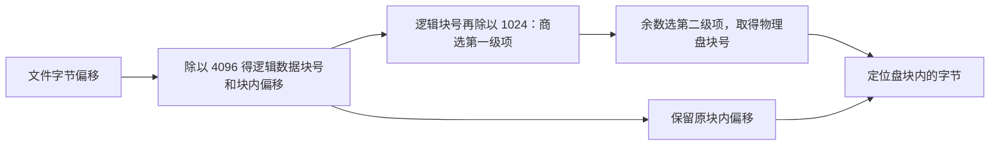

# 《操作系统》文件管理计算题（试题4）

原件共 4 页，第 1 页是封面，第 2–4 页各有一道计算题。以下保留原件的题意和答案要点，计量单位与第三题原解中的笔误另行订正。三题共同考查的是：文件内的字节偏移先决定逻辑数据块，再由 [文件的物理组织](../../../topics/操作系统/文件物理结构.md) 找到盘块。

## 计算 1：链接文件的第 1,569 逻辑字节

**题意：**文件的 5 个逻辑记录分别占一块，每块 512 字节，依次位于 50、121、75、80、63 号盘块。存取文件第 1,569 逻辑字节的信息，要访问哪个盘块？

**原件答案：**以 1,569 为逻辑字节偏移，写作 $1569=512\times 3+33$，逻辑记录编号 3，物理盘块 80。

**参考解答：**若偏移从 0 编号，商 3 表示第 4 个逻辑块，应到盘块 **80**，块内偏移 33。若把“第 1,569 个字节”严格当成从 1 开始的序号，先减 1 得偏移 1,568：仍是盘块 **80**，块内偏移改为 32。本题两种口径盘块一致，但边界处未必一致：第 512 个字节的零基偏移为 511，仍在块 50；零基偏移 512 已落在块 121。只有起点而没有缓存或辅助索引时，隐式链接需要沿 50→121→75→80 找到目标，不是把逻辑块号直接加在 50 上。

## 计算 2：两级索引可表示的最大文件

**题意：**盘块大小为 4 KB，一个盘块号占 4 字节。若用两级索引，最多能表示多长的文件？

**原件答案：**4 GB；原件将指针条目数写作“1 KB 个”。

**参考解答与订正：**按题设二进制口径，一个 4 KiB 索引块可放 $4096/4=1024$ **项**，条目数没有字节单位。两级索引中，第一级的每项指到一个二级索引块，第二级的每项才指数据块；于是能覆盖 $1024^2$ 个数据块，数据容量为 $1024^2\times4096=2^{32}$ 字节，即 **4 GiB**。这个上限假设无额外文件长度约束且各索引块只存指针；用于索引的 1 个顶层块和最多 1,024 个第二层索引块不计入文件内容字节数。

> [!TIP]
> 数==指向下一层的条目==，不要数“索引块占了多少字节”。每多一层间接索引，覆盖范围才乘一次每块可容纳的指针数；算到末尾再乘数据块字节数。4 GiB 是容量，对应的最后一个零基偏移是 $2^{32}-1$，不是 $2^{32}$。

## 计算 3：混合索引每条路径的容量

**题意：**文件的 i 节点占 128 字节，状态信息用去 68 字节；一个盘块指针占 4 字节，每块大小为 8 K。采用直接、一次间接、二次间接、三次间接指针时，各能表示多大的文件？

**原件答案要点：**算出 12 个直接指针；一次、二次、三次间接分别为 16 MB、32 G、16 TB。直接部分的原式写成“12×80K=960KB”。

**参考解答与订正：**若按原解假定各留一个一次、二次和三次间接指针，i 节点剩余空间可容纳 $(128-68)/4=15$ 个指针，故直接指针有 $15-3=12$ 个。题设块大小是 **8 KiB**，原解把 8 K 写成 80 K；直接区应为 $12\times8=96$ KiB。每个间接索引块容纳 $8192/4=2048$ 个指针，故各区如下：

| 路径 | 可寻址的数据块数 | 各区单独覆盖的数据量 |
| --- | ---: | ---: |
| 12 个直接指针 | 12 | 96 KiB |
| 一个一次间接指针 | 2,048 | 16 MiB |
| 一个二次间接指针 | $2048^2$ | 32 GiB |
| 一个三次间接指针 | $2048^3$ | 64 TiB |

三次间接一栏还要订正原件的 **16 TB**：$2048^3\times8192=2^{33}\times 2^{13}=2^{46}$ 字节，即 **64 TiB**。这是树形索引的覆盖量，不代表这个 i 节点的实际系统能储存这么大的文件。例如，若 4 字节指针最多指定全盘 $2^{32}$ 个不同盘块，且所有数据块与索引块都占用该编号空间，则全盘容量的理论上界也只有 $2^{32}\times8192=32$ TiB，真正能装的文件内容还要扣除元数据等开销。题目没给足全局条件，不能把树形覆盖量说成可实现的单文件最大值。若问四个区域合在一起的抽象覆盖量，应把四项相加；若问“只用到某一级”时应根据是否同时使用较低区域说明是否相加。
