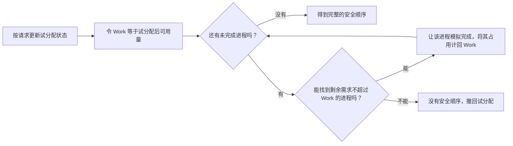

# 《操作系统》混合式课程复习知识点（2024-2025学年第一学期）

以下根据原作者的五章笔记整理，保留作者和授权，订正与新增算例另行标记。校对使用原 Markdown；原件是历史复习笔记，无独立试卷或阅卷答案。

> 整理：[@BlockLune](https://github.com/BlockLune) 协议：[CC BY-NC-SA 4.0](https://creativecommons.org/licenses/by-nc-sa/4.0/)

原笔记记载当期成绩组成是 40% 平时、60% 期末。这及原文旁注的考查范围仅供识别当期资料，不是当前课程安排。

## 第一章

### 操作系统的定义（P3）

现代操作系统是计算机系统中最为基本的一种系统软件，它是程序模块的集合。操作系统能够以尽量有效、合理的方式组织和管理计算机的软、硬件资源，合理地组织计算机的工作流程，控制程序的执行，并能够向用户提供各种服务功能，使计算机系统能够高效地运行，还能够改善人机界面，以使用户能够灵活、方便、有效地应用计算机。

以上定义包含了如下三个层次：

1. 操作系统是整个计算机系统的管理者，所有的资源都归操作系统管理。
2. 操作系统能够控制程序的执行，并且向用户提供服务功能，为计算机系统中运行的各种应用程序提供有效的支撑；程序可以有效地利用系统的资源，程序和程序之间不能互相干扰。
3. 操作系统提供的人机界面一定是友好的，应该为用户提供方便的执行操作命令行或图形化界面，同时要为程序员提供多样化的编程接口，以便有效地基于操作系统来进行开发。

知识点：[操作系统的定义与主要目标](../../../topics/操作系统/操作系统定义与目标.md)、[操作系统的主要功能（处理机管理、存储管理、设备管理、文件管理、用户接口）](../../../topics/操作系统/操作系统功能.md)、[操作系统的用户界面（命令接口、程序接口、图形接口）](../../../topics/操作系统/用户界面.md)

### 操作系统的特性（P5 - P7）

1. 并发性。这是指两个或两个以上的事件 / 活动在同一时间间隔内发生。其包括宏观和微观两个层面：宏观上，多个程序在计算机系统内同时执行；在单核模型中，同一时刻只有一个执行流在该核心运行；多核系统中的不同执行流也可能真正并行。
2. 共享性。计算机系统中的资源可被多个并发执行的用户程序和系统程序共同使用。共享形式可以分为顺序性共享和竞争性共享两种形式，前者即轮流使用，后者表示竞争式地使用资源。
3. 不确定性。此处指异步性：不能预先固定所有事件的交错和进程推进速度，不要求系统具备统计意义上的随机性。在多道程序并发执行的环境中，各程序之间存在着直接或间接的联系，程序的推进速度会受到运行环境的影响。系统中许多随机性事件打断了正在执行的程序，因此，在程序的执行过程中就产生了不确定性的因素。
4. 虚拟性。这是指在物理上没有提供，在逻辑上却具备的功能，在用户看来好像是物理上原来就具有的功能一样。采用虚拟技术的目的是提高资源利用率和为用户提供易于使用、方便高效的操作环境。操作系统中的虚拟化技术，可以把物理上的一个资源实体（如 CPU）逻辑上的多个对应物，或者把物理上的多个实体变成逻辑上的一个对应物。

现代操作系统的 4 个特性不是相互独立的，而是彼此密切关联的。

- 并发和共享是操作系统的两个最基本特征，它们有时互为存在的条件。
- 虚拟技术为共享提供了更好的条件，而并发和共享是导致不确定性的根本原因。

知识点：[现代操作系统的特征（并发、共享、虚拟、异步）](../../../topics/操作系统/操作系统特征.md)

### 操作系统的种类

1. 桌面操作系统
    - Windows 系列（Windows 10/11 等）
    - macOS
    - Linux 发行版（Ubuntu、Fedora、CentOS 等）
2. 移动操作系统
    - Android（Google）
    - iOS（Apple）
    - HarmonyOS（华为）
3. 服务器操作系统
    - Windows Server
    - Linux 服务器版本（Red Hat、Ubuntu Server 等）
    - Unix 系统（如 IBM AIX、HP-UX 等）
4. 嵌入式操作系统
    - Linux 嵌入式版本
    - Windows IoT
    - QNX
    - VxWorks
5. 实时操作系统（RTOS）
    - FreeRTOS
    - QNX
    - VxWorks
    - RT-Thread

## 第二章

知识点：[操作系统三种基本类型（批处理、分时、实时）及其主要目标](../../../topics/操作系统/操作系统基本类型.md)、[操作系统的定义与主要目标](../../../topics/操作系统/操作系统定义与目标.md)

### 进程的定义（P17）

进程是具有独立功能的程序关于某个数据集合上的一次运行活动，是系统进行资源分配、调度和保护的独立单位。

知识点：[进程的定义与特征（动态性、并发性、独立性、制约性、异步性、结构性）](../../../topics/操作系统/进程定义与特征.md)

### 进程的类型（P17）

- 系统进程：操作系统自身的模块、程序在计算机系统中运行时系统为它们创建的进程
- 用户进程：用户的应用程序在计算机系统中运行时创建的进程

知识点：[进程的定义与特征（动态性、并发性、独立性、制约性、异步性、结构性）](../../../topics/操作系统/进程定义与特征.md)

### 进程的结构（P17）

程序代码、数据、进程控制块、堆栈

知识点：[进程的定义与特征（动态性、并发性、独立性、制约性、异步性、结构性）](../../../topics/操作系统/进程定义与特征.md)、[进程控制块（PCB）的作用与内容](../../../topics/操作系统/进程控制块.md)

### 进程的特性（P17）

1. 结构性。进程由程序、数据、进程控制块、栈构成。
2. 共享性。多个进程在系统中共享各种资源，包括 CPU、内存、I/O 设备、数据文件等。
3. 动态性。进程在系统中有诞生、有消亡，是动态变化的。进程的整个生命周期体现出动态性特征。
4. 独立性。系统中并发运行的多个进程是独立运行的，分别使用分给它们的相应资源，按照自己的逻辑往前推进和执行。
5. 制约性。多个进程在系统中并发运行时，既可能彼此协作，也可能彼此竞争，体现了制约性。
6. 并发性。多个进程在系统中并发运行，分时、分空间地使用 CPU 和内存等资源，并发地向前推进。

知识点：[进程的定义与特征（动态性、并发性、独立性、制约性、异步性、结构性）](../../../topics/操作系统/进程定义与特征.md)、[现代操作系统的特征（并发、共享、虚拟、异步）](../../../topics/操作系统/操作系统特征.md)

### 进程和程序的区别（P18）

1. 进程能真实地描述系统中的并发特征，程序不能。
2. 进程是由程序、数据、进程控制块、栈等部分构成的，程序其实是进程的一部分。
3. 程序本质是代码集合，是静态的，而进程是一次活动，在不同状态之间切换，体现出动态性的特征。
4. 进程是有生命周期的，有诞生、有消亡，相对来讲比较短暂；而程序可以保存在辅存上，长久存在。
5. 一个程序在系统中可以演化为多个进程，而一个进程可以涉及多个程序。这时，进程和程序不再仅仅是一一对应的关系，也可能是一对多，还可能是多对一的关系。
6. 进程可以创建子进程，程序不能创建子程序。

知识点：[进程与程序的区别与联系](../../../topics/操作系统/进程与程序区别.md)、[进程的定义与特征（动态性、并发性、独立性、制约性、异步性、结构性）](../../../topics/操作系统/进程定义与特征.md)、[进程的基本状态（就绪、执行、阻塞）及状态转换](../../../topics/操作系统/进程状态转换.md)

### 进程状态（P18）

#### 最基本的三态

- 运行态：进程正在 CPU 上运行，即正在执行指令。
- 就绪态：进程已经准备好要到 CPU 上运行了，但是因为某些原因（例如 CPU 上其他程序正在执行）不能切换到运行状态。
- 等待态：又称阻塞态、封锁态、睡眠态。进程正在等待某事件发生，抑或是等待某信号、某种资源，但那个事件尚未完成。等到那个事件完成了，就会转变为就绪态。

运行和就绪态可以相互转换；运行可以转换为等待；等待可以转换成就绪。

#### 进程的五态模型

除了最基本的三态，再加上两个状态：

- 新建态：进程刚刚创建，但系统还没有允许它执行，而且它所需的一些资源还没有完全被满足。一旦这些资源得到了满足，它就会转变为就绪态。
- 终止态：进程正常结束或异常终止即进入该状态。此时的进程不再具有执行权限。待操作系统进一步处理后，该状态的进程就会被删除。

#### 进程的七态模型

在五态模型的基础上再加上两个状态。但首先，应先了解一下 “挂起” 的概念。

挂起使进程暂时不参加正常调度。课件模型可结合换出释放内存，但“挂起”是状态属性，不要求每个实现总将整个进程写到辅存。

挂起的逆操作是激活。

下面是新增的两种状态：

- 就绪挂起态：在进程的就绪态被挂起
- 等待挂起态：进程既未满足所等条件，又处于挂起。

补充：等待挂起态的事件完成后先到就绪挂起；不激活就不能被处理机选中。

知识点：[进程的基本状态（就绪、执行、阻塞）及状态转换](../../../topics/操作系统/进程状态转换.md)、[进程的定义与特征（动态性、并发性、独立性、制约性、异步性、结构性）](../../../topics/操作系统/进程定义与特征.md)、[原语的概念与进程控制原语（创建、撤销、阻塞、唤醒）](../../../topics/操作系统/原语.md)

### 处理器调度（P24）

#### 模式

- 低级调度（进程调度）：处理器资源。就绪、等待、运行
- 中级调度（平衡负载调度）：内存资源。挂起、激活
- 高级调度（作业调度）：从后备作业中决定哪些可以接纳进入系统，典型情况下为其建立相应执行实体；进程退出并非高级调度的定义。

#### 指标

令作业 $i$ 的到达、完成、实际服务时间分别为 $a_i,c_i,s_i$（$s_i>0$）。周转时间是 $T_i=c_i-a_i$，带权周转时间是 $W_i=T_i/s_i$。

**订正：**原稿中“平均周转时间”和“平均带权周转时间”只写一项除任务数，计算时必须先对各作业求和：
$$
\overline T=\frac{\sum_{i=1}^n T_i}{n},\qquad
\overline W=\frac{\sum_{i=1}^n W_i}{n}.
$$

> [!TIP]
> ==平均带权周转==要先对每个作业分别除以它自己的实际服务时间，再求平均；不能把平均周转时间除以平均服务时间。

**补充验算：**两个作业的 $(a_i,c_i,s_i)$ 分别为 $(0,4,3)$、$(3,9,5)$，故平均周转为 $(4+6)/2=5$，平均带权周转为 $(4/3+6/5)/2=19/15$。用平均周转除以平均服务时间只得到 $5/4$，与正确结果不同。

#### 单道、多道

单道系统一次只让一个用户作业占据执行环境，等待外设时处理机可能空闲。多道系统中可让其他就绪作业趁此推进。这里的“多道”强调同时管理多个作业，不要求它们在同一时刻占用多个核心。

知识点：[处理机的三级调度（高级、中级、低级调度）](../../../topics/操作系统/处理机调度级别.md)、[作业调度算法及性能评价（周转时间、带权周转时间）](../../../topics/操作系统/作业调度算法.md)、[进程调度算法（FCFS、SJF、优先级、时间片轮转、多级反馈队列）](../../../topics/操作系统/进程调度算法.md)

### 进程的同步和互斥（P37）

同步是指多个进程之间为完成共同任务而相互协调执行次序的过程。

互斥是指多个进程在同一时刻只能有一个进程访问共享资源。

实现方法主要包括：

1. 信号量机制（参考[《信号量小书》](https://blog.csdn.net/booksyhay/article/details/82692362)）
2. 互斥锁
3. 管程
4. 条件变量
5. 事件机制

知识点：[临界区、临界资源与互斥的概念](../../../topics/操作系统/临界区与互斥.md)、[信号量机制与P、V操作的定义](../../../topics/操作系统/信号量与PV操作.md)

### 死锁

死锁是指系统中两个或两个以上进程无限期地永远等待永远不会满足的条件，永远在等待着永远得不到的资源而处于停滞状态。（P62）

死锁产生的**必要**条件（注意是 “必要”，即即使 4 个条件都满足，死锁也不一定产生）（P64）：

1. 互斥使用
2. 不可抢占
3. 请求和保持
4. 循环等待

死锁的预防（P64）：

1. 破坏 “不可抢占” 条件
2. 破坏 “请求和保持” 条件
3. 破坏 “循环等待” 条件

死锁的避免（P65）：在系统运行前不做硬性规定，在系统运行过程中再对进程的每一次资源申请进行动态检查，并根据检查结果来决定是否分配。

死锁的检测和解决（P68）：允许死锁的产生（比起预防和避免，产生的系统开销较低）。但是操作系统要不断监视系统的进展情况，判断当前是不是确实有死锁产生。一旦死锁确实产生了，系统就要采取专门的措施来解除死锁，并恢复系统的运行。

知识点：[死锁的定义与四个必要条件（互斥、请求保持、不可剥夺、循环等待）](../../../topics/操作系统/死锁概念与必要条件.md)、[死锁的预防方法与避免方法（银行家算法）](../../../topics/操作系统/死锁预防与避免.md)、[死锁的检测（资源分配图）与解除方法](../../../topics/操作系统/死锁检测与解除.md)

### 银行家算法

原件此处只给一条资料链接。

**补充：**在试分配后的状态，用系统可用量作为 Work。每次找其最大剩余需求逐项不超过 Work 的未完成进程，假设它完成、把原已占资源计回 Work；若找不到下一项，则试分配不安全，应撤回。请求须先满足不超出剩余申报与当前可用量，才能进入试算。

不安全并不等于当前已发生死锁，正如最大申报的需求不等同于已经发出的请求。

## 第三章

知识点：[死锁的预防方法与避免方法（银行家算法）](../../../topics/操作系统/死锁预防与避免.md)

### 内存

知识点：[存储管理的基本功能与地址转换（地址重定位）](../../../topics/操作系统/存储管理功能.md)、[页式存储管理的基本原理与地址转换](../../../topics/操作系统/分页存储管理.md)、[虚拟存储器的基本思想与局部性原理](../../../topics/操作系统/虚拟存储器.md)

### 连续式（P80）

单道顺序环境下，内存一分为二（操作系统区和用户区），由栅栏寄存器用于存放界限地址。

知识点：[存储管理的基本功能与地址转换（地址重定位）](../../../topics/操作系统/存储管理功能.md)、[连续分配方式（单一连续、固定分区、动态分区）及分配算法](../../../topics/操作系统/连续分配方式.md)

### 分区式（P81）

进一步将用户区划分为多个区域，每个区域一个进程。

- 固定分区（优点：简单、容易实现；缺点：内存利用率低、不够灵活）
  - 等长分区
  - 不等长分区：内存分区表（分区号、起始地址、长度、状态、进程号）
- 可变分区（优点：灵活度更高；缺点：实现复杂，存在内存碎片问题）
  - 空闲区表 + 已分配区表

知识点：[连续分配方式（单一连续、固定分区、动态分区）及分配算法](../../../topics/操作系统/连续分配方式.md)、[可变分区分配算法（首次适应、最佳适应、最差适应）](../../../topics/操作系统/可变分区分配算法.md)、[存储管理的基本功能与地址转换（地址重定位）](../../../topics/操作系统/存储管理功能.md)

### 分页式（P86）

进程的逻辑地址空间按**固定大小**分为若干页面，不足一页补齐一页。常见页面大小包括 4KB、8KB、16KB 等。

在存储时，逻辑上相邻的页面在物理存储时不一定是相邻的。

把逻辑字节地址除以页大小，商是页号、余数是页内偏移。查页表取得有效且允许访问的驻留页框后，用页框地址加同一个偏移。请求分页需要另判断有效地址的驻留状态；统计第 96 页置换类题目时，缺页率是缺页次数除以访问次数，初始装入是否计入应看题设。

**订正：**物理分配单位固定不等于“解决了所有碎片”。页面无需连续放置，但末页可能有内部碎片。分页也能共享：让不同进程中的页映射到同一物理页框，并以权限约束共享方式，例如只读代码。

知识点：[页式存储管理的基本原理与地址转换](../../../topics/操作系统/分页存储管理.md)、[页面置换算法（OPT、FIFO、LRU、Clock、LFU）](../../../topics/操作系统/页面置换算法.md)、[存储管理的基本功能与地址转换（地址重定位）](../../../topics/操作系统/存储管理功能.md)

### 分段式（P90）

按程序的逻辑单位划分可变长度段，地址由段号和段内偏移组成。先用段表查基址和段长，偏移合法才可转换。

优点：适合代码共享、数据共享，便于动态连接；缺点：继承了可变分区存储中的碎片问题（P93）

知识点：[段式存储管理的基本原理与地址转换](../../../topics/操作系统/分段存储管理.md)、[分页与分段的区别](../../../topics/操作系统/分页与分段区别.md)、[连续分配方式（单一连续、固定分区、动态分区）及分配算法](../../../topics/操作系统/连续分配方式.md)

### 段页式（P93）

先按逻辑意义分段，再把每一段细分成页。给定段号、段内页号和页内偏移，要先查段表取得该段页表并核对段内范围，再查页表得到物理页框。

## 第四章

知识点：[段页式存储管理的基本原理](../../../topics/操作系统/段页式存储管理.md)

### 设备控制方式（P105）

- 询问方式：CPU 启动 I/O 设备，并反复检测其是否就绪（即所谓 “询问”）
- 基于中断：I/O 设备通过中断来主动报告自身状态
- 基于 DMA：DMA 控制器来负责数据的传输过程，作为 CPU 的助手，传输完成后再通知 CPU
- 基于通道：通道可执行 I/O 指令序列并自主组织一组操作；相比 DMA 只负责已设置的传输，通道在教材模型中承担更多控制。处理机仍需提交任务并处理完成或异常，两者都不能写成绝对不涉及处理机。

知识点：[I/O控制方式（程序查询、中断、DMA、通道）及比较](../../../topics/操作系统/IO控制方式.md)、[DMA控制器的组成与四种寄存器的作用](../../../topics/操作系统/DMA控制器.md)、[通道的概念与作用](../../../topics/操作系统/通道概念.md)

### 缓冲技术（P107）

单缓冲、双缓冲、循环缓冲、缓冲池等

- 改善主机与 I/O 设备之间速度不匹配的问题
- 提高 CPU 与 I/O 设备的并行性，提高资源利用率
- 减少 I/O 中断次数，放宽对 CPU 中断响应的要求

知识点：[缓冲技术的引入目的与类型（单缓冲、双缓冲、循环缓冲）](../../../topics/操作系统/缓冲技术.md)

### 外存储（P109）

访问磁盘上的数据，依赖于：（P110）

- 柱面号 / 磁道号：数据位于哪个半径的磁道上（磁道是同心圆，不要按半径习惯猜磁道编号方向；计算时按题给编号和方向约定）
- 磁头号 / 盘面号：数据位于哪个盘面上
- 块号 / 扇区号：数据位于某磁道的哪一个扇区（扇区是磁道同心圆上的一块区域）

磁盘的数据访问时间包括：（P110）

- 寻道时间：磁头移动到指定磁道所花时间。原笔记的线性关系是习题近似，不是所有机械盘的物理定律：

$$
T = T_{磁头臂启动时间} + T_{移动一条磁道} \times 磁道数
$$

- 旋转延迟时间：磁头已经定位到磁道，等待扇区移动到磁头下方的时间

- 数据传输时间：磁头定位到扇区后，从磁盘读取或向磁盘写入数据所花的时间

磁头臂驱动算法：（P111）

- 先来先服务：按入队次序处理。
- 最短寻道时间优先：按当前磁头重新找最近请求，远处请求可能饥饿。
- 电梯：沿当前运动方向，选择距磁头驱动臂移动方向最近的柱面，如果没有访问请求，才改变移动方向
- 扫描：与电梯的区别在于，扫描会将磁头移动到最大 / 最小磁道
- 单向扫描：只在一个扫掠方向提供服务，空返段不处理请求；题目若问总移动量，应说明是否计入空返。
- 原件称分步扫描不考，只反映当期笔记。

## 第五章

位示图按位记录盘块占用情况（P117）；0 和 1 哪个表示空闲，要以题设约定为准。

知识点：[磁盘调度算法（FCFS、SSTF、SCAN、CSCAN）](../../../topics/操作系统/磁盘调度算法.md)、[文件存储空间的管理方法（位示图法、空闲表法、空闲链表法）](../../../topics/操作系统/文件存储空间管理.md)

### 文件目录结构（P119）

一级目录共享一个命名空间；二级目录可在各用户目录下重用名称；多级目录按路径组织文件。目录层次是“如何命名”，与选用哪种物理分配结构相互独立。

知识点：[文件目录结构（单级、二级、多级目录）及特点](../../../topics/操作系统/文件目录结构.md)、[操作系统的主要功能（处理机管理、存储管理、设备管理、文件管理、用户接口）](../../../topics/操作系统/操作系统功能.md)

### 文件物理结构（P120）

顺序文件结构：

- 将逻辑上连续的文件信息存放在存储介质内依次**相邻**的物理块上
- 记录信息：文件名、始址、块数
- 插入删除开销大

链接文件结构：

- 将在逻辑上连续的文件信息存放在不连续的物理块上。在每个物理块中设一个指针指向下一个物理块
- 读取性能低于顺序文件结构，但在插入删除方面有优势

索引文件结构：

- 将逻辑上连续的文件信息存放在不连续的物理块上，并为每个文件建立索引表
- 记录信息：文件名、索引表地址、索引表内容（逻辑块号与物理块号的对应关系）
- 索引支持按逻辑块号寻找物理块，无须像隐式链接那样逐个遍历。代价是索引块开销；若未缓存，多级索引也会增加查表访问。

## 补充

（这里是原来资料漏掉的，后来补充的内容）

原件列“有空让进、无空等待、多种择一、有限等待”。按含义分别核对：空闲应允许请求者取得，已占用时其他请求者等待，有多个竞争者仍只选一个，不得让某个持续等待者无限被越过。不要只凭是否出现自旋就判断是否满足全部条件。

知识点：[文件的物理结构（连续、链接、索引、混合索引）](../../../topics/操作系统/文件物理结构.md)、[连续文件的优缺点](../../../topics/操作系统/连续文件优缺点.md)
