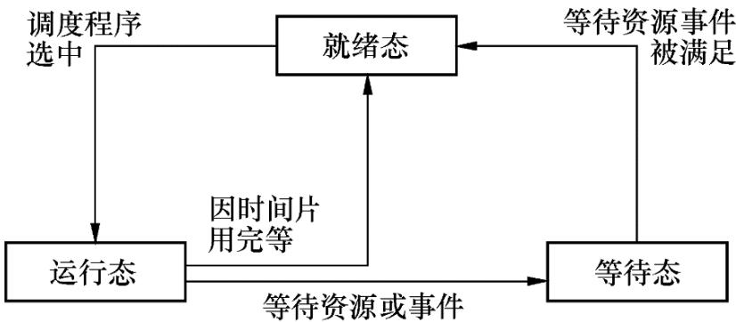

# 《操作系统》知识点重点复习

原件经识别和整理；“参考解答”是我们补的。

## 第一章 操作系统概论

### 概论 1

操作系统的作用：

- 用户观点：用户与计算机硬件系统之间的接口。
- 资源管理观点：计算机系统资源的管理者。

知识点：[操作系统的定义与主要目标](../../../topics/操作系统/操作系统定义与目标.md)

### 概论 2

操作系统访问方法：系统调用。

知识点：[操作系统的主要功能（处理机管理、存储管理、设备管理、文件管理、用户接口）](../../../topics/操作系统/操作系统功能.md)、[操作系统的用户界面（命令接口、程序接口、图形接口）](../../../topics/操作系统/用户界面.md)

### 概论 3

操作系统的定义：

操作系统是一组用于控制和管理计算机系统中的所有资源的程序集合，其任务是合理地组织计算机的工作流程，有效地组织诸资源协调一致的工作以完成各种任务，从而达到充分发挥资源效率、方便用户使用计算机之目的。

知识点：[操作系统的定义与主要目标](../../../topics/操作系统/操作系统定义与目标.md)

### 概论 4

操作系统的资源：

硬件资源（处理器、存储器、I/O 设备）与信息资源（程序/数据）。

知识点：[操作系统的主要功能（处理机管理、存储管理、设备管理、文件管理、用户接口）](../../../topics/操作系统/操作系统功能.md)

### 概论 5

多道程序设计技术的定义：

多道程序设计是指允许多个程序（作业）同时进入一个计算机系统的内存储器并启动进行交替计算的方法。

知识点：[操作系统三种基本类型（批处理、分时、实时）及其主要目标](../../../topics/操作系统/操作系统基本类型.md)、[进程的定义与特征（动态性、并发性、独立性、制约性、异步性、结构性）](../../../topics/操作系统/进程定义与特征.md)

### 概论 6

操作系统的功能：

- 处理器管理（对进程/线程的管理和调度）
- 存储管理（主要功能）
- 设备管理（磁盘管理计算）
- 文件管理（文件组织结构）
- 网络管理（不考）
- 提供良好的用户界面

知识点：[操作系统的主要功能（处理机管理、存储管理、设备管理、文件管理、用户接口）](../../../topics/操作系统/操作系统功能.md)

### 概论 7

操作系统的特性：

并发性、共享性（基本特征）、不确定性、虚拟性（重要特征）。

知识点：[现代操作系统的特征（并发、共享、虚拟、异步）](../../../topics/操作系统/操作系统特征.md)

### 概论 8

批处理的概念、类型：

联机批处理、脱机批处理。

知识点：[操作系统三种基本类型（批处理、分时、实时）及其主要目标](../../../topics/操作系统/操作系统基本类型.md)

### 概论 9

通道和中断技术的定义：

通道是一种专门处理部件，它能控制一台或多台外设工作，负责外部设备和内存之间的信息传输。

中断是指当主机接到外部信号时，马上停止原来的工作，转去处理这一事件，处理完毕之后，主机又回到原来的断点继续工作。

知识点：[中断的概念、类型与处理过程](../../../topics/操作系统/中断机制.md)、[通道的概念与作用](../../../topics/操作系统/通道概念.md)、[I/O控制方式（程序查询、中断、DMA、通道）及比较](../../../topics/操作系统/IO控制方式.md)

### 概论 10

多道/单道程序系统阶段的区别：

单道程序系统阶段中，内存里只有一道程序在运行，设备利用率低，系统性能较差。

多道程序设计允许多个程序同时进入一个计算机系统的内存储器并启动进行交替计算。其具有多道，宏观上并行，微观上串行的特征。

知识点：[现代操作系统的特征（并发、共享、虚拟、异步）](../../../topics/操作系统/操作系统特征.md)、[操作系统的定义与主要目标](../../../topics/操作系统/操作系统定义与目标.md)

### 概论 11

单道/多道批处理系统的区别（各自定义、特点）：

单道批处理系统中，作业按批量顺序进入内存，每次只有一道作业在内存中运行，该作业运行结束或出现异常时，由监督程序控制自动装入下一道作业运行。其特点为单道性、顺序性、自动性。

多道批处理系统中，用户提交的作业先在外存排成一个后备队列，由作业调度程序按照一定的策略从中选择若干作业调入内存运行，共享系统中的各种资源。其特点为多道性、调度性、无序性。

知识点：[操作系统三种基本类型（批处理、分时、实时）及其主要目标](../../../topics/操作系统/操作系统基本类型.md)

### 概论 12

分时操作系统的定义、特征：

分时系统是指一台主机与多个终端相连，允许多个用户通过终端同时以交互的方式使用计算机系统，共享资源。

把 CPU 时间分割成一定大小的时间段，每个时间段为一个时间片，每个终端用户每次可以使用一个由时间片规定的 CPU 时间。这样，多个终端用户就轮流地使用 CPU。

其具有同时性、独立性、及时性、交互性的特征。

知识点：[操作系统三种基本类型（批处理、分时、实时）及其主要目标](../../../topics/操作系统/操作系统基本类型.md)、[分时系统的工作原理与特征](../../../topics/操作系统/分时系统工作原理.md)

### 概论 13

Linux 系统的特点：

多用户、多线程、多进程、实时性好、功能强大而稳定。

知识点：[操作系统的定义与主要目标](../../../topics/操作系统/操作系统定义与目标.md)

### 概论 14

课后习题 1/2/4/5/7/8/9/10/11。

## 第二章 用户界面

知识点：[操作系统的主要功能（处理机管理、存储管理、设备管理、文件管理、用户接口）](../../../topics/操作系统/操作系统功能.md)、[操作系统的用户界面（命令接口、程序接口、图形接口）](../../../topics/操作系统/用户界面.md)

### 用户界面 1

用户界面的形式：

联机命令/系统调用/图形接口。

知识点：[操作系统的用户界面（命令接口、程序接口、图形接口）](../../../topics/操作系统/用户界面.md)、[操作系统的定义与主要目标](../../../topics/操作系统/操作系统定义与目标.md)

### 用户界面 2

系统调用本质上是应用程序请求操作系统内核完成某功能时的一种过程调用。

知识点：[操作系统的用户界面（命令接口、程序接口、图形接口）](../../../topics/操作系统/用户界面.md)、[操作系统的主要功能（处理机管理、存储管理、设备管理、文件管理、用户接口）](../../../topics/操作系统/操作系统功能.md)

### 用户界面 3

系统调用的实现：

访管指令/陷入指令/异常中断指令（记名字即可）。

知识点：[中断的概念、类型与处理过程](../../../topics/操作系统/中断机制.md)、[操作系统的用户界面（命令接口、程序接口、图形接口）](../../../topics/操作系统/用户界面.md)

### 用户界面 4

课后习题 2/3。

## 第三章 进程管理与调度

知识点：[操作系统的用户界面（命令接口、程序接口、图形接口）](../../../topics/操作系统/用户界面.md)

### 进程管理 1

管态/目态的定义、转换：

管态：操作系统管理程序运行的状态。

目态：用户程序运行时的状态。

目态到管态：通过中断。

管态到目态：设置 PSW（程序状态字）。

知识点：[中断的概念、类型与处理过程](../../../topics/操作系统/中断机制.md)、[操作系统的主要功能（处理机管理、存储管理、设备管理、文件管理、用户接口）](../../../topics/操作系统/操作系统功能.md)

### 进程管理 2

中断：

定义：CPU 对系统中或系统外发生异步事件的响应。

分类（图 3.3）：

知识点：[中断的概念、类型与处理过程](../../../topics/操作系统/中断机制.md)

### 进程管理 3

JCB、PCB 工作状态。

知识点：[进程控制块（PCB）的作用与内容](../../../topics/操作系统/进程控制块.md)、[处理机的三级调度（高级、中级、低级调度）](../../../topics/操作系统/处理机调度级别.md)

### 进程管理 4

进程的概念：

进程是具有独立功能的程序关于某个数据集合上的一次运行活动，是系统进行资源分配、调度和保护的独立单位。

知识点：[进程的定义与特征（动态性、并发性、独立性、制约性、异步性、结构性）](../../../topics/操作系统/进程定义与特征.md)、[进程与程序的区别与联系](../../../topics/操作系统/进程与程序区别.md)、[操作系统的主要功能（处理机管理、存储管理、设备管理、文件管理、用户接口）](../../../topics/操作系统/操作系统功能.md)

### 进程管理 5

进程与程序的区别：

1. 进程更能真实地描述并发，程序不能。
2. 进程是由程序、数据和控制块三部分组成的。
3. 程序是静态的，进程是动态的。
4. 进程有生命周期，有诞生有消亡，程序相对长久。
5. 一个程序可以对应多个进程，反之亦然。
6. 进程具有创建其他进程的功能，程序没有。

知识点：[进程与程序的区别与联系](../../../topics/操作系统/进程与程序区别.md)

### 进程管理 6

进程和作业的关系。

知识点：[进程的定义与特征（动态性、并发性、独立性、制约性、异步性、结构性）](../../../topics/操作系统/进程定义与特征.md)、[进程与程序的区别与联系](../../../topics/操作系统/进程与程序区别.md)

### 进程管理 7

进程的状态与转换（重点三态（定义、图 3-4），5/7 简单看）：

运行态：进程占有 CPU，并在 CPU 上运行。

就绪态：一个进程已经具备运行条件，由于无 CPU 暂时不能运行。

等待态：因等待某种事件的发生而暂时不能运行的状态。

知识点：[进程的基本状态（就绪、执行、阻塞）及状态转换](../../../topics/操作系统/进程状态转换.md)、[进程的定义与特征（动态性、并发性、独立性、制约性、异步性、结构性）](../../../topics/操作系统/进程定义与特征.md)、[原语的概念与进程控制原语（创建、撤销、阻塞、唤醒）](../../../topics/操作系统/原语.md)

### 进程管理 8

图 3-7：

进程控制块是操作系统为了管理进程而设置的一个专门的数据结构，用它来记录进程的外部特征，描述进程的运动变化过程。

| 进程描述信息 |
| --- |
| 进程控制信息 |
| 所拥有的资源和使用情况 |
| CPU 现场保护信息 |

知识点：[进程控制块（PCB）的作用与内容](../../../topics/操作系统/进程控制块.md)、[进程的定义与特征（动态性、并发性、独立性、制约性、异步性、结构性）](../../../topics/操作系统/进程定义与特征.md)、[操作系统的主要功能（处理机管理、存储管理、设备管理、文件管理、用户接口）](../../../topics/操作系统/操作系统功能.md)

### 进程管理 9

进程创建的方式（调用原语，fork()）：

- 由系统程序模块统一创建。
- 由父进程创建。

知识点：[原语的概念与进程控制原语（创建、撤销、阻塞、唤醒）](../../../topics/操作系统/原语.md)、[进程控制块（PCB）的作用与内容](../../../topics/操作系统/进程控制块.md)

### 进程管理 10

处理操作系统的调度模型（定义，简述题）。

知识点：[处理机的三级调度（高级、中级、低级调度）](../../../topics/操作系统/处理机调度级别.md)、[进程调度算法（FCFS、SJF、优先级、时间片轮转、多级反馈队列）](../../../topics/操作系统/进程调度算法.md)

### 进程管理 11

作业和进程的关系：

1. 作业是用户向计算机提交任务的任务实体，进程是完成用户任务的执行实体。
2. 一个作业可由多个进程组成，且必须至少由一个进程组成，反之不成立。
3. 作业的概念主要用在批处理系统中，进程的概念用在几乎所有的多道程序系统中。

知识点：[作业调度算法及性能评价（周转时间、带权周转时间）](../../../topics/操作系统/作业调度算法.md)、[进程的定义与特征（动态性、并发性、独立性、制约性、异步性、结构性）](../../../topics/操作系统/进程定义与特征.md)、[操作系统三种基本类型（批处理、分时、实时）及其主要目标](../../../topics/操作系统/操作系统基本类型.md)

### 进程管理 12

作业调度算法：

- 先来先服务算法（FCFS）：按照作业提交的先后次序分派 CPU。
- 最短作业优先算法（SJF）：对预计执行时间短的作业优先分派处理机。
- 最短剩余时间优先算法（SRTF）。
- 最高响应比优先算法（HRN）：$R=\text{作业周转时间}/\text{作业处理时间}=1+(\text{作业等待时间}/\text{作业处理时间})$。
- 基于优先数调度算法（HPF）。
- 均衡调度算法。

知识点：[进程调度算法（FCFS、SJF、优先级、时间片轮转、多级反馈队列）](../../../topics/操作系统/进程调度算法.md)

### 进程管理 13

进程与线程的区别：

1. 进程是资源分配的基本单位，线程与资源分配无关。
2. 进程发生调度时，不同的进程拥有不同的虚拟地址空间，同一进程内的不同线程共享同一地址空间。
3. 线程只由相关堆栈、寄存器和线程控制块组成。
4. 线程切换时不涉及资源指针的保存以及地址空间的变化问题。
5. 进程间的关系比较疏远。

知识点：[线程的概念及与进程的区别](../../../topics/操作系统/线程概念.md)、[进程与程序的区别与联系](../../../topics/操作系统/进程与程序区别.md)

### 进程管理 14

习题 2/3/4/5。

## 第四章 并发进程

知识点：[进程的定义与特征（动态性、并发性、独立性、制约性、异步性、结构性）](../../../topics/操作系统/进程定义与特征.md)、[临界区、临界资源与互斥的概念](../../../topics/操作系统/临界区与互斥.md)、[经典进程同步问题（生产者-消费者、读者-写者、哲学家进餐）](../../../topics/操作系统/经典同步问题.md)

### 并发进程 1

并发和同步的关系。

知识点：[现代操作系统的特征（并发、共享、虚拟、异步）](../../../topics/操作系统/操作系统特征.md)、[信号量机制与P、V操作的定义](../../../topics/操作系统/信号量与PV操作.md)

### 并发进程 2

同步和互斥的区别（PV 操作中场景的对应）：

同步：根据一定的时序关系合作完成一项任务。并发进程因直接制约而互相等待，彼此互相发送消息进行合作，使得各进程按一定的速度执行。

互斥：各进程竞争使用临界资源。互斥是同步的一种特殊情况。

知识点：[临界区、临界资源与互斥的概念](../../../topics/操作系统/临界区与互斥.md)、[信号量机制与P、V操作的定义](../../../topics/操作系统/信号量与PV操作.md)

### 并发进程 3

进程同步：系统中多个进程中发生的事件存在某种时序关系。

知识点：[进程的定义与特征（动态性、并发性、独立性、制约性、异步性、结构性）](../../../topics/操作系统/进程定义与特征.md)、[临界区、临界资源与互斥的概念](../../../topics/操作系统/临界区与互斥.md)

### 并发进程 4

使用临界区的规则：

1. 有空让进
2. 无空等待
3. 多中择一
4. 有限等待
5. 让权等待

知识点：[临界区、临界资源与互斥的概念](../../../topics/操作系统/临界区与互斥.md)、[进程的定义与特征（动态性、并发性、独立性、制约性、异步性、结构性）](../../../topics/操作系统/进程定义与特征.md)、[原语的概念与进程控制原语（创建、撤销、阻塞、唤醒）](../../../topics/操作系统/原语.md)

### 并发进程 5

进程间通信方式：

主从式、会话式、消息队列或邮箱方式、共享存储区方式、直接通信、间接通信。

知识点：[进程通信方式（共享存储、消息传递、管道通信）](../../../topics/操作系统/进程通信.md)、[进程的定义与特征（动态性、并发性、独立性、制约性、异步性、结构性）](../../../topics/操作系统/进程定义与特征.md)

### 并发进程 6

产生死锁的原因、必要条件、预防、避免、检测、解除。

知识点：[死锁的定义与四个必要条件（互斥、请求保持、不可剥夺、循环等待）](../../../topics/操作系统/死锁概念与必要条件.md)、[死锁的预防方法与避免方法（银行家算法）](../../../topics/操作系统/死锁预防与避免.md)、[死锁的检测（资源分配图）与解除方法](../../../topics/操作系统/死锁检测与解除.md)

### 并发进程 7

管程的定义：

一个管程定义了一个数据结构和能为并发进程所执行的一组操作，这组操作能同步进程和改变管程中的数据。

知识点：[经典进程同步问题（生产者-消费者、读者-写者、哲学家进餐）](../../../topics/操作系统/经典同步问题.md)、[信号量机制与P、V操作的定义](../../../topics/操作系统/信号量与PV操作.md)

### 并发进程 8

习题 14/15/17。

## 第五章 存储管理

知识点：[现代操作系统的特征（并发、共享、虚拟、异步）](../../../topics/操作系统/操作系统特征.md)、[进程的定义与特征（动态性、并发性、独立性、制约性、异步性、结构性）](../../../topics/操作系统/进程定义与特征.md)

### 存储管理 1

存储分配的方式：

静态分配、动态分配。

知识点：[存储管理的基本功能与地址转换（地址重定位）](../../../topics/操作系统/存储管理功能.md)、[连续分配方式（单一连续、固定分区、动态分区）及分配算法](../../../topics/操作系统/连续分配方式.md)、[可变分区分配算法（首次适应、最佳适应、最差适应）](../../../topics/操作系统/可变分区分配算法.md)

### 存储管理 2

重定位的概念。

知识点：[存储管理的基本功能与地址转换（地址重定位）](../../../topics/操作系统/存储管理功能.md)

### 存储管理 3

分区存储管理（无问答题）：固定分区、可变分区。

知识点：[连续分配方式（单一连续、固定分区、动态分区）及分配算法](../../../topics/操作系统/连续分配方式.md)、[可变分区分配算法（首次适应、最佳适应、最差适应）](../../../topics/操作系统/可变分区分配算法.md)

### 存储管理 4

分配算法。

知识点：[存储管理的基本功能与地址转换（地址重定位）](../../../topics/操作系统/存储管理功能.md)、[可变分区分配算法（首次适应、最佳适应、最差适应）](../../../topics/操作系统/可变分区分配算法.md)

### 存储管理 5

覆盖与交换的异同。

知识点：[存储管理的基本功能与地址转换（地址重定位）](../../../topics/操作系统/存储管理功能.md)、[虚拟存储器的基本思想与局部性原理](../../../topics/操作系统/虚拟存储器.md)

### 存储管理 6

分区、分页的选择。

知识点：[连续分配方式（单一连续、固定分区、动态分区）及分配算法](../../../topics/操作系统/连续分配方式.md)、[页式存储管理的基本原理与地址转换](../../../topics/操作系统/分页存储管理.md)、[分页与分段的区别](../../../topics/操作系统/分页与分段区别.md)

### 存储管理 7

页表、请求表的作用。

知识点：[页式存储管理的基本原理与地址转换](../../../topics/操作系统/分页存储管理.md)、[虚拟存储器的基本思想与局部性原理](../../../topics/操作系统/虚拟存储器.md)

### 存储管理 8

页式地址转换的关系式：物理地址 = 页框号 × 页长 + 页内地址。

知识点：[页式存储管理的基本原理与地址转换](../../../topics/操作系统/分页存储管理.md)、[快表（TLB）机制及带快表的地址变换过程](../../../topics/操作系统/快表机制.md)

### 存储管理 9

多级页表的概念，页长度。

知识点：[页式存储管理的基本原理与地址转换](../../../topics/操作系统/分页存储管理.md)

### 存储管理 10

虚拟存储管理。

知识点：[虚拟存储器的基本思想与局部性原理](../../../topics/操作系统/虚拟存储器.md)、[页式存储管理的基本原理与地址转换](../../../topics/操作系统/分页存储管理.md)、[页面置换算法（OPT、FIFO、LRU、Clock、LFU）](../../../topics/操作系统/页面置换算法.md)

### 存储管理 11

页面置换算法（OPT/FIFO/LRU）。

知识点：[页面置换算法（OPT、FIFO、LRU、Clock、LFU）](../../../topics/操作系统/页面置换算法.md)、[虚拟存储器的基本思想与局部性原理](../../../topics/操作系统/虚拟存储器.md)

### 存储管理 12

习题 11/12/14。

## 第六章 设备管理

知识点：[存储管理的基本功能与地址转换（地址重定位）](../../../topics/操作系统/存储管理功能.md)、[页面置换算法（OPT、FIFO、LRU、Clock、LFU）](../../../topics/操作系统/页面置换算法.md)、[设备的分类（按资源分配角度：独享、共享、虚拟设备）](../../../topics/操作系统/设备分类.md)

### 设备管理 1

程序直接查询控制方式。

知识点：[I/O控制方式（程序查询、中断、DMA、通道）及比较](../../../topics/操作系统/IO控制方式.md)

### 设备管理 2

中断方式。

知识点：[I/O控制方式（程序查询、中断、DMA、通道）及比较](../../../topics/操作系统/IO控制方式.md)、[中断的概念、类型与处理过程](../../../topics/操作系统/中断机制.md)

### 设备管理 3

DMA 方式。

知识点：[I/O控制方式（程序查询、中断、DMA、通道）及比较](../../../topics/操作系统/IO控制方式.md)、[DMA控制器的组成与四种寄存器的作用](../../../topics/操作系统/DMA控制器.md)

### 设备管理 4

DMA 与通道/中断与通道的区别。

知识点：[I/O控制方式（程序查询、中断、DMA、通道）及比较](../../../topics/操作系统/IO控制方式.md)、[通道的概念与作用](../../../topics/操作系统/通道概念.md)、[DMA控制器的组成与四种寄存器的作用](../../../topics/操作系统/DMA控制器.md)

### 设备管理 5

通道方式。

知识点：[通道的概念与作用](../../../topics/操作系统/通道概念.md)、[I/O控制方式（程序查询、中断、DMA、通道）及比较](../../../topics/操作系统/IO控制方式.md)

### 设备管理 6

磁盘调度：先来先服务 FCFS、最短寻道时间优先 SSTF、扫描算法 SCAN、循环扫描算法 CSAN。

知识点：[磁盘调度算法（FCFS、SSTF、SCAN、CSCAN）](../../../topics/操作系统/磁盘调度算法.md)

### 设备管理 7

虚拟设备：

SPOOLing 系统：组成：输入/输出井、输入/输出缓冲区、输入/输出进程（预输入程序、预输出程序、井管理程序）。特点：提高 I/O 速度，设备不被任何程序独占，实现了虚拟设备功能。

知识点：[设备的分类（按资源分配角度：独享、共享、虚拟设备）](../../../topics/操作系统/设备分类.md)、[缓冲技术的引入目的与类型（单缓冲、双缓冲、循环缓冲）](../../../topics/操作系统/缓冲技术.md)

### 设备管理 8

习题 8。

## 第七章 文件系统（有选择）

知识点：[操作系统的主要功能（处理机管理、存储管理、设备管理、文件管理、用户接口）](../../../topics/操作系统/操作系统功能.md)

### 文件系统 1

文件系统的接口。

知识点：[操作系统的用户界面（命令接口、程序接口、图形接口）](../../../topics/操作系统/用户界面.md)、[文件的逻辑结构（流式文件、记录式文件）](../../../topics/操作系统/文件逻辑结构.md)、[文件的物理结构（连续、链接、索引、混合索引）](../../../topics/操作系统/文件物理结构.md)
