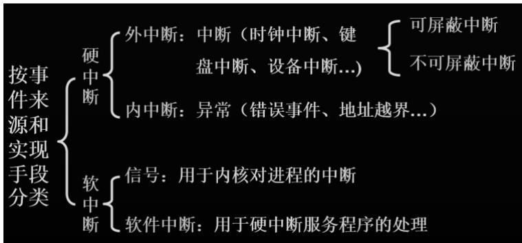
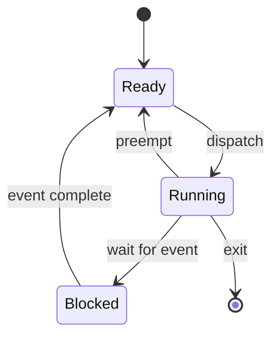

这份复习路线以清单所列 DOCX 为依据，按原稿七章重新组织。原文的题号、星号和考试提示是历史笔记，并非当年考纲；其中的概念误写在相应位置注明。下文的例子与参考解答是补充，并非原件附带答案。

## 从独占运行到多道与分时

裸机若直接把设备交给每个程序，每个程序既要重复实现控制逻辑，又可能覆盖其他程序的结果。操作系统一侧提供可复用的接口（如读文件），另一侧仲裁处理器、内存与设备。批处理先消除逐个装入作业的人工间隔：脱机输入输出把这部分工作移到主机之外；联机系统由主机参与控制。若一个作业发出 I/O 便只能等它完成，CPU 仍然空闲。多道系统则保留多个可推进的作业，在一个作业等待时切给另一个；通道与中断提供了重叠执行的条件。单核上的交错是并发，不等同于同时执行的并行。

分时把原来的“什么时候轮到我”进一步变成可以控制的交互等待：时钟中断让内核有机会收回处理器，时间片避免用户长时间占用它。片太短会增加切换开销，片过长又会接近排队等上一作业结束，降低交互响应。路径见[基本类型](../../../topics/操作系统/操作系统基本类型.md)、[分时原理](../../../topics/操作系统/分时系统工作原理.md)。

## 接口、中断和进程状态

命令与图形界面面向人，系统调用面向程序；命令可以完全在用户空间处理，也可以再调用内核。普通函数调用不因此取得特权；系统调用通过规定的入口进入内核，参数与权限仍需检查。[用户界面](../../../topics/操作系统/用户界面.md)与[中断机制](../../../topics/操作系统/中断机制.md)放在一起读，先问事件是由当前指令同步触发，还是由外部设备异步到达，再判断处理路径。原稿示意图区分外部事件（含可屏蔽、不可屏蔽）、指令相关异常和软件处理手段；别把进程信号和硬件异常当作同一条入口。

*原件图 3.3：原图按事件来源和实现手段分类。下表是整理后的对照，进程信号与硬件异常不应混同。*

| 事件 | 与当前指令的关系 | 为什么不能只靠用户代码 |
| --- | --- | --- |
| 设备完成、时钟到点 | 异步外部事件 | 事件可能在其他程序运行时到达，须由内核统一处理 |
| 页故障、违规访问 | 同步异常 | 需区分可补页恢复和越权，不能由请求者决定 |
| 系统调用 | 程序同步请求内核服务 | 进入受控入口，而不是把任意指令升级为特权指令 |

作业是提交给系统的一份工作，程序是静态指令与数据描述，进程是带执行上下文的运行实例。同一程序可被多个进程执行。作业控制块服务于作业管理，进程控制块（PCB）记录进程标识、状态与调度控制、资源引用和恢复运行需要的现场等。进程由内核保存管理状态，调度器才有可能挑选它继续，而不是重新启动程序。[进程控制块](../../../topics/操作系统/进程控制块.md)与[处理机调度级别](../../../topics/操作系统/处理机调度级别.md)分别说明管理对象与调度入口。

**订正：** 原稿“等待某种时间”应理解为等待某个事件或资源变得可用。定时器到期本身也可以是所等事件，但阻塞并不等于排在就绪队列里等 CPU。外部中断也不保证立刻换进程：中断处理结束时，内核可恢复此前现场或依据调度决策运行另一个可运行对象。

*原件图 3-4：其中「等待态」对应这里所说的阻塞态。后面另附整理的状态图，不替代原图。*

> [!WARNING]
> I/O 完成只消除了阻塞原因，不承诺 CPU 已经分配。题目只写“唤醒”时，先按阻塞到就绪判断，不要跳过调度。

**订正：** 原稿“同一进程内的不同进程共享同一地址空间”应为不同==线程==。同进程线程共享地址空间和许多进程资源，但各自有执行栈、寄存器现场及调度状态；访问共享数据需要同步。不同进程通常具有独立虚拟地址空间，但可以经显式共享映射通信。[进程状态转换](../../../topics/操作系统/进程状态转换.md)、[线程](../../../topics/操作系统/线程概念.md)和[进程通信](../../../topics/操作系统/进程通信.md)可串起来理解。

## 调度：先分辨题目要求优化哪件事

如果只按到达顺序排队，长任务可能让一串短任务一起等待；如果每次都抢占给剩余最短的任务，新来的短作业又可能不断延后长作业。先看==是否允许抢占==，再找与题目一致的排序量。先来先服务看排队次序；最短剩余时间优先看剩余 CPU 服务量；高响应比优先让等待时间进入选择，在常见教材模型中作非抢占选择；时间片轮转则让就绪任务轮流得到 CPU。

**订正：** 原稿在最短剩余时间法与最高响应比法交界处列出的 $R=1+W/S$ 属于高响应比优先，其中 $W$ 是开始服务前已等待时间，$S>0$ 是估计服务时间。最短剩余时间优先不是按这个公式排序。

**补充例题：** 到 $t=8$ 时，处理器结束了先前工作，未运行的 A、B 都就绪。A 在 $t=0$ 到达，需 6 个时间单位；B 在 $t=7$ 到达，需 2 个时间单位。两种策略会先选谁？

**参考解答：** 按高响应比，A 为 $1+8/6=7/3$，B 为 $1+1/2=3/2$，先选 A。按最短剩余时间，A、B 均未开始，剩余分别是 6 与 2，先选 B。若题目在执行中又插入到达事件，后者要用当时的剩余量重新比较，不能沿用初始服务量。[作业调度算法](../../../topics/操作系统/作业调度算法.md)与[进程调度算法](../../../topics/操作系统/进程调度算法.md)分别对照。

## 并发何时需要顺序，何时需要排他

如果消费者必须读生产者刚写好的值，目标是“先写后读”；如果多方会修改同一个队列头，目标是避免多个线程同时进入保护区。两个目标可以同时存在：缓冲区计数管理是否能读写，互斥锁保护更新下标和队列内容。空闲让进、忙则等待、一次选择一个、有限等待以及避免无谓占用处理器分别约束安全或进度；仅有“不能同时进入”并不能推出不会饥饿。管程将共享状态及受控操作收拢，条件等待通常会释放管程锁并在返回前重新获取；在常见唤醒语义下，恢复后要重查谓词。参见[临界区](../../../topics/操作系统/临界区与互斥.md)、[PV 操作](../../../topics/操作系统/信号量与PV操作.md)。

> [!TIP]
> 题面写“必须等某事件”，先找要维护的条件；写“不能同时改某对象”，先画出临界区。当同一线程既拿锁又睡眠时，追问让条件成立的线程是否也需要那把锁。

不可抢占的互斥资源若被请求者边持有边等待，并形成循环，就具备死锁所需的四项条件。预防是制度上破坏必要条件（例如全局资源顺序消除循环等待）；避免是在每次授权前检查是否仍有安全完成顺序；检测接受死锁可能发生，再判定并恢复。==不安全==意味着无可保证的安全顺序，不意味着此刻已有死锁。参阅[死锁条件](../../../topics/操作系统/死锁概念与必要条件.md)、[预防与避免](../../../topics/操作系统/死锁预防与避免.md)、[检测与解除](../../../topics/操作系统/死锁检测与解除.md)。

## 内存：安放、翻译和回收是三个不同动作

静态重定位在装入时处理地址，装入后搬动并不天然可行；动态重定位则靠执行时的映射。固定分区可能留下分区内部未用完的空间，可变分区可按请求划分，却可能留下无法合并的小孔洞。首次、最佳、最坏适应选择不同空闲区，不存在脱离请求序列就必然最好的一种。覆盖让程序分阶段复用内存区，交换在主存与外存之间移出和恢复内存内容；不要把它们与“如何选择牺牲页”混为一谈。[可变分区](../../../topics/操作系统/可变分区分配算法.md)、[分页](../../../topics/操作系统/分页存储管理.md)和[虚拟存储](../../../topics/操作系统/虚拟存储器.md)是这三层的入口。

把虚拟地址拆成页号和偏移，在页表确认页框、驻留与访问许可后，才计算 $\mathrm{PA}=\mathrm{PFN}\times P+\mathrm{offset}$，其中 $P$ 是页长。多级页表把某些稀疏地址范围的下级页表留到需要时再建；快表未命中只表示翻译缓存未命中，不等于页没有驻留。

**补充例题：** 页长为十六进制 `0x1000`，虚拟地址为 `0x1234`，其对应页驻留且有访问权限，页框为 `0x7`。另有三个初始空页框，依次访问页号 `1,2,3,1,4,1`。求地址转换及 FIFO、LRU 缺页数。

**参考解答：** 页号为 `0x1`，偏移为 `0x234`，物理地址是 `0x7234`。前三次访问均缺页；第四次命中页 1。第五次访问页 4 时，FIFO 淘汰最早进入的 1，故最后再次缺页，共 5 次；LRU 淘汰最久未用的 2，故最后命中，共 4 次。OPT 用未来序列选最晚再用或不再用的页作比较基线，不是在线预测器。本题 OPT 同样 4 次；前三个不同页及首次访问 4 均无法免去缺页。[页面置换算法](../../../topics/操作系统/页面置换算法.md)与[快表](../../../topics/操作系统/快表机制.md)分别回答回收和翻译。

## 设备与文件：从一次 I/O 到长期命名

忙轮询让 CPU 主动反复检查设备；中断让 CPU 可先运行其他工作，但不自动代搬每个数据单元。DMA 在初始化后替 CPU 搬运一批数据，完成时通常仍需通知处理器。通道能进一步独立执行组织好的 I/O 命令序列。SPOOLing 则用磁盘排队和后台服务把独占设备包装成多个作业可提交的逻辑接口；同一台打印机并不会真的同时输出多份作业。对照[控制方式](../../../topics/操作系统/IO控制方式.md)、[DMA](../../../topics/操作系统/DMA控制器.md)、[通道](../../../topics/操作系统/通道概念.md)与[SPOOLing](../../../topics/操作系统/SPOOLing系统.md)。

**订正：** 原稿的循环扫描“CSAN”通常写作 C-SCAN。FCFS 按队列顺序、SSTF 优先较近柱面、SCAN 沿当前方向处理后反向、C-SCAN 大体只沿一个方向服务并回绕。做题先标清初始位置、方向、端点和回绕是否计入；若到最后一个请求即反向或回绕，则分别接近 LOOK 或 C-LOOK。参见[磁盘调度](../../../topics/操作系统/磁盘调度算法.md)。

**补充：** 原件对文件系统止于“接口”提示。可以用一次打开、读取、关闭来串联后续概念：路径解析先在目录中找到对象，打开后得到可供读写的描述符；按逻辑偏移读取还需要把它转成物理块位置并检查访问条件。关闭描述符不等于删除文件，文件内容的组织和磁盘块的组织也不必相同。[目录结构](../../../topics/操作系统/文件目录结构.md)、[逻辑结构](../../../topics/操作系统/文件逻辑结构.md)、[物理结构](../../../topics/操作系统/文件物理结构.md)、[文件保护](../../../topics/操作系统/文件保护.md)由此关联。
