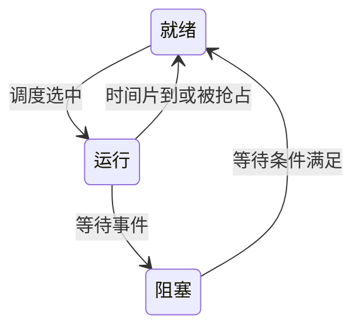

# 《操作系统》简答题复习要点

原件是 18 条复习提纲，不是正式试卷。部分条目只有题目或页码提示；正文从原件文字与表格核回全部条目，参考解答补上原件未展开的机制，不把补写内容冒充原解。最后一条仅有范围提示。

## 从用户任务到运行实体

### 1. 操作系统的四个基本特性

**参考解答：**并发指多项活动在同一时段推进，单核交替也可以并发；共享指资源向多个进程开放，可通过轮流独占或并行访问实现；异步指程序进度及交错次序受环境影响、不能预设；虚拟指把物理资源映射成新的逻辑资源，例如让每个进程看到独立的虚拟地址空间。并发可以利用别的任务等待 I/O 的时间，不能消除 I/O 本身的依赖；正确同步的程序也不应仅因调度顺序不同就产生错误。参见 [操作系统特征](../../../topics/操作系统/操作系统特征.md)。

### 2. 从源程序到运行

**原件填空：**编辑、编译、链接、运行。**补充：**编辑得到源代码；编译通常生成目标文件；链接合并目标文件和库，解析符号引用；运行前系统还要装载可执行内容并建立运行环境。原件列的是典型编译型流程，解释执行、即时编译和动态链接不必全部按此顺序在启动前做完。

### 3. 系统调用做什么

**参考解答：**系统调用是用户程序请求内核执行受控操作的接口。常见类型包括进程管理、文件与设备 I/O、内存管理、进程间通信和取得系统信息。以读文件为例，用户程序提交文件描述符、缓冲区和长度；内核验证访问权限与参数，再读缓存或提交设备请求，返回字节数或错误。库函数可能完成全部工作而不进入内核，也可能封装一次或多次系统调用，两者不等同。参见 [用户与操作系统的接口](../../../topics/操作系统/用户界面.md)。

### 4. 进程和程序的主要区别

**参考解答：**程序是静态指令与数据描述；进程是一次执行实例，有状态、资源和进程控制块（PCB）。同一程序启动两次，可以共享只读代码，但拥有各自的运行进度、寄存器现场与私有数据。程序不因某个实例阻塞就自身变成阻塞；阻塞的是进程或它的线程。参见 [进程与程序](../../../topics/操作系统/进程与程序区别.md)。

### 5. 进程有哪些特征

**参考解答：**动态性指创建到结束的生命周期；并发性指多个执行进度在一段时间内重叠；独立性指各有可管理的上下文及资源边界；制约性来自竞争和协作；异步性指推进快慢与交错不可先验确定；结构性指教学模型中的程序、数据和 PCB。原件把进程称作调度单位时注明单线程条件；多线程系统可调度内核可见线程。参见 [进程定义与特征](../../../topics/操作系统/进程定义与特征.md)。

### 6. 三态模型

**参考解答：**就绪表示条件已齐、只等处理机；运行表示正在占用处理机；阻塞表示正等外部事件或所需条件，即使立即给处理机也不能继续。事件到达只使阻塞者回到就绪，不能保证马上执行。原件要求图和文字；下图为补画。

> [!TIP]
> 问“为什么没在处理机上运行”时，先区分==条件未满足==和==条件已满足、仅等待调度==。I/O 完成改变前者，不直接决定谁占用处理机。

参见 [进程状态转换](../../../topics/操作系统/进程状态转换.md)。

### 7. 同步和互斥的区别与联系

**参考解答：**互斥约束“不能同时做”，例如同一时刻不能由两进程改同一项账目；协作同步约束“何时才能做”，例如消费者必须等生产者交付后再取。互斥可以看作较广义的执行协调，但只靠互斥锁并不能保证一个条件已经成立。比较这两类题时先问==是竞争某个资源，还是等待某个先决事件==。参见 [临界区与互斥](../../../topics/操作系统/临界区与互斥.md)、[经典同步问题](../../../topics/操作系统/经典同步问题.md)。

### 8. 从四方面比较传统进程和线程

| 维度 | 传统单执行流进程 | 同一进程内的多个线程 |
| --- | --- | --- |
| 调度 | 以进程为执行与调度实体 | 内核可见线程可各自被调度；用户态线程也可交给运行时安排 |
| 并发 | 不同进程可交错或并行执行 | 同一进程的多个活动也可交错；能否并行取决于线程模型和处理机 |
| 持有资源 | 通常以进程定义地址空间与资源保护边界 | 共享进程的地址空间；各有栈、寄存器与线程控制信息 |
| 切换开销 | 跨地址空间切换可能有更多转换上下文开销 | 同进程线程切换通常不换地址空间，但仍须保存执行现场 |

**参考解答：**同一地址空间便于共享，不代表写共享数据不用同步。同进程线程切换通常较轻，不是所有系统、任何负载下都更快。参见 [线程](../../../topics/操作系统/线程概念.md)。

### 9. 作业调度和进程调度如何接续

**参考解答：**作业调度先决定哪些外存后备任务被系统接纳，准备资源和进程；进程调度再从就绪的执行实体中选出一个占用处理机。不需要把“已接纳”误解为“正在 CPU 上”。同一作业可派生多个进程，执行它们时低级调度仍会反复发生。参见 [处理机调度级别](../../../topics/操作系统/处理机调度级别.md)。

## 并发约束与存储变换

### 10. 临界区入口应遵循哪些原则

**参考解答：**常见教材用空闲让进、忙则等待、有限等待、让权等待概括：空闲时应允许有请求者进入；某一进程占用时不能再同时进入；请求者不能被无限次越过；不能进入的进程按该教材模型应让出处理机，而不是长时间无效空转。在具体实现中，短临界区和多核环境有时用有界自旋；这是实现取舍，不应把自旋误说成已经让权。参见 [临界区](../../../topics/操作系统/临界区与互斥.md)。

### 11. 死锁的成因、条件与处理

**参考解答：**相互持有资源又等待对方时，若无人能继续释放，可能形成死锁。四个必要条件是互斥、不可剥夺、请求并保持、循环等待。**预防**预先破坏一个必要条件；**避免**在分配前检查未来是否仍有安全完成序列；**检测**检查当前实际申请和占有；**解除**在发现死锁后回滚、撤销进程或剥夺可安全恢复的资源。多实例资源图上有环未必死锁；不安全也不等于已死锁。参见 [死锁](../../../topics/操作系统/死锁概念与必要条件.md)、[预防与避免](../../../topics/操作系统/死锁预防与避免.md)、[检测与解除](../../../topics/操作系统/死锁检测与解除.md)。

### 12. 重定位发生在什么时候

**参考解答：**静态重定位在装入或执行前把需修正的地址改写为当时的落点；动态重定位在运行中由地址变换机构解释程序给出的地址。**补充：**基址为 4,000、界限为 512 字节时，偏移 23 映射为 $4000+23=4023$，偏移 512 越界，不可先加出 4,512 再当合法地址；更换基址可令同一个合法偏移落到新位置。参见 [地址重定位](../../../topics/操作系统/存储管理功能.md)。

### 13. 覆盖和交换有什么不同

**参考解答：**覆盖利用一个程序内的执行阶段或互斥使用关系，让不同模块轮流进入同一片内存；程序组织、链接或装入机制须知道它们的关系。交换由系统根据运行与内存压力，在主存和后备存储之间移动进程或其内容，为其他执行实体腾空间。二者都用额外 I/O 换驻留空间；只保存寄存器的上下文切换不等于交换。参见 [存储管理](../../../topics/操作系统/存储管理功能.md)、[驻留与后备存储](../../../topics/操作系统/虚拟存储器.md)。

### 14. I/O 的四种典型控制方式

**参考解答：**程序查询由处理机反复查设备并搬运数据；中断方式让设备在需要服务时通知处理机，避免持续查询，但频繁搬运小单元仍可能产生不少中断；DMA 用控制器在设备与内存间搬运一块数据，处理机负责设置、完成与异常处理；通道是能执行 I/O 指令序列并组织设备操作的专门部件。判断时问“谁搬数据、何时通知处理机、谁安排一组操作”，不要把“有中断”与“不能用 DMA”划成互斥的两类。参见 [I/O 控制方式](../../../topics/操作系统/IO控制方式.md)、[DMA](../../../topics/操作系统/DMA控制器.md)、[通道](../../../topics/操作系统/通道概念.md)。

### 15. 分页与分段怎样比较

| 维度 | 分页 | 分段 |
| --- | --- | --- |
| 划分依据 | 定长页，由系统选择页面粒度 | 变长逻辑单位，如代码段或数据段 |
| 地址形式 | 线性地址可自动拆成页号和偏移 | 段号与段内偏移，通常须先做段界限检查 |
| 共享 | 可让不同虚拟页映射到同一物理页框，并设相应权限 | 可按有逻辑意义的段为单位组织共享与保护 |
| 典型碎片 | 末页未用部分可能形成内部碎片 | 各变长段分别连续存放时可能形成外部碎片 |

**订正：**原件“页一般不能共享”不是分页机制的限制；例如不同进程可以映射同样的只读代码页。也不能仅凭分页或分段，就断定某程序一定需要多少次缺页，驻留方式、访问轨迹与置换策略都会影响结果。参见 [分页与分段](../../../topics/操作系统/分页与分段区别.md)、[分页](../../../topics/操作系统/分页存储管理.md)、[分段](../../../topics/操作系统/分段存储管理.md)。

## 外设怎样与执行解耦

### 16. SPOOLing 怎样实现多个用户使用同一外设

**参考解答：**假脱机系统通过外存井、内存缓冲区、输入/输出进程把程序请求与物理 I/O 时间隔开。程序先把待输出内容交给输出队列，物理设备空闲时，服务进程才从队列取下一项真正执行。打印机没有变成多台，只是多个程序都能提交，避免在实际打印期间独占调用路径。原件以通道和磁盘说明一种经典结构；有队列与独立服务进程的实现不一定使用教材中的专用硬件形式。参见 [假脱机系统](../../../topics/操作系统/SPOOLing系统.md)。

### 17. 输入井、输出井和缓冲区各放在哪里

**参考解答：**输入井与输出井通常在外存，保存排队或稍后处理的数据；输入、输出缓冲区在内存，暂存正在传输的块；输入进程协调输入设备写入输入井，输出进程将输出井中的作业送给外设。典型输入路径是“输入设备→内存输入缓冲区→外存输入井→供程序读取”；输出反过来是“程序→外存输出井→内存输出缓冲区→输出设备”。把井和缓冲区当成同一处，会解释不了为什么程序结束后输出仍可排队。参见 [井与缓冲区](../../../topics/操作系统/SPOOLing系统.md)、[虚拟设备](../../../topics/操作系统/设备分类.md)。

### 18. 第七章范围提示

原件只写“第七章考小标题”，未给教材版本、章节标题或具体题目。不能据此补造某个考点或原答案；复习时应对照所用版本目录。
