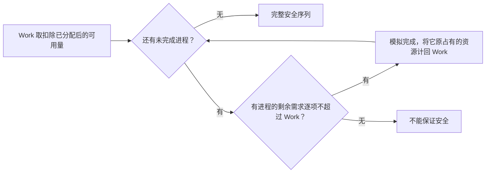

# 《操作系统》简答题知识点整理

原件为八问及答案；第 4 问题头残缺，但正文完整列出三级调度，第 5 问跨页。下文保留八问主题，参考解答重新组织。补充例子与原件中需要改正的定义单独注明。

## 1. 作业与进程的异同

**参考解答：**作业是从用户提交和系统接纳角度看的一份任务，典型于批处理；进程是任务执行期间被系统管理的运行实体。作业尚在后备队列时可以没有已创建的进程；被接纳并实际执行后，可以派生一个或多个进程。一个作业启动脚本，再分别创建解压和校验进程，仍可由批处理队列视为同一个作业。反过来，并不是所有进程都来自用户提交的批处理作业，例如系统服务进程。参见 [调度级别](../../../topics/操作系统/处理机调度级别.md)、[进程定义](../../../topics/操作系统/进程定义与特征.md)。

## 2. 进程与线程的异同

**参考解答：**进程通常是资源组织和保护边界；线程是执行流，典型现代系统将内核可见线程作为处理机调度单位。同一进程的线程共享地址空间及许多进程资源，却分别保存指令位置、寄存器、栈和线程控制状态。栈可在同一共享地址空间中分配不同区域，不等于不同线程各有独立地址空间。进程间切换可能涉及地址空间及相关地址转换上下文的切换；同一进程内切换线程通常不换地址空间，但仍要保存和恢复线程的执行现场。原件“线程与资源分配无关”不可按字面理解：线程也消耗栈、执行上下文等资源。内核线程由内核调度，用户态线程也可由运行时安排。参见 [线程](../../../topics/操作系统/线程概念.md)。

## 3. 管程是什么，为什么要引入它

**参考解答：**管程把共享数据和能改变它的一组操作封装在一起，使对这些状态的访问遵守同一互斥规则，再借条件变量让暂时无法继续的线程等待。大量裸露的 P、V 操作分散在调用者里时，程序员容易漏发通知或写错取得资源的次序；管程让容量、数量、表项状态等不变量由少数入口维护，但不自动避免多个管程之间的循环等待。

**补充：**一个容量为 1 的缓冲区，已有元素时不能继续放。使用通知后重新竞争进入的管程时，写者在“缓冲区仍满”的循环中等待；等待操作释放管程，醒后重新取得并检查条件，不能把通知本身当成抢到了空位。参见 [互斥](../../../topics/操作系统/临界区与互斥.md)、[信号量](../../../topics/操作系统/信号量与PV操作.md)、[经典同步问题](../../../topics/操作系统/经典同步问题.md)。

## 4. 高、中、低三级调度分别决定什么

原件第 4 问题头残缺；根据其三段正文补题名，不猜测丢失的原字。

| 调度层次 | 核心决策 | 典型状态变化 |
| --- | --- | --- |
| 高级（作业调度） | 后备任务是否接纳到系统执行 | 从外存后备队列选作业，准备其执行实体 |
| 中级 | 哪些进程暂时不参与内存中的运行竞争，哪些恢复 | 挂起、换出与恢复，调节内存压力或多道程度 |
| 低级（处理机调度） | 当下由哪个就绪执行实体占用处理机 | 选中就绪进程或内核线程并进行上下文切换 |

**参考解答：**看到“选下一个能占用 CPU 的就绪线程”是低级调度，不是因为刚创建了任务就把它叫高级调度。高级接纳后何时进入就绪队列还取决于资源准备与系统设计。参见 [三级调度](../../../topics/操作系统/处理机调度级别.md)、[进程状态转换](../../../topics/操作系统/进程状态转换.md)。

## 5. 静态重定位和动态重定位的区别

**参考解答：**静态重定位在装入时或运行前把需修正的地址按当次位置改写；运行后若把程序搬到别处，既有地址不自动改变。动态重定位在运行中的访存路径上由地址变换机构计算映射，更新映射即可改变逻辑地址对应的位置，代价是需要硬件与系统软件支持。

**补充：**若逻辑偏移是 300，简单基址方案用基址 4,000 得物理位置 4,300；若搬到基址 6,000，运行期重新解释同一偏移即可得 6,300，且必须先做相应界限检查。动态重定位允许映射在执行期间解释，却**不自动**提供非连续存放；只有一个基址的方案仍得用连续区域，分散存放需要分页或按段映射等结构。参见 [重定位](../../../topics/操作系统/存储管理功能.md)。

## 6. 交换与覆盖的异同

**参考解答：**经典覆盖在同一个程序内部让不会同时用到的模块复用一块内存，通常由程序结构、链接或运行装入逻辑决定；经典交换根据系统负荷在内存与外存之间移动进程或其内容，通常不让每个程序指定覆盖关系。两者都会引入额外 I/O 机会成本，覆盖还增加软件组织成本；交换不等价于只把寄存器存下来的轻量上下文切换。

**订正：**原件“换出到内存，以腾出足够的内存”前后矛盾，应为“换出到外存或后备存储”；反向才是换入内存。**补充：**程序只在开始阶段用解析模块、只在末尾用汇报模块，可以安排二者复用覆盖区，前提是分支和调用不会同时依赖二者。系统若暂时从内存挪走整个非活跃进程以便接纳另一进程，那是交换。参见 [存储管理](../../../topics/操作系统/存储管理功能.md)、[虚拟存储与后备存储](../../../topics/操作系统/虚拟存储器.md)。

## 7. 怎样区分死锁预防、避免、检测和解除

**参考解答：**互斥、不可剥夺、请求并保持、循环等待是死锁的必要条件。预防通过全局规则破坏其中一个条件，例如统一资源申请顺序以排除循环等候；避免在每次具体分配前检查分配后的状态是否仍安全；检测根据真实的现有占用和当前未满足的请求判断是否已陷入死锁；解除才采取回滚、可行的资源剥夺或撤销进程等处理，不是所有设备都能安全剥夺。

**订正：**“每个进程剩余需求不超过可用资源与所有已分配资源之和”不能判安全。已占用资源要等相应进程完成才可回收。银行家算法从可用向量 `Work=Available` 开始，逐次选尚未完成且剩余最大需求逐项满足 `Need <= Work` 的进程，假设它完成并令 `Work += Allocation`；能构造所有进程的完整顺序才是安全。检测中的约化使用当前实际请求，避免中使用最大申报的剩余需求，别混为一谈。

> [!TIP]
> 看到==最大剩余需求==与==当前待满足请求==，先问是在作安全预测，还是在检测已经发生的等待。**不安全不等于已经死锁**，因为最大需求可能尚未真正发出。

**补充验算：**单类资源共 2 个，两个进程各占 1 个、最大需求各为 2。原说法把已分配的 2 个也计入可用量，看似每个余需 1 都够；实际 `Work=0`，没有第一个能模拟完成的进程，状态不安全。如果双方都已请求第 2 个资源，才是这条执行路径上的实际死锁。对照例：共有 3 个资源，两进程仍各占 1 个，最大需求为 2、3；`Work=1` 先满足第一个进程，它完成后 `Work=2`，再满足第二个，所以安全。单实例资源图中有环可判死锁；涉及多实例时还须检查能否完成约化。参见 [死锁条件](../../../topics/操作系统/死锁概念与必要条件.md)、[银行家算法](../../../topics/操作系统/死锁预防与避免.md)、[检测与解除](../../../topics/操作系统/死锁检测与解除.md)。

## 8. 分页与分段如何从地址上区别

**参考解答：**二者都借助映射表做地址转换，物理存放不要求整个进程连续。分页按系统选定大小把地址空间切成定长页，程序的线性字节地址可由硬件拆出页号和偏移；分段按代码、数据等逻辑单位组织，按段号和段内偏移表示位置，段长可不同，转换前要检查段内偏移是否小于该段长度。把线性地址拆为页号和偏移不意味着应用看到的是两个独立地址维度。固定粒度的末页可能有内部碎片；连续放置各变长段时可能出现外部碎片。参见 [分页与分段](../../../topics/操作系统/分页与分段区别.md)、[段式存储](../../../topics/操作系统/分段存储管理.md)。
