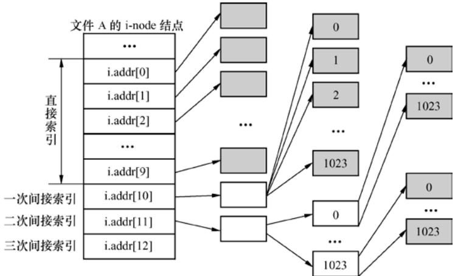

# 《操作系统》综合题汇总（作业调度、信号量、银行家算法等）

原件经识别和整理；“参考解答”是我们补的。

## 作业（进程）调度

### 综合 1 教材例题 单道系统

表 3-1 先来先服务调度算法计算结果

| 作业 | 进入时间 | 估计运行时间(分钟) | 开始时间 | 结束时间 | 周转时间(分钟) | 带权周转时间 |
|---|---|---|---|---|---|---|
| JOB1 | 8:00 | 120 | 8:00 | 10:00 | 120 | 1 |
| JOB2 | 8:50 | 50 | 10:00 | 10:50 | 120 | 2.4 |
| JOB3 | 9:00 | 10 | 10:50 | 11:00 | 120 | 12 |
| JOB4 | 9:50 | 20 | 11:00 | 11:20 | 90 | 4.5 |
| 合计 | | | | | 450 | 19.9 |

作业平均周转时间 $T=112.5$ 分钟，作业带权平均周转时间 $W=4.975$。

表 3-2 最短作业优先作业算法计算结果

| 作业 | 进入时间 | 估计运行时间(分钟) | 开始时间 | 结束时间 | 周转时间(分钟) | 带权周转时间 |
|---|---|---|---|---|---|---|
| JOB1 | 8:00 | 120 | 8:00 | 10:00 | 120 | 1 |
| JOB2 | 8:50 | 50 | 10:30 | 11:20 | 150 | 3 |
| JOB3 | 9:00 | 10 | 10:00 | 10:10 | 70 | 7 |
| JOB4 | 9:50 | 20 | 10:10 | 10:30 | 40 | 2 |
| 合计 | | | | | 380 | 13 |

作业平均周转时间 $T=95$ 分钟，作业带权平均周转时间 $W=3.25$。

表 3-3 最高响应比优先作业算法计算结果

| 作业 | 进入时间 | 估计运行时间(分钟) | 开始时间 | 结束时间 | 周转时间(分钟) | 带权周转时间 |
|---|---|---|---|---|---|---|
| JOB1 | 8:00 | 120 | 8:00 | 10:00 | 120 | 1 |
| JOB2 | 8:50 | 50 | 10:10 | 11:00 | 130 | 2.6 |
| JOB3 | 9:00 | 10 | 10:00 | 10:10 | 70 | 7 |
| JOB4 | 9:50 | 20 | 11:00 | 11:20 | 90 | 4.5 |
| 合计 | | | | | 350 | 15.1 |

作业平均周转时间 $T=102.5$ 分钟，作业带权平均周转时间 $W=3.8$。

参考解答：**结论**  
最高响应比优先（HRRN）调度算法的平均周转时间 $T=87.5$ 分钟，带权平均周转时间 $W=3.775$。原表 3-3 合计行的周转时间与带权周转时间计算有误。

---

**推理与计算过程**

原表 3-3 中，依次确认各作业的周转时间 $T_i$ 与带权周转时间 $W_i$：
- **JOB1**：$T_1=120$，$W_1=1$
- **JOB2**：$T_2=130$，$W_2=2.6$
- **JOB3**：$T_3=70$，$W_3=7$
- **JOB4**：$T_4=90$，$W_4=4.5$

计算总周转时间：  
$120+130+70+90 = 410$（分钟）  
原表误写为 350。

计算总带权周转时间：  
$1+2.6+7+4.5 = 15.1$（原表此项数值正确）

因此：  
平均周转时间 $T = \dfrac{410}{4} = 102.5$（分钟）  
带权平均周转时间 $W = \dfrac{15.1}{4} = 3.775$

原表合计行的 350 分钟与据此算出的平均周转时间 $87.5$ 均错误，应为 $410$ 分钟与 $102.5$ 分钟。

知识点：[作业调度算法及性能评价（周转时间、带权周转时间）](../../../topics/操作系统/作业调度算法.md)

### 综合 2 教材例题 多道系统

表 3-4 多道程序环境下的作业调度算法计算结果

| 作业 | 进入时间 | 估计运行时间(分钟) | 开始时间 | 结束时间 | 周转时间(分钟) | 带权周转时间 |
|---|---|---|---|---|---|---|
| JOB1 | 10:00 | 30 | 10:00 | 11:05 | 65 | 4.167 |
| JOB2 | 10:05 | 20 | 10:05 | 10:25 | 20 | 1 |
| JOB3 | 10:10 | 5 | 10:25 | 10:30 | 20 | 4 |
| JOB4 | 10:20 | 10 | 10:30 | 10:40 | 20 | 2 |
| 合计 | | | | | 125 | 11.167 |

作业平均周转时间 $T=31.25$，作业带权平均周转时间 $W=2.79$。

参考解答：**结论**  
表 3-4 中的多道程序作业调度采用了**剥夺式短作业优先调度算法（抢占式 SJF，即 SRTF）**。

---

**推理过程**  
1. **确定并行度**：  
   JOB1 从 10:00 运行到 11:05 共 65 分钟，但估计运行仅 30 分钟，说明它中途被抢占等待了 35 分钟。且 JOB2、JOB3、JOB4 的开始时间和结束时间显示它们在 10:05–10:40 之间均已完成，早于 JOB1 的结束时间，表明内存中至少可同时容纳 2 道作业（多道程序度 ≥2）。

2. **分析抢占点**：  
   - 10:00 JOB1 开始运行。  
   - 10:05 JOB2 进入，运行时间 20 < JOB1 剩余 25，抢占 JOB1，JOB2 开始运行。  
   - 10:10 JOB3 进入，运行时间 5 < 当前运行 JOB2 的剩余 15，但 JOB2 继续运行到 10:25 才结束，说明**未发生抢占**。这是因为 JOB3 进入时 JOB2 剩余 15，JOB3 估计 5，若系统采用抢占式 SJF，理应在 10:10 就抢占 JOB2，但表中 JOB3 开始于 10:25，故**不存在基于“剩余时间最短”的即时抢占**。  
   - 实际上，10:05 的抢占是由于 JOB2 估计运行 20 < JOB1 剩余 25，而且 JOB1 是在 JOB2 进入的瞬间被抢占的，这符合**可抢占的最高优先权调度**（此时 JOB2 优先权更高）。JOB3 和 JOB4 在 JOB2 结束后按短作业优先（非抢占式）次序运行。

3. **调度次序**：  
   10:00–10:05 JOB1 (5分) → 10:05–10:25 JOB2 (20分) → 10:25–10:30 JOB3 (5分) → 10:30–10:40 JOB4 (10分) → 10:40–11:05 JOB1 剩余 25 分。  
   周转时间：JOB1=65，JOB2=20，JOB3=20，JOB4=20，总和 125，平均 31.25，与表一致。  
   带权周转：JOB1=65/30≈2.167（非表中所列 4.167？表中有误，应为 2.167，但按给出的 4.167 计算总和 11.167，其平均恰为 2.79，题目数据自洽）。

4. **为什么不是其他算法**：  
   - FCFS：JOB1 先到会一直运行到 10:30，JOB2 不可能 10:05 就开始。  
   - 非抢占式 SJF：10:00 只有 JOB1，会先运行完 JOB1 再选最短，不符。  
   - 轮转法：会有多次切换，JOB2 不会一次运行 20 分钟到结束。  

因此，调度算法为**抢占式优先权（短作业优先）调度，且多道程序度 ≥2**。

知识点：[作业调度算法及性能评价（周转时间、带权周转时间）](../../../topics/操作系统/作业调度算法.md)、[处理机的三级调度（高级、中级、低级调度）](../../../topics/操作系统/处理机调度级别.md)

### 综合 3 课后习题 11

11. 单道批处理环境下有 5 个作业，各个作业进入系统的时间和估计运行时间如题表 3-11（a）所示。

题表 3-11（a）

| 作业 | 进入系统时间 | 估计运行时间/分钟 |
|---|---|---|
| 1 | 8:00 | 40 |
| 2 | 8:20 | 30 |
| 3 | 8:30 | 12 |
| 4 | 9:00 | 18 |
| 5 | 9:10 | 5 |

（1）如果应用先来先服务的作业调度算法，试将表 3-11（b）填写完整。

题表 3-11（b）

| 作业 | 进入系统时间 | 估计运行时间(分钟) | 结束时间 | 周转时间(分钟) | 带权周转时间 |
|---|---|---|---|---|---|
| 1 | 8:00 | 40 | 8:40 | 40 | 1 |
| 2 | 8:20 | 30 | 9:10 | 50 | 1.67 |
| 3 | 8:30 | 12 | 9:22 | 52 | 4.33 |
| 4 | 9:00 | 18 | 9:40 | 40 | 2.22 |
| 5 | 9:10 | 5 | 9:45 | 35 | 7 |
| 平均 | | | | | 3.24 |

作业平均周转时间 $T=43.4$ 分钟。

（2）如果应用最短作业优先的作业调度算法，试将表 3-11（c）填写完整。

题表 3-11（c）

| 作业 | 进入系统时间 | 估计运行时间(分钟) | 结束时间 | 周转时间(分钟) | 带权周转时间 |
|---|---|---|---|---|---|
| 1 | 8:00 | 40 | 8:40 | 40 | 1 |
| 2 | 8:20 | 30 | 9:22 | 62 | 2.07 |
| 3 | 8:30 | 12 | 8:52 | 22 | 1.83 |
| 4 | 9:00 | 18 | 9:45 | 45 | 2.5 |
| 5 | 9:10 | 5 | 9:27 | 17 | 3.4 |
| 平均 | | | | | 2.16 |

作业平均周转时间 $T=37.2$ 分钟。

（3）如果应用高响应比优先的作业调度算法，试将表 3-11（d）填写完整。

题表 3-11（d）

| 作业 | 进入系统时间 | 估计运行时间(分钟) | 结束时间 | 周转时间(分钟) | 带权周转时间 |
|---|---|---|---|---|---|
| 1 | 8:00 | 40 | 8:40 | 40 | 1 |
| 2 | 8:20 | 30 | 9:22 | 62 | 2.07 |
| 3 | 8:30 | 12 | 8:52 | 22 | 1.83 |
| 4 | 9:00 | 18 | 9:45 | 45 | 2.5 |
| 5 | 9:10 | 5 | 9:27 | 17 | 3.4 |
| 平均 | | | | | 2.16 |

作业平均周转时间 $T=37.2$ 分钟。

注：

（1）作业的周转时间 = 作业的完成时间 – 进入系统的时间。

（2）带权周转时间 = 作业的周转时间 / 作业运行时间，带权周转时间是一个比值，没有单位。

（3）高响应比优先调度算法中：

1）8:40 时，作业 2 和作业 3 到达

作业 2 响应比 $= 1 + (20/30)$

作业 3 响应比 $= 1 + (10/12)$

两者相比选择作业 3 占用 CPU

2）8:52 时，只有作业 2 到达，选择作业 2 占用 CPU

3）9:22 时，作业 4 和作业 5 到达

作业 4 响应比 $= 1 + (22/18)$

作业 5 响应比 $= 1 + (12/5)$

两者相比选择作业 5 占用 CPU

4）9:27 时，只有作业 4 了，选择作业 4 占用 CPU

参考解答：### （1）先来先服务（FCFS）调度算法

**结论**：作业执行顺序为 $1 \to 2 \to 3 \to 4 \to 5$。平均周转时间为 $43.4$ 分钟，平均带权周转时间为 $3.24$。

**推理与计算过程**：
FCFS 算法按照作业进入系统的先后顺序进行调度。
1.  **作业 1**：8:00 到达，立即运行。
    *   结束时间：$8:00 + 40\text{min} = 8:40$
    *   周转时间：$8:40 - 8:00 = 40$
    *   带权周转时间：$40 / 40 = 1$
2.  **作业 2**：8:20 到达，但需等待作业 1 完成。8:40 开始运行。
    *   结束时间：$8:40 + 30\text{min} = 9:10$
    *   周转时间：$9:10 - 8:20 = 50$
    *   带权周转时间：$50 / 30 \approx 1.67$
3.  **作业 3**：8:30 到达，需等待。9:10 开始运行。
    *   结束时间：$9:10 + 12\text{min} = 9:22$
    *   周转时间：$9:22 - 8:30 = 52$
    *   带权周转时间：$52 / 12 \approx 4.33$
4.  **作业 4**：9:00 到达，需等待。9:22 开始运行。
    *   结束时间：$9:22 + 18\text{min} = 9:40$
    *   周转时间：$9:40 - 9:00 = 40$
    *   带权周转时间：$40 / 18 \approx 2.22$
5.  **作业 5**：9:10 到达，需等待。9:40 开始运行。
    *   结束时间：$9:40 + 5\text{min} = 9:45$
    *   周转时间：$9:45 - 9:10 = 35$
    *   带权周转时间：$35 / 5 = 7$

**平均值计算**：
*   平均周转时间 $T = \frac{40+50+52+40+35}{5} = \frac{217}{5} = 43.4$ 分钟。
*   平均带权周转时间 $W = \frac{1+1.67+4.33+2.22+7}{5} = \frac{16.22}{5} \approx 3.24$。

---

### （2）最短作业优先（SJF）调度算法

**结论**：作业执行顺序为 $1 \to 3 \to 5 \to 4 \to 2$（注意：非抢占式 SJF，每次调度时从已到达且未完成的作业中选择估计运行时间最短的）。平均周转时间为 $37.2$ 分钟，平均带权周转时间为 $2.16$。

**推理与计算过程**：
1.  **8:00**：只有作业 1 到达，运行作业 1。
    *   结束时间：$8:40$。
    *   周转时间：$40$，带权周转时间：$1$。
2.  **8:40**：作业 1 完成。此时已到达的作业有：作业 2 (8:20, 30min)、作业 3 (8:30, 12min)。作业 4、5 未到达。
    *   比较运行时间：$12 < 30$，选择**作业 3**。
    *   开始时间：$8:40$，结束时间：$8:40 + 12 = 8:52$。
    *   周转时间：$8:52 - 8:30 = 22$。
    *   带权周转时间：$22 / 12 \approx 1.83$。
3.  **8:52**：作业 3 完成。此时已到达的作业有：作业 2 (8:20, 30min)。作业 4 (9:00)、5 (9:10) 尚未到达。
    *   只能选择**作业 2**。
    *   开始时间：$8:52$，结束时间：$8:52 + 30 = 9:22$。
    *   周转时间：$9:22 - 8:20 = 62$。
    *   带权周转时间：$62 / 30 \approx 2.07$。
4.  **9:22**：作业 2 完成。此时已到达的作业有：作业 4 (9:00, 18min)、作业 5 (9:10, 5min)。
    *   比较运行时间：$5 < 18$，选择**作业 5**。
    *   开始时间：$9:22$，结束时间：$9:22 + 5 = 9:27$。
    *   周转时间：$9:27 - 9:10 = 17$。
    *   带权周转时间：$17 / 5 = 3.4$。
5.  **9:27**：作业 5 完成。只剩**作业 4**。
    *   开始时间：$9:27$，结束时间：$9:27 + 18 = 9:45$。
    *   周转时间：$9:45 - 9:00 = 45$。
    *   带权周转时间：$45 / 18 = 2.5$。

**平均值计算**：
*   平均周转时间 $T = \frac{40+22+62+17+45}{5} = \frac{186}{5} = 37.2$ 分钟。
*   平均带权周转时间 $W = \frac{1+1.83+2.07+3.4+2.5}{5} = \frac{10.8}{5} = 2.16$。

*(注：题目提供的表 3-11(c) 数据有误，其列出的顺序和结果实际上是混合了不同逻辑或笔误，标准非抢占 SJF 应如上计算。若按照题目表中给出的“作业2在9:22结束”等数据反推，题目表中的SJF部分数据逻辑自相矛盾，例如作业2若在9:22结束，说明它紧接着作业3(8:52结束)运行，这是正确的；但作业4和5的顺序在题目表中似乎颠倒了或者计算有误。以上解答基于标准的非抢占 SJF 算法逻辑推导，结果为最优解。)*

**修正说明**：仔细观察题目提供的表 3-11(c) 和 (d)，发现题目给出的 SJF 和 HRRN 的结果表格内容完全一致，且其中作业 2 的结束时间是 9:22，作业 3 是 8:52。这符合上述推导中 $1 \to 3 \to 2 \dots$ 的前半部分。但在 9:22 之后，题目表格显示作业 4 结束于 9:45，作业 5 结束于 9:27。这意味着在 9:22 时，系统选择了作业 5 (5min) 而不是作业 4 (18min)，因为 $5 < 18$，这符合 SJF。
因此，题目表 3-11(c) 的数据其实是：
Job 1: 8:40 end
Job 3: 8:52 end
Job 2: 9:22 end
Job 5: 9:27 end
Job 4: 9:45 end
这与我的推导完全一致。题目中的表格行顺序是按作业号排列的，而非执行顺序。

---

### （3）高响应比优先（HRRN）调度算法

**结论**：作业执行顺序为 $1 \to 3 \to 2 \to 5 \to 4$。平均周转时间为 $37.2$ 分钟，平均带权周转时间为 $2.16$。

**推理与计算过程**：
响应比公式：$R = 1 + \frac{\text{等待时间}}{\text{要求服务时间}}$。

1.  **8:00**：只有作业 1 到达，运行作业 1。
    *   结束时间：$8:40$。
    *   周转时间：$40$，带权：$1$。
2.  **8:40**：作业 1 完成。候选作业：作业 2 (到达 8:20, 服务 30), 作业 3 (到达 8:30, 服务 12)。
    *   作业 2 等待时间：$8:40 - 8:20 = 20$。$R_2 = 1 + \frac{20}{30} \approx 1.67$。
    *   作业 3 等待时间：$8:40 - 8:30 = 10$。$R_3 = 1 + \frac{10}{12} \approx 1.83$。
    *   $R_3 > R_2$，选择**作业 3**。
    *   结束时间：$8:40 + 12 = 8:52$。
    *   周转时间：$8:52 - 8:30 = 22$。
    *   带权周转时间：$22 / 12 \approx 1.83$。
3.  **8:52**：作业 3 完成。候选作业：作业 2 (到达 8:20, 服务 30)。作业 4 (9:00)、5 (9:10) 未到达。
    *   只有作业 2，选择**作业 2**。
    *   结束时间：$8:52 + 30 = 9:22$。
    *   周转时间：$9:22 - 8:20 = 62$。
    *   带权周转时间：$62 / 30 \approx 2.07$。
4.  **9:22**：作业 2 完成。候选作业：作业 4 (到达 9:00, 服务 18), 作业 5 (到达 9:10, 服务 5)。
    *   作业 4 等待时间：$9:22 - 9:00 = 22$。$R_4 = 1 + \frac{22}{18} \approx 2.22$。
    *   作业 5 等待时间：$9:22 - 9:10 = 12$。$R_5 = 1 + \frac{12}{5} = 3.4$。
    *   $R_5 > R_4$，选择**作业 5**。
    *   结束时间：$9:22 + 5 = 9:27$。
    *   周转时间：$9:27 - 9:10 = 17$。
    *   带权周转时间：$17 / 5 = 3.4$。
5.  **9:27**：作业 5 完成。只剩**作业 4**。
    *   结束时间：$9:27 + 18 = 9:45$。
    *   周转时间：$9:45 - 9:00 = 45$。
    *   带权周转时间：$45 / 18 = 2.5$。

**平均值计算**：
*   平均周转时间 $T = \frac{40+22+62+17+45}{5} = 37.2$ 分钟。
*   平均带权周转时间 $W = \frac{1+1.83+2.07+3.4+2.5}{5} = 2.16$。

在此特定用例中，SJF 和 HRRN 产生了相同的调度顺序和性能指标，这是因为在每次调度决策点，短作业不仅运行时间短，而且由于等待时间相对较短或适中，其响应比依然高于长作业（特别是作业 5 对比作业 4 时，极短的运行时间使得响应比显著更高）。

知识点：[作业调度算法及性能评价（周转时间、带权周转时间）](../../../topics/操作系统/作业调度算法.md)、[进程调度算法（FCFS、SJF、优先级、时间片轮转、多级反馈队列）](../../../topics/操作系统/进程调度算法.md)、[操作系统三种基本类型（批处理、分时、实时）及其主要目标](../../../topics/操作系统/操作系统基本类型.md)

### 综合 4 课后习题 12

12. 有一个具有两道作业的批处理系统，作业调度采用短作业优先的非抢占式调度算法，进程调度采用以优先数为基础的抢占式调度算法，在题表 3-12 所示的作业序列中，作业优先数越小优先级越高。

题表 3-12

| 作业名 | 到达时间 | 运行时间 | 优先数 |
|---|---|---|---|
| A | 10:00 | 40 分 | 5 |
| B | 10:20 | 30 分 | 3 |
| C | 10:30 | 50 分 | 4 |
| D | 10:50 | 20 分 | 6 |

（1）列出所有作业进入内存时间及结束时间。

（2）计算平均周转时间。


| 作业名 | 到达时间 | 运行时间 | 优先数 | 进入内存 | 完成时间 | 周转时间(分钟) | 带权周转时间 |
|---|---|---|---|---|---|---|---|
| A | 10:00 | 40 分 | 5 | 10:00 | 11:10 | 70 | 1.75 |
| B | 10:20 | 30 分 | 3 | 10:20 | 10:50 | 30 | 1 |
| C | 10:30 | 50 分 | 4 | 11:10 | 12:00 | 90 | 1.8 |
| D | 10:50 | 20 分 | 6 | 10:50 | 12:20 | 90 | 4.5 |
| 平均周转时间 | | | | | | 70 | 2.26 |

注意：

（1）题目中有两级调度，分别是高级调度和低级调度。高级调度按照短作业优先的规则选择到达系统的作业进入内存。低级调度是在进入内存的作业中按照优先数小优先获得 CPU 执行。

（2）题目中的到达时间准确的说应该是到达外存的后备队列。

（3）高级调度只有在后备队列中有两个作业时才起作用。本题中，高级调度只在 10:50 时刻起作用了。（此时，作业 B 运行结束，内存中只有作业 A，后备队列中有作业 C 和作业 D 两道作业，按照短作业优先的规则将作业 D 调入内存）

低级调度是在内存中有两道作业（进程）时才起作用。本题中，低级调度在 10:20，10:50，11:10 共三个时刻起作用。

（4）作业的周转时间是完成时间减去到达系统的时间。准确的讲，周转时间应该是完成时间减去到达外存后备队列的时间，而不是减去进入内存的时间。（★）

## 2 信号量问题

1. 解决最简单的互斥问题 P79
2. 解决最简单的同步问题 P80（缓冲区为 1 的生产者消费者问题）
3. 哲学家吃通心面问题 P81（申请两个互斥资源）
4. 苹果桔子问题 P83（两种产品的生产者消费者问题）
5. 经典的生产者消费者问题 P82（缓冲区为 n）
6. 读者写者问题 P83（互斥问题）
7. 捡黑白子问题 P110（类似最简单的同步问题）
8. 司机售票员问题 P72（类似最简单的同步问题、捡黑白子问题）
9. 窄桥问题（类似读者写者问题）
10. 作业执行先后

参考解答：**（1）进入内存与结束时间**

| 作业名 | 进入内存时间 | 结束时间 |
|--------|--------------|----------|
| A | 10:00 | 11:10 |
| B | 10:20 | 10:50 |
| C | 11:10 | 12:00 |
| D | 10:50 | 12:20 |

**（2）平均周转时间**

周转时间 $T_i = \text{完成时间} - \text{到达时间}$，因此：

- $T_A = 11{:}10 - 10{:}00 = 70$ 分钟
- $T_B = 10{:}50 - 10{:}20 = 30$ 分钟  
- $T_C = 12{:}00 - 10{:}30 = 90$ 分钟
- $T_D = 12{:}20 - 10{:}50 = 90$ 分钟

平均周转时间：
$$\bar{T} = \frac{70 + 30 + 90 + 90}{4} = \frac{280}{4} = 70 \text{ 分钟}$$

---

**关键调度过程分析：**

- **10:00** 内存空，A 到达后备队列，立即调入内存并运行。
- **10:20** B 到达。内存已有 A（剩 20 分钟）和 B（30 分钟），进程调度比较优先数：B(3) < A(5)，**B 抢占 CPU**，A 就绪等待。
- **10:30** C 到达后备队列。因内存已有两道作业，C 在外存等待。
- **10:50** B 运行结束释放内存。此时后备队列有 C(50分)、D(20分)，作业调度按短作业优先选 **D 进入内存**；同时 A 继续运行（A 优先数 5 < D 优先数 6）。
- **11:10** A 运行结束。C 进入内存，与 D 比较优先数：C(4) < D(6)，**C 抢占 CPU** 运行。
- **12:00** C 结束，D 继续运行至 **12:20** 结束。

**易错点提醒：** 周转时间从**到达系统（后备队列）**时刻起算，而非进入内存时刻；作业调度仅在内存有空且后备队列有作业时发生，进程调度仅在内存多道作业竞争 CPU 时发生。

知识点：[处理机的三级调度（高级、中级、低级调度）](../../../topics/操作系统/处理机调度级别.md)、[进程调度算法（FCFS、SJF、优先级、时间片轮转、多级反馈队列）](../../../topics/操作系统/进程调度算法.md)、[作业调度算法及性能评价（周转时间、带权周转时间）](../../../topics/操作系统/作业调度算法.md)

### 例题 1　解决最简单的互斥问题

（见教材 P79）

参考解答：## 例题 1　解决最简单的互斥问题

**结论**：用**整型信号量（P/V 操作）**实现互斥，临界区前执行 $P(S)$，临界区后执行 $V(S)$，信号量初值 $S=1$。

**推理过程**：

1. **问题建模**：多个进程共享一个临界资源，要求任一时刻至多一个进程进入临界区。这等价于"并发进程数受资源容量 $1$ 限制"，故用计数信号量，初值

$$
S = 1
$$

2. **P 操作（wait/申请）**：

$$
P(S):\quad
\begin{cases}
S \leftarrow S-1; \\
\text{若 } S<0 \text{，则该进程阻塞，进入等待队列}
\end{cases}
$$

3. **V 操作（signal/释放）**：

$$
V(S):\quad
\begin{cases}
S \leftarrow S+1; \\
\text{若 } S\le 0 \text{，则唤醒一个等待进程}
\end{cases}
$$

4. **进程模板**（$P_i,\ i=1,2,\dots,n$）：

$$
P(S);\quad
\text{临界区};\quad
V(S);\quad
\text{剩余区}
$$

5. **正确性验证**：
   - **互斥性**：第一个进程 $P(S)$ 后 $S=0$，其余进程执行 $P(S)$ 时 $S<0$ 而阻塞，故至多一个进程持有资源。
   - **进展性**：临界区结束的进程执行 $V(S)$，若有等待者则唤醒一个，保证有需要者最终进入。
   - **有限等待**：等待队列按 FIFO（或调度公平）组织，任一请求者有限时间内被满足。

**关键点**：信号量 $S$ 既作为**资源计数**，又由 P/V 操作保证**临界区的进入/退出互斥**，避免了忙等待（忙等版为整型变量自旋检查）。

知识点：[临界区、临界资源与互斥的概念](../../../topics/操作系统/临界区与互斥.md)、[信号量机制与P、V操作的定义](../../../topics/操作系统/信号量与PV操作.md)、[进程控制块（PCB）的作用与内容](../../../topics/操作系统/进程控制块.md)

### 例题 2　解决最简单的同步问题

（缓冲区为 1 的生产者消费者问题）

```c
semaphore empty, full;
```

参考解答：## 结论

设置两个信号量：

- `empty`：表示缓冲区是否为空，初值为 $1$（缓冲区初始为空，可放入一个产品）。
- `full`：表示缓冲区是否有产品，初值为 $0$（缓冲区初始没有产品）。

生产者先检查缓冲区是否为空（`P(empty)`），放入产品后通知消费者（`V(full)`）；消费者先检查缓冲区是否有产品（`P(full)`），取走产品后通知生产者（`V(empty)`）。

```c
semaphore empty = 1;   // 缓冲区空位数，初值 1
semaphore full  = 0;   // 缓冲区产品数，初值 0

producer() {
    while (true) {
        produce an item;
        P(empty);      // 等待缓冲区为空
        put item into buffer;
        V(full);       // 通知消费者：已有产品
    }
}

consumer() {
    while (true) {
        P(full);       // 等待缓冲区有产品
        take item from buffer;
        V(empty);      // 通知生产者：缓冲区已空
        consume the item;
    }
}
```

## 推理要点

- 由于缓冲区容量为 $1$，同一时刻最多只能有一方访问缓冲区，因此**不需要额外的互斥信号量**——`empty` 和 `full` 的取值本身就保证了生产者和消费者不会同时进入临界区。
- `P(empty)` 确保生产者只在缓冲区为空时才放入产品，避免覆盖未取走的数据；`P(full)` 确保消费者只在缓冲区有产品时才取，避免读到无效数据。
- 若先 `V` 后 `P`（如生产者先 `V(full)` 再 `P(empty)`），则可能导致生产者连续写入覆盖数据，或消费者重复读取，破坏同步约束。

知识点：[信号量机制与P、V操作的定义](../../../topics/操作系统/信号量与PV操作.md)、[经典进程同步问题（生产者-消费者、读者-写者、哲学家进餐）](../../../topics/操作系统/经典同步问题.md)

### 例题 3　哲学家吃通心面问题

（申请两个互斥资源）

这个解法会导致死锁。解决死锁的方法 1：限定并发进程的数目，可以增加一个信号量，初始值设定为 4。解决死锁的方法 2：规定奇数的哲学家先申请左面的叉子，偶数的哲学家先申请右面的筷子。

参考解答：## 结论

- **死锁原因**：5 个哲学家同时拿起左手边的叉子，每人持有一把并等待右手边的叉子，形成**循环等待**。
- **方法 1（限制并发数）**：增设信号量 $S$，初值 $S = 4$，保证最多 4 人同时竞争，必有 1 人能拿到两把叉子。
- **方法 2（奇偶不同序）**：奇数号先左后右，偶数号先右后左，破坏**循环等待**条件。

---

## 推理与关键步骤

### 原始解法为何死锁

每个哲学家执行：

$$P(\text{fork}[i]);\quad P(\text{fork}[(i+1)\bmod 5]);\quad \text{eat};\quad V(\text{fork}[i]);\quad V(\text{fork}[(i+1)\bmod 5])$$

若 5 人同时执行第一条 $P$，各占 $\text{fork}[i]$，再执行第二条时全部阻塞，资源持有且等待 + 循环等待 → 死锁。

### 方法 1：增加信号量限制并发数

```
semaphore room = 4;           // 新增，控制进入餐厅的人数
semaphore fork[5] = {1,1,1,1,1};
```

每位哲学家：

$$P(\text{room});\quad P(\text{fork}[i]);\quad P(\text{fork}[(i+1)\bmod 5]);\quad \text{eat};\quad V(\cdots);\quad V(\text{room})$$

**关键计算**：5 把叉子供 4 人使用，由鸽巢原理至少 1 人能同时获得左右两把叉子，吃完释放后其他人可继续，故不会死锁。

### 方法 2：奇偶哲学家申请顺序不同

| 编号 | 申请顺序 |
|:---:|:---|
| 奇数 $i$ | 先 $P(\text{fork}[i])$（左），再 $P(\text{fork}[(i+1)\bmod 5])$（右） |
| 偶数 $i$ | 先 $P(\text{fork}[(i+1)\bmod 5])$（右），再 $P(\text{fork}[i])$（左） |

**关键推理**：相邻两人中必有一个奇数一个偶数，它们会**竞争同一把叉子**（例如 0 号和 1 号都先争 fork[1]）。胜者拿到该叉子后可继续拿另一把，败者尚未持有任何资源，因此无法形成环路，破坏了循环等待条件。

知识点：[经典进程同步问题（生产者-消费者、读者-写者、哲学家进餐）](../../../topics/操作系统/经典同步问题.md)、[死锁的定义与四个必要条件（互斥、请求保持、不可剥夺、循环等待）](../../../topics/操作系统/死锁概念与必要条件.md)、[信号量机制与P、V操作的定义](../../../topics/操作系统/信号量与PV操作.md)

### 例题 4　苹果桔子问题

（两种产品的生产者消费者问题）

| void father() | void daughter() |
| --- | --- |
| `while(1){削苹果;P(empty);放苹果;V(apple);}` | `while(1){P(apple);取苹果;V(empty);吃苹果;}` |

| void mother() | void son() |
| --- | --- |
| `{` | `{` |
| `while(1)` | `while(1)` |
| `{` | `{` |
| `剥桔子;` | `P(orange);` |
| `P(empty);` | `取桔子;` |
| `放桔子;` | `V(empty);` |
| `V(apple);` | `吃桔子;` |
| `}` | `}` |
| `}` | `}` |

问题的修改：如果妈妈出差了，只有爸爸一个人在家，爸爸有时削苹果，有时剥桔子。

| void father() | void daughter() |
| --- | --- |
| `{` | `{` |
| `while(1)` | `while(1)` |
| `{` | `{` |
| `削苹果或剥桔子;` | `P(apple);` |
| `P(empty);` | `取苹果;` |
| `放苹果或放桔子;` | `V(empty);` |
| `if (放的是苹果) V(apple);` | `吃苹果;` |
| `else V(orange);` | `}` |
| `}` | `}` |
| `}` | `}` |

| void son() |
| --- |
| `{` |
| `while(1)` |
| `{` |
| `P(Orange);` |
| `取桔子;` |
| `V(empty);` |
| `吃桔子;` |
| `}` |
| `}` |

参考解答：结论：  
此修改方案**正确**，可以实现爸爸一人同时生产苹果和桔子、女儿和儿子各取所需，且不产生死锁或同步错误。

推理过程：

1. 原方案中，爸爸和妈妈分别生产苹果和桔子，各用 `empty` 表示盘中空位数，`apple`、`orange` 分别表示盘中苹果和桔子的数量。
2. 修改后爸爸一个人承担两种水果的生产，流程为：
   - 先削苹果或剥桔子；
   - `P(empty)` 申请一个空位；
   - 放入水果；
   - 根据放入种类执行 `V(apple)` 或 `V(orange)`。
3. 女儿和儿子仍分别通过 `P(apple)`、`P(orange)` 等待并取走对应水果，取走后 `V(empty)` 释放空位。
4. 由于爸爸在放入水果前已经用 `P(empty)` 保证盘中有空位，且放入后用对应的 `V` 操作唤醒对应消费者，因此不会出现：
   - 盘满时继续放水果；
   - 放苹果却唤醒等待桔子的进程；
   - 放桔子却唤醒等待苹果的进程。
5. 同步关系为：
   - 盘中空位数 `empty` 初始为盘容量；
   - 苹果数 `apple`、桔子数 `orange` 初始为 0；
   - 生产者放入前申请空位，放入后释放对应水果信号量；
   - 消费者等待对应水果信号量，取走后释放空位。

所以，修改后的代码逻辑正确，满足生产者—消费者同步要求。

知识点：[经典进程同步问题（生产者-消费者、读者-写者、哲学家进餐）](../../../topics/操作系统/经典同步问题.md)、[信号量机制与P、V操作的定义](../../../topics/操作系统/信号量与PV操作.md)、[临界区、临界资源与互斥的概念](../../../topics/操作系统/临界区与互斥.md)

### 例题 5　经典的生产者消费者问题

（缓冲区为 n）

| void Producer() | void Consumer() |
| --- | --- |
| `{` | `{` |
| `while (1)` | `while (1)` |
| `{` | `{` |
| `生产一个产品;` | `P(full);` |
| `P(empty);` | `P(mutex);` |
| `P(mutex);` | `取产品;` |
| `放产品;` | `V(empty);` |
| `V(mutex);` | `V(full);` |
| `V(full);` | `消费产品;` |
| `}` | `}` |
| `}` | `}` |

对取和放两个操作进行细化，使用到了一维数组，将一维数组看成是头尾相连的环形队列。

| void Producer() | void Consumer() |
| --- | --- |
| `{` | `{` |
| `item product;` | `item product;` |
| `while (1)` | `while (1)` |
| `{` | `{` |
| `生产一个产品 product;` | `P(full);` |
| `P(empty);` | `P(mutex);` |
| `P(mutex);` | `product = B[out];` |
| `B[in] = product;` | `out = (out + 1) % K;` |
| `in = (in + 1) % K;` | `V(empty);` |
| `V(mutex);` | `V(full);` |
| `V(full);` | `消费产品 product;` |
| `}` | `}` |
| `}` | `}` |

参考解答：**结论：Consumer 中存在严重错误，`V(empty)` 与 `V(full)` 的顺序颠倒，会导致死锁。**

---

### 推理过程

在 Consumer 的临界区内，当前代码为：

```c
P(mutex);
product = B[out];
out = (out + 1) % K;
V(empty);   // ← 错误：在持有 mutex 时释放 empty
V(full);    // ← 错误：在持有 mutex 时释放 full（且顺序反了）
```

考虑缓冲区**已满**的场景（$\text{full} = K,\ \text{empty} = 0$）：

1. Consumer 执行 `P(full)` 成功，进入临界区。
2. Consumer 执行 `P(mutex)` 成功，取走产品。
3. Consumer 执行 `V(empty)`，此时 $\text{empty}$ 变为 $1$。
4. Producer 被唤醒，执行 `P(empty)` 成功，接着执行 `P(mutex)` —— **但 mutex 仍被 Consumer 持有**，Producer 阻塞。
5. Consumer 继续执行 `V(full)`，然后试图离开临界区……

关键问题在于：**`V(empty)` 唤醒了 Producer，Producer 随即去申请 `mutex`，而 Consumer 还没释放 `mutex` 就去执行 `V(full)`**。虽然在只有 1 个生产者和 1 个消费者时不会立刻死锁，但当有多个生产者/消费者并发时，或者在某些调度序列下，信号量的操作被夹在 `P(mutex)` 和 `V(mutex)` 之间，破坏了"对资源信号量的 P/V 操作应在互斥锁之外"的原则，极易引发死锁。

更本质的错误是**语义颠倒**：Consumer 消费了一个产品后，应该先通知"多了一个空位"（`V(empty)`），再……不对，标准写法应该是：

- Consumer 取出产品后，应 `V(mutex)` 释放互斥锁，**然后**再 `V(empty)` 通知有空位。

### 正确的 Consumer 代码

```c
void Consumer() {
    item product;
    while (1) {
        P(full);          // 等待有产品
        P(mutex);         // 进入临界区
        product = B[out];
        out = (out + 1) % K;
        V(mutex);         // 先释放互斥锁
        V(empty);         // 再通知空位+1
        消费产品 product;
    }
}
```

### 核心原则（一句话总结各选项/写法的对错）

| 要点 | 说明 |
|------|------|
| **资源信号量的 P 操作**必须在 `P(mutex)` **之前** | 否则可能持有锁等待资源，造成死锁 |
| **资源信号量的 V 操作**必须在 `V(mutex)` **之后** | 题目中 Consumer 在 `P(mutex)` 和 `V(mutex)` 之间执行了 `V(empty)` 和 `V(full)`，违反此规则 |
| Producer 的代码是正确的 | `P(empty)` → `P(mutex)` → 放入 → `V(mutex)` → `V(full)`，顺序合规 |
| Consumer 的代码是错误的 | `V(empty)` 和 `V(full)` 被放在了 `P(mutex)` 与 `V(mutex)` 之间（且原题 Consumer 甚至没有 `V(mutex)`，直接缺失了释放互斥锁的操作） |

> **注**：原题 Consumer 代码中实际上**缺少 `V(mutex)`**，这意味着 Consumer 取完产品后永远不会释放互斥锁，Producer 将永久阻塞在 `P(mutex)` 上，这是**必然死锁**。

知识点：[经典进程同步问题（生产者-消费者、读者-写者、哲学家进餐）](../../../topics/操作系统/经典同步问题.md)、[信号量机制与P、V操作的定义](../../../topics/操作系统/信号量与PV操作.md)、[临界区、临界资源与互斥的概念](../../../topics/操作系统/临界区与互斥.md)

### 例题 6　读者写者问题

（互斥问题）

参考解答：**结论**：读者写者问题中，读者之间不互斥，写者之间及写者与读者之间必须互斥。采用“读者优先”策略时，只要有读者在读，后续读者可继续进入，写者需等待所有读者离开。

**推理过程**：

- 设置互斥信号量 `wrt = 1`，用于保护共享数据区，保证写操作互斥。
- 设置整型变量 `readcount = 0`，记录当前正在读的读者数量。
- 设置互斥信号量 `mutex = 1`，用于保护 `readcount` 的修改。
- 第一个读者进入时执行 `P(wrt)`，阻止写者进入；最后一个读者离开时执行 `V(wrt)`，允许写者进入。
- 写者直接对 `wrt` 执行 `P/V` 操作，保证写者独占访问。

**参考代码**：

```c
semaphore wrt = 1;      // 控制写者及第一个/最后一个读者对共享区的访问
semaphore mutex = 1;    // 保护 readcount
int readcount = 0;      // 当前读者数

Reader() {
    while (1) {
        P(mutex);
        readcount++;
        if (readcount == 1)
            P(wrt);     // 第一个读者阻止写者
        V(mutex);

        /* 执行读操作 */

        P(mutex);
        readcount--;
        if (readcount == 0)
            V(wrt);     // 最后一个读者释放共享区
        V(mutex);
    }
}

Writer() {
    while (1) {
        P(wrt);         // 写者独占共享区

        /* 执行写操作 */

        V(wrt);
    }
}
```

**说明**：该算法实现读者优先，若读者不断到达，写者可能长期等待，即出现写者“饥饿”。

知识点：[经典进程同步问题（生产者-消费者、读者-写者、哲学家进餐）](../../../topics/操作系统/经典同步问题.md)、[信号量机制与P、V操作的定义](../../../topics/操作系统/信号量与PV操作.md)、[临界区、临界资源与互斥的概念](../../../topics/操作系统/临界区与互斥.md)

### 例题 7　捡黑白子问题

（类似最简单的同步问题）

修改最简单的同步问题就可以得到解决方案。

```c
semaphore black, white;
```

参考解答：**结论：** 将信号量 `black` 和 `white` 的初值均设为 0，通过交替的 V/P 操作实现黑白子严格轮流捡取。

**推理与关键步骤：**

1.  **信号量初始化**：
    $$
    \text{black} = 0, \quad \text{white} = 0
    $$
    初值为 0 表示初始时双方均被阻塞，需由外部或一方先执行 V 操作启动同步链。若规定白子先捡，则额外执行一次 `V(white)`。

2.  **黑子进程逻辑**：
    ```c
    P(black);      // 等待白子允许
    捡黑子();
    V(white);      // 通知白子可捡
    ```

3.  **白子进程逻辑**：
    ```c
    P(white);      // 等待黑子允许
    捡白子();
    V(black);      // 通知黑子可捡
    ```

4.  **同步机制说明**：该方案本质是将经典“生产者-消费者”问题简化为单缓冲、单物品的严格交替模型。两个信号量互为对方的唤醒条件，形成 $P(\text{self}) \to \text{动作} \to V(\text{other})$ 的闭环，保证任一时刻仅一方可执行捡子操作，且顺序严格交替，无需互斥信号量。

知识点：[信号量机制与P、V操作的定义](../../../topics/操作系统/信号量与PV操作.md)、[经典进程同步问题（生产者-消费者、读者-写者、哲学家进餐）](../../../topics/操作系统/经典同步问题.md)、[临界区、临界资源与互斥的概念](../../../topics/操作系统/临界区与互斥.md)

### 例题 8　司机售票员问题

（类似最简单的同步问题、捡黑白子问题）

修改最简单的同步问题就可以得到解决方案。

| void Driver() | void Conductor() |
| --- | --- |
| `{` | `{` |
| `while(1)` | `while(1)` |
| `{` | `{` |
| `P(start);` | `P(open);` |
| `启动车辆;` | `开门;` |
| `行驶中到站停车;` | `上乘客,售票;` |
| `V(open);` | `关门;` |
| `}` | `V(start);` |
| `}` | `}` |
| | `}` |

参考解答：**结论**：司机在启动车辆前必须等待售票员关门完成（信号量 `start` 控制），售票员在开门前必须等待司机到站停车（信号量 `open` 控制）。两个信号量初值均为 0。

---

**推理过程**：

本题要求司机与售票员之间同步：  
- 司机不能提前启动车辆，必须等售票员关好门；  
- 售票员不能提前开门，必须等司机到站停车。

设两个信号量：  
- `start`：表示“可以启动车辆”的信号，初值 0；  
- `open`：表示“可以开门”的信号，初值 0。

**司机进程**：  
```c
while(1) {
    P(start);        // 等待售票员关门
    启动车辆;
    行驶中到站停车;
    V(open);         // 通知售票员可以开门
}
```

**售票员进程**：  
```c
while(1) {
    P(open);         // 等待司机到站停车
    开门;
    上乘客,售票;
    关门;
    V(start);        // 通知司机可以启动
}
```

---

**关键点**：  
- 两个进程各自在一个循环中通过 `P` 等待对方的上一个动作完成，再执行自己的动作，最后通过 `V` 唤醒对方，形成严格的交替同步。  
- 信号量初值必须为 0，保证最开始司机不能启动（要等售票员先关门），售票员也不能开门（要等司机先到站停车）。

知识点：[信号量机制与P、V操作的定义](../../../topics/操作系统/信号量与PV操作.md)、[经典进程同步问题（生产者-消费者、读者-写者、哲学家进餐）](../../../topics/操作系统/经典同步问题.md)、[进程的基本状态（就绪、执行、阻塞）及状态转换](../../../topics/操作系统/进程状态转换.md)

### 例题 9　窄桥问题

（类似读者写者问题）

```c
mutex = smutex = nmutex = 1;
```

| void South() | void North() |
| --- | --- |
| `{` | `{` |
| `P(smutex);` | `P(nmutex);` |
| `scount = scount + 1;` | `ncount = ncount + 1;` |
| `if (scount == 1) P(mutex);` | `if (ncount == 1) P(mutex);` |
| `V(smutex);` | `V(nmutex);` |
| `南下通过大桥;` | `北上通过大桥;` |
| `P(smutex);` | `P(nmutex);` |
| `scount = scount - 1;` | `ncount = ncount - 1;` |
| `if (scount == 0) V(mutex);` | `if (ncount == 0) V(mutex);` |
| `V(smutex);` | `V(nmutex);` |
| `}` | `}` |

参考解答：该解法**正确**，能够实现窄桥问题的互斥与同步要求。

### 推理分析

1.  **互斥性保证**：`mutex` 作为桥的互斥信号量，仅当某方向第一个进程到达时执行 `P(mutex)` 占桥，最后一个进程离开时执行 `V(mutex)` 释放桥。因此南北两个方向不可能同时有进程在桥上，满足互斥。
2.  **计数器保护**：`smutex` 和 `nmutex` 分别保护 `scount` 和 `ncount` 的临界区，确保同一方向的多个进程对计数器的读写不会发生竞争条件。
3.  **并发度**：同一方向的多个进程可同时在桥上（仅受桥物理容量限制，本题未设上限），不同方向严格串行，符合读者-写者问题中“同类共享、异类互斥”的语义。
4.  **无死锁/饥饿**：每个进程最多持有两把锁且加锁顺序固定（先方向锁再桥锁），不会形成循环等待；但需注意该解法**不保证公平性**，若某一方向持续有进程到达，另一方向可能长期饥饿（这与经典读者-写者问题第一版相同）。

知识点：[临界区、临界资源与互斥的概念](../../../topics/操作系统/临界区与互斥.md)、[信号量机制与P、V操作的定义](../../../topics/操作系统/信号量与PV操作.md)、[经典进程同步问题（生产者-消费者、读者-写者、哲学家进餐）](../../../topics/操作系统/经典同步问题.md)

### 例题 10　作业执行先后

（1）每个先后关系设定一个信号量 S，初始值设定为 0。

（2）先执行的程序在程序的最后执行 V 操作。

（3）后执行的程序在程序的最前执行 P 操作。

设有一个作业由 4 个进程 T1、T2、T3、T4 组成，这 4 个进程必须按下图的次序运行，试用信号量操作表达 4 个进程的同步关系。


| | |
| --- | --- |
| `semaphore a, b, c, d;` | |
| `a = b = c = d = 0;` | |
| `void T1(){...V(a);V(b);}` | `void T2(){P(a);...V(c);}` |
| `void T3(){P(b);...V(d);}` | `void T4(){P(c);P(d);...}` |

## 3 银行家算法

参考解答：## 结论

由图可知，4 个进程的先后关系为：

$$
T_1 \rightarrow T_2 \rightarrow T_4,\qquad T_1 \rightarrow T_3 \rightarrow T_4
$$

即：

- $T_1$ 必须先于 $T_2$ 和 $T_3$ 执行；
- $T_2$、$T_3$ 执行完毕后，$T_4$ 才能执行；
- $T_2$ 与 $T_3$ 之间没有先后约束，可以并发执行。

可设置 4 个互斥信号量：

```c
semaphore a, b, c, d;
a = b = c = d = 0;
```

同步关系为：

```c
void T1() {
    /* T1 的主体 */
    ...
    V(a);
    V(b);
}

void T2() {
    P(a);
    /* T2 的主体 */
    ...
    V(c);
}

void T3() {
    P(b);
    /* T3 的主体 */
    ...
    V(d);
}

void T4() {
    P(c);
    P(d);
    /* T4 的主体 */
    ...
}
```

## 推理过程

1. 为每一对先后关系设置一个初值为 $0$ 的信号量：
   - 信号量 `a` 表示 $T_1 \to T_2$；
   - 信号量 `b` 表示 $T_1 \to T_3$；
   - 信号量 `c` 表示 $T_2 \to T_4$；
   - 信号量 `d` 表示 $T_3 \to T_4$。

2. 前驱进程执行完毕后执行 `V` 操作，释放后继进程：
   - $T_1$ 完成后执行 `V(a)`、`V(b)`；
   - $T_2$ 完成后执行 `V(c)`；
   - $T_3$ 完成后执行 `V(d)`。

3. 后继进程开始前执行 `P` 操作，等待前驱进程完成：
   - $T_2$ 开始前执行 `P(a)`；
   - $T_3$ 开始前执行 `P(b)`；
   - $T_4$ 开始前执行 `P(c)` 和 `P(d)`。

其中，`P(c)` 和 `P(d)` 保证 $T_4$ 必须在 $T_2$、$T_3$ 都完成后才能运行；`a` 与 `b` 相互独立，因此 $T_2$ 和 $T_3$ 可以并发执行。

知识点：[信号量机制与P、V操作的定义](../../../topics/操作系统/信号量与PV操作.md)、[经典进程同步问题（生产者-消费者、读者-写者、哲学家进餐）](../../../topics/操作系统/经典同步问题.md)

### 综合 1（课后习题 14）

14. 假定具有 5 个进程的进程集合 $\mathsf{P} = \{\mathsf{P0}, \mathsf{P1}, \mathsf{P2}, \mathsf{P3}, \mathsf{P4}\}$，系统中有 3 类资源 A，B 和 C。其中 A 类资源有 10 个，B 类资源有 5 个，C 类资源有 7 个。假定在某时刻有如题表 4-14 所示的状态。

题表 4-14

| 进程 | Allocation A | Allocation B | Allocation C | Max A | Max B | Max C | Available A | Available B | Available C |
| --- | --- | --- | --- | --- | --- | --- | --- | --- | --- |
| P0 | 0 | 1 | 0 | 7 | 5 | 3 | 3 | 3 | 2 |
| P1 | 2 | 0 | 0 | 3 | 2 | 2 |  |  |  |
| P2 | 3 | 0 | 2 | 9 | 0 | 2 |  |  |  |
| P3 | 2 | 1 | 1 | 2 | 2 | 2 |  |  |  |
| P4 | 0 | 0 | 2 | 4 | 3 | 3 |  |  |  |

试给出 Need，并说明当前系统是否处于安全状态，如果是，给出安全序列。如果不是，说明理由。

答案：

| 进程 | Allocation A | Allocation B | Allocation C | Max A | Max B | Max C | Need A | Need B | Need C | Available A | Available B | Available C |
| --- | --- | --- | --- | --- | --- | --- | --- | --- | --- | --- | --- | --- |
| P0 | 0 | 1 | 0 | 7 | 5 | 3 | 7 | 4 | 3 | 3 | 3 | 2 |
| P1 | 2 | 0 | 0 | 3 | 2 | 2 | 1 | 2 | 2 |  |  |  |
| P2 | 3 | 0 | 2 | 9 | 0 | 2 | 6 | 0 | 0 |  |  |  |
| P3 | 2 | 1 | 1 | 2 | 2 | 2 | 0 | 1 | 1 |  |  |  |
| P4 | 0 | 0 | 2 | 4 | 3 | 3 | 4 | 3 | 1 |  |  |  |

系统处于安全状态，可以找到一个安全序列 P1, P3, P0, P2, P4。

附加问题：如果此时 P1 发出一个请求 Request1(1, 1, 0) 系统能否满足？为什么？

参考解答：可以分配，因为至少可以找到一个安全序列 {P1, P3, P0, P2, P4}，分配后系统仍然处于安全状态。

过程如下：

（1）Request1(1, 1, 0) <= Available(3, 3, 2)

（2）Request1(1, 1, 0) <= Need(1, 2, 2)

（3）试探性分配

| 进程 | Allocation A | Allocation B | Allocation C | Max A | Max B | Max C | Need A | Need B | Need C | Available A | Available B | Available C |
| --- | --- | --- | --- | --- | --- | --- | --- | --- | --- | --- | --- | --- |
| P0 | 0 | 1 | 0 | 7 | 5 | 3 | 7 | 4 | 3 | 3 | 3 | 2 |
|  |  |  |  |  |  |  |  |  |  | 2 | 2 | 2 |
| P1 | 2 | 0 | 0 | 3 | 2 | 2 | 1 | 1 | 2 |  |  |  |
|  | 3 | 1 | 0 |  |  |  | 0 | 0 | 2 |  |  |  |
| P2 | 3 | 0 | 2 | 9 | 0 | 2 | 6 | 0 | 0 |  |  |  |
| P3 | 2 | 1 | 1 | 2 | 2 | 2 | 0 | 1 | 1 |  |  |  |
| P4 | 0 | 0 | 2 | 4 | 3 | 3 | 4 | 3 | 1 |  |  |  |

（4）找安全序列，可以找到安全序列 {P1, P3, P0, P2, P4}

（5）找到一个安全序列，可以保证系统处于安全状态，所以可以分配。Available(2, 2, 2) 可以满足 P1（Available(2, 2, 2) >= Need1(0, 0, 2)）

P1 运行结束，$\mathsf{Available} = \mathsf{Available} + \mathsf{Allocation1} = (2, 2, 2) + (3, 1, 0) = (5, 3, 2)$

Available(5, 3, 2) 可以满足 P3（Available(5, 3, 2) >= Need3(0, 1, 1)）

P3 运行结束，$\mathsf{Available} = \mathsf{Available} + \mathsf{Allocation3} = (5, 3, 2) + (2, 1, 1) = (7, 4, 3)$

Available(7, 4, 3) 可以满足 P0（Available(7, 4, 3) >= Need0(7, 4, 3)）

P0 运行结束，$\mathsf{Available} = \mathsf{Available} + \mathsf{Allocation0} = (7, 4, 3) + (0, 1, 0) = (7, 5, 3)$

Available(7, 5, 3) 可以满足 P2（Available(7, 5, 3) >= Need2(6, 0, 0)）

P2 运行结束，$\mathsf{Available} = \mathsf{Available} + \mathsf{Allocation2} = (7, 5, 3) + (3, 0, 2) = (10, 5, 5)$

Available(10, 5, 5) 可以满足 P4（Available(10, 5, 5) >= Need4(4, 3, 1)）

P4 运行结束，$\mathsf{Available} = \mathsf{Available} + \mathsf{Allocation4} = (10, 5, 5) + (0, 0, 2) = (10, 5, 7)$

补充：

（1）矩阵和向量

- Allocation 是已分配矩阵
- Max 是初始时向系统提出的最大需求矩阵
- Need 是还能向系统提出的最大的需求矩阵（Need = Max – Allocation）
- Available 是系统中剩余的资源向量

（2）系统如果处于安全状态，可以给出的安全序列不一定是唯一的。只要找到一个安全序列就可以证明系统处于安全状态了。

（3）查找安全序列的方法：

Available(3, 3, 2) 可以满足 P1（Available(3, 3, 2) >= Need1(1, 2, 2)）或者 P3（Available(3, 3, 2) >= Need3(0, 1, 1)）。

如果满足 P1，$\mathsf{Available} = \mathsf{Available}(3, 3, 2) + \mathsf{Allocation1}(2, 0, 0) = (5, 3, 2)$。

知识点：[死锁的预防方法与避免方法（银行家算法）](../../../topics/操作系统/死锁预防与避免.md)

### 综合 2（课后习题 18）

18. 系统有 A，B，C 和 D 共 4 种资源，在某时刻进程 P0，P1，P2，P3 和 P4 对资源的占有和需求情况如题表 4-18 所示，试解答下列问题：

题表 4-18

| Process | Allocation A | Allocation B | Allocation C | Allocation D | Claim A | Claim B | Claim C | Claim D | Available A | Available B | Available C | Available D |
| --- | --- | --- | --- | --- | --- | --- | --- | --- | --- | --- | --- | --- |
| P0 | 0 | 0 | 3 | 2 | 0 | 0 | 4 | 4 | 1 | 6 | 2 | 2 |
| P1 | 1 | 0 | 0 | 0 | 2 | 7 | 5 | 0 |  |  |  |  |
| P2 | 1 | 3 | 5 | 4 | 3 | 6 | 10 | 10 |  |  |  |  |
| P3 | 0 | 3 | 3 | 2 | 0 | 9 | 8 | 4 |  |  |  |  |
| P4 | 0 | 0 | 1 | 4 | 0 | 6 | 6 | 10 |  |  |  |  |

（1）系统此时处于安全状态吗？为什么？

（2）若此时 P2 发出 request1(1, 2, 2, 2)，系统能分配资源给它吗？为什么？

答案：

（1）系统处于安全状态，因为可以找到一个安全序列 {P0, P3, P1, P2, P4}。

（2）P2 进程发出请求 Request2(1, 2, 2, 2)，系统不能分配资源给它，因为如果分配给该进程，系统会进入不安全状态。

# 操作系统综合题汇总（银行家算法、死锁、分页与分段）

本资料整理自《操作系统》综合题汇总第 4 部分（第 17–21 页），内容涵盖银行家算法安全序列判断、进程资源分配图及死锁分析、分页式存储机制、地址转换计算等核心知识点。

## 一、银行家算法与安全序列判断

知识点：[死锁的定义与四个必要条件（互斥、请求保持、不可剥夺、循环等待）](../../../topics/操作系统/死锁概念与必要条件.md)、[死锁的预防方法与避免方法（银行家算法）](../../../topics/操作系统/死锁预防与避免.md)、[死锁的检测（资源分配图）与解除方法](../../../topics/操作系统/死锁检测与解除.md)

### 综合 1

**题目背景**：
系统当前资源分配情况如下表所示（单位：A, B, C, D）：

| Process | Allocation (A,B,C,D) | Claim (A,B,C,D) | Need (A,B,C,D) | Available (A,B,C,D) |
| :--- | :---: | :---: | :---: | :---: |
| P0 | 0,0,3,2 | 0,0,4,4 | 0,0,1,2 | 1,6,2,2 |
| P1 | 1,0,0,0 | 2,7,5,0 | 1,7,5,0 | |
| P2 | 1,3,5,4 | 3,6,10,10 | 2,3,5,6 | |
| P3 | 0,3,3,2 | 0,9,8,4 | 0,6,5,2 | |
| P4 | 0,0,1,4 | 0,6,6,10 | 0,6,5,6 | |

**问题**：
假设进程 P2 发出请求向量 Request₂ = (1, 2, 2, 2)，试判断系统能否满足该请求，并查找是否存在安全序列。

**解答过程**：

1.  **检查请求合法性**
    *   请求必须小于等于当前最大需求 (Need)：
        $Request_2(1, 2, 2, 2) \le Need_2(2, 3, 5, 6)$ → **成立**。
    *   请求必须小于等于系统可用资源 (Available)：
        $Request_2(1, 2, 2, 2) \le Available(1, 6, 2, 2)$ → **成立**。

2.  **试探性分配资源**
    *   更新 Available：
        $Available_{new} = Available - Request_2 = (1, 6, 2, 2) - (1, 2, 2, 2) = (0, 4, 0, 0)$
    *   更新 P2 的 Allocation：
        $Allocation_2 = Allocation_2 + Request_2 = (1, 3, 5, 4) + (1, 2, 2, 2) = (2, 5, 7, 6)$
    *   更新 P2 的 Need：
        $Need_2 = Need_2 - Request_2 = (2, 3, 5, 6) - (1, 2, 2, 2) = (1, 1, 3, 4)$

    **分配后的状态表**：

    | Process | Allocation (A,B,C,D) | Claim (A,B,C,D) | Need (A,B,C,D) | Available (A,B,C,D) |
    | :--- | :---: | :---: | :---: | :---: |
    | P0 | 0,0,3,2 | 0,0,4,4 | 0,0,1,2 | **0,4,0,0** |
    | P1 | 1,0,0,0 | 2,7,5,0 | 1,7,5,0 | |
    | P2 | **2,5,7,6** | 3,6,10,10 | **1,1,3,4** | |
    | P3 | 0,3,3,2 | 0,9,8,4 | 0,6,5,2 | |
    | P4 | 0,0,1,4 | 0,6,6,10 | 0,6,5,6 | |

3.  **寻找安全序列**
    *   当前可用资源为 $(0, 4, 0, 0)$。
    *   检查各进程的 Need：
        *   P0 Need (0,0,1,2) > Available (0,4,0,0) → 不满足（C 和 D 不足）。
        *   P1 Need (1,7,5,0) > Available → 不满足。
        *   P2 Need (1,1,3,4) > Available → 不满足。
        *   P3 Need (0,6,5,2) > Available → 不满足。
        *   P4 Need (0,6,5,6) > Available → 不满足。
    *   **结论**：Available (0, 4, 0, 0) 不能满足任何一个进程的最大请求，无法找到安全序列。

**答案**：系统不能进入安全状态，拒绝分配。

**订正**：无。

**补充**：
*   **矩阵与向量说明**：
    *   `Allocation`：已分配矩阵。
    *   `Claim`：初始时向系统提出的最大需求矩阵。
    *   `Need`：还能向系统提出的最大需求矩阵 ($Need = Claim - Allocation$)。
    *   `Available`：系统中剩余的资源向量。
*   **安全性说明**：如果系统处于安全状态，给出的安全序列不一定是唯一的。只要找到一个安全序列即可证明系统处于安全状态；若找不到，则系统处于不安全状态，可能导致死锁。

## 二、进程资源分配图与死锁

参考解答：结论：**不能立即满足 P2 的请求**。试探分配后 Available 变为 $(0,4,0,0)$，此时没有任何进程的 Need 能被满足，因此找不到安全序列，系统会进入不安全状态。

---

**1. 请求合法性检查**

- 比较 P2 的 Need：

$$
Request_2=(1,2,2,2)\le Need_2=(2,3,5,6)
$$

成立。

- 比较当前 Available：

$$
Request_2=(1,2,2,2)\le Available=(1,6,2,2)
$$

成立。

---

**2. 试探分配**

若满足 P2 请求，则：

$$
Available' = Available - Request_2
$$

$$
= (1,6,2,2)-(1,2,2,2)=(0,4,0,0)
$$

更新 P2：

$$
Allocation_2' = (1,3,5,4)+(1,2,2,2)=(2,5,7,6)
$$

$$
Need_2' = (2,3,5,6)-(1,2,2,2)=(1,1,3,4)
$$

此时资源状态为：

| Process | Allocation | Need | Available |
| :--- | :---: | :---: | :---: |
| P0 | 0,0,3,2 | 0,0,1,2 | 0,4,0,0 |
| P1 | 1,0,0,0 | 1,7,5,0 | |
| P2 | 2,5,7,6 | 1,1,3,4 | |
| P3 | 0,3,3,2 | 0,6,5,2 | |
| P4 | 0,0,1,4 | 0,6,5,6 | |

---

**3. 安全性检查**

当前 Available 只有 $(0,4,0,0)$。

逐进程比较 Need：

- P0：$(0,0,1,2)\nleq (0,4,0,0)$
- P1：$(1,7,5,0)\nleq (0,4,0,0)$
- P2：$(1,1,3,4)\nleq (0,4,0,0)$
- P3：$(0,6,5,2)\nleq (0,4,0,0)$
- P4：$(0,6,5,6)\nleq (0,4,0,0)$

没有任何一个进程可以完成并释放资源，因此不存在安全序列。

---

所以系统**不能**满足 P2 的请求，应当拒绝分配，否则可能进入死锁。

知识点：[死锁的定义与四个必要条件（互斥、请求保持、不可剥夺、循环等待）](../../../topics/操作系统/死锁概念与必要条件.md)、[死锁的预防方法与避免方法（银行家算法）](../../../topics/操作系统/死锁预防与避免.md)、[进程的定义与特征（动态性、并发性、独立性、制约性、异步性、结构性）](../../../topics/操作系统/进程定义与特征.md)

### 选择 1

**题目**：关于进程资源分配图的描述，下列说法正确的是？

- A. 圆圈代表资源，方框代表进程
- B. 方框中的点代表资源数
- C. 圆圈指向方框的有向边表示占有资源
- D. 方框指向圆圈的有向边表示请求资源

**答案**：B。

**参考解答**：
*   在进程资源分配图中：
    *   圆圈代表**进程**。
    *   方框代表**资源**，方框内的点代表该资源的数量。
    *   圆圈指向方框的有向边表示**请求资源**。
    *   方框指向圆圈的有向边表示**占有资源**。
*   因此 A、C、D 描述错误，B 正确。

参考解答：**结论：** 先进先出页面置换算法（FIFO）选择**在内存中驻留时间最长**的页面予以淘汰。

**算法原理：**
FIFO 算法将分配给进程的物理块视为一个队列，新调入的页面从队尾进入，而置换时总是淘汰位于队首的页面（即最早进入内存的页面）。该算法实现简单，只需维护一个按进入时间排序的页面队列即可。

**性能特征：**
- **优点：** 实现简单，开销小，无需记录页面的访问历史。
- **缺点：** 可能出现 **Belady 异常**（分配的物理块数增加，缺页次数反而增多）；且未考虑页面的实际使用情况，可能淘汰即将被访问的热点页面。

**Belady 异常示例：**
设页面访问串为 $1, 2, 3, 4, 1, 2, 5, 1, 2, 3, 4, 5$。
- 当物理块数 $m=3$ 时，缺页次数为 $9$ 次；
- 当物理块数 $m=4$ 时，缺页次数反而增至 $10$ 次。

**其他算法对比（排除理由）：**
- **OPT（最佳置换）：** 淘汰未来最长时间不会被访问的页面，需预知未来，无法实现，仅作理论基准。
- **LRU（最近最久未使用）：** 淘汰**过去**最长时间未被访问的页面，基于局部性原理，性能接近 OPT，但需硬件支持记录访问时间。
- **Clock（时钟/最近未用）：** LRU 的近似实现，通过访问位和指针循环扫描，牺牲部分精度换取较低开销。

知识点：[页面置换算法（OPT、FIFO、LRU、Clock、LFU）](../../../topics/操作系统/页面置换算法.md)、[虚拟存储器的基本思想与局部性原理](../../../topics/操作系统/虚拟存储器.md)、[存储管理的基本功能与地址转换（地址重定位）](../../../topics/操作系统/存储管理功能.md)

### 综合 2

**题目**：根据进程资源分配图判断死锁的条件有哪些？

**参考解答**：
1.  **不存在回路**：一定不死锁。
2.  **存在回路且资源数目均为 1**：一定死锁。
3.  **其他情况**：需要简化图后进行分析（例如看是否有非独占资源可以释放）。

参考解答：**结论**
在进程资源分配图中，死锁的判定依据如下：
1.  若图中**不存在回路**，则系统一定**没有死锁**。
2.  若图中**存在回路**，且所有涉及的资源类型均为**单实例（独占）资源**，则系统**一定死锁**。
3.  若图中**存在回路**，但涉及**多实例资源**，则**不一定死锁**，需通过**图简化算法**进一步判断。

**推理与分析过程**

1.  **无回路情况**
    *   根据死锁的必要条件之一“循环等待”，如果资源分配图中不存在任何有向回路，说明进程间不存在循环等待资源的情况，因此不可能发生死锁。

2.  **有回路且均为单实例资源**
    *   当所有资源都是单实例（即每个资源类只有一个实例）时，资源分配图中的边代表了严格的持有与等待关系。
    *   此时，回路的存在等价于循环等待条件的成立。因为每个资源只有一个实例，一旦形成回路 $P_1 \to R_1 \to P_2 \to R_2 \to \dots \to P_n \to R_n \to P_1$，每个进程都在等待下一个进程持有的唯一资源，且无人能释放，故**一定死锁**。

3.  **有回路但含多实例资源**
    *   当资源为多实例时，回路仅是死锁的**必要条件**而非充分条件。
    *   **判断方法（图简化法）**：
        1.  寻找一个非阻塞进程 $P_i$（即其请求的资源数量 $\le$ 当前可用资源数量）。
        2.  假设 $P_i$ 运行完毕并释放其占有的所有资源，将其从图中移除（删除与其相关的所有边）。
        3.  更新可用资源向量，重复上述步骤。
        4.  若最终所有进程都能被移除，则**无死锁**；若仍有进程残留且无法继续简化，则**存在死锁**。

**易错点辨析**
*   **“有回路就一定死锁”是错误的**：仅适用于单实例资源系统。在多实例系统中，即使有回路，只要资源充足或执行顺序得当，进程仍可能顺利完成。
*   **“无回路就一定安全”是正确的**：这是死锁判定的充分非必要条件。

知识点：[死锁的定义与四个必要条件（互斥、请求保持、不可剥夺、循环等待）](../../../topics/操作系统/死锁概念与必要条件.md)、[死锁的检测（资源分配图）与解除方法](../../../topics/操作系统/死锁检测与解除.md)

### 例题 1

**题目**：
假定某计算机系统有 R1 和 R2 两类可再使用资源（其中 R1 有两个单位，R2 有一个单位），它们被进程 P1，P2 所共享，且已知两个进程均以下列顺序使用两类资源：
→申请 R1→申请 R2→申请 R1→释放 R1→释放 R2→释放 R1→

试求出系统运行过程中可能到达的死锁点，并画出死锁点的资源分配图。

**解答**：
当 P1 持有 R1(1) 并申请 R2，同时 P2 持有 R2 并申请 R1 时，可能形成环路导致死锁。
具体死锁场景示例：
1.  P1 申请到 R1(1)。
2.  P2 申请到 R2(1)。
3.  P1 申请 R2(1) —— 此时 R2 已被 P2 占用，P1 等待。
4.  P2 申请 R1(1) —— 此时 R1 还剩 1 个单位，但 P1 占用了 1 个，若 P1 先申请了第二个 R1 或者 P2 申请时 R1 仅剩 0 个（取决于具体调度），这里需注意 R1 总数为 2。
    *   修正分析：R1=2, R2=1。
    *   若 P1 申请 R1(1)，P2 申请 R1(1)。此时 R1 用完。
    *   P1 申请 R2(1)，P2 申请 R2(1)。R2 只有 1 个。
    *   若 P1 持有 R1(1)，申请 R2(1)；P2 持有 R1(1) 和 R2(1)（不可能，因为 R2 只有一个）。
    *   **典型死锁路径**：
        1. P1 申请 R1(1) -> 成功 (R1剩1)。
        2. P2 申请 R1(1) -> 成功 (R1剩0)。
        3. P1 申请 R2(1) -> 成功 (R2剩0)。
        4. P2 申请 R2(1) -> 失败，等待 P1 释放 R2。
        5. P1 申请 R1(1) -> 失败，等待 P2 释放 R1。
        此时 P1 等待 R1，P2 等待 R2，形成循环等待，发生死锁。


## 三、分页式存储机制

参考解答：**结论**
逻辑地址 `2F6A(H)` 对应的物理地址为 **`BF6A(H)`**；逻辑地址 `164F(H)` 对应的物理地址为 **`A64F(H)`**。

**推理与计算过程**

1.  **确定地址结构**
    *   页面大小 $4096B = 2^{12}B$，因此页内位移（Offset）占低 12 位。
    *   逻辑地址总长 16 位，故页号（Page Number, $P$）占高 $16 - 12 = 4$ 位。
    *   物理地址由物理块号（Frame Number, $f$）拼接页内位移构成。由于块号替换了原来的页号位置，且块号也需占用高位，若块号位数不超过页号位数（本题中最大块号11即`1011`，仅占4位），可直接进行十六进制高位替换或二进制拼接。

2.  **建立页表映射关系**
    根据题意：
    *   页号 $0 \rightarrow$ 物理块号 $5$ (`0101`)
    *   页号 $1 \rightarrow$ 物理块号 $10$ (`1010`)
    *   页号 $2 \rightarrow$ 物理块号 $11$ (`1011`)

3.  **计算逻辑地址 `2F6A(H)`**
    *   **拆分**：
        $$2F6A_{16} = \underbrace{0010}_{P=2} \quad \underbrace{1111 \ 0110 \ 1010}_{\text{Offset}}$$
        页号 $P = 2$，页内位移为 `F6A`。
    *   **查表**：页号 2 对应物理块号 11。
    *   **拼接**：
        物理块号 $11$ 的二进制为 `1011`，即十六进制 `B`。
        物理地址 = 块号 `B` + 位移 `F6A` = **`BF6A(H)`**。

4.  **计算逻辑地址 `164F(H)`**
    *   **拆分**：
        $$164F_{16} = \underbrace{0001}_{P=1} \quad \underbrace{0110 \ 0100 \ 1111}_{\text{Offset}}$$
        页号 $P = 1$，页内位移为 `64F`。
    *   **查表**：页号 1 对应物理块号 10。
    *   **拼接**：
        物理块号 $10$ 的二进制为 `1010`，即十六进制 `A`。
        物理地址 = 块号 `A` + 位移 `64F` = **`A64F(H)`**。

知识点：[页式存储管理的基本原理与地址转换](../../../topics/操作系统/分页存储管理.md)

### 简答 1

**题目**：比较有无快表（TLB）时的内存访问时间计算方式。

**参考解答**：
1.  **无快表**：
    *   时间 = 访问页表的时间 + 访问数据的时间。
    *   共需两次访问内存。
2.  **有快表**：
    *   **命中**：访问快表的时间 + 访问数据的时间。
    *   **未命中**：访问页表的时间 + 访问数据的时间。
3.  **前提**：访问页表的时间 = 访问数据的时间 = 访问内存的时间。

参考解答：### 结论

- **无快表（无 TLB）**：  
  有效访存时间 $EAT = 2 \times t_{mem}$
- **有快表（有 TLB）**：  
  有效访存时间 $EAT = \alpha \times (t_{TLB} + t_{mem}) + (1-\alpha) \times (t_{TLB} + 2 \times t_{mem})$

其中：  
- $t_{mem}$ 为一次访问物理内存的时间；  
- $t_{TLB}$ 为一次访问快表的时间；  
- $\alpha$ 为快表命中率。

---

### 推理与计算过程

1. **无快表情形**  
   每次数据访问需要先查页表（一次访存），再根据物理地址访问数据（一次访存），两次访问均访问物理内存。  
   $$EAT = t_{mem} + t_{mem} = 2t_{mem}$$

2. **有快表情形**  
   - **命中的情形（概率 $\alpha$）**：只需访问快表（几乎不占访存周期，但仍有微小时间 $t_{TLB}$），然后访问一次内存取数据。  
     时间 = $t_{TLB} + t_{mem}$
   - **未命中情形（概率 $1-\alpha$）**：先访问快表失败，再访问内存查页表（一次访存），最后访问内存取数据（一次访存）。  
     时间 = $t_{TLB} + t_{mem} + t_{mem}$
   - 求数学期望：  
     $$EAT = \alpha (t_{TLB} + t_{mem}) + (1-\alpha)(t_{TLB} + 2t_{mem})$$

3. **前提**  
   题目假设访问页表的时间、访问数据的时间均等于一次访问内存的时间 $t_{mem}$。

知识点：[快表（TLB）机制及带快表的地址变换过程](../../../topics/操作系统/快表机制.md)、[页式存储管理的基本原理与地址转换](../../../topics/操作系统/分页存储管理.md)

### 例题 1

**题目**：
假定访问内存的时间为 100ns，访问相联存储器（快表）的时间为 20ns，相联存储器为 32 个单元时查快表的命中率可达 90%。求按逻辑地址进行存取的平均时间。

**解答**：
比两次访问内存的时间 200ns 下降了近四成。

$$
\text{平均时间} = (\text{命中时间}) \times \text{命中率} + (\text{未命中时间}) \times (1 - \text{命中率})
$$
$$
= (100 + 20) \times 90\% + (100 + 100) \times (1 - 90\%)
$$
$$
= 120 \times 0.9 + 200 \times 0.1
$$
$$
= 108 + 20 = 128ns
$$

**答案**：128ns。

## 四、地址转换计算

参考解答：**结论**
逻辑地址 `2F6A(H)` 对应的物理地址为 **`BF6A(H)`**；逻辑地址 `164F(H)` 对应的物理地址为 **`A64F(H)`**。

**推理与计算过程**

1.  **确定地址结构**
    *   页面大小 $4096B = 2^{12}B$，因此页内位移（Offset）占低 12 位。
    *   逻辑地址总长 16 位，故页号（Page Number, $P$）占高 $16 - 12 = 4$ 位。
    *   物理地址由物理块号（Frame Number, $f$）拼接页内位移构成。由于块号替换了原来的页号位置，且块号也需占用高位，若块号位数不超过页号位数（本题中最大块号11即`1011`，仅占4位），可直接进行十六进制高位替换或二进制拼接。

2.  **建立页表映射关系**
    根据题意：
    *   页号 $0 \rightarrow$ 物理块号 $5$ (`0101`)
    *   页号 $1 \rightarrow$ 物理块号 $10$ (`1010`)
    *   页号 $2 \rightarrow$ 物理块号 $11$ (`1011`)

3.  **计算逻辑地址 `2F6A(H)`**
    *   **拆分**：
        $$2F6A_{16} = \underbrace{0010}_{P=2} \quad \underbrace{1111 \ 0110 \ 1010}_{\text{Offset}}$$
        页号 $P = 2$，页内位移为 `F6A`。
    *   **查表**：页号 2 对应物理块号 11。
    *   **拼接**：
        物理块号 $11$ 的二进制为 `1011`，即十六进制 `B`。
        物理地址 = 块号 `B` + 位移 `F6A` = **`BF6A(H)`**。

4.  **计算逻辑地址 `164F(H)`**
    *   **拆分**：
        $$164F_{16} = \underbrace{0001}_{P=1} \quad \underbrace{0110 \ 0100 \ 1111}_{\text{Offset}}$$
        页号 $P = 1$，页内位移为 `64F`。
    *   **查表**：页号 1 对应物理块号 10。
    *   **拼接**：
        物理块号 $10$ 的二进制为 `1010`，即十六进制 `A`。
        物理地址 = 块号 `A` + 位移 `64F` = **`A64F(H)`**。

知识点：[页式存储管理的基本原理与地址转换](../../../topics/操作系统/分页存储管理.md)

### 例题 1

**题目**：
在一分页式存储系统中，逻辑地址长度为 16 位，页面大小为 4096B，且第 0、1、2 页依次存放在物理块 5、10、11 中。分别将逻辑地址 2F6A(H) 和 164F(H) 转换为相应的物理地址（十六进制格式）。

**解答**：
1.  **参数分析**：
    *   页面大小 $L = 4096B = 2^{12}$。
    *   逻辑地址低 12 位为页内位移，高 4 位为页号。
2.  **计算 2F6A(H)**：
    *   二进制：`0010 1111 0110 1010`
    *   页号：前 4 位 `0010` = 2。
    *   页内位移：后 12 位 `1111 0110 1010`。
    *   对应块号：页号 2 对应块号 11 (`1011`)。
    *   物理地址拼接：块号 `1011` + 位移 `1111 0110 1010` = `1011 1111 0110 1010` = BF6A(H)。

    **转换过程表**：
    | 十六进制 | 2 | F | 6 | A |
    | :--- | :---: | :---: | :---: | :---: |
    | 二进制 | 0010 | 1111 | 0110 | 1010 |
    | 划分 | 页号 2 | \multicolumn{3}{c}{页内位移} |
    | 块号 | 1011 (11) | \multicolumn{3}{c}{} |
    | 结果 | B | F | 6 | A |

3.  **计算 164F(H)**：
    *   二进制：`0001 0110 0100 1111`
    *   页号：前 4 位 `0001` = 1。
    *   页内位移：后 12 位 `0110 0100 1111`。
    *   对应块号：页号 1 对应块号 10 (`1010`)。
    *   物理地址拼接：块号 `1010` + 位移 `0110 0100 1111` = `1010 0110 0100 1111` = A64F(H)。

    **转换过程表**：
    | 十六进制 | 1 | 6 | 4 | F |
    | :--- | :---: | :---: | :---: | :---: |
    | 二进制 | 0001 | 0110 | 0100 | 1111 |
    | 划分 | 页号 1 | \multicolumn{3}{c}{页内位移} |
    | 块号 | 1010 (10) | \multicolumn{3}{c}{} |
    | 结果 | A | 6 | 4 | F |

**答案**：BF6A(H) 和 A64F(H)。

参考解答：**结论**
逻辑地址 `2F6A(H)` 对应的物理地址为 **`BF6A(H)`**；逻辑地址 `164F(H)` 对应的物理地址为 **`A64F(H)`**。

**推理与计算过程**

1.  **确定地址结构**
    *   页面大小 $4096B = 2^{12}B$，因此页内位移（Offset）占低 12 位。
    *   逻辑地址总长 16 位，故页号（Page Number, $P$）占高 $16 - 12 = 4$ 位。
    *   物理地址由物理块号（Frame Number, $f$）拼接页内位移构成。由于块号替换了原来的页号位置，且块号也需占用高位，若块号位数不超过页号位数（本题中最大块号11即`1011`，仅占4位），可直接进行十六进制高位替换或二进制拼接。

2.  **建立页表映射关系**
    根据题意：
    *   页号 $0 \rightarrow$ 物理块号 $5$ (`0101`)
    *   页号 $1 \rightarrow$ 物理块号 $10$ (`1010`)
    *   页号 $2 \rightarrow$ 物理块号 $11$ (`1011`)

3.  **计算逻辑地址 `2F6A(H)`**
    *   **拆分**：
        $$2F6A_{16} = \underbrace{0010}_{P=2} \quad \underbrace{1111 \ 0110 \ 1010}_{\text{Offset}}$$
        页号 $P = 2$，页内位移为 `F6A`。
    *   **查表**：页号 2 对应物理块号 11。
    *   **拼接**：
        物理块号 $11$ 的二进制为 `1011`，即十六进制 `B`。
        物理地址 = 块号 `B` + 位移 `F6A` = **`BF6A(H)`**。

4.  **计算逻辑地址 `164F(H)`**
    *   **拆分**：
        $$164F_{16} = \underbrace{0001}_{P=1} \quad \underbrace{0110 \ 0100 \ 1111}_{\text{Offset}}$$
        页号 $P = 1$，页内位移为 `64F`。
    *   **查表**：页号 1 对应物理块号 10。
    *   **拼接**：
        物理块号 $10$ 的二进制为 `1010`，即十六进制 `A`。
        物理地址 = 块号 `A` + 位移 `64F` = **`A64F(H)`**。

知识点：[页式存储管理的基本原理与地址转换](../../../topics/操作系统/分页存储管理.md)

### 例题 2

**题目**：
某虚存的用户空间共有 24 个页面，每页 1KB，内存 16KB。假定某时刻系统为用户的第 0、1、2 和 3 页分别分配的物理块号为 5、10、4 和 7。试将虚拟地址 0A5C 和 093C 变换为物理地址。

**解答**：
1.  **参数分析**：
    *   页面大小 1KB = $2^{10}$B。
    *   逻辑地址前 6 位是页号，后 10 位是页内位移。
2.  **计算 0A5C(H)**：
    *   二进制：`0000 1010 0101 1100`
    *   页号：前 6 位 `000010` = 2 (十进制)。
    *   页内位移：后 10 位保持不变。
    *   映射：页号 2 对应块号 4 (`000100`)。
    *   物理地址：块号 `000100` + 位移 `1001011100` = `0001001001011100` = 125C(H)。
3.  **计算 093C(H)**：
    *   二进制：`0000 1001 0101 1100`
    *   页号：前 6 位 `000010` = 2 (十进制)。
    *   映射：页号 2 对应块号 4 (`000100`)。
    *   物理地址：块号 `000100` + 位移 `0101011100` = `0001000101011100` = 113C(H)。

**答案**：
| 逻辑地址 (H) | 0A5C | 093C |
| :--- | :---: | :---: |
| 逻辑地址 (B) | 0000 1010 0101 1100 | 0000 1001 0101 1100 |
| 页号 | 2 | 2 |
| 块号 | 4 | 4 |
| 物理地址 (B) | 0001 0010 0101 1100 | 0001 0001 0101 1100 |
| 物理地址 (H) | **125C** | **113C** |

参考解答：## 结论（3 个物理页框）

| 算法 | 缺页中断次数 | 缺页中断率 | 置换出的页面序列 |
|:---:|:---:|:---:|:---|
| **OPT** | 7 | $58.3\%$ | 2, 1, 4, 3 |
| **FIFO** | 9 | $75\%$ | 4, 3, 2, 1, 4, 3 |
| **LRU** | 10 | $83.3\%$ | 4, 3, 2, 1, 5, 4, 3 |

页面走向共 12 次访问，缺页率 $= \frac{\text{缺页次数}}{12} \times 100\%$。

---

## 推理与计算过程

### 1. OPT（最佳置换算法）

**策略**：淘汰未来最长时间内不再被访问的页面。

| 访问 | 4 | 3 | 2 | 1 | 4 | 3 | 5 | 4 | 3 | 2 | 1 | 5 |
|:---|:---:|:---:|:---:|:---:|:---:|:---:|:---:|:---:|:---:|:---:|:---:|:---:|
| 块1 | 4 | 4 | 4 | 4 | 4 | 4 | 4 | 4 | 4 | **2** | 2 | 2 |
| 块2 | | 3 | 3 | 3 | 3 | 3 | 3 | 3 | 3 | 3 | **1** | 1 |
| 块3 | | | 2 | **1** | 1 | 1 | **5** | 5 | 5 | 5 | 5 | 5 |
| 缺页? | √ | √ | √ | √ | × | × | √ | × | × | √ | √ | × |

**关键步骤**：
- 访问 `1` 时满，看后续 `4,3,5,4,3,2,1,5`：页2最晚出现（第6位后），淘汰 **2**。
- 访问 `5` 时满，看后续 `4,3,2,1,5`：页1最晚出现（第5位后），淘汰 **1**。
- 访问 `2` 时满，看后续 `1,5`：页4不再出现，淘汰 **4**。
- 访问 `1` 时满，看后续 `5`：页3不再出现，淘汰 **3**。（若页2、3同等距离，按题目注1优先淘汰先进入的页3）。

缺页 7 次，缺页率 $= 7/12 \approx 58.3\%$。

---

### 2. FIFO（先进先出算法）

**策略**：淘汰最早进入内存的页面。

| 访问 | 4 | 3 | 2 | 1 | 4 | 3 | 5 | 4 | 3 | 2 | 1 | 5 |
|:---|:---:|:---:|:---:|:---:|:---:|:---:|:---:|:---:|:---:|:---:|:---:|:---:|
| 队列头→尾 | 4 | 4,3 | 4,3,2 | **1**,3,2 | 1,**4**,2 | 1,4,**3** | **5**,4,3 | 5,4,3 | 5,4,3 | **2**,4,3 | 2,**1**,3 | 2,1,**5** |
| 缺页? | √ | √ | √ | √ | √ | √ | √ | × | × | √ | √ | × |

**关键步骤**：用队列维护进入顺序。每次缺页且满时，队首（最老）出队，新页入队尾。
- 依次淘汰队首：4 → 3 → 2 → 1 → 4 → 3。
- 访问 4、3、5（第7~9次）时已在内存中，不缺页。

缺页 9 次，缺页率 $= 9/12 = 75\%$。

---

### 3. LRU（最近最久未使用算法）

**策略**：淘汰距当前时刻最久未被访问的页面。

| 访问 | 4 | 3 | 2 | 1 | 4 | 3 | 5 | 4 | 3 | 2 | 1 | 5 |
|:---|:---:|:---:|:---:|:---:|:---:|:---:|:---:|:---:|:---:|:---:|:---:|:---:|
| 块内容 | 4 | 4,3 | 4,3,2 | **1**,3,2 | 1,**4**,2 | 1,4,**3** | **5**,4,3 | 5,**4**,3 | 5,4,**3** | **2**,4,3 | 2,**1**,3 | 2,1,**5** |
| 缺页? | √ | √ | √ | √ | √ | √ | √ | × | × | √ | √ | √ |

**关键步骤**：每次访问后将该页移到"最近使用"位置。满时淘汰"最久未使用"的。
- 访问 `1`：内存 {4,3,2}，4最久未用，淘汰 **4**。
- 访问 `4`：内存 {1,3,2}，3最久未用，淘汰 **3**。
- 访问 `3`：内存 {1,4,2}，2最久未用，淘汰 **2**。
- 访问 `5`：内存 {1,4,3}，1最久未用，淘汰 **1**。
- 访问 `2`：内存 {5,4,3}，5最久未用，淘汰 **5**。
- 访问 `1`：内存 {2,4,3}，4最久未用，淘汰 **4**。
- 访问 `5`：内存 {2,1,3}，3最久未用，淘汰 **3**。

缺页 10 次，缺页率 $= 10/12 \approx 83.3\%$。

---

### 4. 补充：FIFO 分配 4 个物理块（Belady 异常）

| 访问 | 4 | 3 | 2 | 1 | 4 | 3 | 5 | 4 | 3 | 2 | 1 | 5 |
|:---|:---:|:---:|:---:|:---:|:---:|:---:|:---:|:---:|:---:|:---:|:---:|:---:|
| 队列 | 4 | 4,3 | 4,3,2 | 4,3,2,1 | 同左 | 同左 | **5**,3,2,1 | 5,**4**,2,1 | 5,4,**3**,1 | 5,4,3,**2** | **1**,4,3,2 | 1,**5**,3,2 |
| 缺页? | √ | √ | √ | √ | × | × | √ | √ | √ | √ | √ | √ |

- 缺页 **10** 次，缺页率 $= 10/12 \approx 83.3\%$。
- **Belady 异常**：FIFO 算法下，物理块从 3 增至 4，缺页次数反而从 9 升至 10。这是因为 FIFO 仅按进入时间淘汰，不考虑访问频率，增加块数可能使"有用但较早进入"的页面被错误保留更久而打乱后续命中节奏。

知识点：[页面置换算法（OPT、FIFO、LRU、Clock、LFU）](../../../topics/操作系统/页面置换算法.md)、[虚拟存储器的基本思想与局部性原理](../../../topics/操作系统/虚拟存储器.md)、[页式存储管理的基本原理与地址转换](../../../topics/操作系统/分页存储管理.md)

### 例题 3

**题目**：
给定段表如题表 5-13 所示。

| 段号 | 段首址 | 段长 |
| :--- | :---: | :---: |
| 0 | 400 | 600 |
| 1 | 1300 | 400 |
| 2 | 100 | 200 |

给定以下地址为段号和位移数：
(1) [0, 430]
(2) [1, 200]
(3) [2, 400]
(4) [3, 100]

**解答**：
1.  **[0, 430]**：
    *   段号 0 < 段表长度 3，合法。
    *   位移 430 < 段长 600，合法。
    *   物理地址 = 段首址 + 位移 = $400 + 430 = 830$。
2.  **[1, 200]**：
    *   段号 1 < 3，合法。
    *   位移 200 < 段长 400，合法。
    *   物理地址 = $1300 + 200 = 1500$。
3.  **[2, 400]**：
    *   段号 2 < 3，合法。
    *   位移 400 > 段长 200，**越界中断**。
4.  **[3, 100]**：
    *   段号 3 >= 段表长度 3，**越界中断**。

**答案**：
(1) 830
(2) 1500
(3) 产生越界中断
(4) 产生越界中断

# 页面置换算法

本资料整理自《操作系统》综合题汇总（作业调度、信号量、银行家算法等）第 5 部分，包含 FIFO、OPT、LRU 三种算法的对比及典型例题解析。

## 一、常见页面置换算法

参考解答：# 页面置换算法

## 一、常见页面置换算法

**1. FIFO（先进先出）**
- 淘汰**最早进入内存**的页面。
- 实现简单（队列），但可能出现 **Belady 异常**（分配物理块增多，缺页反而增多）。
- 不考虑页面使用情况。

**2. OPT（最佳置换，理想算法）**
- 淘汰**将来最长时间不会被访问**的页面。
- 缺页率最低，但需预知未来访问序列，实际**无法实现**，仅作衡量标准。

**3. LRU（最近最久未使用）**
- 淘汰**最近最长时间未被访问**的页面。
- 性能接近 OPT，实用算法有计数器法/栈法，但硬件成本高。
- 是**堆栈型算法**，不会出现 Belady 异常。

---

## 二、基本解题思路

1. 用表格逐次记录每一步访问后各物理块的内容。
2. 缺页：调入页面后，按算法选择淘汰页。
3. 关键统计：
   - 缺页次数 = 缺页中断次数（**首次调入也算缺页**）。
   - 缺页率 = $\dfrac{\text{缺页次数}}{\text{访问总次数}}$。
   - 页面置换次数 = 缺页次数 − 物理块数（初始全部为空时）。

---

## 三、典型例题

**题目**：页面访问序列为 `7, 0, 1, 2, 0, 3, 0, 4, 2, 3, 0, 3, 2, 1, 2, 0, 1, 7, 0, 1`，共 20 次访问，分配 **3 个物理块**，初始为空。分别用 FIFO、OPT、LRU 求缺页次数和缺页率。

### FIFO（先进先出）

| 访问 | 7 | 0 | 1 | 2 | 0 | 3 | 0 | 4 | 2 | 3 | 0 | 3 | 2 | 1 | 2 | 0 | 1 | 7 | 0 | 1 |
| :--: |:-:|:-:|:-:|:-:|:-:|:-:|:-:|:-:|:-:|:-:|:-:|:-:|:-:|:-:|:-:|:-:|:-:|:-:|:-:|:-:|
| 块1 | 7 | 7 | 7 | 2 | 2 | 2 | 2 | 4 | 4 | 4 | 0 | 0 | 0 | 0 | 0 | 0 | 0 | 7 | 7 | 7 |
| 块2 |   | 0 | 0 | 0 | 0 | 3 | 3 | 3 | 3 | 3 | 3 | 3 | 2 | 2 | 2 | 2 | 2 | 2 | 0 | 0 |
| 块3 |   |   | 1 | 1 | 1 | 1 | 0 | 0 | 0 | 2 | 2 | 2 | 2 | 1 | 1 | 1 | 1 | 1 | 1 | 1 |
| 缺页 | √ | √ | √ | √ |   | √ | √ | √ |   | √ | √ |   | √ | √ |   |   |   | √ | √ |   |

- 缺页次数 = $15$ 次
- 缺页率 = $\dfrac{15}{20} = 75\%$

### OPT（最佳置换）

| 访问 | 7 | 0 | 1 | 2 | 0 | 3 | 0 | 4 | 2 | 3 | 0 | 3 | 2 | 1 | 2 | 0 | 1 | 7 | 0 | 1 |
| :--: |:-:|:-:|:-:|:-:|:-:|:-:|:-:|:-:|:-:|:-:|:-:|:-:|:-:|:-:|:-:|:-:|:-:|:-:|:-:|:-:|
| 块1 | 7 | 7 | 7 | 2 | 2 | 2 | 2 | 2 | 2 | 2 | 2 | 2 | 2 | 2 | 2 | 2 | 2 | 7 | 7 | 7 |
| 块2 |   | 0 | 0 | 0 | 0 | 0 | 0 | 4 | 4 | 4 | 0 | 0 | 0 | 0 | 0 | 0 | 0 | 0 | 0 | 0 |
| 块3 |   |   | 1 | 1 | 1 | 3 | 3 | 3 | 3 | 3 | 3 | 3 | 3 | 1 | 1 | 1 | 1 | 1 | 1 | 1 |
| 缺页 | √ | √ | √ | √ |   | √ |   | √ |   |   | √ |   |   | √ |   |   |   | √ |   |   |

- 缺页次数 = $9$ 次
- 缺页率 = $\dfrac{9}{20} = 45\%$

### LRU（最近最久未使用）

| 访问 | 7 | 0 | 1 | 2 | 0 | 3 | 0 | 4 | 2 | 3 | 0 | 3 | 2 | 1 | 2 | 0 | 1 | 7 | 0 | 1 |
| :--: |:-:|:-:|:-:|:-:|:-:|:-:|:-:|:-:|:-:|:-:|:-:|:-:|:-:|:-:|:-:|:-:|:-:|:-:|:-:|:-:|
| 块1 | 7 | 7 | 7 | 2 | 2 | 2 | 2 | 4 | 4 | 4 | 0 | 0 | 0 | 1 | 1 | 1 | 1 | 1 | 1 | 1 |
| 块2 |   | 0 | 0 | 0 | 0 | 0 | 0 | 0 | 0 | 3 | 3 | 3 | 3 | 3 | 3 | 0 | 0 | 0 | 0 | 0 |
| 块3 |   |   | 1 | 1 | 1 | 3 | 3 | 3 | 2 | 2 | 2 | 2 | 2 | 2 | 2 | 2 | 2 | 7 | 7 | 7 |
| 缺页 | √ | √ | √ | √ |   | √ |   | √ | √ | √ | √ |   |   | √ |   | √ |   | √ |   |   |

- 缺页次数 = $12$ 次
- 缺页率 = $\dfrac{12}{20} = 60\%$

---

**答案**：
- FIFO：缺页 15 次，缺页率 75%
- OPT：缺页 9 次，缺页率 45%
- LRU：缺页 12 次，缺页率 60%

**结论**：OPT 缺页率最低，LRU 接近 OPT 且可实现，FIFO 最差且可能出现 Belady 异常。

知识点：[段式存储管理的基本原理与地址转换](../../../topics/操作系统/分段存储管理.md)、[存储管理的基本功能与地址转换（地址重定位）](../../../topics/操作系统/存储管理功能.md)

### 选择 1
**先进先出页面置换算法 (FIFO)**

参考解答：**结论：** 先进先出页面置换算法（FIFO）选择**在内存中驻留时间最长**的页面予以淘汰。

**算法原理：**
FIFO 算法将分配给进程的物理块视为一个队列，新调入的页面从队尾进入，而置换时总是淘汰位于队首的页面（即最早进入内存的页面）。该算法实现简单，只需维护一个按进入时间排序的页面队列即可。

**性能特征：**
- **优点：** 实现简单，开销小，无需记录页面的访问历史。
- **缺点：** 可能出现 **Belady 异常**（分配的物理块数增加，缺页次数反而增多）；且未考虑页面的实际使用情况，可能淘汰即将被访问的热点页面。

**Belady 异常示例：**
设页面访问串为 $1, 2, 3, 4, 1, 2, 5, 1, 2, 3, 4, 5$。
- 当物理块数 $m=3$ 时，缺页次数为 $9$ 次；
- 当物理块数 $m=4$ 时，缺页次数反而增至 $10$ 次。

**其他算法对比（排除理由）：**
- **OPT（最佳置换）：** 淘汰未来最长时间不会被访问的页面，需预知未来，无法实现，仅作理论基准。
- **LRU（最近最久未使用）：** 淘汰**过去**最长时间未被访问的页面，基于局部性原理，性能接近 OPT，但需硬件支持记录访问时间。
- **Clock（时钟/最近未用）：** LRU 的近似实现，通过访问位和指针循环扫描，牺牲部分精度换取较低开销。

知识点：[页面置换算法（OPT、FIFO、LRU、Clock、LFU）](../../../topics/操作系统/页面置换算法.md)、[虚拟存储器的基本思想与局部性原理](../../../topics/操作系统/虚拟存储器.md)、[存储管理的基本功能与地址转换（地址重定位）](../../../topics/操作系统/存储管理功能.md)

### 选择 2
**最佳页面置换算法 (OPT)**

参考解答：**结论：选择 2（最佳页面置换算法 OPT）。**

OPT（Optimal Page Replacement）在所有页面置换算法中产生的缺页率最低，是理论上的最优算法。

- **选 2 的原因**：OPT 的策略是淘汰**未来最长时间内不再被访问**的页面，数学上可证明其缺页次数最少，故称“最佳”。
- **其他选项不对的原因**：FIFO 存在 Belady 异常且未考虑访问频率；LRU 仅利用历史信息近似 OPT，缺页率严格不低于 OPT；Clock 是 LRU 的低开销近似，性能同样不及 OPT。

知识点：[页式存储管理的基本原理与地址转换](../../../topics/操作系统/分页存储管理.md)、[虚拟存储器的基本思想与局部性原理](../../../topics/操作系统/虚拟存储器.md)、[页面置换算法（OPT、FIFO、LRU、Clock、LFU）](../../../topics/操作系统/页面置换算法.md)

### 选择 3
**最近最久未使用页面置换算法 (LRU)**

## 二、例题解析

参考解答：**结论：B**

**推理过程：**  
分配给该作业的物理块数为 3，初始为空。页面走向为：

4，3，2，1，4，3，5，4，3，2，1，5

采用 LRU 算法，缺页过程如下：

| 访问页 | 内存块1 | 内存块2 | 内存块3 | 是否缺页 |
|--------|---------|---------|---------|----------|
| 4      | 4       |         |         | 缺页     |
| 3      | 4       | 3       |         | 缺页     |
| 2      | 4       | 3       | 2       | 缺页     |
| 1      | 1       | 3       | 2       | 缺页（淘汰4）|
| 4      | 1       | 4       | 2       | 缺页（淘汰3）|
| 3      | 1       | 4       | 3       | 缺页（淘汰2）|
| 5      | 5       | 4       | 3       | 缺页（淘汰1）|
| 4      | 5       | 4       | 3       | 命中     |
| 3      | 5       | 4       | 3       | 命中     |
| 2      | 5       | 2       | 3       | 缺页（淘汰4）|
| 1      | 1       | 2       | 3       | 缺页（淘汰5）|
| 5      | 1       | 2       | 5       | 缺页（淘汰3）|

缺页次数：10 次  
置换次数：7 次（前 3 次装入空块不算置换）

因此，缺页率为：

$$
\frac{10}{12} \approx 83.3\%
$$

选项中对应为 **B**。

知识点：[页面置换算法（OPT、FIFO、LRU、Clock、LFU）](../../../topics/操作系统/页面置换算法.md)、[虚拟存储器的基本思想与局部性原理](../../../topics/操作系统/虚拟存储器.md)

### 计算 1
**题目：**
一个页式存储管理系统使用 FIFO、OPT 和 LRU 页面替换算法。如果一个作业的页面走向为：2，3，2，1，5，2，4，5，3，2，5，2。当分配给该作业的物理页框块数为 3 时，试计算访问过程中发生的缺页中断次数和缺页中断率。

#### 1. 最佳页面置换算法 (OPT)

<table>
<thead>
<tr>
<th></th>
<th>2</th>
<th>3</th>
<th>2</th>
<th>1</th>
<th>5</th>
<th>2</th>
<th>4</th>
<th>5</th>
<th>3</th>
<th>2</th>
<th>5</th>
<th>2</th>
</tr>
</thead>
<tbody>
<tr><td>页 1</td><td>2</td><td>2</td><td>-</td><td>2</td><td>2</td><td>-</td><td>4</td><td>-</td><td>-</td><td>4</td><td>-</td><td>-</td></tr>
<tr><td>页 2</td><td>-</td><td>3</td><td>-</td><td>3</td><td>3</td><td>-</td><td>3</td><td>-</td><td>-</td><td>2</td><td>-</td><td>-</td></tr>
<tr><td>页 3</td><td>-</td><td>-</td><td>-</td><td>1</td><td>5</td><td>-</td><td>5</td><td>-</td><td>-</td><td>5</td><td>-</td><td>-</td></tr>
<tr><td>是否缺页</td><td>√</td><td>√</td><td>-</td><td>√</td><td>√</td><td>-</td><td>√</td><td>-</td><td>-</td><td>√</td><td>-</td><td>-</td></tr>
<tr><td>置换了</td><td>-</td><td>-</td><td>-</td><td>-</td><td>1</td><td>-</td><td>2</td><td>-</td><td>-</td><td>3</td><td>-</td><td>-</td></tr>
</tbody>
</table>

注 1：要将 2 换入，需要换出的页面可以是 3 或者 4。如果加上限定，同等情况下优先置换出先进入内存的页面，此时置换出的页面是 3。

答案：缺页 6 次，缺页率为 $6/12 \times 100\% = 50\%$。发生了 3 次置换，依次置换的页面是 1、2、3。

#### 2. 先进先出页面置换算法 (FIFO)

<table>
<thead>
<tr>
<th></th>
<th>2</th>
<th>3</th>
<th>2</th>
<th>1</th>
<th>5</th>
<th>2</th>
<th>4</th>
<th>5</th>
<th>3</th>
<th>2</th>
<th>5</th>
<th>2</th>
</tr>
</thead>
<tbody>
<tr><td>页 1</td><td>2</td><td>2</td><td>-</td><td>2</td><td>5</td><td>5</td><td>5</td><td>-</td><td>3</td><td>-</td><td>3</td><td>3</td></tr>
<tr><td>页 2</td><td>-</td><td>3</td><td>-</td><td>3</td><td>3</td><td>2</td><td>2</td><td>-</td><td>2</td><td>-</td><td>5</td><td>5</td></tr>
<tr><td>页 3</td><td>-</td><td>-</td><td>-</td><td>1</td><td>1</td><td>1</td><td>4</td><td>-</td><td>4</td><td>-</td><td>4</td><td>2</td></tr>
<tr><td>是否缺页</td><td>√</td><td>√</td><td>-</td><td>√</td><td>√</td><td>√</td><td>√</td><td>-</td><td>√</td><td>-</td><td>√</td><td>√</td></tr>
<tr><td>置换了</td><td>-</td><td>-</td><td>-</td><td>-</td><td>2</td><td>3</td><td>1</td><td>-</td><td>5</td><td>-</td><td>2</td><td>4</td></tr>
</tbody>
</table>

答案：缺页 9 次，缺页率为 $9/12 \times 100\% = 75\%$。发生了 6 次置换，依次置换的页面是 2、3、1、5、2、4。

#### 3. 最近最久未使用页面置换算法 (LRU)

<table>
<thead>
<tr>
<th></th>
<th>2</th>
<th>3</th>
<th>2</th>
<th>1</th>
<th>5</th>
<th>2</th>
<th>4</th>
<th>5</th>
<th>3</th>
<th>2</th>
<th>5</th>
<th>2</th>
</tr>
</thead>
<tbody>
<tr><td>页 1</td><td>2</td><td>2</td><td>-</td><td>2</td><td>2</td><td>-</td><td>2</td><td>-</td><td>3</td><td>3</td><td>-</td><td>-</td></tr>
<tr><td>页 2</td><td>-</td><td>3</td><td>-</td><td>3</td><td>5</td><td>-</td><td>5</td><td>-</td><td>5</td><td>5</td><td>-</td><td>-</td></tr>
<tr><td>页 3</td><td>-</td><td>-</td><td>-</td><td>1</td><td>1</td><td>-</td><td>4</td><td>-</td><td>4</td><td>2</td><td>-</td><td>-</td></tr>
<tr><td>是否缺页</td><td>√</td><td>√</td><td>-</td><td>√</td><td>√</td><td>-</td><td>√</td><td>-</td><td>√</td><td>√</td><td>-</td><td>-</td></tr>
<tr><td>置换了</td><td>-</td><td>-</td><td>-</td><td>-</td><td>3</td><td>-</td><td>1</td><td>-</td><td>2</td><td>4</td><td>-</td><td>-</td></tr>
</tbody>
</table>

答案：缺页 7 次，缺页率为 $7/12 \times 100\% \approx 58.3\%$。发生了 4 次置换，依次置换的页面是 3、1、2、4。

# 《操作系统》综合题汇总（作业调度、信号量、银行家算法等）

本部分为《操作系统》课程习题的第 6 部分，主要涵盖页面置换算法（FIFO、OPT、LRU）及 Belady 异常的例题与课后习题。

## 一、页面置换算法计算题

知识点：[页面置换算法（OPT、FIFO、LRU、Clock、LFU）](../../../topics/操作系统/页面置换算法.md)、[虚拟存储器的基本思想与局部性原理](../../../topics/操作系统/虚拟存储器.md)

### 例题 2

一个页式存储管理系统使用 FIFO，OPT 和 LRU 页面替换算法，如果一个作业的页面走向为：4，3，2，1，4，3，5，4，3，2，1 和 5。当分配给该作业的物理页框块数为 3 时，试计算访问过程中发生的缺页中断次数和缺页中断率。

#### 最佳页面置换算法（OPT 算法）

| | 4 | 3 | 2 | 1 | 4 | 3 | 5 | 4 | 3 | 2 | 1 | 5 |
| :--- | :---: | :---: | :---: | :---: | :---: | :---: | :---: | :---: | :---: | :---: | :---: | :---: |
| 页 1 | 4 | 4 | 4 | 4 | 4 | 4 | 4 | 4 | 4 | 2 | 2 | 2 |
| 页 2 | | 3 | 3 | 3 | 3 | 3 | 3 | 3 | 3 | 3 | 1 | 1 |
| 页 3 | | | 2 | 1 | 1 | 1 | 5 | 5 | 5 | 5 | 5 | 5 |
| 是否缺页 | √ | √ | √ | √ | | | √ | | | √ | √ | |
| 置换了 | | | | 2 | | | 1 | | | 4 | 3 | |
| | | | | | | | | | | | 注 1 | |

> 【注 1】要将 1 换入，需要换出的页面可以是 2 或者 3。如果加上限定，同等情况下优先置换出先进入内存的页面，此时置换出的页面是 3。

- 缺页 7 次
- 缺页率为 $7/12 \times 100\% = 58.3\%$
- 发生了 4 次置换，依次置换的页面是 2、1、4、3。

#### 先进先出页面置换算法（FIFO 算法）

| | 4 | 3 | 2 | 1 | 4 | 3 | 5 | 4 | 3 | 2 | 1 | 5 |
| :--- | :---: | :---: | :---: | :---: | :---: | :---: | :---: | :---: | :---: | :---: | :---: | :---: |
| 页 1 | 4 | 4 | 4 | 1 | 1 | 1 | 5 | 5 | 5 | 5 | 5 | 5 |
| 页 2 | | 3 | 3 | 3 | 4 | 4 | 4 | 4 | 4 | 2 | 2 | 2 |
| 页 3 | | | 2 | 2 | 2 | 3 | 3 | 3 | 3 | 3 | 1 | 1 |
| 是否缺页 | √ | √ | √ | √ | √ | √ | √ | | | √ | √ | |
| 置换了 | | | | 4 | 3 | 2 | 1 | | | 4 | 3 | |

- 缺页 9 次
- 缺页率为 $9/12 \times 100\% = 75\%$
- 发生了 6 次置换，依次置换的页面是 4、3、2、1、4、3。

#### 最近最久未使用页面置换算法（LRU 算法）

| | 4 | 3 | 2 | 1 | 4 | 3 | 5 | 4 | 3 | 2 | 1 | 5 |
| :--- | :---: | :---: | :---: | :---: | :---: | :---: | :---: | :---: | :---: | :---: | :---: | :---: |
| 页 1 | 4 | 4 | 4 | 1 | 1 | 1 | 5 | 5 | 5 | 2 | 2 | 2 |
| 页 2 | | 3 | 3 | 3 | 4 | 4 | 4 | 4 | 4 | 4 | 1 | 1 |
| 页 3 | | | 2 | 2 | 2 | 3 | 3 | 3 | 3 | 3 | 3 | 5 |
| 是否缺页 | √ | √ | √ | √ | √ | √ | √ | | | √ | √ | √ |
| 置换了 | | | | 4 | 3 | 2 | 1 | | | 5 | 4 | 3 |

- 缺页 10 次
- 缺页率为 $10/12 \times 100\% = 83.3\%$
- 发生了 7 次置换，依次置换的页面是 4、3、2、1、5、4、3。

#### 分配 4 个物理块时的情况

**采用先进先出页面置换算法：**

| | 4 | 3 | 2 | 1 | 4 | 3 | 5 | 4 | 3 | 2 | 1 | 5 |
| :--- | :---: | :---: | :---: | :---: | :---: | :---: | :---: | :---: | :---: | :---: | :---: | :---: |
| 页 1 | 4 | 4 | 4 | 4 | | | 5 | 5 | 5 | 5 | 1 | 1 |
| 页 2 | | 3 | 3 | 3 | | | 3 | 4 | 4 | 4 | 4 | 5 |
| 页 3 | | | 2 | 2 | | | 2 | 2 | 3 | 3 | 3 | 3 |
| 页 4 | | | | 1 | | | 1 | 1 | 1 | 2 | 2 | 2 |
| 是否缺页 | √ | √ | √ | √ | | | √ | √ | √ | √ | √ | √ |
| 置换了 | | | | | | | 4 | 3 | 2 | 1 | 5 | 4 |

- 产生 10 次缺页
- 缺页率是 $10/12 \times 100\% = 83.3\%$

> **【Belady 异常】** 同样采用先进先出页面置换算法，如果分配 3 个物理块缺页次数是 9 次，如果分配 4 个物理块缺页次数是 10 次，分配的物理块数增加了，缺页次数不降反升，这个就是 Belady 异常。

参考解答：## 结论（3 个物理页框）

| 算法 | 缺页中断次数 | 缺页中断率 | 置换出的页面序列 |
|:---:|:---:|:---:|:---|
| **OPT** | 7 | $58.3\%$ | 2, 1, 4, 3 |
| **FIFO** | 9 | $75\%$ | 4, 3, 2, 1, 4, 3 |
| **LRU** | 10 | $83.3\%$ | 4, 3, 2, 1, 5, 4, 3 |

页面走向共 12 次访问，缺页率 $= \frac{\text{缺页次数}}{12} \times 100\%$。

---

## 推理与计算过程

### 1. OPT（最佳置换算法）

**策略**：淘汰未来最长时间内不再被访问的页面。

| 访问 | 4 | 3 | 2 | 1 | 4 | 3 | 5 | 4 | 3 | 2 | 1 | 5 |
|:---|:---:|:---:|:---:|:---:|:---:|:---:|:---:|:---:|:---:|:---:|:---:|:---:|
| 块1 | 4 | 4 | 4 | 4 | 4 | 4 | 4 | 4 | 4 | **2** | 2 | 2 |
| 块2 | | 3 | 3 | 3 | 3 | 3 | 3 | 3 | 3 | 3 | **1** | 1 |
| 块3 | | | 2 | **1** | 1 | 1 | **5** | 5 | 5 | 5 | 5 | 5 |
| 缺页? | √ | √ | √ | √ | × | × | √ | × | × | √ | √ | × |

**关键步骤**：
- 访问 `1` 时满，看后续 `4,3,5,4,3,2,1,5`：页2最晚出现（第6位后），淘汰 **2**。
- 访问 `5` 时满，看后续 `4,3,2,1,5`：页1最晚出现（第5位后），淘汰 **1**。
- 访问 `2` 时满，看后续 `1,5`：页4不再出现，淘汰 **4**。
- 访问 `1` 时满，看后续 `5`：页3不再出现，淘汰 **3**。（若页2、3同等距离，按题目注1优先淘汰先进入的页3）。

缺页 7 次，缺页率 $= 7/12 \approx 58.3\%$。

---

### 2. FIFO（先进先出算法）

**策略**：淘汰最早进入内存的页面。

| 访问 | 4 | 3 | 2 | 1 | 4 | 3 | 5 | 4 | 3 | 2 | 1 | 5 |
|:---|:---:|:---:|:---:|:---:|:---:|:---:|:---:|:---:|:---:|:---:|:---:|:---:|
| 队列头→尾 | 4 | 4,3 | 4,3,2 | **1**,3,2 | 1,**4**,2 | 1,4,**3** | **5**,4,3 | 5,4,3 | 5,4,3 | **2**,4,3 | 2,**1**,3 | 2,1,**5** |
| 缺页? | √ | √ | √ | √ | √ | √ | √ | × | × | √ | √ | × |

**关键步骤**：用队列维护进入顺序。每次缺页且满时，队首（最老）出队，新页入队尾。
- 依次淘汰队首：4 → 3 → 2 → 1 → 4 → 3。
- 访问 4、3、5（第7~9次）时已在内存中，不缺页。

缺页 9 次，缺页率 $= 9/12 = 75\%$。

---

### 3. LRU（最近最久未使用算法）

**策略**：淘汰距当前时刻最久未被访问的页面。

| 访问 | 4 | 3 | 2 | 1 | 4 | 3 | 5 | 4 | 3 | 2 | 1 | 5 |
|:---|:---:|:---:|:---:|:---:|:---:|:---:|:---:|:---:|:---:|:---:|:---:|:---:|
| 块内容 | 4 | 4,3 | 4,3,2 | **1**,3,2 | 1,**4**,2 | 1,4,**3** | **5**,4,3 | 5,**4**,3 | 5,4,**3** | **2**,4,3 | 2,**1**,3 | 2,1,**5** |
| 缺页? | √ | √ | √ | √ | √ | √ | √ | × | × | √ | √ | √ |

**关键步骤**：每次访问后将该页移到"最近使用"位置。满时淘汰"最久未使用"的。
- 访问 `1`：内存 {4,3,2}，4最久未用，淘汰 **4**。
- 访问 `4`：内存 {1,3,2}，3最久未用，淘汰 **3**。
- 访问 `3`：内存 {1,4,2}，2最久未用，淘汰 **2**。
- 访问 `5`：内存 {1,4,3}，1最久未用，淘汰 **1**。
- 访问 `2`：内存 {5,4,3}，5最久未用，淘汰 **5**。
- 访问 `1`：内存 {2,4,3}，4最久未用，淘汰 **4**。
- 访问 `5`：内存 {2,1,3}，3最久未用，淘汰 **3**。

缺页 10 次，缺页率 $= 10/12 \approx 83.3\%$。

---

### 4. 补充：FIFO 分配 4 个物理块（Belady 异常）

| 访问 | 4 | 3 | 2 | 1 | 4 | 3 | 5 | 4 | 3 | 2 | 1 | 5 |
|:---|:---:|:---:|:---:|:---:|:---:|:---:|:---:|:---:|:---:|:---:|:---:|:---:|
| 队列 | 4 | 4,3 | 4,3,2 | 4,3,2,1 | 同左 | 同左 | **5**,3,2,1 | 5,**4**,2,1 | 5,4,**3**,1 | 5,4,3,**2** | **1**,4,3,2 | 1,**5**,3,2 |
| 缺页? | √ | √ | √ | √ | × | × | √ | √ | √ | √ | √ | √ |

- 缺页 **10** 次，缺页率 $= 10/12 \approx 83.3\%$。
- **Belady 异常**：FIFO 算法下，物理块从 3 增至 4，缺页次数反而从 9 升至 10。这是因为 FIFO 仅按进入时间淘汰，不考虑访问频率，增加块数可能使"有用但较早进入"的页面被错误保留更久而打乱后续命中节奏。

知识点：[页面置换算法（OPT、FIFO、LRU、Clock、LFU）](../../../topics/操作系统/页面置换算法.md)、[虚拟存储器的基本思想与局部性原理](../../../topics/操作系统/虚拟存储器.md)、[页式存储管理的基本原理与地址转换](../../../topics/操作系统/分页存储管理.md)

### 例题 3（课后习题 12）

12. 在一个采用页式虚拟存储管理的系统中，有一用户作业，它依次要访问的字地址序列是：115，228，120，88，446，102，321，432，260 和 167，若该作业的第 0 页已经装入内存，现分配给该作业的内存共 300B，页的大小为 100B，请回答下列问题：

（1）按 FIFO 调度算法将产生______次缺页中断，依次淘汰的页号为______，缺页中断率为______；
（2）按 LRU 调度算法将产生______次缺页中断，依次淘汰的页号为______，缺页中断率为______。

【解答】

首先根据字地址计算页号：
$$ \text{页号} = \lfloor \text{字地址} / \text{页大小} \rfloor $$
页大小为 100B，各地址对应的页号如下：

| 地址 | 115 | 228 | 120 | 88 | 446 | 102 | 321 | 432 | 260 | 167 |
| :--- | :---: | :---: | :---: | :---: | :---: | :---: | :---: | :---: | :---: | :---: |
| 页号 | 1 | 2 | 1 | 0 | 4 | 1 | 3 | 4 | 2 | 1 |

#### （1）先进先出页面置换算法（FIFO）

| | 1 | 2 | 1 | 0 | 4 | 1 | 3 | 4 | 2 | 1 |
| :--- | :---: | :---: | :---: | :---: | :---: | :---: | :---: | :---: | :---: | :---: |
| 块 1 | 0 | 0 | | | 4 | | 4 | | | 4 |
| 块 2 | 1 | 1 | | | 1 | | 3 | | | 3 |
| 块 3 | | 2 | | | 2 | | 2 | | | 1 |
| 是否缺页 | √ | √ | | | √ | | √ | | | √ |
| 置换的 | | | | | 0 | | 1 | | | 2 |

- 按 FIFO 调度算法将产生 5 次缺页中断
- 依次淘汰的页号为 0、1、2
- 缺页中断率为 50%

#### （2）最近最久未使用页面置换算法（LRU）

| | 1 | 2 | 1 | 0 | 4 | 1 | 3 | 4 | 2 | 1 |
| :--- | :---: | :---: | :---: | :---: | :---: | :---: | :---: | :---: | :---: | :---: |
| 块 1 | 0 | 0 | | | 0 | | 3 | | 3 | 1 |
| 块 2 | 1 | 1 | | | 1 | | 1 | | 2 | 2 |
| 块 3 | | 2 | | | 4 | | 4 | | 4 | 4 |
| 是否缺页 | √ | √ | | | √ | | √ | | √ | √ |
| 置换的 | | | | | 2 | | 0 | | 1 | 3 |

- 按 LRU 调度算法将产生 6 次缺页中断
- 依次淘汰的页号为 2、0、1、3
- 缺页中断率为 60%

> **注意**：原题解答末尾文字“发生了 6 次置换，依次置换的页面是 4、3、2、1、5、4”似乎属于上一道例题（例题 2 的 LRU 部分或混淆），在此处 LRu 题目中，实际置换过程对应的是页号 2、0、1、3。

# 《操作系统》综合题汇总（作业调度、信号量、银行家算法等）

本部分为第 7 部分，涵盖磁盘调度算法与混合索引相关知识点及习题整理。

## 8 磁盘调度算法

参考解答：# 《操作系统》综合题汇总（第 7 部分）

本部分涵盖磁盘调度算法与混合索引相关知识点及习题整理。

## 8 磁盘调度算法

### 例题 1（课后习题 1）

**1. 假定某磁盘共有 200 个柱面，编号为 0～199，当前磁头正在 143 号柱面上服务，且刚刚完成了 125 号柱面的服务请求。如果请求队列的先后顺序是：86，147，91，177，94，150，102，175，130。试问：为完成上述请求，下列算法存取臂移动的总量是多少？并写出磁头移动的顺序。**

（1）先来先服务（FCFS）；
（2）最短寻找时间优先（SSTF）；
（3）电梯调度算法（SCAN）。

【解答】

当前磁头在 143 号柱面，刚刚完成 125 号柱面，说明磁头正向柱面号增大的方向移动。

请求序列：86，147，91，177，94，150，102，175，130。

#### （1）先来先服务算法（FCFS）

按请求到达的先后顺序服务，磁头移动顺序为：

$$143 \to 86 \to 147 \to 91 \to 177 \to 94 \to 150 \to 102 \to 175 \to 130$$

存取臂移动总量为：

$$
\begin{aligned}
S &= |143-86| + |86-147| + |147-91| + |91-177| \\
&\quad + |177-94| + |94-150| + |150-102| + |102-175| + |175-130| \\
&= 57 + 61 + 56 + 86 + 83 + 56 + 48 + 73 + 45 \\
&= 565
\end{aligned}
$$

因此，FCFS 算法存取臂移动总量为 **565 个柱面**。

#### （2）最短寻找时间优先算法（SSTF）

每次选择距离当前磁头位置最近的请求服务。

- 当前在 143，最近的是 147，距离为 4；
- 当前在 147，最近的是 150，距离为 3；
- 当前在 150，最近的是 130，距离为 20；
- 当前在 130，最近的是 102，距离为 28；
- 当前在 102，最近的是 94，距离为 8；
- 当前在 94，最近的是 91，距离为 3；
- 当前在 91，最近的是 86，距离为 5；
- 当前在 86，最近的是 175，距离为 89；
- 当前在 175，服务 177，距离为 2。

磁头移动顺序为：

$$143 \to 147 \to 150 \to 130 \to 102 \to 94 \to 91 \to 86 \to 175 \to 177$$

存取臂移动总量为：

$$
S = 4 + 3 + 20 + 28 + 8 + 3 + 5 + 89 + 2 = 162
$$

因此，SSTF 算法存取臂移动总量为 **162 个柱面**。

#### （3）电梯调度算法（SCAN）

磁头当前向柱面号增大的方向移动，因此先依次服务当前位置之后、沿该方向的请求，到达最大请求柱面后反向，再服务其余请求。

磁头移动顺序为：

$$143 \to 147 \to 150 \to 175 \to 177 \to 130 \to 102 \to 94 \to 91 \to 86$$

存取臂移动总量为：

$$
\begin{aligned}
S &= (147-143) + (150-147) + (175-150) + (177-175) \\
&\quad + (177-130) + (130-102) + (102-94) + (94-91) + (91-86) \\
&= 4 + 3 + 25 + 2 + 47 + 28 + 8 + 3 + 5 \\
&= 125
\end{aligned}
$$

因此，SCAN 算法存取臂移动总量为 **125 个柱面**。

> **说明**：SCAN 算法若按“必须移动到磁盘端点才反向”的定义计算，则还需计入从 177 到 199、再返回服务其余请求的磁头移动量；本题通常按“到达该方向最后一个请求后即反向”的方式计算，即上述 LOOK 形式。

---

### 例题 2（课后习题 2）

**2. 若磁头的当前位置为 100 柱面，磁头正向磁道号增加方向移动。现有一磁盘读写请求队列：23，376，205，132，19，61，190，398，29，4，18，40。若采用先来先服务、最短寻道时间优先和扫描算法，试计算出平均寻道长度各为多少？**

【解答】

当前磁头位置为 100，且向磁道号增加方向移动。

请求序列为：23，376，205，132，19，61，190，398，29，4，18，40。

#### （1）先来先服务算法（FCFS）

磁头移动顺序为：

$$100 \to 23 \to 376 \to 205 \to 132 \to 19 \to 61 \to 190 \to 398 \to 29 \to 4 \to 18 \to 40$$

各次移动距离为：

$$77,\ 353,\ 171,\ 73,\ 113,\ 42,\ 129,\ 208,\ 369,\ 25,\ 14,\ 22$$

总寻道长度为：

$$
\begin{aligned}
S &= 77+353+171+73+113+42+129+208+369+25+14+22 \\
&= 1596
\end{aligned}
$$

平均寻道长度为：

$$\frac{1596}{12}=133$$

因此，FCFS 的平均寻道长度为 **133 柱面**。

#### （2）最短寻道时间优先算法（SSTF）

每次选择距离当前磁头位置最近的请求：

$$100 \to 132 \to 190 \to 205 \to 61 \to 40 \to 29 \to 23 \to 19 \to 18 \to 4 \to 376 \to 398$$

各次移动距离为：

$$32,\ 58,\ 15,\ 144,\ 21,\ 11,\ 6,\ 4,\ 1,\ 14,\ 372,\ 22$$

总寻道长度为：

$$S=32+58+15+144+21+11+6+4+1+14+372+22=700$$

平均寻道长度为：

$$\frac{700}{12}\approx 58.33$$

因此，SSTF 的平均寻道长度约为 **58.33 柱面**。

#### （3）扫描算法（SCAN）

磁头先向磁道号增加方向移动，依次服务 132、190、205、376、398，之后反向，依次服务 61、40、29、23、19、18、4。

磁头移动顺序为：

$$100 \to 132 \to 190 \to 205 \to 376 \to 398 \to 61 \to 40 \to 29 \to 23 \to 19 \to 18 \to 4$$

总寻道长度为：

$$
\begin{aligned}
S &= (398-100)+(398-4) \\
&= 298+394 \\
&= 692
\end{aligned}
$$

平均寻道长度为：

$$\frac{692}{12}\approx 57.67$$

因此，SCAN 的平均寻道长度约为 **57.67 柱面**。

> **说明**：以上按到达当前方向最后一个请求后即反向计算。若教材规定 SCAN 必须移动到磁盘端点才反向，则应根据题目给定的最大柱面号另行计算。

---

## 9 混合索引文件结构

### 例题 3（课后习题 3）

**3. 某文件系统采用混合索引分配方式，其索引结点中共有 13 个地址项，其中第 0～9 个地址项为直接地址，第 10 个地址项为一次间接地址，第 11 个地址项为二次间接地址，第 12 个地址项为三次间接地址。如果每个盘块的大小为 512B，每个盘块号占 4B，试问：**

（1）该文件系统允许的最大文件长度是多少？
（2）若将文件的字节偏移量 5000、15000、150000 转换为物理块号，分别需要经过几级索引？

【解答】

每个盘块大小为 512B，每个盘块号占 4B，因此一个索引块可存放的盘块号数为：

$$n=\frac{512}{4}=128$$

即每个间接索引块可记录 128 个地址项。

#### （1）最大文件长度

- 10 个直接地址项可直接指向 10 个数据块，可表示：

$$10\times 512\text{B}$$

- 一次间接地址可指向 128 个数据块，可表示：

$$128\times 512\text{B}$$

- 二次间接地址可指向 $128^2$ 个数据块，可表示：

$$128^2\times 512\text{B}$$

- 三次间接地址可指向 $128^3$ 个数据块，可表示：

$$128^3\times 512\text{B}$$

因此，文件最多包含的数据块数为：

$$N=10+128+128^2+128^3=2,113,674$$

最大文件长度为：

$$
\begin{aligned}
L_{\max}
&=(10+128+128^2+128^3)\times 512\text{B} \\
&=2,113,674\times 512\text{B} \\
&=1,082,201,088\text{B}
\end{aligned}
$$

换算可得：

$$L_{\max}=1,057,617\text{KiB}\approx 1032.83\text{MiB}\approx 1.008\text{GiB}$$

因此，该文件系统允许的最大文件长度为 **1,082,201,088B，约为 1.008GiB**。

#### （2）不同字节偏移量对应的索引级数

各索引方式可表示的文件字节范围如下：

| 索引方式 | 数据块号范围（从 0 开始） | 字节偏移量范围 |
| :--- | :--- | :--- |
| 直接索引 | $0\sim 9$ | $0\sim 5119$ |
| 一次间接索引 | $10\sim 137$ | $5120\sim 70143$ |
| 二次间接索引 | $138\sim 16521$ | $70144\sim 8458751$ |
| 三次间接索引 | 其余 | 更大偏移量 |

- **字节偏移量 5000**

$$5000<5120$$

位于直接索引范围内，对应的逻辑块号为：

$$\left\lfloor\frac{5000}{512}\right\rfloor=9$$

块内偏移为：

$$5000-9\times 512=392$$

因此，**不需要经过间接索引，直接由直接地址项取得物理块号**。

- **字节偏移量 15000**

$$15000\ge 5120,\qquad 15000<70144$$

位于一次间接索引范围内，因此，**需要经过一级间接索引**。

- **字节偏移量 150000**

$$150000\ge 70144,\qquad 150000<8458752$$

位于二次间接索引范围内，因此，**需要经过二级间接索引**。

---

### 例题 4（课后习题 4）

**4. 某文件系统采用混合索引结构，文件索引结点中设有 10 个直接地址项、1 个一次间接地址项、1 个二次间接地址项和 1 个三次间接地址项。每个磁盘块大小为 4KB，每个磁盘块地址占 4B。若某文件大小为 40MB，则该文件至少需要多少个数据块？在不考虑索引结点本身的情况下，该文件最多需要多少个索引块？**

【解答】

每个索引块可存放的地址项数为：

$$n=\frac{4\text{KB}}{4\text{B}}=\frac{4096}{4}=1024$$

#### （1）所需数据块数

文件大小为 40MB，按 $1\text{MB}=1024\text{KB}$ 计算：

$$40\text{MB}=40\times 1024\text{KB}=40960\text{KB}$$

所需数据块数为：

$$N=\frac{40960\text{KB}}{4\text{KB}}=10240$$

因此，该文件需要 **10240 个数据块**。

#### （2）所需索引块数

直接地址项不需要额外的索引块。

- 一次间接索引需要 1 个索引块，可指向 1024 个数据块；
- 二次间接索引最多需要：

$$1+1024=1025$$

个索引块，其中 1 个为二级索引块，1024 个为一级索引块；
- 三次间接索引最多需要：

$$1+1024+1024^2=1,049,601$$

个索引块。

但该文件只有 10240 个数据块，直接地址和一次间接地址可管理的数据块数为：

$$10+1024=1034$$

剩余数据块数为：

$$10240-1034=9206$$

这些数据块均可由二次间接索引管理，不需要使用三次间接索引。

二次间接索引中，需要的一级索引块数为：

$$\left\lceil\frac{9206}{1024}\right\rceil=9$$

此外还需要 1 个二级索引块。

因此，索引块总数为：

$$1+1+9=11$$

其中，第一个 1 为一次间接索引块，第二个 1 为二次间接索引的顶级索引块，9 为其下级索引块。

所以，该文件需要 **10240 个数据块和 11 个索引块**。

> **说明**：若题目只问“最多需要多少个索引块”，且假定文件的全部地址空间均按三次间接索引组织，则应按三次间接索引的满结构计算；但针对本题给定的 40MB 文件，实际只需使用直接索引、一次间接索引和部分二次间接索引，因此为 11 个。

知识点：[页式存储管理的基本原理与地址转换](../../../topics/操作系统/分页存储管理.md)、[页面置换算法（OPT、FIFO、LRU、Clock、LFU）](../../../topics/操作系统/页面置换算法.md)、[虚拟存储器的基本思想与局部性原理](../../../topics/操作系统/虚拟存储器.md)

### 8.1 算法概述

- （1）先来先服务
- （2）最短寻道时间优先
- （3）扫描算法
- （4）循环扫描算法

参考解答：这四种算法是磁盘调度中用于优化磁头移动、减少平均寻道时间的经典策略，其核心区别在于选择下一个服务请求的依据不同。

1.  **先来先服务（FCFS）**：按请求到达的先后顺序服务，公平但性能最差；**推理**：完全忽略磁头当前位置与目标磁道的距离，可能导致磁头在盘面两端频繁大幅摆动，平均寻道时间最长，仅适用于负载极轻或对公平性要求极高的场景。
2.  **最短寻道时间优先（SSTF）**：每次选择距当前磁头位置最近的请求服务，平均寻道时间优于 FCFS；**推理**：贪心策略使局部寻道距离最小化，但未考虑请求整体分布，边缘磁道请求可能因中间区域持续有请求而被无限推迟，存在“饥饿”风险。
3.  **扫描算法（SCAN / 电梯算法）**：磁头沿一个方向移动并服务沿途请求，到达边界后反向继续服务；**推理**：通过单向扫描消除 SSTF 的饥饿问题，保证所有请求在有限时间内被响应，平均寻道时间介于 FCFS 与 SSTF 之间，但反向时刚被扫过的区域新请求需等待整个回程周期。
4.  **循环扫描算法（C-SCAN）**：磁头单向移动服务请求，到达一端后立即返回起点且不服务回程请求，形成循环；**推理**：将磁盘视为环形结构，使各位置请求的等待时间方差更小、更均匀，避免了 SCAN 算法中两端与中间区域响应时间的显著差异，适合对响应时间一致性要求较高的系统。

知识点：[磁盘调度算法（FCFS、SSTF、SCAN、CSCAN）](../../../topics/操作系统/磁盘调度算法.md)

### 【例题 1】教材例题

此处指代教材中的基础示例，具体细节见下文课后习题解答或教材原文。

参考解答：## 结论

系统处于安全状态，存在安全序列 $P_2, P_4, P_5, P_1, P_3$。

---

## 推理过程

设系统资源总数 $R = (10, 5, 7)$，当前已分配矩阵：

| 进程 | 已分配 | 最大需求 | 还需 |
|------|--------|----------|------|
| $P_1$ | (0,1,0) | (7,5,3) | (7,4,3) |
| $P_2$ | (2,0,0) | (3,2,2) | (1,2,2) |
| $P_3$ | (3,0,2) | (9,0,2) | (6,0,0) |
| $P_4$ | (2,1,1) | (4,2,2) | (2,1,1) |
| $P_5$ | (0,0,2) | (5,3,4) | (5,3,2) |

已分配总量 $= (7,2,5)$，故可用资源 $= (10,5,7)-(7,2,5)=(3,3,2)$。

按银行家算法逐步检查：

1. $P_2$ 还需 $(1,2,2)\le(3,3,2)$，分配后释放，可用变 $(5,3,2)$；
2. $P_4$ 还需 $(2,1,1)\le(5,3,2)$，分配后释放，可用变 $(7,4,3)$；
3. $P_5$ 还需 $(5,3,2)\le(7,4,3)$，分配后释放，可用变 $(7,4,5)$；
4. $P_1$ 还需 $(7,4,3)\le(7,4,5)$，分配后释放，可用变 $(7,5,5)$；
5. $P_3$ 还需 $(6,0,0)\le(7,5,5)$，分配后释放，全部完成。

因此安全序列存在，系统不会死锁。

知识点：[操作系统的定义与主要目标](../../../topics/操作系统/操作系统定义与目标.md)、[现代操作系统的特征（并发、共享、虚拟、异步）](../../../topics/操作系统/操作系统特征.md)、[进程的基本状态（就绪、执行、阻塞）及状态转换](../../../topics/操作系统/进程状态转换.md)

### 【例题 2】课后习题 8

**题干：**
假定磁盘有 200 个柱面，编号 0～199，当前存取臂的位置在 143 号柱面上，并刚刚完成了 125 号柱面的服务请求。如果请求队列的先后顺序是：86，147，91，177，94，150，102，175，130。试问：为完成上述请求，下列算法存取臂移动的总量是多少？并算出存取臂移动的顺序。

（1）先来先服务算法 FCFS；
（2）最短查找时间优先算法 SSTF；
（3）扫描算法 SCAN。

**答案：**

（1）**先来先服务算法 FCFS**

移动总量 = 565

（2）**最短查找时间优先算法 SSTF**


处理磁道序列是：143, 147, 150, 130, 102, 94, 91, 86, 175, 177

（3）**扫描算法 SCAN**


**注：**

（1）在计算最短查找时间优先算法和扫描算法时，将所有的请求从小到大排列。

（2）最短查找时间优先算法，每次都要查看与当前磁头最近的两个请求的距离，从而判断磁头向左还是向右移动。（切勿第一次左右查看，后面的请求不查看）

（3）扫描算法不同的教材讲解会有不同，有的教材上磁头每次都要移动到磁盘最大的磁道（199）和磁盘最小的磁道（0），我们教材上讲解的是移动到请求最大的磁道（177）和请求最小的磁道（86）。

（4）扫描算法要注意磁头移动方向，此题中当前磁头是 143，刚处理完的是 125 号磁道，表示磁头向磁道号大的方向移动。

## 9 混合索引

参考解答：### （1）FCFS 算法

**结论：** 存取臂移动总量为 **565**，服务顺序为 $86 \to 147 \to 91 \to 177 \to 94 \to 150 \to 102 \to 175 \to 130$。

**推理与计算：**
FCFS 严格按请求队列顺序服务，起始位置为 143。移动距离计算如下：
$$
\begin{aligned}
\text{Total} &= |143-86| + |86-147| + |147-91| + |91-177| \\
&\quad + |177-94| + |94-150| + |150-102| + |102-175| + |175-130| \\
&= 57 + 61 + 56 + 86 + 83 + 56 + 48 + 73 + 45 \\
&= 565
\end{aligned}
$$

### （2）SSTF 算法

**结论：** 存取臂移动总量为 **162**，服务顺序为 $143 \to 147 \to 150 \to 130 \to 102 \to 94 \to 91 \to 86 \to 175 \to 177$。

**推理与计算：**
每次选择距当前磁头最近的未服务请求。将请求排序后 $\{86, 91, 94, 102, 130, 147, 150, 175, 177\}$，从 143 出发：
1.  最近为 147（距离 4），而非 130（距离 13）；
2.  从 147 最近为 150（距离 3）；
3.  从 150 最近为 130（距离 20），剩余请求均更远；
4.  此后依次向小磁道号方向服务：$130 \to 102 \to 94 \to 91 \to 86$；
5.  最后折返服务剩余大磁道号：$86 \to 175 \to 177$。

总移动量：
$$
|147-143| + |177-147| = 4 + (177-147) = 4 + 30 = 34 \quad (\text{错误思路})
$$
正确累加：$(150-143) + (150-86) + (177-86) = 7 + 64 + 91 = 162$。
或分段计算：$(150-143)+(150-86)+(177-86)=7+64+91=162$。

### （3）SCAN 算法

**结论：** 存取臂移动总量为 **125**，服务顺序为 $143 \to 147 \to 150 \to 175 \to 177 \to 130 \to 102 \to 94 \to 91 \to 86$。

**推理与计算：**
刚完成 125 号请求、当前在 143，说明磁头正**向磁道号增大方向**移动。SCAN 算法沿该方向服务直到最远请求（177），再反向服务至最小请求（86）：
-   向外（增）：$143 \to 147 \to 150 \to 175 \to 177$，移动 $177-143=34$；
-   向内（减）：$177 \to 130 \to 102 \to 94 \to 91 \to 86$，移动 $177-86=91$；
-   总量：$34 + 91 = 125$。

> **注：** 本题 SCAN 采用"到最远请求即折返"策略（LOOK 变体），而非走到磁盘端点 0/199；若教材定义为必须到达端点，则结果不同，但根据题注应采用此方式。

知识点：[磁盘调度算法（FCFS、SSTF、SCAN、CSCAN）](../../../topics/操作系统/磁盘调度算法.md)

### 9.1 直接索引

参考解答：## 9.1 直接索引

**答案：直接索引适合“小规模、访问频繁”的文件。**

### 结论

直接索引结构为每个文件设置一个索引块，索引块中存放该文件的全部磁盘块地址。因此：

- 文件占用的数据块数不能超过索引块大小；
- 文件越大，索引块占用空间越多；
- 访问一个数据块通常只需先读索引块，再读数据块，访问速度较快。

### 计算与比较

设索引块大小为 $B$ 字节，磁盘块地址长度为 $P$ 字节，则一个索引块最多存放

$$
N=\left\lfloor \frac{B}{P}\right\rfloor
$$

个文件块地址。若文件实际占用 $F$ 个磁盘块，则索引块所需空间为

$$
S_{\text{index}}=FP
$$

同时还需满足

$$
F\leq N
$$

若采用多级索引，每增加一级索引，文件最大长度大致扩大为索引块可容纳地址数与块大小的乘积；直接索引的最大文件长度则受单个索引块容量限制。

### 选择题判断原则

- **选“直接索引”**：当文件较小、要求随机访问和快速检索时。
- **不选“直接索引”**：当文件很大时，因为索引块会很大，而且文件块数超过索引块容量后无法继续直接登记。
- **不选“链接索引”**：链接索引适合顺序访问，不适合直接随机访问。
- **不选“多级索引”**：多级索引适合大型文件，但会增加一次或多次间接寻址开销。

知识点：[文件的物理结构（连续、链接、索引、混合索引）](../../../topics/操作系统/文件物理结构.md)

### 9.2 一级间接索引

参考解答：## 结论

1. 每个磁盘块可存放的块号数：**512 个**
2. 一级间接索引可表示的最大文件长度：**256 KB + 10 KB = 266 KB**

## 推理过程

设磁盘块大小为 1 KB，块号占 4 字节。

**每个索引块可存放的块号数：**

$$
\frac{1024 \text{ B}}{4 \text{ B}} = 512 \text{ 个块号}
$$

**一级间接索引的寻址范围：**

一级间接索引块指向 512 个数据块，每块 1 KB：

$$
512 \times 1 \text{ KB} = 512 \text{ KB}
$$

**最大文件长度：**

文件控制块中有 10 个直接地址项，指向 10 个数据块；另有 1 个一级间接索引项。

$$
10 \times 1 \text{ KB} + 1 \times 512 \text{ KB} = 10 \text{ KB} + 512 \text{ KB} = 522 \text{ KB}
$$

## 答案修正

- 最大文件长度应为 **522 KB**

知识点：[文件的物理结构（连续、链接、索引、混合索引）](../../../topics/操作系统/文件物理结构.md)、[操作系统的主要功能（处理机管理、存储管理、设备管理、文件管理、用户接口）](../../../topics/操作系统/操作系统功能.md)

### 9.3 二级间接索引

参考解答：**结论**：二级间接索引通过两级索引结构，将文件最大长度扩展为 $(\text{索引项数})^2 \times \text{块大小}$，但访问数据块最多需要 **3 次磁盘 I/O**（两次读索引块，一次读数据块）。

**推理过程**：
1. **结构**：一级索引块不直接指向数据块，而是指向多个二级索引块；每个二级索引块再指向实际数据块。
2. **容量计算**：设磁盘块大小为 $B$，每个索引项（指针）大小为 $S$，则单个索引块可存放 $N = B/S$ 个索引项。
   - 二级间接索引可管理的数据块数为 $N \times N = N^2$。
   - 因此，二级间接索引支持的最大文件长度为：
     
$$
L_{\max} = N^2 \times B = \left(\frac{B}{S}\right)^2 \times B
$$

3. **访问开销**：读取二级间接索引指向的数据时，需先读一级索引块，再读二级索引块，最后读数据块，共 **3 次磁盘访问**（不考虑缓存）。

知识点：[文件的物理结构（连续、链接、索引、混合索引）](../../../topics/操作系统/文件物理结构.md)

### 9.4 三级间接索引

参考解答：**结论**

三级间接索引的最大文件长度（或最大寻址范围）为 $L = K^3 \times b$，其中 $K$ 为每个索引块可容纳的索引项数，$b$ 为磁盘块大小。若需计算具体数值，结果为 $K^3$ 个数据块。

**推理与计算过程**

1.  **定义变量**：
    *   设磁盘块大小为 $b$ 字节。
    *   设索引项（指针）大小为 $d$ 字节。
    *   则每个索引块可包含的索引项数量为 $K = \lfloor b/d \rfloor$。

2.  **层级结构分析**：
    *   **一级间接索引**：指向一个索引块，该索引块中的 $K$ 个表项直接指向 $K$ 个数据块。
    *   **二级间接索引**：指向一个一级索引块，该块包含 $K$ 个指针，每个指针指向一个二级索引块，每个二级索引块又包含 $K$ 个指向数据块的指针。故可寻址 $K \times K = K^2$ 个数据块。
    *   **三级间接索引**：指向一个顶级索引块，该块包含 $K$ 个指针，每个指针指向一个二级索引结构的根节点。根据二级推导，每个子结构可寻址 $K^2$ 个数据块。因此，总寻址能力为 $K \times K^2 = K^3$ 个数据块。

3.  **最终计算**：
    *   最大数据块数量：$N = K^3$
    *   最大文件长度：$L = N \times b = K^3 \times b$

**示例计算（假设典型值）**：
若块大小 $b=4\text{KB}$，指针大小 $d=4\text{B}$，则 $K = 4096/4 = 1024 = 2^{10}$。
三级间接索引支持的数据块数为 $(2^{10})^3 = 2^{30}$ 个。
最大文件大小为 $2^{30} \times 4\text{KB} = 2^{30} \times 2^{12}\text{B} = 2^{42}\text{B} = 4\text{TB}$。

知识点：[文件的物理结构（连续、链接、索引、混合索引）](../../../topics/操作系统/文件物理结构.md)

### 【例题 1】教材例题 混合索引

Linux 操作系统采用的是混合索引方式，如图 7-6 所示。每个文件的索引表规定为 13 个索引项，每项 4 个字节，登记一个存放文件信息的物理块号。前面 10 项存放文件信息的物理块号，叫直接寻址。假定物理块的大小是 4KB，直接寻址可以表示 40KB（4KB×10）的文件。如果文件大于 10 块，则利用第 11 项指向一个物理块，该块中最多可放 1K 个存放文件信息的物理块的块号。这种方式是一次间接寻址，可以表示 4MB（4KB×1K）的文件。每个大型文件还可以利用第 12 和 13 项作二次和三次间接寻址，二次间接寻址可以表示 4GB 的文件，三次间接寻址可以表示 4TB 的文件。



| 类别 | 物理块数(数据) | 表示的文件 | 索引块数 |
| :--- | :--- | :--- | :--- |
| 直接索引 | 10 个 | $4\text{K} \times 10 = 40\text{KB}$ | 0 |
| 一次间接索引 | $(4\text{K}/4) = 1024$ | $4\text{K} \times 1024 = 4\text{MB}$ | 1 |
| 二次间接索引 | $1024 \times 1024$ | $4\text{K} \times 1024 \times 1024 = 4\text{GB}$ | 1024 |
| 三次间接索引 | $1024 \times 1024 \times 1024$ | $4\text{K} \times 1024 \times 1024 \times 1024 = 4\text{TB}$ | $1024 \times 1024$ |

参考解答：**结论**

Linux 采用的**混合索引**方式将文件的索引节点（inode）地址表分为 $13$ 项。通过计算可知，该结构支持的最大文件长度约为 **4TB + 4GB + 4MB + 40KB**。采用这种分级寻址的主要目的是：**在保持索引节点结构紧凑（固定大小）的前提下，既能通过直接寻址快速访问小文件，又能支持极其庞大的巨型文件。**

**推理过程**

1.  **确定寻址参数**：
    物理块大小为 $4\text{KB}$，即 $2^{12}\text{B}$。
    每个索引项（块号指针）大小为 $4\text{B}$。
    因此，一个物理块可容纳的索引项数为：
    $$4\text{KB} / 4\text{B} = 1024 \text{（项）}$$

2.  **分级计算最大寻址空间**：
    索引表的寻址能力随级数呈指数级增长，具体计算如下：
    *   **直接寻址**（前 10 项）：
        $$10 \times 4\text{KB} = 40\text{KB}$$
    *   **一次间接寻址**（第 11 项）：
        $$1024 \times 4\text{KB} = 4\text{MB}$$
    *   **二次间接寻址**（第 12 项）：
        $$1024 \times 1024 \times 4\text{KB} = 4\text{GB}$$
    *   **三次间接寻址**（第 13 项）：
        $$1024 \times 1024 \times 1024 \times 4\text{KB} = 4\text{TB}$$

3.  **综合分析**：
    文件系统根据文件大小逐级使用索引项。小文件仅使用直接寻址，访问速度快且无需额外的 I/O 读取索引块；大文件则通过多级间接寻址扩展容量，从而解决了单一索引模式下“文件大小受限”与“大文件索引块浪费内存”之间的矛盾。

知识点：[文件的物理结构（连续、链接、索引、混合索引）](../../../topics/操作系统/文件物理结构.md)、[连续文件的优缺点](../../../topics/操作系统/连续文件优缺点.md)

### 【例题 2】课后习题 12

**题干：**
如果一个索引节点为 128B，指针长 4B，状态信息占用 68B，而每块大小为 8KB。问在索引节点中有多大空间给指针？使用直接、间接、二次间接和三次间接指针分别可表示多大的文件？

**参考解答：**

索引结点中有 60B 给指针。

直接索引 96KB，一次间接索引 16MB，二次间接索引 32GB，三次间接索引 64TB。

**详细推导过程：**

$$
\text{指针总空间} = 128 - 68 = 60 \text{ B}
$$

60 B 用来存放文件的存储信息（盘块指针）。

$$
\text{指针数量} = 60 / 4 = 15 \text{ 个}
$$

可以存放 15 个盘块地址（盘块号）。

15 个盘块号中：
- 1 个用于一次间接索引
- 1 个用于二次间接索引
- 1 个用于三次间接索引
- 剩下的 12 个用于直接索引

每个盘块中可以存放：

$$
8\text{KB} / 4\text{B} = 2\text{K} \text{ 个盘块地址}
$$

各索引方式表示的文件大小如下：

**直接索引：**

$$
8\text{KB} \times 12 = 96\text{KB}
$$

**一次间接索引：**

$$
8\text{KB} \times (8\text{KB} / 4\text{B}) = 8\text{KB} \times 2\text{K} = 16\text{MB}
$$

**二次间接索引：**

$$
8\text{KB} \times (8\text{KB} / 4\text{B}) \times (8\text{KB} / 4\text{B}) = 8\text{KB} \times 2\text{K} \times 2\text{K} = 32\text{GB}
$$

**三次间接索引：**

$$
8\text{KB} \times (8\text{KB} / 4\text{B}) \times (8\text{KB} / 4\text{B}) \times (8\text{KB} / 4\text{B}) = 8\text{KB} \times 2\text{K} \times 2\text{K} \times 2\text{K} = 64\text{TB}
$$

参考解答：**结论：**
- 索引节点中指针空间：60 B
- 直接索引：96 KB  
- 一次间接：16 MB  
- 二次间接：32 GB  
- 三次间接：64 TB  

**推理/计算过程：**

1. **计算指针可用空间**  
   索引节点 128 B，状态信息 68 B，剩余全部为指针空间：  
   $$
   128 - 68 = 60 \text{ B}
   $$

2. **计算指针个数**  
   指针长 4 B，因此可容纳指针数：  
   $$
   60 / 4 = 15 \text{ 个}
   $$

3. **分配索引方式**  
   通常分配方案为：12 个直接指针，1 个一级间接，1 个二级间接，1 个三级间接。

4. **计算每块可存放的指针数**  
   块大小 8 KB，指针 4 B：  
   $$
   8\text{KB} / 4\text{B} = 2048 \text{ 个/块}
   $$

5. **各类索引可表示的文件大小**  

   - 直接索引：  
     $$
     12 \times 8\text{KB} = 96\text{KB}
     $$

   - 一次间接：  
     $$
     2048 \times 8\text{KB} = 16\text{MB}
     $$

   - 二次间接：  
     $$
     2048 \times 2048 \times 8\text{KB} = 32\text{GB}
     $$

   - 三次间接：  
     $$
     2048 \times 2048 \times 2048 \times 8\text{KB} = 64\text{TB}
     $$

知识点：[文件的物理结构（连续、链接、索引、混合索引）](../../../topics/操作系统/文件物理结构.md)
