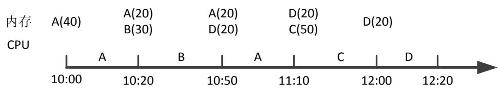
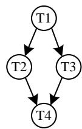
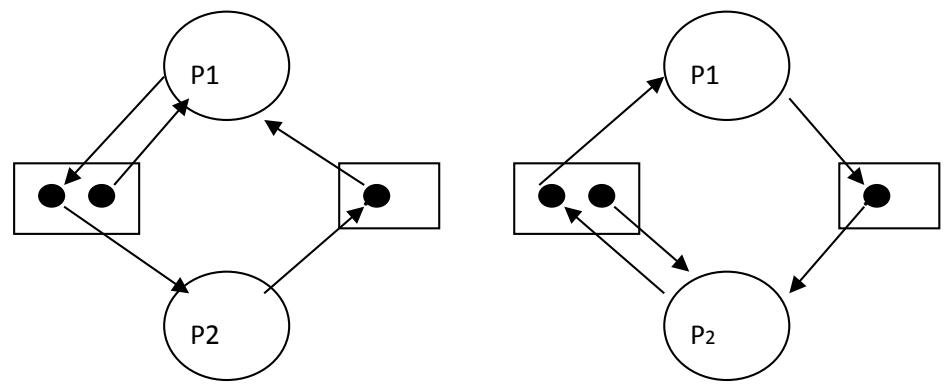
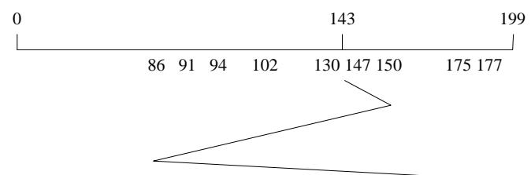
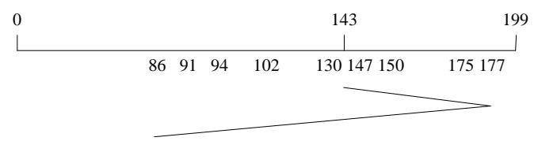

# 《操作系统》综合题汇总（作业调度、信号量、银行家算法等）

原件经识别和整理；“参考解答”是我们补的。

## 作业（进程）调度

### 综合 1 教材例题 单道系统

表 3-1 先来先服务调度算法计算结果

| 作业 | 进入时间 | 估计运行时间(分钟) | 开始时间 | 结束时间 | 周转时间(分钟) | 带权周转时间 |
|---|---|---|---|---|---|---|
| JOB1 | 8:00 | 120 | 8:00 | 10:00 | 120 | 1 |
| JOB2 | 8:50 | 50 | 10:00 | 10:50 | 120 | 2.4 |
| JOB3 | 9:00 | 10 | 10:50 | 11:00 | 120 | 12 |
| JOB4 | 9:50 | 20 | 11:00 | 11:20 | 90 | 4.5 |
| 合计 | | | | | 450 | 19.9 |

作业平均周转时间 $T=112.5$ 分钟，作业带权平均周转时间 $W=4.975$。

表 3-2 最短作业优先作业算法计算结果

| 作业 | 进入时间 | 估计运行时间(分钟) | 开始时间 | 结束时间 | 周转时间(分钟) | 带权周转时间 |
|---|---|---|---|---|---|---|
| JOB1 | 8:00 | 120 | 8:00 | 10:00 | 120 | 1 |
| JOB2 | 8:50 | 50 | 10:30 | 11:20 | 150 | 3 |
| JOB3 | 9:00 | 10 | 10:00 | 10:10 | 70 | 7 |
| JOB4 | 9:50 | 20 | 10:10 | 10:30 | 40 | 2 |
| 合计 | | | | | 380 | 13 |

作业平均周转时间 $T=95$ 分钟，作业带权平均周转时间 $W=3.25$。

表 3-3 最高响应比优先作业算法计算结果

| 作业 | 进入时间 | 估计运行时间(分钟) | 开始时间 | 结束时间 | 周转时间(分钟) | 带权周转时间 |
|---|---|---|---|---|---|---|
| JOB1 | 8:00 | 120 | 8:00 | 10:00 | 120 | 1 |
| JOB2 | 8:50 | 50 | 10:10 | 11:00 | 130 | 2.6 |
| JOB3 | 9:00 | 10 | 10:00 | 10:10 | 70 | 7 |
| JOB4 | 9:50 | 20 | 11:00 | 11:20 | 90 | 4.5 |
| 合计 | | | | | 350 | 15.1 |

作业平均周转时间 $T=102.5$ 分钟，作业带权平均周转时间 $W=3.8$。

知识点：[作业调度算法及性能评价（周转时间、带权周转时间）](../../../topics/操作系统/作业调度算法.md)

### 综合 2 教材例题 多道系统

表 3-4 多道程序环境下的作业调度算法计算结果

| 作业 | 进入时间 | 估计运行时间(分钟) | 开始时间 | 结束时间 | 周转时间(分钟) | 带权周转时间 |
|---|---|---|---|---|---|---|
| JOB1 | 10:00 | 30 | 10:00 | 11:05 | 65 | 4.167 |
| JOB2 | 10:05 | 20 | 10:05 | 10:25 | 20 | 1 |
| JOB3 | 10:10 | 5 | 10:25 | 10:30 | 20 | 4 |
| JOB4 | 10:20 | 10 | 10:30 | 10:40 | 20 | 2 |
| 合计 | | | | | 125 | 11.167 |

作业平均周转时间 $T=31.25$，作业带权平均周转时间 $W=2.79$。

知识点：[作业调度算法及性能评价（周转时间、带权周转时间）](../../../topics/操作系统/作业调度算法.md)、[处理机的三级调度（高级、中级、低级调度）](../../../topics/操作系统/处理机调度级别.md)

### 综合 3 课后习题 11

11. 单道批处理环境下有 5 个作业，各个作业进入系统的时间和估计运行时间如题表 3-11（a）所示。

题表 3-11（a）

| 作业 | 进入系统时间 | 估计运行时间/分钟 |
|---|---|---|
| 1 | 8:00 | 40 |
| 2 | 8:20 | 30 |
| 3 | 8:30 | 12 |
| 4 | 9:00 | 18 |
| 5 | 9:10 | 5 |

（1）如果应用先来先服务的作业调度算法，试将表 3-11（b）填写完整。

题表 3-11（b）

| 作业 | 进入系统时间 | 估计运行时间(分钟) | 结束时间 | 周转时间(分钟) | 带权周转时间 |
|---|---|---|---|---|---|
| 1 | 8:00 | 40 | 8:40 | 40 | 1 |
| 2 | 8:20 | 30 | 9:10 | 50 | 1.67 |
| 3 | 8:30 | 12 | 9:22 | 52 | 4.33 |
| 4 | 9:00 | 18 | 9:40 | 40 | 2.22 |
| 5 | 9:10 | 5 | 9:45 | 35 | 7 |
| 平均 | | | | | 3.24 |

作业平均周转时间 $T=43.4$ 分钟。

（2）如果应用最短作业优先的作业调度算法，试将表 3-11（c）填写完整。

题表 3-11（c）

| 作业 | 进入系统时间 | 估计运行时间(分钟) | 结束时间 | 周转时间(分钟) | 带权周转时间 |
|---|---|---|---|---|---|
| 1 | 8:00 | 40 | 8:40 | 40 | 1 |
| 2 | 8:20 | 30 | 9:22 | 62 | 2.07 |
| 3 | 8:30 | 12 | 8:52 | 22 | 1.83 |
| 4 | 9:00 | 18 | 9:45 | 45 | 2.5 |
| 5 | 9:10 | 5 | 9:27 | 17 | 3.4 |
| 平均 | | | | | 2.16 |

作业平均周转时间 $T=37.2$ 分钟。

（3）如果应用高响应比优先的作业调度算法，试将表 3-11（d）填写完整。

题表 3-11（d）

| 作业 | 进入系统时间 | 估计运行时间(分钟) | 结束时间 | 周转时间(分钟) | 带权周转时间 |
|---|---|---|---|---|---|
| 1 | 8:00 | 40 | 8:40 | 40 | 1 |
| 2 | 8:20 | 30 | 9:22 | 62 | 2.07 |
| 3 | 8:30 | 12 | 8:52 | 22 | 1.83 |
| 4 | 9:00 | 18 | 9:45 | 45 | 2.5 |
| 5 | 9:10 | 5 | 9:27 | 17 | 3.4 |
| 平均 | | | | | 2.16 |

作业平均周转时间 $T=37.2$ 分钟。

注：

（1）作业的周转时间 = 作业的完成时间 – 进入系统的时间。

（2）带权周转时间 = 作业的周转时间 / 作业运行时间，带权周转时间是一个比值，没有单位。

（3）高响应比优先调度算法中：

1）8:40 时，作业 2 和作业 3 到达

作业 2 响应比 $= 1 + (20/30)$

作业 3 响应比 $= 1 + (10/12)$

两者相比选择作业 3 占用 CPU

2）8:52 时，只有作业 2 到达，选择作业 2 占用 CPU

3）9:22 时，作业 4 和作业 5 到达

作业 4 响应比 $= 1 + (22/18)$

作业 5 响应比 $= 1 + (12/5)$

两者相比选择作业 5 占用 CPU

4）9:27 时，只有作业 4 了，选择作业 4 占用 CPU

知识点：[作业调度算法及性能评价（周转时间、带权周转时间）](../../../topics/操作系统/作业调度算法.md)、[进程调度算法（FCFS、SJF、优先级、时间片轮转、多级反馈队列）](../../../topics/操作系统/进程调度算法.md)、[操作系统三种基本类型（批处理、分时、实时）及其主要目标](../../../topics/操作系统/操作系统基本类型.md)

### 综合 4 课后习题 12

12. 有一个具有两道作业的批处理系统，作业调度采用短作业优先的非抢占式调度算法，进程调度采用以优先数为基础的抢占式调度算法，在题表 3-12 所示的作业序列中，作业优先数越小优先级越高。

题表 3-12

| 作业名 | 到达时间 | 运行时间 | 优先数 |
|---|---|---|---|
| A | 10:00 | 40 分 | 5 |
| B | 10:20 | 30 分 | 3 |
| C | 10:30 | 50 分 | 4 |
| D | 10:50 | 20 分 | 6 |

（1）列出所有作业进入内存时间及结束时间。

（2）计算平均周转时间。



| 作业名 | 到达时间 | 运行时间 | 优先数 | 进入内存 | 完成时间 | 周转时间(分钟) | 带权周转时间 |
|---|---|---|---|---|---|---|---|
| A | 10:00 | 40 分 | 5 | 10:00 | 11:10 | 70 | 1.75 |
| B | 10:20 | 30 分 | 3 | 10:20 | 10:50 | 30 | 1 |
| C | 10:30 | 50 分 | 4 | 11:10 | 12:00 | 90 | 1.8 |
| D | 10:50 | 20 分 | 6 | 10:50 | 12:20 | 90 | 4.5 |
| 平均周转时间 | | | | | | 70 | 2.26 |

注意：

（1）题目中有两级调度，分别是高级调度和低级调度。高级调度按照短作业优先的规则选择到达系统的作业进入内存。低级调度是在进入内存的作业中按照优先数小优先获得 CPU 执行。

（2）题目中的到达时间准确的说应该是到达外存的后备队列。

（3）高级调度只有在后备队列中有两个作业时才起作用。本题中，高级调度只在 10:50 时刻起作用了。（此时，作业 B 运行结束，内存中只有作业 A，后备队列中有作业 C 和作业 D 两道作业，按照短作业优先的规则将作业 D 调入内存）

低级调度是在内存中有两道作业（进程）时才起作用。本题中，低级调度在 10:20，10:50，11:10 共三个时刻起作用。

（4）作业的周转时间是完成时间减去到达系统的时间。准确的讲，周转时间应该是完成时间减去到达外存后备队列的时间，而不是减去进入内存的时间。（★）

## 2 信号量问题

1. 解决最简单的互斥问题 P79
2. 解决最简单的同步问题 P80（缓冲区为 1 的生产者消费者问题）
3. 哲学家吃通心面问题 P81（申请两个互斥资源）
4. 苹果桔子问题 P83（两种产品的生产者消费者问题）
5. 经典的生产者消费者问题 P82（缓冲区为 n）
6. 读者写者问题 P83（互斥问题）
7. 捡黑白子问题 P110（类似最简单的同步问题）
8. 司机售票员问题 P72（类似最简单的同步问题、捡黑白子问题）
9. 窄桥问题（类似读者写者问题）
10. 作业执行先后

知识点：[处理机的三级调度（高级、中级、低级调度）](../../../topics/操作系统/处理机调度级别.md)、[进程调度算法（FCFS、SJF、优先级、时间片轮转、多级反馈队列）](../../../topics/操作系统/进程调度算法.md)、[作业调度算法及性能评价（周转时间、带权周转时间）](../../../topics/操作系统/作业调度算法.md)

### 例题 1　解决最简单的互斥问题

（见教材 P79）

知识点：[临界区、临界资源与互斥的概念](../../../topics/操作系统/临界区与互斥.md)、[信号量机制与P、V操作的定义](../../../topics/操作系统/信号量与PV操作.md)、[进程控制块（PCB）的作用与内容](../../../topics/操作系统/进程控制块.md)

### 例题 2　解决最简单的同步问题

（缓冲区为 1 的生产者消费者问题）

```c
semaphore empty, full;
```

知识点：[信号量机制与P、V操作的定义](../../../topics/操作系统/信号量与PV操作.md)、[经典进程同步问题（生产者-消费者、读者-写者、哲学家进餐）](../../../topics/操作系统/经典同步问题.md)

### 例题 3　哲学家吃通心面问题

（申请两个互斥资源）

这个解法会导致死锁。解决死锁的方法 1：限定并发进程的数目，可以增加一个信号量，初始值设定为 4。解决死锁的方法 2：规定奇数的哲学家先申请左面的叉子，偶数的哲学家先申请右面的筷子。

知识点：[经典进程同步问题（生产者-消费者、读者-写者、哲学家进餐）](../../../topics/操作系统/经典同步问题.md)、[死锁的定义与四个必要条件（互斥、请求保持、不可剥夺、循环等待）](../../../topics/操作系统/死锁概念与必要条件.md)、[信号量机制与P、V操作的定义](../../../topics/操作系统/信号量与PV操作.md)

### 例题 4　苹果桔子问题

（两种产品的生产者消费者问题）

| void father() | void daughter() |
| --- | --- |
| `while(1){削苹果;P(empty);放苹果;V(apple);}` | `while(1){P(apple);取苹果;V(empty);吃苹果;}` |

| void mother() | void son() |
| --- | --- |
| `{` | `{` |
| `while(1)` | `while(1)` |
| `{` | `{` |
| `剥桔子;` | `P(orange);` |
| `P(empty);` | `取桔子;` |
| `放桔子;` | `V(empty);` |
| `V(apple);` | `吃桔子;` |
| `}` | `}` |
| `}` | `}` |

问题的修改：如果妈妈出差了，只有爸爸一个人在家，爸爸有时削苹果，有时剥桔子。

| void father() | void daughter() |
| --- | --- |
| `{` | `{` |
| `while(1)` | `while(1)` |
| `{` | `{` |
| `削苹果或剥桔子;` | `P(apple);` |
| `P(empty);` | `取苹果;` |
| `放苹果或放桔子;` | `V(empty);` |
| `if (放的是苹果) V(apple);` | `吃苹果;` |
| `else V(orange);` | `}` |
| `}` | `}` |
| `}` | `}` |

| void son() |
| --- |
| `{` |
| `while(1)` |
| `{` |
| `P(Orange);` |
| `取桔子;` |
| `V(empty);` |
| `吃桔子;` |
| `}` |
| `}` |

知识点：[经典进程同步问题（生产者-消费者、读者-写者、哲学家进餐）](../../../topics/操作系统/经典同步问题.md)、[信号量机制与P、V操作的定义](../../../topics/操作系统/信号量与PV操作.md)、[临界区、临界资源与互斥的概念](../../../topics/操作系统/临界区与互斥.md)

### 例题 5　经典的生产者消费者问题

（缓冲区为 n）

| void Producer() | void Consumer() |
| --- | --- |
| `{` | `{` |
| `while (1)` | `while (1)` |
| `{` | `{` |
| `生产一个产品;` | `P(full);` |
| `P(empty);` | `P(mutex);` |
| `P(mutex);` | `取产品;` |
| `放产品;` | `V(empty);` |
| `V(mutex);` | `V(full);` |
| `V(full);` | `消费产品;` |
| `}` | `}` |
| `}` | `}` |

对取和放两个操作进行细化，使用到了一维数组，将一维数组看成是头尾相连的环形队列。

| void Producer() | void Consumer() |
| --- | --- |
| `{` | `{` |
| `item product;` | `item product;` |
| `while (1)` | `while (1)` |
| `{` | `{` |
| `生产一个产品 product;` | `P(full);` |
| `P(empty);` | `P(mutex);` |
| `P(mutex);` | `product = B[out];` |
| `B[in] = product;` | `out = (out + 1) % K;` |
| `in = (in + 1) % K;` | `V(empty);` |
| `V(mutex);` | `V(full);` |
| `V(full);` | `消费产品 product;` |
| `}` | `}` |
| `}` | `}` |

知识点：[经典进程同步问题（生产者-消费者、读者-写者、哲学家进餐）](../../../topics/操作系统/经典同步问题.md)、[信号量机制与P、V操作的定义](../../../topics/操作系统/信号量与PV操作.md)、[临界区、临界资源与互斥的概念](../../../topics/操作系统/临界区与互斥.md)

### 例题 6　读者写者问题

（互斥问题）

知识点：[经典进程同步问题（生产者-消费者、读者-写者、哲学家进餐）](../../../topics/操作系统/经典同步问题.md)、[信号量机制与P、V操作的定义](../../../topics/操作系统/信号量与PV操作.md)、[临界区、临界资源与互斥的概念](../../../topics/操作系统/临界区与互斥.md)

### 例题 7　捡黑白子问题

（类似最简单的同步问题）

修改最简单的同步问题就可以得到解决方案。

```c
semaphore black, white;
```

知识点：[信号量机制与P、V操作的定义](../../../topics/操作系统/信号量与PV操作.md)、[经典进程同步问题（生产者-消费者、读者-写者、哲学家进餐）](../../../topics/操作系统/经典同步问题.md)、[临界区、临界资源与互斥的概念](../../../topics/操作系统/临界区与互斥.md)

### 例题 8　司机售票员问题

（类似最简单的同步问题、捡黑白子问题）

修改最简单的同步问题就可以得到解决方案。

| void Driver() | void Conductor() |
| --- | --- |
| `{` | `{` |
| `while(1)` | `while(1)` |
| `{` | `{` |
| `P(start);` | `P(open);` |
| `启动车辆;` | `开门;` |
| `行驶中到站停车;` | `上乘客,售票;` |
| `V(open);` | `关门;` |
| `}` | `V(start);` |
| `}` | `}` |
| | `}` |

知识点：[信号量机制与P、V操作的定义](../../../topics/操作系统/信号量与PV操作.md)、[经典进程同步问题（生产者-消费者、读者-写者、哲学家进餐）](../../../topics/操作系统/经典同步问题.md)、[进程的基本状态（就绪、执行、阻塞）及状态转换](../../../topics/操作系统/进程状态转换.md)

### 例题 9　窄桥问题

（类似读者写者问题）

```c
mutex = smutex = nmutex = 1;
```

| void South() | void North() |
| --- | --- |
| `{` | `{` |
| `P(smutex);` | `P(nmutex);` |
| `scount = scount + 1;` | `ncount = ncount + 1;` |
| `if (scount == 1) P(mutex);` | `if (ncount == 1) P(mutex);` |
| `V(smutex);` | `V(nmutex);` |
| `南下通过大桥;` | `北上通过大桥;` |
| `P(smutex);` | `P(nmutex);` |
| `scount = scount - 1;` | `ncount = ncount - 1;` |
| `if (scount == 0) V(mutex);` | `if (ncount == 0) V(mutex);` |
| `V(smutex);` | `V(nmutex);` |
| `}` | `}` |

知识点：[临界区、临界资源与互斥的概念](../../../topics/操作系统/临界区与互斥.md)、[信号量机制与P、V操作的定义](../../../topics/操作系统/信号量与PV操作.md)、[经典进程同步问题（生产者-消费者、读者-写者、哲学家进餐）](../../../topics/操作系统/经典同步问题.md)

### 例题 10　作业执行先后

（1）每个先后关系设定一个信号量 S，初始值设定为 0。

（2）先执行的程序在程序的最后执行 V 操作。

（3）后执行的程序在程序的最前执行 P 操作。

设有一个作业由 4 个进程 T1、T2、T3、T4 组成，这 4 个进程必须按下图的次序运行，试用信号量操作表达 4 个进程的同步关系。



| | |
| --- | --- |
| `semaphore a, b, c, d;` | |
| `a = b = c = d = 0;` | |
| `void T1(){...V(a);V(b);}` | `void T2(){P(a);...V(c);}` |
| `void T3(){P(b);...V(d);}` | `void T4(){P(c);P(d);...}` |

## 3 银行家算法

知识点：[信号量机制与P、V操作的定义](../../../topics/操作系统/信号量与PV操作.md)、[经典进程同步问题（生产者-消费者、读者-写者、哲学家进餐）](../../../topics/操作系统/经典同步问题.md)

### 综合 1（课后习题 14）

14. 假定具有 5 个进程的进程集合 $\mathsf{P} = \{\mathsf{P0}, \mathsf{P1}, \mathsf{P2}, \mathsf{P3}, \mathsf{P4}\}$，系统中有 3 类资源 A，B 和 C。其中 A 类资源有 10 个，B 类资源有 5 个，C 类资源有 7 个。假定在某时刻有如题表 4-14 所示的状态。

题表 4-14

| 进程 | Allocation A | Allocation B | Allocation C | Max A | Max B | Max C | Available A | Available B | Available C |
| --- | --- | --- | --- | --- | --- | --- | --- | --- | --- |
| P0 | 0 | 1 | 0 | 7 | 5 | 3 | 3 | 3 | 2 |
| P1 | 2 | 0 | 0 | 3 | 2 | 2 |  |  |  |
| P2 | 3 | 0 | 2 | 9 | 0 | 2 |  |  |  |
| P3 | 2 | 1 | 1 | 2 | 2 | 2 |  |  |  |
| P4 | 0 | 0 | 2 | 4 | 3 | 3 |  |  |  |

试给出 Need，并说明当前系统是否处于安全状态，如果是，给出安全序列。如果不是，说明理由。

答案：

| 进程 | Allocation A | Allocation B | Allocation C | Max A | Max B | Max C | Need A | Need B | Need C | Available A | Available B | Available C |
| --- | --- | --- | --- | --- | --- | --- | --- | --- | --- | --- | --- | --- |
| P0 | 0 | 1 | 0 | 7 | 5 | 3 | 7 | 4 | 3 | 3 | 3 | 2 |
| P1 | 2 | 0 | 0 | 3 | 2 | 2 | 1 | 2 | 2 |  |  |  |
| P2 | 3 | 0 | 2 | 9 | 0 | 2 | 6 | 0 | 0 |  |  |  |
| P3 | 2 | 1 | 1 | 2 | 2 | 2 | 0 | 1 | 1 |  |  |  |
| P4 | 0 | 0 | 2 | 4 | 3 | 3 | 4 | 3 | 1 |  |  |  |

系统处于安全状态，可以找到一个安全序列 P1, P3, P0, P2, P4。

附加问题：如果此时 P1 发出一个请求 Request1(1, 1, 0) 系统能否满足？为什么？

知识点：[死锁的预防方法与避免方法（银行家算法）](../../../topics/操作系统/死锁预防与避免.md)

### 综合 2（课后习题 18）

18. 系统有 A，B，C 和 D 共 4 种资源，在某时刻进程 P0，P1，P2，P3 和 P4 对资源的占有和需求情况如题表 4-18 所示，试解答下列问题：

题表 4-18

| Process | Allocation A | Allocation B | Allocation C | Allocation D | Claim A | Claim B | Claim C | Claim D | Available A | Available B | Available C | Available D |
| --- | --- | --- | --- | --- | --- | --- | --- | --- | --- | --- | --- | --- |
| P0 | 0 | 0 | 3 | 2 | 0 | 0 | 4 | 4 | 1 | 6 | 2 | 2 |
| P1 | 1 | 0 | 0 | 0 | 2 | 7 | 5 | 0 |  |  |  |  |
| P2 | 1 | 3 | 5 | 4 | 3 | 6 | 10 | 10 |  |  |  |  |
| P3 | 0 | 3 | 3 | 2 | 0 | 9 | 8 | 4 |  |  |  |  |
| P4 | 0 | 0 | 1 | 4 | 0 | 6 | 6 | 10 |  |  |  |  |

（1）系统此时处于安全状态吗？为什么？

（2）若此时 P2 发出 request1(1, 2, 2, 2)，系统能分配资源给它吗？为什么？

答案：

（1）系统处于安全状态，因为可以找到一个安全序列 {P0, P3, P1, P2, P4}。

（2）P2 进程发出请求 Request2(1, 2, 2, 2)，系统不能分配资源给它，因为如果分配给该进程，系统会进入不安全状态。

# 操作系统综合题汇总（银行家算法、死锁、分页与分段）

本资料整理自《操作系统》综合题汇总第 4 部分（第 17–21 页），内容涵盖银行家算法安全序列判断、进程资源分配图及死锁分析、分页式存储机制、地址转换计算等核心知识点。

## 一、银行家算法与安全序列判断

知识点：[死锁的定义与四个必要条件（互斥、请求保持、不可剥夺、循环等待）](../../../topics/操作系统/死锁概念与必要条件.md)、[死锁的预防方法与避免方法（银行家算法）](../../../topics/操作系统/死锁预防与避免.md)、[死锁的检测（资源分配图）与解除方法](../../../topics/操作系统/死锁检测与解除.md)

### 综合 1

**题目背景**：
系统当前资源分配情况如下表所示（单位：A, B, C, D）：

| Process | Allocation (A,B,C,D) | Claim (A,B,C,D) | Need (A,B,C,D) | Available (A,B,C,D) |
| :--- | :---: | :---: | :---: | :---: |
| P0 | 0,0,3,2 | 0,0,4,4 | 0,0,1,2 | 1,6,2,2 |
| P1 | 1,0,0,0 | 2,7,5,0 | 1,7,5,0 | |
| P2 | 1,3,5,4 | 3,6,10,10 | 2,3,5,6 | |
| P3 | 0,3,3,2 | 0,9,8,4 | 0,6,5,2 | |
| P4 | 0,0,1,4 | 0,6,6,10 | 0,6,5,6 | |

**问题**：
假设进程 P2 发出请求向量 Request₂ = (1, 2, 2, 2)，试判断系统能否满足该请求，并查找是否存在安全序列。

**解答过程**：

1.  **检查请求合法性**
    *   请求必须小于等于当前最大需求 (Need)：
        $Request_2(1, 2, 2, 2) \le Need_2(2, 3, 5, 6)$ → **成立**。
    *   请求必须小于等于系统可用资源 (Available)：
        $Request_2(1, 2, 2, 2) \le Available(1, 6, 2, 2)$ → **成立**。

2.  **试探性分配资源**
    *   更新 Available：
        $Available_{new} = Available - Request_2 = (1, 6, 2, 2) - (1, 2, 2, 2) = (0, 4, 0, 0)$
    *   更新 P2 的 Allocation：
        $Allocation_2 = Allocation_2 + Request_2 = (1, 3, 5, 4) + (1, 2, 2, 2) = (2, 5, 7, 6)$
    *   更新 P2 的 Need：
        $Need_2 = Need_2 - Request_2 = (2, 3, 5, 6) - (1, 2, 2, 2) = (1, 1, 3, 4)$

    **分配后的状态表**：

    | Process | Allocation (A,B,C,D) | Claim (A,B,C,D) | Need (A,B,C,D) | Available (A,B,C,D) |
    | :--- | :---: | :---: | :---: | :---: |
    | P0 | 0,0,3,2 | 0,0,4,4 | 0,0,1,2 | **0,4,0,0** |
    | P1 | 1,0,0,0 | 2,7,5,0 | 1,7,5,0 | |
    | P2 | **2,5,7,6** | 3,6,10,10 | **1,1,3,4** | |
    | P3 | 0,3,3,2 | 0,9,8,4 | 0,6,5,2 | |
    | P4 | 0,0,1,4 | 0,6,6,10 | 0,6,5,6 | |

3.  **寻找安全序列**
    *   当前可用资源为 $(0, 4, 0, 0)$。
    *   检查各进程的 Need：
        *   P0 Need (0,0,1,2) > Available (0,4,0,0) → 不满足（C 和 D 不足）。
        *   P1 Need (1,7,5,0) > Available → 不满足。
        *   P2 Need (1,1,3,4) > Available → 不满足。
        *   P3 Need (0,6,5,2) > Available → 不满足。
        *   P4 Need (0,6,5,6) > Available → 不满足。
    *   **结论**：Available (0, 4, 0, 0) 不能满足任何一个进程的最大请求，无法找到安全序列。

**答案**：系统不能进入安全状态，拒绝分配。

**订正**：无。

**补充**：
*   **矩阵与向量说明**：
    *   `Allocation`：已分配矩阵。
    *   `Claim`：初始时向系统提出的最大需求矩阵。
    *   `Need`：还能向系统提出的最大需求矩阵 ($Need = Claim - Allocation$)。
    *   `Available`：系统中剩余的资源向量。
*   **安全性说明**：如果系统处于安全状态，给出的安全序列不一定是唯一的。只要找到一个安全序列即可证明系统处于安全状态；若找不到，则系统处于不安全状态，可能导致死锁。

## 二、进程资源分配图与死锁

知识点：[死锁的定义与四个必要条件（互斥、请求保持、不可剥夺、循环等待）](../../../topics/操作系统/死锁概念与必要条件.md)、[死锁的预防方法与避免方法（银行家算法）](../../../topics/操作系统/死锁预防与避免.md)、[进程的定义与特征（动态性、并发性、独立性、制约性、异步性、结构性）](../../../topics/操作系统/进程定义与特征.md)

### 选择 1

**题目**：关于进程资源分配图的描述，下列说法正确的是？

- A. 圆圈代表资源，方框代表进程
- B. 方框中的点代表资源数
- C. 圆圈指向方框的有向边表示占有资源
- D. 方框指向圆圈的有向边表示请求资源

**答案**：B。

**参考解答**：
*   在进程资源分配图中：
    *   圆圈代表**进程**。
    *   方框代表**资源**，方框内的点代表该资源的数量。
    *   圆圈指向方框的有向边表示**请求资源**。
    *   方框指向圆圈的有向边表示**占有资源**。
*   因此 A、C、D 描述错误，B 正确。

知识点：[页面置换算法（OPT、FIFO、LRU、Clock、LFU）](../../../topics/操作系统/页面置换算法.md)、[虚拟存储器的基本思想与局部性原理](../../../topics/操作系统/虚拟存储器.md)、[存储管理的基本功能与地址转换（地址重定位）](../../../topics/操作系统/存储管理功能.md)

### 综合 2

**题目**：根据进程资源分配图判断死锁的条件有哪些？

**参考解答**：
1.  **不存在回路**：一定不死锁。
2.  **存在回路且资源数目均为 1**：一定死锁。
3.  **其他情况**：需要简化图后进行分析（例如看是否有非独占资源可以释放）。

知识点：[死锁的定义与四个必要条件（互斥、请求保持、不可剥夺、循环等待）](../../../topics/操作系统/死锁概念与必要条件.md)、[死锁的检测（资源分配图）与解除方法](../../../topics/操作系统/死锁检测与解除.md)

### 例题 1

**题目**：
假定某计算机系统有 R1 和 R2 两类可再使用资源（其中 R1 有两个单位，R2 有一个单位），它们被进程 P1，P2 所共享，且已知两个进程均以下列顺序使用两类资源：
→申请 R1→申请 R2→申请 R1→释放 R1→释放 R2→释放 R1→

试求出系统运行过程中可能到达的死锁点，并画出死锁点的资源分配图。

**解答**：
当 P1 持有 R1(1) 并申请 R2，同时 P2 持有 R2 并申请 R1 时，可能形成环路导致死锁。
具体死锁场景示例：
1.  P1 申请到 R1(1)。
2.  P2 申请到 R2(1)。
3.  P1 申请 R2(1) —— 此时 R2 已被 P2 占用，P1 等待。
4.  P2 申请 R1(1) —— 此时 R1 还剩 1 个单位，但 P1 占用了 1 个，若 P1 先申请了第二个 R1 或者 P2 申请时 R1 仅剩 0 个（取决于具体调度），这里需注意 R1 总数为 2。
    *   修正分析：R1=2, R2=1。
    *   若 P1 申请 R1(1)，P2 申请 R1(1)。此时 R1 用完。
    *   P1 申请 R2(1)，P2 申请 R2(1)。R2 只有 1 个。
    *   若 P1 持有 R1(1)，申请 R2(1)；P2 持有 R1(1) 和 R2(1)（不可能，因为 R2 只有一个）。
    *   **典型死锁路径**：
        1. P1 申请 R1(1) -> 成功 (R1剩1)。
        2. P2 申请 R1(1) -> 成功 (R1剩0)。
        3. P1 申请 R2(1) -> 成功 (R2剩0)。
        4. P2 申请 R2(1) -> 失败，等待 P1 释放 R2。
        5. P1 申请 R1(1) -> 失败，等待 P2 释放 R1。
        此时 P1 等待 R1，P2 等待 R2，形成循环等待，发生死锁。



## 三、分页式存储机制

知识点：[页式存储管理的基本原理与地址转换](../../../topics/操作系统/分页存储管理.md)

### 简答 1

**题目**：比较有无快表（TLB）时的内存访问时间计算方式。

**参考解答**：
1.  **无快表**：
    *   时间 = 访问页表的时间 + 访问数据的时间。
    *   共需两次访问内存。
2.  **有快表**：
    *   **命中**：访问快表的时间 + 访问数据的时间。
    *   **未命中**：访问页表的时间 + 访问数据的时间。
3.  **前提**：访问页表的时间 = 访问数据的时间 = 访问内存的时间。

知识点：[快表（TLB）机制及带快表的地址变换过程](../../../topics/操作系统/快表机制.md)、[页式存储管理的基本原理与地址转换](../../../topics/操作系统/分页存储管理.md)

### 例题 1

**题目**：
假定访问内存的时间为 100ns，访问相联存储器（快表）的时间为 20ns，相联存储器为 32 个单元时查快表的命中率可达 90%。求按逻辑地址进行存取的平均时间。

**解答**：
比两次访问内存的时间 200ns 下降了近四成。

$$
\text{平均时间} = (\text{命中时间}) \times \text{命中率} + (\text{未命中时间}) \times (1 - \text{命中率})
$$
$$
= (100 + 20) \times 90\% + (100 + 100) \times (1 - 90\%)
$$
$$
= 120 \times 0.9 + 200 \times 0.1
$$
$$
= 108 + 20 = 128ns
$$

**答案**：128ns。

## 四、地址转换计算

知识点：[页式存储管理的基本原理与地址转换](../../../topics/操作系统/分页存储管理.md)

### 例题 1

**题目**：
在一分页式存储系统中，逻辑地址长度为 16 位，页面大小为 4096B，且第 0、1、2 页依次存放在物理块 5、10、11 中。分别将逻辑地址 2F6A(H) 和 164F(H) 转换为相应的物理地址（十六进制格式）。

**解答**：
1.  **参数分析**：
    *   页面大小 $L = 4096B = 2^{12}$。
    *   逻辑地址低 12 位为页内位移，高 4 位为页号。
2.  **计算 2F6A(H)**：
    *   二进制：`0010 1111 0110 1010`
    *   页号：前 4 位 `0010` = 2。
    *   页内位移：后 12 位 `1111 0110 1010`。
    *   对应块号：页号 2 对应块号 11 (`1011`)。
    *   物理地址拼接：块号 `1011` + 位移 `1111 0110 1010` = `1011 1111 0110 1010` = BF6A(H)。

    **转换过程表**：
    | 十六进制 | 2 | F | 6 | A |
    | :--- | :---: | :---: | :---: | :---: |
    | 二进制 | 0010 | 1111 | 0110 | 1010 |
    | 划分 | 页号 2 | \multicolumn{3}{c}{页内位移} |
    | 块号 | 1011 (11) | \multicolumn{3}{c}{} |
    | 结果 | B | F | 6 | A |

3.  **计算 164F(H)**：
    *   二进制：`0001 0110 0100 1111`
    *   页号：前 4 位 `0001` = 1。
    *   页内位移：后 12 位 `0110 0100 1111`。
    *   对应块号：页号 1 对应块号 10 (`1010`)。
    *   物理地址拼接：块号 `1010` + 位移 `0110 0100 1111` = `1010 0110 0100 1111` = A64F(H)。

    **转换过程表**：
    | 十六进制 | 1 | 6 | 4 | F |
    | :--- | :---: | :---: | :---: | :---: |
    | 二进制 | 0001 | 0110 | 0100 | 1111 |
    | 划分 | 页号 1 | \multicolumn{3}{c}{页内位移} |
    | 块号 | 1010 (10) | \multicolumn{3}{c}{} |
    | 结果 | A | 6 | 4 | F |

**答案**：BF6A(H) 和 A64F(H)。

知识点：[页式存储管理的基本原理与地址转换](../../../topics/操作系统/分页存储管理.md)

### 例题 2

**题目**：
某虚存的用户空间共有 24 个页面，每页 1KB，内存 16KB。假定某时刻系统为用户的第 0、1、2 和 3 页分别分配的物理块号为 5、10、4 和 7。试将虚拟地址 0A5C 和 093C 变换为物理地址。

**解答**：
1.  **参数分析**：
    *   页面大小 1KB = $2^{10}$B。
    *   逻辑地址前 6 位是页号，后 10 位是页内位移。
2.  **计算 0A5C(H)**：
    *   二进制：`0000 1010 0101 1100`
    *   页号：前 6 位 `000010` = 2 (十进制)。
    *   页内位移：后 10 位保持不变。
    *   映射：页号 2 对应块号 4 (`000100`)。
    *   物理地址：块号 `000100` + 位移 `1001011100` = `0001001001011100` = 125C(H)。
3.  **计算 093C(H)**：
    *   二进制：`0000 1001 0101 1100`
    *   页号：前 6 位 `000010` = 2 (十进制)。
    *   映射：页号 2 对应块号 4 (`000100`)。
    *   物理地址：块号 `000100` + 位移 `0101011100` = `0001000101011100` = 113C(H)。

**答案**：
| 逻辑地址 (H) | 0A5C | 093C |
| :--- | :---: | :---: |
| 逻辑地址 (B) | 0000 1010 0101 1100 | 0000 1001 0101 1100 |
| 页号 | 2 | 2 |
| 块号 | 4 | 4 |
| 物理地址 (B) | 0001 0010 0101 1100 | 0001 0001 0101 1100 |
| 物理地址 (H) | **125C** | **113C** |

知识点：[页面置换算法（OPT、FIFO、LRU、Clock、LFU）](../../../topics/操作系统/页面置换算法.md)、[虚拟存储器的基本思想与局部性原理](../../../topics/操作系统/虚拟存储器.md)、[页式存储管理的基本原理与地址转换](../../../topics/操作系统/分页存储管理.md)

### 例题 3

**题目**：
给定段表如题表 5-13 所示。

| 段号 | 段首址 | 段长 |
| :--- | :---: | :---: |
| 0 | 400 | 600 |
| 1 | 1300 | 400 |
| 2 | 100 | 200 |

给定以下地址为段号和位移数：
(1) [0, 430]
(2) [1, 200]
(3) [2, 400]
(4) [3, 100]

**解答**：
1.  **[0, 430]**：
    *   段号 0 < 段表长度 3，合法。
    *   位移 430 < 段长 600，合法。
    *   物理地址 = 段首址 + 位移 = $400 + 430 = 830$。
2.  **[1, 200]**：
    *   段号 1 < 3，合法。
    *   位移 200 < 段长 400，合法。
    *   物理地址 = $1300 + 200 = 1500$。
3.  **[2, 400]**：
    *   段号 2 < 3，合法。
    *   位移 400 > 段长 200，**越界中断**。
4.  **[3, 100]**：
    *   段号 3 >= 段表长度 3，**越界中断**。

**答案**：
(1) 830
(2) 1500
(3) 产生越界中断
(4) 产生越界中断

# 页面置换算法

本资料整理自《操作系统》综合题汇总（作业调度、信号量、银行家算法等）第 5 部分，包含 FIFO、OPT、LRU 三种算法的对比及典型例题解析。

## 一、常见页面置换算法

知识点：[段式存储管理的基本原理与地址转换](../../../topics/操作系统/分段存储管理.md)、[存储管理的基本功能与地址转换（地址重定位）](../../../topics/操作系统/存储管理功能.md)

### 选择 1
**先进先出页面置换算法 (FIFO)**

知识点：[页面置换算法（OPT、FIFO、LRU、Clock、LFU）](../../../topics/操作系统/页面置换算法.md)、[虚拟存储器的基本思想与局部性原理](../../../topics/操作系统/虚拟存储器.md)、[存储管理的基本功能与地址转换（地址重定位）](../../../topics/操作系统/存储管理功能.md)

### 选择 2
**最佳页面置换算法 (OPT)**

知识点：[页式存储管理的基本原理与地址转换](../../../topics/操作系统/分页存储管理.md)、[虚拟存储器的基本思想与局部性原理](../../../topics/操作系统/虚拟存储器.md)、[页面置换算法（OPT、FIFO、LRU、Clock、LFU）](../../../topics/操作系统/页面置换算法.md)

### 选择 3
**最近最久未使用页面置换算法 (LRU)**

## 二、例题解析

知识点：[页面置换算法（OPT、FIFO、LRU、Clock、LFU）](../../../topics/操作系统/页面置换算法.md)、[虚拟存储器的基本思想与局部性原理](../../../topics/操作系统/虚拟存储器.md)

### 计算 1
**题目：**
一个页式存储管理系统使用 FIFO、OPT 和 LRU 页面替换算法。如果一个作业的页面走向为：2，3，2，1，5，2，4，5，3，2，5，2。当分配给该作业的物理页框块数为 3 时，试计算访问过程中发生的缺页中断次数和缺页中断率。

#### 1. 最佳页面置换算法 (OPT)

<table>
<thead>
<tr>
<th></th>
<th>2</th>
<th>3</th>
<th>2</th>
<th>1</th>
<th>5</th>
<th>2</th>
<th>4</th>
<th>5</th>
<th>3</th>
<th>2</th>
<th>5</th>
<th>2</th>
</tr>
</thead>
<tbody>
<tr><td>页 1</td><td>2</td><td>2</td><td>-</td><td>2</td><td>2</td><td>-</td><td>4</td><td>-</td><td>-</td><td>4</td><td>-</td><td>-</td></tr>
<tr><td>页 2</td><td>-</td><td>3</td><td>-</td><td>3</td><td>3</td><td>-</td><td>3</td><td>-</td><td>-</td><td>2</td><td>-</td><td>-</td></tr>
<tr><td>页 3</td><td>-</td><td>-</td><td>-</td><td>1</td><td>5</td><td>-</td><td>5</td><td>-</td><td>-</td><td>5</td><td>-</td><td>-</td></tr>
<tr><td>是否缺页</td><td>√</td><td>√</td><td>-</td><td>√</td><td>√</td><td>-</td><td>√</td><td>-</td><td>-</td><td>√</td><td>-</td><td>-</td></tr>
<tr><td>置换了</td><td>-</td><td>-</td><td>-</td><td>-</td><td>1</td><td>-</td><td>2</td><td>-</td><td>-</td><td>3</td><td>-</td><td>-</td></tr>
</tbody>
</table>

注 1：要将 2 换入，需要换出的页面可以是 3 或者 4。如果加上限定，同等情况下优先置换出先进入内存的页面，此时置换出的页面是 3。

答案：缺页 6 次，缺页率为 $6/12 \times 100\% = 50\%$。发生了 3 次置换，依次置换的页面是 1、2、3。

#### 2. 先进先出页面置换算法 (FIFO)

<table>
<thead>
<tr>
<th></th>
<th>2</th>
<th>3</th>
<th>2</th>
<th>1</th>
<th>5</th>
<th>2</th>
<th>4</th>
<th>5</th>
<th>3</th>
<th>2</th>
<th>5</th>
<th>2</th>
</tr>
</thead>
<tbody>
<tr><td>页 1</td><td>2</td><td>2</td><td>-</td><td>2</td><td>5</td><td>5</td><td>5</td><td>-</td><td>3</td><td>-</td><td>3</td><td>3</td></tr>
<tr><td>页 2</td><td>-</td><td>3</td><td>-</td><td>3</td><td>3</td><td>2</td><td>2</td><td>-</td><td>2</td><td>-</td><td>5</td><td>5</td></tr>
<tr><td>页 3</td><td>-</td><td>-</td><td>-</td><td>1</td><td>1</td><td>1</td><td>4</td><td>-</td><td>4</td><td>-</td><td>4</td><td>2</td></tr>
<tr><td>是否缺页</td><td>√</td><td>√</td><td>-</td><td>√</td><td>√</td><td>√</td><td>√</td><td>-</td><td>√</td><td>-</td><td>√</td><td>√</td></tr>
<tr><td>置换了</td><td>-</td><td>-</td><td>-</td><td>-</td><td>2</td><td>3</td><td>1</td><td>-</td><td>5</td><td>-</td><td>2</td><td>4</td></tr>
</tbody>
</table>

答案：缺页 9 次，缺页率为 $9/12 \times 100\% = 75\%$。发生了 6 次置换，依次置换的页面是 2、3、1、5、2、4。

#### 3. 最近最久未使用页面置换算法 (LRU)

<table>
<thead>
<tr>
<th></th>
<th>2</th>
<th>3</th>
<th>2</th>
<th>1</th>
<th>5</th>
<th>2</th>
<th>4</th>
<th>5</th>
<th>3</th>
<th>2</th>
<th>5</th>
<th>2</th>
</tr>
</thead>
<tbody>
<tr><td>页 1</td><td>2</td><td>2</td><td>-</td><td>2</td><td>2</td><td>-</td><td>2</td><td>-</td><td>3</td><td>3</td><td>-</td><td>-</td></tr>
<tr><td>页 2</td><td>-</td><td>3</td><td>-</td><td>3</td><td>5</td><td>-</td><td>5</td><td>-</td><td>5</td><td>5</td><td>-</td><td>-</td></tr>
<tr><td>页 3</td><td>-</td><td>-</td><td>-</td><td>1</td><td>1</td><td>-</td><td>4</td><td>-</td><td>4</td><td>2</td><td>-</td><td>-</td></tr>
<tr><td>是否缺页</td><td>√</td><td>√</td><td>-</td><td>√</td><td>√</td><td>-</td><td>√</td><td>-</td><td>√</td><td>√</td><td>-</td><td>-</td></tr>
<tr><td>置换了</td><td>-</td><td>-</td><td>-</td><td>-</td><td>3</td><td>-</td><td>1</td><td>-</td><td>2</td><td>4</td><td>-</td><td>-</td></tr>
</tbody>
</table>

答案：缺页 7 次，缺页率为 $7/12 \times 100\% \approx 58.3\%$。发生了 4 次置换，依次置换的页面是 3、1、2、4。

# 《操作系统》综合题汇总（作业调度、信号量、银行家算法等）

本部分为《操作系统》课程习题的第 6 部分，主要涵盖页面置换算法（FIFO、OPT、LRU）及 Belady 异常的例题与课后习题。

## 一、页面置换算法计算题

知识点：[页面置换算法（OPT、FIFO、LRU、Clock、LFU）](../../../topics/操作系统/页面置换算法.md)、[虚拟存储器的基本思想与局部性原理](../../../topics/操作系统/虚拟存储器.md)

### 例题 2

一个页式存储管理系统使用 FIFO，OPT 和 LRU 页面替换算法，如果一个作业的页面走向为：4，3，2，1，4，3，5，4，3，2，1 和 5。当分配给该作业的物理页框块数为 3 时，试计算访问过程中发生的缺页中断次数和缺页中断率。

#### 最佳页面置换算法（OPT 算法）

| | 4 | 3 | 2 | 1 | 4 | 3 | 5 | 4 | 3 | 2 | 1 | 5 |
| :--- | :---: | :---: | :---: | :---: | :---: | :---: | :---: | :---: | :---: | :---: | :---: | :---: |
| 页 1 | 4 | 4 | 4 | 4 | 4 | 4 | 4 | 4 | 4 | 2 | 2 | 2 |
| 页 2 | | 3 | 3 | 3 | 3 | 3 | 3 | 3 | 3 | 3 | 1 | 1 |
| 页 3 | | | 2 | 1 | 1 | 1 | 5 | 5 | 5 | 5 | 5 | 5 |
| 是否缺页 | √ | √ | √ | √ | | | √ | | | √ | √ | |
| 置换了 | | | | 2 | | | 1 | | | 4 | 3 | |
| | | | | | | | | | | | 注 1 | |

> 【注 1】要将 1 换入，需要换出的页面可以是 2 或者 3。如果加上限定，同等情况下优先置换出先进入内存的页面，此时置换出的页面是 3。

- 缺页 7 次
- 缺页率为 $7/12 \times 100\% = 58.3\%$
- 发生了 4 次置换，依次置换的页面是 2、1、4、3。

#### 先进先出页面置换算法（FIFO 算法）

| | 4 | 3 | 2 | 1 | 4 | 3 | 5 | 4 | 3 | 2 | 1 | 5 |
| :--- | :---: | :---: | :---: | :---: | :---: | :---: | :---: | :---: | :---: | :---: | :---: | :---: |
| 页 1 | 4 | 4 | 4 | 1 | 1 | 1 | 5 | 5 | 5 | 5 | 5 | 5 |
| 页 2 | | 3 | 3 | 3 | 4 | 4 | 4 | 4 | 4 | 2 | 2 | 2 |
| 页 3 | | | 2 | 2 | 2 | 3 | 3 | 3 | 3 | 3 | 1 | 1 |
| 是否缺页 | √ | √ | √ | √ | √ | √ | √ | | | √ | √ | |
| 置换了 | | | | 4 | 3 | 2 | 1 | | | 4 | 3 | |

- 缺页 9 次
- 缺页率为 $9/12 \times 100\% = 75\%$
- 发生了 6 次置换，依次置换的页面是 4、3、2、1、4、3。

#### 最近最久未使用页面置换算法（LRU 算法）

| | 4 | 3 | 2 | 1 | 4 | 3 | 5 | 4 | 3 | 2 | 1 | 5 |
| :--- | :---: | :---: | :---: | :---: | :---: | :---: | :---: | :---: | :---: | :---: | :---: | :---: |
| 页 1 | 4 | 4 | 4 | 1 | 1 | 1 | 5 | 5 | 5 | 2 | 2 | 2 |
| 页 2 | | 3 | 3 | 3 | 4 | 4 | 4 | 4 | 4 | 4 | 1 | 1 |
| 页 3 | | | 2 | 2 | 2 | 3 | 3 | 3 | 3 | 3 | 3 | 5 |
| 是否缺页 | √ | √ | √ | √ | √ | √ | √ | | | √ | √ | √ |
| 置换了 | | | | 4 | 3 | 2 | 1 | | | 5 | 4 | 3 |

- 缺页 10 次
- 缺页率为 $10/12 \times 100\% = 83.3\%$
- 发生了 7 次置换，依次置换的页面是 4、3、2、1、5、4、3。

#### 分配 4 个物理块时的情况

**采用先进先出页面置换算法：**

| | 4 | 3 | 2 | 1 | 4 | 3 | 5 | 4 | 3 | 2 | 1 | 5 |
| :--- | :---: | :---: | :---: | :---: | :---: | :---: | :---: | :---: | :---: | :---: | :---: | :---: |
| 页 1 | 4 | 4 | 4 | 4 | | | 5 | 5 | 5 | 5 | 1 | 1 |
| 页 2 | | 3 | 3 | 3 | | | 3 | 4 | 4 | 4 | 4 | 5 |
| 页 3 | | | 2 | 2 | | | 2 | 2 | 3 | 3 | 3 | 3 |
| 页 4 | | | | 1 | | | 1 | 1 | 1 | 2 | 2 | 2 |
| 是否缺页 | √ | √ | √ | √ | | | √ | √ | √ | √ | √ | √ |
| 置换了 | | | | | | | 4 | 3 | 2 | 1 | 5 | 4 |

- 产生 10 次缺页
- 缺页率是 $10/12 \times 100\% = 83.3\%$

> **【Belady 异常】** 同样采用先进先出页面置换算法，如果分配 3 个物理块缺页次数是 9 次，如果分配 4 个物理块缺页次数是 10 次，分配的物理块数增加了，缺页次数不降反升，这个就是 Belady 异常。

知识点：[页面置换算法（OPT、FIFO、LRU、Clock、LFU）](../../../topics/操作系统/页面置换算法.md)、[虚拟存储器的基本思想与局部性原理](../../../topics/操作系统/虚拟存储器.md)、[页式存储管理的基本原理与地址转换](../../../topics/操作系统/分页存储管理.md)

### 例题 3（课后习题 12）

12. 在一个采用页式虚拟存储管理的系统中，有一用户作业，它依次要访问的字地址序列是：115，228，120，88，446，102，321，432，260 和 167，若该作业的第 0 页已经装入内存，现分配给该作业的内存共 300B，页的大小为 100B，请回答下列问题：

（1）按 FIFO 调度算法将产生______次缺页中断，依次淘汰的页号为______，缺页中断率为______；
（2）按 LRU 调度算法将产生______次缺页中断，依次淘汰的页号为______，缺页中断率为______。

【解答】

首先根据字地址计算页号：
$$ \text{页号} = \lfloor \text{字地址} / \text{页大小} \rfloor $$
页大小为 100B，各地址对应的页号如下：

| 地址 | 115 | 228 | 120 | 88 | 446 | 102 | 321 | 432 | 260 | 167 |
| :--- | :---: | :---: | :---: | :---: | :---: | :---: | :---: | :---: | :---: | :---: |
| 页号 | 1 | 2 | 1 | 0 | 4 | 1 | 3 | 4 | 2 | 1 |

#### （1）先进先出页面置换算法（FIFO）

| | 1 | 2 | 1 | 0 | 4 | 1 | 3 | 4 | 2 | 1 |
| :--- | :---: | :---: | :---: | :---: | :---: | :---: | :---: | :---: | :---: | :---: |
| 块 1 | 0 | 0 | | | 4 | | 4 | | | 4 |
| 块 2 | 1 | 1 | | | 1 | | 3 | | | 3 |
| 块 3 | | 2 | | | 2 | | 2 | | | 1 |
| 是否缺页 | √ | √ | | | √ | | √ | | | √ |
| 置换的 | | | | | 0 | | 1 | | | 2 |

- 按 FIFO 调度算法将产生 5 次缺页中断
- 依次淘汰的页号为 0、1、2
- 缺页中断率为 50%

#### （2）最近最久未使用页面置换算法（LRU）

| | 1 | 2 | 1 | 0 | 4 | 1 | 3 | 4 | 2 | 1 |
| :--- | :---: | :---: | :---: | :---: | :---: | :---: | :---: | :---: | :---: | :---: |
| 块 1 | 0 | 0 | | | 0 | | 3 | | 3 | 1 |
| 块 2 | 1 | 1 | | | 1 | | 1 | | 2 | 2 |
| 块 3 | | 2 | | | 4 | | 4 | | 4 | 4 |
| 是否缺页 | √ | √ | | | √ | | √ | | √ | √ |
| 置换的 | | | | | 2 | | 0 | | 1 | 3 |

- 按 LRU 调度算法将产生 6 次缺页中断
- 依次淘汰的页号为 2、0、1、3
- 缺页中断率为 60%

> **注意**：原题解答末尾文字“发生了 6 次置换，依次置换的页面是 4、3、2、1、5、4”似乎属于上一道例题（例题 2 的 LRU 部分或混淆），在此处 LRu 题目中，实际置换过程对应的是页号 2、0、1、3。

# 《操作系统》综合题汇总（作业调度、信号量、银行家算法等）

本部分为第 7 部分，涵盖磁盘调度算法与混合索引相关知识点及习题整理。

## 8 磁盘调度算法

知识点：[页式存储管理的基本原理与地址转换](../../../topics/操作系统/分页存储管理.md)、[页面置换算法（OPT、FIFO、LRU、Clock、LFU）](../../../topics/操作系统/页面置换算法.md)、[虚拟存储器的基本思想与局部性原理](../../../topics/操作系统/虚拟存储器.md)

### 8.1 算法概述

- （1）先来先服务
- （2）最短寻道时间优先
- （3）扫描算法
- （4）循环扫描算法

知识点：[磁盘调度算法（FCFS、SSTF、SCAN、CSCAN）](../../../topics/操作系统/磁盘调度算法.md)

### 【例题 1】教材例题

此处指代教材中的基础示例，具体细节见下文课后习题解答或教材原文。

知识点：[操作系统的定义与主要目标](../../../topics/操作系统/操作系统定义与目标.md)、[现代操作系统的特征（并发、共享、虚拟、异步）](../../../topics/操作系统/操作系统特征.md)、[进程的基本状态（就绪、执行、阻塞）及状态转换](../../../topics/操作系统/进程状态转换.md)

### 【例题 2】课后习题 8

**题干：**
假定磁盘有 200 个柱面，编号 0～199，当前存取臂的位置在 143 号柱面上，并刚刚完成了 125 号柱面的服务请求。如果请求队列的先后顺序是：86，147，91，177，94，150，102，175，130。试问：为完成上述请求，下列算法存取臂移动的总量是多少？并算出存取臂移动的顺序。

（1）先来先服务算法 FCFS；
（2）最短查找时间优先算法 SSTF；
（3）扫描算法 SCAN。

**答案：**

（1）**先来先服务算法 FCFS**

移动总量 = 565

（2）**最短查找时间优先算法 SSTF**



处理磁道序列是：143, 147, 150, 130, 102, 94, 91, 86, 175, 177

（3）**扫描算法 SCAN**



**注：**

（1）在计算最短查找时间优先算法和扫描算法时，将所有的请求从小到大排列。

（2）最短查找时间优先算法，每次都要查看与当前磁头最近的两个请求的距离，从而判断磁头向左还是向右移动。（切勿第一次左右查看，后面的请求不查看）

（3）扫描算法不同的教材讲解会有不同，有的教材上磁头每次都要移动到磁盘最大的磁道（199）和磁盘最小的磁道（0），我们教材上讲解的是移动到请求最大的磁道（177）和请求最小的磁道（86）。

（4）扫描算法要注意磁头移动方向，此题中当前磁头是 143，刚处理完的是 125 号磁道，表示磁头向磁道号大的方向移动。

## 9 混合索引

知识点：[磁盘调度算法（FCFS、SSTF、SCAN、CSCAN）](../../../topics/操作系统/磁盘调度算法.md)

### 9.1 直接索引

知识点：[文件的物理结构（连续、链接、索引、混合索引）](../../../topics/操作系统/文件物理结构.md)

### 9.2 一级间接索引

知识点：[文件的物理结构（连续、链接、索引、混合索引）](../../../topics/操作系统/文件物理结构.md)、[操作系统的主要功能（处理机管理、存储管理、设备管理、文件管理、用户接口）](../../../topics/操作系统/操作系统功能.md)

### 9.3 二级间接索引

知识点：[文件的物理结构（连续、链接、索引、混合索引）](../../../topics/操作系统/文件物理结构.md)

### 9.4 三级间接索引

知识点：[文件的物理结构（连续、链接、索引、混合索引）](../../../topics/操作系统/文件物理结构.md)

### 【例题 1】教材例题 混合索引

Linux 操作系统采用的是混合索引方式，如图 7-6 所示。每个文件的索引表规定为 13 个索引项，每项 4 个字节，登记一个存放文件信息的物理块号。前面 10 项存放文件信息的物理块号，叫直接寻址。假定物理块的大小是 4KB，直接寻址可以表示 40KB（4KB×10）的文件。如果文件大于 10 块，则利用第 11 项指向一个物理块，该块中最多可放 1K 个存放文件信息的物理块的块号。这种方式是一次间接寻址，可以表示 4MB（4KB×1K）的文件。每个大型文件还可以利用第 12 和 13 项作二次和三次间接寻址，二次间接寻址可以表示 4GB 的文件，三次间接寻址可以表示 4TB 的文件。


| 类别 | 物理块数(数据) | 表示的文件 | 索引块数 |
| :--- | :--- | :--- | :--- |
| 直接索引 | 10 个 | $4\text{K} \times 10 = 40\text{KB}$ | 0 |
| 一次间接索引 | $(4\text{K}/4) = 1024$ | $4\text{K} \times 1024 = 4\text{MB}$ | 1 |
| 二次间接索引 | $1024 \times 1024$ | $4\text{K} \times 1024 \times 1024 = 4\text{GB}$ | 1024 |
| 三次间接索引 | $1024 \times 1024 \times 1024$ | $4\text{K} \times 1024 \times 1024 \times 1024 = 4\text{TB}$ | $1024 \times 1024$ |

知识点：[文件的物理结构（连续、链接、索引、混合索引）](../../../topics/操作系统/文件物理结构.md)、[连续文件的优缺点](../../../topics/操作系统/连续文件优缺点.md)

### 【例题 2】课后习题 12

**题干：**
如果一个索引节点为 128B，指针长 4B，状态信息占用 68B，而每块大小为 8KB。问在索引节点中有多大空间给指针？使用直接、间接、二次间接和三次间接指针分别可表示多大的文件？

**参考解答：**

索引结点中有 60B 给指针。

直接索引 96KB，一次间接索引 16MB，二次间接索引 32GB，三次间接索引 64TB。

**详细推导过程：**

$$
\text{指针总空间} = 128 - 68 = 60 \text{ B}
$$

60 B 用来存放文件的存储信息（盘块指针）。

$$
\text{指针数量} = 60 / 4 = 15 \text{ 个}
$$

可以存放 15 个盘块地址（盘块号）。

15 个盘块号中：
- 1 个用于一次间接索引
- 1 个用于二次间接索引
- 1 个用于三次间接索引
- 剩下的 12 个用于直接索引

每个盘块中可以存放：

$$
8\text{KB} / 4\text{B} = 2\text{K} \text{ 个盘块地址}
$$

各索引方式表示的文件大小如下：

**直接索引：**

$$
8\text{KB} \times 12 = 96\text{KB}
$$

**一次间接索引：**

$$
8\text{KB} \times (8\text{KB} / 4\text{B}) = 8\text{KB} \times 2\text{K} = 16\text{MB}
$$

**二次间接索引：**

$$
8\text{KB} \times (8\text{KB} / 4\text{B}) \times (8\text{KB} / 4\text{B}) = 8\text{KB} \times 2\text{K} \times 2\text{K} = 32\text{GB}
$$

**三次间接索引：**

$$
8\text{KB} \times (8\text{KB} / 4\text{B}) \times (8\text{KB} / 4\text{B}) \times (8\text{KB} / 4\text{B}) = 8\text{KB} \times 2\text{K} \times 2\text{K} \times 2\text{K} = 64\text{TB}
$$

知识点：[文件的物理结构（连续、链接、索引、混合索引）](../../../topics/操作系统/文件物理结构.md)
