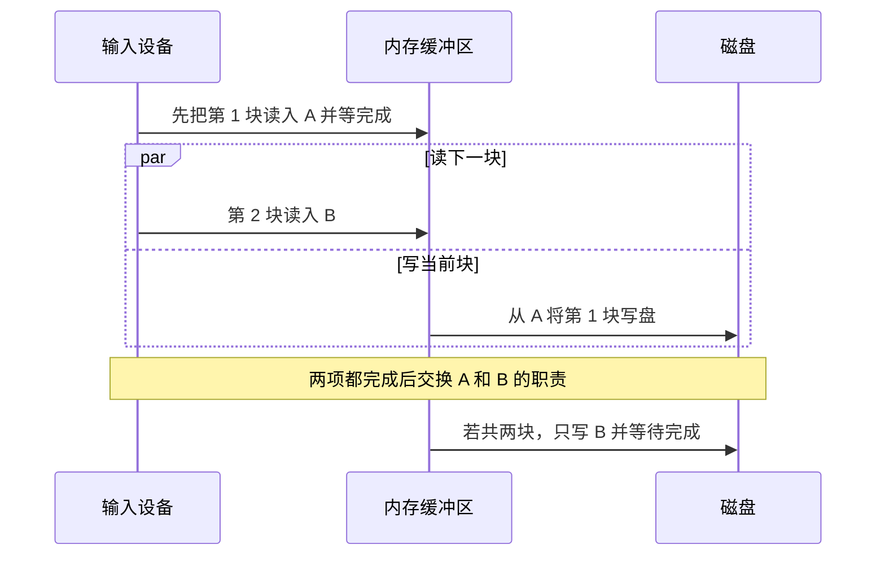

# 《操作系统》设备管理：串行与并行数据传输流程改造（试题-3）

原件共 4 页，第 1 页是封面，第 2–3 页讲输入与写盘重叠，第 4 页是磁盘寻道计算。以下将原解与独立验算分开，并补全原解省略的结束边界。

## 分析 1：两块缓冲区为什么能让输入与写盘重叠

**题意：**输入设备先把一个数据块读入内存缓冲区，等待输入结束后才启动磁盘写该块，写完又读下一块。硬件允许两个外设并行，怎样改造软件流程？

**原解要点：**先读第一块到 A。将 A 写盘的同时，把下一块读到 B；等这两项操作都结束，再继续。

**参考解答：**一块缓冲区被磁盘占用时不能覆盖，否则写盘可能读到后一数据块。改用 A、B 两块，按下面的轮次交替：

1. 读第一块到 A，等待完成；没有输入时直接结束。
2. 写当前已满的缓冲区；若还有下一块，同时读入另一个已经空闲的缓冲区。
3. 该轮的写和读都结束后，交换两块缓冲区的职责，再执行上一步。最后一轮只写、不再读，等尾块确实写完才结束。

> [!IMPORTANT]
> 写盘开始前，==接收该数据块的输入必须完成==；重用旧缓冲区前，==磁盘必须已经不再读取它==。并行的是“上一块写盘”和“下一块读入”，不是将同一块一边写入内存、一边无条件交给磁盘。

**补充验算：**假设输入一块需 $r$ 秒、写盘需 $w$ 秒，操作启动、切换时间忽略不计，硬件确能并行。对 $n\ge1$ 块，原串行流程耗时 $n(r+w)$，双缓冲耗时 $r+(n-1)\max(r,w)+w$：首读和尾写无法重叠，中间每轮等较慢设备。例：3 块、每块读 4 秒、写 6 秒，串行为 30 秒，双缓冲为 22 秒；只有一块时两者都是 10 秒。这不是对设备共享总线时的性能保证。参见 [双缓冲](../../../topics/操作系统/缓冲技术.md)；重叠是否由设备自主完成则取决于 [I/O 控制方式](../../../topics/操作系统/IO控制方式.md)。

## 计算 1：磁头何时反向，比算法名称更能决定答案

**题意：**请求包括 67、65、124、14、122、37、183、98；磁道号从 0 到 199。开始服务时磁头已从 60 到达 67，按题称 SCAN 求直到任务结束的移动量。

**原件答案：**按 67、98、122、124、183、65、37、14 服务，移动 285 道。

**参考解答：**60→67 只用来确定初始方向是向更大的磁道号，已完成的 7 道不计入本次任务；67 号请求在初始位置服务，不产生移动。之后先按升序服务 98、122、124、183，反向后按降序服务 65、37、14。两种常见定义相同的是**服务顺序**，不同的是**实际走过的磁道**：

| 折返约定 | 向上走到 | 折返后最后服务 | 总移动量 |
| --- | --- | --- | ---: |
| 原件：当前方向已无请求即折返，常称 LOOK | 183 | 14 | $(183-67)+(183-14)=285$ 道 |
| 严格端点版 SCAN：先到磁盘端点再折返 | 199（不新增一次服务） | 14 | $(199-67)+(199-14)=317$ 道 |

题目问“任务结束”，最后一个请求在 14，服务后不必为下一轮继续扫到 0。端点版多走的 32 道正是 183 与 199 之间的往返距离。也可逐段验算原解：$31+24+2+59+118+28+23=285$。按本课件的折返约定应答 285；若题目或授课约定必须到物理端点，则答 317，并写明所用规则。参见 [磁盘调度算法](../../../topics/操作系统/磁盘调度算法.md)。
