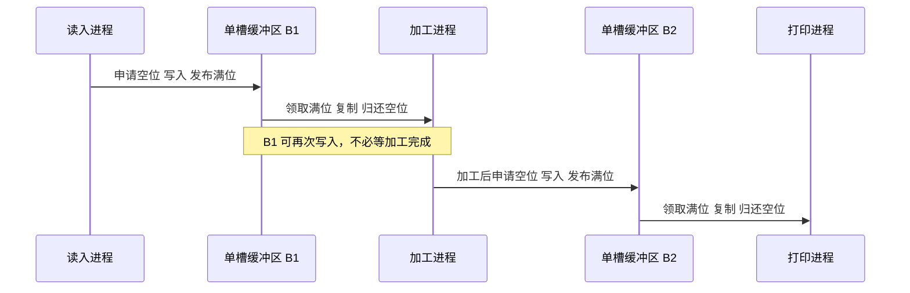
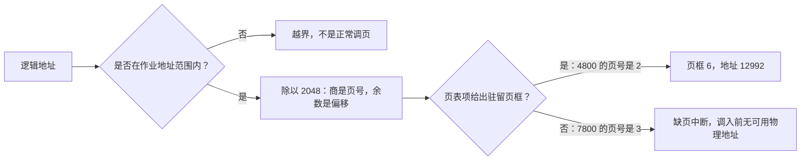

# 《操作系统》课后复习题（进程同步与互斥）

原件 9 页、共 8 题，第 8、9 页是同一题的题目与课堂修改。除另注外，“参考解答”是按题设重新推导；原件只给出部分做法的地方，不把补全的算法算作原答案。下文 $P$ 表示申请或等待，$V$ 表示释放或通知，和伪代码中的 `wait`、`signal` 同义。原子性与共享表的约束见 [信号量与 P、V 操作](../../../topics/操作系统/信号量与PV操作.md)、[临界区与互斥](../../../topics/操作系统/临界区与互斥.md)。

## 1. 两个单槽缓冲区的读入、加工、打印流水线

**题意：**R 从输入设备读入信息块，M 加工，P 打印。R 到 M 用 B1，M 到 P 用 B2；两个缓冲区各只能放一个信息块。用信号量和 P、V 写出三个进程。

**原解要点：**每段用一对初值为 1 和 0 的信号量；M、打印进程在把槽内容拷入自己的局部变量后立即交还槽。原件开头列出的数组和下标没有参与这套单槽操作。

**参考解答：**设 `empty1=empty2=1`、`full1=full2=0`；三个进程各用自己的局部变量，且读入和复制取得独立的数据，不留另一进程可改写的共享引用。循环体为：

```text
R: x = 读入一块
   P(empty1); B1 = x; V(full1)

M: P(full1); y = 复制 B1; V(empty1)
   y = 加工(y)
   P(empty2); B2 = y; V(full2)

打印进程: P(full2); z = 复制 B2; V(empty2)
          打印(z)
```



每个槽的唯一许可在“可写、写者占有、可读、读者占有”间传递，因此不能盖掉尚未读取的块，也不能取到上一轮的旧块。不能简单写成“`empty+full=1` 始终成立”：在申请成功但尚未发布的瞬间，两信号量都可为 0。每槽各只有一个写者、一个读者，许可已将存取交替化，故此题不需要再给槽加一把互斥锁。若题目改成有限输入，可附加随数据同序流转的结束标志，不能让 M 和打印进程无限等下一块。可联系 [缓冲技术](../../../topics/操作系统/缓冲技术.md)。

## 2. 阅览室登记：空位配额不是登记表互斥

**题意：**阅览室有 100 个座位；入内前必须在登记表中的唯一座号下写姓名，离开要注销。分别用信号量和管程设计算法。

**原解要点：**原件可见的是信号量写法，空位计数初值 100，登记表互斥量初值 1；未附完整管程解法。原件示意的登记扫描须在选中一处后停止，否则一人可能占多个表项。

**参考解答（信号量）：**读者入内先 `P(seatCount)` 占一份配额，再 `P(mutex)` 找一个空表项，写入姓名并记下自己的座号，`V(mutex)` 后才开始阅读。离开时在 `mutex` 保护下删除**自己**座号的登记，退出临界区，然后 `V(seatCount)`。配额保证尝试登记的读者总数不会超过 100；互斥保证进程不会同时选到同一个空表项。已经取得配额、尚未登记的读者使配额与表中空位数可短暂不等，这是保留的座位额度，不是漏洞。

**参考解答（补全管程）：**在管程中维护表及 `free=100`，用条件变量 `seatAvailable`。假定采用唤醒不立即移交管程控制权的语义：

```text
enter(name):
    while free == 0: wait(seatAvailable)  // 等待时原子地释放管程，醒后重新取得
    i = 任取一个空表项
    表[i] = name; free = free - 1
    return i

leave(i):
    清除调用者自己的表[i]登记; free = free + 1
    signal(seatAvailable)
```

两操作处在同一个管程中，阅读本身不占管程。醒来后再检查条件，因为另一个读者可能先取得管程、占走唯一刚释放的座位。若先锁登记表再睡眠等配额，已在座的读者会无法取得锁来注销，最后一个可释放资源的进程也被堵住。

## 3. 黑白棋交替：不仅要互斥，还要接力

**题意：**两个进程 P1、P2 分别拣白子和黑子，每次一枚，不能同时拣；一方拣完必须轮到另一方。两色数量相等。

**原解要点：**令白方信号量 $S_1$ 初值 1，黑方 $S_2$ 初值 0；每方先 P 自己的信号量，拣完 V 对方。原件用无限循环，展示的是轮次同步而不是盒空的退出协议。

**参考解答：**设每种有 $N$ 枚、开始前已知。白方循环 $N$ 次执行 `P(S1); 拣一枚白子; V(S2)`；黑方循环 $N$ 次执行 `P(S2); 拣一枚黑子; 若不是最后一次则 V(S1)`。从白开始，若 $N=2$，唯一允许的拣取顺序是白、黑、白、黑。轮到时一方拿到唯一接力许可，另一方一直等到交棒；最后一枚黑子之后不再发许可，双方退出。若只知道两色相等但不知 $N$，可在黑方取完后、仍持棒时检测盒是否空，通过共享结束标志加一次唤醒让等候的白方退出；须另外处理初始盒空，不能把这一唤醒误当成还有棋子。

> [!TIP]
> “不能同时”只需要互斥，“必须轮到对方”要求==把下一次执行许可明确交给对方==。只用一把锁，白方可释放后马上再次取得，不能得到交替保证。

## 4. 段式地址转换：先判断，后相加

**题意：**按下表转换逻辑地址 $(0,430)$、$(3,400)$、$(1,1)$、$(2,500)$、$(4,42)$。

| 段号 | 段首址 | 段长 |
| --- | ---: | ---: |
| 0 | 219 | 600 |
| 1 | 2300 | 14 |
| 2 | 90 | 100 |
| 3 | 1327 | 580 |
| 4 | 1952 | 96 |

**原件答案：**649、1727、2301、越界、1994。

**参考解答：**段号必须在表内，偏移须满足 $0\le d<\text{段长}$。对合法项，依次为 $219+430=649$、$1327+400=1727$、$2300+1=2301$、$1952+42=1994$；第四项的 500 大于段长 100，不能拿 90 相加充当有效物理地址。偏移等于段长也越界，例如 2 段能用的最大偏移是 99，不是 100。参见 [段式存储管理](../../../topics/操作系统/分段存储管理.md)。

## 5. 分页地址转换：查表替换页号，不改变页内偏移

**题意：**逻辑地址长 16 位，页大小 4,096 字节，第 0、1、2 页分别在物理块 10、12、14 中，把 2F6AH 转为物理地址。

**原件答案：**EF6AH。

**参考解答：**4,096 字节即 $2^{12}$，所以高四位给出页号 2，低十二位给出偏移 F6AH。页号 2 映射到十进制块 14，即 EH；块起点 E000H 加 F6AH 得 EF6AH。回除 4,096 得商 14、余数 3,946，说明仅页框号被换、偏移未变。参见 [页式地址转换](../../../topics/操作系统/分页存储管理.md)。

## 6. 请求调页：逻辑地址合法不等于页在内存

**题意：**作业有 4 个逻辑页，每页 2,048 字节；第 0、1、2 页分别映射到页框 2、3、6，第 3 页表项无驻留页框。求 4,800 和 7,800 的变换结果，画地址变换图，不考虑快表。

**原件答案：**4,800 变为 12,992；7,800 发生缺页中断。

**参考解答：**逻辑地址范围为 0 到 8,191。$4800=2\times2048+704$，页 2 在页框 6，故 $6\times2048+704=12992$。$7800=3\times2048+1656$，仍在有效逻辑范围内，但页 3 不在内存，触发缺页，不能从现有页表给出一个物理地址。若后来调入成功，物理地址须用届时取得的页框号重新计算。



参见 [虚拟存储器与缺页](../../../topics/操作系统/虚拟存储器.md)。

## 7. FIFO 与 LRU：相同缺页次数不代表相同驻留集合

**题意：**按次访问 10、11、104、170、73、305、180、240、244、445、467、366；页大小 100，给 3 个页框，求页序列及 FIFO、LRU 缺页中断率。以下按考试惯例假定初始为空；缺页后可装入空页框。

**原件答案：**以 1 起编页号，给出 1、1、2、2、1、4、2、3、3、5、5、4；FIFO 5 次，原件写约 41.6%；LRU 6 次，50%。

**参考解答：**若页号从 0 开始，取每个字节地址除以 100 的商，页序列是 0、0、1、1、0、3、1、2、2、4、4、3。这里只改变页名，命中和缺页次数不变。下表 FIFO 从最早进入到最晚进入，LRU 从最久未访问到最近访问；星号表示该次缺页。

| 次序 | 页 | FIFO 队列 | LRU 队列 |
| ---: | ---: | --- | --- |
| 1 | 0 | 0 ★ | 0 ★ |
| 2 | 0 | 0 | 0 |
| 3 | 1 | 0,1 ★ | 0,1 ★ |
| 4 | 1 | 0,1 | 0,1 |
| 5 | 0 | 0,1 | 1,0 |
| 6 | 3 | 0,1,3 ★ | 1,0,3 ★ |
| 7 | 1 | 0,1,3 | 0,3,1 |
| 8 | 2 | 1,3,2 ★ | 3,1,2 ★ |
| 9 | 2 | 1,3,2 | 3,1,2 |
| 10 | 4 | 3,2,4 ★ | 1,2,4 ★ |
| 11 | 4 | 3,2,4 | 1,2,4 |
| 12 | 3 | 3,2,4 | 2,4,3 ★ |

**订正：**FIFO 的精确比例是 $5/12$，取一位小数应为 **41.7%**，不是 41.6%；LRU 为 $6/12=50\%$。第 7 次访问页 1 更新了 LRU 的顺序，却不改 FIFO 入队顺序，因而在第 10 次两者淘汰的页不同。最后访问页 3 时只在 FIFO 中命中；这条序列证明 LRU 不保证比 FIFO 好，不说明 LRU 普遍更差。参见 [页面置换算法](../../../topics/操作系统/页面置换算法.md)。

## 8. 有界缓冲区：为许可等待之前不要握着互斥锁

**题意：**改正原件第 8 页的生产者—消费者解法。题中生产者先锁 `mutex` 再等 `full`，消费者先锁 `mutex` 再等 `empty`；两个方向均缺少对新状态的通知。第 9 页把等待对象、次序、下标递增及通知补了回来。

**参考解答：**容量取任意正整数 $K$。初始化 `empty=K, full=0, mutex=1, in=out=0`。对循环缓冲区，原件的下标递增应规范成模 $K$；下列每行是顺序执行，数据生产和消费放在锁外：

```text
生产者: x = 生产()
        P(empty); P(mutex)
        buffer[in] = x; in = (in + 1) mod K
        V(mutex); V(full)

消费者: P(full); P(mutex)
        y = buffer[out]; out = (out + 1) mod K
        V(mutex); V(empty)
        消费(y)
```

> [!WARNING]
> 即便把等待对象改对，也不能在握着 `mutex` 时等资源。初始空缓冲时，若消费者先拿锁再等 `full`，生产者虽能取得空位却进不了临界区，无法发布第一个满位。满缓冲时，生产者先拿锁再等 `empty` 会出现对称死锁。

`empty` 许可对应尚可预订的空位，`full` 许可对应尚可预订的可取项；申请成功但尚未归还或发布的许可在进程手上。互斥锁保护共享槽与下标，不负责判断能不能取或放。以容量 2、从空开始为例：先放 A、B，再取 A，再放 C 会回绕到被腾出的槽，余下按 B、C 取出。这里保证的是取出次序，若有多个消费者且锁外处理耗时不同，并不保证外部处理完成的次序。参见 [生产者—消费者与经典同步问题](../../../topics/操作系统/经典同步问题.md)、[持锁等待与死锁](../../../topics/操作系统/死锁概念与必要条件.md)。
