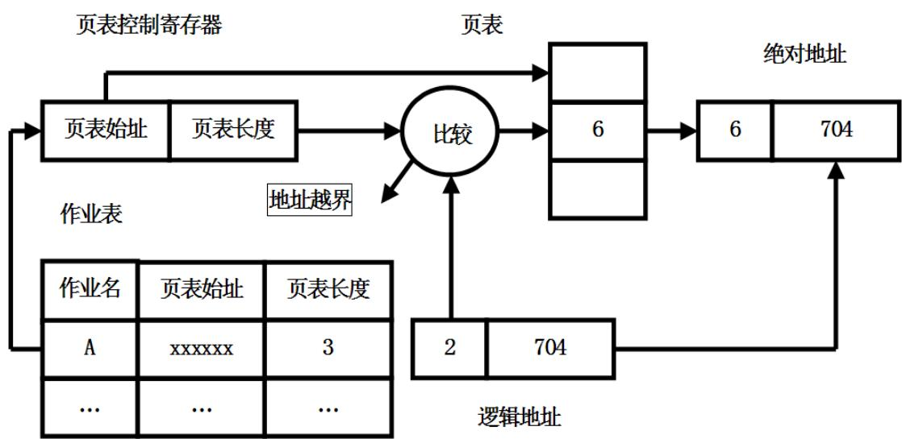

# 《操作系统》课后复习题（进程同步与互斥）

原件经识别和整理；“参考解答”是我们补的。

## 简答 2

有一阅览室，读者进入时必须先在一张登记表上登记，该表为每一座位列出一个表目，包括座号、姓名，读者离开时要注销登记信息；假如阅览室共有100个座位。试用：1）信号量和P、V操作；2）管程，来实现用户进程的同步算法。

答：1) 使用信号量和P、V操作：

## 简答 3

在一个盒子里，混装了数量相等的黑白围棋子。现在用自动分拣系统把黑子、白子分开，设分拣系统有二个进程P1和P2，其中P1拣白子；P2拣黑子。规定每个进程每次拣一子；当一个进程在拣时，不允许另一个进程去拣；当一个进程拣了一子时，必须让另一个进程去拣。试写出两进程P1和P2能并发正确执行的程序。

答：实质上是两个进程的同步问题，设信号量S1和S2分别表示可拣白子和黑子，不失一般性，若令先拣白子。

## 简答 4

给定段表如下：

给定地址为段号和位移：1）[0，430]、2）[3，400]、3）[1，1]、4）[2，500]、5）[4，42]，试求出对应的内存物理地址。

| 段号 | 段首址 | 段长 |
| --- | --- | --- |
| 0 | 219 | 600 |
| 1 | 2300 | 14 |
| 2 | 90 | 100 |
| 3 | 1327 | 580 |
| 4 | 1952 | 96 |

答：1)649 2)1727 3)2301 4)越界 5)1994

## 简答 5

在一分页存储管理系统中，逻辑地址长度为16位，页面大小为4096字节，现有一逻辑地址为2F6AH，且第0、1、2页依次存在物理块10、12、14号中，问相应的物理地址为多少？

答：因为逻辑地址长度为16位，而页面大小为4096字节，所以，前面的4位表示页号。把2F6AH转换成二进制为：0010 1111 0110 1010，可知页号为2。故放在14号物理块中，写成十六进制为：EF6AH。

## 简答 6

在采用请求页式存储管理的系统中，某作业的逻辑地址空间为4页（每页大小为2048字节），且已知该作业的页面映象表（页表）如下：

(1) 试求出逻辑地址4800所对应的物理地址及转换过程，并画出地址变换图（不必考虑快表机制）。

(2) 试求出逻辑地址7800所对应的物理地址或发生的相应事件。

| 页号 | 页框号 |
| --- | --- |
| 0 | 2 |
| 1 | 3 |
| 2 | 6 |
| 3 |  |

答：

（1）逻辑地址4800：704＋6×2048＝12992

（2）逻辑地址7800：发生缺页中断

## 简答 7

请求页式存储管理中，进程访问地址序列为：

10,11,104,170,73,305,180,240,244,445,467，366。试问1)如果页面大小为100，给出页面访问序列。

2)进程若分得3个页框，采用FIFO和LRU替换算法，求缺页中断率?

答：1) 页面访问序列为1，1，2，2，1，4，2，3，3，5，5，4。

2)FIFO为5次，缺页中断率为5/12=41.6%。LRU为6次，缺页中断率为6/12=50%。LRU反比FIFO缺页中断率高。
