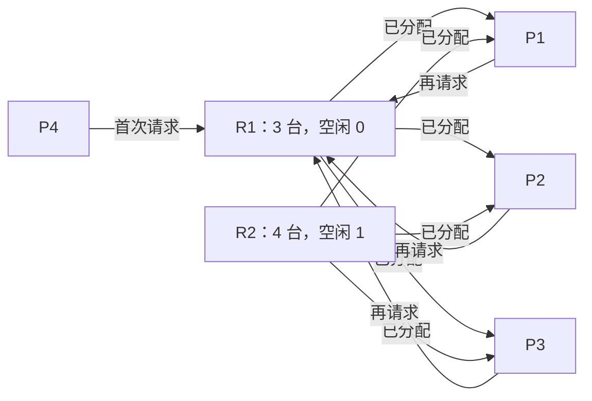

# 《操作系统》进程管理及调度计算习题（试题-1）

原件共 9 页，第 1 页为封面，其余是 4 题及课堂解答。本篇保留题意；“参考解答”独立推导，原件的数值近似和伪代码问题另行标明。

## 1. 加内存能把处理机利用率提高多少

**题意：**内存原有 1 MB，操作系统占 200 KB，每个用户进程占 200 KB；每个用户进程有 80% 的时间等待 I/O。增加 1 MB 内存后，处理机利用率提高多少？

**原件答案：**由约 59% 升至约 87%，相对提高约 47%。

**参考解答：**按题设容量，驻留进程数由 4 个增至 9 个。这里无论按题目近似的 1,000 还是常用二进制口径的 1,024 换算，向下取整后分别都是 4 和 9。采用原解隐含的模型：不同进程处于 I/O 等待状态的事件相互独立，且只要至少一个进程可运行，处理机就不空转。令每个进程等待概率为 $p=0.8$，则 $n$ 个进程都在等待的概率是 $p^n$，利用率 $U_n=1-p^n$。

| 场景 | 驻留用户进程 | 利用率 |
| --- | ---: | ---: |
| 扩展前 | 4 | $1-0.8^4=59.04\%$ |
| 扩展后 | 9 | $1-0.8^9\approx86.58\%$ |

绝对增幅约 **27.54 个百分点**；按原利用率为分母，相对增幅约 **46.64%**。二者是不同问法。若所有进程总在同一时刻等待，同样的 80% 不能相乘，增加驻留进程也不会使利用率达到这个计算结果。参见 [驻留与处理机调度的区别](../../../topics/操作系统/处理机调度级别.md)。

## 2. 单盘分水果：按水果种类发许可

**题意：**爸爸往一只容量为 1 的盘子里放苹果或橘子；儿子只取苹果，女儿只取橘子。用 P、V 操作让三进程正确并发。

**原解要点与订正：**三个信号量分别表示可用空盘、有苹果、有橘子。原件代码给儿子、女儿的水果和题干反了；主程序画成普通的顺序调用，也不能直接执行三个无限循环，应分别启动三个并发进程。以题干为准：

```text
empty = 1; apple = 0; orange = 0

爸爸（反复执行）:
    P(empty); 放入一个水果
    放的是苹果则 V(apple)，否则 V(orange)

儿子（反复执行）:
    P(apple); 取出苹果; V(empty); 吃苹果

女儿（反复执行）:
    P(orange); 取出橘子; V(empty); 吃橘子
```

> [!TIP]
> 看到==同一个缓冲位，却由不同消费者按种类取==，别只设一个不区分内容的“有水果”。爸爸发出的是种类许可，只有相应消费者才可能进入盘子的取出阶段。

许可依次由空盘、爸爸、指定类型的等待队列、对应消费者接力。P 成功到 V 尚未执行的间隙，三种信号量可暂时全为 0，许可并未消失，而是在执行者手里。若爸爸永远只放苹果，女儿便可能一直等待；程序保证不会取错或覆盖水果，并不凭空保证两类都出现。参见 [经典同步问题](../../../topics/操作系统/经典同步问题.md)、[信号量与 P、V 操作](../../../topics/操作系统/信号量与PV操作.md)。

## 3. 八台磁带机：最多多少个进程时保证无死锁

**题意：**8 台同类磁带机由 $n$ 个进程共享，每个进程最多需要 3 台。问何时无死锁危险。

**原件答案：**$n=1,2,3$。

**参考解答：**假定逐台申请、持有至用完才归还，一旦拿齐所需设备就能完成并归还。在无法继续的分配里，每个尚未完成而阻塞的进程至多持有 2 台，否则它已有全部所需设备。若 $n\le3$，即使三个进程各占 2 台也还剩 2 台，某个进程下一次申请仍可得到设备；它完成归还后再释放更多容量。反过来，若 $n\ge4$，可以先让 4 个进程各持 2 台，都请求第 3 台，恰好用光 8 台，再让其余进程等待第一台；无人能归还。

**补充：**在同一模型下，若有 $m$ 台同类设备，每个进程最多要 $k$ 台，保证无死锁的容量条件是 $m\ge n(k-1)+1$：以 $k-1$ 封住每个尚未满足的进程之后，仍要为至少一个下一次申请留一台。反方向可把 $m$ 台分给各进程、每者最多 $k-1$ 台，再让所有进程都请求下一台，构造坏状态。讨论的是任意合法调度下的保证，不是预测每次运行都会怎样。

## 4. 两类设备：总量不够同时满足，不等于已经证明死锁

**题意：**R1 有 3 台、R2 有 4 台，由 P1 至 P4 共享。各进程依次申请 R1、申请 R2、再申请一台 R1，随后依次归还 R1、R2、R1。说明能否死锁；若能，给出情形和进程—资源图。

**原解要点：**前三个进程先各得到一台 R1，再各得到一台 R2；第四个进程等第一台 R1。当前三者再等第二台 R1 时，所有人都阻塞。

**参考解答：**一种合法的请求顺序是先让 P1、P2、P3 拿完各自的第一台 R1，再让 P4 请求 R1 挂起；让前三者各拿 R2 后再分别请求第二台 R1。此时可用向量是 $(R1,R2)=(0,1)$，但所有未满足的请求都指向 R1。下图中，资源框到进程的箭头各表示分配一台；进程到资源框的箭头各表示请求一台。



> [!WARNING]
> ==总峰值超过资源数==只是不能人人同时达峰，不能单独当成死锁证据。多实例资源图即使有环，也要核对空闲实例及是否存在能先完成并释放资源的进程。本题若让进程一个个完整执行，也能全部完成；死锁来自上述特定并发顺序，不是每次必然发生。

参见 [死锁及必要条件](../../../topics/操作系统/死锁概念与必要条件.md) 和 [预防与安全分配](../../../topics/操作系统/死锁预防与避免.md)。
