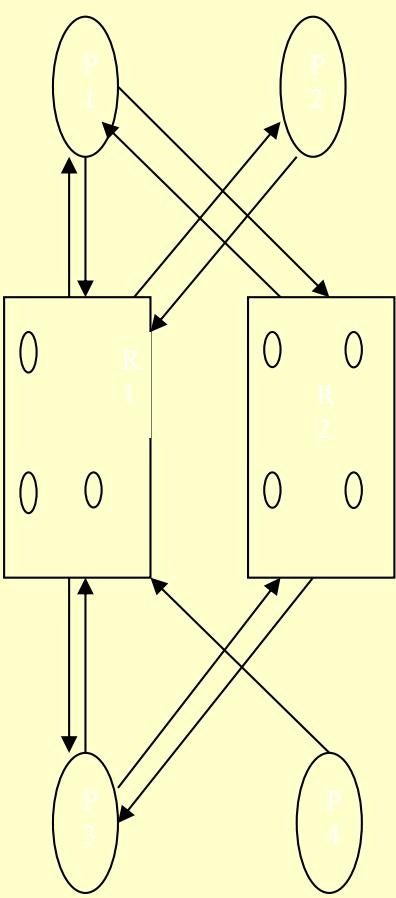

# 《操作系统》进程管理及调度计算习题（试题-1）

原件经识别和整理；“参考解答”是我们补的。

## 计算 1

有一台计算机，具有 1MB 内存，操作系统占用 200KB，每个用户进程各占 200KB。如果用户进程等待 I/O 的时间为 80%，若增加 1MB 内存，则 CPU 的利用率提高多少？

### 分析计算

设每个进程等待 I/O 的百分比为 $P$，则 $n$ 个进程同时等待 I/O 的概率是 $P^n$。

$n$ 个进程同时等待 I/O 时，CPU 为空闲，利用率为 $1-P^n$。

本题中，除去操作系统，可容纳 4 个用户进程，每个用户等待外设时间为 80%：

- CPU 利用率 $=1-(80\%)^4=0.59$
- 若增加 1MB 内存，系统可同时运行 9 个进程
- CPU 利用率 $=1-(80\%)^9=0.87$
- CPU 利用率提高 $=87/59=1.47$
- 即：提高 47%

## 进程的同步与互斥 2

桌上有一只空盘子，允许存放一只水果。爸爸可向盘中放苹果和桔子，儿子专等吃盘中的苹果，女儿专等吃盘中的桔子。规定当盘空时一次只能放一只水果供吃着使用。请用 P、V 原语实现爸爸、儿子、女儿 3 个并发进程的同步。

参考解答：使用三个信号量：`empty`（初值 1）、`apple`（初值 0）、`orange`（初值 0）即可实现同步。

### 信号量定义与初值

-   $empty = 1$：表示盘子为空，可放入水果；
-   $apple = 0$：表示盘中有苹果，儿子可取；
-   $orange = 0$：表示盘中有桔子，女儿可取。

### 进程描述

```text
爸爸() {
    while(true) {
        P(empty);           // 等待盘子空
        if (放苹果) {
            将苹果放入盘中;
            V(apple);       // 通知儿子有苹果
        } else {
            将桔子放入盘中;
            V(orange);      // 通知女儿有桔子
        }
    }
}

儿子() {
    while(true) {
        P(apple);           // 等待盘中有苹果
        从盘中取出苹果;
        V(empty);           // 释放盘子
        吃苹果;
    }
}

女儿() {
    while(true) {
        P(orange);          // 等待盘中有桔子
        从盘中取出桔子;
        V(empty);           // 释放盘子
        吃桔子;
    }
}
```

### 推理说明

-   **互斥访问盘子**：`empty` 信号量保证了同一时刻只有一个生产者（爸爸）能向盘中放水果，且只有当盘子为空时才能放入，天然实现了"盘空时才放"的互斥约束，无需额外互斥信号量。
-   **定向同步**：`apple` 和 `orange` 分别作为爸爸与儿子、爸爸与女儿之间的专用同步信号，确保儿子只在有苹果时被唤醒、女儿只在有桔子时被唤醒，避免误消费。
-   **资源释放闭环**：消费者取走水果后执行 `V(empty)`，使盘子恢复为空状态，保证爸爸可继续放入下一只水果，形成完整的同步循环。

知识点：[经典进程同步问题（生产者-消费者、读者-写者、哲学家进餐）](../../../topics/操作系统/经典同步问题.md)、[信号量机制与P、V操作的定义](../../../topics/操作系统/信号量与PV操作.md)

### 分析解答

设置 3 个信号量：

```
Int S = 1;   // 盘子是否为空
Int Sa = 0;  // 盘子是否有苹果
Int S0 = 0;  // 盘子是否有桔子
```

```
Main() {
    Father();
    Son();
    Danghter();
}

Father()
While(1)
    P(S);
    水果放入盘中；
    If (放入的是桔子) V(S0);
    Else V(Sa);

Son()
While(1)
    P(S0);
    从盘中取出桔子；
    V(S);
    吃桔子；

Danghter()
While(1)
    P(Sa);
    从盘中取出苹果；
    V(S);
    吃苹果；
```

## 死锁 3

一台计算机有 8 台磁带机，他们由 $n$ 个进程竞争使用，每个进程可用 3 台磁带机，请问 $n$ 为多少时，系统没有死锁危险？说明原因。

解答：

$N=1,2,3$ 是不会死锁。

## 综合 1

假设一计算机系统有 R1 设备 3 台和 R2 设备 4 台，他们被 P1，P2，P3，P4 进程所共享且已知这四个进程均以如下顺序使用两类资源。

->申请 R1 -> 申请 R2 -> 申请 R1 -> 释放 R1 -> 释放 R2 -> 释放 R1 ->

（1）系统运行过程中是否有产生死锁的可能？为什么？

（2）如果有可能的话，请举出一种情况，并画出表示死锁状态的进程-资源图。

参考解答：**结论**

1. 有产生死锁的可能。  
2. 例如：P1、P2、P3 各已占用 1 台 R1，P4 已占用 1 台 R2；此时 R1 已分配完，R2 还剩 3 台。若 P4 再申请 R1，而 P1、P2、P3 均在第二次申请 R1 前已持有 R1 并等待 R2，则 P4 需要的 R1 无法满足，P1、P2、P3 需要的 R2 也可能被 P4 占用后无法释放，从而形成循环等待，发生死锁。

---

**分析**

系统中共有：

- R1：3 台  
- R2：4 台  

每个进程的资源申请顺序为：


$$
\text{申请 } R1 \rightarrow \text{申请 } R2 \rightarrow \text{申请 } R1 \rightarrow \text{释放 } R1 \rightarrow \text{释放 } R2 \rightarrow \text{释放 } R1
$$


其中每个进程最多同时占用：


$$
R1: 2 \text{ 台}, \quad R2: 1 \text{ 台}
$$


如果 3 个进程都已经进入“已持有 1 台 R1，正在申请 R2”的状态，则：

- 已分配 R1：3 台，已全部分完；
- 已分配 R2：最多可能已分配 3 台，还剩 1 台空闲。

此时第 4 个进程若已持有 1 台 R2，并申请第 2 台 R1，就会因为 R1 已分配完而等待。

与此同时，前 3 个进程如果申请不到 R2，就不会释放 R1；而第 4 个进程如果申请不到 R1，也不会释放 R2。于是形成资源的循环等待：


$$
P1,P2,P3 \text{ 等待 } R2 \text{，而 } R2 \text{ 被 } P4 \text{ 持有}
$$


$$
P4 \text{ 等待 } R1 \text{，而 } R1 \text{ 被 } P1,P2,P3 \text{ 持有}
$$


满足死锁产生的四个必要条件：互斥、占有且等待、不可剥夺、循环等待，因此可能死锁。

**一种具体的死锁状态**

设：

- R1 有 3 台：$R1_1, R1_2, R1_3$
- R2 有 4 台：$R2_1, R2_2, R2_3, R2_4$

进程状态如下：

| 进程 | 已持有资源 | 正在申请资源 |
|---|---|---|
| P1 | $R1_1$ | $R2$ |
| P2 | $R1_2$ | $R2$ |
| P3 | $R1_3$ | $R2$ |
| P4 | $R2_1$ | $R1$ |

此时 R1 已全部分配给 P1、P2、P3；R2 中有一台被 P4 持有。  
P1、P2、P3 得不到 R2 就不会释放 R1；P4 得不到 R1 就不会释放 R2。  
循环等待形成，系统进入死锁状态。

**资源分配图示意**

用以下边表示：

- 资源 → 进程：表示资源已分配给该进程；
- 进程 → 资源：表示进程正在申请该资源。


$$
P1 \xrightarrow{\text{申请}} R2
$$


$$
P2 \xrightarrow{\text{申请}} R2
$$


$$
P3 \xrightarrow{\text{申请}} R2
$$


$$
P4 \xrightarrow{\text{申请}} R1
$$


$$
R1_1 \xrightarrow{\text{分配}} P1
$$


$$
R1_2 \xrightarrow{\text{分配}} P2
$$


$$
R1_3 \xrightarrow{\text{分配}} P3
$$


$$
R2_1 \xrightarrow{\text{分配}} P4
$$


图中存在环：


$$
P1 \to R2 \to P4 \to R1 \to P1
$$


因此表示死锁状态。

知识点：[信号量机制与P、V操作的定义](../../../topics/操作系统/信号量与PV操作.md)、[死锁的定义与四个必要条件（互斥、请求保持、不可剥夺、循环等待）](../../../topics/操作系统/死锁概念与必要条件.md)、[经典进程同步问题（生产者-消费者、读者-写者、哲学家进餐）](../../../topics/操作系统/经典同步问题.md)

### 解答

（1）4 个进程需要使用的资源数为：R1 设备各 2 台，R2 设备各 1 台，资源总数不够，系统运行过程中有可能死锁。

（2）3 个进程都执行完第 1 步（申请 R1），开始执行第 2 步（申请 R2），另一个资源因没有 R1 资源而被阻塞。

3 个进程都执行完第 2 步（申请 R2）后，系统仅剩一个 R2 资源。

这时 3 个进程都申请 R1（第 3 步），因此，全部阻塞。



参考解答：（1）**结论**：系统运行过程中有可能发生死锁。  
**推理**：4 个进程各自最大需求为 R1×2、R2×1，总需求为 R1×8、R2×4；若系统实际资源数少于该总量（如 R1<8 或 R2<4），则存在资源不足导致循环等待的可能，满足死锁的必要条件之一。

（2）**结论**：当 3 个进程完成前两步后同时申请 R1 时，系统将进入死锁状态。  
**推理**：  
- 第 1 步：3 个进程各占 1 台 R1，共占用 R1×3；  
- 第 2 步：3 个进程各占 1 台 R2，共占用 R2×3，此时系统仅剩 R2×1；  
- 第 3 步：3 个进程均需再申请 1 台 R1，但剩余 R1 数量不足以同时满足（因已分配 3 台，若系统 R1 总数 ≤3，则无可用 R1）；  
- 所有进程均持有 R2 并等待 R1，而 R1 被其他等待 R2 的进程持有（或已被占满），形成循环等待，构成死锁。  

**注**：图中所示进程-资源图应体现 3 个进程节点分别指向 R1 和 R2 资源节点，且 R1 资源节点无空闲实例，验证了上述阻塞与循环依赖关系。

知识点：[死锁的定义与四个必要条件（互斥、请求保持、不可剥夺、循环等待）](../../../topics/操作系统/死锁概念与必要条件.md)
