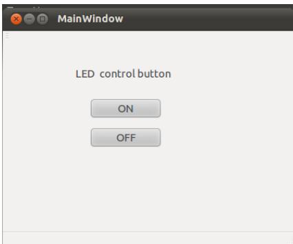

# 2017-2018学年第一学期《嵌入式系统与开发》复习提要

原件经识别和整理；“参考解答”是我们补的。

---
title: 2017-2018学年第一学期《嵌入式系统与开发》复习提要
kind: 复习要点
course: 嵌入式系统与开发
term: 2017-2018-1
source: 识别工具读取的原始文档（第 1–4 页）
---

# 2017-2018学年第一学期《嵌入式系统与开发》复习提要

本资料由识别工具读取整理，包含考试题型说明、复习脉络及附录测试题。明显的识别错误已按上下文修正。

## 一、考试题型说明

### 题型分布与占比

考试题型分为填空题、名称解释、问答题和设计题四种类型，分别占比为 30%、20%、30% 和 20%。

知识点：[Linux字符设备驱动程序的基本框架与数据结构（cdev、file_operations）](../../../topics/嵌入式系统/字符设备驱动框架.md)、[用户空间应用程序通过open/read/write/ioctl与底层驱动交互的接口实现](../../../topics/嵌入式系统/驱动与应用交互接口.md)、[S3C6410 LED报警灯字符设备驱动代码（s3c6410_leddrv.c）设计实例](../../../topics/嵌入式系统/LED报警灯驱动设计.md)

### 填空题

共 15 空，每空 2 分。

**示例：**

嵌入式应用程序 `hello.c`，编译成 ARM 平台可执行程序 `hello`，编译指令为\_\_\_\_，依据所做实验平台，假设要将其从 PC 端搬运到 ARM 平台，则使用什么工具完成\_\_\_\_(A. ADS B.gcc C.串口超级终端)。

> **注意**：填空题基本为教材和实验指导书上内容，部分为课程上课时作业。

知识点：[Linux可加载内核模块（LKM）的编写、编译（insmod/rmmod）与测试](../../../topics/嵌入式系统/Linux内核模块编程.md)、[Linux字符设备驱动程序的基本框架与数据结构（cdev、file_operations）](../../../topics/嵌入式系统/字符设备驱动框架.md)

### 名词解释

共 4 题，每题 5 分。

知识点：[Linux可加载内核模块（LKM）的编写、编译（insmod/rmmod）与测试](../../../topics/嵌入式系统/Linux内核模块编程.md)、[Linux字符设备驱动程序的基本框架与数据结构（cdev、file_operations）](../../../topics/嵌入式系统/字符设备驱动框架.md)

### 问答题

共 2 题，30 分。

**示例：**

简述嵌入式 Linux 系统构建过程中根文件系统有哪几部分组成，并简述每一部分的基本构建过程（要求写出源码名称，解压命令，裁剪命令、编译命令和安装命令等）。

知识点：[Linux可加载内核模块（LKM）的编写、编译（insmod/rmmod）与测试](../../../topics/嵌入式系统/Linux内核模块编程.md)、[Linux字符设备驱动程序的基本框架与数据结构（cdev、file_operations）](../../../topics/嵌入式系统/字符设备驱动框架.md)、[用户空间应用程序通过open/read/write/ioctl与底层驱动交互的接口实现](../../../topics/嵌入式系统/驱动与应用交互接口.md)

### 设计题

共 1 题，共 20 分。

主要考察大家对嵌入式系统的基本设计能力，题目结合实验内容进行考察，有较高难度，请大家务必对我们的实验及实验报告认真学习和总结。

## 二、复习提要

知识点：[Linux字符设备驱动程序的基本框架与数据结构（cdev、file_operations）](../../../topics/嵌入式系统/字符设备驱动框架.md)、[用户空间应用程序通过open/read/write/ioctl与底层驱动交互的接口实现](../../../topics/嵌入式系统/驱动与应用交互接口.md)、[S3C6410 LED报警灯字符设备驱动代码（s3c6410_leddrv.c）设计实例](../../../topics/嵌入式系统/LED报警灯驱动设计.md)

### 1. 教材

（此处指代教材相关内容，具体见正文知识点梳理）

知识点：[Linux可加载内核模块（LKM）的编写、编译（insmod/rmmod）与测试](../../../topics/嵌入式系统/Linux内核模块编程.md)、[Linux字符设备驱动程序的基本框架与数据结构（cdev、file_operations）](../../../topics/嵌入式系统/字符设备驱动框架.md)、[S3C6410 LED报警灯字符设备驱动代码（s3c6410_leddrv.c）设计实例](../../../topics/嵌入式系统/LED报警灯驱动设计.md)

### 2. 实验及实验报告

重点复习实验内容及实验报告中涉及的关键步骤和原理。

知识点：[Linux可加载内核模块（LKM）的编写、编译（insmod/rmmod）与测试](../../../topics/嵌入式系统/Linux内核模块编程.md)、[Linux字符设备驱动程序的基本框架与数据结构（cdev、file_operations）](../../../topics/嵌入式系统/字符设备驱动框架.md)、[主/次设备号的申请注册（register_chrdev）与/dev下设备节点创建](../../../topics/嵌入式系统/设备号注册与节点创建.md)

### 3. 课外补充测试题

见附录 1-6。

知识点：[Linux可加载内核模块（LKM）的编写、编译（insmod/rmmod）与测试](../../../topics/嵌入式系统/Linux内核模块编程.md)、[Linux字符设备驱动程序的基本框架与数据结构（cdev、file_operations）](../../../topics/嵌入式系统/字符设备驱动框架.md)、[主/次设备号的申请注册（register_chrdev）与/dev下设备节点创建](../../../topics/嵌入式系统/设备号注册与节点创建.md)

### 课程知识脉络

整个课程的脉络大家可以按照下面的知识点进行学习和掌握：

#### 了解类知识点

1. 了解嵌入式系统的一般定义方法及其相关含义。
2. 了解基于 ARM 核的研究和商业运作模式。
3. 了解嵌入式应用开发的一般流程及方法。
4. 了解 ADS 集成开发环境及其使用方法。
5. 了解 arm-linux-\* 相关工具的作用及其使用方法。
6. 了解嵌入式远程 GDB 的使用方法。
7. 了解 CodeBlocks 软件的基本使用方法。
8. 了解设备驱动和一般应用程序的区别。
9. 了解设备驱动的基本作用。
10. 了解 Linux 支持的三类的硬件设备：字符、块和网络设备。
11. 了解引入模块的基本原理和模块的本质。
12. 了解 Qt 程序的优点。
13. 了解使用 Qt 开发嵌入式应用的基本方法。

#### 掌握类知识点

1. 掌握非操作系统模式的嵌入式开发模型及开发所涉及的基本过程。
2. 掌握基于操作系统模式的嵌入式开发模型及开发所涉及的基本过程。
3. 掌握 S3C6410 看门狗工作的基本原理及控制方法。
4. 掌握使用 S3C6410 芯片的 GPIO 控制 LED 灯打开或关闭的基本原理及控制方法。
5. 掌握宿主机-目标板开发模式的基本原理和工作方法。
6. 掌握 bootloader、内核和文件系统等的编译、裁剪和烧写过程。
7. 掌握 Make 及 Makefile 文件使用方法。
8. 掌握模块的加载和卸载方法。
9. 掌握 Linux 设备驱动模型的构建方法。
10. 掌握 Qt 程序的信号和槽的工作机理。
11. 掌握看门狗程序的编写原理和编写方法（非操作系统模式和操作系统模式）。
12. 掌握跑马灯程序的编写原理和编写方法（非操作系统模式和操作系统模式）。
13. 掌握嵌入式应用程序移植基本步骤和方法。
14. 掌握嵌入式 sqlite 基本使用命令和编程函数。

## 附录 1: ARM 汇编基础

知识点：[S3C6410 LED报警灯字符设备驱动代码（s3c6410_leddrv.c）设计实例](../../../topics/嵌入式系统/LED报警灯驱动设计.md)、[S3C6410 看门狗定时器设备驱动代码（s3c6410_wdtdrv.c）设计实例](../../../topics/嵌入式系统/看门狗驱动设计.md)、[Linux字符设备驱动程序的基本框架与数据结构（cdev、file_operations）](../../../topics/嵌入式系统/字符设备驱动框架.md)

### 填空 1

ARM 汇编程序由\_\_\_\_指令、\_\_\_\_指令和\_\_\_\_指令构成。

知识点：[Linux字符设备驱动程序的基本框架与数据结构（cdev、file_operations）](../../../topics/嵌入式系统/字符设备驱动框架.md)

### 填空 2

ARM 伪指令可以分为以下几类: \_\_\_\_、\_\_\_\_、\_\_\_\_和\_\_\_\_等。

知识点：[Linux字符设备驱动程序的基本框架与数据结构（cdev、file_operations）](../../../topics/嵌入式系统/字符设备驱动框架.md)、[主/次设备号的申请注册（register_chrdev）与/dev下设备节点创建](../../../topics/嵌入式系统/设备号注册与节点创建.md)、[用户空间应用程序通过open/read/write/ioctl与底层驱动交互的接口实现](../../../topics/嵌入式系统/驱动与应用交互接口.md)

### 填空 3

假设存储数据 0x12345678 于 ARM 微处理器内存 0X30000000 开始的位置，则 0X30000001 内存位置的数据为\_\_\_\_（A.0X12 B.0X34 C.0X56 D.0X78）（采用小端模式进行存储）。

### 填空 4

一般情况下, ARM 微处理器异常处理模式共有\_\_\_\_种, 机器启动后第一条指令执行的是\_\_\_\_ (A.复位异常处理函数指令 B.中断异常处理指令 C.IRQ 异常处理指令 D.指令预取终止异常)。

### 填空 5

调用函数 FUN(X,Y,Z)，则实参值分别通过\_\_\_\_、\_\_\_\_、\_\_\_\_寄存器来进行传递，如果参数超过 4 个，则参数传递规则为 \_\_\_\_。

### 填空 6

举例列出一款 ARM7TDMI 微内核的嵌入式微处理器\_\_\_\_, ARM920T 微内核的嵌入式微处理器\_\_\_\_, ARM11 内核的嵌入式微处理器\_\_\_\_, 并列举 2 款 64 位 ARM 微内核\_\_\_\_、\_\_\_\_。

知识点：[Linux可加载内核模块（LKM）的编写、编译（insmod/rmmod）与测试](../../../topics/嵌入式系统/Linux内核模块编程.md)

### 简答 1

利用汇编和 C 混合编程，设计代码完成求 a,b,c 中最大值功能，要求写出汇编启动代码和 C 代码。

## 附录 2: Embedded Linux 系统构建基础

### 填空 1

嵌入式 Linux 操作系统包括 \_\_\_\_、\_\_\_\_、\_\_\_\_ 三部分组成。

知识点：[Linux字符设备驱动程序的基本框架与数据结构（cdev、file_operations）](../../../topics/嵌入式系统/字符设备驱动框架.md)

### 填空 2

在 PC 机上 Linux 系统编译使用的编译器名为 \_\_\_\_，ARM 处理器嵌入式编译器名为 \_\_\_\_。

知识点：[Linux字符设备驱动程序的基本框架与数据结构（cdev、file_operations）](../../../topics/嵌入式系统/字符设备驱动框架.md)、[主/次设备号的申请注册（register_chrdev）与/dev下设备节点创建](../../../topics/嵌入式系统/设备号注册与节点创建.md)、[用户空间应用程序通过open/read/write/ioctl与底层驱动交互的接口实现](../../../topics/嵌入式系统/驱动与应用交互接口.md)

### 填空 3

bootloader 的功能：\_\_\_\_。

### 填空 4

列出最常用的 bootloader: \_\_\_\_、\_\_\_\_、\_\_\_\_、\_\_\_\_、\_\_\_\_。

### 填空 5

在 uboot 中，打印开发板上环境变量值的命令为\_\_\_\_，设置 IP 地址为 192.168.1.1 的命令为\_\_\_\_，假如嵌入式内核名为 vmlinux，通过 tftp 加载内核的命令为\_\_\_\_，启动嵌入式 Linux 内核的命令为\_\_\_\_。

### 填空 6

从 C 语言角度来理解，嵌入式 Linux 内核仅是众多 \_\_\_\_ 的集合体，其有一个类似于 main 的函数，名称为 \_\_\_\_。

知识点：[Linux可加载内核模块（LKM）的编写、编译（insmod/rmmod）与测试](../../../topics/嵌入式系统/Linux内核模块编程.md)

### 填空 7

嵌入式 Linux 内核裁剪命令为 \_\_\_\_；裁剪完成后生成配置选择文件 \_\_\_\_；编译内核命令为 \_\_\_\_。

知识点：[Linux可加载内核模块（LKM）的编写、编译（insmod/rmmod）与测试](../../../topics/嵌入式系统/Linux内核模块编程.md)

### 填空 8

启动 linux 后常用的命令如 ifconfig、cp、ls 等通常位于\_\_\_\_（A. bootloader B. 内核 C. 文件系统）中；嵌入式 Linux 环境下生成文件系统的常用工具为\_\_\_\_；以 yaffs 方法为例，将嵌入式文件夹压缩成一个 yaffs2 格式的文件系统命令为\_\_\_\_。

### 填空 9

构建嵌入式 Linux 系统时，烧写 bootloader 的工具为 \_\_\_\_；烧写 Linux 内核一般使用 \_\_\_\_（A. bootloader B. 文件系统 C. 交叉编译器）来烧写，烧写文件系统一般使用 \_\_\_\_（A. bootloader B. 文件系统 C. 交叉编译器）来烧写。

### 简答 2

简述构建嵌入式 Linux 系统基本过程。

## 附录 3: Makefile 与应用程序移植

### 填空 1

Linux 中自动生成 makefile 的工具集名称为 \_\_\_\_；工具集包括 aclocal、autoscan、autoconf、autoheader 和 \_\_\_\_ 等几部分组成。

知识点：[Linux字符设备驱动程序的基本框架与数据结构（cdev、file_operations）](../../../topics/嵌入式系统/字符设备驱动框架.md)

### 填空 2

一个源码文件 hello.c 利用自动生成 makefile 的工具集后得到文件一批文件后，利用命令 \_\_\_\_ 生成 Makefile，利用命令 \_\_\_\_ 生成发行压缩包文件 hello.tar.gz。

知识点：[Linux字符设备驱动程序的基本框架与数据结构（cdev、file_operations）](../../../topics/嵌入式系统/字符设备驱动框架.md)、[主/次设备号的申请注册（register_chrdev）与/dev下设备节点创建](../../../topics/嵌入式系统/设备号注册与节点创建.md)、[用户空间应用程序通过open/read/write/ioctl与底层驱动交互的接口实现](../../../topics/嵌入式系统/驱动与应用交互接口.md)

### 填空 3

嵌入式 Linux 应用程序移植常用 configure 命令生成 Makefile, 一般来说, 指定安装目录为 /opt/soft 的命令为 \_\_\_\_ ; 如果待生成的可执行目标板为 ARM 处理器, （注：原题此处断行，后续内容可能涉及交叉编译工具链指定，如 `--host=arm-linux` 等，请结合课堂笔记补充完整）。

### 简答 3

以 web 服务器 boa 移植为例，简述其基本过程。

知识点：[用户空间应用程序通过open/read/write/ioctl与底层驱动交互的接口实现](../../../topics/嵌入式系统/驱动与应用交互接口.md)

### 填空 4

嵌入式数据库经常使用 sqlite，为可以在开发板上运行的轻型数据库。通常情况下 sqlite 提供 \_\_\_\_ 和 \_\_\_\_ 两种使用方式。

### 填空 5

在 sqlite 下创建数据库 stu.db 命令为 \_\_\_\_；创建包含学号, 姓名和电话号码的数据表 StuPhone 命令为 \_\_\_\_；插入 10010201, wangming, 13900008888 记录的命令为 \_\_\_\_。

### 填空 6

利用函数调用创建数据库 stu.db 的形式为 \_\_\_\_；创建包含学号，姓名和电话号码的数据表 StuPhone 函数调用形式为\_\_\_\_；插入 10010201, wangming, 13900008888 记录的函数调用形式为\_\_\_\_。

## 附录 4: 内核模块编程

知识点：[Linux可加载内核模块（LKM）的编写、编译（insmod/rmmod）与测试](../../../topics/嵌入式系统/Linux内核模块编程.md)

### 填空 1

嵌入式 Linux 内核是可裁剪系统，通常情况下使用\_\_\_\_机制进行设计。模块程序和应用程序分别位于 Linux 系统的\_\_\_\_空间和\_\_\_\_空间。

知识点：[Linux字符设备驱动程序的基本框架与数据结构（cdev、file_operations）](../../../topics/嵌入式系统/字符设备驱动框架.md)

### 填空 2

嵌入式 Linux 系统模块程序 hello.c 被编译成模块 hello.ko 后，动态插入内核的命令为\_\_\_\_，查看 Linux 内核中有哪些模块的命令为\_\_\_\_，删除内核中模块 hello.ko 的命令为\_\_\_\_。

知识点：[Linux字符设备驱动程序的基本框架与数据结构（cdev、file_operations）](../../../topics/嵌入式系统/字符设备驱动框架.md)、[主/次设备号的申请注册（register_chrdev）与/dev下设备节点创建](../../../topics/嵌入式系统/设备号注册与节点创建.md)、[用户空间应用程序通过open/read/write/ioctl与底层驱动交互的接口实现](../../../topics/嵌入式系统/驱动与应用交互接口.md)

### 综合 1

编写一模块，向内核中添加两整数相加功能函数和两整数相减功能函数，并要求在加载模块时打印出“hello, I am in kernel now!”，卸载模块时打印“hello, I will leave from kernel now!”，编写 Makefile，并简述加载到内核和卸载出内核的基本命令。

## 附录 5: Qt 嵌入式开发

知识点：[Linux可加载内核模块（LKM）的编写、编译（insmod/rmmod）与测试](../../../topics/嵌入式系统/Linux内核模块编程.md)、[用户空间应用程序通过open/read/write/ioctl与底层驱动交互的接口实现](../../../topics/嵌入式系统/驱动与应用交互接口.md)、[主/次设备号的申请注册（register_chrdev）与/dev下设备节点创建](../../../topics/嵌入式系统/设备号注册与节点创建.md)

### 填空 1

在嵌入式 Linux 开发过程中，EmbeddedQT 通常情况下用于 \_\_\_\_（A. 内核代码 B. 驱动代码 C. 图形应用程序）设计。EmbeddedQT 采用工具开发包的形式提供给用户，一般情况下包括 \_\_\_\_、\_\_\_\_ 和 Makefile 制作工具，字体国际化工具等。

知识点：[Linux字符设备驱动程序的基本框架与数据结构（cdev、file_operations）](../../../topics/嵌入式系统/字符设备驱动框架.md)

### 填空 2

QT 开发中采用\_\_\_\_机制来连接两个对象之间的通讯，假设对象 a 的 clicked 信号和对象 b 的 handleFunction（）相关联，对应语句为：

```cpp
connect(a, SIGNAL(clicked()), b, SLOT(handleFunction()));
```

知识点：[Linux字符设备驱动程序的基本框架与数据结构（cdev、file_operations）](../../../topics/嵌入式系统/字符设备驱动框架.md)、[主/次设备号的申请注册（register_chrdev）与/dev下设备节点创建](../../../topics/嵌入式系统/设备号注册与节点创建.md)、[用户空间应用程序通过open/read/write/ioctl与底层驱动交互的接口实现](../../../topics/嵌入式系统/驱动与应用交互接口.md)

### 综合 2

假设有嵌入式 LED 报警灯驱动设备文件 `/dev/led`，点亮 led 灯调用函数 `ioctl(fd, LEDON)`，熄灭 led 灯调用函数 `ioctl(fd, LEDOFF)`，请设计 QT 应用程序完成如下任务，点击 ON 按钮点亮 LED 灯，点击 OFF 按钮熄灭 LED 灯。写出这两个按钮的相关联的函数。假设 ON 按钮名称为 `m_on`, OFF 按钮名称为 `m_off`。



## 附录 6: 设备驱动开发

知识点：[用户空间应用程序通过open/read/write/ioctl与底层驱动交互的接口实现](../../../topics/嵌入式系统/驱动与应用交互接口.md)、[S3C6410 LED报警灯字符设备驱动代码（s3c6410_leddrv.c）设计实例](../../../topics/嵌入式系统/LED报警灯驱动设计.md)

### 填空 1

嵌入式 Linux 驱动设备分为 \_\_\_\_ 、 \_\_\_\_ 和网络设备三种类型，其中通常情况下键盘、鼠标、LCD 屏等设备驱动属于 \_\_\_\_ 设备，硬盘设备属于 \_\_\_\_ 设备。

知识点：[Linux字符设备驱动程序的基本框架与数据结构（cdev、file_operations）](../../../topics/嵌入式系统/字符设备驱动框架.md)

### 综合 3

以模块的方式向内核添加功能函数 `int addFun(int a, int b)` 和 `int subFun(int a, int b)`，要求编写模块文件，Makefile 文件，假设模块名为 hello.ko，写出加载模块到内核的命令。

设备要能被使用，通常需要设备驱动软件，在 Linux 系统中，设备驱动驱动软件位于\_\_\_\_(A. 内核空间 B. 用户空间)，假设有 LED 报警灯设备驱动软件 leddrv.ko，则加载该驱动软件到内核命令为\_\_\_\_，测试完成后，将该软件从内核中卸载命令为\_\_\_\_。

知识点：[Linux可加载内核模块（LKM）的编写、编译（insmod/rmmod）与测试](../../../topics/嵌入式系统/Linux内核模块编程.md)

### 填空 2

除网络设备外，设备驱动通常采用\_\_\_\_方式进行访问，一般包括\_\_\_\_、读写控制设备，最后\_\_\_\_。在 Linux 中设备文件名本质上是设备号，将两者之间建立关联的命令为 mknod，假设 LED 设备驱动主设备号为 253，次设备号为 0，设备名为 leddev，则建立设备文件的具体命令为\_\_\_\_。

知识点：[Linux字符设备驱动程序的基本框架与数据结构（cdev、file_operations）](../../../topics/嵌入式系统/字符设备驱动框架.md)、[主/次设备号的申请注册（register_chrdev）与/dev下设备节点创建](../../../topics/嵌入式系统/设备号注册与节点创建.md)、[用户空间应用程序通过open/read/write/ioctl与底层驱动交互的接口实现](../../../topics/嵌入式系统/驱动与应用交互接口.md)

### 简答 4

简述编写看门狗驱动基本步骤

知识点：[S3C6410 看门狗定时器设备驱动代码（s3c6410_wdtdrv.c）设计实例](../../../topics/嵌入式系统/看门狗驱动设计.md)、[Linux字符设备驱动程序的基本框架与数据结构（cdev、file_operations）](../../../topics/嵌入式系统/字符设备驱动框架.md)、[主/次设备号的申请注册（register_chrdev）与/dev下设备节点创建](../../../topics/嵌入式系统/设备号注册与节点创建.md)
