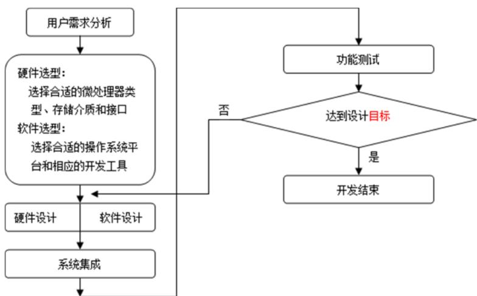

# 南京邮电大学《嵌入式系统与开发》期末复习提纲（理论部分）

原件经识别和整理；“参考解答”是我们补的。

本资料由识别工具读取整理，适用于南京邮电大学李超老师课程。原文档包含考试携带要求、实验提示及最终声明，此处仅保留理论知识点内容。

## 一、CH1：嵌入式系统基础

### 1. 嵌入式系统的定义与特点

**定义**
以系统为中心，以计算机技术为基础，软硬件可剪裁，适应应用系统对功能、可靠性、成本、体积、功耗严格要求的专用计算机系统。（书 P1）

**特点**
- 微内核
- 专用性强
- 可裁剪
- 专用操作系统的支撑
- 专用的开发工具和环境

### 2. 嵌入式系统微处理器种类及典型代表

**常见架构**
ARM、MIPS、68K/Cold Fire、PowerPC。

**典型型号举例**
- **ARM7TDMI 内核**: S3C44B0X
- **ARM920T 内核**: S3C2410
- **ARM11 内核**: S3C6410
- **64 位 ARM 内核 (Cortex-A)**: Cortex-A53、Cortex-A57

知识点：[S3C6410 LED报警灯字符设备驱动代码（s3c6410_leddrv.c）设计实例](../../../topics/嵌入式系统/LED报警灯驱动设计.md)、[S3C6410 看门狗定时器设备驱动代码（s3c6410_wdtdrv.c）设计实例](../../../topics/嵌入式系统/看门狗驱动设计.md)

### 3. 嵌入式 OS 的种类及典型代表

**常见系统**
VxWorks、RT-Linux、uClinux、ARM-Linux、Windows Phone、iOS、Android。（书 P7）

### 4. 开发模式

**基本模式**
宿主机——目标板模式。（书 P10）

**基于 ARM 核的研究和商业运作模式**
- **Chipless 生产模式**: 企业既不生产芯片，也不设计芯片，而是设计出高效的 IP 内核。
- **市场数据**: 全球有 103 家巨型 IT 公司在采用 ARM 技术，20 家最大的半导体厂商中有 19 家是 ARM 的用户。

### 5. 开发流程



> 注：原件为流程图图片，此处保留占位符。

## 二、CH2：ARM 处理器架构

知识点：[Linux字符设备驱动程序的基本框架与数据结构（cdev、file_operations）](../../../topics/嵌入式系统/字符设备驱动框架.md)、[S3C6410 LED报警灯字符设备驱动代码（s3c6410_leddrv.c）设计实例](../../../topics/嵌入式系统/LED报警灯驱动设计.md)

### 1. ARM 处理器的特点与构成

**特点**
- 体积小、功耗低、成本低、高性能。
- 支持 Thumb（16 位）/ARM（32/64 位）双指令集，能够兼容 8 位和 16 位器件。
- 具有大量的寄存器，因而指令执行速度快。
- 绝大多数操作都在寄存器中进行，通过 Load/Store 的体系架构在内存和寄存器之间传递数据。
- 寻址方式简单。
- 采用固定长度的指令格式。（书 P14）

**ARM 指令格式**
1. ARM 汇编程序由机器指令、汇编指令和伪指令构成。
2. **ARM 伪指令分类**:
   - 符号定义伪指令
   - 数据定义伪指令
   - 汇编控制伪指令
   - 信息报告伪指令
   - 宏指令
   - 其他伪指令

### 2. 存储体系：大/小端模式

**大端模式 (Big-Endian)**
字数据的高字节存放在低地址中，字数据的低字节部分存放在高地址中。（书 P20）

| 字单元 | 半字单元 (低地址部分) | 半字单元 (高地址部分) |
| :---: | :---: | :---: |
| **最低字节单** | **第二字单元** | **第三字单元** | **最高字单元** |

**小端模式 (Little-Endian)**
与小端模式存储格式恰好相反，低地址中存放字数据的低字节部分，高地址存放的是字数据的高地址部分。（书 P20）

| 字单元 | 半字单元 (低地址部分) | 半字单元 (高地址部分) |
| :---: | :---: | :---: |
| **最低字节单** | **第二字单元** | **第三字单元** | **最高字单元** |

**测试题**
假设存储数据 `0x12345678` 于 ARM 微处理器内存 `0x30000000` 开始的位置，则 `0x30000001` 内存位置的数据为？（采用小端模式进行存储）
- A. `0x12`
- B. `0x34`
- C. `0x56`
- D. `0x78`

答案：C。

### 3. 异常处理模式

异常是 ARM 微处理器中非常重要的一个事件，由内部或外部源产生。ARM 微处理器支持的异常类型如下表所示。（书 P17）

| 异常类型 | 含义 |
| :--- | :--- |
| **复位** | 当处理器的复位引脚有效时 (可以有软硬件引起),系统产生复位异常中断,程序跳转到复位程序处执行。 |
| **未定义指令** | 当 ARM 处理器或者协处理器执行到未定义指令时,产生未定义的指令异常中断,转到相应的处理程序处执行。 |
| **软件中断** | 软件中断由用户执行指令 SWI 而引起,可用于用户模式下的程序调用特权操作指令。 |
| **指令预取中止** | 若处理器预取的指令的地址不存在,或该地址不允许当前指令访问时,当该被预取的指令执行时,才会产生指令预取中止异常。 |
| **数据访问中止** | 如果数据访问指令的目标地址不存在,或者该地址不允许当前指令访问,处理器产生数据访问中止异常中断。 |
| **外部中断请求 (IRQ)** | 当处理器的外部中断请求引脚有效,而且 CPSR 寄存器的 I 位为 0 时,处理器产生外部中断请求 IRQ 异常中断。系统的外设通常通过该异常中断请求中断服务。 |
| **快速中断请求 (FIQ)** | 当处理器的快速中断请求引脚有效,并且 CPSR 寄存器的 F 位为 0 时,处理器产生外部中断请求 FIQ 异常中断。 |

**练习**
一般情况下，ARM 微处理器异常处理模式共有 **7** 种，机器启动后第一条指令执行的是？
- A. 复位异常处理函数指令
- B. 中断异常处理指令
- C. IRQ 异常处理指令
- D. 指令预取终止异常

答案：A。

### 4. 传参原则

根据参数个数是否固定，子程序分为参数个数固定的子程序和参数个数可变的子程序，两者的传递规则不同。（书 P30）

**① 参数个数可变的子程序**
- **规则**: 当参数不超过 4 个时，使用寄存器 R0~R3 传递；超过 4 个时，剩余参数通过数据栈传递。
- **细节**: 所有参数视为连续内存单元中的字数据，依次送入 R0-R3。入栈顺序与参数顺序相反（最后一个先入栈）。
- **浮点数**: 可通过寄存器、数据栈或混合方式传递。

**② 参数个数固定的子程序**
- **规则**: 若系统包含浮点运算硬件部件，浮点参数按顺序分配编号最小的连续 FP 寄存器；第一个整数参数通过 R0~R3 传递，其他参数通过数据栈传递。

**示例**
调用函数 `FUN(X, Y, Z)`，实参值分别通过 **R0, R1, R2** 寄存器进行传递。如果参数超过 4 个，则通过栈进行传递。

### 5. 特殊寄存器作用

**R13 (SP)**
用作堆栈指针。（书 P16）

**R14 (LR)**
- **作用①**: 用户模式下，用作链接寄存器 (Link Register)，存放子程序被调用时的返回地址。
- **作用②**: 异常处理模式下，用来保存异常的返回地址。

**R15 (PC)**
程序计数器。由于 ARM 采用了流水线机制，PC 的值为当前指令地址的值加 8 个字节，即 PC 指向当前指令的下两条指令的地址。

## 三、CH3：S3C6410 与硬件操作

知识点：[主/次设备号的申请注册（register_chrdev）与/dev下设备节点创建](../../../topics/嵌入式系统/设备号注册与节点创建.md)、[用户空间应用程序通过open/read/write/ioctl与底层驱动交互的接口实现](../../../topics/嵌入式系统/驱动与应用交互接口.md)

### 1. S3C6410 微处理器架构

（本章主要介绍 S3C6410 的具体架构细节，详见教材对应章节）

### 2. 软件操作与硬件方式

**非 OS 环境下的端口操作**
直接读写端口寄存器。

**代码示例**
端口地址为 `0x7F008800`。

```c
#define rGPKCON0 (* ((volatile int *) (0x7F008800)))
rGPKCON0 = 0x55aa;
```

或者：

```c
(* ((volatile int *) (0x7F008800))) = 0x55aa;
```

知识点：[用户空间应用程序通过open/read/write/ioctl与底层驱动交互的接口实现](../../../topics/嵌入式系统/驱动与应用交互接口.md)

### 3. LED 灯与看门狗

**看门狗的作用**
系统软件或应用软件出错导致系统无法工作时，需重启系统以恢复功能。S3C6410 微处理器集成的看门狗定时器可实现此功能。（书 P37）

> 注：具体实验代码见实验部分。

## 四、CH4：交叉编译与调试

知识点：[S3C6410 LED报警灯字符设备驱动代码（s3c6410_leddrv.c）设计实例](../../../topics/嵌入式系统/LED报警灯驱动设计.md)、[S3C6410 看门狗定时器设备驱动代码（s3c6410_wdtdrv.c）设计实例](../../../topics/嵌入式系统/看门狗驱动设计.md)、[Linux字符设备驱动程序的基本框架与数据结构（cdev、file_operations）](../../../topics/嵌入式系统/字符设备驱动框架.md)

### 1. 交叉编译器核心部件

主要包括：gcc、make、gdb 的安装与配置。

### 2. GCC 的使用

**常用选项**
`-O`, `-C`, `-l`, `-L`, `-I`, `-g`, `-O` (注意：原文档此处可能有重复或笔误，通常指优化等级 `-O0` 至 `-O3` 等)

- **-o**
  - **功能**: 制定目标名称。缺省时，编译出的文件是 `a.out`。
  - **例**: `arm-linux-gcc -o hello.exe hello.c`

- **-c**
  - **功能**: 只对文件进行编译和汇编，不进行连接，生成 `.obj` 文件。
  - **例**: `arm-linux-gcc -c hello.c` (生成 `hello.o`)

- **-l, -I, -L**
  - **-I**: 指定寻找头文件的目录。
  - **-L**: 指定寻找库文件的目录。
  - **-l**: 表示在库文件目录中寻找指定的动态库文件。

- **-g**
  - **功能**: 编译时产生调试信息。

### 3. GDB 操作步骤与常用命令

**常用命令表**

| 命令 | 描述 |
| :--- | :--- |
| `file` | 装入想要调试的可执行文件 |
| `kill` | 终止正在调试的程序 |
| `list` | 列出产生执行文件的源代码的一部分 |
| `next` | 执行一行源代码但不进入函数内部 |
| `step` | 执行一行源代码而且进入函数内部 |
| `run` | 执行当前被调试的程序 |
| `quit` | 终止 gdb |
| `watch` | 监视一个变量的值而不管它何时被改变 |
| `break` | 在代码里设置断点，使程序执行到这里时被挂起 |
| `make` | 不退出 gdb 就可以重新产生可执行文件 |
| `shell` | 不离开 gdb 就执行 UNIX shell 命令 |

> 更多命令见 P57。

**运行 gdb 调试程序的标准步骤**

**(1) 运行程序**
在命令行键入 `gdb` 并按回车键启动。
示例输出：
```text
GDB is free software and you are welcome to distribute copies of it under certain conditions; type "show copying" to see the conditions.
There is absolutely no warranty for GDB; type "show warranty" for details.
GDB 4.14 (i486-slakware-linux), Copyright 1995 Free Software Foundation, Inc.
```
也可以直接指定文件名运行：`gdb <fname>`，这将告诉 gdb 装入名为 fname 的可执行文件。

**(2) 设置/显示命令行参数**
- **设置**: `set args <arg list>`
- **显示**: `show args`

**(3) 程序运行相关命令**
- `set args`: 设置运行时参数列表。

# 南京邮电大学《嵌入式系统与开发》期末复习提纲（理论部分）- 第2部分

## CH5：Bootloader 与 Linux 系统构建

### 选择 1

**题干：** bootloader 的功能包括哪些？

- A. 引导操作系统内核启动
- B. 提供辅助命令工具
- C. 编译应用程序
- D. 管理文件系统

答案：A, B。
知识点：[Linux可加载内核模块（LKM）的编写、编译（insmod/rmmod）与测试](../../../topics/嵌入式系统/Linux内核模块编程.md)

### 填空 2

**题干：** 从 C 语言角度来理解，嵌入式 Linux 内核仅是众多 \_\_\_\_\_\_ 的集合体，其有一个类似于 main 的函数，名称为 \_\_\_\_\_\_。

答案：函数; start_kernel (或类似入口函数，具体视教材定义，通常指内核入口)

知识点：[Linux可加载内核模块（LKM）的编写、编译（insmod/rmmod）与测试](../../../topics/嵌入式系统/Linux内核模块编程.md)

### 填空 3

**题干：** 启动 Linux 后常用的命令如 ifconfig、cp、ls 等通常位于 \_\_\_\_\_\_ 中；嵌入式 Linux 环境下生成文件系统的常用工具为 \_\_\_\_\_\_；以 yaffs2 方法为例，将嵌入式文件夹压缩成一个 yaffs2 格式的文件系统命令为 \_\_\_\_\_\_。

答案：C (文件系统); mkyaffs2img; mkyaffs2img <文件夹> <镜像文件名>

### 简答 1

**题干：** 简述 bootloader、内核、文件系统构建步骤及烧写工具。

知识点：[主/次设备号的申请注册（register_chrdev）与/dev下设备节点创建](../../../topics/嵌入式系统/设备号注册与节点创建.md)、[用户空间应用程序通过open/read/write/ioctl与底层驱动交互的接口实现](../../../topics/嵌入式系统/驱动与应用交互接口.md)、[Linux字符设备驱动程序的基本框架与数据结构（cdev、file_operations）](../../../topics/嵌入式系统/字符设备驱动框架.md)

### 编程题 2

**题干：** QT 实现 LED 灯亮灭。假设有嵌入式 LED 报警灯驱动设备文件 `/dev/led`，点亮 led 灯调用函数 `ioctl(fd, LEDON)`，熄灭 led 灯调用函数 `ioctl(fd, LEDOFF)`。请设计 QT 应用程序完成如下任务：点击 ON 按钮点亮 LED 灯，点击 OFF 按钮熄灭 LED 灯。写出这两个按钮的相关联的函数。假设 ON 按钮名称为 `m_on`，OFF 按钮名称为 `m_off`。

答案：
关联函数示例（伪代码/C++）：

```cpp
// 在构造函数或初始化函数中建立连接
connect(m_on, SIGNAL(clicked()), this, SLOT(onLedOn()));
connect(m_off, SIGNAL(clicked()), this, SLOT(onLedOff()));

// 槽函数实现
void MyWidget::onLedOn() {
    int fd = open("/dev/led", O_RDWR);
    if (fd >= 0) {
        ioctl(fd, LEDON);
        close(fd);
    }
}

void MyWidget::onLedOff() {
    int fd = open("/dev/led", O_RDWR);
    if (fd >= 0) {
        ioctl(fd, LEDOFF);
        close(fd);
    }
}
```

## CH7：设备驱动与内核模块

知识点：[用户空间应用程序通过open/read/write/ioctl与底层驱动交互的接口实现](../../../topics/嵌入式系统/驱动与应用交互接口.md)、[S3C6410 LED报警灯字符设备驱动代码（s3c6410_leddrv.c）设计实例](../../../topics/嵌入式系统/LED报警灯驱动设计.md)

### 填空 6

**题干：** 嵌入式 Linux 驱动设备分为 \_\_\_\_\_\_、\_\_\_\_\_\_ 和网络设备三种类型。其中通常情况下键盘、鼠标、LCD 屏等设备驱动属于 \_\_\_\_\_\_ 设备，硬盘设备属于 \_\_\_\_\_\_ 设备。

答案：字符设备; 块设备; 字符; 块

知识点：[Linux字符设备驱动程序的基本框架与数据结构（cdev、file_operations）](../../../topics/嵌入式系统/字符设备驱动框架.md)、[主/次设备号的申请注册（register_chrdev）与/dev下设备节点创建](../../../topics/嵌入式系统/设备号注册与节点创建.md)

### 填空 7

**题干：** 设备要能被使用，通常需要设备驱动软件，在 Linux 系统中，设备驱动软件位于 \_\_\_\_\_\_。假设有 LED 报警灯设备驱动软件 leddrv.ko，则加载该驱动软件到内核命令为 \_\_\_\_\_\_，测试完成后，将该软件从内核中卸载命令为 \_\_\_\_\_\_。

答案：A (内核空间); insmod leddrv.ko; rmmod leddrv

知识点：[Linux可加载内核模块（LKM）的编写、编译（insmod/rmmod）与测试](../../../topics/嵌入式系统/Linux内核模块编程.md)、[主/次设备号的申请注册（register_chrdev）与/dev下设备节点创建](../../../topics/嵌入式系统/设备号注册与节点创建.md)

### 填空 8

**题干：** 除网络设备外，设备驱动通常采用 \_\_\_\_\_\_ 方式进行访问，一般包括 \_\_\_\_\_\_、读写控制设备，最后 \_\_\_\_\_\_。在 Linux 中设备文件名本质上是设备号，将两者之间建立关联的命令为 \_\_\_\_\_\_。假设 LED 设备驱动主设备号为 253，次设备号为 0，设备名为 leddev，则建立设备文件的具体命令为 \_\_\_\_\_\_。

答案：文件; 打开设备; 关闭设备; mknod; #mknod /dev/leddev c 253 0

知识点：[主/次设备号的申请注册（register_chrdev）与/dev下设备节点创建](../../../topics/嵌入式系统/设备号注册与节点创建.md)、[Linux字符设备驱动程序的基本框架与数据结构（cdev、file_operations）](../../../topics/嵌入式系统/字符设备驱动框架.md)、[用户空间应用程序通过open/read/write/ioctl与底层驱动交互的接口实现](../../../topics/嵌入式系统/驱动与应用交互接口.md)

### 简答 4

**题干：** 简述看门狗驱动编写的基本步骤。

知识点：[S3C6410 看门狗定时器设备驱动代码（s3c6410_wdtdrv.c）设计实例](../../../topics/嵌入式系统/看门狗驱动设计.md)、[Linux可加载内核模块（LKM）的编写、编译（insmod/rmmod）与测试](../../../topics/嵌入式系统/Linux内核模块编程.md)、[主/次设备号的申请注册（register_chrdev）与/dev下设备节点创建](../../../topics/嵌入式系统/设备号注册与节点创建.md)

### 填空 9

**题干：** 嵌入式 Linux 内核是可裁剪系统，通常情况下使用 \_\_\_\_\_\_ 机制进行设计。模块程序和应用程序分别位于 Linux 系统的 \_\_\_\_\_\_ 空间和 \_\_\_\_\_\_ 空间。嵌入式 Linux 系统模块程序 hello.c 被编译成模块 hello.ko 后，动态插入内核的命令为 \_\_\_\_\_\_，查看 Linux 内核中有哪些模块的命令为 \_\_\_\_\_\_，删除内核中模块 hello.ko 的命令为 \_\_\_\_\_\_。

答案：模块; 内核; 用户; #insmod hello.ko; #lsmod; #rmmod hello

知识点：[Linux可加载内核模块（LKM）的编写、编译（insmod/rmmod）与测试](../../../topics/嵌入式系统/Linux内核模块编程.md)、[主/次设备号的申请注册（register_chrdev）与/dev下设备节点创建](../../../topics/嵌入式系统/设备号注册与节点创建.md)

### 简答 5

**题干：** 驱动程序与一般应用程序的区别有哪些？

知识点：[用户空间应用程序通过open/read/write/ioctl与底层驱动交互的接口实现](../../../topics/嵌入式系统/驱动与应用交互接口.md)、[Linux字符设备驱动程序的基本框架与数据结构（cdev、file_operations）](../../../topics/嵌入式系统/字符设备驱动框架.md)、[Linux可加载内核模块（LKM）的编写、编译（insmod/rmmod）与测试](../../../topics/嵌入式系统/Linux内核模块编程.md)

### 编程题 3

**题干：** 编写一模块，向内核中添加两整数相加功能函数和两整数相减功能函数，并要求在加载模块时打印出“hello，I am in kernel now!”，卸载模块时打印“hello, I will leave from kernel now!”。编写 Makefile，并简述加载到内核和卸载出内核的基本命令。

知识点：[Linux可加载内核模块（LKM）的编写、编译（insmod/rmmod）与测试](../../../topics/嵌入式系统/Linux内核模块编程.md)、[用户空间应用程序通过open/read/write/ioctl与底层驱动交互的接口实现](../../../topics/嵌入式系统/驱动与应用交互接口.md)、[主/次设备号的申请注册（register_chrdev）与/dev下设备节点创建](../../../topics/嵌入式系统/设备号注册与节点创建.md)
