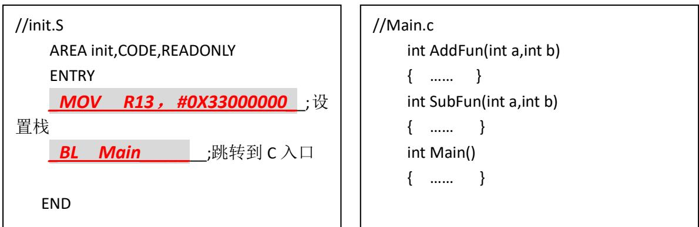
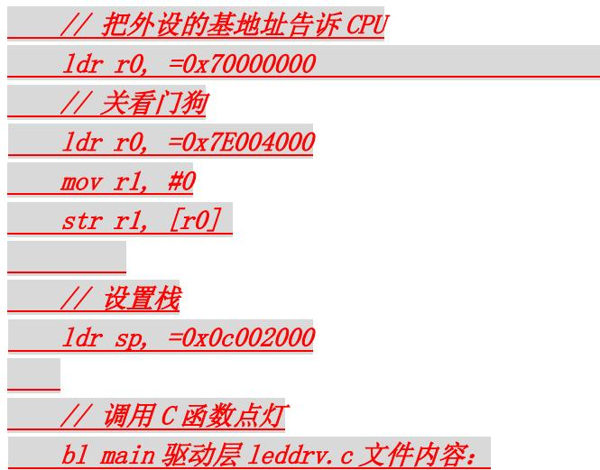

# 《嵌入式系统与开发》实验1 ARM汇编与S3C6410接口设计（答案）

原件经识别和整理；“参考解答”是我们补的。

## 一.实验目的

熟悉裸板开发环境构建，掌握利用ADS 开发工具或 arm-linux-gcc开发工具编写裸板系统下程序的基本步骤和方法，掌握裸板程序的基本架构，熟悉汇编设计的基本指令和伪指令的使用方法，掌握 S3C6410 接口开发基本方法和步骤，并编程设计 LED 流水灯和看门狗程序设计。深刻体会软件控制硬件工作的基本思路和方法。

### 简答 1

实验目的与要求。

## 二.实验内容

实验1.1 熟悉ADS 开发工具或交叉编译器 arm-linux-gcc的安装和基本使用

实验 1.2 LED 流水灯实验

实验1.3 看门狗实验

### 简答 2

实验内容。

## 三.预备知识

C 语言、微机接口等

### 简答 3

预备知识。

## 四.实验设备及工具（包括软件调试工具）

硬件：ARM 嵌入式开发平台、PC 机Pentium100 以上、串口线。

软件： WinXP 或 UBUNTU 开发环境。

### 简答 4

实验设备及工具。

## 五.实验步骤

### 简答 5

ADS 开发工具安装和使用步骤。

## 5.1 ADS 开发工具安装和使用

步骤：

第一步，ADS 工具安装在\_\_A\_\_(A. WINDOWS 平台 B.linux 平台)下，按照类似于 VC++开发工具的使用方法和步骤来进行使用。

第二步，利用ADS 打开demo 项目模板，查看 ADS 中配置中几个重要选项，

第三步，参照demo 项目代码结构，编写裸板程序完成两整数加和两整数减函数，分别用C代码实现，写出完成汇编启动代码和 C代码。

第四步 用ADS 自带的 ARM 模拟器调试上述代码，查看调用 AddFun 的汇编代码，可以看到变量 a 和变量 b 被编译器优化到寄存器\_R0 \_R1\_\_\_中，函数返回汇编语句为\_MOV PC R14\_\_\_，在这条语句中分别用到寄存器\_\_PC\_ R14

### 填空 1

ADS 工具安装平台选择。

答案：A

### 填空 2

变量 a、b 被优化到的寄存器。

答案：R0、R1

### 填空 3

函数返回汇编语句。

答案：MOV PC R14

### 填空 4

返回语句中用到的寄存器。

答案：PC、R14

### 5.2 arm-linux-gcc 编译工具安装和使用

第一步：arm-linux-gcc 开发工具安装于\_B\_\_(A. WINDOWS 平台 B.linux 平台)下，按照类似于gcc开发工具的使用方法和步骤来进行使用。

第二步：参看相关实验样例，一般基于 arm-linux-gcc 编译的裸板程序通常包含汇编启动代码文件，C 功能代码文件和make 工具文件Makefile。

### 填空 5

arm-linux-gcc 安装平台选择。

答案：B

### 5.3LED流水灯设计实验

本实验要求使用 arm-linux-gcc 编译。备注，控制 LED1 的 GPIO 口为 GPM0

步骤 1：编写代码

参看相关实验样例，编写 LED1 报警灯代码，实现 LED1 以 1 秒左右的时间进行闪烁，要求 LED驱动代码编写在 leddrv.c 中，功能代码编写在 main.c 文件中，启动代码文件和 Makefile 文件参照实验样例代码来设计。

则启动代码文件内容：

start:

功能层main.c文件内容：

步骤2：编译编译步骤为：在1inux环境下，进入到目录#make

步骤3：加载到内存中运行

步骤为：

使 用 minitools 工 具 ， 选 中 上 方 的 ”Download and run“ ， 设 置 好 下 载 地 址 “RAMAddress(Download/Loading)”，选择要运行的裸机程序，再点击“下载运行”就可以了。MiniTools首先会把裸机程序下载到DRAM的地址0x50000000处，然后跳转到该地址上运行裸机程序，所以只要PC上一点击“下载运行”就可以马上看到开发板上裸机程序的运行效果了。

实验箱断电后再重新加电，能否再次观察到LED1不停闪烁现象\_ A \_(A.不能 B.能)。

步骤4：烧写裸板程序到NAND设备

步骤为：

使用 minitools 工具，选中上方的”INSTALL TO NAND FLASH“，选择要运行的裸机程序，再点击“下载运行”就把裸机程序下载到开发板的 NAND 设备。

实验箱断电后再重新打开电源，能否再次观察到 LED1不停闪烁现象 B \_(A.不能 B.能)。

步骤 5：实验箱上共有 8 个 LED 报警灯，分别有 GPM0/GPM1/GPM2/GPM3/ GPM4/GPM5/GPQ1/GPQ2控制，编写代码完成8个LED灯流水效果（即先逐一点亮然后逐一熄灭，依次循环）。

### 填空 6

加载到内存运行后断电重加电能否再次观察到 LED1 闪烁。

答案：A

### 填空 7

烧写到 NAND 后断电重开电源能否再次观察到 LED1 闪烁。

答案：B

### 5.4 参照相关参考样例，将 5.3实验嵌入式看门狗驱动代码，完成硬件看门功能

系统代码详细设计：
