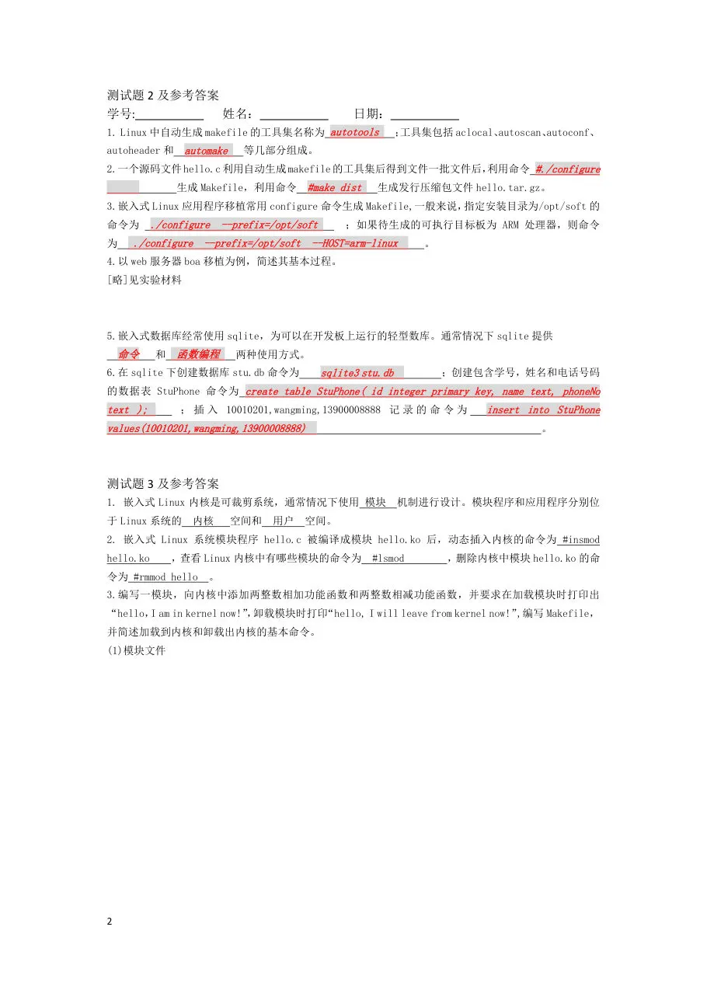
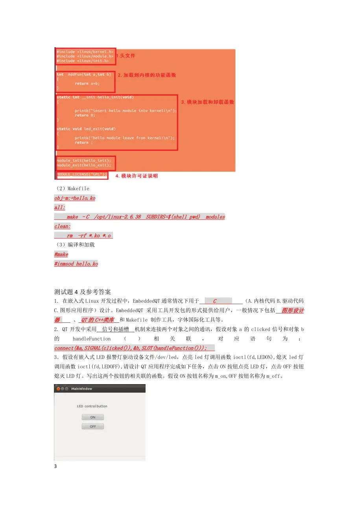

# 《嵌入式系统与开发》测试题及参考答案

原件经识别和整理；“参考解答”是我们补的。

# 嵌入式系统与开发 测试题及参考答案

## 一、填空题与选择题

### 选择 1

ARM 汇编程序由\_机器\_\_\_\_指令、\_\_汇编\_\_\_指令和\_\_伪\_\_\_指令构成。

答案：机器；汇编；伪

### 选择 2

ARM 伪指令可以分为以下几类：符号定义伪指令、数据定义伪指令、汇编控制伪指令、信息报告伪指令、宏指令以及其他伪指令。

答案：见正文

### 选择 3

假设存储数据 `0x12345678` 于 ARM 微处理器内存 `0X30000000` 开始的位置，则 `0X30000001` 内存位置的数据为\_C\_\_\_\_（A.0X12 B.0X34 C.0X56 D.0X78）（采用小端模式进行存储）

- A. 0X12
- B. 0X34
- C. 0X56
- D. 0X78

答案：C
知识点：[Linux可加载内核模块（LKM）的编写、编译（insmod/rmmod）与测试](../../../topics/嵌入式系统/Linux内核模块编程.md)、[Linux字符设备驱动程序的基本框架与数据结构（cdev、file_operations）](../../../topics/嵌入式系统/字符设备驱动框架.md)、[主/次设备号的申请注册（register_chrdev）与/dev下设备节点创建](../../../topics/嵌入式系统/设备号注册与节点创建.md)

### 填空 6

嵌入式 Linux 内核裁剪命令为 make menuconfig ；裁剪完成后生成配置选择文件 .config ；编译内核命令为 make zImage。

答案：make menuconfig；.config；make zImage

### 选择 7

启动 linux 后常用的命令如 ifconfig、cp、ls 等通常位于 C （A.bootloader B.内核 C.文件系统）中；嵌入式 Linux 环境下生成文件系统的常用工具为 mkyaffs2img ；以 yaffs 方法为例，将嵌入式文件夹压缩成一个 yaffs2 格式的文件系统命令为 mkyaffs2img 文件夹 镜像文件名 。

- A. bootloader
- B. 内核
- C. 文件系统

答案：C

### 选择 8

构建嵌入式 Linux 系统时，烧写 bootloader 的工具为 hjtag ；烧写 Linux 内核一般使用 A （A.bootloader B.文件系统 C.交叉编译器）来烧写，烧写文件系统一般使用 A （A.bootloader B.文件系统 C.交叉编译器）来烧写。

- A. bootloader
- B. 文件系统
- C. 交叉编译器

答案：hjtag；A；A

### 简答 3

简述构建嵌入式 Linux 系统基本过程。

略，见实验材料

## 三、Autotools 与 SQLite

知识点：[Linux可加载内核模块（LKM）的编写、编译（insmod/rmmod）与测试](../../../topics/嵌入式系统/Linux内核模块编程.md)、[Linux字符设备驱动程序的基本框架与数据结构（cdev、file_operations）](../../../topics/嵌入式系统/字符设备驱动框架.md)、[主/次设备号的申请注册（register_chrdev）与/dev下设备节点创建](../../../topics/嵌入式系统/设备号注册与节点创建.md)

### 填空 7

Linux 中自动生成 makefile 的工具集名称为 autotools ；工具集包括 aclocal、autoscan、autoconf、autoheader 和 automake 等几部分组成。

答案：autotools；aclocal、autoscan、autoconf、autoheader、automake

知识点：[Linux可加载内核模块（LKM）的编写、编译（insmod/rmmod）与测试](../../../topics/嵌入式系统/Linux内核模块编程.md)

### 填空 8

一个源码文件 hello.c 利用自动生成 makefile 的工具集后得到文件一批文件后，利用命令 `./configure` 生成 Makefile，利用命令 `tar -czf hello.tar.gz *` 生成发行压缩包文件 hello.tar.gz。（注：原文识别有误，根据上下文推断 tar 命令格式）

答案：./configure；tar -czf hello.tar.gz *

### 填空 9

嵌入式 Linux 应用程序移植常用 configure 命令生成 Makefile,一般来说，指定安装目录为 /opt/soft 的命令为 `./configure --prefix=/opt/soft` ；如果待生成的可执行目标板为 ARM 处理器，则命令为 `./configure --prefix=/opt/soft --host=arm-linux`。（注：修正原文识别乱码 `/confi<sub>g</sub>ure` 等）

答案：./configure --prefix=/opt/soft；./configure --prefix=/opt/soft --host=arm-linux

### 简答 4

以 web 服务器 boa 移植为例，简述其基本过程。

### [略] 见实验材料

知识点：[Linux字符设备驱动程序的基本框架与数据结构（cdev、file_operations）](../../../topics/嵌入式系统/字符设备驱动框架.md)、[用户空间应用程序通过open/read/write/ioctl与底层驱动交互的接口实现](../../../topics/嵌入式系统/驱动与应用交互接口.md)、[S3C6410 LED报警灯字符设备驱动代码（s3c6410_leddrv.c）设计实例](../../../topics/嵌入式系统/LED报警灯驱动设计.md)

### 填空 10

嵌入式数据库经常使用 sqlite，为可以在开发板上运行的轻型数据库。通常情况下 sqlite 提供 命令行 和 函数编程 两种使用方式。

答案：命令行；函数编程

### 填空 11

在 sqlite 下创建数据库 stu.db 命令为 `sqlite3 stu.db` ；创建包含学号，姓名和电话号码的数据表 StuPhone 命令为 `create table StuPhone( id integer primary key, name text, phoneNo text );` ；插入 10010201,wangming,13900008888 记录的命令为 `insert into StuPhone values (10010201, 'wangming', '13900008888');`（注：补全语法，原文缺失 insert into 关键字且字段名拼写有误，此处按标准 SQL 修正逻辑，若严格按原文填空则为空缺）。

答案：sqlite3 stu.db；create table StuPhone( id integer primary key, name text, phoneNo text );；insert into StuPhone values (10010201, 'wangming', '13900008888');

## 四、Linux 内核模块

知识点：[Linux可加载内核模块（LKM）的编写、编译（insmod/rmmod）与测试](../../../topics/嵌入式系统/Linux内核模块编程.md)

### 填空 12

嵌入式 Linux 内核是可裁剪系统，通常情况下使用 模块 机制进行设计。模块程序和应用程序分别位于 Linux 系统的 内核 空间和 用户 空间。

答案：模块；内核；用户

知识点：[Linux可加载内核模块（LKM）的编写、编译（insmod/rmmod）与测试](../../../topics/嵌入式系统/Linux内核模块编程.md)

### 填空 13

嵌入式 Linux 系统模块程序 hello.c 被编译成模块 hello.ko 后，动态插入内核的命令为 `insmod hello.ko` ，查看 Linux 内核中有哪些模块的命令为 `lsmod` ，删除内核中模块 hello.ko 的命令为 `rmmod hello`。

答案：insmod hello.ko；lsmod；rmmod hello

知识点：[Linux可加载内核模块（LKM）的编写、编译（insmod/rmmod）与测试](../../../topics/嵌入式系统/Linux内核模块编程.md)

### 综合 1

编写一模块，向内核中添加两整数相加功能函数和两整数相减功能函数，并要求在加载模块时打印出“hello，I am in kernel now!”，卸载模块时打印“hello, I will leave from kernel now!”,编写 Makefile，并简述加载到内核和卸载出内核的基本命令。

#### (1) 模块文件



#### (2) Makefile

```makefile
obj-m:=hello.ko

all:
	make -C /opt/linux-2.6.38 SUBDIRS=$(shell pwd) modules

clean:
	rm -rf *.ko *.o
```

#### (3) 编译和加载

```bash
# make
# insmod hello.ko
```

答案：见上述代码块

## 五、Embedded Qt 开发

知识点：[Linux可加载内核模块（LKM）的编写、编译（insmod/rmmod）与测试](../../../topics/嵌入式系统/Linux内核模块编程.md)

### 选择 9

在嵌入式 Linux 开发过程中，EmbeddedQT 通常情况下用于 C （A.内核代码 B.驱动代码 C.图形应用程序）设计。EmbeddedQT 采用工具开发包的形式提供给用户，一般情况下包括 图形设计、 和 Makefile 制作工具，字体国际化工具等。

- A. 内核代码
- B. 驱动代码
- C. 图形应用程序

答案：C

### 填空 14

QT 开发中采用 信号和插槽 机制来连接两个对象之间的通讯，假设对象 a 的 clicked 信号和对象 b 的 handleFunction() 相关联对应语句为：`connect(&a, SIGNAL(clicked()), &b, SLOT(handleFunction()));`。

答案：信号和插槽；`connect(&a, SIGNAL(clicked()), &b, SLOT(handleFunction()));`

### 综合 2

假设有嵌入式 LED 报警灯驱动设备文件 `/dev/led`，点亮 led 灯调用函数 `ioctl(fd,LEDON)`,熄灭 led 灯调用函数 `ioctl(fd,LEDOFF)`,请设计 QT 应用程序完成如下任务，点击 ON 按钮点亮 LED 灯，点击 OFF 按钮熄灭 LED 灯。写出这两个按钮的相关联的函数。假设 ON 按钮名称为 m_on,OFF 按钮名称为 m_off。



关联函数：

```cpp
// 伪代码示例，具体实现需结合完整项目
void MainWindow::on_m_on_clicked() {
    int fd = open("/dev/led", O_RDWR);
    ioctl(fd, LEDON);
    close(fd);
}

void MainWindow::on_m_off_clicked() {
    int fd = open("/dev/led", O_RDWR);
    ioctl(fd, LEDOFF);
    close(fd);
}
```

答案：见上方代码逻辑

## 六、Linux 设备驱动

知识点：[用户空间应用程序通过open/read/write/ioctl与底层驱动交互的接口实现](../../../topics/嵌入式系统/驱动与应用交互接口.md)、[主/次设备号的申请注册（register_chrdev）与/dev下设备节点创建](../../../topics/嵌入式系统/设备号注册与节点创建.md)、[S3C6410 LED报警灯字符设备驱动代码（s3c6410_leddrv.c）设计实例](../../../topics/嵌入式系统/LED报警灯驱动设计.md)

### 填空 15

嵌入式 Linux 驱动设备分为\_字符设备 \_\_、 块设备 \_和网络设备三种类型，其中通常情况下键盘、鼠标、LCD 屏等设备驱动属于 字符 设备，硬盘设备属于\_块 \_设备。

答案：字符设备；块设备；字符；块

知识点：[Linux字符设备驱动程序的基本框架与数据结构（cdev、file_operations）](../../../topics/嵌入式系统/字符设备驱动框架.md)

### 选择 10

设备要能被使用，通常需要设备驱动软件，在 Linux 系统中，设备驱动驱动软件位于\_ A \_(A.内核空间 B.用户空间)，假设有 LED 报警灯设备驱动软件 leddrv.ko，则加载该驱动软件到内核命令为 `#insmod leddrv.ko`，测试完成后，将该软件从内核中卸载命令为 `#rmmod leddrv`。

- A. 内核空间
- B. 用户空间

答案：A；`insmod leddrv.ko`；`rmmod leddrv`

知识点：[Linux可加载内核模块（LKM）的编写、编译（insmod/rmmod）与测试](../../../topics/嵌入式系统/Linux内核模块编程.md)、[S3C6410 LED报警灯字符设备驱动代码（s3c6410_leddrv.c）设计实例](../../../topics/嵌入式系统/LED报警灯驱动设计.md)

### 填空 16

除网络设备外，设备驱动通常采用\_文件\_\_方式进行访问，一般包括\_打开设备\_、读写控制设备，最后\_关闭设备\_。在 Linux 中设备文件名本质上是设备号，将两者之间建立关联的命令为 mknod，假设 LED 设备驱动主设备号为 253，次设备号为 0，设备名为 leddev，则建立设备文件的具体命令为\_`#mknod /dev/leddev c 253 0`\_。

答案：文件；打开设备；关闭设备；`mknod /dev/leddev c 253 0`

知识点：[主/次设备号的申请注册（register_chrdev）与/dev下设备节点创建](../../../topics/嵌入式系统/设备号注册与节点创建.md)、[用户空间应用程序通过open/read/write/ioctl与底层驱动交互的接口实现](../../../topics/嵌入式系统/驱动与应用交互接口.md)

### 简答 5

简述编写看门狗驱动基本步骤。

编写硬件驱动代码，包括：
1. 编写硬件接口函数
2. 建立文件系统与硬件接口函数的关联
3. 注册字符设备
4. 添加模块代码

编译设备驱动并加载到内核，包括：
1. 编写 Makefile
2. 编译
3. 加载
4. 创建设备节点

编写应用程序访问底层设备驱动

答案：见正文

知识点：[Linux字符设备驱动程序的基本框架与数据结构（cdev、file_operations）](../../../topics/嵌入式系统/字符设备驱动框架.md)、[S3C6410 LED报警灯字符设备驱动代码（s3c6410_leddrv.c）设计实例](../../../topics/嵌入式系统/LED报警灯驱动设计.md)、[S3C6410 看门狗定时器设备驱动代码（s3c6410_wdtdrv.c）设计实例](../../../topics/嵌入式系统/看门狗驱动设计.md)
