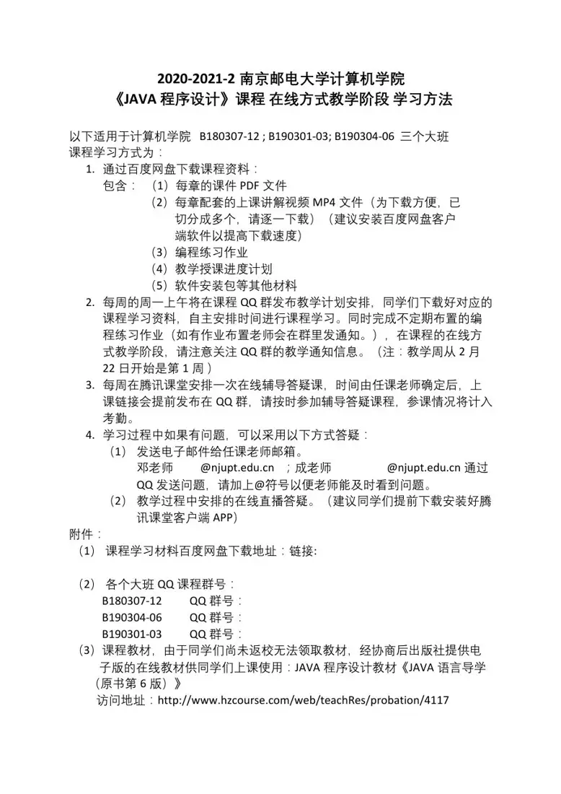

# 2020-2021-2 南京邮电大学计算机学院《JAVA 程序设计》课程在线方式教学阶段学习方法

原件的每一页，下面附识别出的文字。

### 1. 通过百度网盘下载课程资料：

原文：

2020-2021-2 南京邮电大学计算机学院《JAVA 程序设计》课程 在线方式教学阶段 学习方法

以下适用于计算机学院 B180307-12 ; B190301-03; B190304-06 三个大班课程学习方式为：

1. 通过百度网盘下载课程资料：

包含： （1）每章的课件 PDF 文件

（2）每章配套的上课讲解视频 MP4 文件（为下载方便，已切分成多个，请逐一下载）（建议安装百度网盘客户端软件以提高下载速度）

（3）编程练习作业

（4）教学授课进度计划

（5）软件安装包等其他材料

2. 每周的周一上午将在课程 QQ群发布教学计划安排，同学们下载好对应的课程学习资料，自主安排时间进行课程学习。同时完成不定期布置的编程练习作业（如有作业布置老师会在群里发通知。），在课程的在线方式教学阶段，请注意关注 QQ群的教学通知信息。（注：教学周从 2 月22 日开始是第 1 周）

3. 每周在腾讯课堂安排一次在线辅导答疑课，时间由任课老师确定后，上课链接会提前发布在 QQ群，请按时参加辅导答疑课程，参课情况将计入考勤。

4. 学习过程中如果有问题，可以采用以下方式答疑：

（1） 发送电子邮件给任课老师邮箱。邓老师 @njupt.edu.cn ；成老师 @njupt.edu.cn 通过QQ发送问题，请加上@符号以便老师能及时看到问题。

（2） 教学过程中安排的在线直播答疑。（建议同学们提前下载安装好腾讯课堂客户端 APP）

附件：

（1） 课程学习材料百度网盘下载地址：链接:

（2） 各个大班 QQ课程群号：B180307-12 QQ 群号：B190304-06 QQ群号：B190301-03 QQ群号：

（3）课程教材，由于同学们尚未返校无法领取教材，经协商后出版社提供电子版的在线教材供同学们上课使用：JAVA 程序设计教材《JAVA 语言导学（原书第 6 版）》访问地址：http://www.hzcourse.com/web/teachRes/probation/4117
