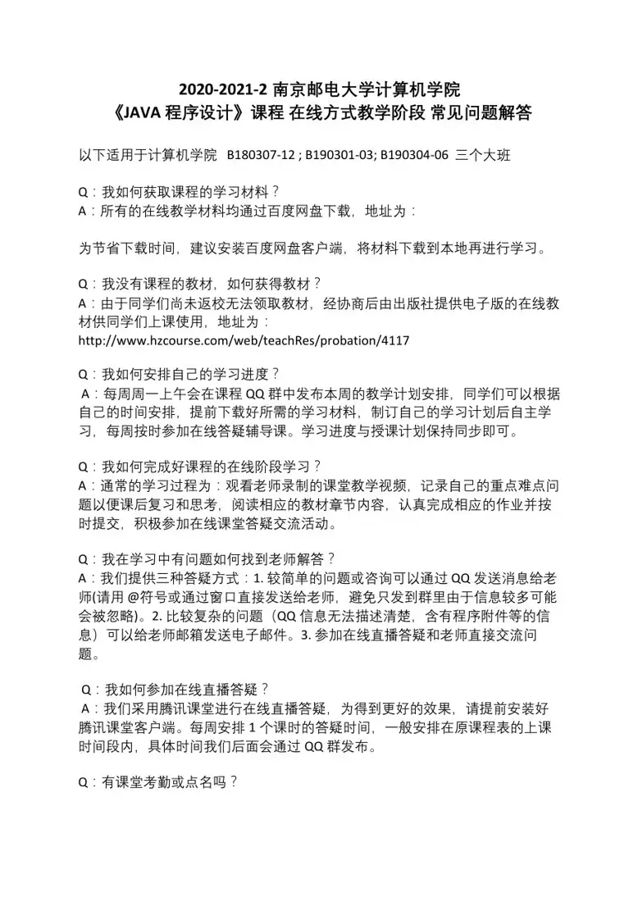

# 2020—2021 学年第二学期《JAVA 程序设计》课程在线教学阶段常见问题解答

原件的每一页，下面附识别出的文字。

### Q：我如何获取课程的学习材料？A：所有的在线教学材料均通过百度网盘下载，地址为：

原文：

2020-2021-2 南京邮电大学计算机学院《JAVA 程序设计》课程 在线方式教学阶段 常见问题解答

以下适用于计算机学院 B180307-12 ; B190301-03; B190304-06 三个大班

Q：我如何获取课程的学习材料？A：所有的在线教学材料均通过百度网盘下载，地址为：

为节省下载时间，建议安装百度网盘客户端，将材料下载到本地再进行学习。

Q：我没有课程的教材，如何获得教材？

A：由于同学们尚未返校无法领取教材，经协商后由出版社提供电子版的在线教材供同学们上课使用，地址为：http://www.hzcourse.com/web/teachRes/probation/4117

Q：我如何安排自己的学习进度？

A：每周周一上午会在课程QQ群中发布本周的教学计划安排，同学们可以根据自己的时间安排，提前下载好所需的学习材料，制订自己的学习计划后自主学习，每周按时参加在线答疑辅导课。学习进度与授课计划保持同步即可。

Q：我如何完成好课程的在线阶段学习？

A：通常的学习过程为：观看老师录制的课堂教学视频，记录自己的重点难点问题以便课后复习和思考，阅读相应的教材章节内容，认真完成相应的作业并按时提交，积极参加在线课堂答疑交流活动。

Q：我在学习中有问题如何找到老师解答？

A：我们提供三种答疑方式：1.较简单的问题或咨询可以通过QQ发送消息给老师(请用@符号或通过窗口直接发送给老师，避免只发到群里由于信息较多可能会被忽略)。2.比较复杂的问题（QQ信息无法描述清楚，含有程序附件等的信息）可以给老师邮箱发送电子邮件。3.参加在线直播答疑和老师直接交流问题。

Q：我如何参加在线直播答疑？

A：我们采用腾讯课堂进行在线直播答疑，为得到更好的效果，请提前安装好腾讯课堂客户端。每周安排 1 个课时的答疑时间，一般安排在原课程表的上课时间段内，具体时间我们后面会通过 QQ群发布。

Q：有课堂考勤或点名吗？

### Q：这门课需要提交作业吗？

原文：

A：在线教学这个阶段，每周的辅导答疑课有课堂考勤，数据来源于腾讯课堂，为准确记录参课情况，请同学们在进入课堂前将自己的名称改为学号+姓名的形式，例如：B19030101 我是学霸。参课考勤计入平时成绩。

Q：这门课需要提交作业吗？

A：我们会不定期地布置课后作业，主要是一系列的编程练习，对这门课来讲，动手编程非常重要，请同学们一定要完成好作业，并且在规定的时间内提交给老师批阅，作业成绩将会被计入平时成绩，请同学们务必认真完成。
