# 《JAVA程序设计》第1章（课件）

原件的每一页，下面附识别出的文字。

### JAVA程序设计（JAVA PROGRAMMING）

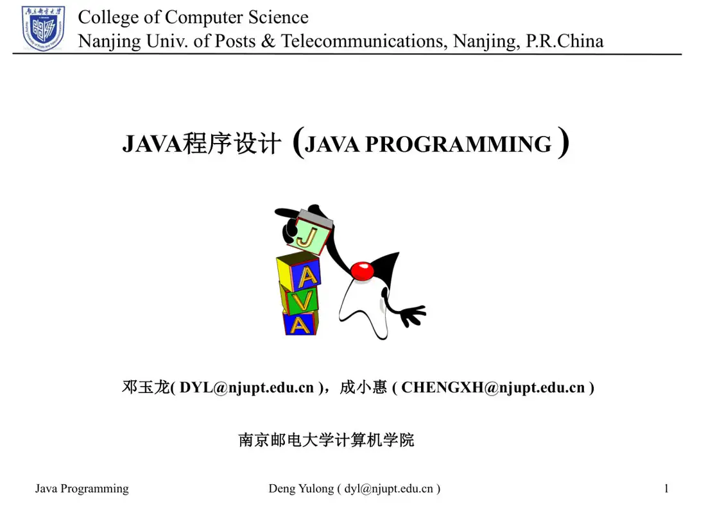

原文：

JAVA程序设计（JAVA PROGRAMMING）

邓玉龙(DYL@njupt.edu.cn)，成小惠(CHENGXH@njupt.edu.cn)

南京邮电大学计算机学院

Deng Yulong ( dyl@njupt.edu.cn )

南京郵電大學
1942
Nanjing University of Posts and Telecommunications
www.njce.com

College of Computer Science
Nanjing Univ. of Posts & Telecommunications, Nanjing, P.R.China

Java Programming

1

### 课程信息：课程编号B0302281C,面向计算机专业本科学生

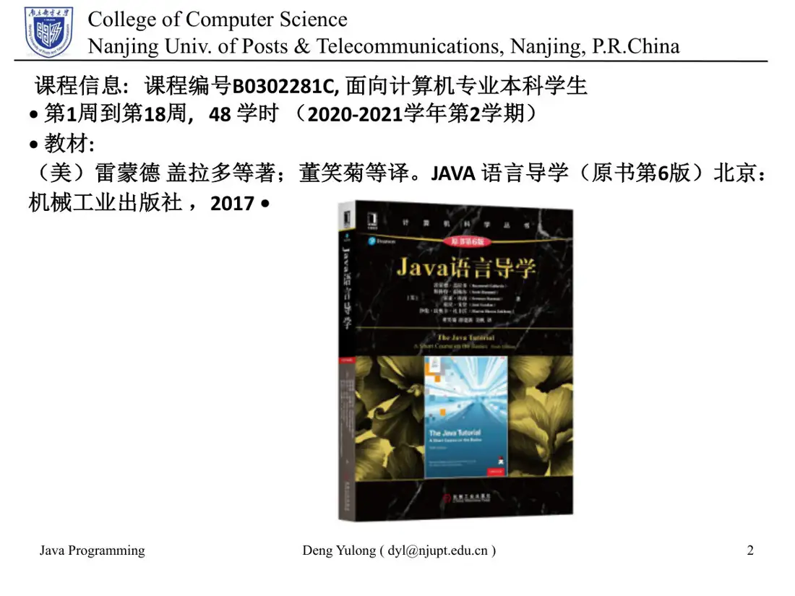

原文：

课程信息：课程编号B0302281C,面向计算机专业本科学生

\- 第1周到第18周，48学时（2020-2021学年第2学期）

\- 教材:

（美）雷蒙德 盖拉多等著；董笑菊等译。JAVA 语言导学（原书第6版）北京：机械工业出版社，2017 •

南京郵電大學
1942
Nanjing University of Posts and Telecommunications
www.njeng.com

College of Computer Science
Nanjing Univ. of Posts & Telecommunications, Nanjing, P.R.China

Java Programming

Deng Yulong ( dyl@njupt.edu.cn )

2

### 其他相似教材可供参考:

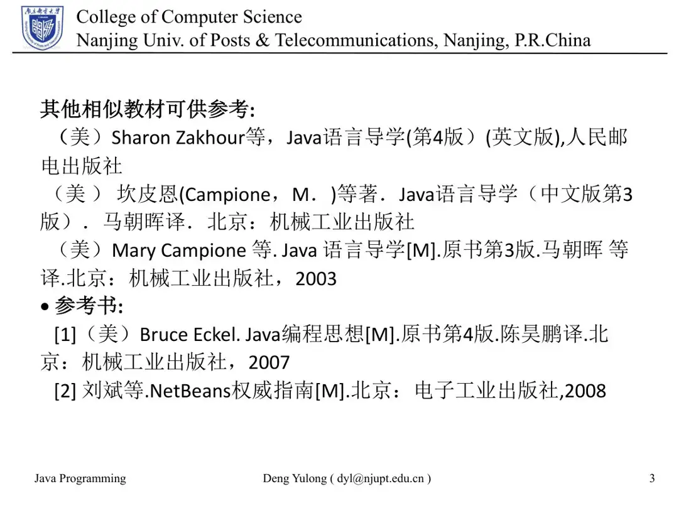

原文：

其他相似教材可供参考:

（美）Sharon Zakhour等，Java语言导学(第4版) (英文版),人民邮电出版社

(美) 坎皮恩(Campione, M.)等著. Java语言导学（中文版第3版）. 马朝晖译. 北京: 机械工业出版社

（美）Mary Campione 等. Java 语言导学[M]. 原书第3版. 马朝晖等译. 北京：机械工业出版社，2003

- 参考书:

[1]（美）Bruce Eckel. Java编程思想[M]. 原书第4版. 陈昊鹏译. 北京：机械工业出版社，2007

[2] 刘斌等.NetBeans权威指南[M]. 北京：电子工业出版社, 2008

南京郵電大學
1942
Nanjing University of Posts and Telecommunications
www.njeng.com

College of Computer Science
Nanjing Univ. of Posts & Telecommunications, Nanjing, P.R.China

Java Programming

Deng Yulong ( dyl@njupt.edu.cn )

3

### 南京郵電大學

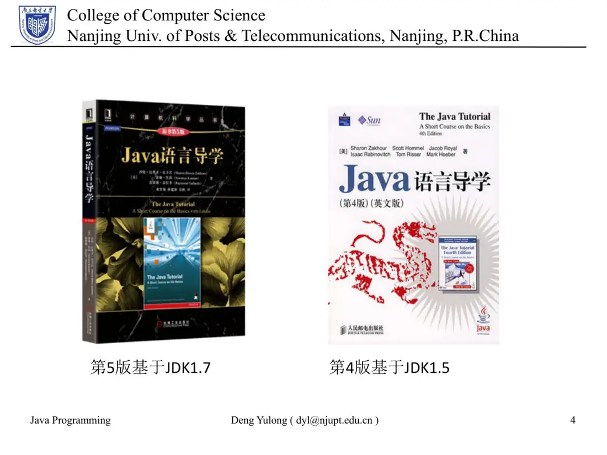

原文：

南京郵電大學
1942
Nanjing University of Posts and Telecommunications
www.njce.com

College of Computer Science
Nanjing Univ. of Posts & Telecommunications, Nanjing, P.R.China

Java Programming

Deng Yulong ( dyl@njupt.edu.cn )

4

### 南京郵電大學

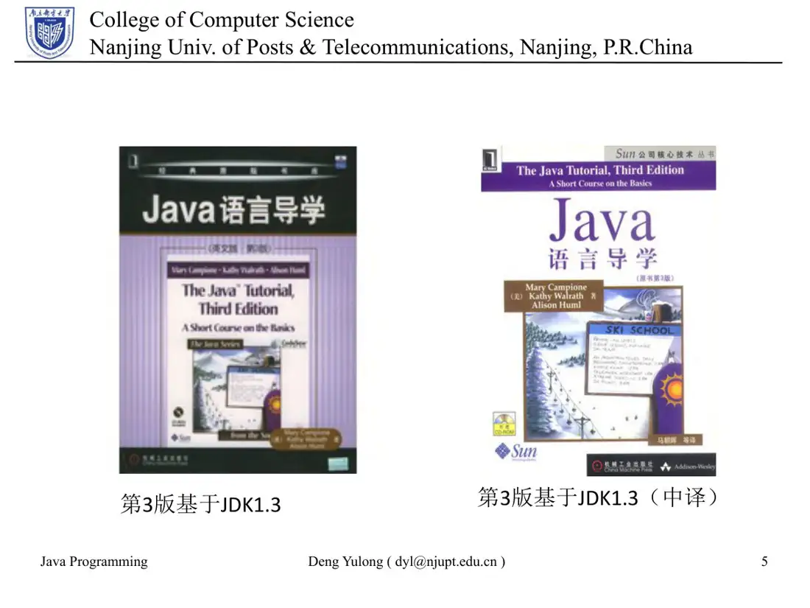

原文：

南京郵電大學
1942
Nanjing University of Posts and Telecommunications
www.njeng.com

College of Computer Science
Nanjing Univ. of Posts & Telecommunications, Nanjing, P.R.China

Java Programming

Deng Yulong ( dyl@njupt.edu.cn )

5

### 南京郵電大學

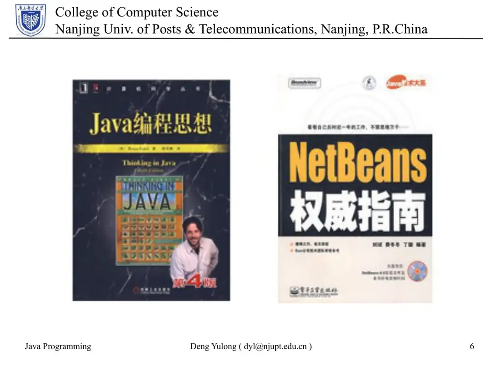

原文：

南京郵電大學
1942
Nanjing University of Posts and Telecommunications
www.njeng.com

College of Computer Science
Nanjing Univ. of Posts & Telecommunications, Nanjing, P.R.China

Java Programming

Deng Yulong ( dyl@njupt.edu.cn )

6

### 南京郵電大學

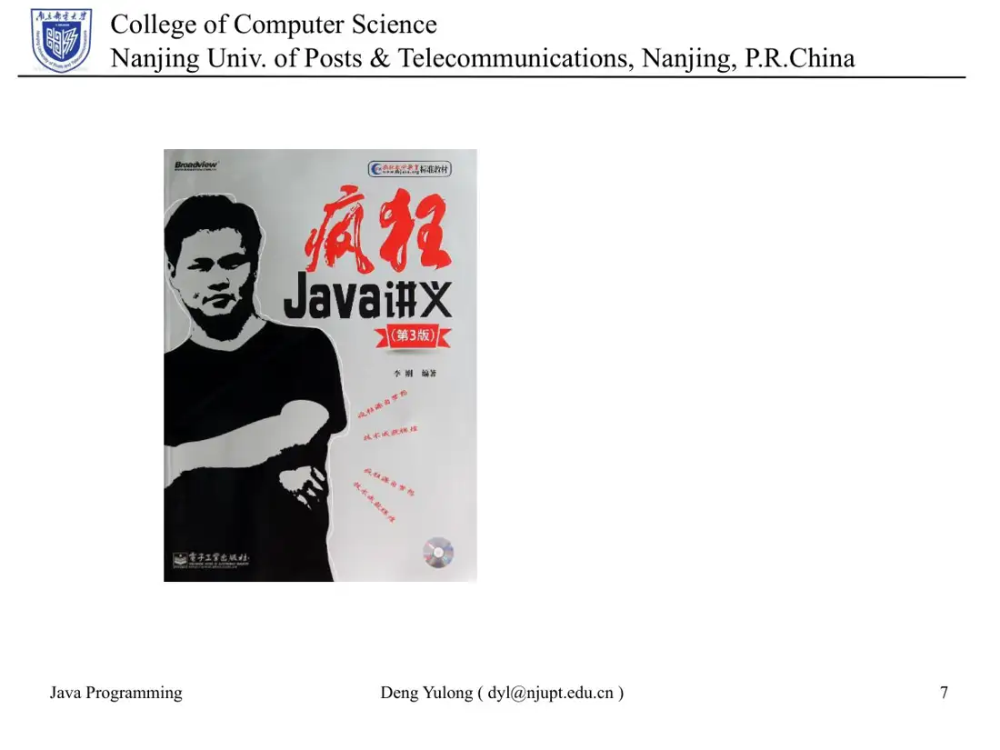

原文：

南京郵電大學
1942
Nanjing University of Posts and Telecommunications
www.njeng.com

College of Computer Science
Nanjing Univ. of Posts & Telecommunications, Nanjing, P.R.China

Java Programming

Deng Yulong ( dyl@njupt.edu.cn )

7

### - 成绩计算方法

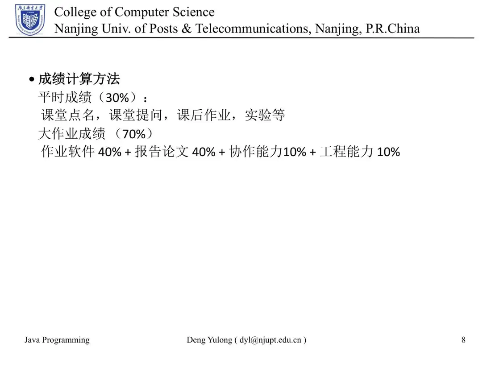

原文：

- 成绩计算方法

平时成绩（30%）：

课堂点名，课堂提问，课后作业，实验等

大作业成绩（70%）

作业软件 40% + 报告论文 40% + 协作能力10% + 工程能力 10%

南京郵電大學
1942
Nanjing University of Posts and Telecommunications
www.njeng.com

College of Computer Science
Nanjing Univ. of Posts & Telecommunications, Nanjing, P.R.China

Java Programming

Deng Yulong ( dyl@njupt.edu.cn )

8

### 答疑，课程资料下载以及课程信息通知：

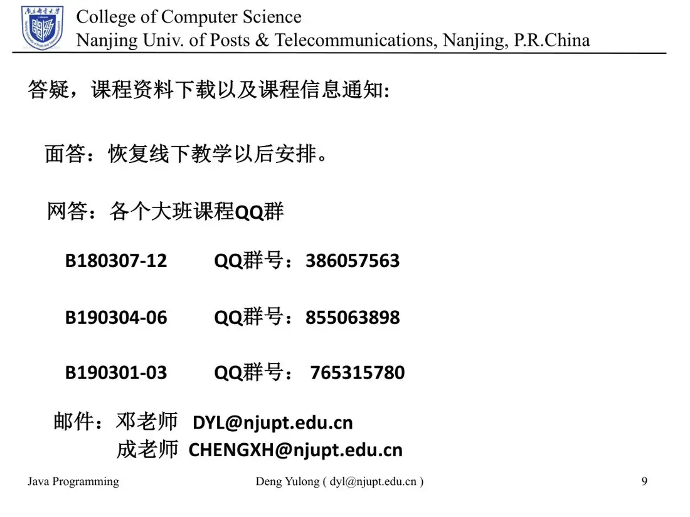

原文：

答疑，课程资料下载以及课程信息通知：

面答：恢复线下教学以后安排。

网答：各个大班课程QQ群

B180307-12 QQ群号：386057563

B190304-06 QQ群号：855063898

B190301-03 QQ群号：765315780

邮件：邓老师 DYL@njupt.edu.cn
成老师 CHENGXH@njupt.edu.cn

南京郵電大學
1842
Nanjing University of Posts and Telecommunications
www.njeng.com

College of Computer Science
Nanjing Univ. of Posts & Telecommunications, Nanjing, P.R.China

Deng Yulong ( dyl@njupt.edu.cn )

Java Programming

9

### Java Programming

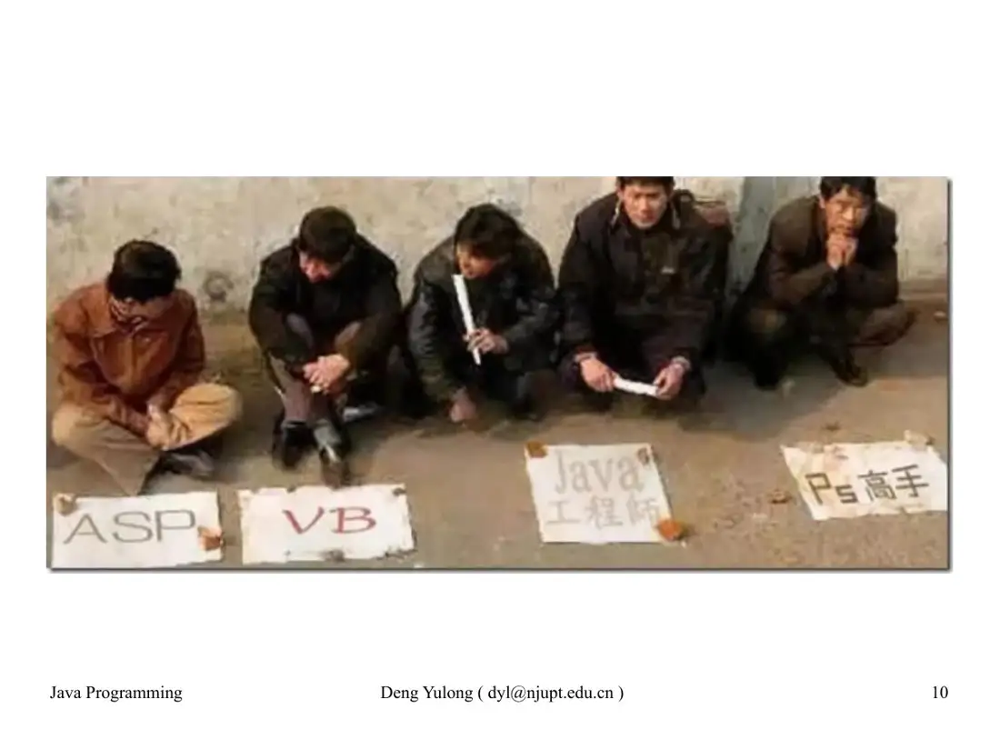

原文：

Java Programming

Deng Yulong ( dyl@njupt.edu.cn )

10

### 南京郵電大學

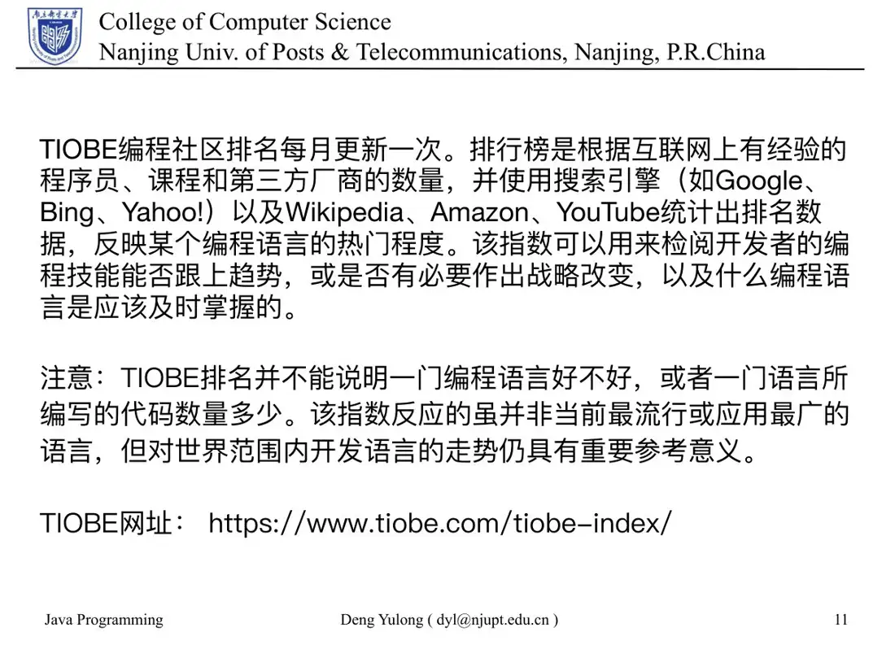

原文：

TIOBE编程社区排名每月更新一次。排行榜是根据互联网上有经验的程序员、课程和第三方厂商的数量，并使用搜索引擎（如Google、Bing、Yahoo!）以及Wikipedia、Amazon、YouTube统计出排名数据，反映某个编程语言的热门程度。该指数可以用来检阅开发者的编程技能能否跟上趋势，或是否有必要作出战略改变，以及什么编程语言是应该及时掌握的。

注意：TIOBE排名并不能说明一门编程语言好不好，或者一门语言所编写的代码数量多少。该指数反应的虽并非当前最流行或应用最广的语言，但对世界范围内开发语言的走势仍具有重要参考意义。

TIOBE网址：https://www.tiobe.com/tiobe-index/

南京郵電大學
1942
Nanjing University of Posts and Telecommunications
www.njeng.com

College of Computer Science
Nanjing Univ. of Posts & Telecommunications, Nanjing, P.R.China

Java Programming

Deng Yulong ( dyl@njupt.edu.cn )

11

### 2021年2月 TIOBE编程语言排行榜 TOP10 榜单：

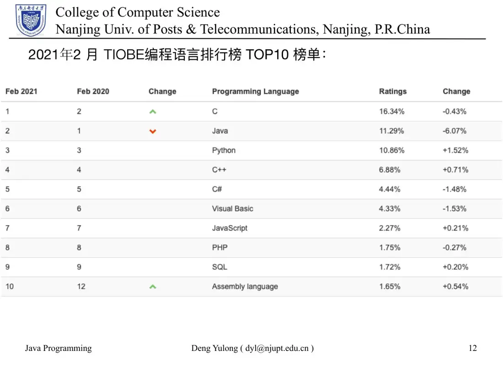

原文：

2021年2月 TIOBE编程语言排行榜 TOP10 榜单：

<table><tr><td>Feb 2021</td><td>Feb 2020</td><td>Change</td><td>Programming Language</td><td>Ratings</td><td>Change</td></tr><tr><td>1</td><td>2</td><td>^</td><td>C</td><td>16.34%</td><td>-0.43%</td></tr><tr><td>2</td><td>1</td><td>▼</td><td>Java</td><td>11.29%</td><td>-6.07%</td></tr><tr><td>3</td><td>3</td><td></td><td>Python</td><td>10.86%</td><td>+1.52%</td></tr><tr><td>4</td><td>4</td><td></td><td>C++</td><td>6.88%</td><td>+0.71%</td></tr><tr><td>5</td><td>5</td><td></td><td>C#</td><td>4.44%</td><td>-1.48%</td></tr><tr><td>6</td><td>6</td><td></td><td>Visual Basic</td><td>4.33%</td><td>-1.53%</td></tr><tr><td>7</td><td>7</td><td></td><td>JavaScript</td><td>2.27%</td><td>+0.21%</td></tr><tr><td>8</td><td>8</td><td></td><td>PHP</td><td>1.75%</td><td>-0.27%</td></tr><tr><td>9</td><td>9</td><td></td><td>SQL</td><td>1.72%</td><td>+0.20%</td></tr><tr><td>10</td><td>12</td><td>^</td><td>Assembly language</td><td>1.65%</td><td>+0.54%</td></tr></table>

南京郵電大學
1942
Nanjing University of Posts and Telecommunications
www.njeng.com

College of Computer Science
Nanjing Univ. of Posts & Telecommunications, Nanjing, P.R.China

Java Programming

Deng Yulong ( dyl@njupt.edu.cn )

12

### 南京郵電大學

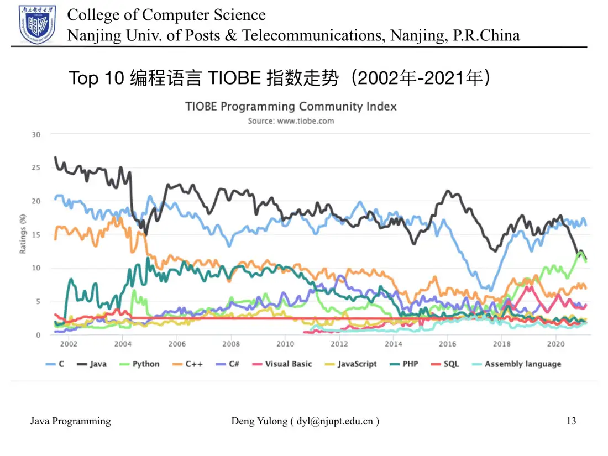

原文：

南京郵電大學
1942
Nanjing University of Posts and Telecommunications
www.njeng.com

College of Computer Science
Nanjing Univ. of Posts & Telecommunications, Nanjing, P.R.China

Java Programming

Deng Yulong ( dyl@njupt.edu.cn )

13

### 课程计划讲授内容:

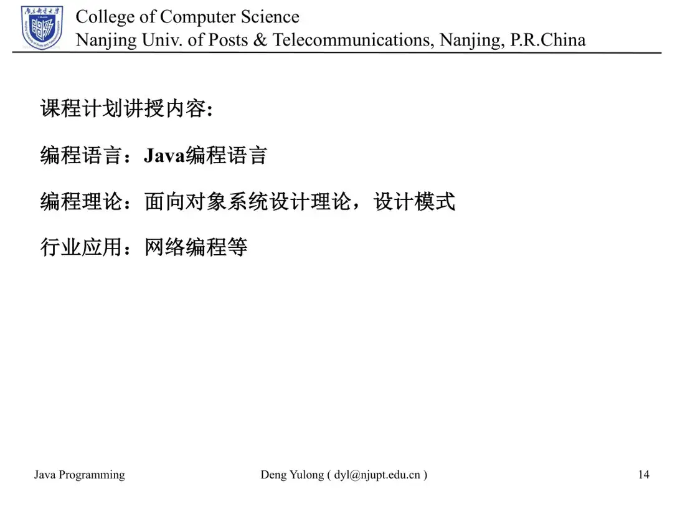

原文：

课程计划讲授内容:

编程语言：Java编程语言

编程理论：面向对象系统设计理论，设计模式

行业应用：网络编程等

南京郵電大學
1842
Nanjing University of Posts and Telecommunications
www.njeng.com

College of Computer Science
Nanjing Univ. of Posts & Telecommunications, Nanjing, P.R.China

Java Programming

Deng Yulong ( dyl@njupt.edu.cn )

14

### 课程计划讲授内容:

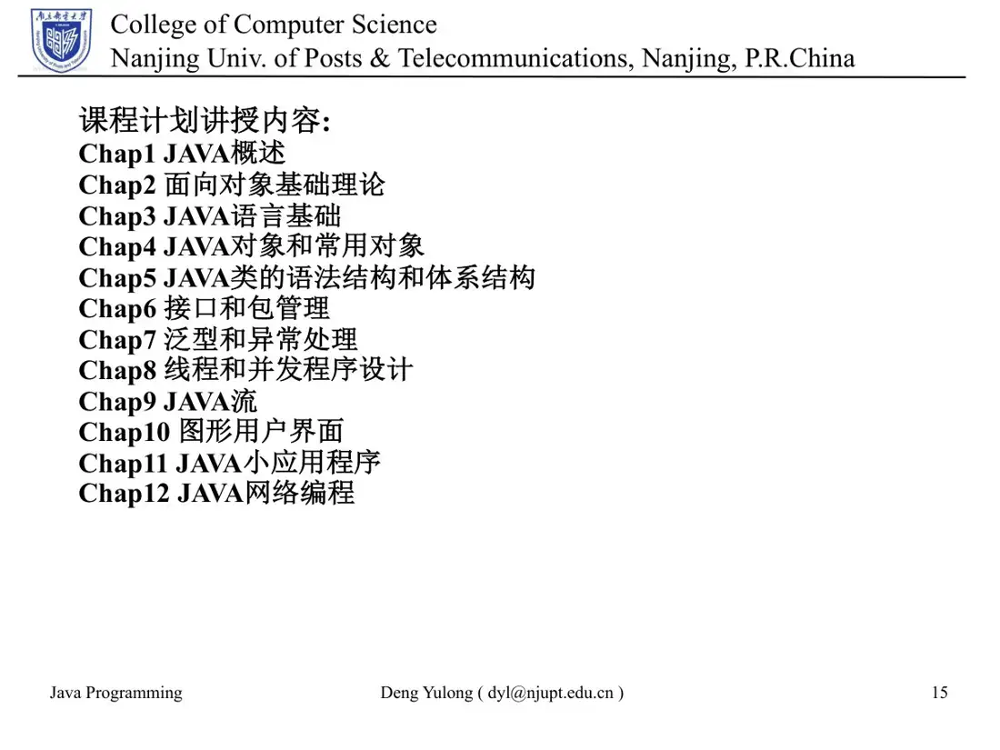

原文：

课程计划讲授内容:

Chap1 JAVA概述

Chap2 面向对象基础理论

Chap3 JAVA语言基础

Chap4 JAVA对象和常用对象

Chap5 JAVA类的语法结构和体系结构

Chap6 接口和包管理

Chap7 泛型和异常处理

Chap8 线程和并发程序设计

Chap9 JAVA流

Chap10 图形用户界面

Chap11 JAVA小应用程序

Chap12 JAVA网络编程

南京郵電大學
1842
Nanjing University of Posts and Telecommunications
www.njeng.com

College of Computer Science
Nanjing Univ. of Posts & Telecommunications, Nanjing, P.R.China

Java Programming

Deng Yulong ( dyl@njupt.edu.cn )

15

### 第1章 JAVA概述

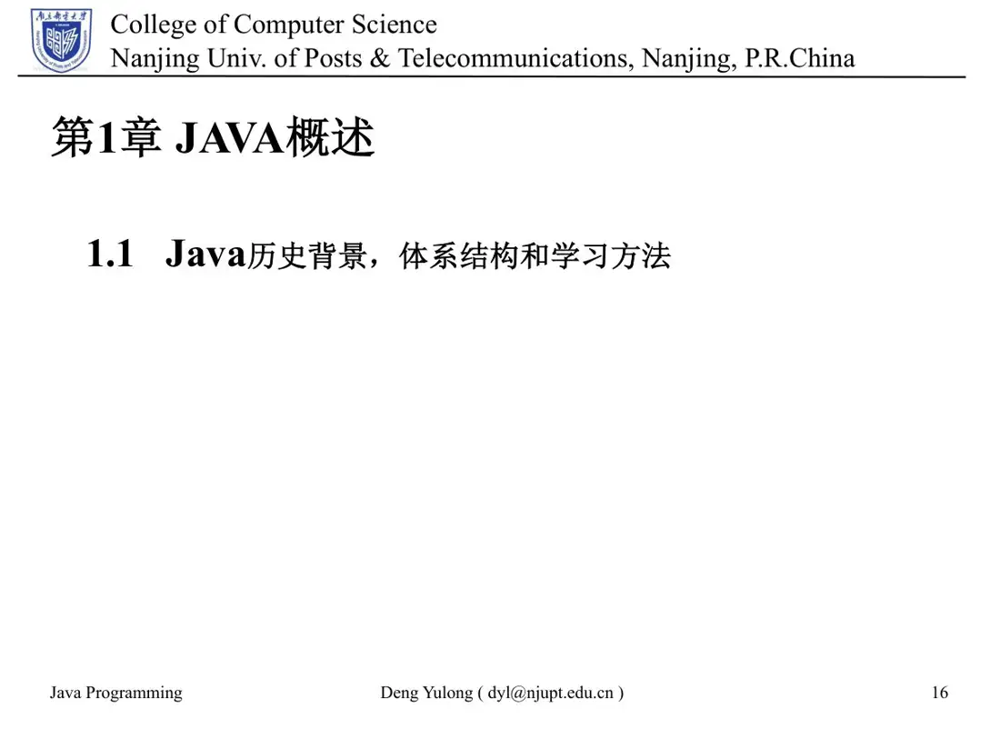

原文：

第1章 JAVA概述

1.1 Java历史背景，体系结构和学习方法

南京郵電大學
1942
Nanjing University of Posts and Telecommunications
www.njeng.com

College of Computer Science
Nanjing Univ. of Posts & Telecommunications, Nanjing, P.R.China

Java Programming

Deng Yulong ( dyl@njupt.edu.cn )

16

### Java的诞生和进化历史

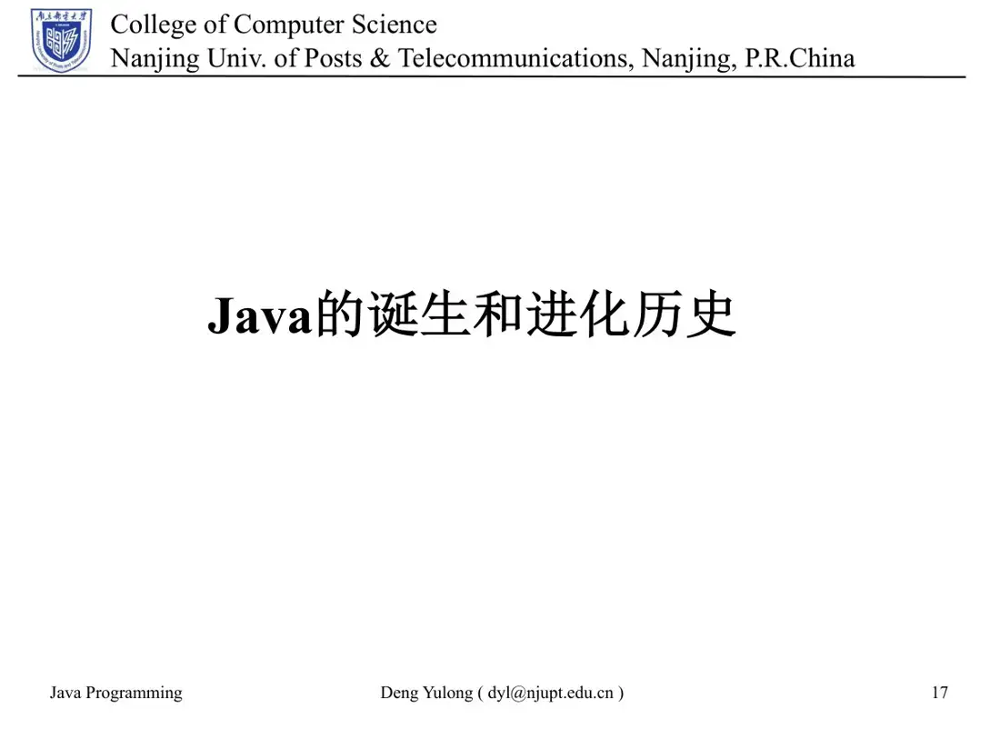

原文：

Java的诞生和进化历史

南京郵電大學
1942
Nanjing University of Posts and Telecommunications
www.njce.com

College of Computer Science
Nanjing Univ. of Posts & Telecommunications, Nanjing, P.R.China

Java Programming

Deng Yulong ( dyl@njupt.edu.cn )

17

### 1990 \*7 项目

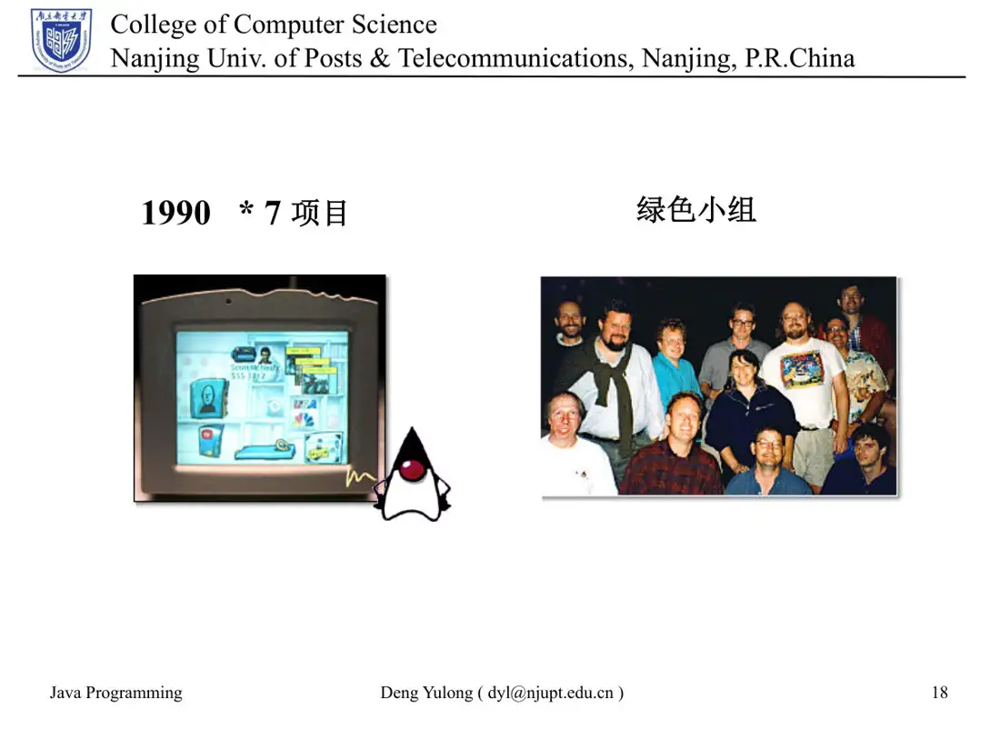

原文：

1990 \*7 项目

南京郵電大學
1942
Nanjing University of Posts and Telecommunications
www.njce.com

College of Computer Science
Nanjing Univ. of Posts & Telecommunications, Nanjing, P.R.China

Java Programming

Deng Yulong ( dyl@njupt.edu.cn )

18

### Java™

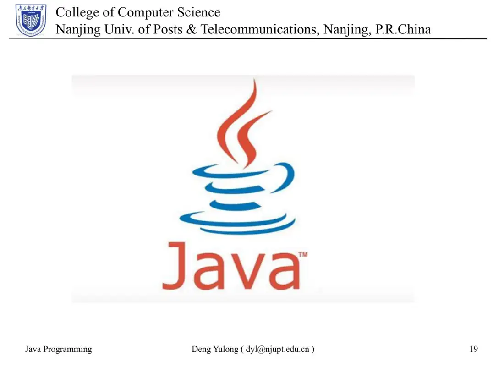

原文：

Java™

南京郵電大學
1942
Nanjing University of Posts and Telecommunications
www.njce.com

College of Computer Science
Nanjing Univ. of Posts & Telecommunications, Nanjing, P.R.China

Java Programming

Deng Yulong ( dyl@njupt.edu.cn )

19

### 南京郵電大學

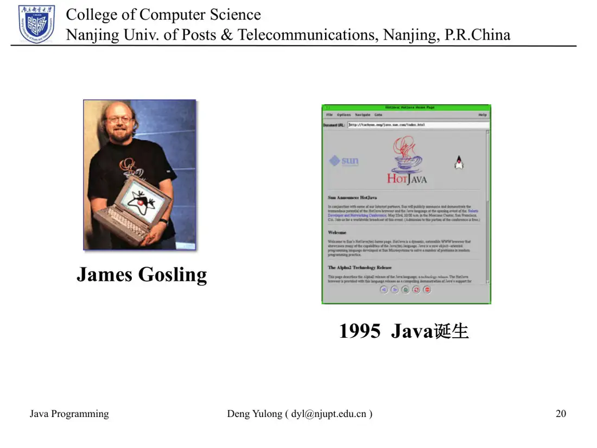

原文：

南京郵電大學
1942
Nanjing University of Posts and Telecommunications
www.njeng.com

College of Computer Science
Nanjing Univ. of Posts & Telecommunications, Nanjing, P.R.China

Java Programming

Deng Yulong ( dyl@njupt.edu.cn )

20

### Java 版本进化

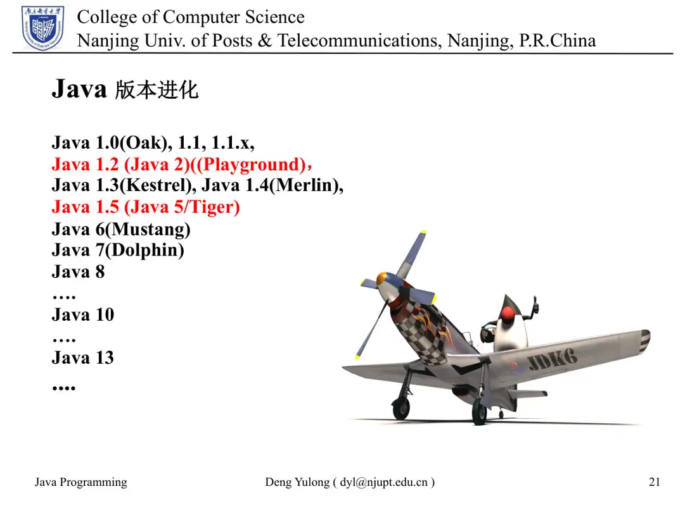

原文：

Java 版本进化

Java 1.0(Oak), 1.1, 1.1.x,

Java 1.2 (Java 2)((Playground),

Java 1.3(Kestrel), Java 1.4(Merlin),

Java 1.5 (Java 5/Tiger)

Java 6(Mustang)

Java 7(Dolphin)

Java 8

Java 10

● ● ● ●

Java 13

●●●●

南京郵電大學
1942
Nanjing University of Posts and Telecommunications
www.njeng.com

College of Computer Science
Nanjing Univ. of Posts & Telecommunications, Nanjing, P.R.China

Java Programming

Deng Yulong ( dyl@njupt.edu.cn )

21

### 南京郵電大學

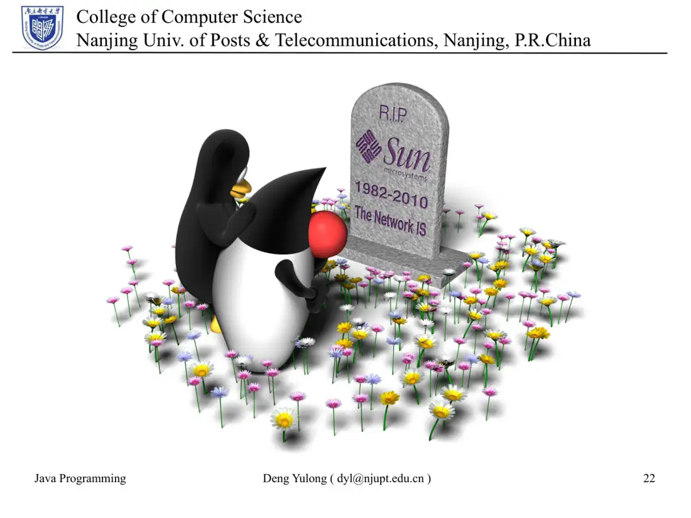

原文：

南京郵電大學
1942
Nanjing University of Posts and Telecommunications
www.njce.com

College of Computer Science
Nanjing Univ. of Posts & Telecommunications, Nanjing, P.R.China

Java Programming

Deng Yulong ( dyl@njupt.edu.cn )

22

### Java的基本原理和体系结构

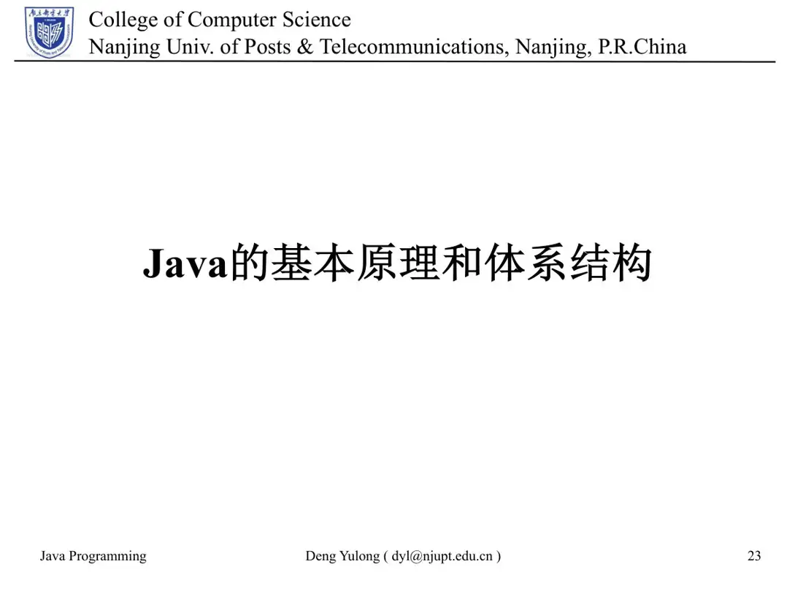

原文：

Java的基本原理和体系结构

南京郵電大學
1942
Nanjing University of Posts and Telecommunications
www.njce.com

College of Computer Science
Nanjing Univ. of Posts & Telecommunications, Nanjing, P.R.China

Java Programming

Deng Yulong ( dyl@njupt.edu.cn )

23

### 1.1.1 Java技术和Java语言

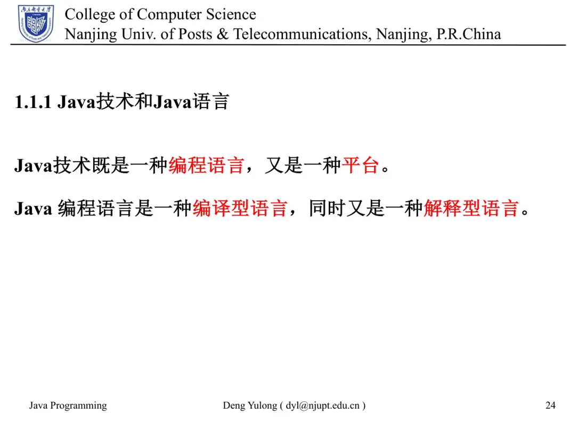

原文：

1.1.1 Java技术和Java语言

Java技术既是一种编程语言，又是一种平台。

Java 编程语言是一种编译型语言，同时又是一种解释型语言。

南京郵電大學
1942
Nanjing University of Posts and Telecommunications
www.njce.com

College of Computer Science
Nanjing Univ. of Posts & Telecommunications, Nanjing, P.R.China

Java Programming

Deng Yulong ( dyl@njupt.edu.cn )

24

### 用Java语言编写的程序首先被进行编译然后被解释执行。

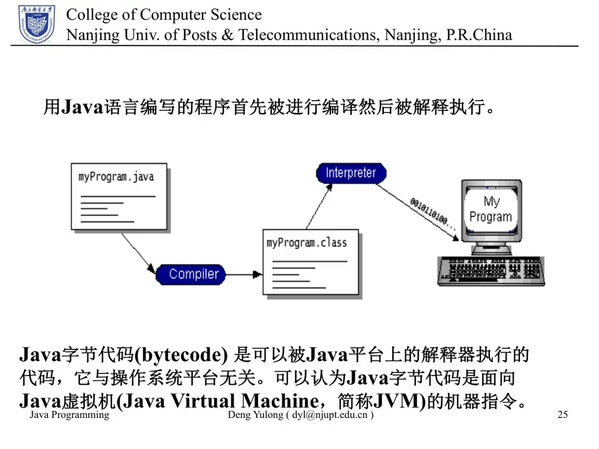

原文：

用Java语言编写的程序首先被进行编译然后被解释执行。

南京郵電大學
1942
Nanjing University of Posts and Telecommunications
www.njce.com

College of Computer Science
Nanjing Univ. of Posts & Telecommunications, Nanjing, P.R.China

25

### 南京郵電大學

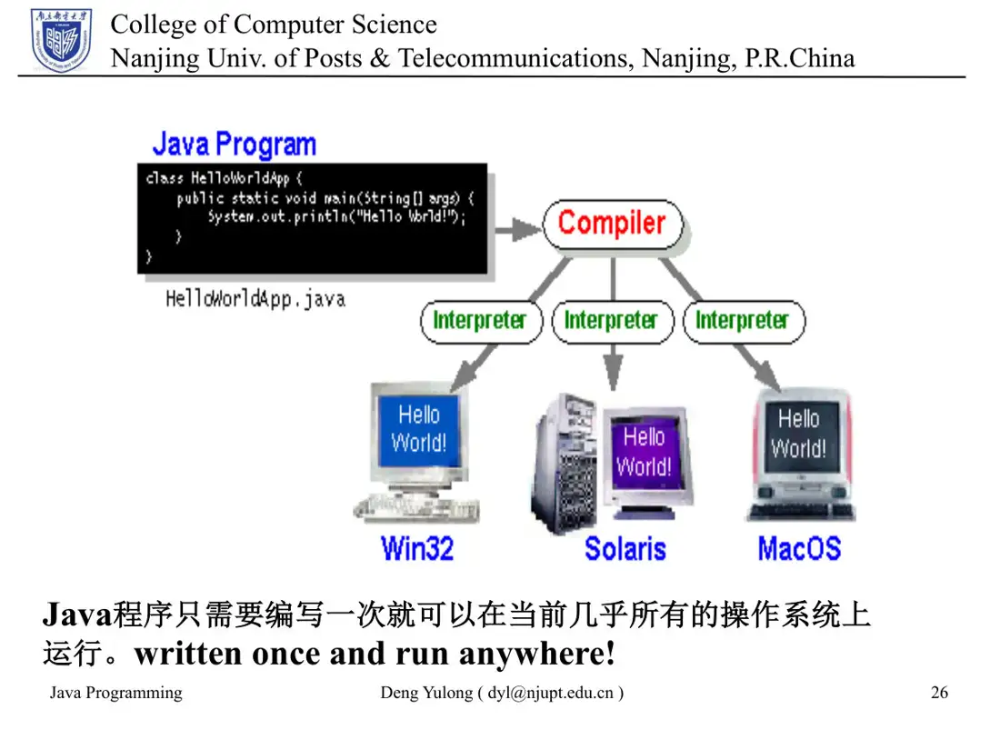

原文：

南京郵電大學
1942
Nanjing University of Posts and Telecommunications
www.njce.com

College of Computer Science
Nanjing Univ. of Posts & Telecommunications, Nanjing, P.R.China

Java Programming

Deng Yulong ( dyl@njupt.edu.cn )

26

### 1.1.2 Java 平台

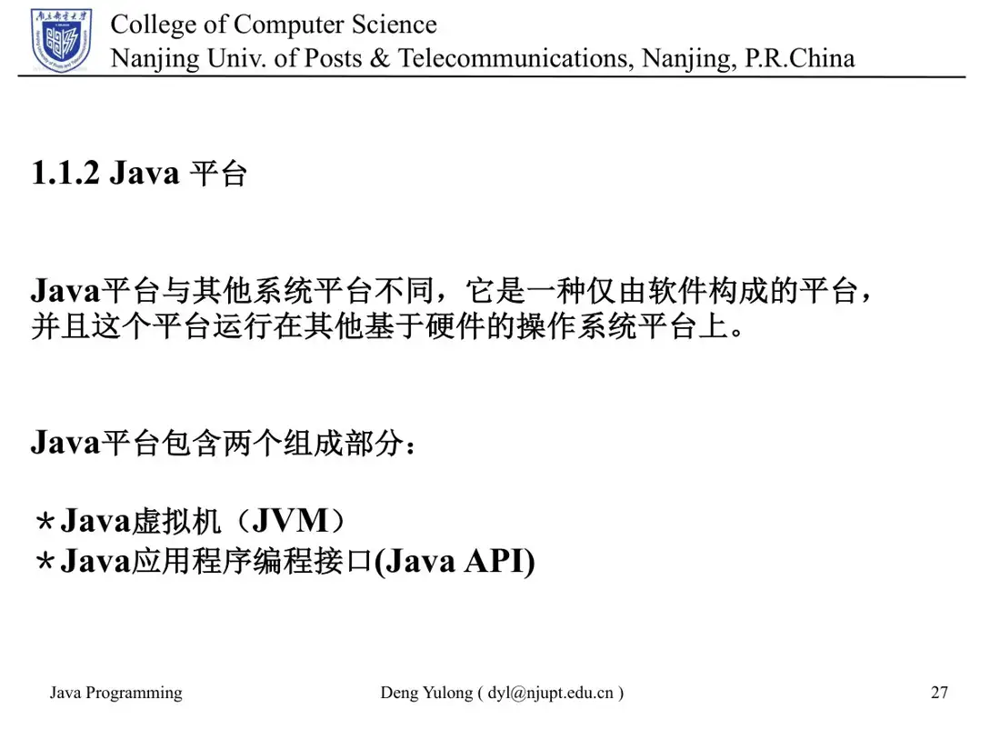

原文：

1.1.2 Java 平台

Java平台与其他系统平台不同，它是一种仅由软件构成的平台，并且这个平台运行在其他基于硬件的操作系统平台上。

Java平台包含两个组成部分:

\*Java虚拟机（JVM）

\*Java应用程序编程接口(Java API)

南京郵電大學
1942
Nanjing University of Posts and Telecommunications
www.njce.com

College of Computer Science
Nanjing Univ. of Posts & Telecommunications, Nanjing, P.R.China

Java Programming

Deng Yulong ( dyl@njupt.edu.cn )

27

### 在Java虚拟机规范中对Java虚拟机(JVM)的定义为:

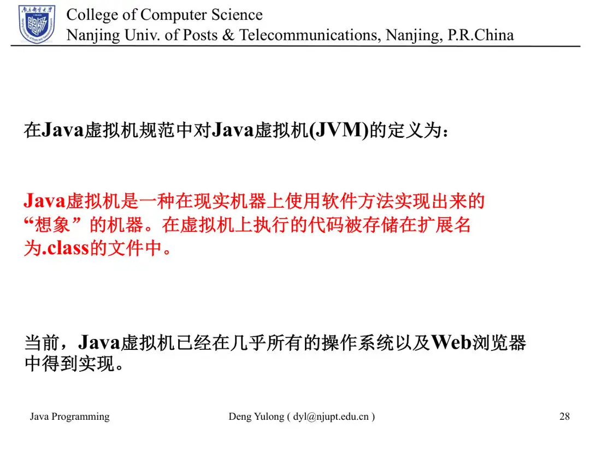

原文：

在Java虚拟机规范中对Java虚拟机(JVM)的定义为:

Java虚拟机是一种在现实机器上使用软件方法实现出来的“想象”的机器。在虚拟机上执行的代码被存储在扩展名为.class的文件中。

当前，Java虚拟机已经在几乎所有的操作系统以及Web浏览器中得到实现。

南京郵電大學
1942
Nanjing University of Posts and Telecommunications
www.njce.com

College of Computer Science
Nanjing Univ. of Posts & Telecommunications, Nanjing, P.R.China

Java Programming

Deng Yulong ( dyl@njupt.edu.cn )

28

### 南京郵電大學

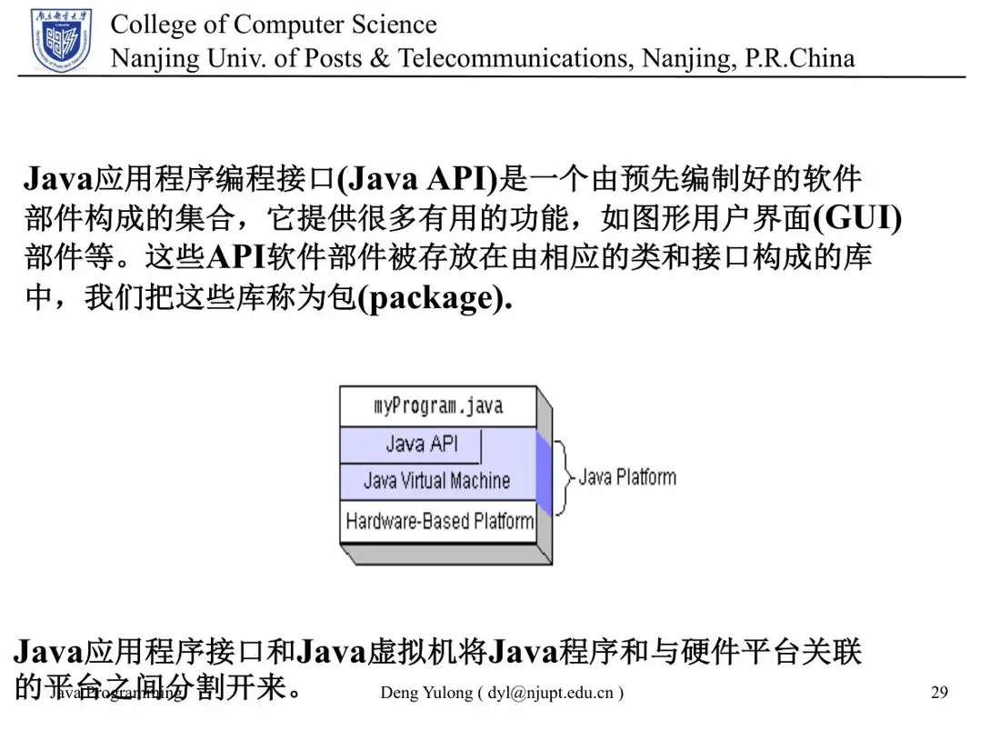

原文：

Java应用程序编程接口(Java API)是一个由预先编制好的软件部件构成的集合，它提供很多有用的功能，如图形用户界面(GUI)部件等。这些API软件部件被存放在由相应的类和接口构成的库中，我们把这些库称为包(package).

Java应用程序接口和Java虚拟机将Java程序和与硬件平台关联的平台之间分割开来。 Deng Yulong (dyl@njupt.edu.cn)

南京郵電大學
1942
Nanjing University of Posts and Telecommunications
www.njce.com

College of Computer Science
Nanjing Univ. of Posts & Telecommunications, Nanjing, P.R.China

29

### Java SDK 构成

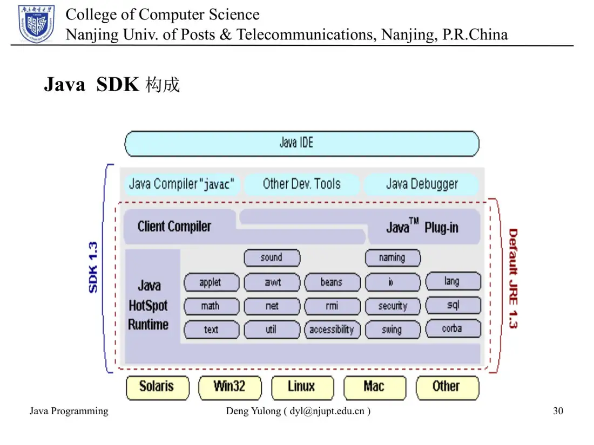

原文：

Java SDK 构成

南京郵電大學
1942
Nanjing University of Posts and Telecommunications
www.njce.com

College of Computer Science
Nanjing Univ. of Posts & Telecommunications, Nanjing, P.R.China

Java Programming

30

### Java的实际应用

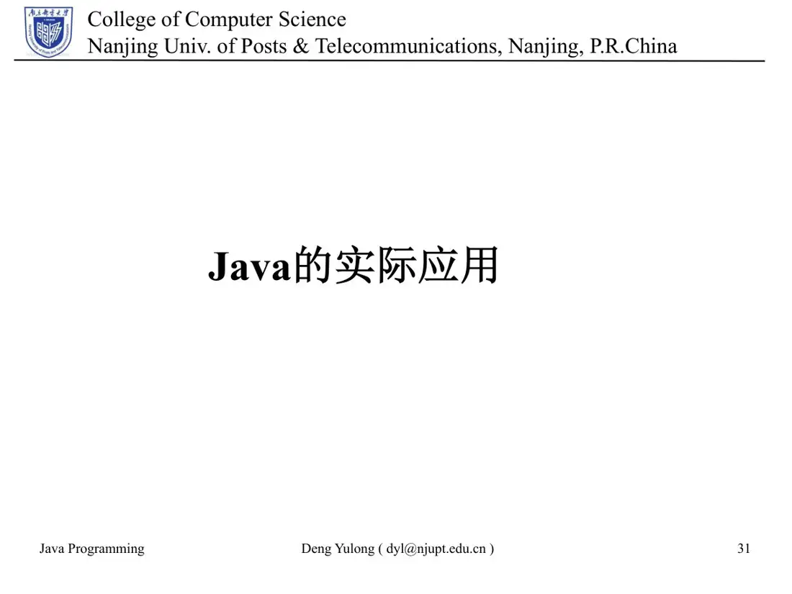

原文：

Java的实际应用

南京郵電大學
1942
Nanjing University of Posts and Telecommunications
www.njce.com

College of Computer Science
Nanjing Univ. of Posts & Telecommunications, Nanjing, P.R.China

Java Programming

Deng Yulong ( dyl@njupt.edu.cn )

31

### 南京郵電大學

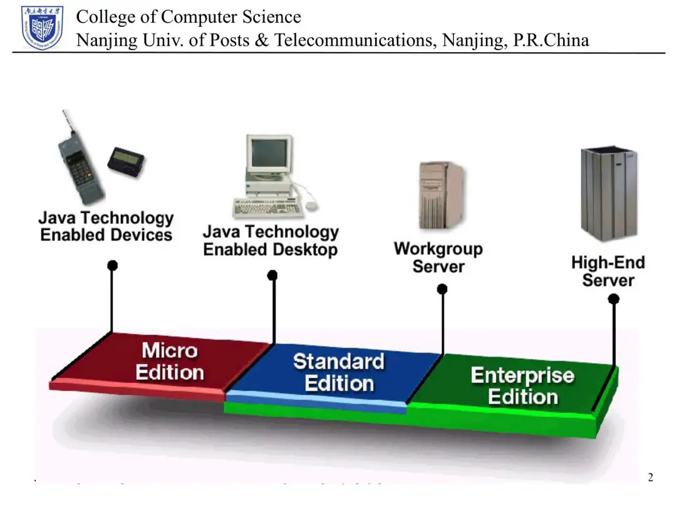

原文：

南京郵電大學
1942
Nanjing University of Posts and Telecommunications
www.njg.com

College of Computer Science
Nanjing Univ. of Posts & Telecommunications, Nanjing, P.R.China

2

### 1.1.3 Java技术可以做什么？

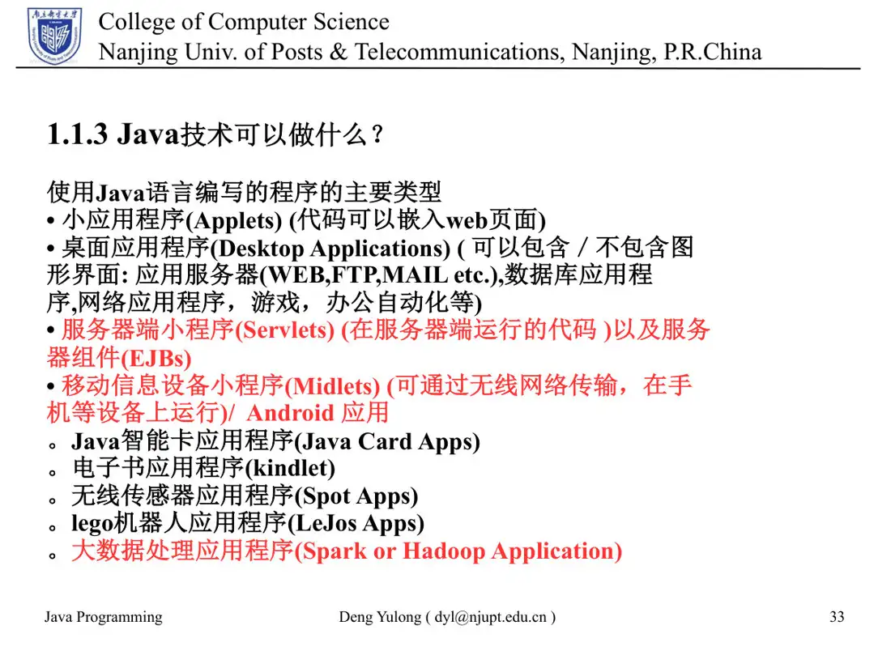

原文：

1.1.3 Java技术可以做什么？

使用Java语言编写的程序的主要类型

\- 小应用程序(Applets) (代码可以嵌入web页面)

\- 桌面应用程序(Desktop Applications) (可以包含 / 不包含图形界面: 应用服务器(WEB,FTP,MAIL etc.),数据库应用程序,网络应用程序,游戏,办公自动化等)

\- 服务器端小程序(Servlets) (在服务器端运行的代码)以及服务器组件(EJBs)

\- 移动信息设备小程序(Midlets) (可通过无线网络传输，在手机等设备上运行)/ Android 应用

。Java智能卡应用程序(Java Card Apps)

。电子书应用程序(kindlet)

。无线传感器应用程序(Spot Apps)

。lego机器人应用程序(LeJos Apps)

。大数据处理应用程序(Spark or Hadoop Application)

南京郵電大學
1942
Nanjing University of Posts and Telecommunications
www.njce.com

College of Computer Science
Nanjing Univ. of Posts & Telecommunications, Nanjing, P.R.China

Java Programming

Deng Yulong ( dyl@njupt.edu.cn )

33

### Java 桌面程序 (在桌面操作系统上运行上运行)

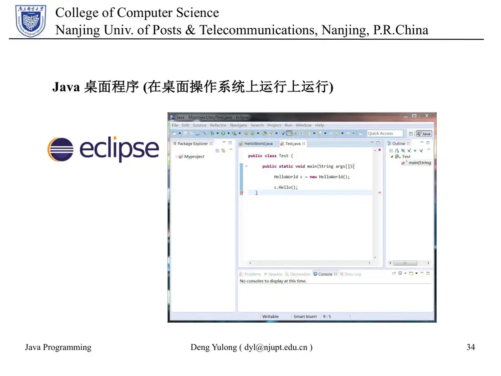

原文：

Java 桌面程序 (在桌面操作系统上运行上运行)

eclipse

南京郵電大學
1942
Nanjing University of Posts and Telecommunications
www.njg.com

College of Computer Science
Nanjing Univ. of Posts & Telecommunications, Nanjing, P.R.China

Java Programming

Deng Yulong ( dyl@njupt.edu.cn )

34

### Java 小应用程序Applets (在web 浏览器上运行)

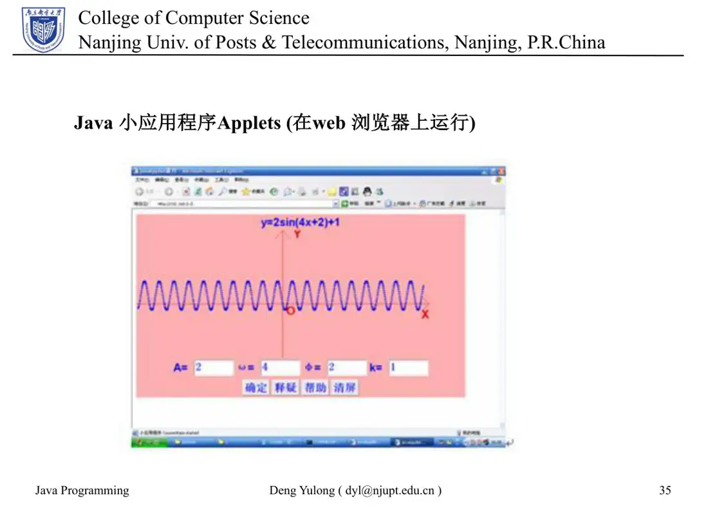

原文：

Java 小应用程序Applets (在web 浏览器上运行)

南京郵電大學
1942
Nanjing University of Posts and Telecommunications
www.njg.com

College of Computer Science
Nanjing Univ. of Posts & Telecommunications, Nanjing, P.R.China

Java Programming

Deng Yulong ( dyl@njupt.edu.cn )

35

### 南京郵電大學

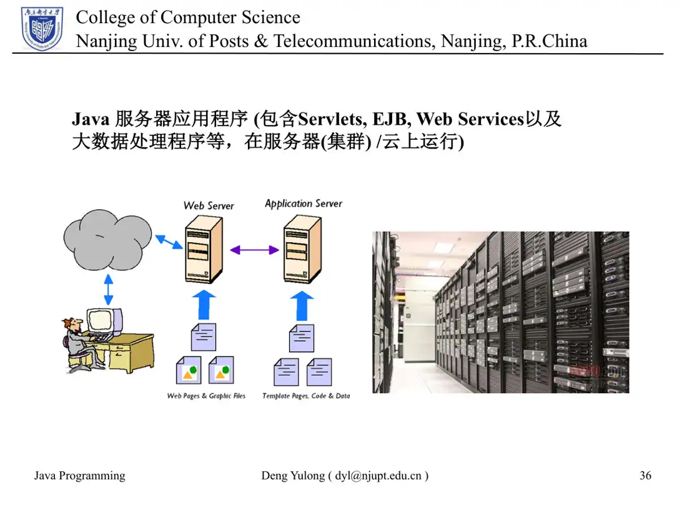

原文：

Java 服务器应用程序 (包含Servlets, EJB, Web Services以及大数据处理程序等，在服务器(集群)/云上运行)

南京郵電大學
1942
Nanjing University of Posts and Telecommunications
www.njg.com

College of Computer Science
Nanjing Univ. of Posts & Telecommunications, Nanjing, P.R.China

Java Programming

Deng Yulong ( dyl@njupt.edu.cn )

36

### Java Apks (在Android手机/平板电脑 / 穿戴设备上运行)

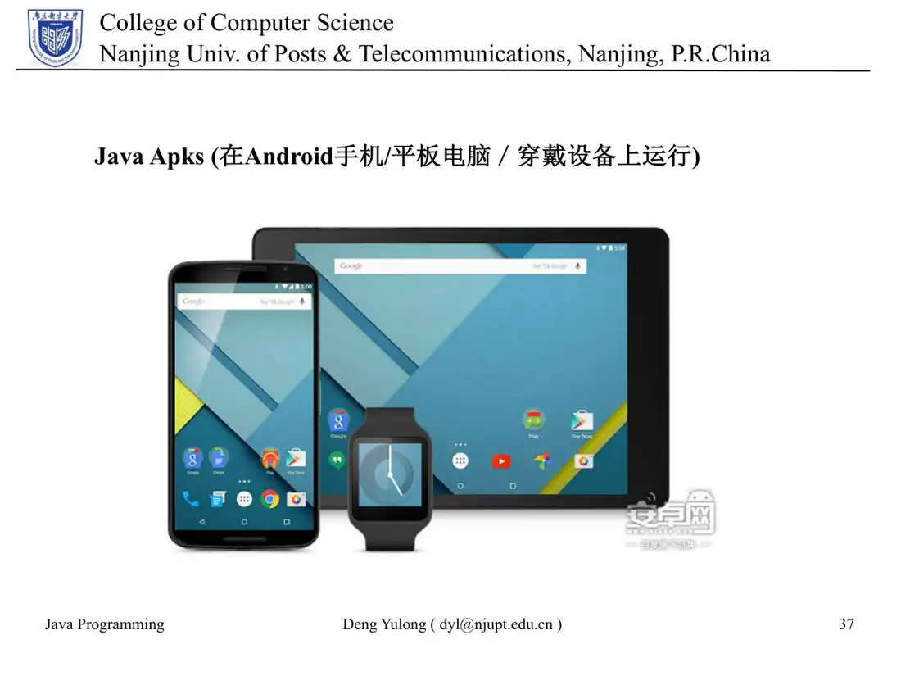

原文：

Java Apks (在Android手机/平板电脑 / 穿戴设备上运行)

南京郵電大學
1942
Nanjing University of Posts and Telecommunications
www.njg.com

College of Computer Science
Nanjing Univ. of Posts & Telecommunications, Nanjing, P.R.China

Java Programming

Deng Yulong ( dyl@njupt.edu.cn )

37

### Java Midlets (在手机上运行)

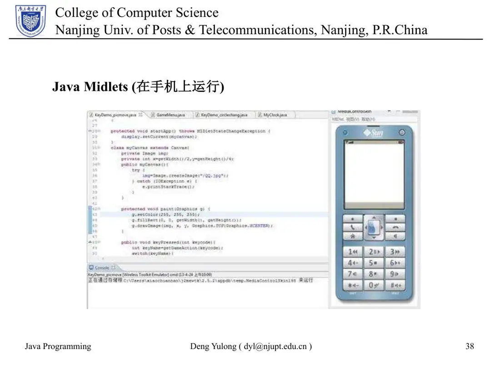

原文：

Java Midlets (在手机上运行)

南京郵電大學
1942
Nanjing University of Posts and Telecommunications
www.njg.com

College of Computer Science
Nanjing Univ. of Posts & Telecommunications, Nanjing, P.R.China

Java Programming

Deng Yulong ( dyl@njupt.edu.cn )

38

### Java kindlets (在kindle电子书上运行)

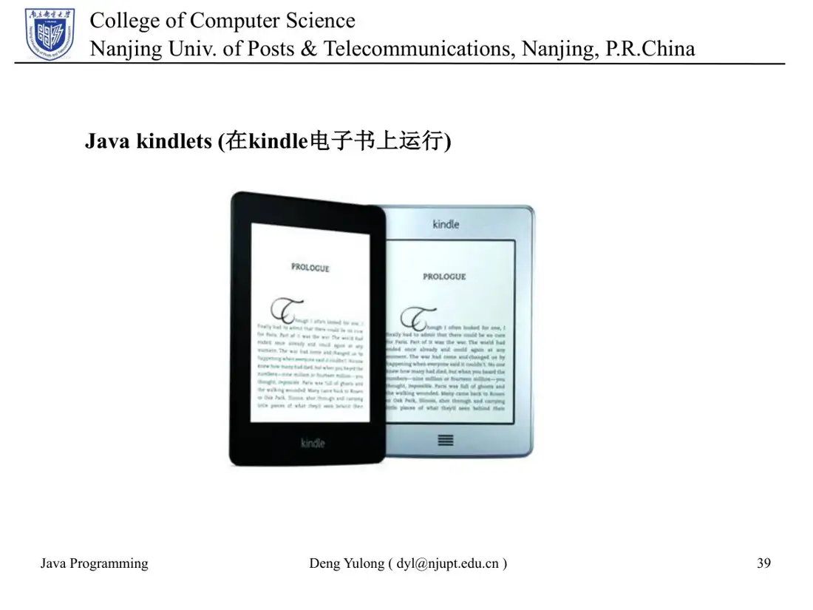

原文：

Java kindlets (在kindle电子书上运行)

南京郵電大學
1942
Nanjing University of Posts and Telecommunications
www.njg.com

College of Computer Science
Nanjing Univ. of Posts & Telecommunications, Nanjing, P.R.China

Java Programming

Deng Yulong ( dyl@njupt.edu.cn )

39

### Java Midlets (在嵌入式平台上运行)

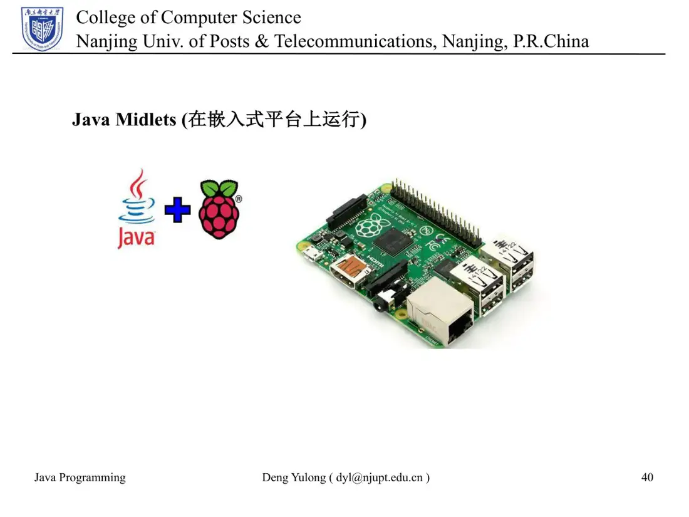

原文：

Java Midlets (在嵌入式平台上运行)

南京邮电大学
1942
Nanjing University of Posts and Telecommunications
www.njce.com

College of Computer Science
Nanjing Univ. of Posts & Telecommunications, Nanjing, P.R.China

Java Programming

Deng Yulong ( dyl@njupt.edu.cn )

40

### Java智能卡程序Cardlets

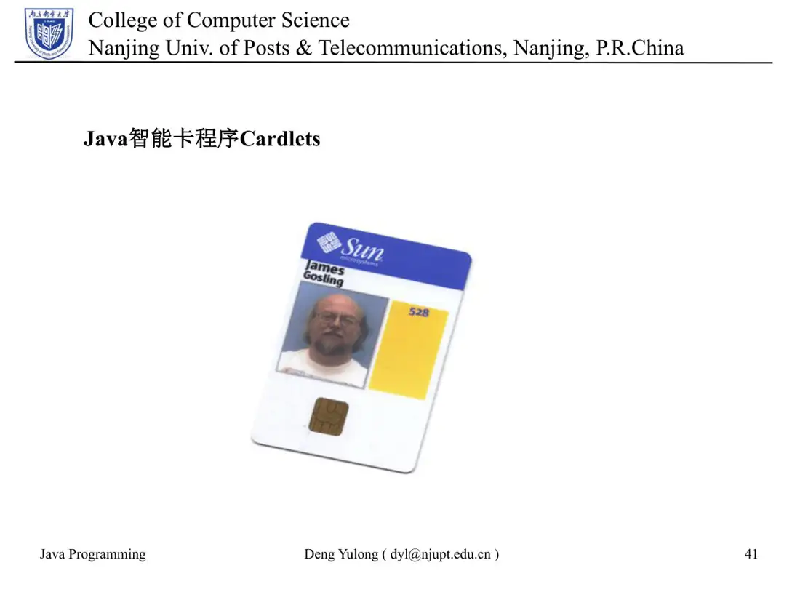

原文：

Java智能卡程序Cardlets

南京郵電大學
1942
Nanjing University of Posts and Telecommunications
www.njg.com

College of Computer Science
Nanjing Univ. of Posts & Telecommunications, Nanjing, P.R.China

Java Programming

Deng Yulong ( dyl@njupt.edu.cn )

41

### 无线传感器应用程序(Spot Apps)

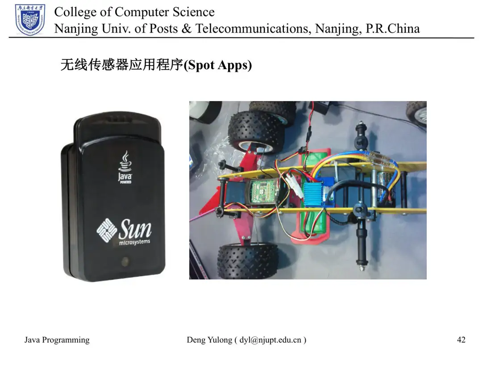

原文：

无线传感器应用程序(Spot Apps)

南京郵電大學
1942
Nanjing University of Posts and Telecommunications
www.njeng.com

College of Computer Science
Nanjing Univ. of Posts & Telecommunications, Nanjing, P.R.China

Java Programming

Deng Yulong ( dyl@njupt.edu.cn )

42

### lego机器人应用程序(LeJos Apps)

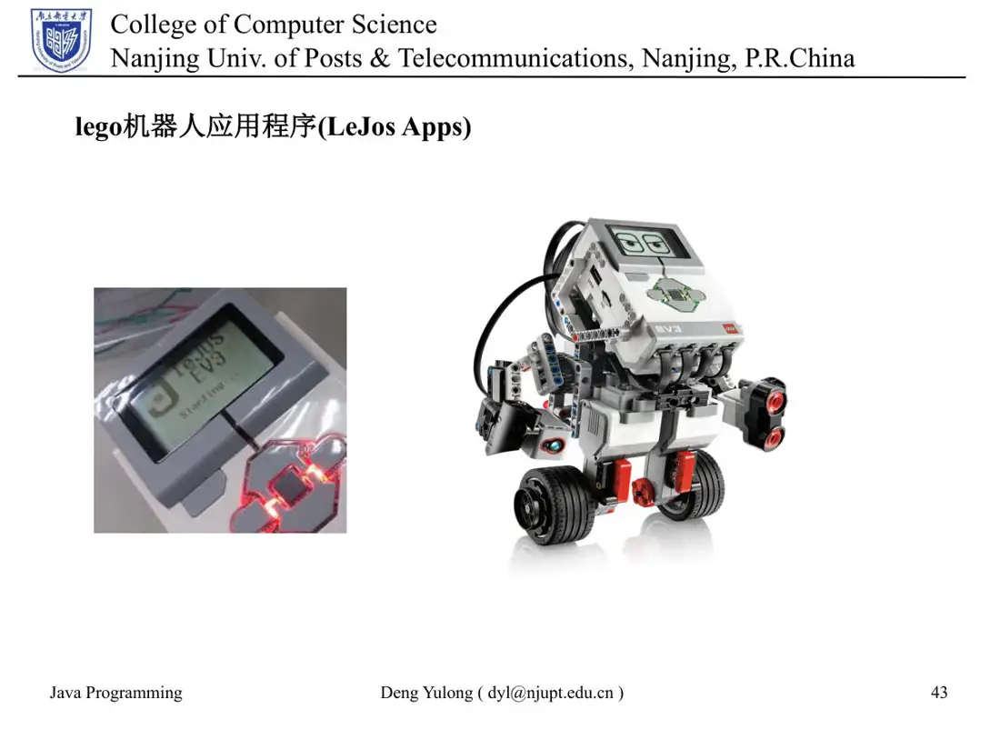

原文：

lego机器人应用程序(LeJos Apps)

南京郵電大學
1942
Nanjing University of Posts and Telecommunications
www.njeng.com

College of Computer Science
Nanjing Univ. of Posts & Telecommunications, Nanjing, P.R.China

Java Programming

Deng Yulong ( dyl@njupt.edu.cn )

43

### 1.2 Java程序开发环境和helloworld程序举例

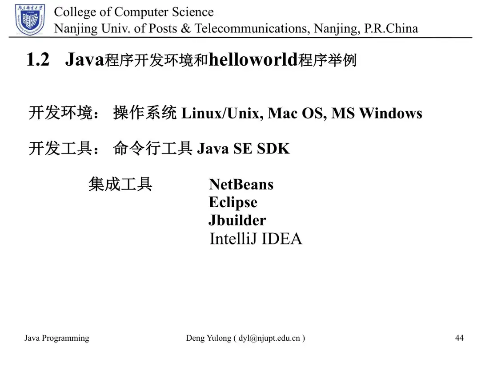

原文：

1.2 Java程序开发环境和helloworld程序举例

开发环境：操作系统 Linux/Unix, Mac OS, MS Windows

开发工具：命令行工具 Java SE SDK

集成工具 NetBeans

Eclipse

Jbuilder

IntelliJ IDEA

南京郵電大學
1842
Nanjing University of Posts and Telecommunications
www.njeng.com

College of Computer Science
Nanjing Univ. of Posts & Telecommunications, Nanjing, P.R.China

44

Java Programming

Deng Yulong ( dyl@njupt.edu.cn )

### 第一个Java程序 Hello World!

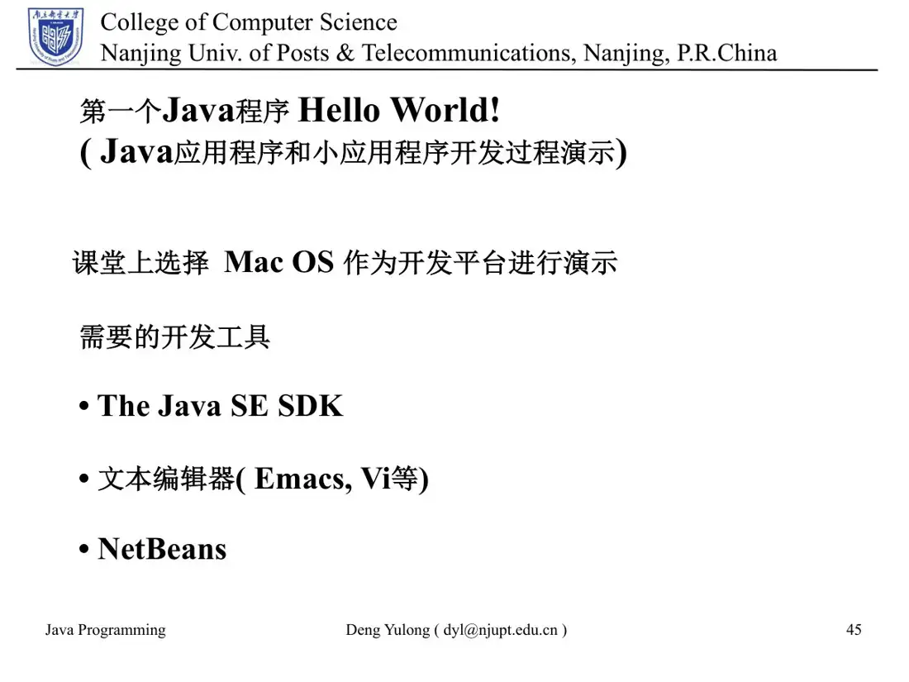

原文：

第一个Java程序 Hello World!

( Java应用程序和小应用程序开发过程演示)

课堂上选择 Mac OS 作为开发平台进行演示

需要的开发工具

• The Java SE SDK

\- 文本编辑器(Emacs, Vi等)

\- NetBeans

南京郵電大學
1942
Nanjing University of Posts and Telecommunications
www.njce.com

College of Computer Science
Nanjing Univ. of Posts & Telecommunications, Nanjing, P.R.China

Java Programming

Deng Yulong ( dyl@njupt.edu.cn )

45

### \- 创建源程序文件 (\*.java)

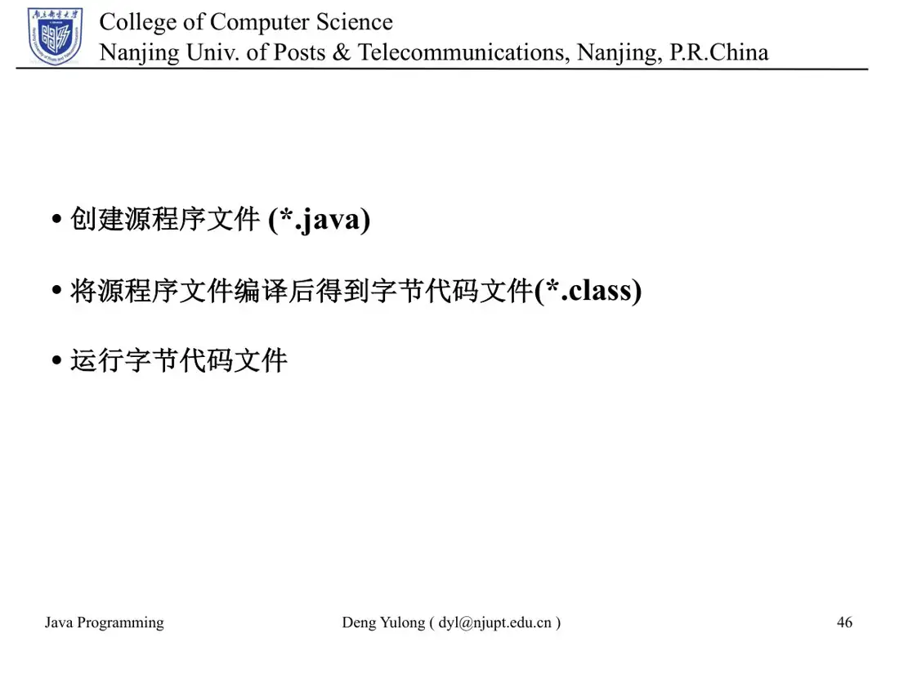

原文：

\- 创建源程序文件 (\*.java)

\- 将源程序文件编译后得到字节代码文件(\*.class)

\- 运行字节代码文件

南京郵電大學
1942
Nanjing University of Posts and Telecommunications
www.njeng.com

College of Computer Science
Nanjing Univ. of Posts & Telecommunications, Nanjing, P.R.China

Java Programming

Deng Yulong ( dyl@njupt.edu.cn )

46

### 南京郵電大學

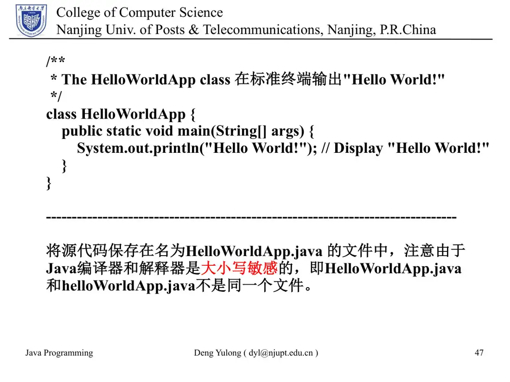

原文：

将源代码保存在名为HelloWorldApp.java的文件中，注意由于Java编译器和解释器是大小写敏感的，即HelloWorldApp.java和helloWorldApp.java不是同一个文件。

南京郵電大學
1942
Nanjing University of Posts and Telecommunications
www.njce.com

College of Computer Science
Nanjing Univ. of Posts & Telecommunications, Nanjing, P.R.China

Java Programming

Deng Yulong ( dyl@njupt.edu.cn )

47

### 使用命令行工具 javac 编译源代码得到字节代码文件

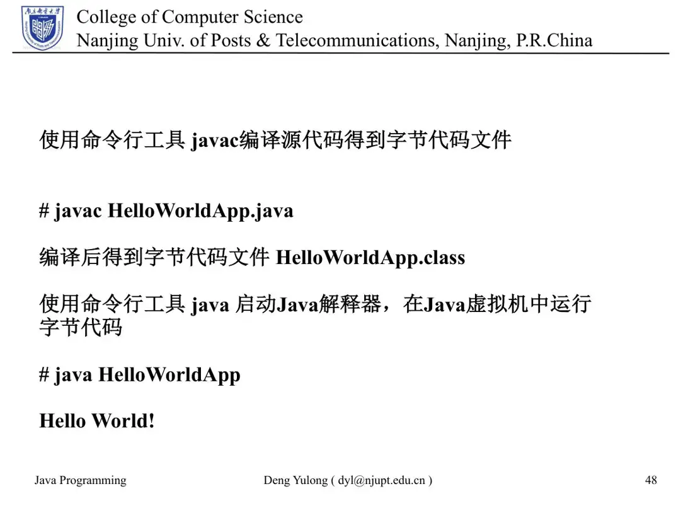

原文：

使用命令行工具 javac 编译源代码得到字节代码文件

# javac HelloWorldApp.java

编译后得到字节代码文件 HelloWorldApp.class

使用命令行工具 java 启动Java解释器，在Java虚拟机中运行字节代码

\# java HelloWorldApp

Hello World!

南京郵電大學
1942
Nanjing University of Posts and Telecommunications
www.njce.com

College of Computer Science
Nanjing Univ. of Posts & Telecommunications, Nanjing, P.R.China

Java Programming

Deng Yulong ( dyl@njupt.edu.cn )

48

### 1.3 对 HelloWorld 程序进行分析

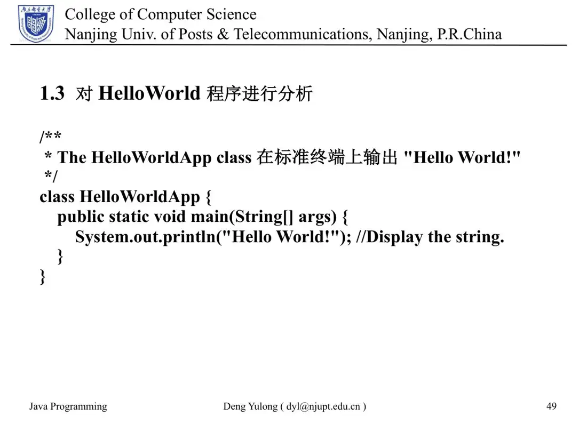

原文：

1.3 对 HelloWorld 程序进行分析

南京郵電大學
1942
Nanjing University of Posts and Telecommunications
www.njce.com

College of Computer Science
Nanjing Univ. of Posts & Telecommunications, Nanjing, P.R.China

Java Programming

Deng Yulong ( dyl@njupt.edu.cn )

49

### \- 注释

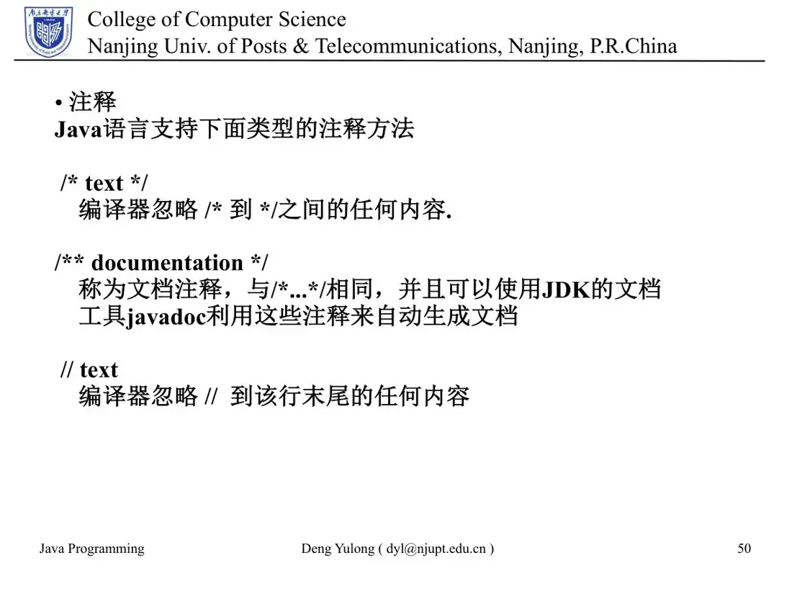

原文：

\- 注释
Java语言支持下面类型的注释方法

/\* text \*/
编译器忽略 /\* 到 \*/之间的任何内容.

/\*\* documentation \*/
称为文档注释，与/\*...\*/相同，并且可以使用JDK的文档工具javadoc利用这些注释来自动生成文档

// text
编译器忽略 // 到该行末尾的任何内容

南京郵電大學
1942
Nanjing University of Posts and Telecommunications
www.njce.com

College of Computer Science
Nanjing Univ. of Posts & Telecommunications, Nanjing, P.R.China

Java Programming

Deng Yulong ( dyl@njupt.edu.cn )

50

### - 定义类

原文：

- 定义类

Java语言中的方法(method)和变量(variable)都存在于类(class)或对象(object)(对象是类的实例)中。任何Java程序的框架结构都是类的定义。

最简单的类的定义形式为

在 HelloWorldApp.java ,应用程序没有使用变量，只含有一个 main 方法。

南京郵電大學
1942
Nanjing University of Posts and Telecommunications
www.njce.com

College of Computer Science
Nanjing Univ. of Posts & Telecommunications, Nanjing, P.R.China

Java Programming

Deng Yulong ( dyl@njupt.edu.cn )

51

### - main 方法

原文：

- main 方法

main方法是java应用程序的入口，由解释器进行调用。每个Java应用程序都必须包含一个main方法

public static void main(String[] args) {}

main 方法必须包含3个修饰词public,static和void其中

public 表示main方法可以被任何一个对象调用

static表示main方法是一个类方法

void表示main方法没有返回值

String数组可以用于运行环境和应用程序间传递信息。

南京郵電大學
1942
Nanjing University of Posts and Telecommunications
www.njce.com

College of Computer Science
Nanjing Univ. of Posts & Telecommunications, Nanjing, P.R.China

Java Programming

Deng Yulong ( dyl@njupt.edu.cn )

52

### - 使用类和对象

原文：

- 使用类和对象

除了HelloWorldApp类以外，HelloWorldApp应用程序没有定义其他的类。但我们常常需要定义多个类以便实现复杂的功能，这一点将在后面的章节讨论

应用程序中使用Sytsem类来实现将文本字符串输出到标准终端窗口的功能

System.out.println("Hello World!");

\* System.out 是类变量引用，指向 PrintStream 对象

\* 类变量和实例变量

南京郵電大學
1942
Nanjing University of Posts and Telecommunications
www.njeng.com

College of Computer Science
Nanjing Univ. of Posts & Telecommunications, Nanjing, P.R.China

Java Programming

Deng Yulong ( dyl@njupt.edu.cn )

53
