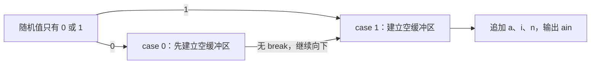

# 《Java程序设计》小测试题

原卷有八道选择题，每题有一个或多个正确答案。下文的“参考解答”是整理时补写的；原卷中的排版引号已换为代码引号，未替换选项的字符类型。

## 第 1 题：哪些声明能与已有方法共存？

在已定义 `public void amethod(int i) { }` 的类 `A` 中插入哪几个方法？

| 选项 | 候选声明 | 能否插入 |
| --- | --- | --- |
| A | `public int amethod(int z) { }` | 否；与原方法签名相同，且非 `void` 方法体未返回值 |
| B | `public int amethod(int i, int j) { return 99; }` | 能；形参个数不同 |
| C | `protected void amethod(long l) { }` | 能；形参类型不同 |
| D | `private void anothermethod() { }` | 能；方法名不同，不属于同名重载 |

**参考解答：B、C、D。** 看见==同一类中已有同名方法==，先在纸上只保留方法名和有序的参数类型，再检查方法体。A 就算补上 `return 0;`，也仍与原方法同为 `amethod(int)`。只改返回值、访问级别或参数名，都不能解决签名冲突。

知识点：[方法的定义与重载](../../../topics/Java开发/方法的定义与重载.md)。

## 第 2 题：常量、进制和布尔值

四个候选语句：A. `boolean b = -1;`；B. `boolean b2 = false;`；C. `int i = 019;`；D. `char c = 99;`。

**参考解答：B、D。** A 给布尔变量赋了整数，Java 不把整数当作布尔值。C 中前导 `0` 指定八进制，数字 `9` 在该进制中无效，问题出在字面量本身，不在赋值。D 的 `99` 是值可由 `char` 表示的编译时整数常量，赋值时允许缩窄，得到字符 `'c'`。把右边换成普通变量，`int n = 99; char c = n;` 就无法通过编译；变量当时碰巧为 99，不会让这个表达式变成编译时常量。

知识点：[基本数据类型](../../../topics/Java开发/基本数据类型.md)、[数据类型转换](../../../topics/Java开发/数据类型转换.md)。

## 第 3 题：同一个加号的两种语义

四个候选语句：A. `System.out.println(1 + 1);`；B. `int i = 2 + '2';`；C. `String s = "on" + 'one';`；D. `int z = 025;`。

**参考解答：A、B、D。** A 打印 `2`。B 没有字符串操作数，字符 `'2'` 以其数值 50 参与整型加法，得到 `52`，不是 `4` 或 `"22"`。C 的 `'one'` 不是合法的字符字面量，编译无法走到字符串拼接；改成 `"on" + "one"` 才能得到 `"onone"`。D 的 `025` 是合法八进制，数值为 $2 \times 8 + 5 = 21$。

知识点：[基本数据类型](../../../topics/Java开发/基本数据类型.md)、[数据类型转换](../../../topics/Java开发/数据类型转换.md)。

## 第 4 题：真假不是数值

设 `result` 是布尔变量，判断以下写法：A. `result = true;`；B. `if (result) { … }`；C. `if (result != 0) { … }`；D. `result = 1;`。

**参考解答：A、B。** A 是合法的赋值语句；B 直接以布尔值作为条件。C 把布尔值和整数作不等比较，D 把整数直接赋给布尔变量，都不成立。若实际变量是整数 `n`，`n != 0` 可以生成布尔值，但不能据此把既有的布尔值再与零比较。

知识点：[基本数据类型](../../../topics/Java开发/基本数据类型.md)、[流程控制语句](../../../topics/Java开发/流程控制语句.md)。

## 第 5 题：进入哪一处，执行到哪里？

下面代码中，哪个 `m` 值只产生一行 `Default`？A. 0；B. 1；C. 2；D. 3。

```java
switch (m) {
    case 0: System.out.println("Case 0");
    case 1:
    default: System.out.println("Default");
}
```

**参考解答：B、C、D。**

| `m` | 进入位置 | 实际输出 |
| --- | --- | --- |
| 0 | `case 0` | 先 `Case 0`，再 `Default` |
| 1 | `case 1` | `Default` |
| 2 或 3 | `default` | `Default` |

**订正：** 原卷第一页末尾有 `case 1:`，第二页开头紧接 `default:`。旧转录漏了前一个标签，选项结果恰好没变，但 `m = 1` 是先命中 `case 1`、再进入共享语句，不是匹配失败后进入默认分支。

> [!TIP]
> 看到==冒号式标签且未见 break==，先找进入位置，再从那个位置向下追踪控制流。不能在每个标签处重新判断 `m`。

知识点：[流程控制语句](../../../topics/Java开发/流程控制语句.md)。

## 第 6 题：方法声明头的构造

找出下列不合法的方法声明头：A. `public protected amethod(int i)`；B. `public void amethod(int i)`；C. `public void amthod(void)`；D. `void public amethod(int i)`。

**参考解答：A、C、D。** 本题比较的是声明头，可先给各候选补上方法体再检查语法。A 的两个访问修饰符互斥，而且缺少返回类型；C 把 `void` 写入参数列表，无参数应写 `()`，方法名 `amthod` 的拼写不是错误原因；D 把修饰符放在了返回类型之后。B 补上 `{ }` 即可构成完整实现。

知识点：[方法的定义与重载](../../../topics/Java开发/方法的定义与重载.md)。

## 第 7 题：容量不是内容

原卷程序如下。A. 随机输出 `Pain` 或 `Gain`；B. 总输出 `Gain`；C. 总输出 `Pain`；D. 以上都不正确。

```java
public class PainOrGain {
    private static Random rnd = new Random();
    public static void main(String[] args) {
        StringBuffer word = null;
        switch (rnd.nextInt(2)) {
            case 0: word = new StringBuffer('P');
            case 1: word = new StringBuffer('G');
        }
        word.append('a');
        word.append('i');
        word.append('n');
        System.out.println(word);
    }
}
```

**参考解答：D。** 原卷若作为独立源文件直接编译，缺少 `import java.util.Random;`；补上导入后，真正的输出恒为小写的 `ain`。先不要猜两个首字母：`nextInt(2)` 只有 0 或 1。进入 `case 0` 后会继续执行 `case 1`，而直接进入 `case 1` 也得到同一个末次赋值。更关键的是，`StringBuffer` 无单个 `char` 参数的构造器，`'G'` 扩宽为 `int` 71，调用的是容量构造器，所以此时字符序列长度为 0，容量才是 71。



> [!WARNING]
> `new StringBuffer('G')` 与 `new StringBuffer("G")` 不是同一种初始化：前者初始长度是 0，后者为 1。把题目中的单引号改成双引号只会修正初值；若不阻止从 0 贯穿至 1，两条路径仍都会以 `G` 开头。

**原卷辨异：** 配套答案稿的第 7 题印的是 `case 1:`、`case 2:`，不是这里的 `case 0:`、`case 1:`；补上导入后，答案稿版本抽到 0 时没有匹配标签，首次 `append` 会触发空指针异常，抽到 1 时则贯穿至 `case 2` 后打印 `ain`。两份的选项都是 D，不能反过来把答案稿的路径套给原卷。配套稿也交换了原卷第 2、3 题的顺序。

知识点：[流程控制语句](../../../topics/Java开发/流程控制语句.md)、[方法的定义与重载](../../../topics/Java开发/方法的定义与重载.md)、[数据类型转换](../../../topics/Java开发/数据类型转换.md)。

## 第 8 题：编译器允许从哪里读取变量？

```java
class B {
    public static void main(String args[]) {
        int p;
        int j = 10;
        j = p;
    }
}
```

A. 编译时出现一处错误；B. 编译时出现两处错误；C. 运行时出错；D. 编译运行均无误。

**参考解答：A。** `int p;` 本身是合法声明，读 `p` 的 `j = p;` 才出错。定位时找==右侧变量读之前的赋值路径==：它是方法局部变量，不能借用字段的默认值规则；把它移为类的 `static int p;` 字段，才会以 0 初始化。这里不是程序跑起来以后才发现没有值，编译器会先拒绝该读取。

知识点：[变量的作用域与初始化](../../../topics/Java开发/变量的作用域与初始化.md)、[Java 平台与 JVM](../../../topics/Java开发/Java平台与JVM.md)。
