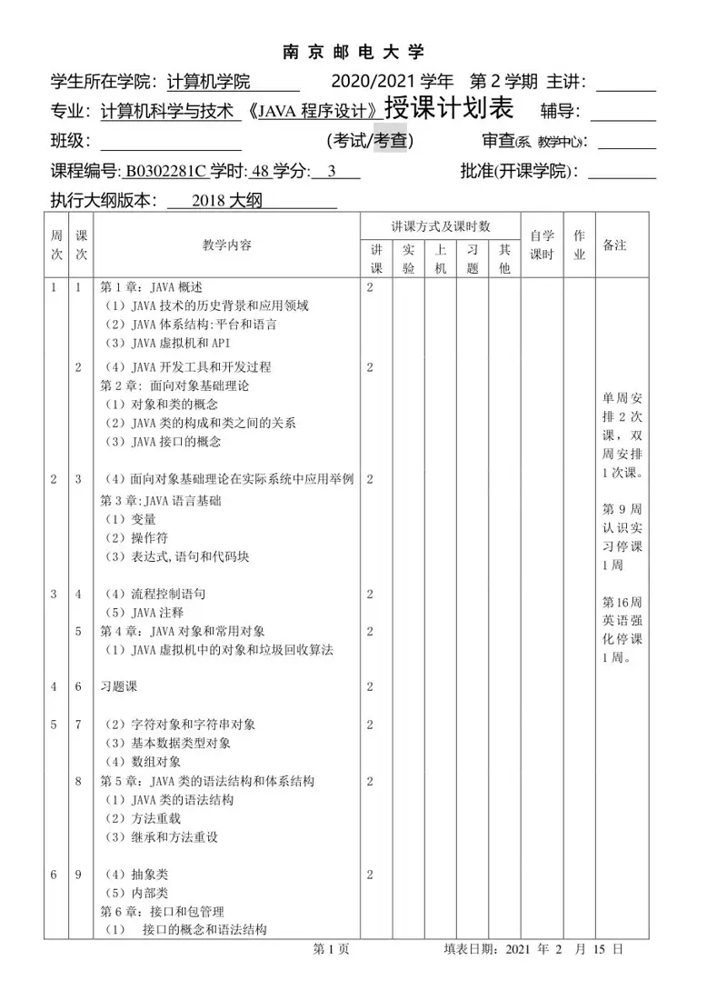
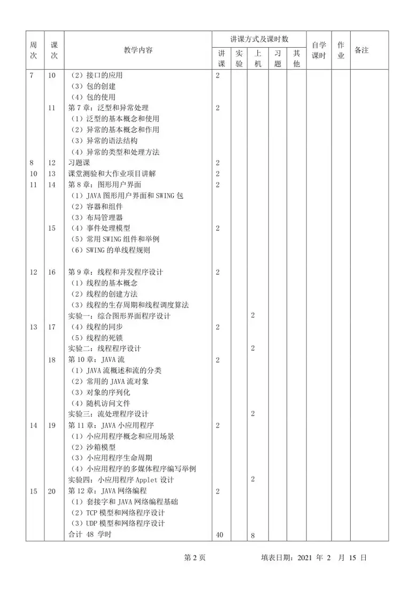
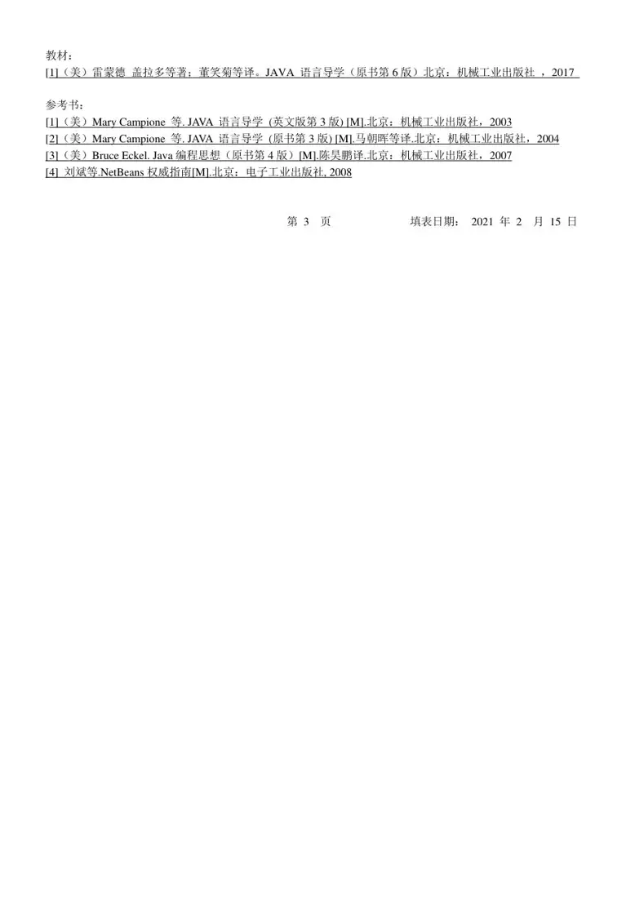

# 《Java程序设计》授课计划（2020-2021学年第二学期）

原件的每一页，下面附识别出的文字。

### 南 京 邮 电 大 学

原文：

南 京 邮 电 大 学

学生所在学院：计算机学院 2020/2021 学年 第 2 学期 主讲：

专业：计算机科学与技术 《JAVA 程序设计》授课计划表 辅导：

班级：

（考试/考查）

审查(系、教学中心)：

课程编号: B0302281C 学时: 48 学分: 3

批准(开课学院)：

执行大纲版本： 2018 大纲

<table><tr><td rowspan="2">周次</td><td rowspan="2">课次</td><td rowspan="2">教学内容</td><td colspan="5">讲课方式及课时数</td><td rowspan="2">自学课时</td><td rowspan="2">作业</td><td rowspan="2">备注</td></tr><tr><td>讲课</td><td>实验</td><td>上机</td><td>习题</td><td>其他</td></tr><tr><td rowspan="2">1</td><td>1</td><td>第1章:JAVA概述(1)JAVA技术的历史背景和应用领域(2)JAVA体系结构:平台和语言(3)JAVA虚拟机和API</td><td>2</td><td></td><td></td><td></td><td></td><td></td><td></td><td rowspan="9">单周安排2次课,双周安排1次课。第9周认识实习停课1周第16周英语强化停课1周。</td></tr><tr><td>2</td><td>(4)JAVA开发工具和开发过程第2章:面向对象基础理论(1)对象和类的概念(2)JAVA类的构成和类之间的关系(3)JAVA接口的概念</td><td>2</td><td></td><td></td><td></td><td></td><td></td><td></td></tr><tr><td>2</td><td>3</td><td>(4)面向对象基础理论在实际系统中应用举例第3章:JAVA语言基础(1)变量(2)操作符(3)表达式,语句和代码块</td><td>2</td><td></td><td></td><td></td><td></td><td></td><td></td></tr><tr><td rowspan="2">3</td><td>4</td><td>(4)流程控制语句(5)JAVA注释</td><td>2</td><td></td><td></td><td></td><td></td><td></td><td></td></tr><tr><td>5</td><td>第4章:JAVA对象和常用对象(1)JAVA虚拟机中的对象和垃圾回收算法</td><td>2</td><td></td><td></td><td></td><td></td><td></td><td></td></tr><tr><td>4</td><td>6</td><td>习题课</td><td>2</td><td></td><td></td><td></td><td></td><td></td><td></td></tr><tr><td rowspan="2">5</td><td>7</td><td>(2)字符对象和字符串对象(3)基本数据类型对象(4)数组对象</td><td>2</td><td></td><td></td><td></td><td></td><td></td><td></td></tr><tr><td>8</td><td>第5章:JAVA类的语法结构和体系结构(1)JAVA类的语法结构(2)方法重载(3)继承和方法重设</td><td>2</td><td></td><td></td><td></td><td></td><td></td><td></td></tr><tr><td>6</td><td>9</td><td>(4)抽象类(5)内部类第6章:接口和包管理(1)接口的概念和语法结构</td><td>2</td><td></td><td></td><td></td><td></td><td></td><td></td></tr></table>

填表日期：2021 年 2 月 15 日

第 1 页

### 填表日期：2021 年 2 月 15 日

原文：

<table><tr><td rowspan="2">周次</td><td rowspan="2">课次</td><td rowspan="2">教学内容</td><td colspan="5">讲课方式及课时数</td><td rowspan="2">自学课时</td><td rowspan="2">作业</td><td rowspan="2">备注</td></tr><tr><td>讲课</td><td>实验</td><td>上机</td><td>习题</td><td>其他</td></tr><tr><td rowspan="2">7</td><td>10</td><td>(2)接口的应用(3)包的创建(4)包的使用</td><td>2</td><td></td><td></td><td></td><td></td><td></td><td></td><td></td></tr><tr><td>11</td><td>第7章:泛型和异常处理(1)泛型的基本概念和使用(2)异常的基本概念和作用(3)异常的语法结构(4)异常的类型和处理方法</td><td>2</td><td></td><td></td><td></td><td></td><td></td><td></td><td></td></tr><tr><td>8</td><td>12</td><td>习题课</td><td>2</td><td></td><td></td><td></td><td></td><td></td><td></td><td></td></tr><tr><td>10</td><td>13</td><td>课堂测验和大作业项目讲解</td><td>2</td><td></td><td></td><td></td><td></td><td></td><td></td><td></td></tr><tr><td>11</td><td>14</td><td>第8章:图形用户界面(1)JAVA图形用户界面和SWING包(2)容器和组件(3)布局管理器(4)事件处理模型(5)常用SWING组件和举例(6)SWING的单线程规则</td><td>2</td><td></td><td></td><td></td><td></td><td></td><td></td><td></td></tr><tr><td>12</td><td>16</td><td>第9章:线程和并发程序设计(1)线程的基本概念(2)线程的创建方法(3)线程的生存周期和线程调度算法实验一:综合图形界面程序设计</td><td>2</td><td></td><td></td><td></td><td></td><td></td><td></td><td></td></tr><tr><td rowspan="2">13</td><td>17</td><td>(4)线程的同步(5)线程的死锁实验二:线程程序设计</td><td>2</td><td></td><td>2</td><td></td><td></td><td></td><td></td><td></td></tr><tr><td>18</td><td>第10章:JAVA流(1)JAVA流概述和流的分类(2)常用的JAVA流对象(3)对象的序列化(4)随机访问文件实验三:流处理程序设计</td><td>2</td><td></td><td>2</td><td></td><td></td><td></td><td></td><td></td></tr><tr><td>14</td><td>19</td><td>第11章:JAVA小应用程序(1)小应用程序概念和应用场景(2)沙箱模型(3)小应用程序生命周期(4)小应用程序的多媒体程序编写举例实验四:小应用程序Applet设计</td><td>2</td><td></td><td>2</td><td></td><td></td><td></td><td></td><td></td></tr><tr><td rowspan="2">15</td><td rowspan="2">20</td><td rowspan="2">第12章:JAVA网络编程(1)套接字和JAVA网络编程基础(2)TCP模型和网络程序设计(3)UDP模型和网络程序设计合计48学时</td><td>2</td><td></td><td>2</td><td></td><td></td><td></td><td></td><td></td></tr><tr><td>40</td><td></td><td>8</td><td></td><td></td><td></td><td></td><td></td></tr></table>

填表日期：2021 年 2 月 15 日

第 2页

### 填表日期： 2021 年 2 月 15 日

原文：

填表日期： 2021 年 2 月 15 日

教材：

[1]（美）雷蒙德 盖拉多等著；董笑菊等译。JAVA 语言导学（原书第 6版）北京：机械工业出版社 ，2017

参考书：

[1]（美）Mary Campione 等. JAVA 语言导学 (英文版第 3 版) [M].北京：机械工业出版社，2003

[2]（美）Mary Campione 等. JAVA 语言导学 (原书第 3 版) [M].马朝晖等译.北京：机械工业出版社，2004

[3]（美）Bruce Eckel. Java 编程思想（原书第 4 版）[M].陈昊鹏译.北京：机械工业出版社，2007

[4] 刘斌等.NetBeans 权威指南[M].北京：电子工业出版社, 2008

第 3 页
