# 《Java程序设计》第2章 面向对象编程基础理论（课件）

原件的每一页，下面附识别出的文字。

### 第2章 面向对象编程基础理论

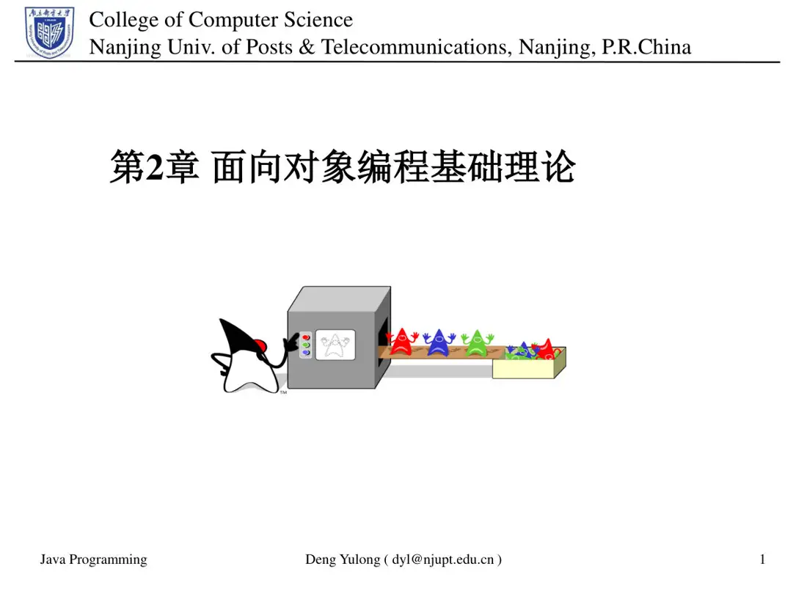

原文：

第2章 面向对象编程基础理论

南京郵電大學Nanjing Ut 圆

College of Computer Science Nanjing Univ. of Posts & Telecommunications, Nanjing, P.R.China

Java Programming

Deng Yulong ( dyl@njupt.edu.cn )

1

### 面向对象编程思想的诞生

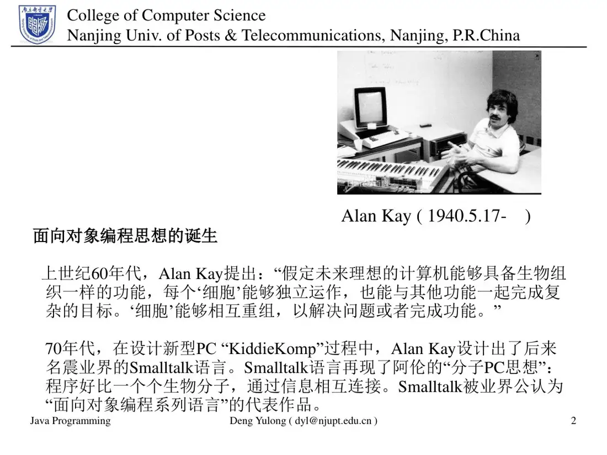

原文：

面向对象编程思想的诞生

上世纪60年代，Alan Kay提出：“假定未来理想的计算机能够具备生物组织一样的功能，每个‘细胞’能够独立运作，也能与其他功能一起完成复杂的目标。‘细胞’能够相互重组，以解决问题或者完成功能。 9

70年代，在设计新型PC “KiddieKomp”过程中，Alan Kay设计出了后来名震业界的Smalltalk语言。Smalltalk语言再现了阿伦的“分子PC思想”：程序好比一个个生物分子，通过信息相互连接。Smalltalk被业界公认为“面向对象编程系列语言”的代表作品。

南京郵電大學948y of Post

College of Computer Science Nanjing Univ. of Posts & Telecommunications, Nanjing, P.R.China

Java Programming

Deng Yulong ( dyl@njupt.edu.cn )

2

### 2.1 对象(Object)和类(Class)的概念

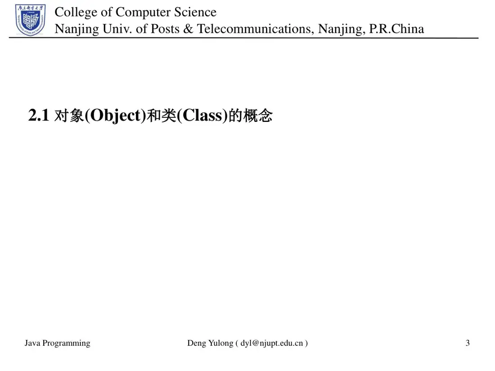

原文：

2.1 对象(Object)和类(Class)的概念

南京郵電大學Nanjing Unn

College of Computer Science Nanjing Univ. of Posts & Telecommunications, Nanjing, P.R.China

Java Programming

Deng Yulong ( dyl@njupt.edu.cn )

3

### N:问题域元素集合K:问题域元素关系集合

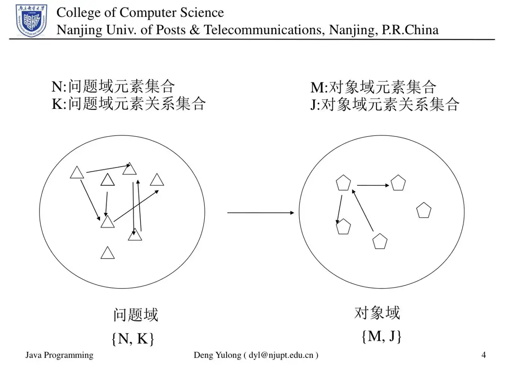

原文：

N:问题域元素集合K:问题域元素关系集合

M:对象域元素集合J:对象域元素关系集合

南京郵電大學Nanjing Ora 圆易 mmnncons

College of Computer Science Nanjing Univ. of Posts & Telecommunications, Nanjing, P.R.China

Java Programming

4

### 变量/字段： 用于存储状态方法： 用于定义行为

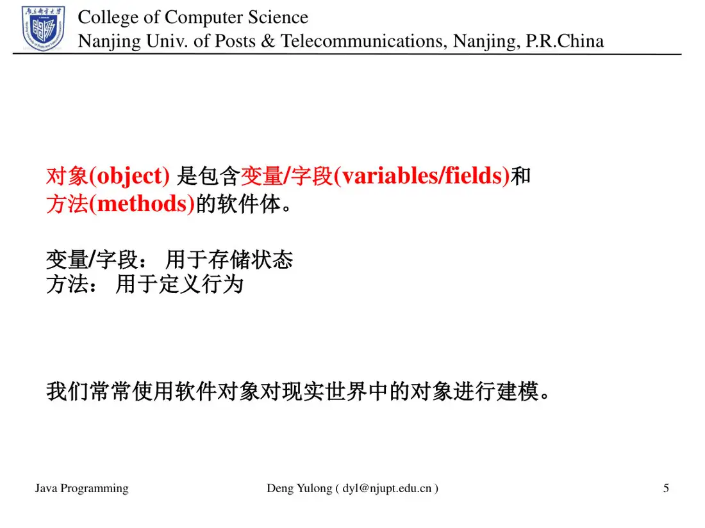

原文：

对象(object) 是包含变量/字段(variables/fields)和方法(methods)的软件体。

变量/字段： 用于存储状态方法： 用于定义行为

我们常常使用软件对象对现实世界中的对象进行建模。

南京都電大学

College of Computer Science Nanjing Univ. of Posts & Telecommunications, Nanjing, P.R.China

Java Programming

Deng Yulong ( dyl@njupt.edu.cn )

5

### 一个软件对象

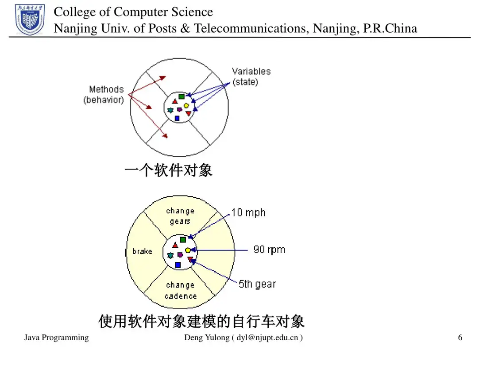

原文：

一个软件对象

南京郵電大學Nanjing Unn

College of Computer Science Nanjing Univ. of Posts & Telecommunications, Nanjing, P.R.China

Java Programming

Deng Yulong ( dyl@njupt.edu.cn )

6

### 自行车中(pedal cadence,gears etc.)变量是实例变量

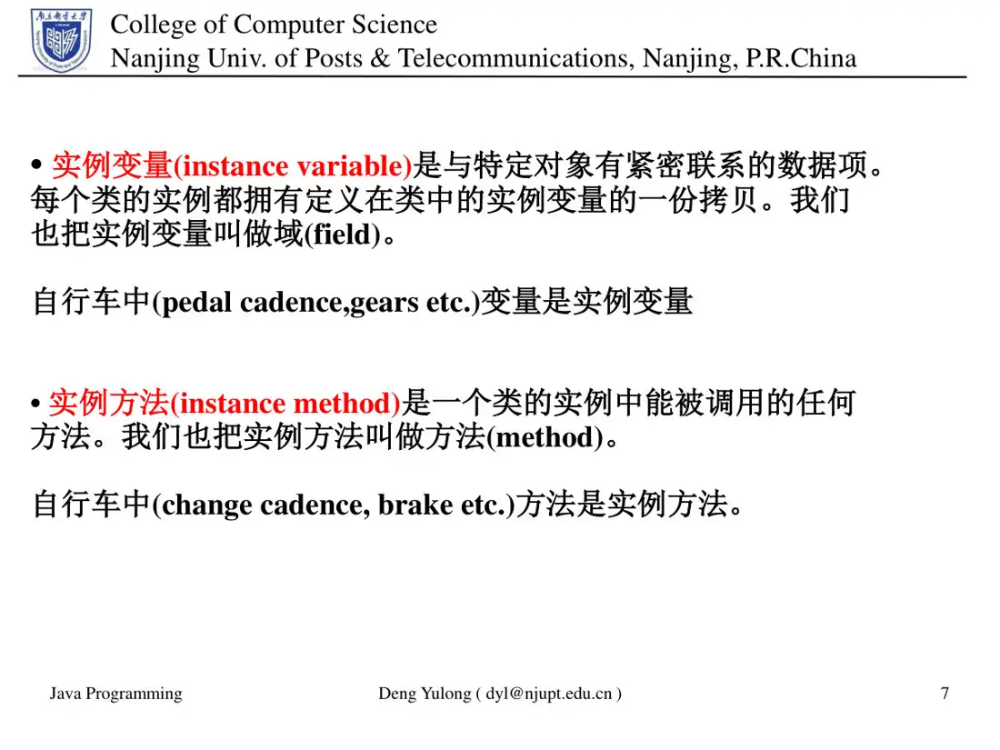

原文：

• 实例变量(instance variable)是与特定对象有紧密联系的数据项。每个类的实例都拥有定义在类中的实例变量的一份拷贝。我们也把实例变量叫做域(field)。

自行车中(pedal cadence,gears etc.)变量是实例变量

• 实例方法(instance method)是一个类的实例中能被调用的任何方法。我们也把实例方法叫做方法(method)。

自行车中(change cadence, brake etc.)方法是实例方法。

南京郵電大學Nanjing Ut 圆

College of Computer Science Nanjing Univ. of Posts & Telecommunications, Nanjing, P.R.China

Java Programming

Deng Yulong ( dyl@njupt.edu.cn )

7

### 南京郵電大學Nanjing Unn

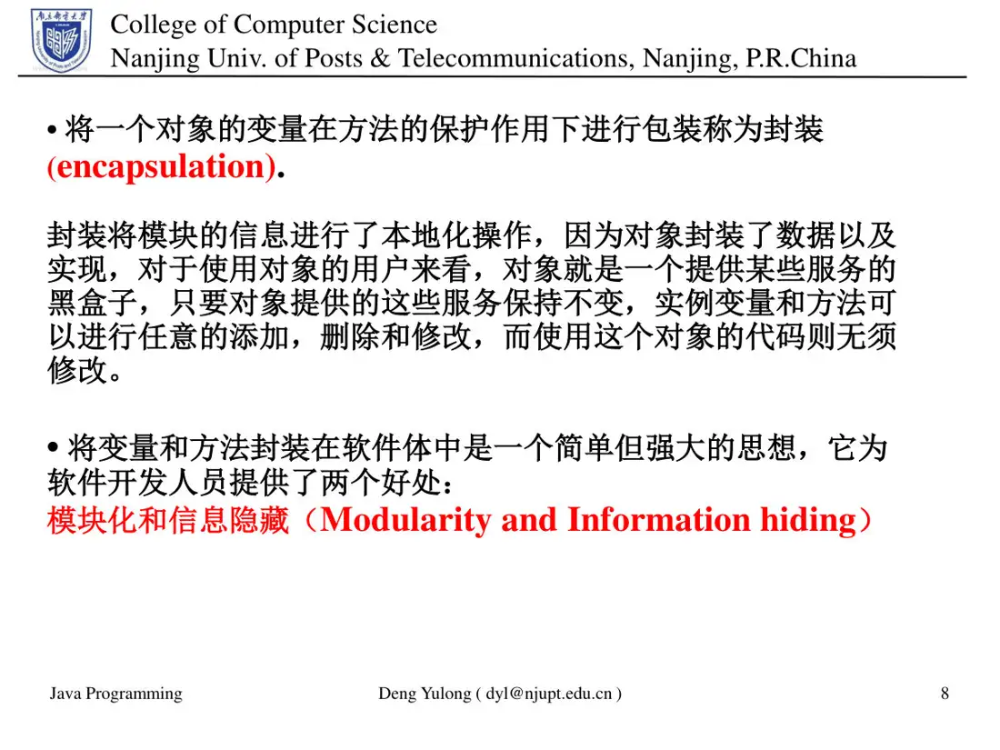

原文：

• 将一个对象的变量在方法的保护作用下进行包装称为封装(encapsulation).

封装将模块的信息进行了本地化操作，因为对象封装了数据以及实现，对于使用对象的用户来看，对象就是一个提供某些服务的黑盒子，只要对象提供的这些服务保持不变，实例变量和方法可以进行任意的添加，删除和修改，而使用这个对象的代码则无须修改。

• 将变量和方法封装在软件体中是一个简单但强大的思想，它为软件开发人员提供了两个好处：

模块化和信息隐藏（Modularity and Information hiding）

南京郵電大學Nanjing Unn

College of Computer Science Nanjing Univ. of Posts & Telecommunications, Nanjing, P.R.China

Java Programming

Deng Yulong ( dyl@njupt.edu.cn )

8

### 类(Class)

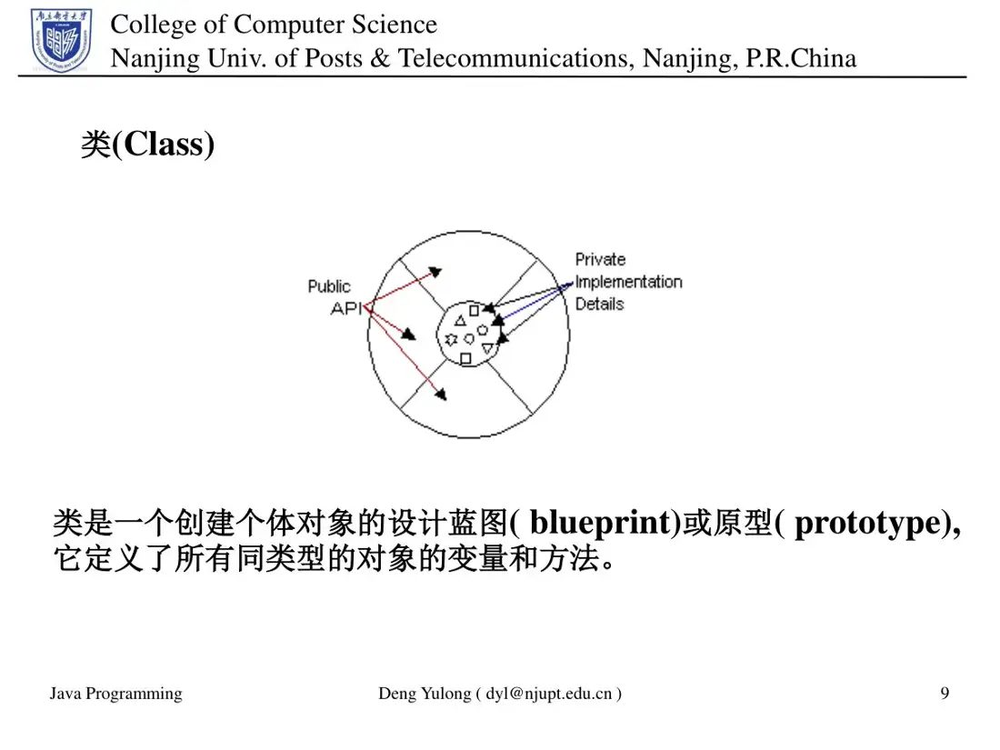

原文：

类(Class)

类是一个创建个体对象的设计蓝图( blueprint)或原型( prototype),它定义了所有同类型的对象的变量和方法。

南京郵電大學Nanjing U 圆 mmnciions

College of Computer Science Nanjing Univ. of Posts & Telecommunications, Nanjing, P.R.China

Java Programming

Deng Yulong ( dyl@njupt.edu.cn )

9

### 南京郵電大學Nanjing Ut 圆

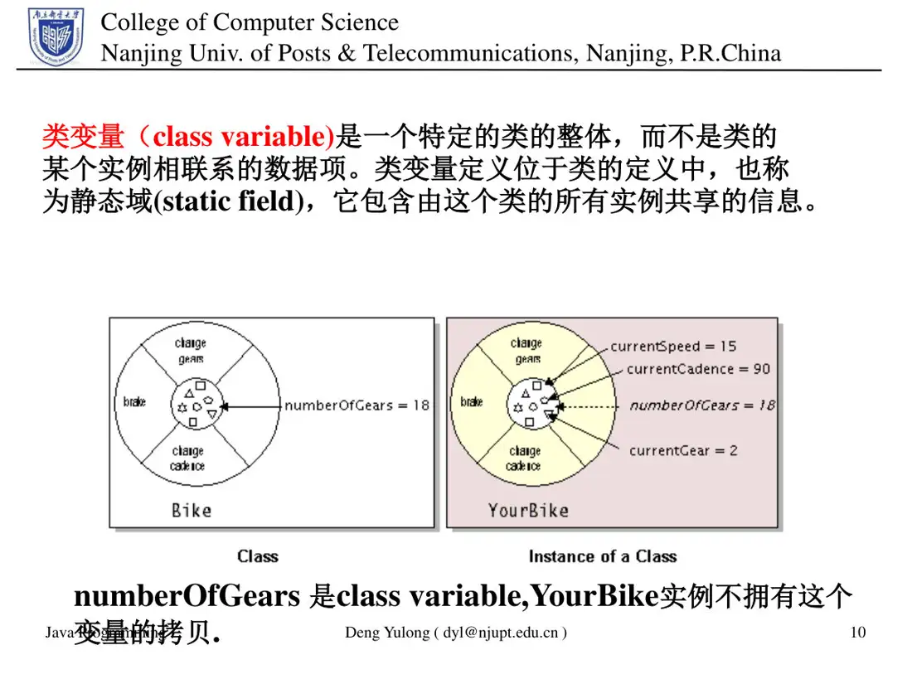

原文：

类变量（class variable)是一个特定的类的整体，而不是类的某个实例相联系的数据项。类变量定义位于类的定义中，也称为静态域(static field)，它包含由这个类的所有实例共享的信息。

numberOfGears 是class variable,YourBike实例不拥有这个 Java Programming 变量的拷贝. Deng Yulong ( dyl@njupt.edu.cn ) 1 0

南京郵電大學Nanjing Ut 圆

College of Computer Science Nanjing Univ. of Posts & Telecommunications, Nanjing, P.R.China

### 南京郵電大學Nanjing Ut 圆

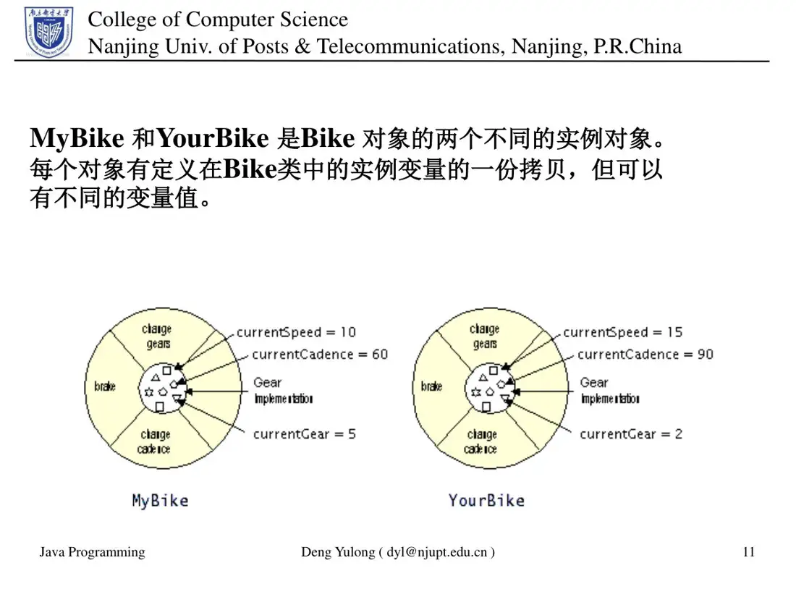

原文：

MyBike 和YourBike 是Bike 对象的两个不同的实例对象。每个对象有定义在Bike类中的实例变量的一份拷贝，但可以有不同的变量值。

南京郵電大學Nanjing Ut 圆

College of Computer Science Nanjing Univ. of Posts & Telecommunications, Nanjing, P.R.China

Java Programming

Deng Yulong ( dyl@njupt.edu.cn )

11

### 类提供重用性(reusable factory).

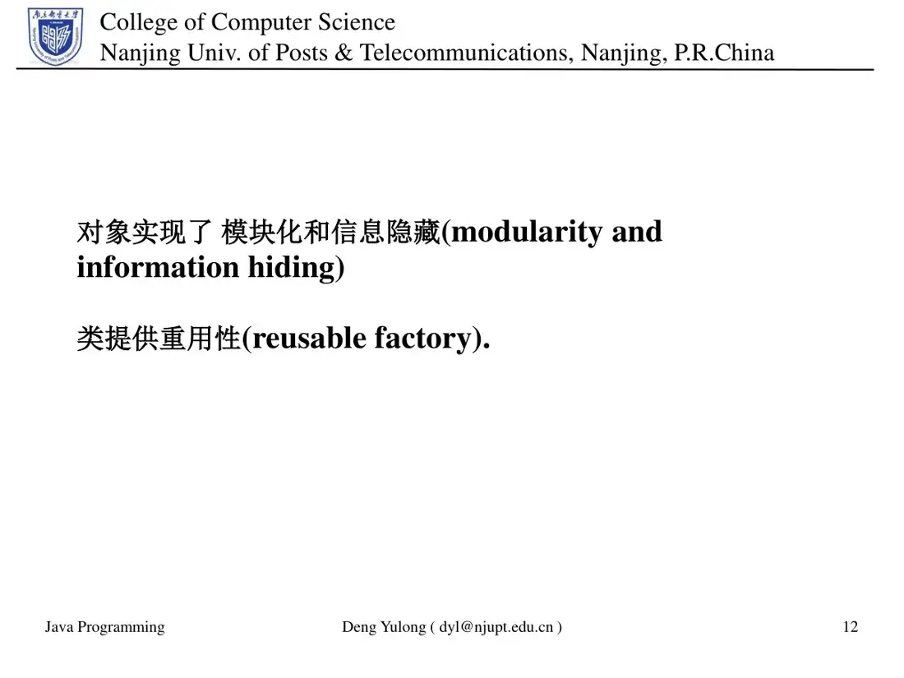

原文：

对象实现了 模块化和信息隐藏(modularity andinformation hiding)

类提供重用性(reusable factory).

南京郵電大學Nanjing Ut 圆

College of Computer Science Nanjing Univ. of Posts & Telecommunications, Nanjing, P.R.China

Java Programming

Deng Yulong ( dyl@njupt.edu.cn )

12

### 消息(Message)

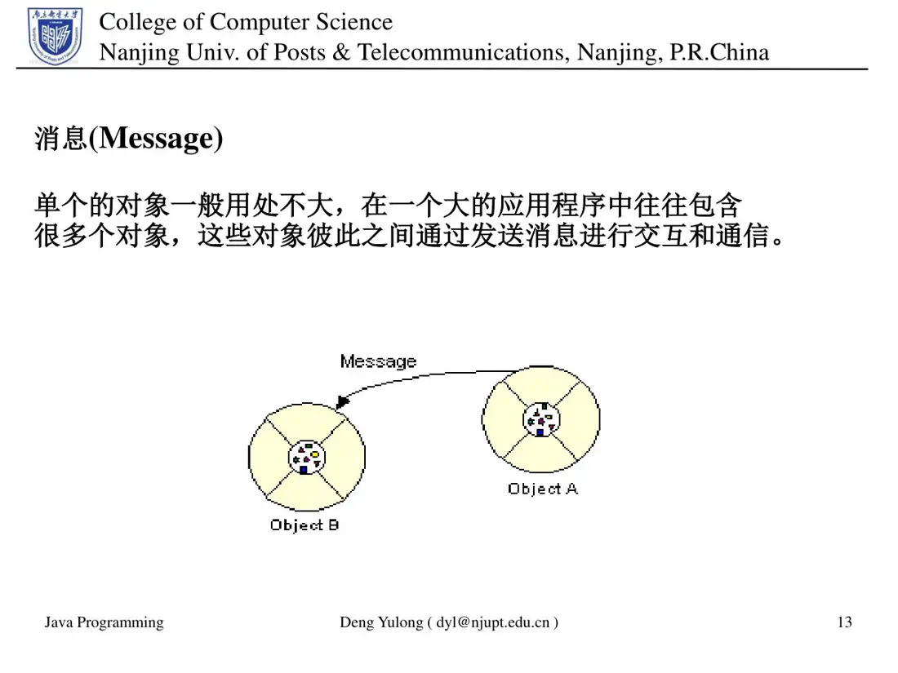

原文：

消息(Message)

单个的对象一般用处不大，在一个大的应用程序中往往包含很多个对象，这些对象彼此之间通过发送消息进行交互和通信。

南京郵電大學Nanjing U 圆 mmnciions

College of Computer Science Nanjing Univ. of Posts & Telecommunications, Nanjing, P.R.China

Java Programming

Deng Yulong ( dyl@njupt.edu.cn )

13

### 消息由3个部分组成：

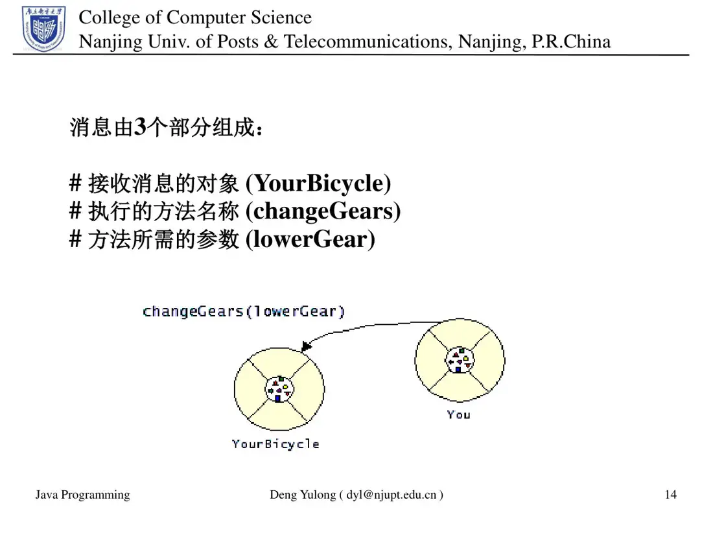

原文：

消息由3个部分组成：

\# 接收消息的对象 (YourBicycle)

\# 执行的方法名称 (changeGears)

\# 方法所需的参数 (lowerGear)

南京郵電大學Nanjing U 圆 mmnciions

College of Computer Science Nanjing Univ. of Posts & Telecommunications, Nanjing, P.R.China

Java Programming

Deng Yulong ( dyl@njupt.edu.cn )

14

### 消息提供我们两个重要的好处：

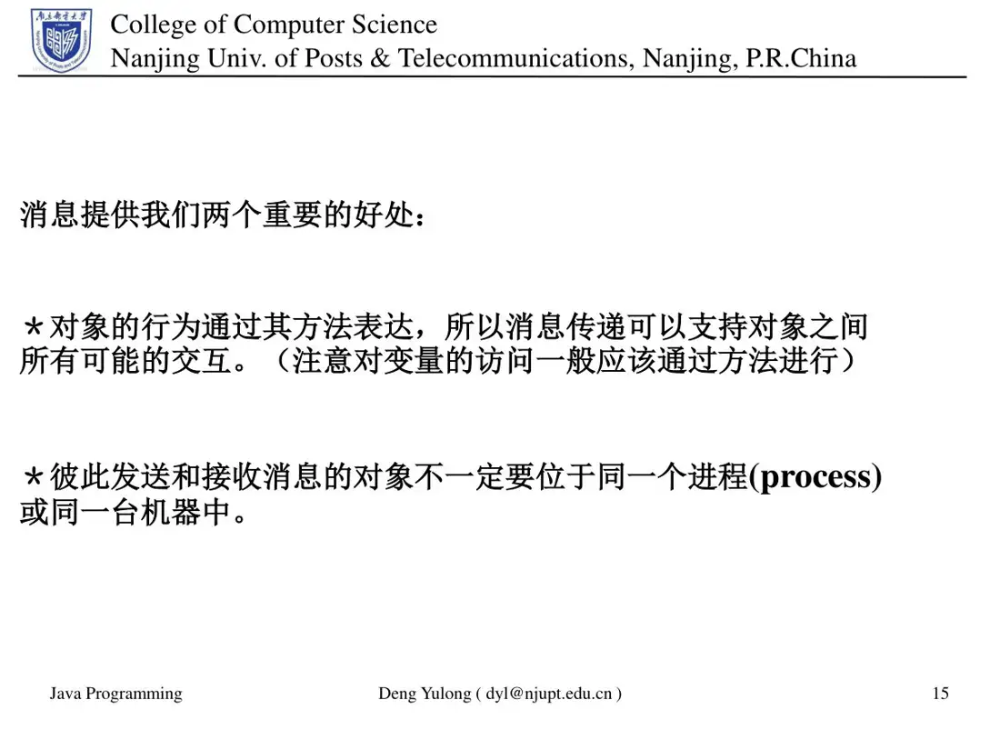

原文：

消息提供我们两个重要的好处：

＊对象的行为通过其方法表达，所以消息传递可以支持对象之间所有可能的交互。（注意对变量的访问一般应该通过方法进行）

＊彼此发送和接收消息的对象不一定要位于同一个进程(process)或同一台机器中。

南京郵電大學Nanjing U 圆 mmnciions

College of Computer Science Nanjing Univ. of Posts & Telecommunications, Nanjing, P.R.China

Java Programming

Deng Yulong ( dyl@njupt.edu.cn )

15

### 2.2 Java类的构成，类之间的关系和UML描述

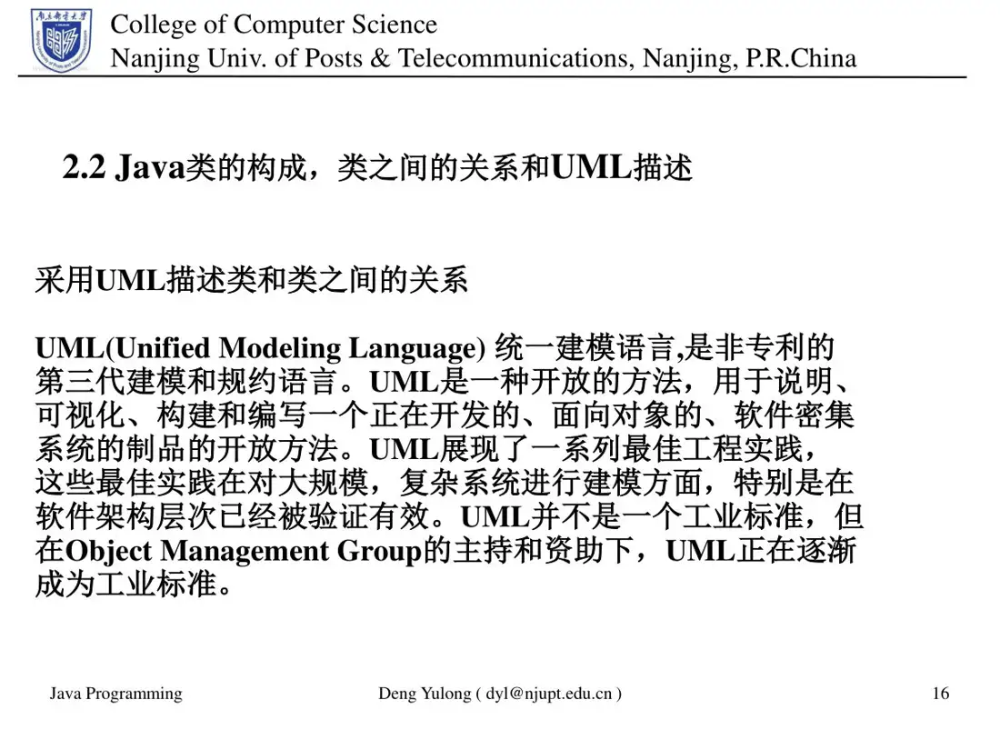

原文：

2.2 Java类的构成，类之间的关系和UML描述

采用UML描述类和类之间的关系

UML(Unified Modeling Language) 统一建模语言,是非专利的第三代建模和规约语言。UML是一种开放的方法，用于说明、可视化、构建和编写一个正在开发的、面向对象的、软件密集系统的制品的开放方法。UML展现了一系列最佳工程实践，这些最佳实践在对大规模，复杂系统进行建模方面，特别是在软件架构层次已经被验证有效。UML并不是一个工业标准，但在Object Management Group的主持和资助下，UML正在逐渐成为工业标准。

南京都電大学

College of Computer Science Nanjing Univ. of Posts & Telecommunications, Nanjing, P.R.China

Java Programming

Deng Yulong ( dyl@njupt.edu.cn )

16

### 系统开发中三个主要的UML模型：

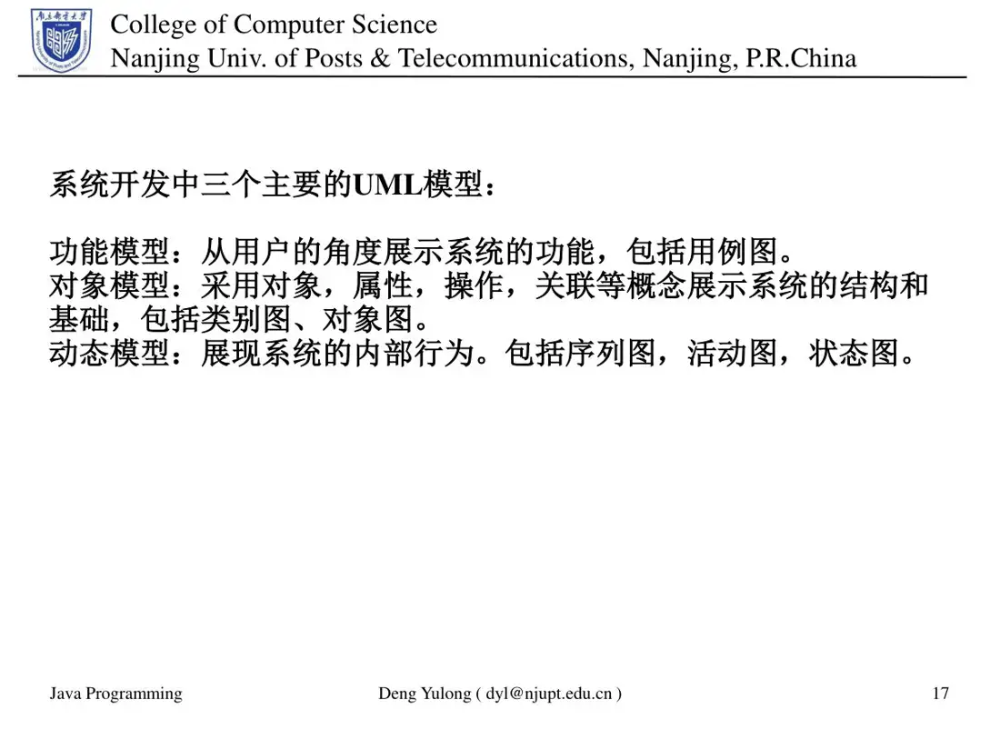

原文：

系统开发中三个主要的UML模型：

功能模型：从用户的角度展示系统的功能，包括用例图。

对象模型：采用对象，属性，操作，关联等概念展示系统的结构和基础，包括类别图、对象图。

动态模型：展现系统的内部行为。包括序列图，活动图，状态图。

南京郵電大學948

College of Computer Science Nanjing Univ. of Posts & Telecommunications, Nanjing, P.R.China

Java Programming

Deng Yulong ( dyl@njupt.edu.cn )

17

### 用例：用于建立软件系统中的基本模型，是对系统需求的准确表述。

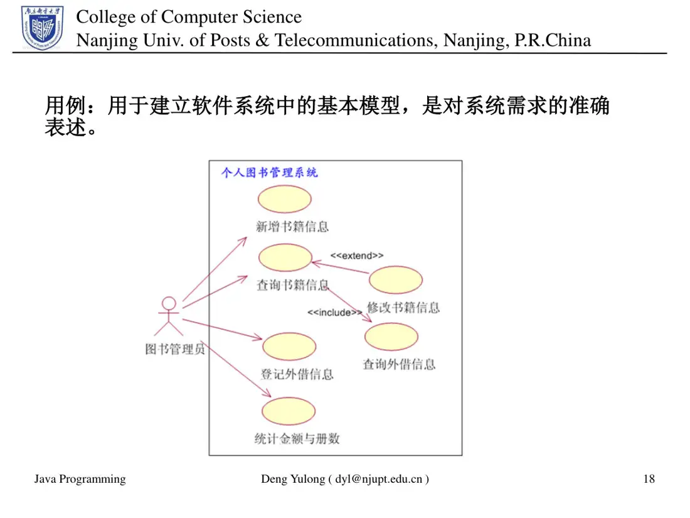

原文：

用例：用于建立软件系统中的基本模型，是对系统需求的准确表述。

南京郵電大學948

College of Computer Science Nanjing Univ. of Posts & Telecommunications, Nanjing, P.R.China

Java Programming

Deng Yulong ( dyl@njupt.edu.cn )

18

### 类图：用于描述软件系统中对象和之间的静态关系。

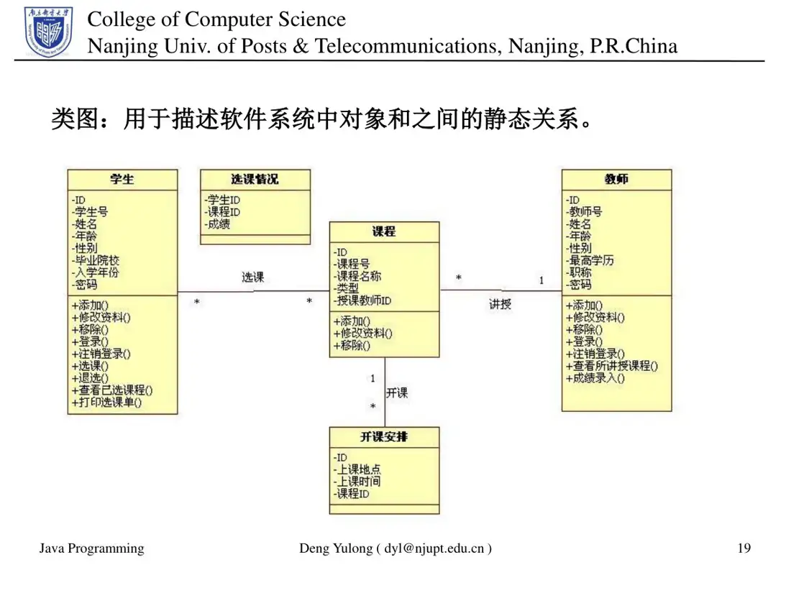

原文：

类图：用于描述软件系统中对象和之间的静态关系。

南京郵電大學948

College of Computer Science Nanjing Univ. of Posts & Telecommunications, Nanjing, P.R.China

Java Programming

Deng Yulong ( dyl@njupt.edu.cn )

19

### 时序图：描述对象之间传递消息的时间顺序，即用例中的行为顺序。

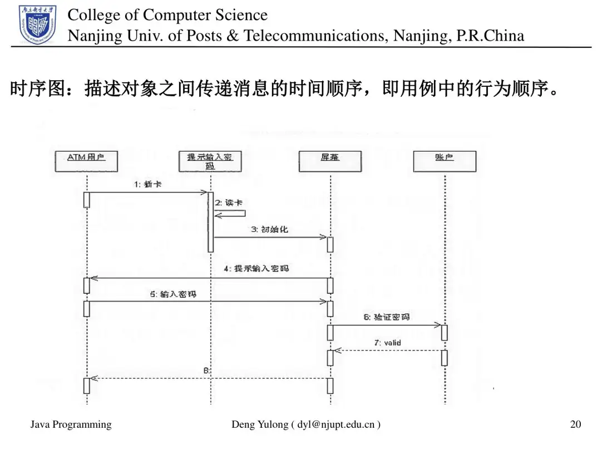

原文：

时序图：描述对象之间传递消息的时间顺序，即用例中的行为顺序。

南京郵電大學948Nanjing Unav

College of Computer Science Nanjing Univ. of Posts & Telecommunications, Nanjing, P.R.China

Java Programming

Deng Yulong ( dyl@njupt.edu.cn )

20

### 状态图：描述系统中对象的状态和状态的迁移，可使用有限状态机描述

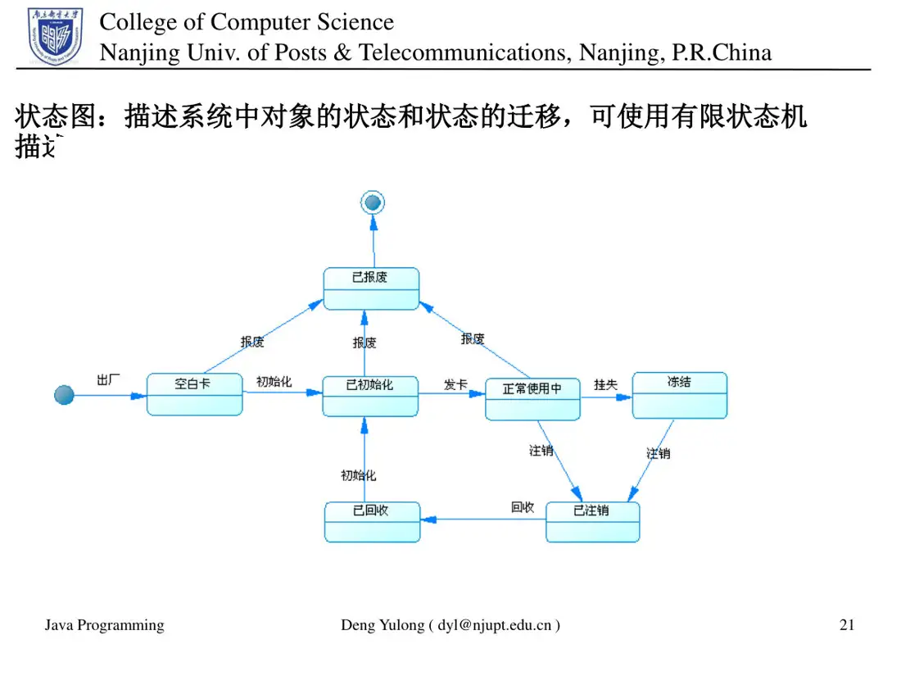

原文：

状态图：描述系统中对象的状态和状态的迁移，可使用有限状态机描述

南京郵電大學948

College of Computer Science Nanjing Univ. of Posts & Telecommunications, Nanjing, P.R.China

Java Programming

Deng Yulong ( dyl@njupt.edu.cn )

21

### UML学习参考书：

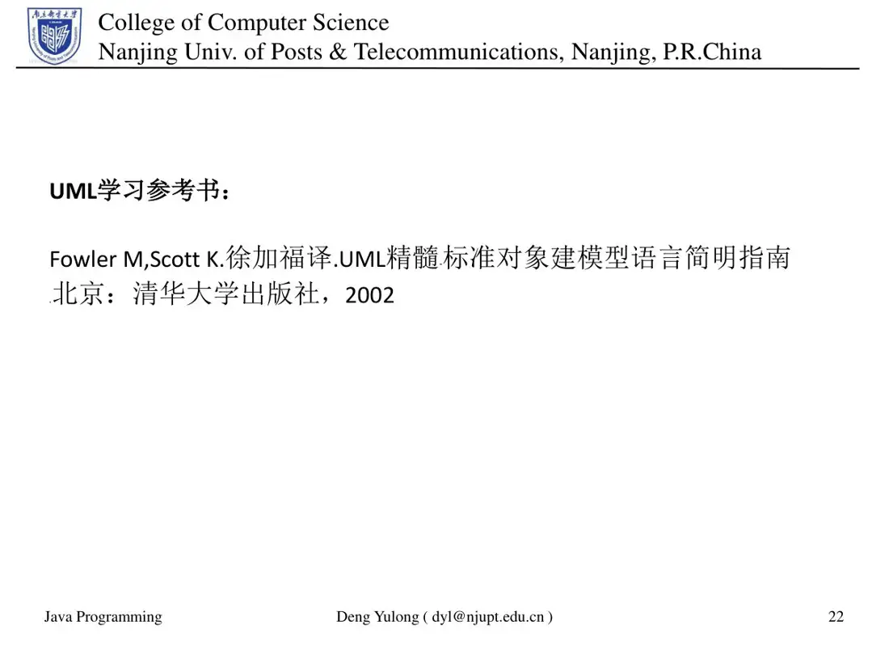

原文：

UML学习参考书：

Fowler M,Scott K.徐加福译.UML精髓-标准对象建模型语言简明指南.北京：清华大学出版社，2002

南京郵電大學Nanjing Ora 圆

College of Computer Science Nanjing Univ. of Posts & Telecommunications, Nanjing, P.R.China

Java Programming

Deng Yulong ( dyl@njupt.edu.cn )

22

### 在静态类图中，类（对象)的描述方法

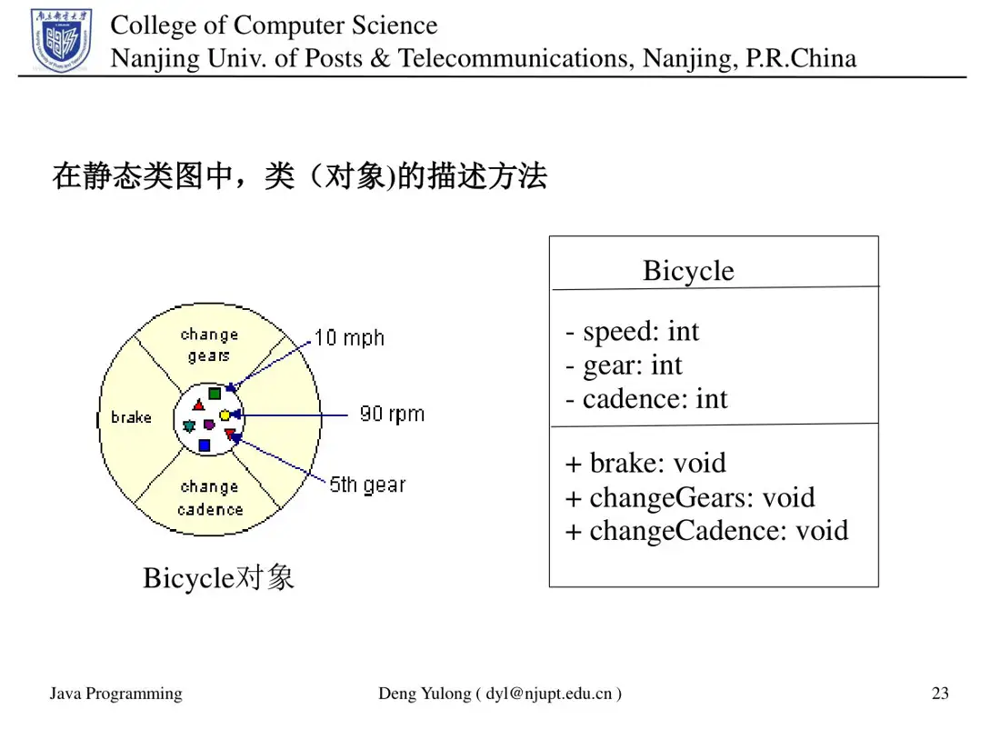

原文：

在静态类图中，类（对象)的描述方法

Bicycle

\- speed: int

\- gear: int

\- cadence: int

\+ brake: void

\+ changeGears: void

\+ changeCadence: void - speed: int - gear: int - cadence: int

南京郵電大學Nanjing Ora 圆

College of Computer Science Nanjing Univ. of Posts & Telecommunications, Nanjing, P.R.China

Java Programming

Deng Yulong ( dyl@njupt.edu.cn )

23

### 南京郵電大學Nanjing Ora 圆

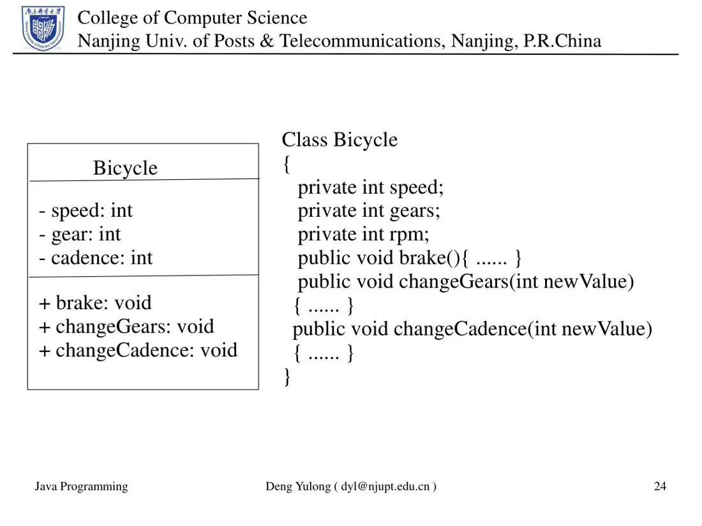

原文：

\+ brake: void + changeGears: void + changeCadence: void

南京郵電大學Nanjing Ora 圆

College of Computer Science Nanjing Univ. of Posts & Telecommunications, Nanjing, P.R.China

Java Programming

Deng Yulong ( dyl@njupt.edu.cn )

24

### 在静态类图中，类（对象)的关系

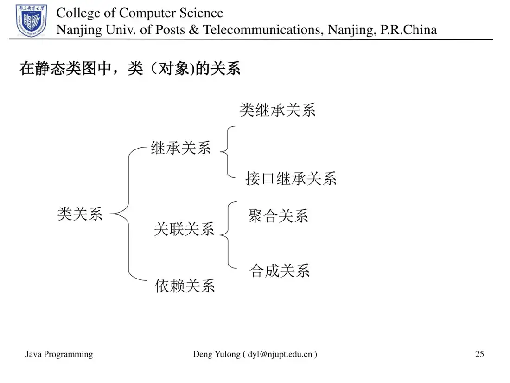

原文：

在静态类图中，类（对象)的关系

南京郵電大學圆易 948Nanjing Ora mncons

College of Computer Science Nanjing Univ. of Posts & Telecommunications, Nanjing, P.R.China

Java Programming

Deng Yulong ( dyl@njupt.edu.cn )

25

### 继承关系( Inheritance)

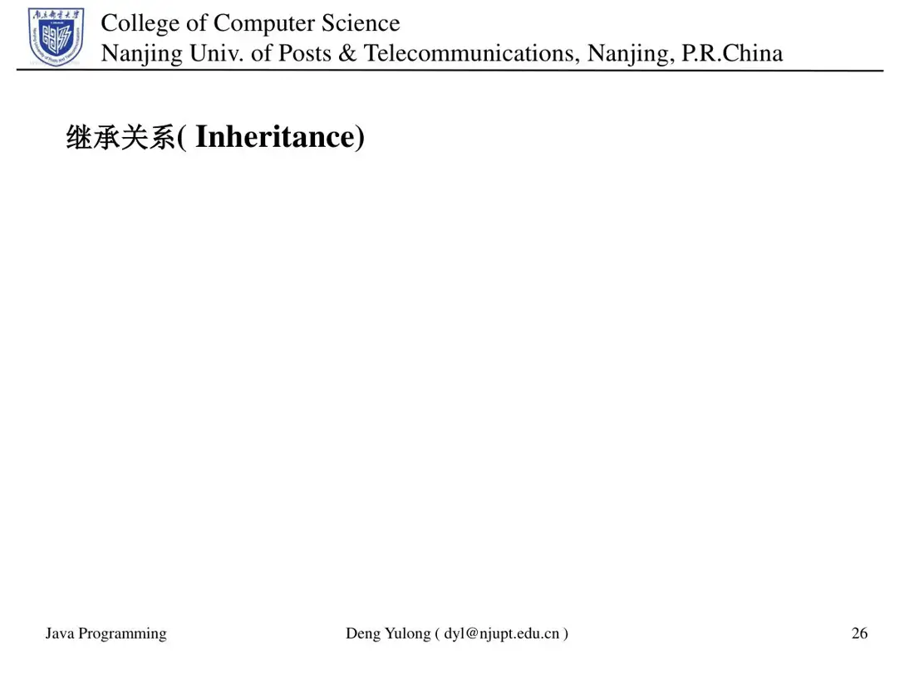

原文：

继承关系( Inheritance)

南京都電大学

College of Computer Science Nanjing Univ. of Posts & Telecommunications, Nanjing, P.R.China

Java Programming

Deng Yulong ( dyl@njupt.edu.cn )

26

### 南京郵電大學Nanjing Ut 圆

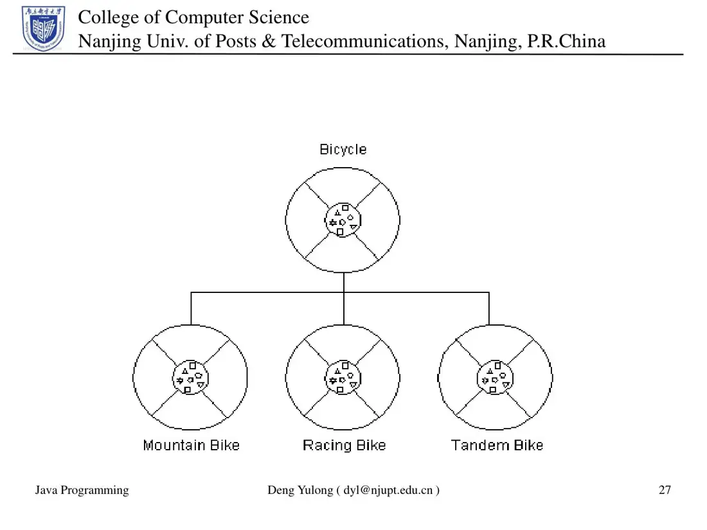

原文：

南京郵電大學Nanjing Ut 圆

College of Computer Science Nanjing Univ. of Posts & Telecommunications, Nanjing, P.R.China

Java Programming

Deng Yulong ( dyl@njupt.edu.cn )

27

### 南京郵電大學948

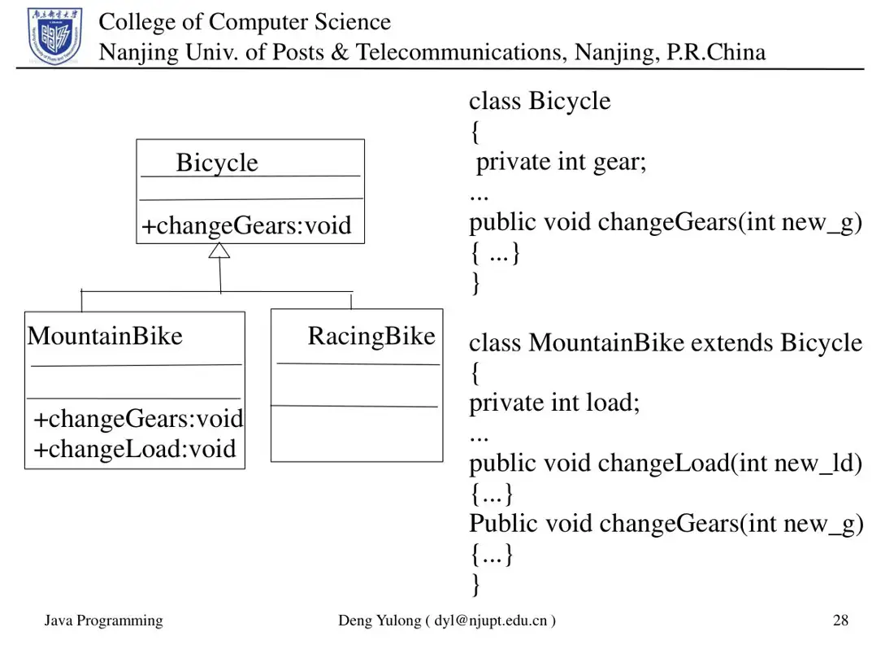

原文：

南京郵電大學948

College of Computer Science Nanjing Univ. of Posts & Telecommunications, Nanjing, P.R.China

Java Programming

Deng Yulong ( dyl@njupt.edu.cn )

28

### • 子类(subclass)是由某个特定的类派生出的类。

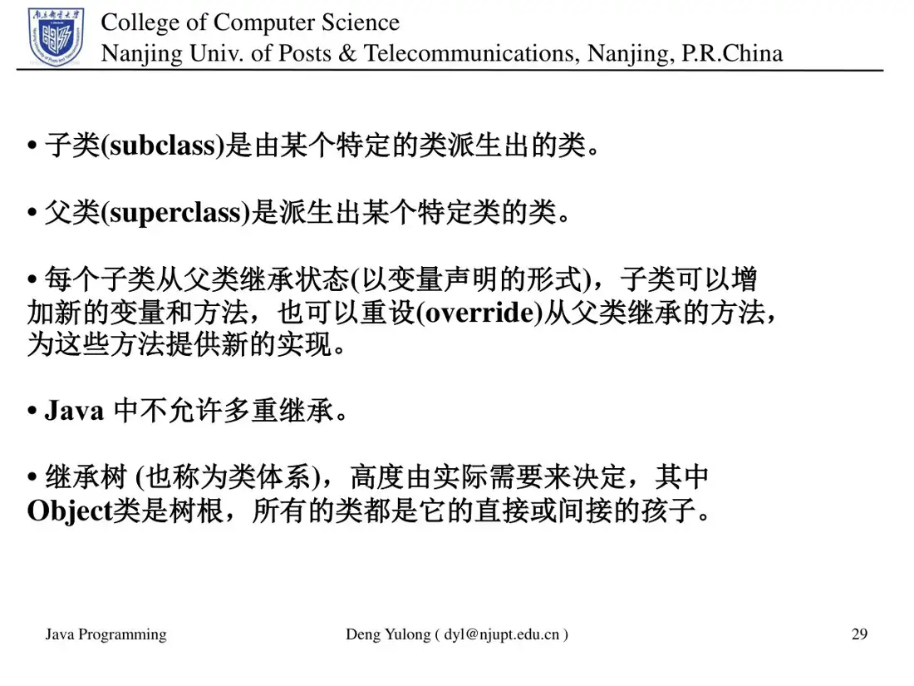

原文：

• 子类(subclass)是由某个特定的类派生出的类。

• 父类(superclass)是派生出某个特定类的类。

• 每个子类从父类继承状态(以变量声明的形式)，子类可以增加新的变量和方法，也可以重设(override)从父类继承的方法，为这些方法提供新的实现。

• Java 中不允许多重继承。

• 继承树 (也称为类体系)，高度由实际需要来决定，其中Object类是树根，所有的类都是它的直接或间接的孩子。

南京郵電大學Nanjing U 圆 mmnciions

College of Computer Science Nanjing Univ. of Posts & Telecommunications, Nanjing, P.R.China

Java Programming

Deng Yulong ( dyl@njupt.edu.cn )

29

### 继承提供两个特性：

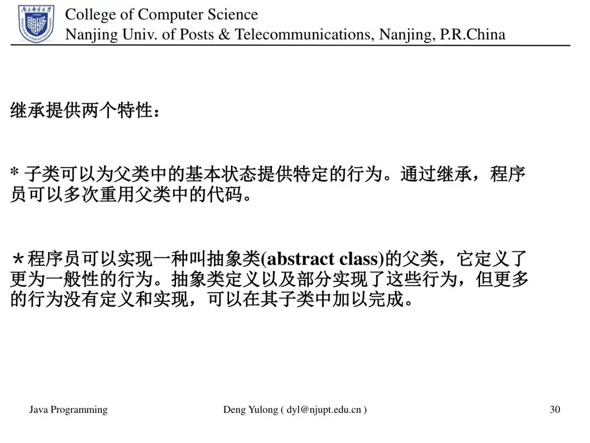

原文：

继承提供两个特性：

\* 子类可以为父类中的基本状态提供特定的行为。通过继承，程序员可以多次重用父类中的代码。

＊程序员可以实现一种叫抽象类(abstract class)的父类，它定义了更为一般性的行为。抽象类定义以及部分实现了这些行为，但更多的行为没有定义和实现，可以在其子类中加以完成。

南京郵電大學Nanjing U 圆 mmnciions

College of Computer Science Nanjing Univ. of Posts & Telecommunications, Nanjing, P.R.China

Java Programming

Deng Yulong ( dyl@njupt.edu.cn )

30

### 开闭原则（Open-Closed Principle, OCP）

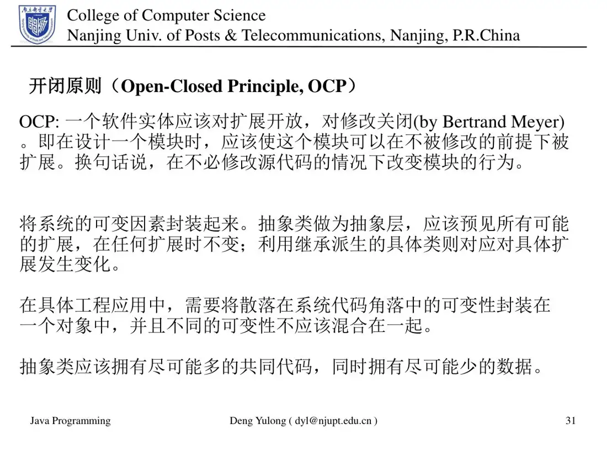

原文：

开闭原则（Open-Closed Principle, OCP）

OCP: 一个软件实体应该对扩展开放，对修改关闭(by Bertrand Meyer)。即在设计一个模块时，应该使这个模块可以在不被修改的前提下被扩展。换句话说，在不必修改源代码的情况下改变模块的行为。

将系统的可变因素封装起来。抽象类做为抽象层，应该预见所有可能的扩展，在任何扩展时不变；利用继承派生的具体类则对应对具体扩展发生变化。

在具体工程应用中，需要将散落在系统代码角落中的可变性封装在一个对象中，并且不同的可变性不应该混合在一起。

抽象类应该拥有尽可能多的共同代码，同时拥有尽可能少的数据。

南京郵電大學Nanjing Ora 圆

College of Computer Science Nanjing Univ. of Posts & Telecommunications, Nanjing, P.R.China

Java Programming

Deng Yulong ( dyl@njupt.edu.cn )

31

### 聚合关系（Aggregation）

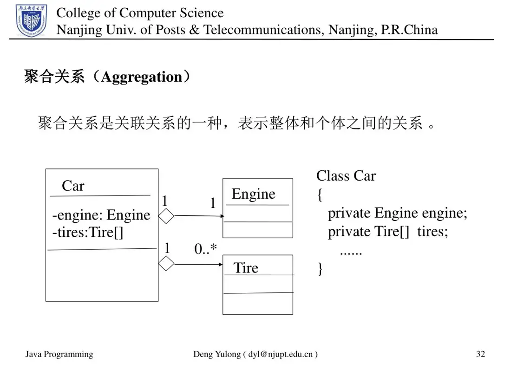

原文：

聚合关系（Aggregation）

聚合关系是关联关系的一种，表示整体和个体之间的关系 。

Class Car { private Engine engine; private Tire[] tires;

南京郵電大學Nanjing Ora 圆

College of Computer Science Nanjing Univ. of Posts & Telecommunications, Nanjing, P.R.China

Java Programming

Deng Yulong ( dyl@njupt.edu.cn )

32

### 合成关系（Composition）

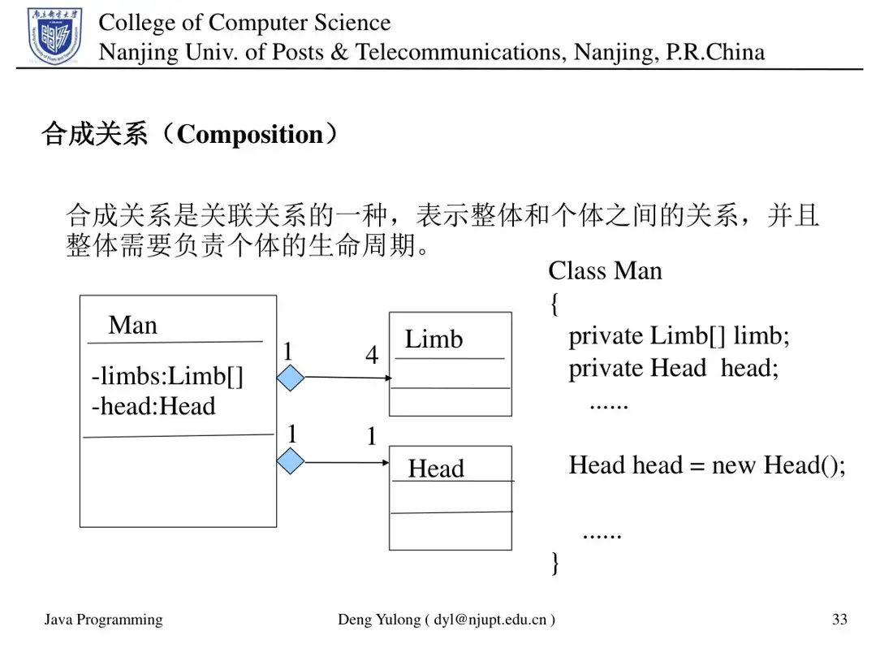

原文：

合成关系（Composition）

合成关系是关联关系的一种，表示整体和个体之间的关系，并且整体需要负责个体的生命周期。

Head head = new Head();

南京郵電大學Nanjing Ora 圆

College of Computer Science Nanjing Univ. of Posts & Telecommunications, Nanjing, P.R.China

Java Programming

Deng Yulong ( dyl@njupt.edu.cn )

33

### 依赖关系（Dependency）

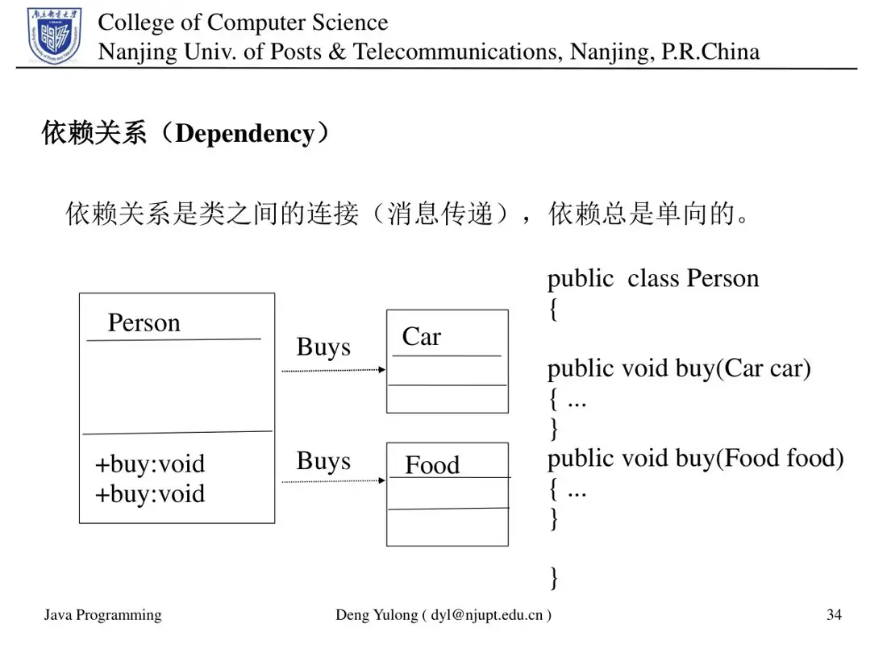

原文：

依赖关系（Dependency）

依赖关系是类之间的连接（消息传递），依赖总是单向的。

南京郵電大學Nanjing Ora 圆

College of Computer Science Nanjing Univ. of Posts & Telecommunications, Nanjing, P.R.China

Java Programming

Deng Yulong ( dyl@njupt.edu.cn )

34

### 2.3接口(Interface)

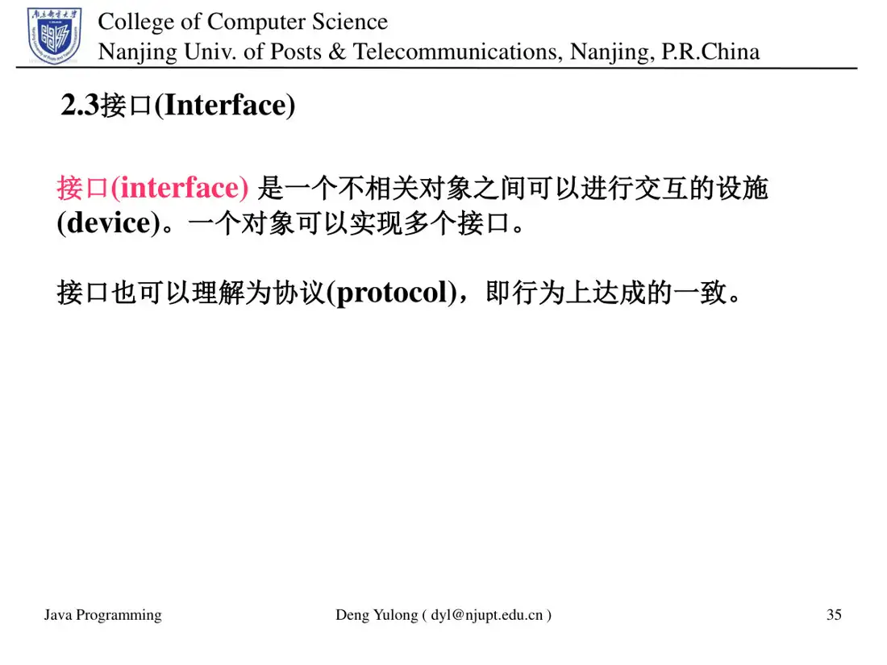

原文：

2.3接口(Interface)

接口(interface) 是一个不相关对象之间可以进行交互的设施(device)。一个对象可以实现多个接口。

接口也可以理解为协议(protocol)，即行为上达成的一致。

南京郵電大學Nanjing U 圆 mmnciions

College of Computer Science Nanjing Univ. of Posts & Telecommunications, Nanjing, P.R.China

Java Programming

Deng Yulong ( dyl@njupt.edu.cn )

35

### 可以使用接口定义能够在类体系中被任意的类实现的协议或行为。接口有下面的作用：

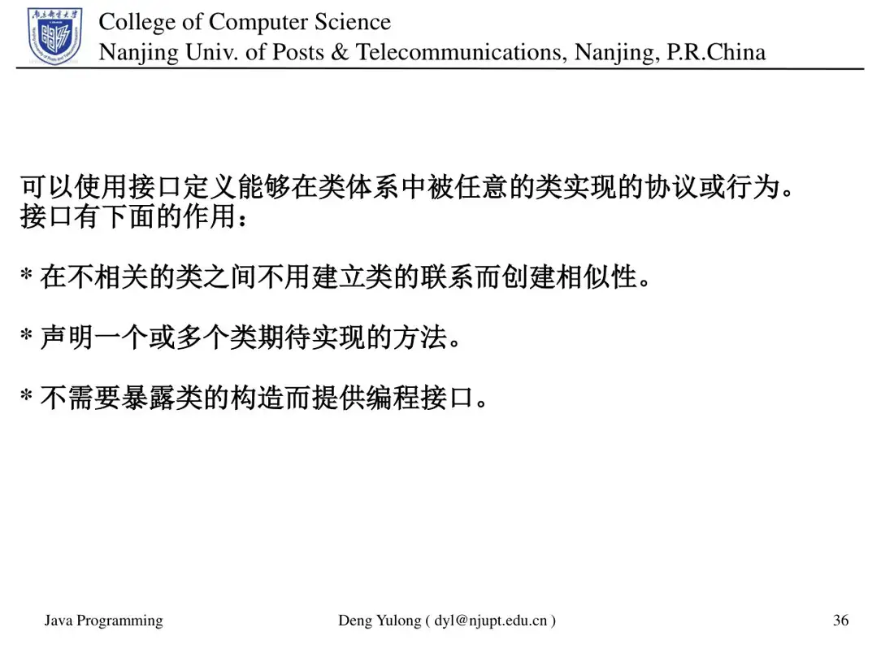

原文：

可以使用接口定义能够在类体系中被任意的类实现的协议或行为。接口有下面的作用：

\* 在不相关的类之间不用建立类的联系而创建相似性。

\* 声明一个或多个类期待实现的方法。

\* 不需要暴露类的构造而提供编程接口。

南京郵電大學Nanjing U 圆 mmnciions

College of Computer Science Nanjing Univ. of Posts & Telecommunications, Nanjing, P.R.China

Java Programming

Deng Yulong ( dyl@njupt.edu.cn )

36

### 南京郵電大學Nanjing Ora 圆

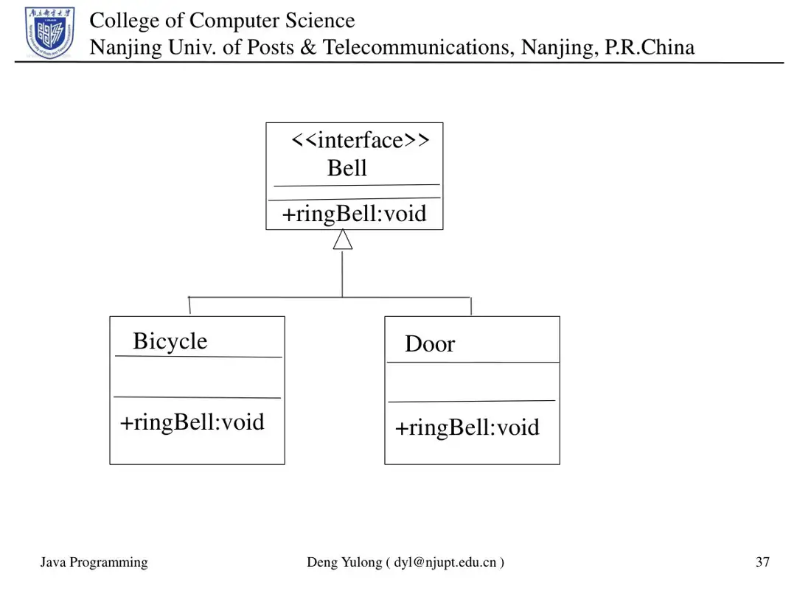

原文：

南京郵電大學Nanjing Ora 圆

College of Computer Science Nanjing Univ. of Posts & Telecommunications, Nanjing, P.R.China

Java Programming

Deng Yulong ( dyl@njupt.edu.cn )

37

### 南京都電大学

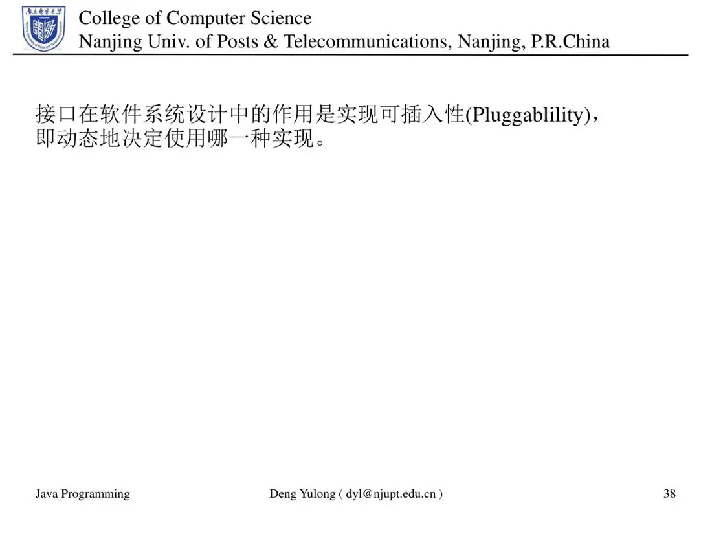

原文：

接口在软件系统设计中的作用是实现可插入性(Pluggablility)，即动态地决定使用哪一种实现。

南京都電大学

College of Computer Science Nanjing Univ. of Posts & Telecommunications, Nanjing, P.R.China

Java Programming

Deng Yulong ( dyl@njupt.edu.cn )

38

### 2.4 在程序代码中理解面向的基础理论

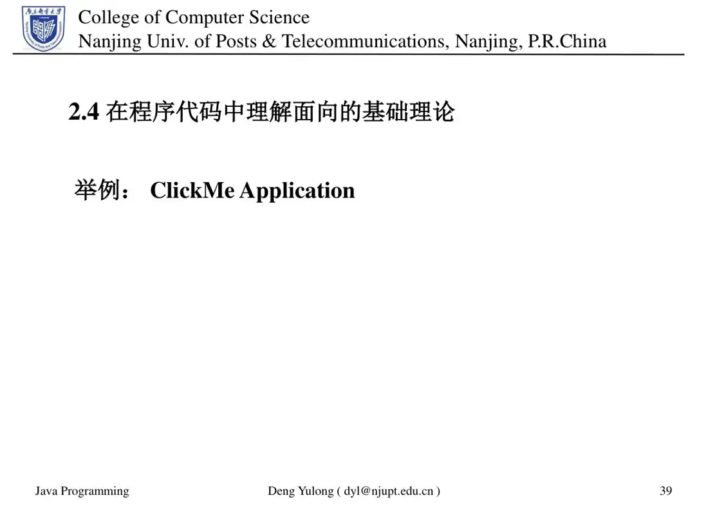

原文：

2.4 在程序代码中理解面向的基础理论

举例： ClickMe Application

南京郵電大學Nanjing Unn

College of Computer Science Nanjing Univ. of Posts & Telecommunications, Nanjing, P.R.China

Java Programming

Deng Yulong ( dyl@njupt.edu.cn )

39

### Deng Yulong ( dyl@njupt.edu.cn )

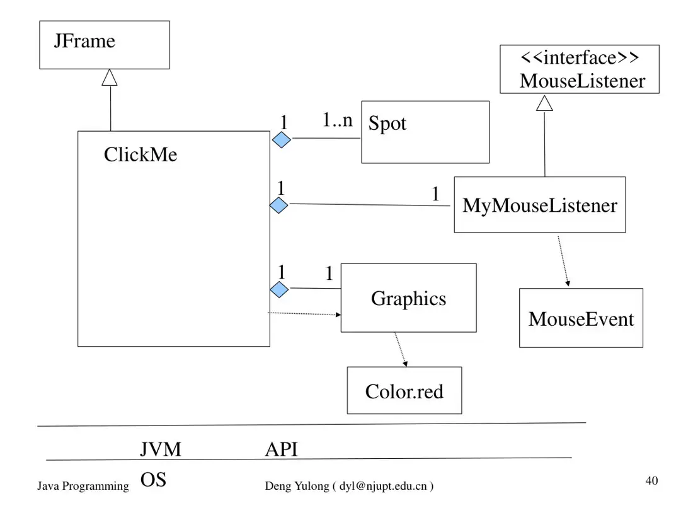

原文：

Deng Yulong ( dyl@njupt.edu.cn )

Java Programming

40

### 南京郵電大學

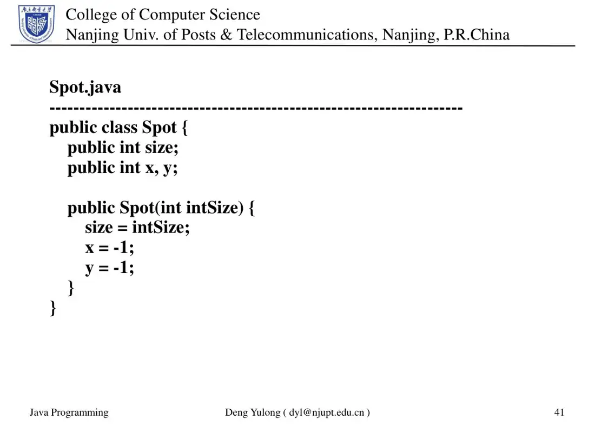

原文：

南京郵電大學

College of Computer Science Nanjing Univ. of Posts & Telecommunications, Nanjing, P.R.China

Java Programming

Deng Yulong ( dyl@njupt.edu.cn )

41

### ClickMe.java

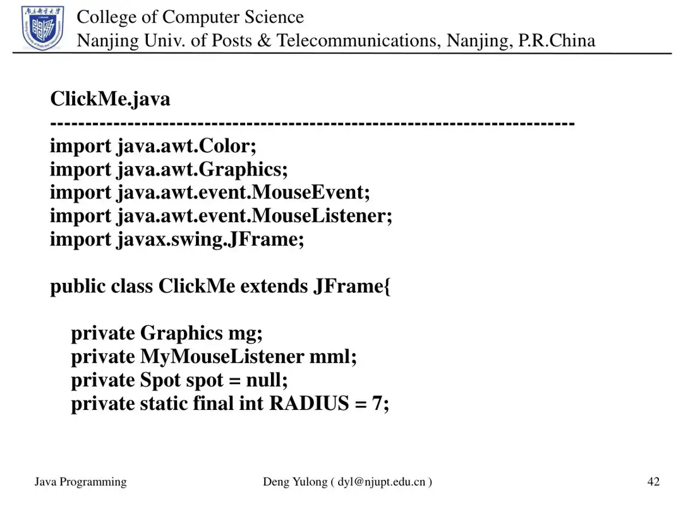

原文：

ClickMe.java

import java.awt.Color; import java.awt.Graphics; import java.awt.event.MouseEvent; import java.awt.event.MouseListener; import javax.swing.JFrame;

public class ClickMe extends JFrame{

private Graphics mg; private MyMouseListener mml; private Spot spot = null; private static final int RADIUS = 7;

南京郵電大學Nanjing U 圆 mmnciions

College of Computer Science Nanjing Univ. of Posts & Telecommunications, Nanjing, P.R.China

Java Programming

Deng Yulong ( dyl@njupt.edu.cn )

42

### public ClickMe(){

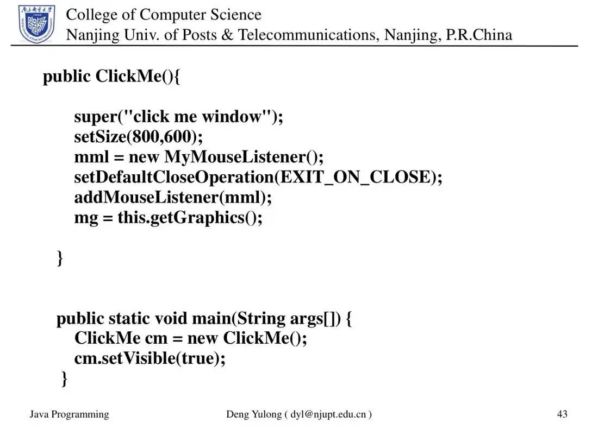

原文：

public ClickMe(){

南京郵電大學

College of Computer Science Nanjing Univ. of Posts & Telecommunications, Nanjing, P.R.China

Java Programming

Deng Yulong ( dyl@njupt.edu.cn )

43

### public void paint(Graphics mg) {

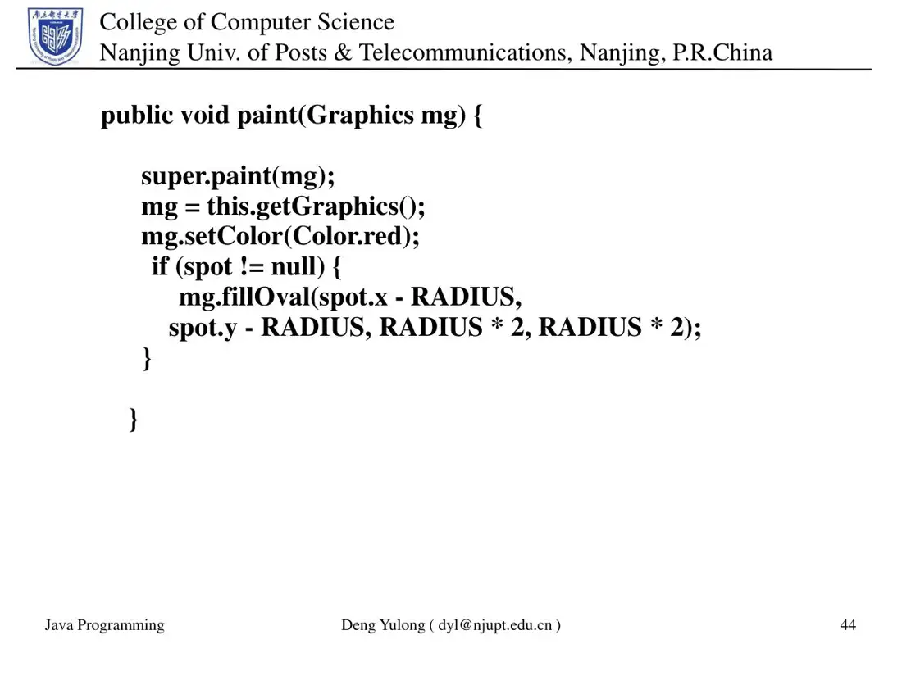

原文：

public void paint(Graphics mg) {

南京郵電大學

College of Computer Science Nanjing Univ. of Posts & Telecommunications, Nanjing, P.R.China

Java Programming

Deng Yulong ( dyl@njupt.edu.cn )

44

### 南京郵電大學Nanjig Unive

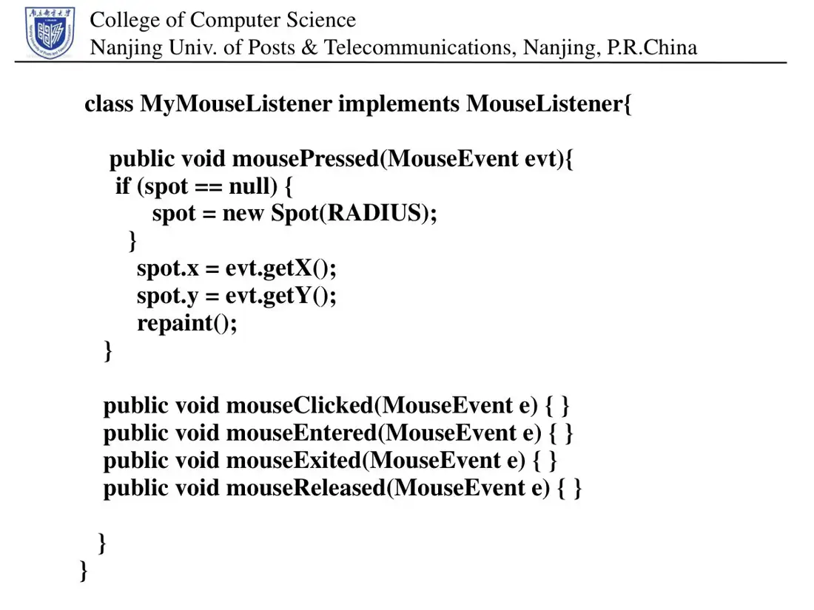

原文：

南京郵電大學Nanjig Unive

College of Computer Science Nanjing Univ. of Posts & Telecommunications, Nanjing, P.R.China

### •对象

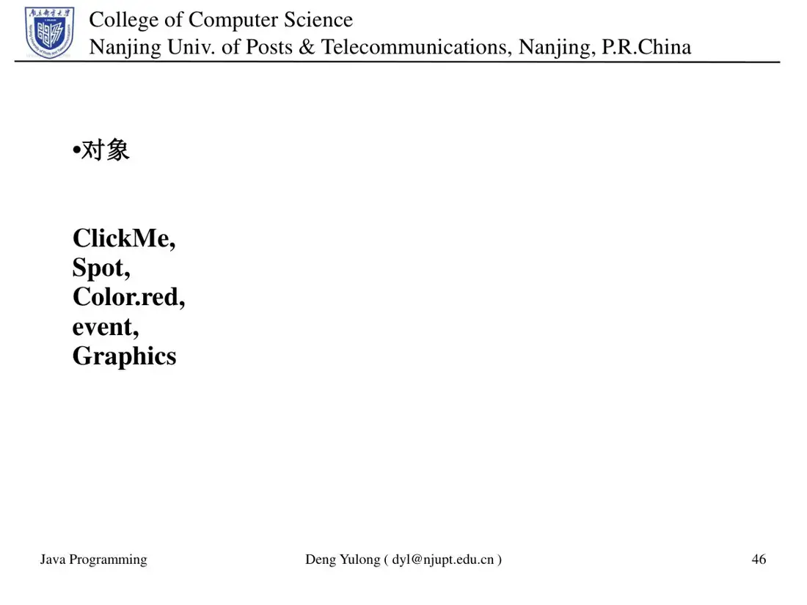

原文：

•对象

ClickMe, Spot, Color.red, event, Graphics

南京郵電大學Nanjing U 圆 mmnciions

College of Computer Science Nanjing Univ. of Posts & Telecommunications, Nanjing, P.R.China

Java Programming

Deng Yulong ( dyl@njupt.edu.cn )

46

### •类和由类创建的对象 (举例)

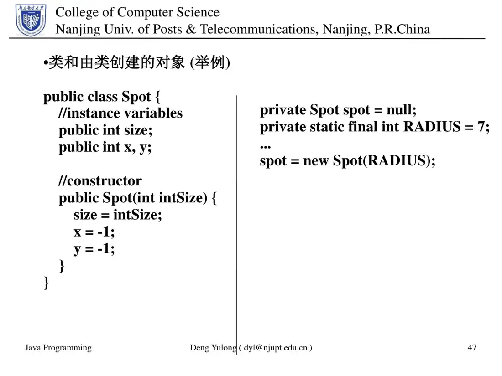

原文：

•类和由类创建的对象 (举例)

南京郵電大學Nanjing U 圆 mmnciions

College of Computer Science Nanjing Univ. of Posts & Telecommunications, Nanjing, P.R.China

Java Programming

Deng Yulong ( dyl@njupt.edu.cn )

47

### 左图为Spot类右图为Spot 对象

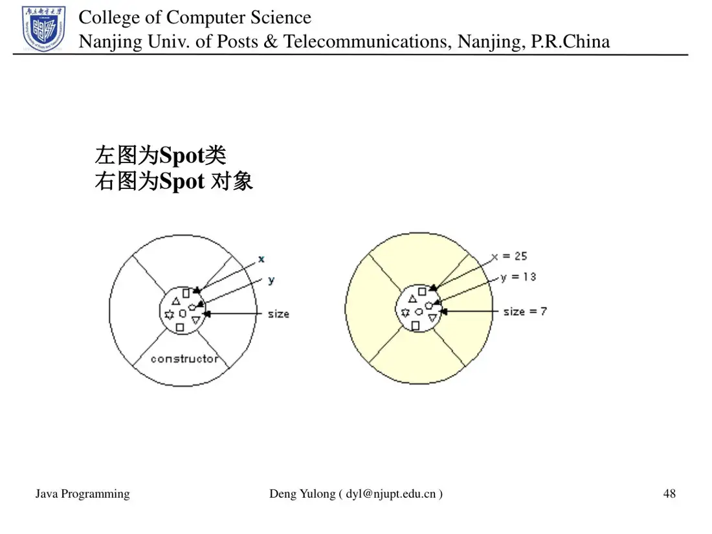

原文：

左图为Spot类右图为Spot 对象

南京郵電大學Nanjing U 圆 mmnciions

College of Computer Science Nanjing Univ. of Posts & Telecommunications, Nanjing, P.R.China

Java Programming

Deng Yulong ( dyl@njupt.edu.cn )

48

### • 消息（举例）

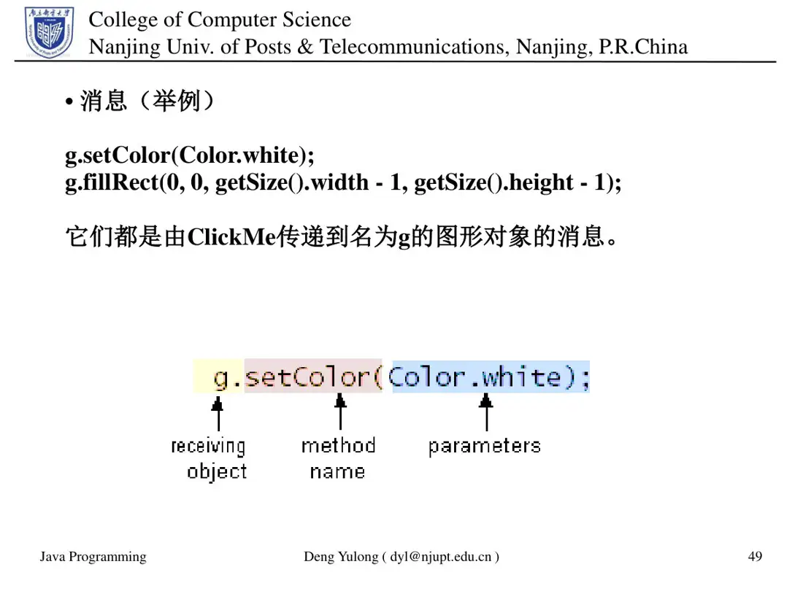

原文：

• 消息（举例）

g.setColor(Color.white); g.fillRect(0, 0, getSize().width - 1, getSize().height - 1);

它们都是由ClickMe传递到名为g的图形对象的消息。

南京郵電大學Nanjing U 圆 mmnciions

College of Computer Science Nanjing Univ. of Posts & Telecommunications, Nanjing, P.R.China

Java Programming

Deng Yulong ( dyl@njupt.edu.cn )

49

### • 继承

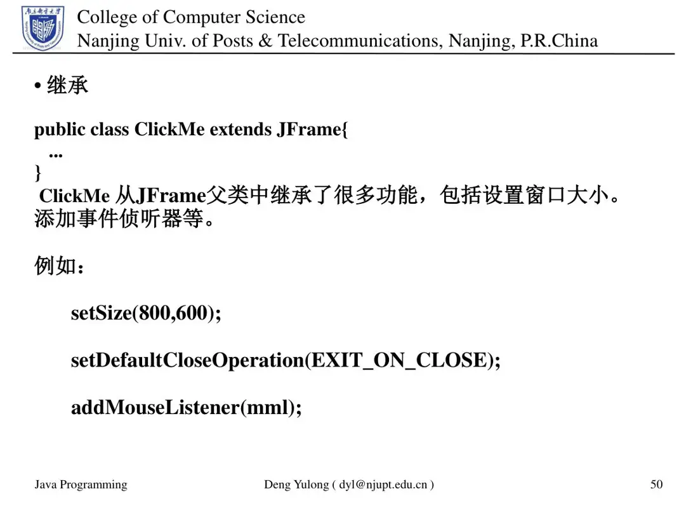

原文：

• 继承

public class ClickMe extends JFrame{

ClickMe 从JFrame父类中继承了很多功能，包括设置窗口大小。添加事件侦听器等。

例如：

setSize(800,600);

setDefaultCloseOperation(EXIT\_ON\_CLOSE);

addMouseListener(mml);

南京郵電大學Nanjing Unn

College of Computer Science Nanjing Univ. of Posts & Telecommunications, Nanjing, P.R.China

Java Programming

Deng Yulong ( dyl@njupt.edu.cn )

50

### • 接口

原文：

• 接口

The ClickMe 通过在鼠标点击点位置显示红点来响应鼠标点击。Java平台事件处理系统规定，一个对象需要实现MouseListener 接口以便能得到鼠标点击事件的通知，同时这个对象还需要注册为一个鼠标侦听器( mouse listener)

在MouseListener接口中定义的5个方法必须全部进行实现，即使实际只用到其中的某个事件。

南京郵電大學Nanjing Ut 圆

College of Computer Science Nanjing Univ. of Posts & Telecommunications, Nanjing, P.R.China

Java Programming

Deng Yulong ( dyl@njupt.edu.cn )

51

### public ClickMe(){

原文：

public ClickMe(){

mml = new MyMouseListener();

addMouseListener(mml);

南京郵電大學Nanjing Ut 圆

College of Computer Science Nanjing Univ. of Posts & Telecommunications, Nanjing, P.R.China

Java Programming

Deng Yulong ( dyl@njupt.edu.cn )

52

### 南京郵電大學

原文：

class MyMouseListener implements MouseListener{ public void mouseClicked(MouseEvent event) {} public void mouseReleased(MouseEvent event) {} public void mouseEntered(MouseEvent event) {} public void mouseExited(MouseEvent event) {}

南京郵電大學

College of Computer Science Nanjing Univ. of Posts & Telecommunications, Nanjing, P.R.China

### 南京郵電大學Nanjing Ut 圆

原文：

南京郵電大學Nanjing Ut 圆

College of Computer Science Nanjing Univ. of Posts & Telecommunications, Nanjing, P.R.China

Java Programming

Deng Yulong ( dyl@njupt.edu.cn )

54

### • API 文档

原文：

• API 文档

可以从API 获取更多关于类的信息:

\* javax. swing.JFrame

\* java.awt.Graphics

\* java.awt.Color

\* java.awt.event.MouseListener

\* java.awt.event.MouseEvent

南京郵電大學Nanjing Ut 圆

College of Computer Science Nanjing Univ. of Posts & Telecommunications, Nanjing, P.R.China

Java Programming

Deng Yulong ( dyl@njupt.edu.cn )

55
