# 《Java程序设计》第3章 Java语言基础（课件）

原件的每一页，下面附识别出的文字。

### 第3章 Java语言基础

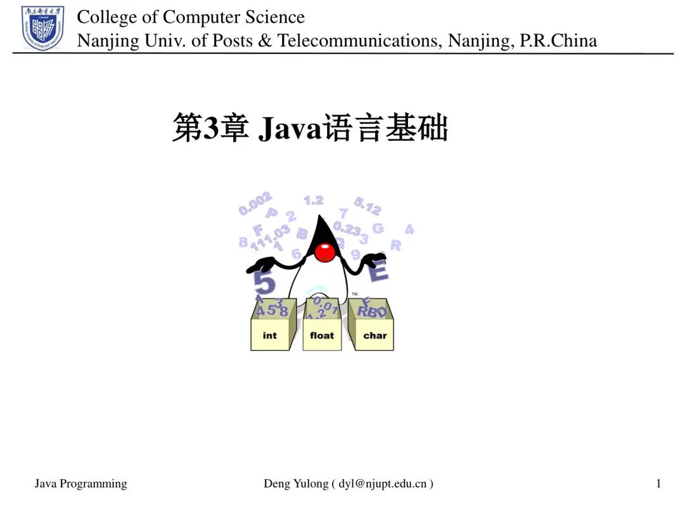

原文：

第3章 Java语言基础

南京郵電大學Nanjing Ut 圆

College of Computer Science Nanjing Univ. of Posts & Telecommunications, Nanjing, P.R.China

Java Programming

Deng Yulong ( dyl@njupt.edu.cn )

1

### 3.1 变量(Variable)

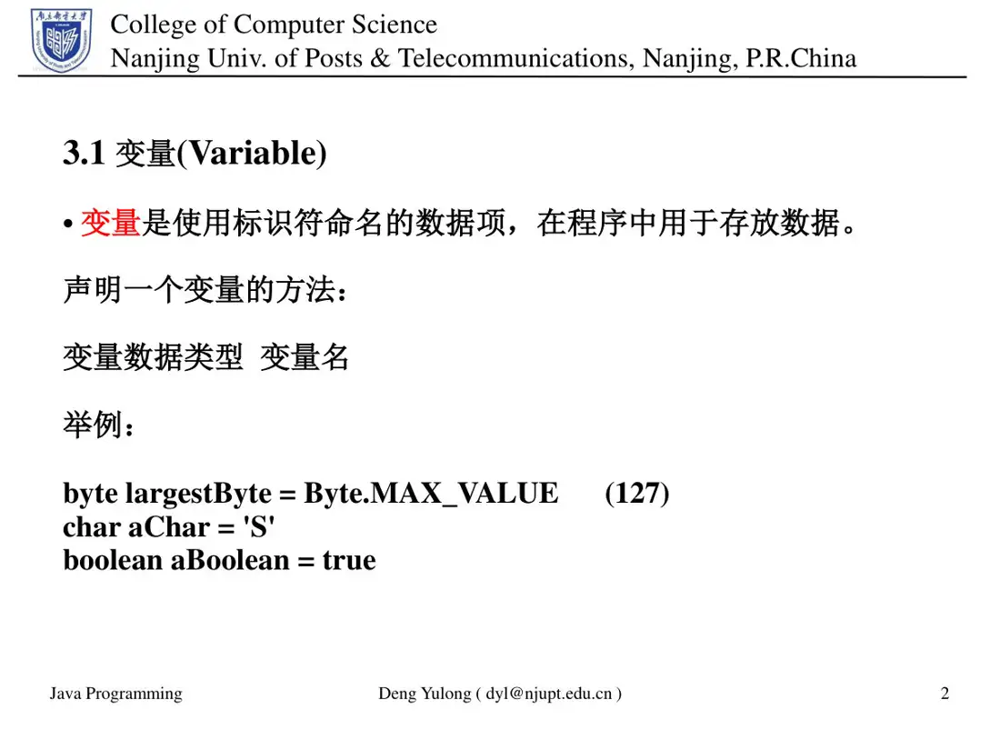

原文：

3.1 变量(Variable)

• 变量是使用标识符命名的数据项，在程序中用于存放数据。

声明一个变量的方法：

变量数据类型 变量名

举例：

byte largestByte = Byte.MAX\_VALUE (127) char aChar = 'S' boolean aBoolean = true

南京郵電大學Nanjing U 圆 mmnciions

College of Computer Science Nanjing Univ. of Posts & Telecommunications, Nanjing, P.R.China

Java Programming

Deng Yulong ( dyl@njupt.edu.cn )

2

### • 数据类型

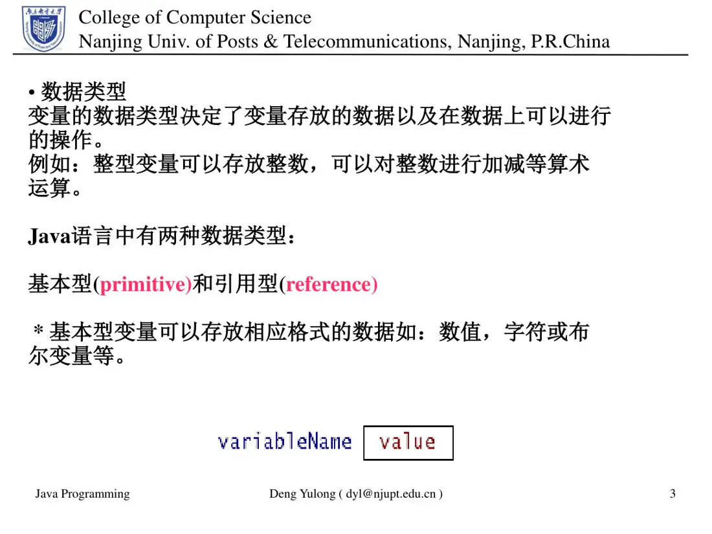

原文：

• 数据类型

变量的数据类型决定了变量存放的数据以及在数据上可以进行的操作。

例如：整型变量可以存放整数，可以对整数进行加减等算术运算。

Java语言中有两种数据类型：

基本型(primitive)和引用型(reference)

\* 基本型变量可以存放相应格式的数据如：数值，字符或布尔变量等。

variableName

value

南京郵電大學Nanjing Unn

College of Computer Science Nanjing Univ. of Posts & Telecommunications, Nanjing, P.R.China

Java Programming

Deng Yulong ( dyl@njupt.edu.cn )

3

### Java语言中的基本型变量：

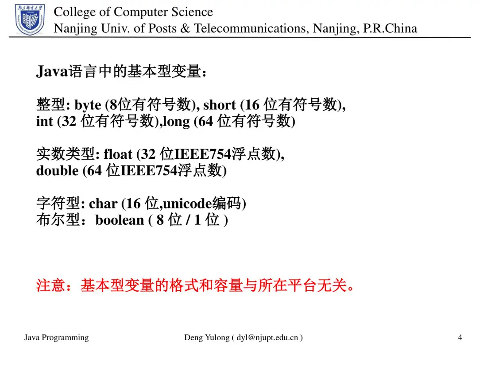

原文：

Java语言中的基本型变量：

整型: byte (8位有符号数), short (16 位有符号数), int (32 位有符号数),long (64 位有符号数)

实数类型: float (32 位IEEE754浮点数),double (64 位IEEE754浮点数)

字符型: char (16 位,unicode编码)

布尔型：boolean ( 8 位 / 1 位 )

注意：基本型变量的格式和容量与所在平台无关。

南京郵電大學Nanjing Ut 圆

College of Computer Science Nanjing Univ. of Posts & Telecommunications, Nanjing, P.R.China

Java Programming

Deng Yulong ( dyl@njupt.edu.cn )

4

### 数据类型长度的唯一性保证了Java代码的可移植性。

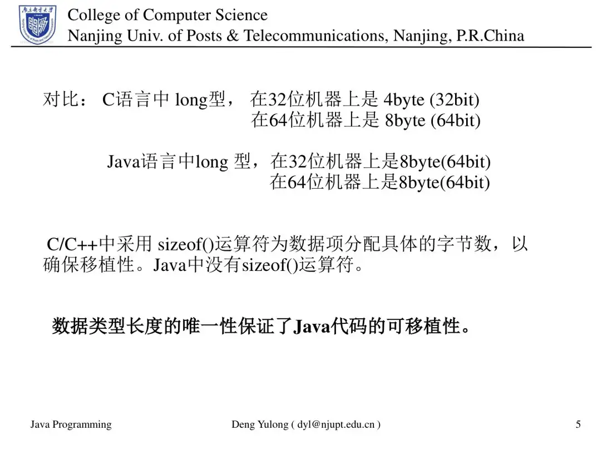

原文：

对比： C语言中 long型， 在32位机器上是 4byte (32bit)在64位机器上是 8byte (64bit)

Java语言中long 型，在32位机器上是8byte(64bit)在64位机器上是8byte(64bit)

C/C++中采用sizeof()运算符为数据项分配具体的字节数，以确保移植性。Java中没有sizeof()运算符。

数据类型长度的唯一性保证了Java代码的可移植性。

南京郵電大學Nanjing Ora 圆易 mmnncons

College of Computer Science Nanjing Univ. of Posts & Telecommunications, Nanjing, P.R.China

Java Programming

Deng Yulong ( dyl@njupt.edu.cn )

5

### 注意： 隐式转换有时会得到程序员预料之外的结果，从而在程序中出现错误。

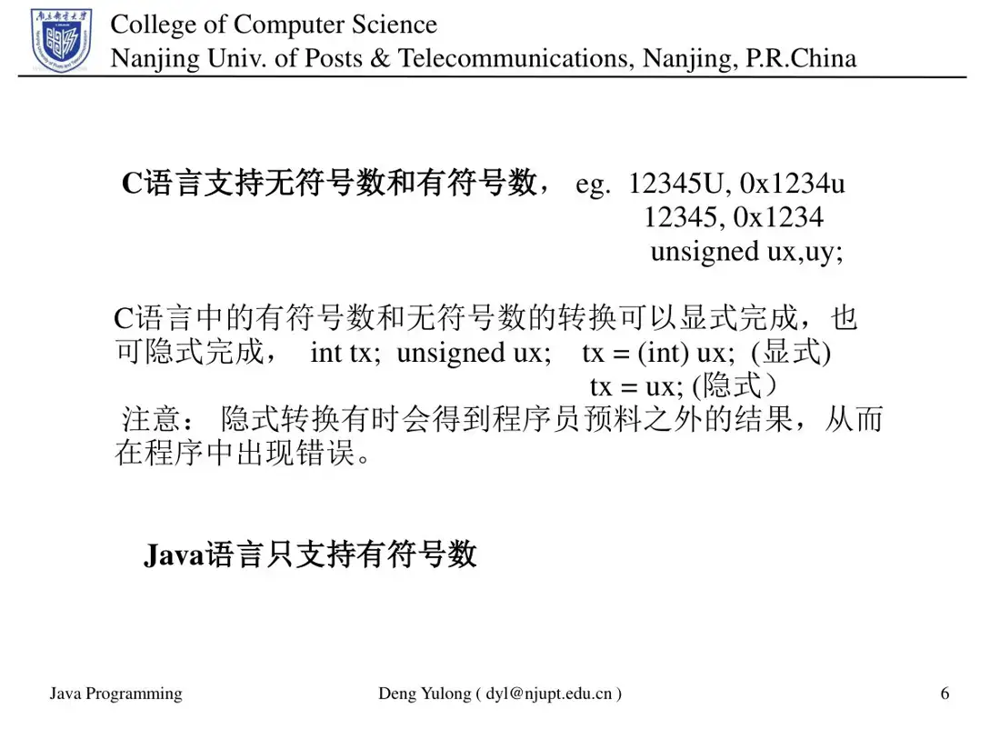

原文：

C语言支持无符号数和有符号数， eg. 12345U, 0x1234u12345, 0x1234unsigned ux,uy;

C语言中的有符号数和无符号数的转换可以显式完成，也可隐式完成， int tx; unsigned ux; tx = (int) ux; (显式)tx = ux; (隐式）

注意： 隐式转换有时会得到程序员预料之外的结果，从而在程序中出现错误。

Java语言只支持有符号数

南京郵電大學Nanjing Ora 圆

College of Computer Science Nanjing Univ. of Posts & Telecommunications, Nanjing, P.R.China

Java Programming

Deng Yulong ( dyl@njupt.edu.cn )

6

### Unicode编码

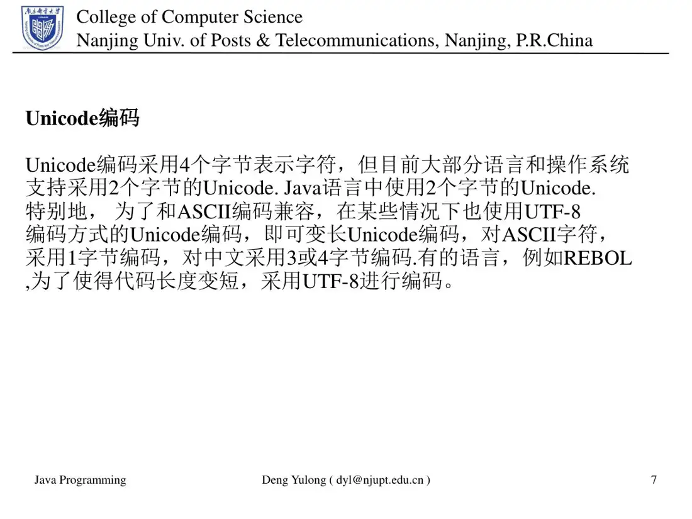

原文：

Unicode编码

Unicode编码采用4个字节表示字符，但目前大部分语言和操作系统支持采用2个字节的Unicode. Java语言中使用2个字节的Unicode.特别地， 为了和ASCII编码兼容，在某些情况下也使用UTF-8编码方式的Unicode编码，即可变长Unicode编码，对ASCII字符，采用1字节编码，对中文采用3或4字节编码.有的语言，例如REBOL,为了使得代码长度变短，采用UTF-8进行编码。

南京郵電大学Nanjing Ora 圆

College of Computer Science Nanjing Univ. of Posts & Telecommunications, Nanjing, P.R.China

Java Programming

Deng Yulong ( dyl@njupt.edu.cn )

7

### 变量可以直接赋值：

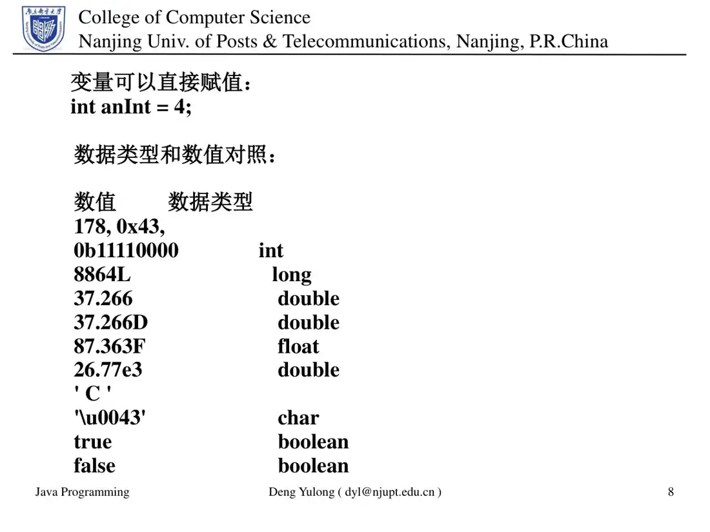

原文：

变量可以直接赋值：

数据类型和数值对照：

数值 数据类型

南京郵電大學Nanjing U 圆 mmnciions

College of Computer Science Nanjing Univ. of Posts & Telecommunications, Nanjing, P.R.China

8

### 基本型变量的类型转换

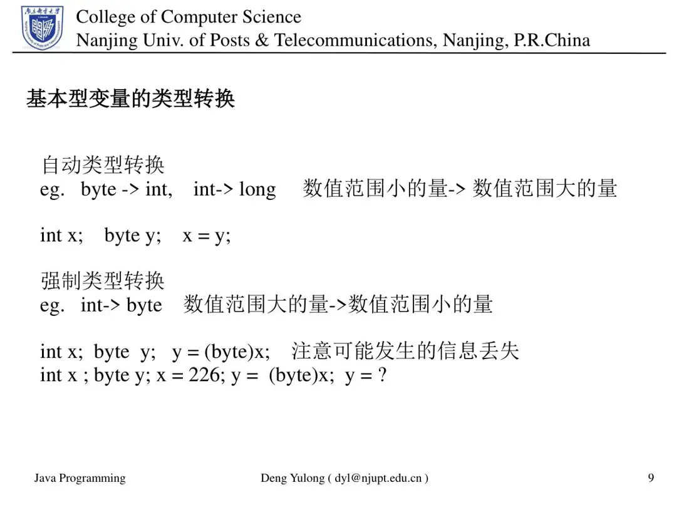

原文：

基本型变量的类型转换

南京郵電大學948

College of Computer Science Nanjing Univ. of Posts & Telecommunications, Nanjing, P.R.China

Java Programming

Deng Yulong ( dyl@njupt.edu.cn )

9

### x = 226

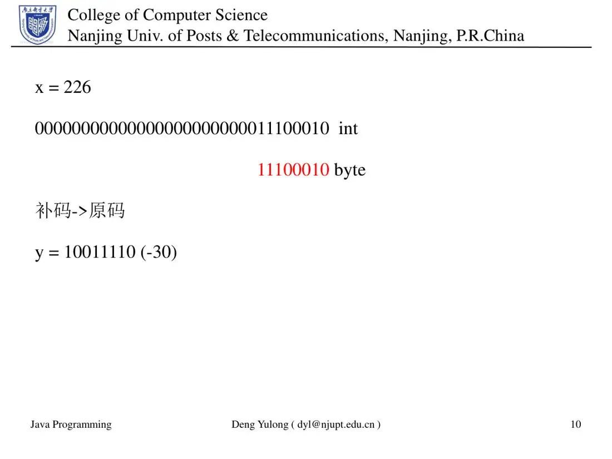

原文：

x = 226

00000000000000000000000011100010 int

11100010 byte

补码->原码

y = 10011110 (-30)

南京都電大学

College of Computer Science Nanjing Univ. of Posts & Telecommunications, Nanjing, P.R.China

Java Programming

Deng Yulong ( dyl@njupt.edu.cn )

10

### \* 引用型变量是对单个数值或数值集合（数组，类，接口）的引用。

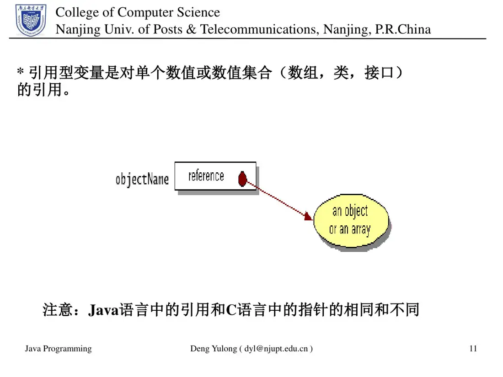

原文：

\* 引用型变量是对单个数值或数值集合（数组，类，接口）的引用。

注意：Java语言中的引用和C语言中的指针的相同和不同

南京郵電大學Nanjing Ut 圆

College of Computer Science Nanjing Univ. of Posts & Telecommunications, Nanjing, P.R.China

Java Programming

Deng Yulong ( dyl@njupt.edu.cn )

11

### 简单命名:

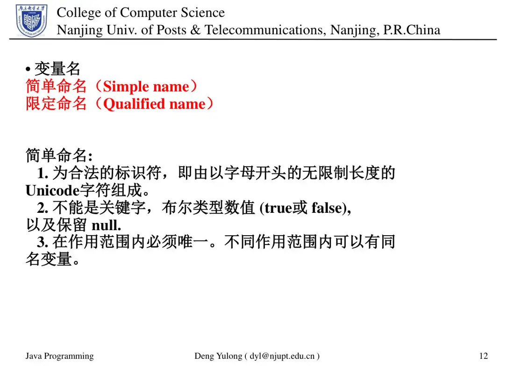

原文：

• 变量名简单命名（Simple name）限定命名（Qualified name）

简单命名:

1. 为合法的标识符，即由以字母开头的无限制长度的Unicode字符组成。

2. 不能是关键字，布尔类型数值 (true或 false),以及保留 null.

3. 在作用范围内必须唯一。不同作用范围内可以有同名变量。

南京郵電大學Nanjing Unn

College of Computer Science Nanjing Univ. of Posts & Telecommunications, Nanjing, P.R.China

Java Programming

Deng Yulong ( dyl@njupt.edu.cn )

12

### • 作用范围(Scope)

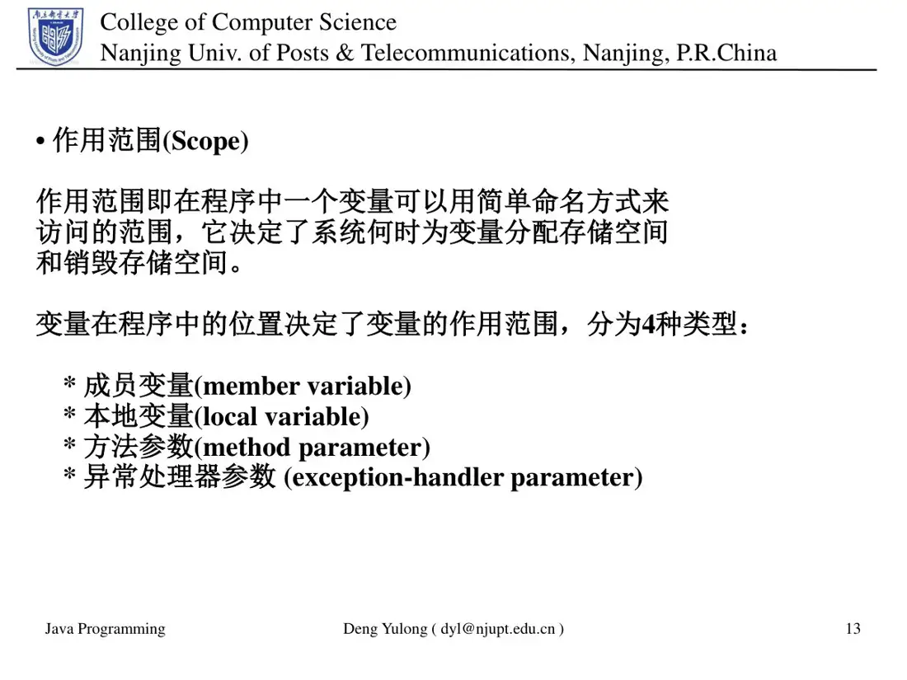

原文：

• 作用范围(Scope)

作用范围即在程序中一个变量可以用简单命名方式来访问的范围，它决定了系统何时为变量分配存储空间和销毁存储空间。

变量在程序中的位置决定了变量的作用范围，分为4种类型：

\* 成员变量(member variable)

\* 本地变量(local variable)

\* 方法参数(method parameter)

\* 异常处理器参数 (exception-handler parameter)

南京郵電大學Nanjing Ut 圆

College of Computer Science Nanjing Univ. of Posts & Telecommunications, Nanjing, P.R.China

Java Programming

Deng Yulong ( dyl@njupt.edu.cn )

13

### 成员变量的作用范围为整个类的声明范围。

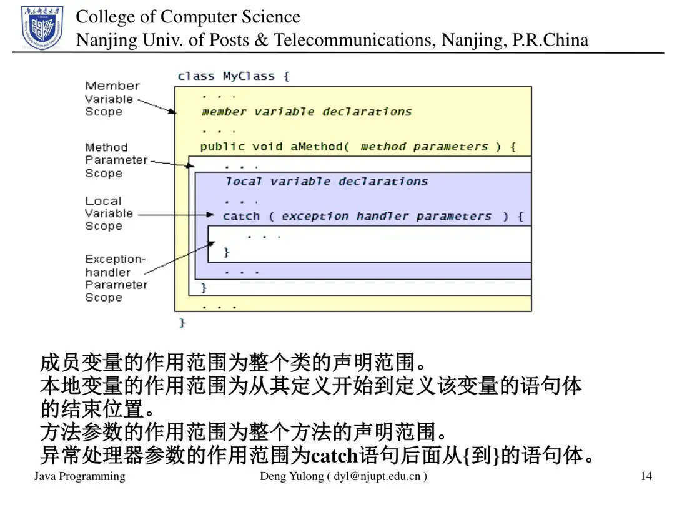

原文：

成员变量的作用范围为整个类的声明范围。

本地变量的作用范围为从其定义开始到定义该变量的语句体的结束位置。

方法参数的作用范围为整个方法的声明范围。

异常处理器参数的作用范围为catch语句后面从{到}的语句体。

南京郵電大學Nanjing Unn

College of Computer Science Nanjing Univ. of Posts & Telecommunications, Nanjing, P.R.China

Java Programming

Deng Yulong ( dyl@njupt.edu.cn )

14

### 举例：

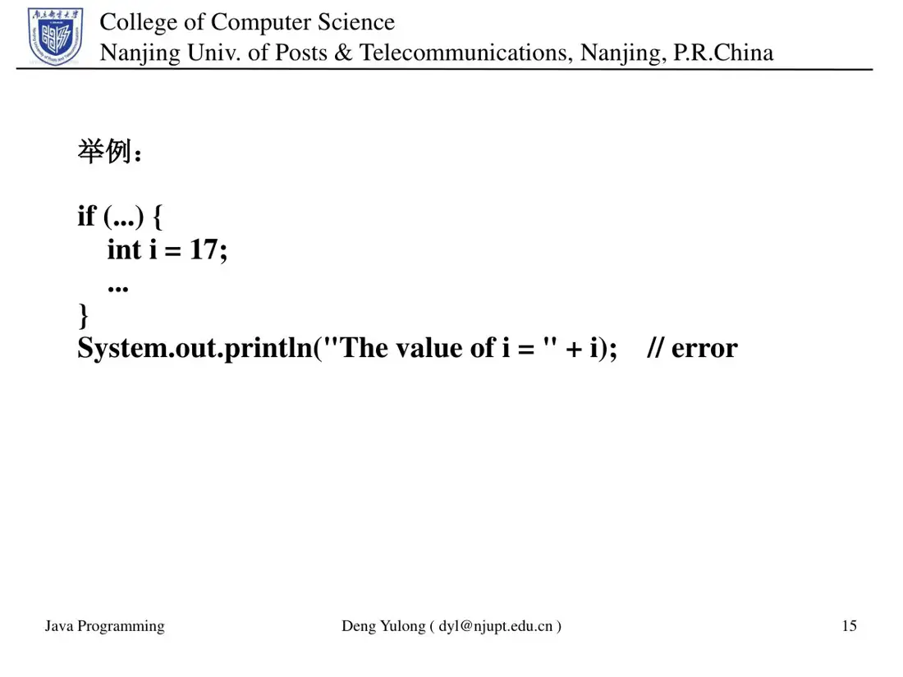

原文：

举例：

南京郵電大學

College of Computer Science Nanjing Univ. of Posts & Telecommunications, Nanjing, P.R.China

Java Programming

Deng Yulong ( dyl@njupt.edu.cn )

15

### • 变量的初始化

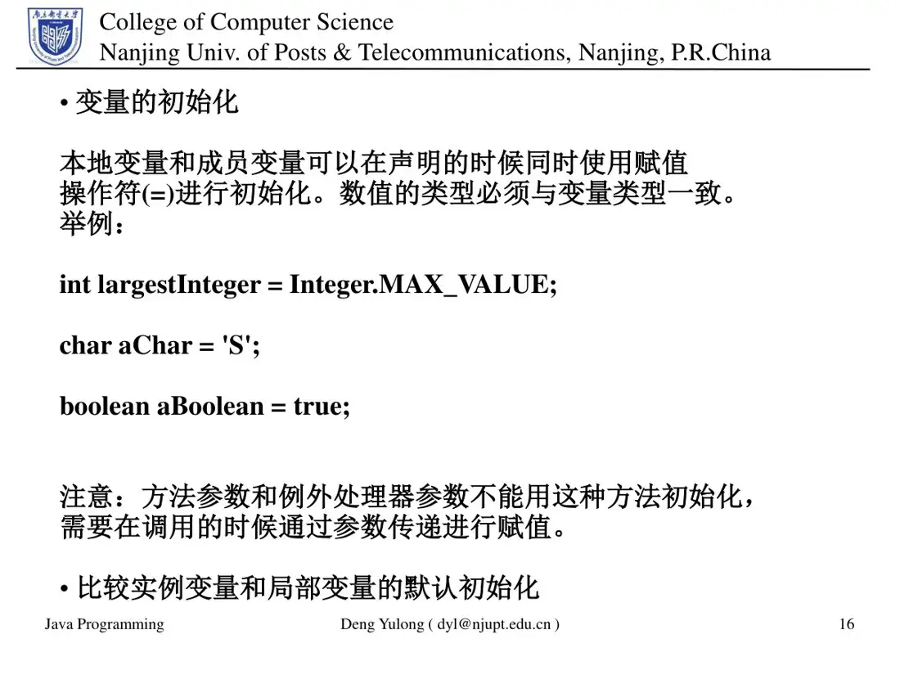

原文：

• 变量的初始化

本地变量和成员变量可以在声明的时候同时使用赋值操作符(=)进行初始化。数值的类型必须与变量类型一致。举例：

char aChar = 'S';

boolean aBoolean = true;

注意：方法参数和例外处理器参数不能用这种方法初始化，需要在调用的时候通过参数传递进行赋值。

• 比较实例变量和局部变量的默认初始化

南京郵電大學Nanjing Unn

College of Computer Science Nanjing Univ. of Posts & Telecommunications, Nanjing, P.R.China

Java Programming

Deng Yulong ( dyl@njupt.edu.cn )

16

### 实例变量

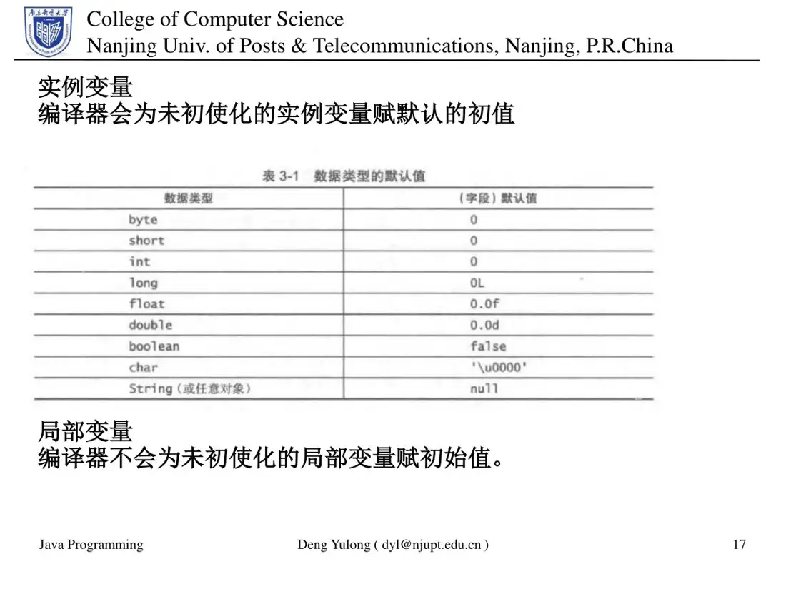

原文：

实例变量

编译器会为未初使化的实例变量赋默认的初值

表 3-1 数据类型的默认值
<table><tr><td>数据类型</td><td>(字段)默认值</td></tr><tr><td>byte</td><td>0</td></tr><tr><td>short</td><td>0</td></tr><tr><td>int</td><td>0</td></tr><tr><td>long</td><td>0L</td></tr><tr><td>float</td><td>0.0f</td></tr><tr><td>double</td><td>0.0d</td></tr><tr><td>boolean</td><td>false</td></tr><tr><td>char</td><td>&#x27;\u0000&#x27;</td></tr><tr><td>String(或任意对象)</td><td>null</td></tr></table>

局部变量

编译器不会为未初使化的局部变量赋初始值。

南京郵電大學Nanjing Unn

College of Computer Science Nanjing Univ. of Posts & Telecommunications, Nanjing, P.R.China

Java Programming

Deng Yulong ( dyl@njupt.edu.cn )

17

### 表 3-1 数据类型的默认值

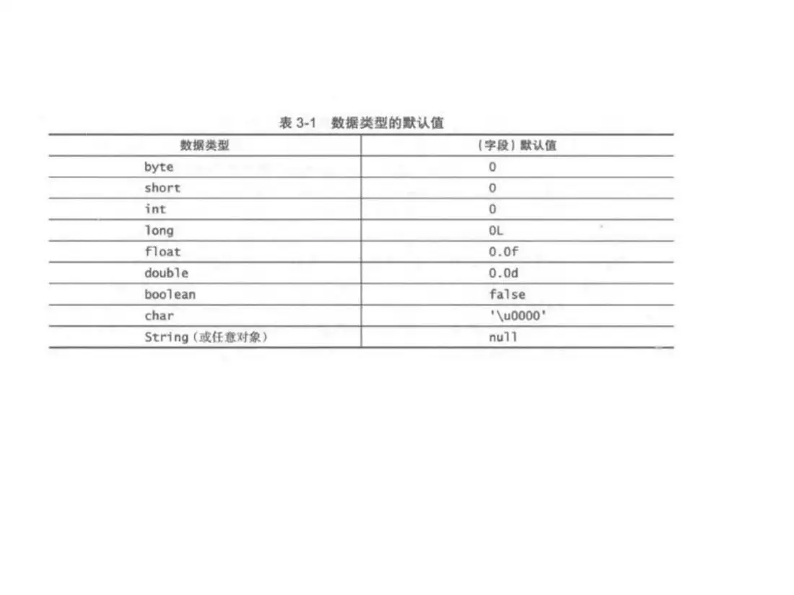

原文：

表 3-1 数据类型的默认值
<table><tr><td>数据类型</td><td>(字段)默认值</td></tr><tr><td>byte</td><td>0</td></tr><tr><td>short</td><td>0</td></tr><tr><td>int</td><td>0</td></tr><tr><td>long</td><td>0L</td></tr><tr><td>float</td><td>0.0f</td></tr><tr><td>double</td><td>0.0d</td></tr><tr><td>boolean</td><td>false</td></tr><tr><td>char</td><td>&#x27;\u0000&#x27;</td></tr><tr><td>String(或任意对象)</td><td>null</td></tr></table>

### • 终止变量 (Final Variables)

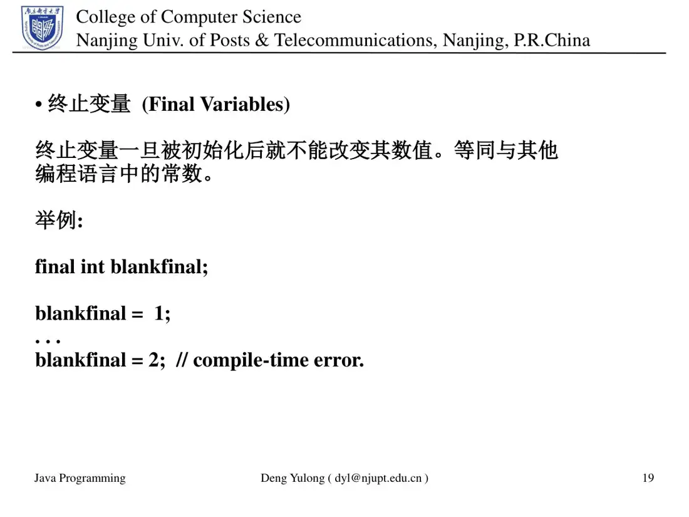

原文：

• 终止变量 (Final Variables)

终止变量一旦被初始化后就不能改变其数值。等同与其他编程语言中的常数。

举例:

final int blankfinal;

blankfinal = 1;

blankfinal = 2; // compile-time error.

南京郵電大學Nanjing U 圆 mmnciions

College of Computer Science Nanjing Univ. of Posts & Telecommunications, Nanjing, P.R.China

Java Programming

Deng Yulong ( dyl@njupt.edu.cn )

19

### 3.2 操作符(Operators)

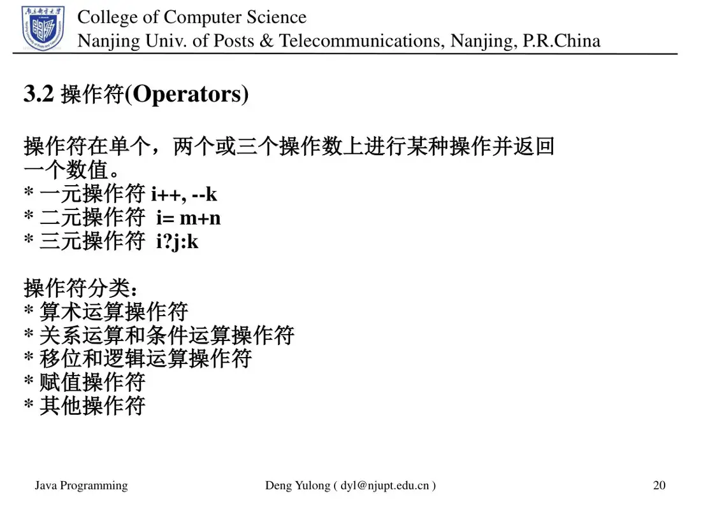

原文：

3.2 操作符(Operators)

操作符在单个，两个或三个操作数上进行某种操作并返回一个数值。

\* 一元操作符 i++, --k

\* 二元操作符 i= m+n

\* 三元操作符 i?j:k

操作符分类：

\* 算术运算操作符

\* 关系运算和条件运算操作符

\* 移位和逻辑运算操作符

\* 赋值操作符

\* 其他操作符

南京郵電大學Nanjing Unn

College of Computer Science Nanjing Univ. of Posts & Telecommunications, Nanjing, P.R.China

Java Programming

Deng Yulong ( dyl@njupt.edu.cn )

20

### • 算术运算操作符

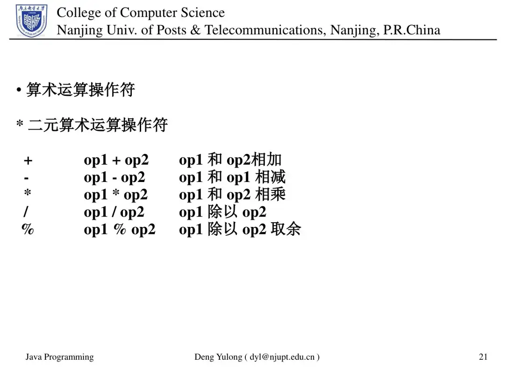

原文：

• 算术运算操作符

\* 二元算术运算操作符

<table><tr><td>+</td><td>op1 + op2</td><td>op1 和 op2相加</td></tr><tr><td>-</td><td>op1 - op2</td><td>op1 和 op1 相减</td></tr><tr><td>*</td><td>op1 * op2</td><td>op1 和 op2 相乘</td></tr><tr><td>/</td><td>op1 / op2</td><td>op1 除以 op2</td></tr><tr><td>%</td><td>op1 % op2</td><td>op1 除以 op2 取余</td></tr></table>

南京郵電大學Nanjing U 圆 mmnciions

College of Computer Science Nanjing Univ. of Posts & Telecommunications, Nanjing, P.R.China

Java Programming

Deng Yulong ( dyl@njupt.edu.cn )

21

### 注意：算术运算符的返回类型

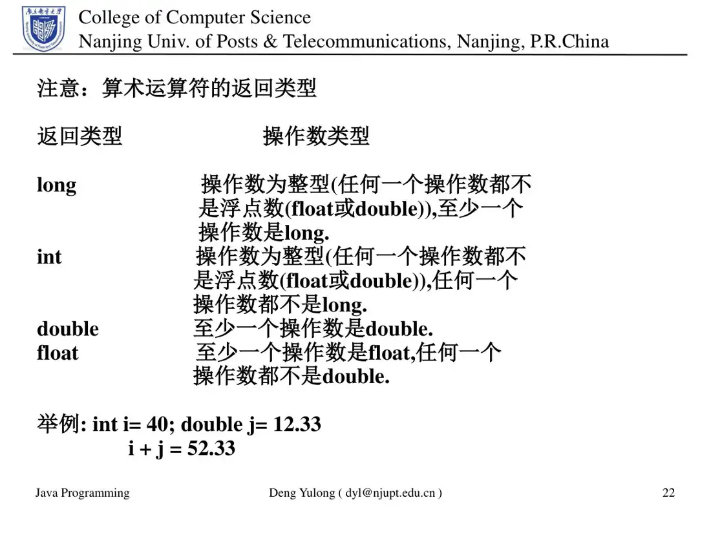

原文：

注意：算术运算符的返回类型

<table><tr><td>返回类型</td><td>操作数类型</td></tr><tr><td>long</td><td>操作数为整型(任何一个操作数都不是浮点数(float或double)),至少一个操作数是long.</td></tr><tr><td>int</td><td>操作数为整型(任何一个操作数都不是浮点数(float或double)),任何一个操作数都不是long.</td></tr><tr><td>double</td><td>至少一个操作数是double.</td></tr><tr><td>float</td><td>至少一个操作数是float,任何一个操作数都不是double.</td></tr></table>

举例: int i= 40; double j= 12.33 i + j = 52.33

南京郵電大學Nanjing U 圆 mmnciions

College of Computer Science Nanjing Univ. of Posts & Telecommunications, Nanjing, P.R.China

Java Programming

Deng Yulong ( dyl@njupt.edu.cn )

22

### \* 增量减量运算符

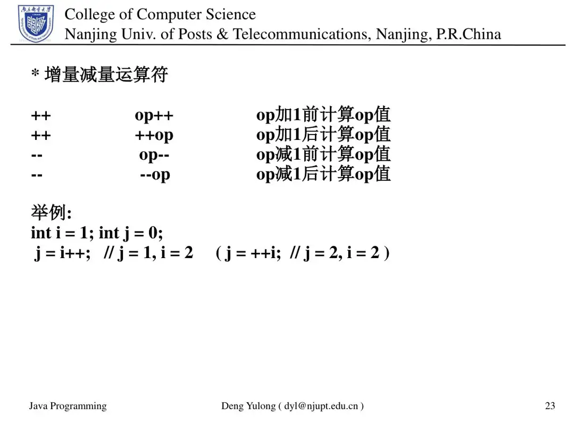

原文：

\* 增量减量运算符

$$
^ {+ +}
$$

$$
\mathbf {o p} + +
$$

$$
^ {+ +}
$$

$$
+ + \mathbf {o p}
$$

$$
\mathbf {o p} - -
$$

$$
- - \mathbf {o p}
$$

举例:

int i = 1; int j = 0;

$$
\mathbf {j} = \mathbf {i} + +; / / \mathbf {j} = \mathbf {1}, \mathbf {i} = 2
$$

op加1前计算op值

op加1后计算op值

op减1前计算op值

op减1后计算op值

$$
(\mathbf {j} = + + \mathbf {i}; / / \mathbf {j} = 2, \mathbf {i} = 2)
$$

南京郵電大學Nanjing U 圆 mmnciions

College of Computer Science Nanjing Univ. of Posts & Telecommunications, Nanjing, P.R.China

Java Programming

Deng Yulong ( dyl@njupt.edu.cn )

23

### •关系和条件运算符

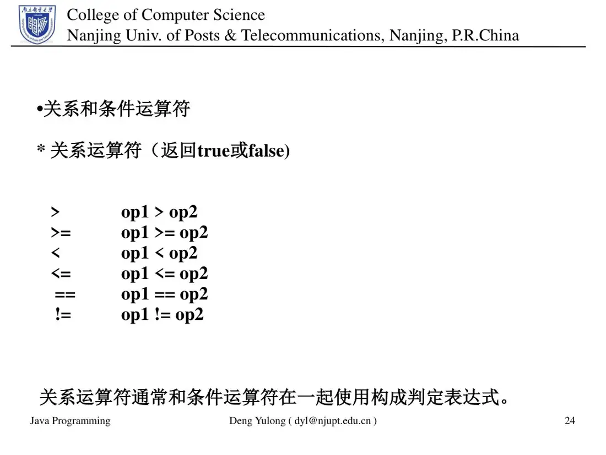

原文：

•关系和条件运算符

\* 关系运算符（返回true或false)

关系运算符通常和条件运算符在一起使用构成判定表达式。

南京郵電大學Nanjing Ut 圆

College of Computer Science Nanjing Univ. of Posts & Telecommunications, Nanjing, P.R.China

Java Programming

Deng Yulong ( dyl@njupt.edu.cn )

24

### \*条件运算符(操作数是true或false,结果返回true或false)

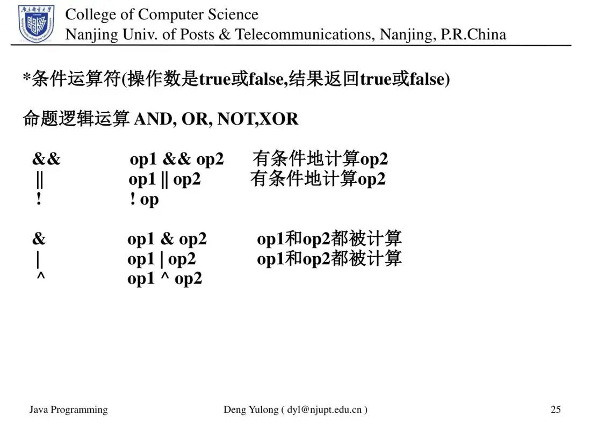

原文：

\*条件运算符(操作数是true或false,结果返回true或false)

命题逻辑运算 AND, OR, NOT,XOR

<table><tr><td>&amp;&amp;</td><td>op1 &amp;&amp; op2</td><td>有条件地计算op2</td></tr><tr><td>||</td><td>op1 || op2</td><td>有条件地计算op2</td></tr><tr><td>!</td><td>! op</td><td></td></tr><tr><td>&amp;</td><td>op1 &amp; op2</td><td>op1和op2都被计算</td></tr><tr><td>|</td><td>op1 | op2</td><td>op1和op2都被计算</td></tr><tr><td>^</td><td>op1 ^ op2</td><td></td></tr></table>

南京郵電大學Nanjing U 圆 mmnciions

College of Computer Science Nanjing Univ. of Posts & Telecommunications, Nanjing, P.R.China

Java Programming

Deng Yulong ( dyl@njupt.edu.cn )

25

### 注意：

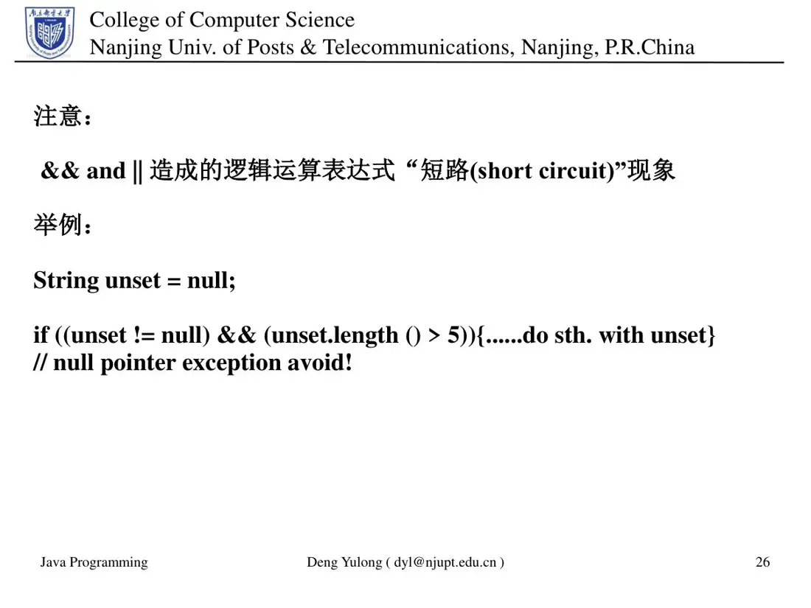

原文：

注意：

&& and || 造成的逻辑运算表达式“短路(short circuit)”现象

举例：

String unset = null;

if ((unset != null) && (unset.length () > 5)){......do sth. with unset} // null pointer exception avoid!

南京郵電大學

College of Computer Science Nanjing Univ. of Posts & Telecommunications, Nanjing, P.R.China

Java Programming

Deng Yulong ( dyl@njupt.edu.cn )

26

### • 移位和位逻辑运算

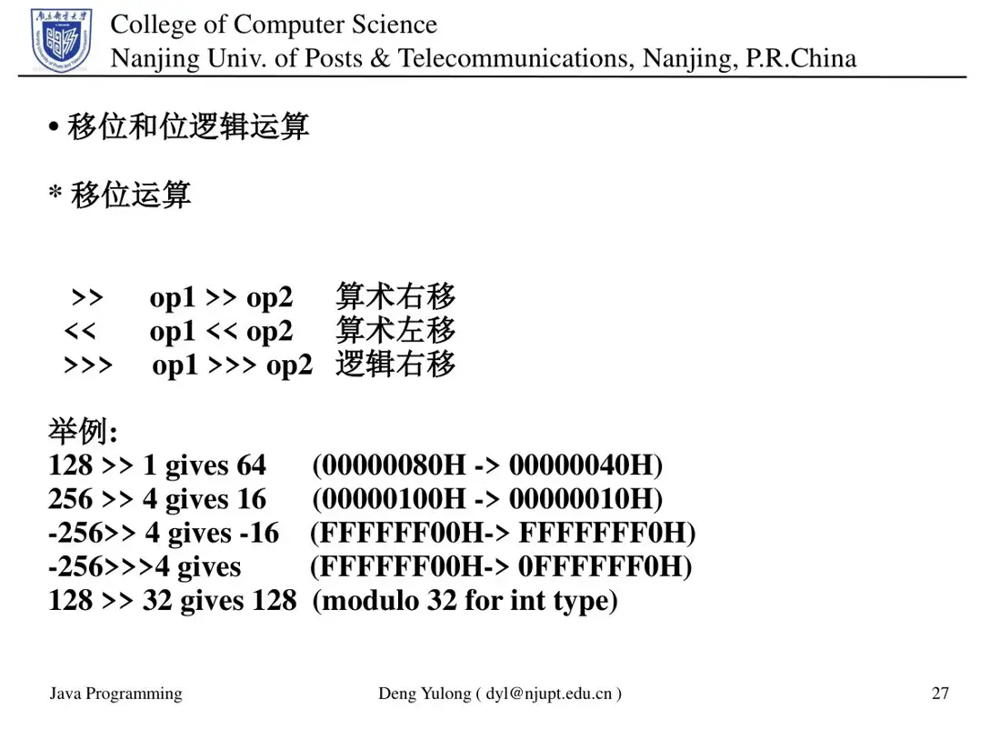

原文：

• 移位和位逻辑运算

\* 移位运算

举例:

-256>> 4 gives -16 (FFFFFF00H-> FFFFFFF0H)

-256>>>4 gives (FFFFFF00H-> 0FFFFFF0H)

128 >> 32 gives 128 (modulo 32 for int type)

南京郵電大學Nanjing Urtn

College of Computer Science Nanjing Univ. of Posts & Telecommunications, Nanjing, P.R.China

Java Programming

Deng Yulong ( dyl@njupt.edu.cn )

27

### • 位逻辑运算(按位布尔运算)

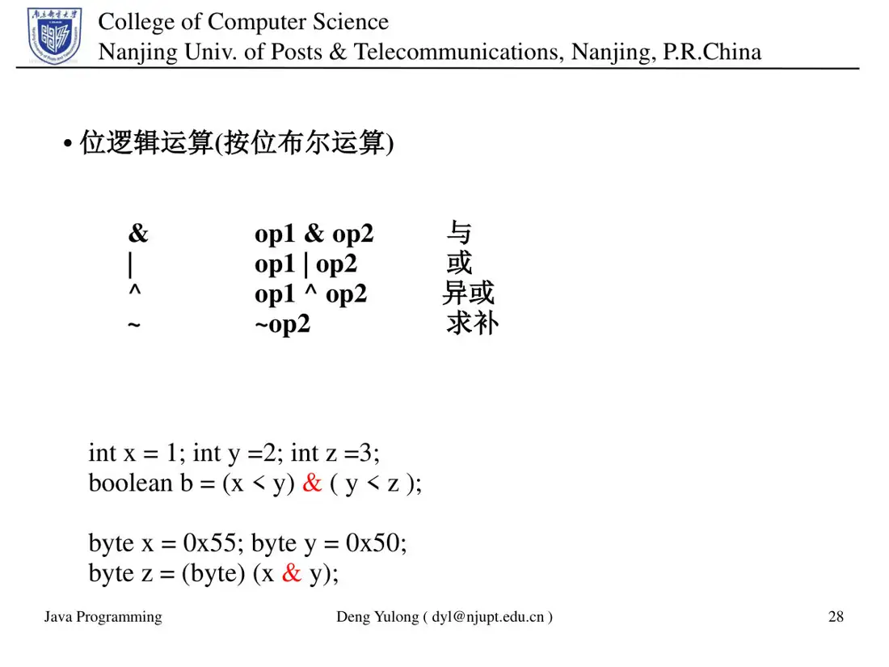

原文：

• 位逻辑运算(按位布尔运算)

南京郵電大學Nanjing U 圆 mmnciions

College of Computer Science Nanjing Univ. of Posts & Telecommunications, Nanjing, P.R.China

Java Programming

Deng Yulong ( dyl@njupt.edu.cn )

28

### 南京郵電大學Nanjing U 圆 mmnciions

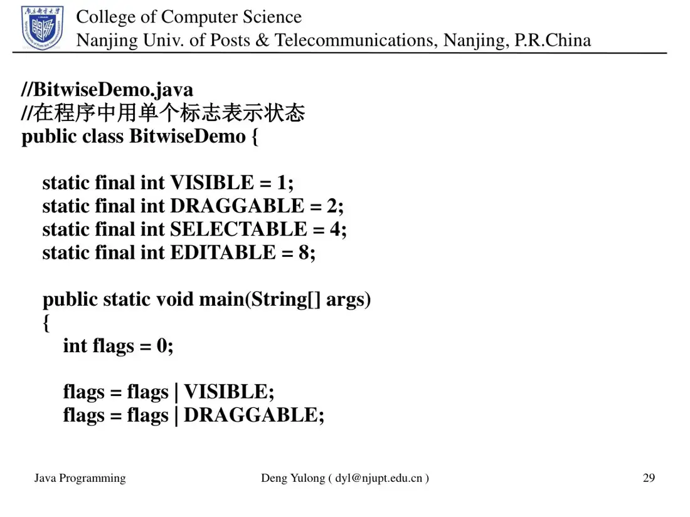

原文：

南京郵電大學Nanjing U 圆 mmnciions

College of Computer Science Nanjing Univ. of Posts & Telecommunications, Nanjing, P.R.China

Java Programming

Deng Yulong ( dyl@njupt.edu.cn )

29

### 南京郵電大學Nanjing Ut 圆

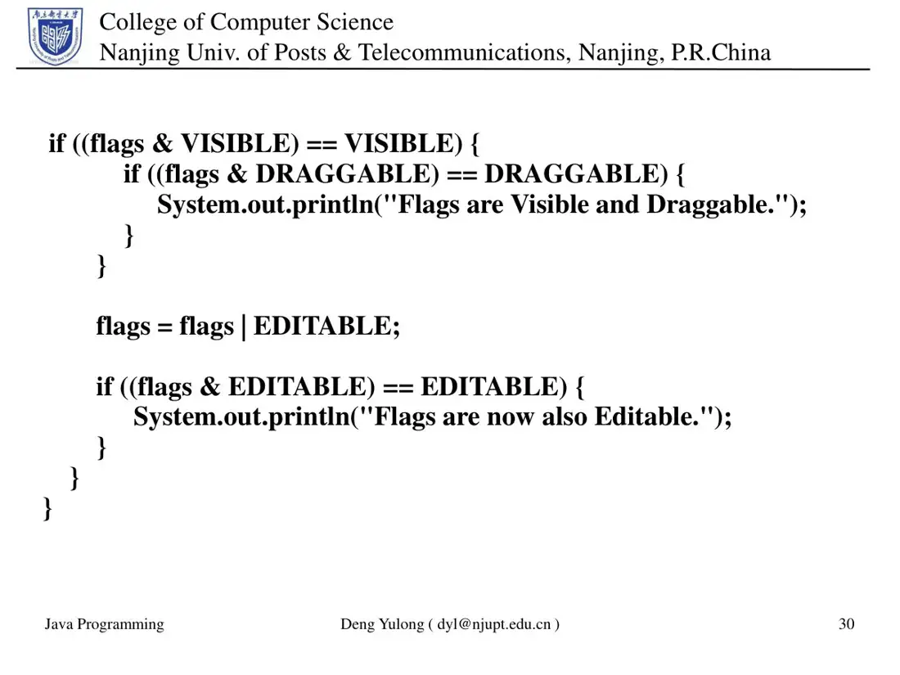

原文：

南京郵電大學Nanjing Ut 圆

College of Computer Science Nanjing Univ. of Posts & Telecommunications, Nanjing, P.R.China

Java Programming

Deng Yulong ( dyl@njupt.edu.cn )

30

### • 赋值运算操作符

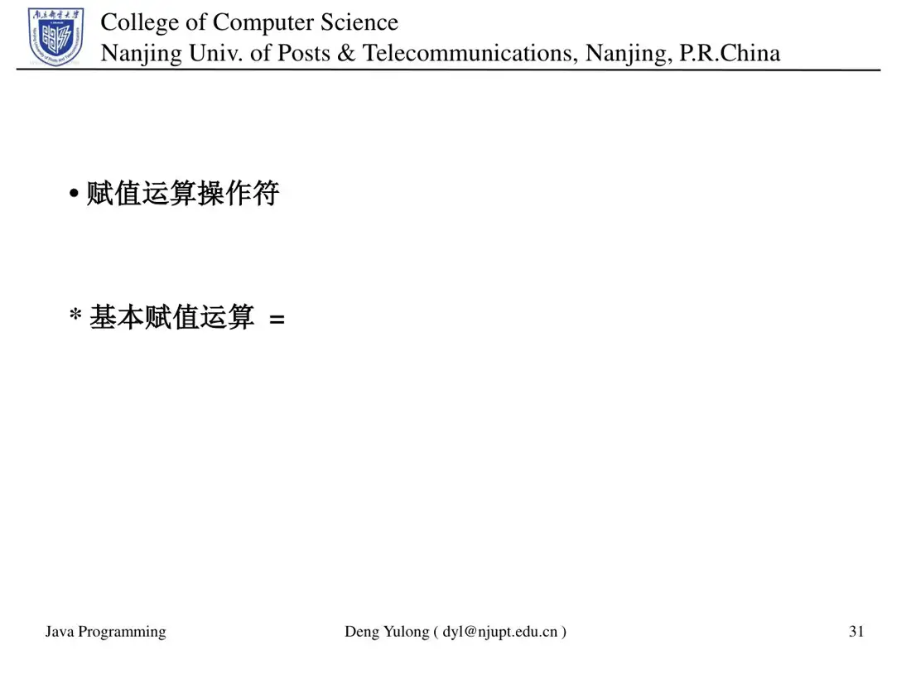

原文：

• 赋值运算操作符

\* 基本赋值运算 =

南京郵電大學Nanjing Unn

College of Computer Science Nanjing Univ. of Posts & Telecommunications, Nanjing, P.R.China

Java Programming

Deng Yulong ( dyl@njupt.edu.cn )

31

### \* 复合赋值运算符

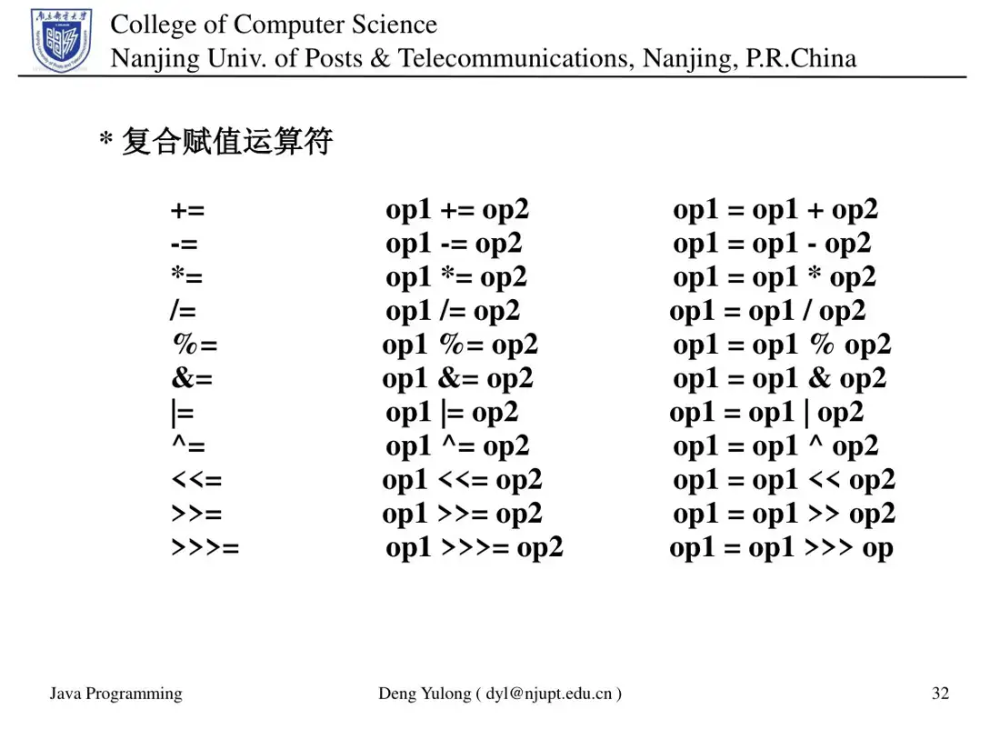

原文：

\* 复合赋值运算符

$$
+ =
$$

$$
\mathbf {o p 1} + = \mathbf {o p 2}
$$

$$
\mathbf {o p 1} = \mathbf {o p 1} + \mathbf {o p 2}
$$

$$
=
$$

$$
\mathbf {o p 1} = \mathbf {o p 2}
$$

$$
\mathbf {o p 1} = \mathbf {o p 1} - \mathbf {o p 2}
$$

$$
^ {* =}
$$

$$
\mathbf {o p 1} ^ {*} = \mathbf {o p 2}
$$

$$
\mathbf {o p 1} = \mathbf {o p 1} * \mathbf {o p 2}
$$

$$
/ =
$$

$$
\mathbf {o p 1} / = \mathbf {o p 2}
$$

$$
\mathbf {o p 1} = \mathbf {o p 1} / \mathbf {o p 2}
$$

$$
\% =
$$

$$
\mathbf {o p 1 \%} = \mathbf {o p 2}
$$

$$
\mathbf {o p 1} = \mathbf {o p 1 \% o p 2}
$$

$$
\& =
$$

$$
\mathbf {o p 1} \& = \mathbf {o p 2}
$$

$$
\mathbf {o p 1} = \mathbf {o p 1} \& \mathbf {o p 2}
$$

$$
\models
$$

$$
\mathbf {o p 1} \models \mathbf {o p 2}
$$

$$
\mathbf {o p 1} = \mathbf {o p 1} \mid \mathbf {o p 2}
$$

$$
\wedge_ {=}
$$

$$
\mathbf {o p 1} \mathbf {\Lambda} ^ {\wedge} = \mathbf {o p 2}
$$

$$
\mathbf {o p 1} = \mathbf {o p 1} ^ {\wedge} \mathbf {o p 2}
$$

$$
<   <   =
$$

$$
\mathbf {o p 1} <   <   = \mathbf {o p 2}
$$

$$
\mathbf {o p 1} = \mathbf {o p 1} <   <   \mathbf {o p 2}
$$

$$
> > =
$$

$$
\mathbf {o p 1} > > = \mathbf {o p 2}
$$

$$
\mathbf {o p 1} = \mathbf {o p 1} > > \mathbf {o p 2}
$$

$$
> > > =
$$

$$
\mathbf {o p 1} > > > = \mathbf {o p 2}
$$

$$
\mathbf {o p 1} = \mathbf {o p 1} > > > \mathbf {o p}
$$

南京郵電大學Nanjing U 圆 mmnciions

College of Computer Science Nanjing Univ. of Posts & Telecommunications, Nanjing, P.R.China

Java Programming

Deng Yulong ( dyl@njupt.edu.cn )

32

### • 其他操作符

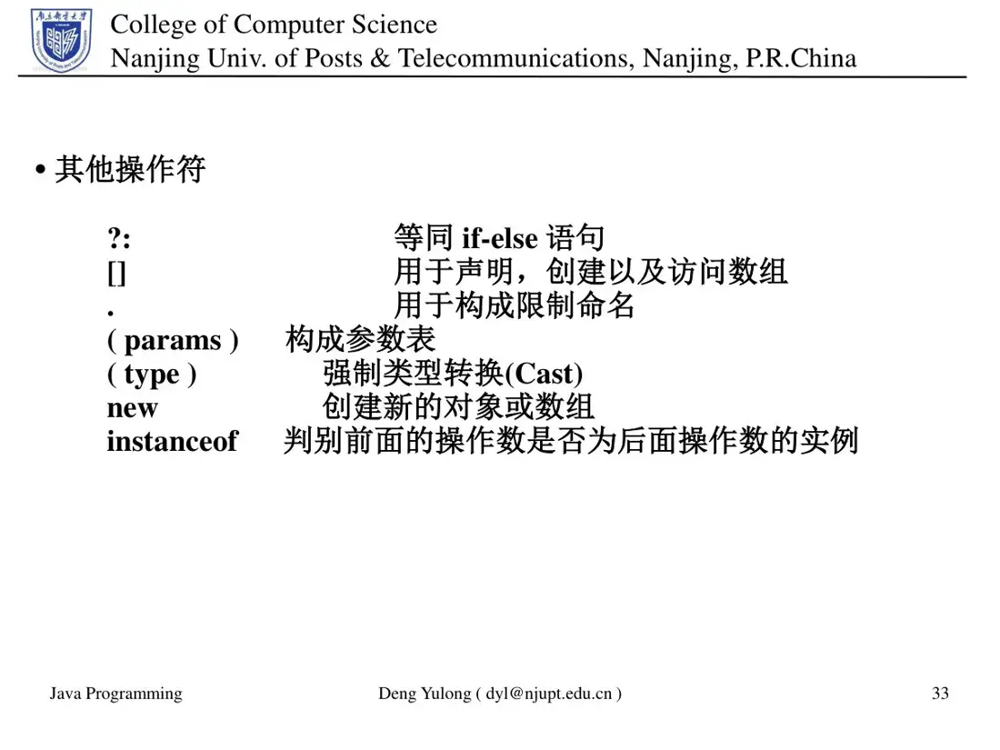

原文：

• 其他操作符

<table><tr><td>?:</td><td>等同 if-else 语句</td></tr><tr><td>[]</td><td>用于声明,创建以及访问数组</td></tr><tr><td>.</td><td>用于构成限制命名</td></tr><tr><td>(params)</td><td>构成参数表</td></tr><tr><td>(type)</td><td>强制类型转换(Cast)</td></tr><tr><td>new</td><td>创建新的对象或数组</td></tr><tr><td>instanceof</td><td>判别前面的操作数是否为后面操作数的实例</td></tr></table>

南京郵電大學Nanjing U 圆 mmnciions

College of Computer Science Nanjing Univ. of Posts & Telecommunications, Nanjing, P.R.China

Java Programming

Deng Yulong ( dyl@njupt.edu.cn )

33

### • 表达式

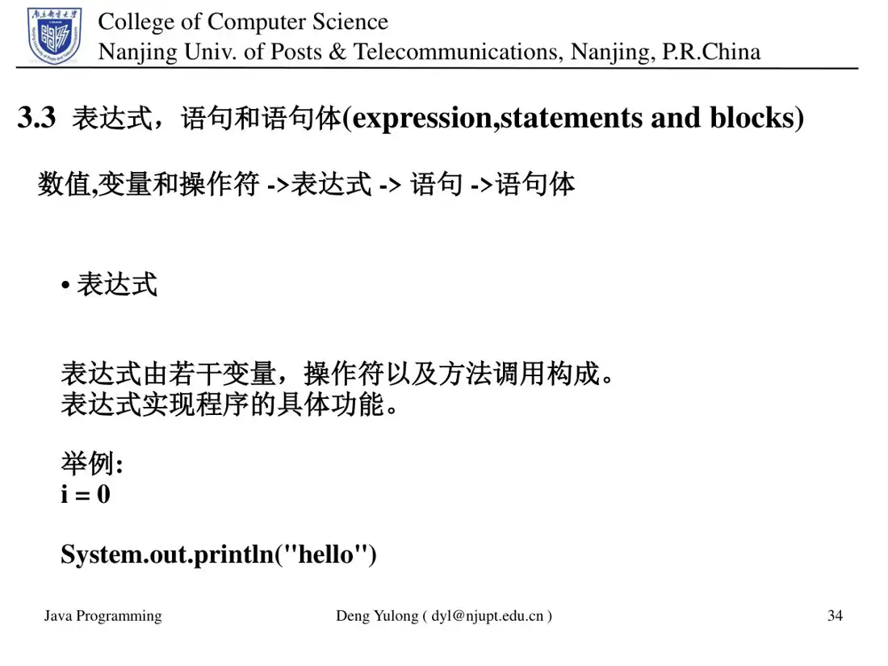

原文：

3.3 表达式，语句和语句体(expression,statements and blocks)数值,变量和操作符->表达式 -> 语句 ->语句体

• 表达式

表达式由若干变量，操作符以及方法调用构成。表达式实现程序的具体功能。

举例: i = 0

System.out.println("hello")

南京郵電大學

College of Computer Science Nanjing Univ. of Posts & Telecommunications, Nanjing, P.R.China

Java Programming

Deng Yulong ( dyl@njupt.edu.cn )

34

### 南京郵電大學Nanjing U 圆 mmnciions

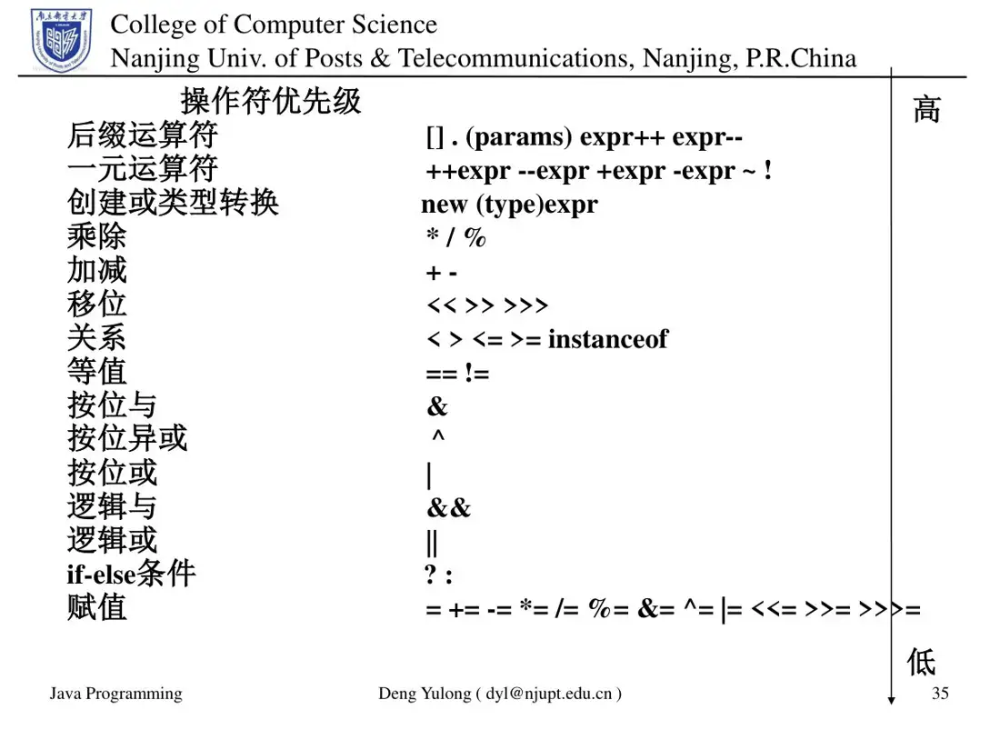

原文：

<table><tr><td colspan="2">操作符优先级</td><td>高</td></tr><tr><td>后缀运算符</td><td>[] . (params) expr++ expr--</td><td></td></tr><tr><td>一元运算符</td><td>++expr --expr +expr -expr ~ !</td><td></td></tr><tr><td>创建或类型转换</td><td>new (type)expr</td><td></td></tr><tr><td>乘除</td><td>* / %</td><td></td></tr><tr><td>加减</td><td>+ -</td><td></td></tr><tr><td>移位</td><td>&lt;&lt; &gt;&gt; &gt;&gt;&gt;</td><td></td></tr><tr><td>关系</td><td>&lt; &gt; &lt;= &gt;= instanceof</td><td></td></tr><tr><td>等值</td><td>== !=</td><td></td></tr><tr><td>按位与</td><td>&amp;</td><td></td></tr><tr><td>按位异或</td><td>^</td><td></td></tr><tr><td>按位或</td><td>|</td><td></td></tr><tr><td>逻辑与</td><td>&amp;&amp;</td><td></td></tr><tr><td>逻辑或</td><td>||</td><td></td></tr><tr><td>if-else条件</td><td>?:</td><td></td></tr><tr><td>赋值</td><td>= += -= *= /= %= &amp;= ^= |= &lt;&lt;= &gt;&gt;= &gt;&gt;&gt;&gt;=</td><td></td></tr><tr><td></td><td></td><td>低</td></tr></table>

南京郵電大學Nanjing U 圆 mmnciions

College of Computer Science Nanjing Univ. of Posts & Telecommunications, Nanjing, P.R.China

### 举例:

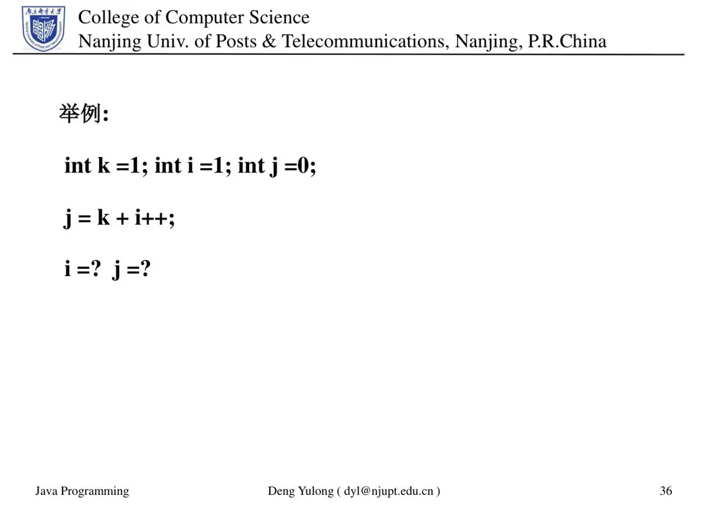

原文：

举例:

j = k + i++;

$$
\mathbf {i} = ? \quad \mathbf {j} = ?
$$

南京郵電大學

College of Computer Science Nanjing Univ. of Posts & Telecommunications, Nanjing, P.R.China

Java Programming

Deng Yulong ( dyl@njupt.edu.cn )

36

### • 语句

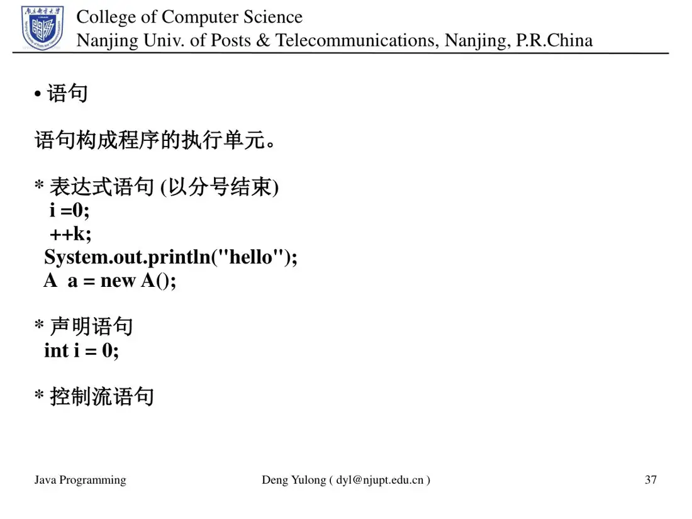

原文：

• 语句

语句构成程序的执行单元。

南京郵電大學Nanjing Unn

College of Computer Science Nanjing Univ. of Posts & Telecommunications, Nanjing, P.R.China

Java Programming

Deng Yulong ( dyl@njupt.edu.cn )

37

### • 语句块

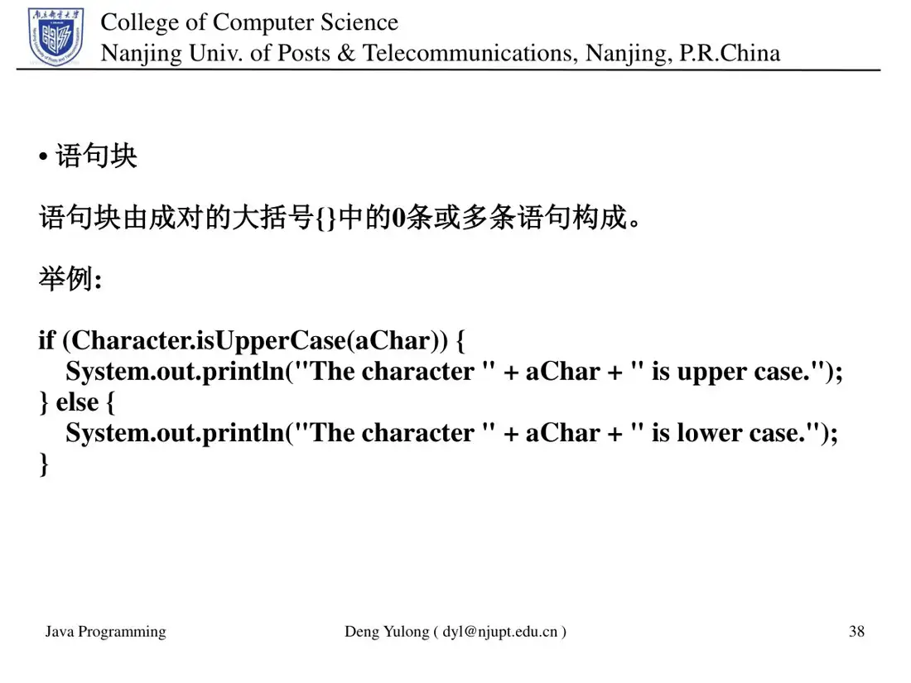

原文：

• 语句块

语句块由成对的大括号{}中的0条或多条语句构成。

举例:

南京郵電大學

College of Computer Science Nanjing Univ. of Posts & Telecommunications, Nanjing, P.R.China

Java Programming

Deng Yulong ( dyl@njupt.edu.cn )

38

### 3.4 控制流语句

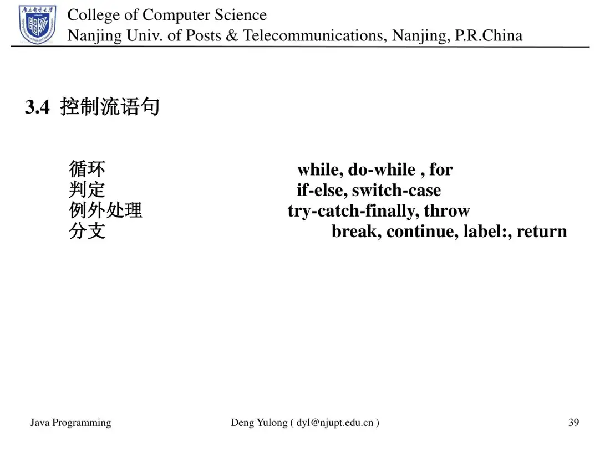

原文：

3.4 控制流语句

循环

判定

例外处理

分支

while, do-while , for

if-else, switch-case

try-catch-finally, throw

break, continue, label:, return

南京郵電大學Nanjing U 圆 mmnciions

College of Computer Science Nanjing Univ. of Posts & Telecommunications, Nanjing, P.R.China

Java Programming

Deng Yulong ( dyl@njupt.edu.cn )

39

### • while and do-while 语句

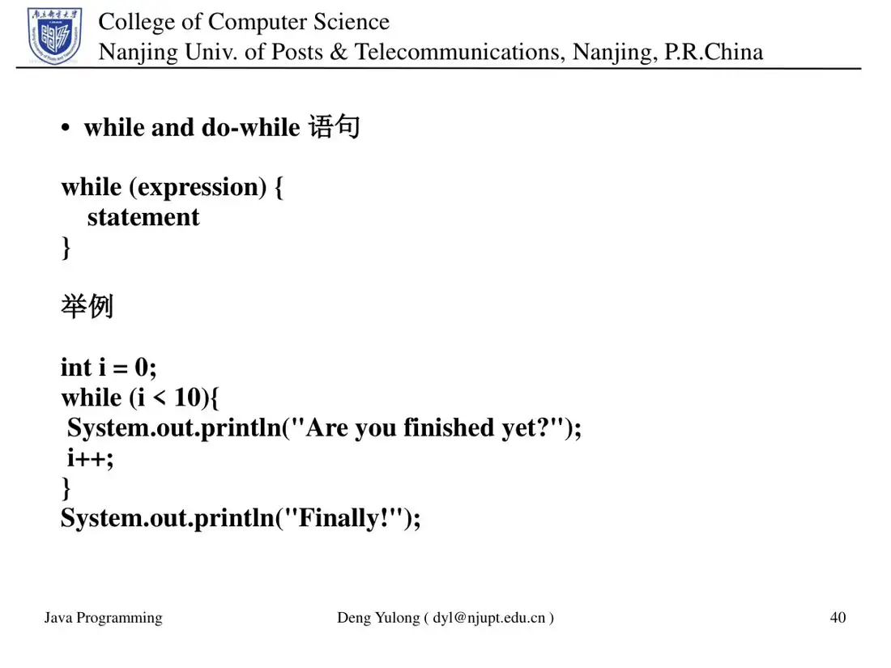

原文：

• while and do-while 语句

南京郵電大學

College of Computer Science Nanjing Univ. of Posts & Telecommunications, Nanjing, P.R.China

Java Programming

Deng Yulong ( dyl@njupt.edu.cn )

40

### 南京郵電大學Nanjig Unive

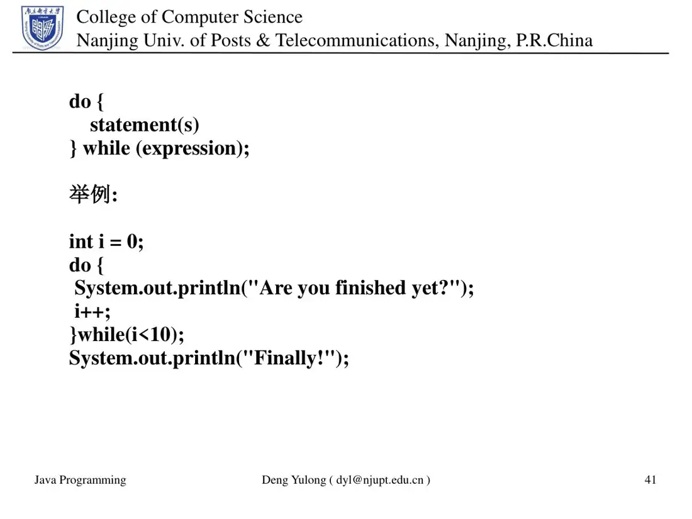

原文：

南京郵電大學Nanjig Unive

College of Computer Science Nanjing Univ. of Posts & Telecommunications, Nanjing, P.R.China

Java Programming

Deng Yulong ( dyl@njupt.edu.cn )

41

### 南京郵電大學Nanjing Unn

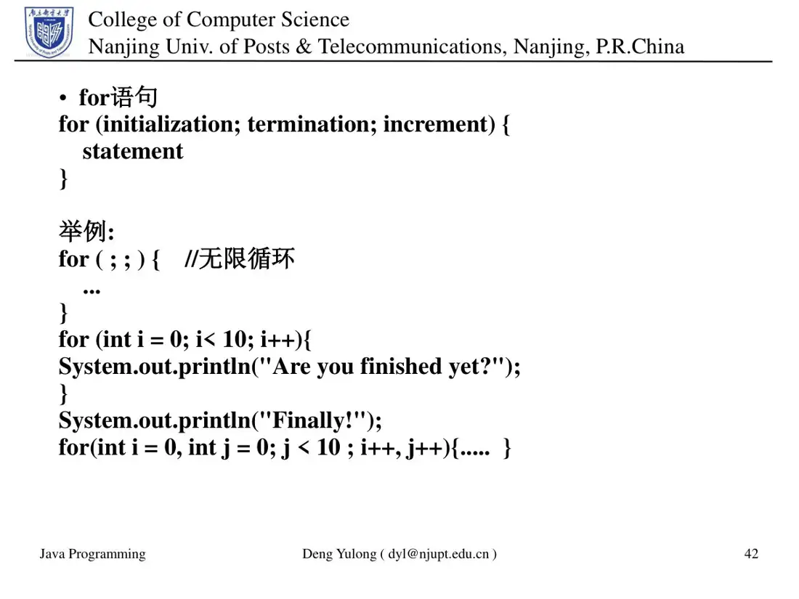

原文：

南京郵電大學Nanjing Unn

College of Computer Science Nanjing Univ. of Posts & Telecommunications, Nanjing, P.R.China

Java Programming

Deng Yulong ( dyl@njupt.edu.cn )

42

### 南京郵電大學948

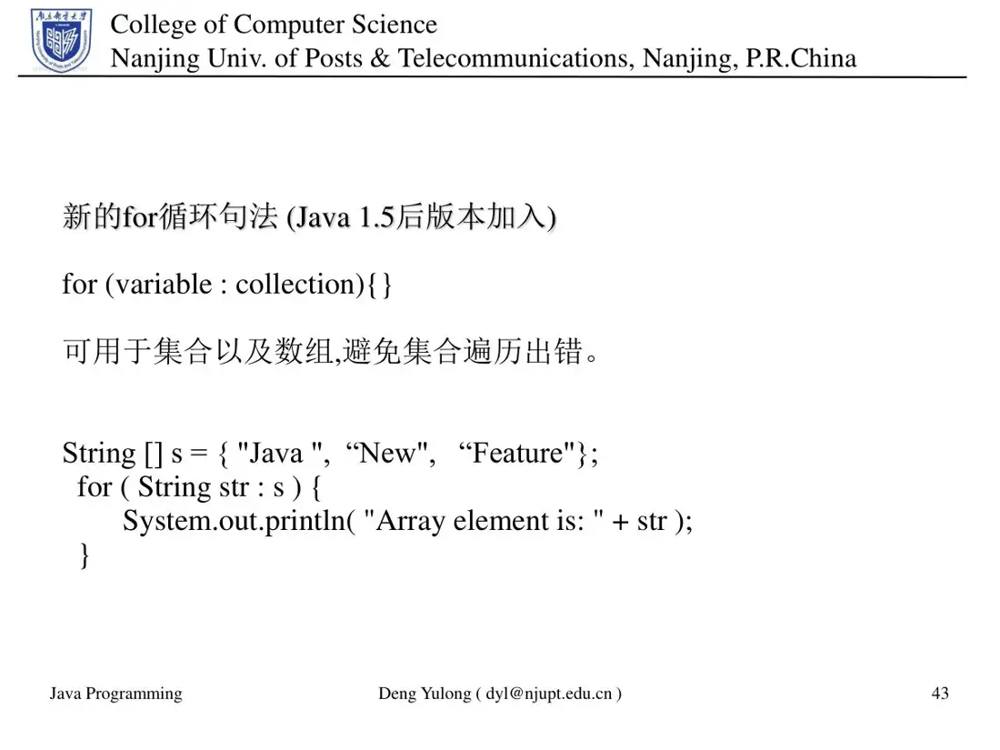

原文：

南京郵電大學948

College of Computer Science Nanjing Univ. of Posts & Telecommunications, Nanjing, P.R.China

Java Programming

Deng Yulong ( dyl@njupt.edu.cn )

43

### • if -else 语句

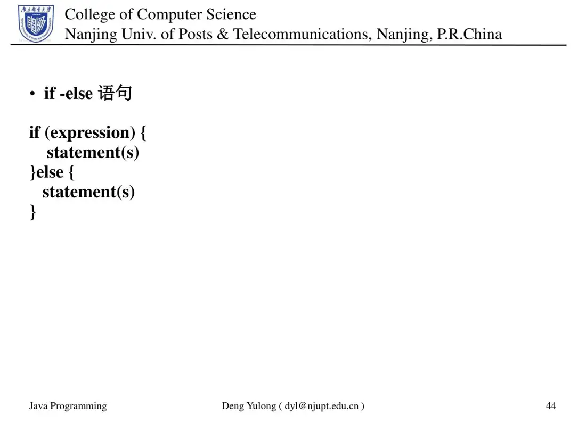

原文：

• if -else 语句

南京郵電大學

College of Computer Science Nanjing Univ. of Posts & Telecommunications, Nanjing, P.R.China

Java Programming

Deng Yulong ( dyl@njupt.edu.cn )

44

### 举例:

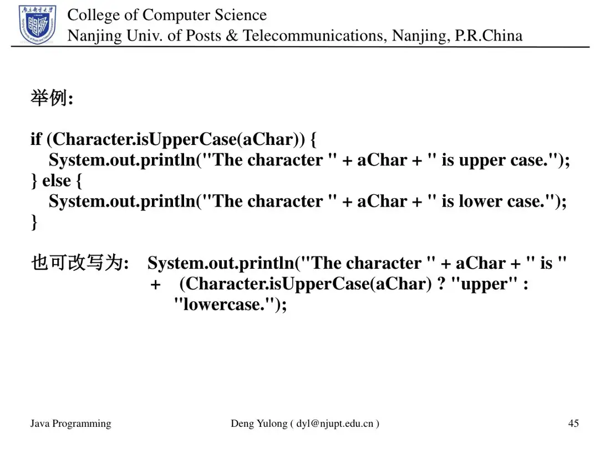

原文：

举例:

南京郵電大學

College of Computer Science Nanjing Univ. of Posts & Telecommunications, Nanjing, P.R.China

Java Programming

Deng Yulong ( dyl@njupt.edu.cn )

45

### 注意：

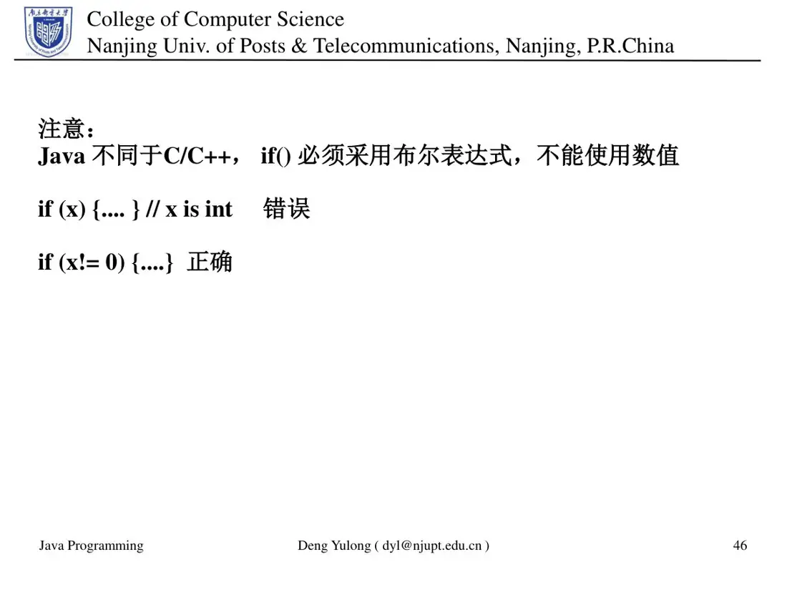

原文：

注意：

Java 不同于C/C++， if() 必须采用布尔表达式，不能使用数值

if (x) {.... } // x is int 错误

if (x!= 0) {....} 正确

南京郵電大學Nanjing U 圆 mmnciions

College of Computer Science Nanjing Univ. of Posts & Telecommunications, Nanjing, P.R.China

Java Programming

Deng Yulong ( dyl@njupt.edu.cn )

46

### • Switch 语句

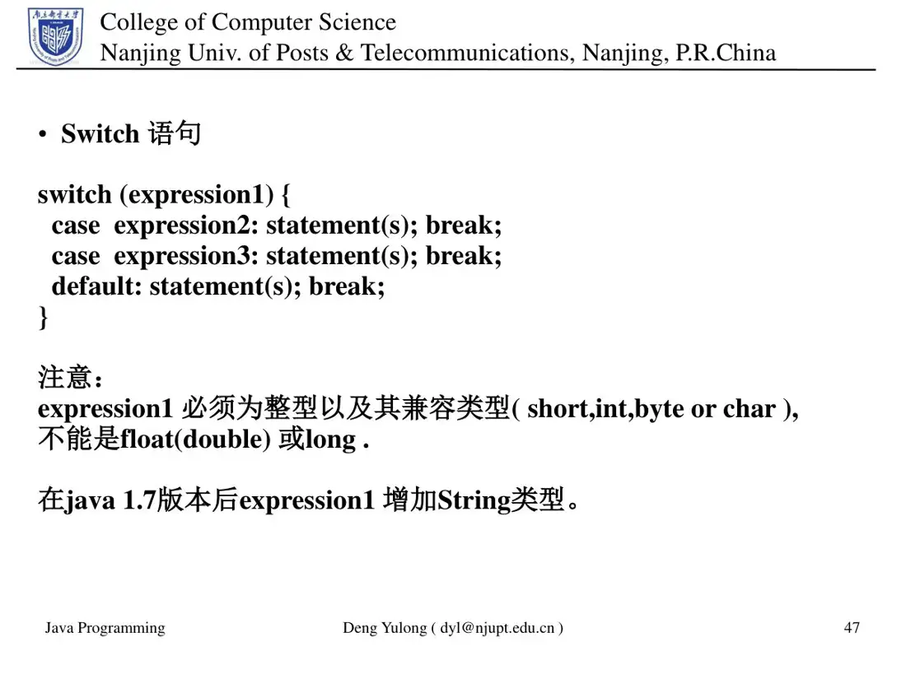

原文：

• Switch 语句

注意：

expression1 必须为整型以及其兼容类型( short,int,byte or char ),不能是float(double) 或long .

在java 1.7版本后expression1 增加String类型。

南京郵電大學Nanjing Ut 圆

College of Computer Science Nanjing Univ. of Posts & Telecommunications, Nanjing, P.R.China

Java Programming

Deng Yulong ( dyl@njupt.edu.cn )

47

### 南京郵電大學Nanjing Unn

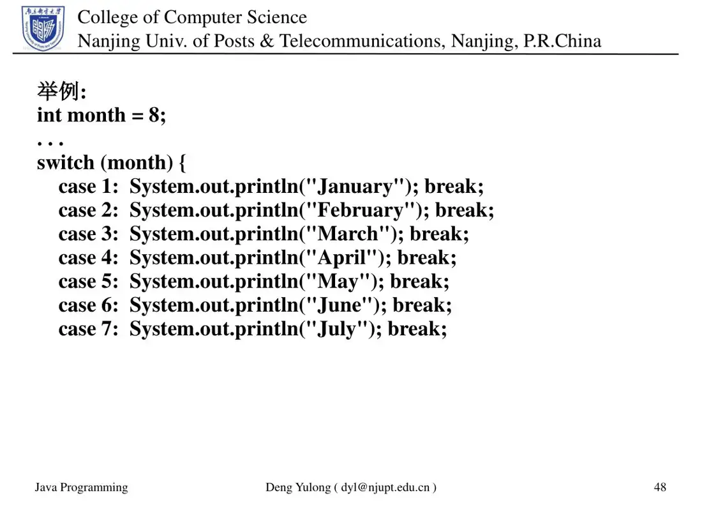

原文：

南京郵電大學Nanjing Unn

College of Computer Science Nanjing Univ. of Posts & Telecommunications, Nanjing, P.R.China

Java Programming

Deng Yulong ( dyl@njupt.edu.cn )

48

### 南京郵電大學Nanjing U 圆 mmnciions

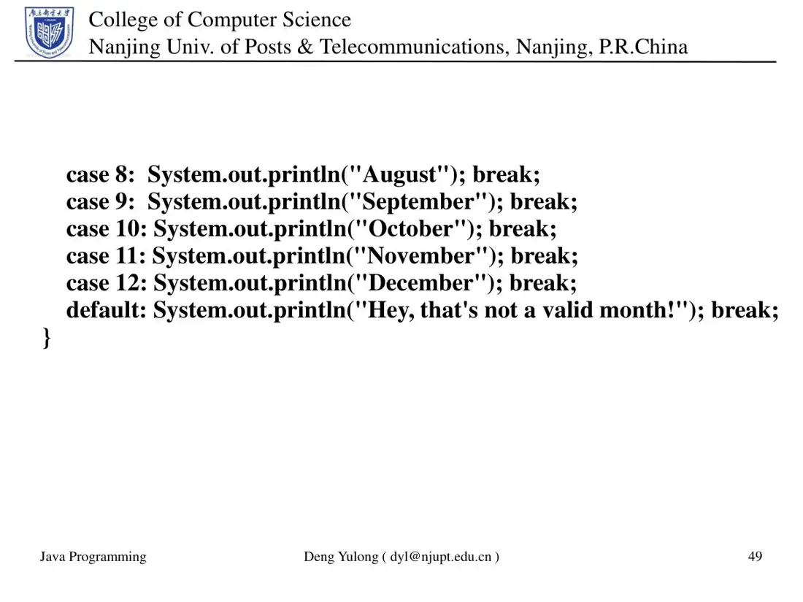

原文：

南京郵電大學Nanjing U 圆 mmnciions

College of Computer Science Nanjing Univ. of Posts & Telecommunications, Nanjing, P.R.China

Java Programming

Deng Yulong ( dyl@njupt.edu.cn )

49

### • 异常（例外）处理语句

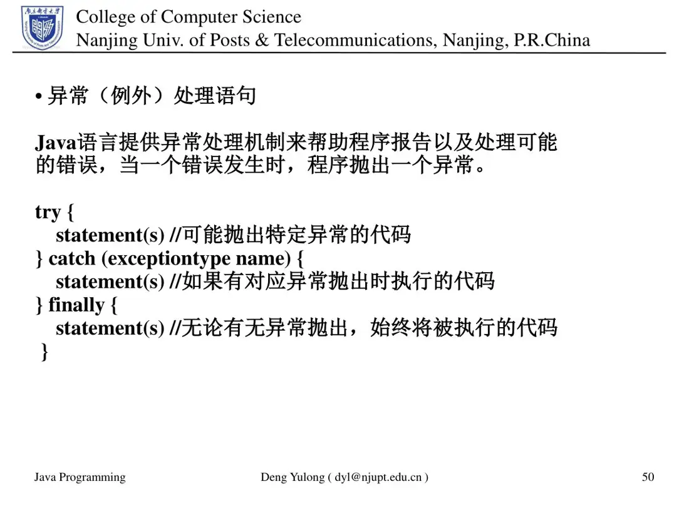

原文：

• 异常（例外）处理语句

Java语言提供异常处理机制来帮助程序报告以及处理可能的错误，当一个错误发生时，程序抛出一个异常。

南京郵電大學

College of Computer Science Nanjing Univ. of Posts & Telecommunications, Nanjing, P.R.China

Java Programming

Deng Yulong ( dyl@njupt.edu.cn )

50

### 举例:

原文：

举例:

异常将在第7章详细讲述

南京郵電大學

College of Computer Science Nanjing Univ. of Posts & Telecommunications, Nanjing, P.R.China

Java Programming

Deng Yulong ( dyl@njupt.edu.cn )

51

### • 分支语句 （在循环结构中使用）

原文：

• 分支语句 （在循环结构中使用）

\* break [label] 用于结束循环

\* continue [label] 用于结束本次循环

\* label: statement( for, while, do-while)

\* return

南京郵電大學Nanjing U 圆 mmnciions

College of Computer Science Nanjing Univ. of Posts & Telecommunications, Nanjing, P.R.China

Java Programming

Deng Yulong ( dyl@njupt.edu.cn )

52

### 举例:

原文：

举例:

南京郵電大學Nanjing Unn

College of Computer Science Nanjing Univ. of Posts & Telecommunications, Nanjing, P.R.China

Java Programming

Deng Yulong ( dyl@njupt.edu.cn )

53

### 13

原文：

13
14
15
16
17
18
19
20
21

南京郵電大學Nanjing U 圆 mmnciions

College of Computer Science Nanjing Univ. of Posts & Telecommunications, Nanjing, P.R.China

Java Programming

Deng Yulong ( dyl@njupt.edu.cn )

54

### return 语句

原文：

return 语句

使用return从当前方法中退出

返回一个数值 return 100;

不返回数值 return; (方法声明为void.)

南京郵電大學Nanjing U 圆 mmnciions

College of Computer Science Nanjing Univ. of Posts & Telecommunications, Nanjing, P.R.China

Java Programming

Deng Yulong ( dyl@njupt.edu.cn )

55

### 3.5 Java注释

原文：

3.5 Java注释

Java语言支持下面类型的注释方法

/\* text \*/编译器忽略/\* 到 \*/之间的任何内容.

// text编译器忽略// 到该行末尾的任何内容

/\*\* documentation \*/称为文档注释，与/\*...\*/相同，并且可以使用JDK的文档工具javadoc利用这些注释来自动生成文档

南京郵電大学Nanjing Ora 圆

College of Computer Science Nanjing Univ. of Posts & Telecommunications, Nanjing, P.R.China

Java Programming

Deng Yulong ( dyl@njupt.edu.cn )

56

### 南京都電大学

原文：

/\* hello word app \*/ package hello; /\*\* \* \* hello world app, my first program! print out Hello,NJUPT! \*/ public class HelloWorldApp {

/\*\* \* \* method main, using System.out stream \*/ public static void main(String args[]){ //print out hello njupt System.out.println("Hello, NJUPT!\n"); } } Java Programming Deng Yulong ( dyl@njupt.edu.cn )

南京都電大学

College of Computer Science Nanjing Univ. of Posts & Telecommunications, Nanjing, P.R.China

57

### javadoc -d mydoc HelloWorldApp.java

原文：

Java 文档注释可以采用 Javadoc 命令行工具 生成HTML格式的标准Java文档。

javadoc -d mydoc HelloWorldApp.java

也可以使用集成环境工具，如Netbeans在项目文件夹中生成文档。

南京郵電大學Nanjing Ora 圆易 mmnncons

College of Computer Science Nanjing Univ. of Posts & Telecommunications, Nanjing, P.R.China

Java Programming

Deng Yulong ( dyl@njupt.edu.cn )

58
