# 《Java程序设计》第4章 Java对象生命周期和常用对象（课件）

原件的每一页，下面附识别出的文字。

### Chap 4 Java对象生命周期和常用对象

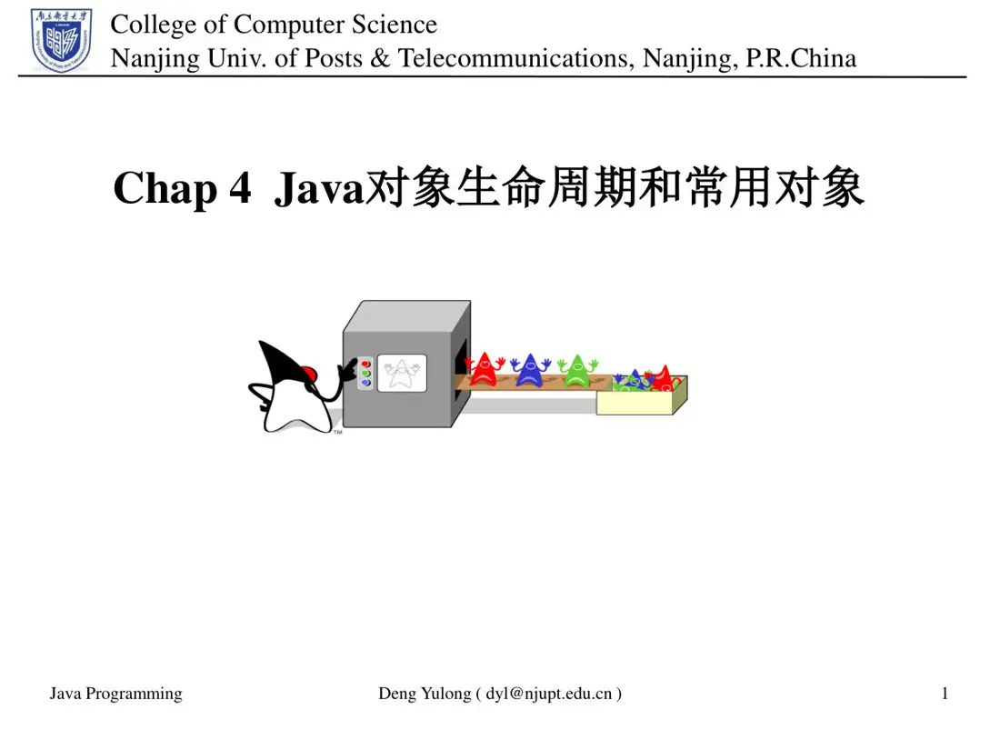

原文：

Chap 4 Java对象生命周期和常用对象

南京郵電大學Nanjing Ut 圆

College of Computer Science Nanjing Univ. of Posts & Telecommunications, Nanjing, P.R.China

Java Programming

Deng Yulong ( dyl@njupt.edu.cn )

1

### 4.1 Java虚拟机中的对象的创建，使用和垃圾回收

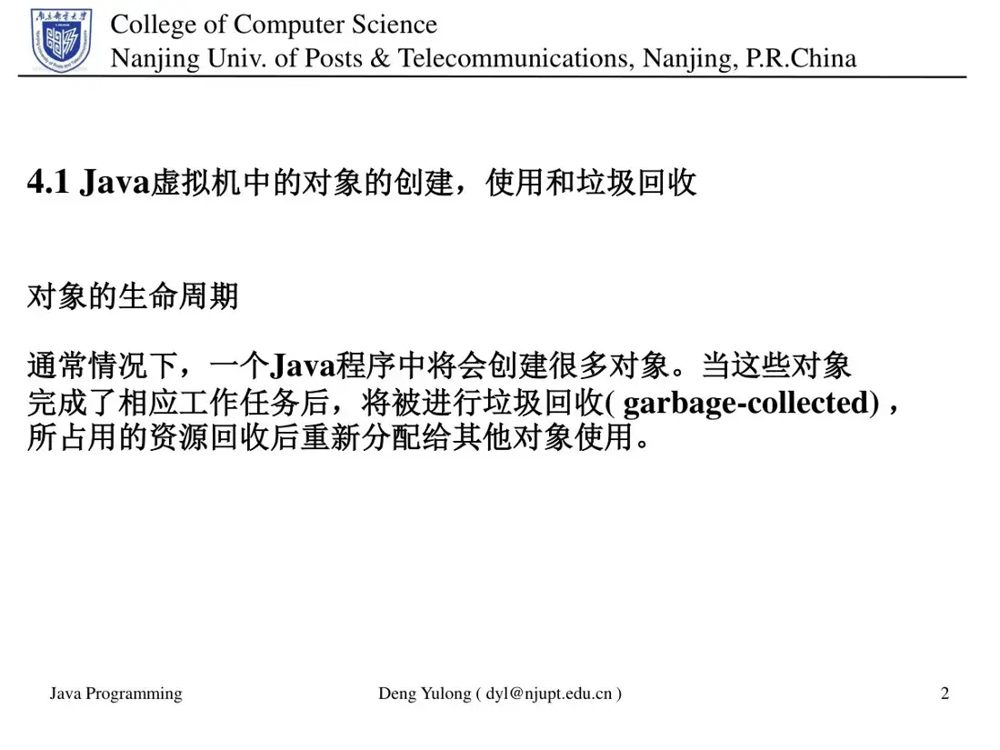

原文：

4.1 Java虚拟机中的对象的创建，使用和垃圾回收

对象的生命周期

通常情况下，一个Java程序中将会创建很多对象。当这些对象完成了相应工作任务后，将被进行垃圾回收( garbage-collected) ，所占用的资源回收后重新分配给其他对象使用。

南京郵電大學Nanjing U 圆 mmnciions

College of Computer Science Nanjing Univ. of Posts & Telecommunications, Nanjing, P.R.China

Java Programming

Deng Yulong ( dyl@njupt.edu.cn )

2

### 南京郵電大學Nanjing Ora 圆

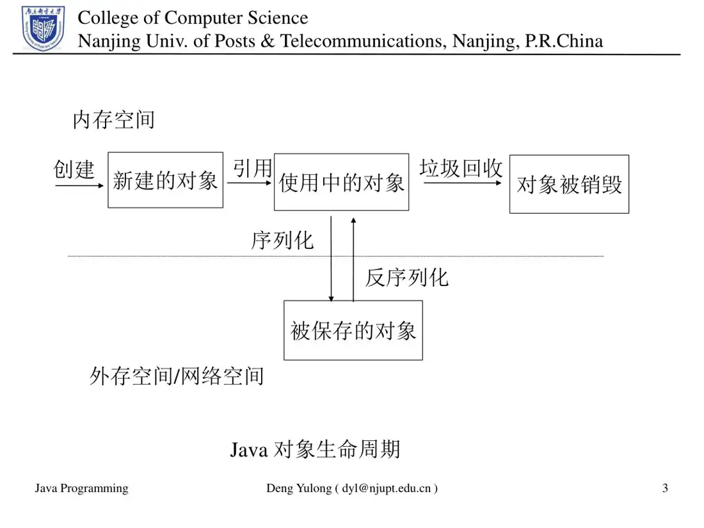

原文：

南京郵電大學Nanjing Ora 圆

College of Computer Science Nanjing Univ. of Posts & Telecommunications, Nanjing, P.R.China

Java Programming

Deng Yulong ( dyl@njupt.edu.cn )

3

### 南京都電大学

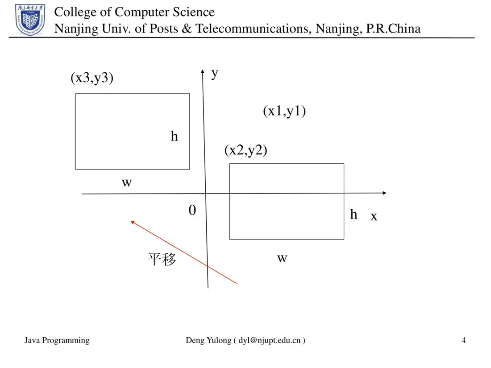

原文：

南京都電大学

College of Computer Science Nanjing Univ. of Posts & Telecommunications, Nanjing, P.R.China

Java Programming

Deng Yulong ( dyl@njupt.edu.cn )

4

### 南京郵電大學948y of Post

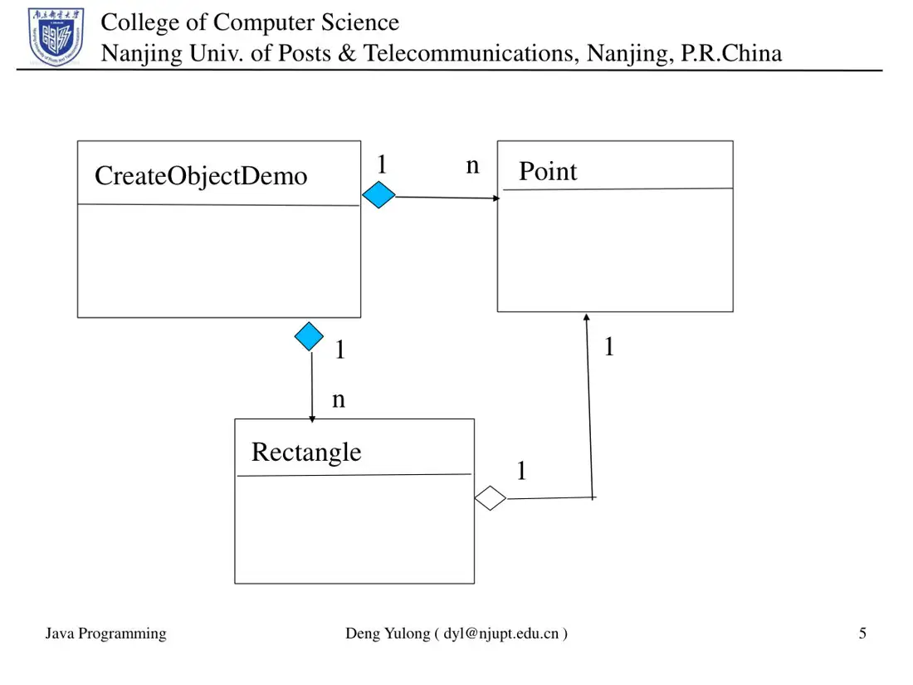

原文：

南京郵電大學948y of Post

College of Computer Science Nanjing Univ. of Posts & Telecommunications, Nanjing, P.R.China

Java Programming

Deng Yulong ( dyl@njupt.edu.cn )

5

### 南京郵電大學Nanjing Unn

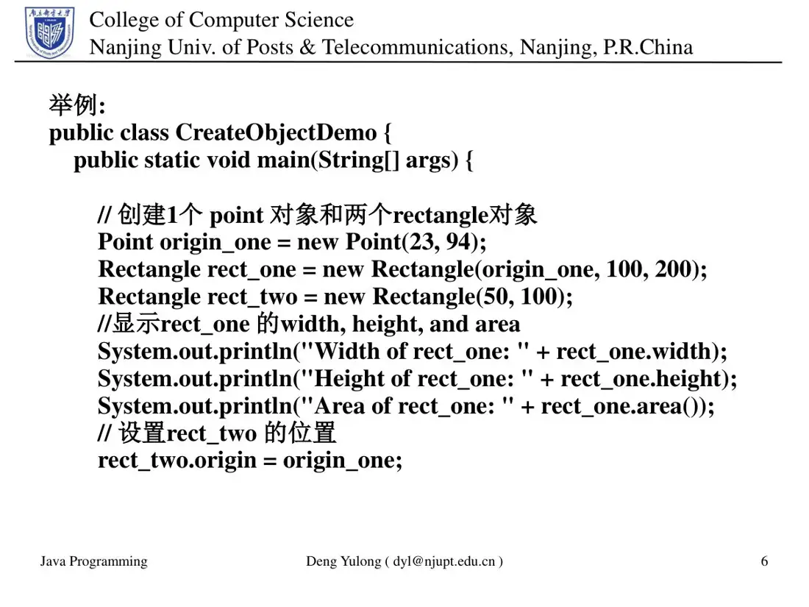

原文：

举例: public class CreateObjectDemo { public static void main(String[] args) {

南京郵電大學Nanjing Unn

College of Computer Science Nanjing Univ. of Posts & Telecommunications, Nanjing, P.R.China

Java Programming

Deng Yulong ( dyl@njupt.edu.cn )

6

### 南京郵電大學Nanjing Ut 圆

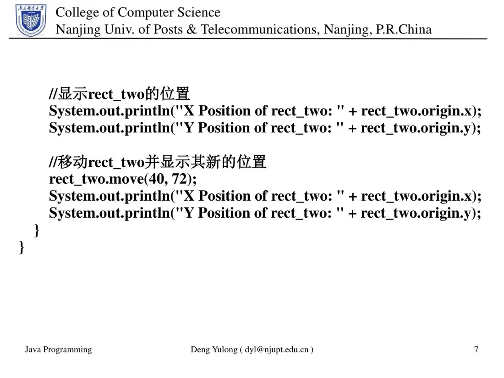

原文：

南京郵電大學Nanjing Ut 圆

College of Computer Science Nanjing Univ. of Posts & Telecommunications, Nanjing, P.R.China

Java Programming

Deng Yulong ( dyl@njupt.edu.cn )

7

### 4.1.1 创建对象

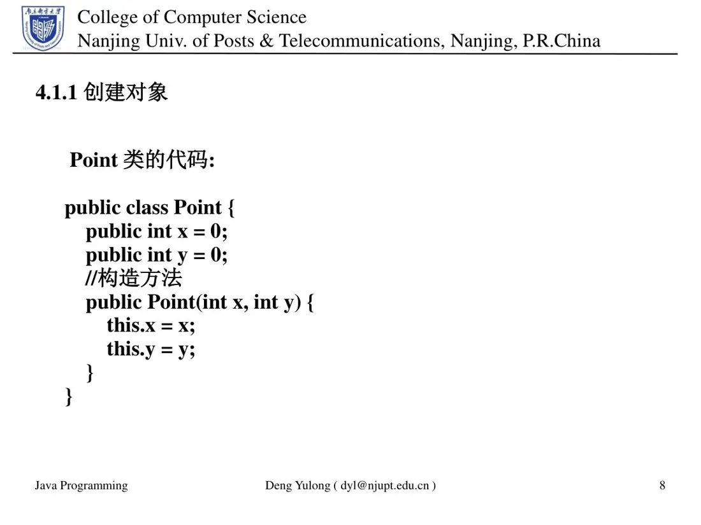

原文：

4.1.1 创建对象

Point 类的代码:

南京郵電大學Nanjing Unn

College of Computer Science Nanjing Univ. of Posts & Telecommunications, Nanjing, P.R.China

Java Programming

Deng Yulong ( dyl@njupt.edu.cn )

8

### 语句包含三个部分:

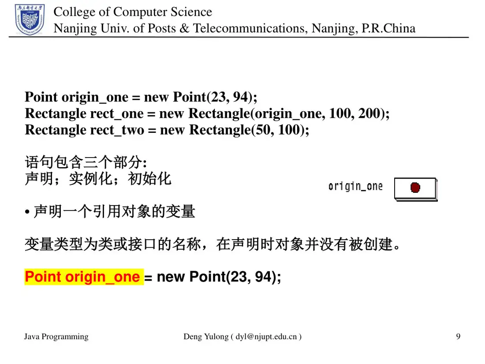

原文：

语句包含三个部分:

声明；实例化；初始化

origin\_one

• 声明一个引用对象的变量

变量类型为类或接口的名称，在声明时对象并没有被创建。

Point origin\_one = new Point(23, 94);

南京郵電大學Nanjing Ut 圆

College of Computer Science Nanjing Univ. of Posts & Telecommunications, Nanjing, P.R.China

Java Programming

Deng Yulong ( dyl@njupt.edu.cn )

9

### • 初始化和实例化一个对象

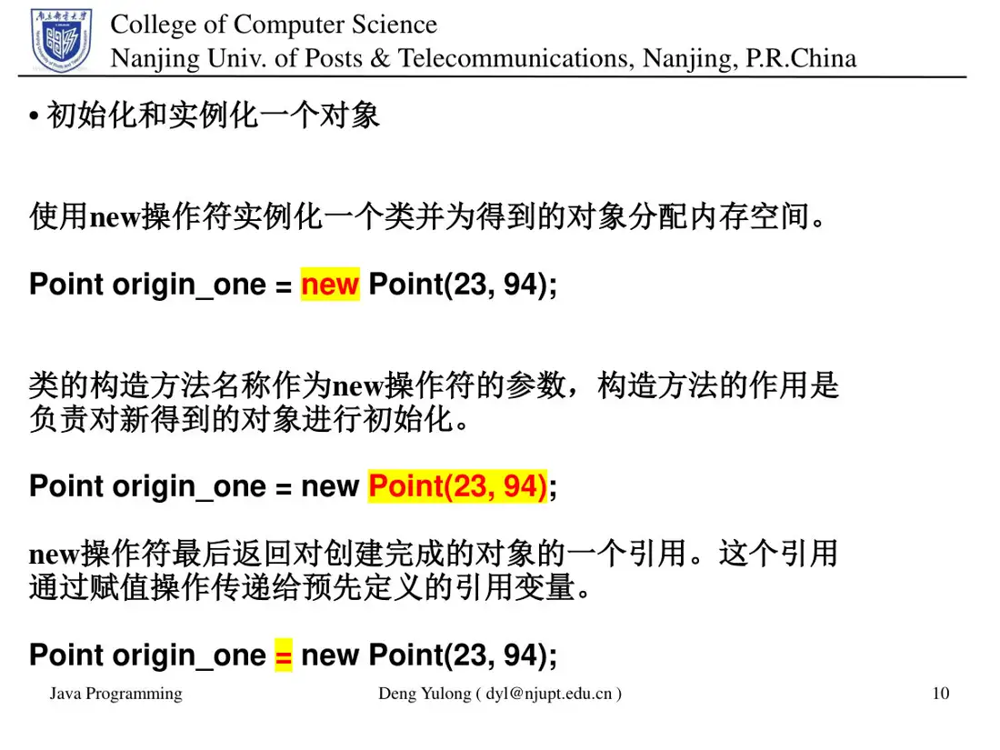

原文：

• 初始化和实例化一个对象

使用new操作符实例化一个类并为得到的对象分配内存空间。

类的构造方法名称作为new操作符的参数，构造方法的作用是负责对新得到的对象进行初始化。

Point origin\_one = new Point(23, 94)

new操作符最后返回对创建完成的对象的一个引用。这个引用通过赋值操作传递给预先定义的引用变量。

南京郵電大學

College of Computer Science Nanjing Univ. of Posts & Telecommunications, Nanjing, P.R.China

Java Programming

10

### Point origin\_one = new Point(23, 94);

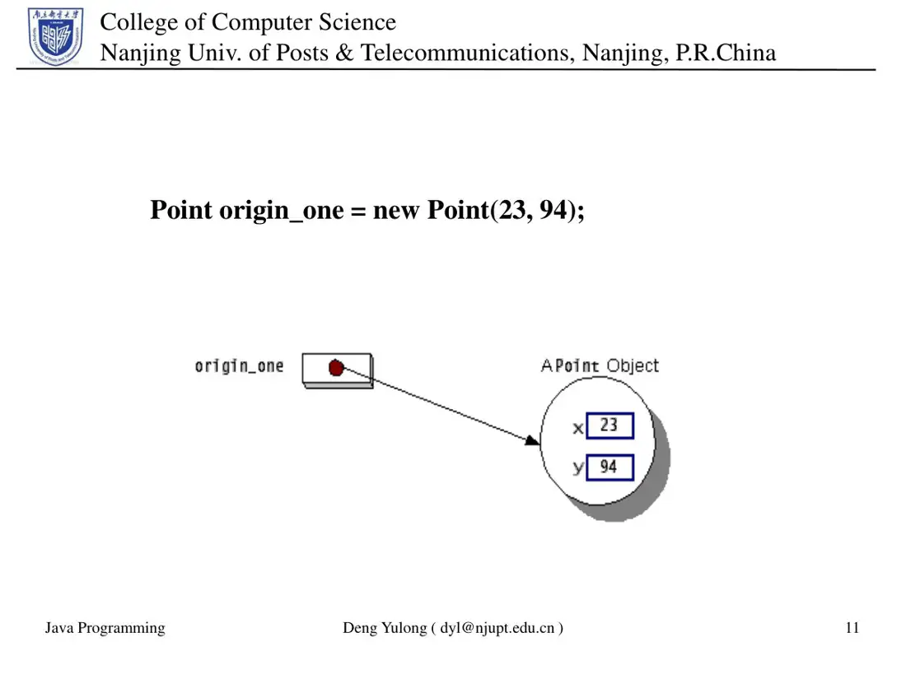

原文：

Point origin\_one = new Point(23, 94);

南京郵電大學Nanjing Ut 圆

College of Computer Science Nanjing Univ. of Posts & Telecommunications, Nanjing, P.R.China

Java Programming

Deng Yulong ( dyl@njupt.edu.cn )

11

### Rectangle类的代码

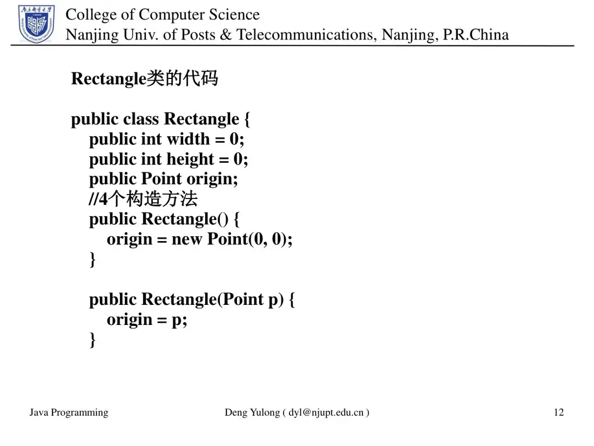

原文：

Rectangle类的代码

南京郵電大學

College of Computer Science Nanjing Univ. of Posts & Telecommunications, Nanjing, P.R.China

Java Programming

Deng Yulong ( dyl@njupt.edu.cn )

12

### 南京郵電大學

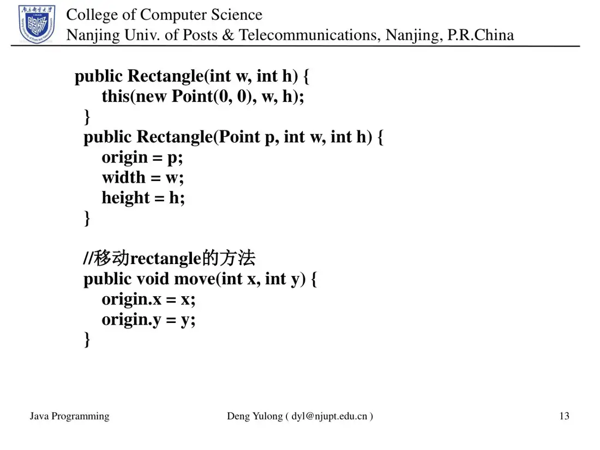

原文：

南京郵電大學

College of Computer Science Nanjing Univ. of Posts & Telecommunications, Nanjing, P.R.China

Java Programming

Deng Yulong ( dyl@njupt.edu.cn )

13

### 南京郵電大學Nanjing U 圆 mmnciions

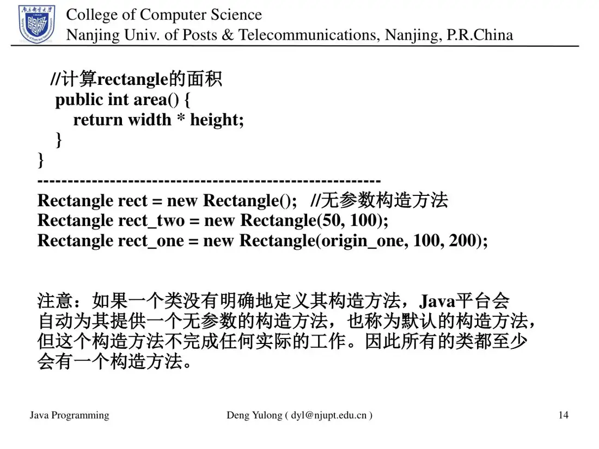

原文：

注意：如果一个类没有明确地定义其构造方法，Java平台会自动为其提供一个无参数的构造方法，也称为默认的构造方法，但这个构造方法不完成任何实际的工作。因此所有的类都至少会有一个构造方法。

南京郵電大學Nanjing U 圆 mmnciions

College of Computer Science Nanjing Univ. of Posts & Telecommunications, Nanjing, P.R.China

Java Programming

Deng Yulong ( dyl@njupt.edu.cn )

14

### 南京郵電大學Nanjing Ut 圆

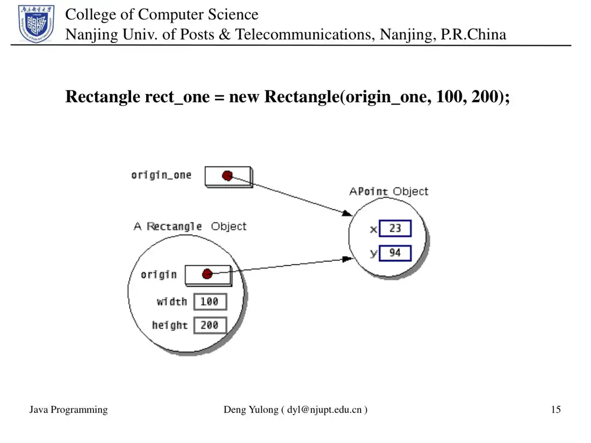

原文：

Rectangle rect\_one = new Rectangle(origin\_one, 100, 200);

南京郵電大學Nanjing Ut 圆

College of Computer Science Nanjing Univ. of Posts & Telecommunications, Nanjing, P.R.China

Java Programming

Deng Yulong ( dyl@njupt.edu.cn )

15

### 4.1.2 使用对象

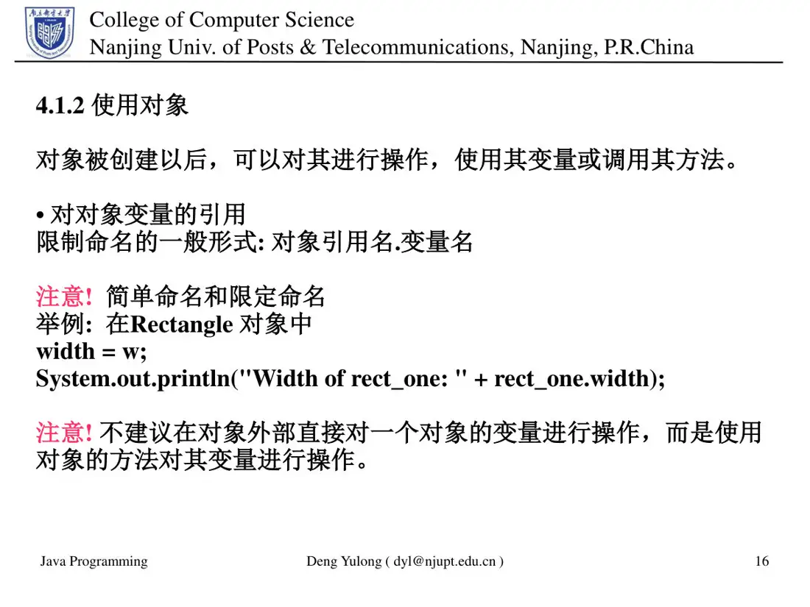

原文：

4.1.2 使用对象

对象被创建以后，可以对其进行操作，使用其变量或调用其方法。

• 对对象变量的引用

限制命名的一般形式: 对象引用名.变量名

注意! 不建议在对象外部直接对一个对象的变量进行操作，而是使用对象的方法对其变量进行操作。

南京郵電大學Nanjing U 圆 mmnciions

College of Computer Science Nanjing Univ. of Posts & Telecommunications, Nanjing, P.R.China

Java Programming

Deng Yulong ( dyl@njupt.edu.cn )

16

### 南京都電大学

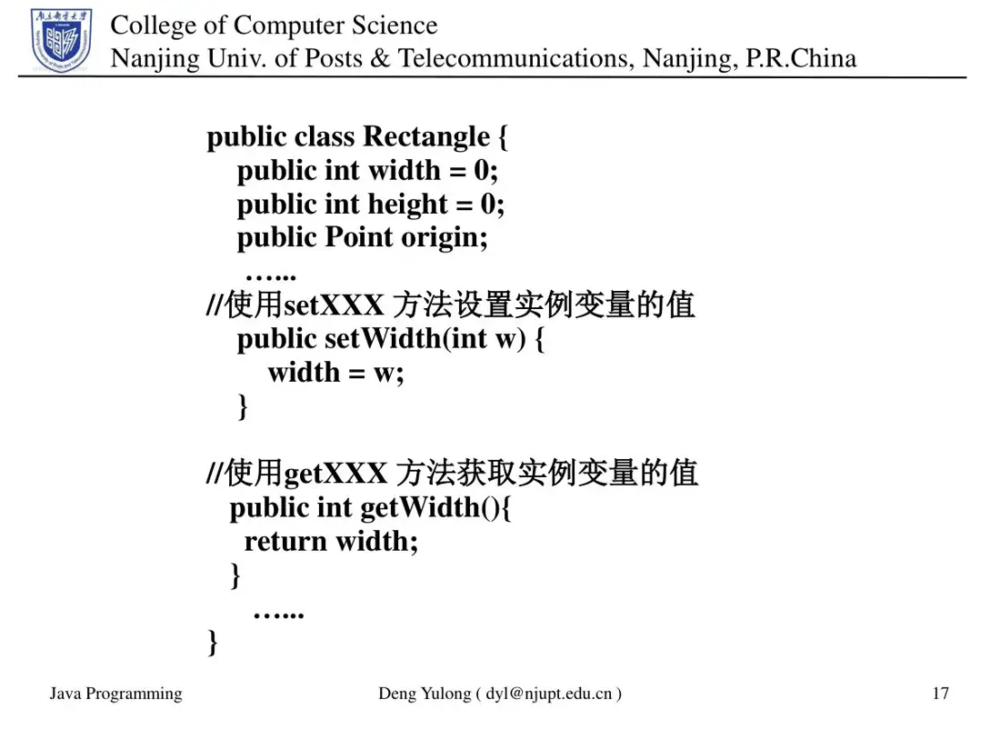

原文：

南京都電大学

College of Computer Science Nanjing Univ. of Posts & Telecommunications, Nanjing, P.R.China

Java Programming

Deng Yulong ( dyl@njupt.edu.cn )

17

### int width\_value;

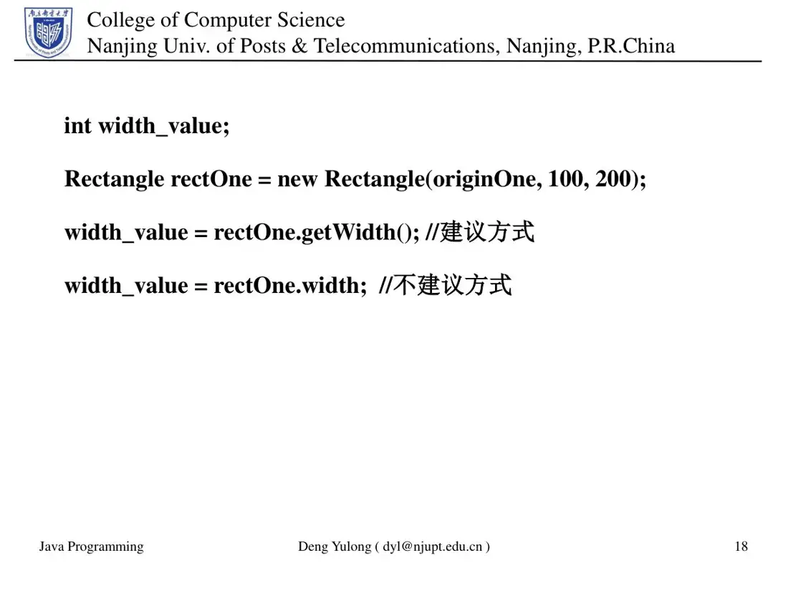

原文：

int width\_value;

Rectangle rectOne = new Rectangle(originOne, 100, 200);

width\_value = rectOne.getWidth(); //建议方式

width\_value = rectOne.width; //不建议方式

南京郵電大學Nanjing Ora 圆

College of Computer Science Nanjing Univ. of Posts & Telecommunications, Nanjing, P.R.China

Java Programming

Deng Yulong ( dyl@njupt.edu.cn )

18

### • 对对象方法的调用

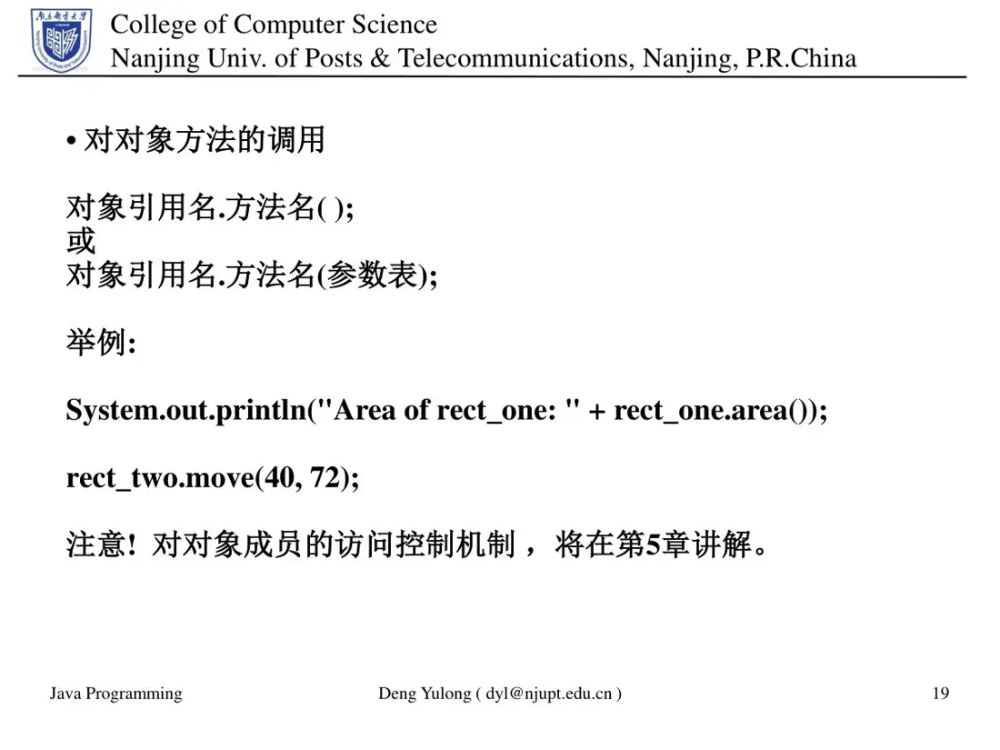

原文：

• 对对象方法的调用

对象引用名.方法名( );

或

对象引用名.方法名(参数表);

举例:

System.out.println("Area of rect\_one: " + rect\_one.area());

rect\_two.move(40, 72);

注意! 对对象成员的访问控制机制 ，将在第5章讲解。

南京郵電大學Nanjing Unn

College of Computer Science Nanjing Univ. of Posts & Telecommunications, Nanjing, P.R.China

Java Programming

Deng Yulong ( dyl@njupt.edu.cn )

19

### 4.1.3 无用对象和垃圾回收算法

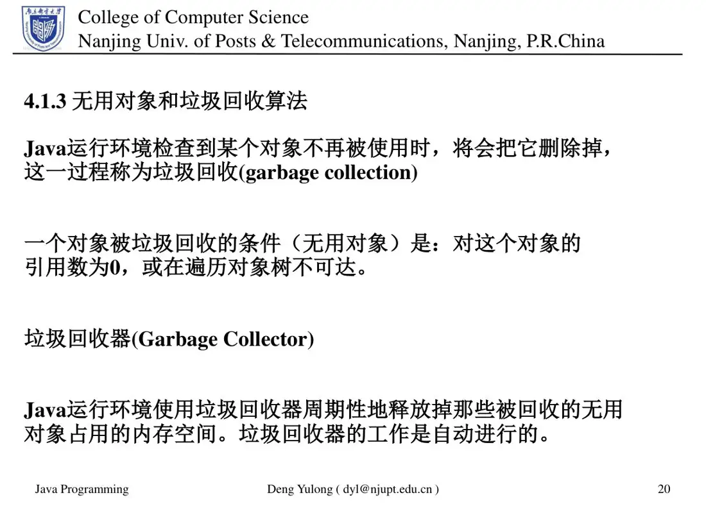

原文：

4.1.3 无用对象和垃圾回收算法

Java运行环境检查到某个对象不再被使用时，将会把它删除掉，这一过程称为垃圾回收(garbage collection)

一个对象被垃圾回收的条件（无用对象）是：对这个对象的引用数为0，或在遍历对象树不可达。

垃圾回收器(Garbage Collector)

Java运行环境使用垃圾回收器周期性地释放掉那些被回收的无用对象占用的内存空间。垃圾回收器的工作是自动进行的。

南京郵電大學Nanjing Ut 圆

College of Computer Science Nanjing Univ. of Posts & Telecommunications, Nanjing, P.R.China

Java Programming

Deng Yulong ( dyl@njupt.edu.cn )

20

### 举例：

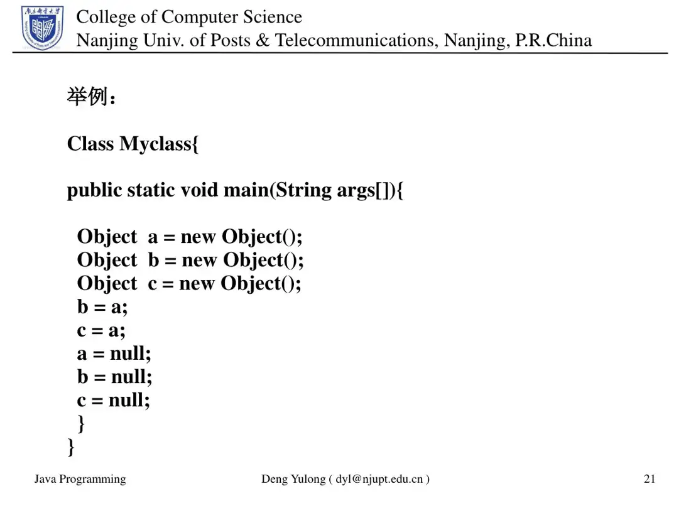

原文：

举例：

Class Myclass{

public static void main(String args[]){

南京郵電大學

College of Computer Science Nanjing Univ. of Posts & Telecommunications, Nanjing, P.R.China

Java Programming

Deng Yulong ( dyl@njupt.edu.cn )

21

### 经典垃圾回收算法

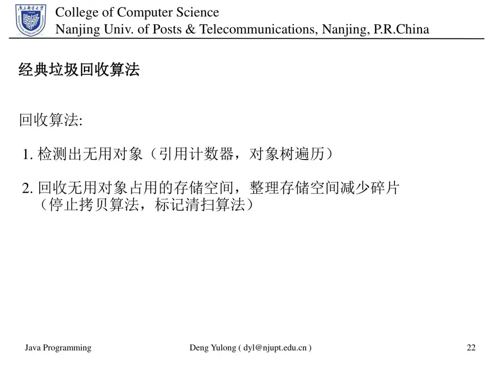

原文：

经典垃圾回收算法

回收算法:

1. 检测出无用对象（引用计数器，对象树遍历）

2. 回收无用对象占用的存储空间，整理存储空间减少碎片（停止拷贝算法，标记清扫算法）

南京郵電大學948

College of Computer Science Nanjing Univ. of Posts & Telecommunications, Nanjing, P.R.China

Java Programming

Deng Yulong ( dyl@njupt.edu.cn )

22

### 停止拷贝算法(stop & copy)

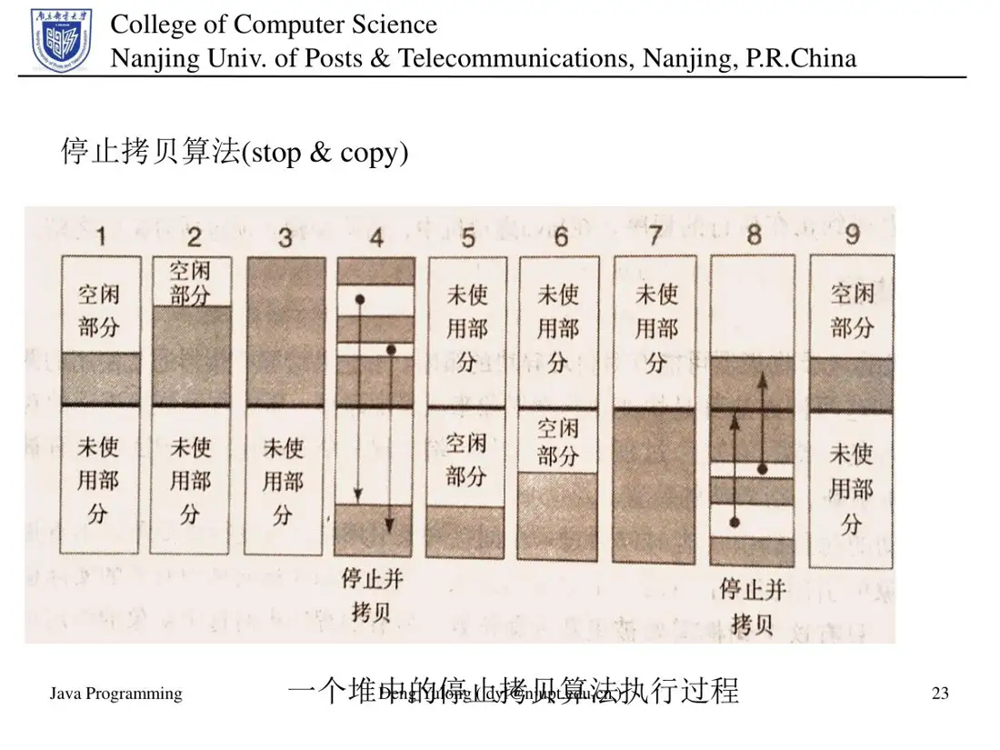

原文：

停止拷贝算法(stop & copy)

南京郵電大學948y of Post

College of Computer Science Nanjing Univ. of Posts & Telecommunications, Nanjing, P.R.China

Java Programming

Deng Yulong ( dyl@njupt.edu.cn )一个堆中的停止拷贝算法执行过程

23

### 南京郵電大學Nanjing Ora 圆

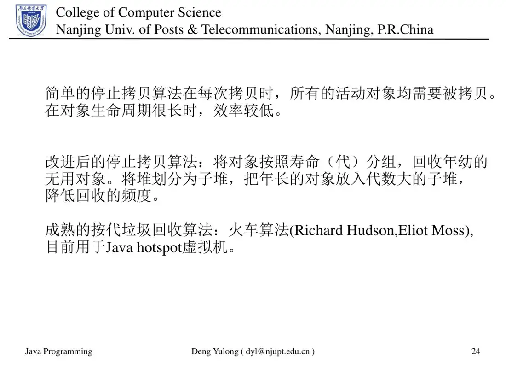

原文：

简单的停止拷贝算法在每次拷贝时，所有的活动对象均需要被拷贝。在对象生命周期很长时，效率较低。

改进后的停止拷贝算法：将对象按照寿命（代）分组，回收年幼的无用对象。将堆划分为子堆，把年长的对象放入代数大的子堆，降低回收的频度。

成熟的按代垃圾回收算法：火车算法(Richard Hudson,Eliot Moss),目前用于Java hotspot虚拟机。

南京郵電大學Nanjing Ora 圆

College of Computer Science Nanjing Univ. of Posts & Telecommunications, Nanjing, P.R.China

Java Programming

Deng Yulong ( dyl@njupt.edu.cn )

24

### 标记清扫算法(mark & sweep)

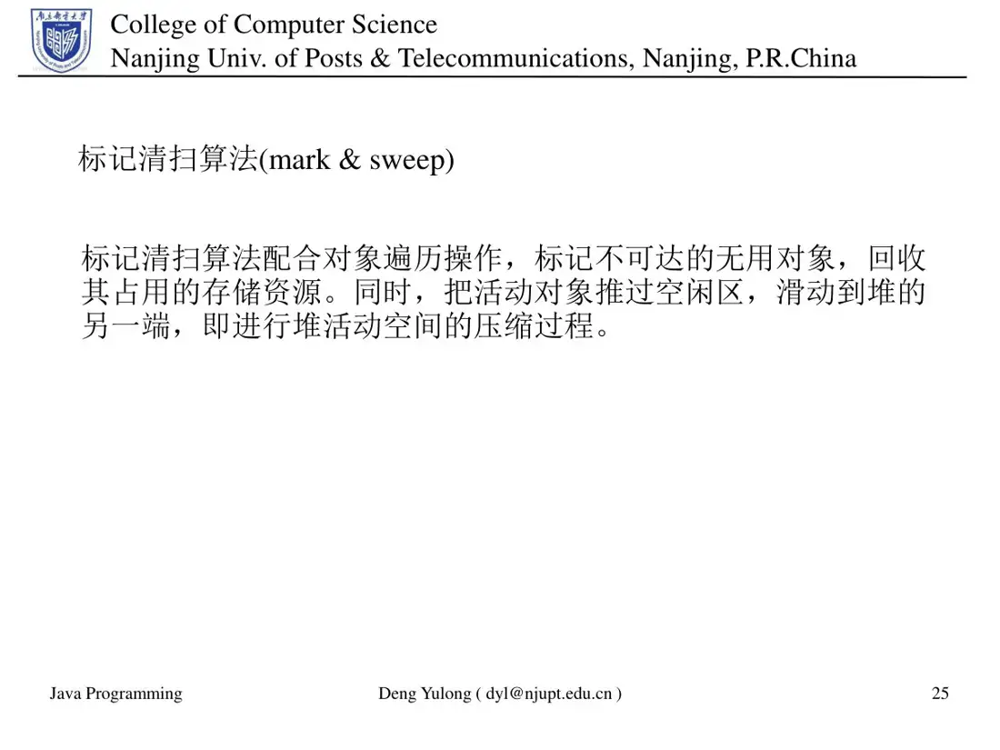

原文：

标记清扫算法(mark & sweep)

标记清扫算法配合对象遍历操作，标记不可达的无用对象，回收其占用的存储资源。同时，把活动对象推过空闲区，滑动到堆的另一端，即进行堆活动空间的压缩过程。

南京郵電大學Nanjing Ora 圆

College of Computer Science Nanjing Univ. of Posts & Telecommunications, Nanjing, P.R.China

Java Programming

Deng Yulong ( dyl@njupt.edu.cn )

25

### 4.2 数组对象(Arrays)

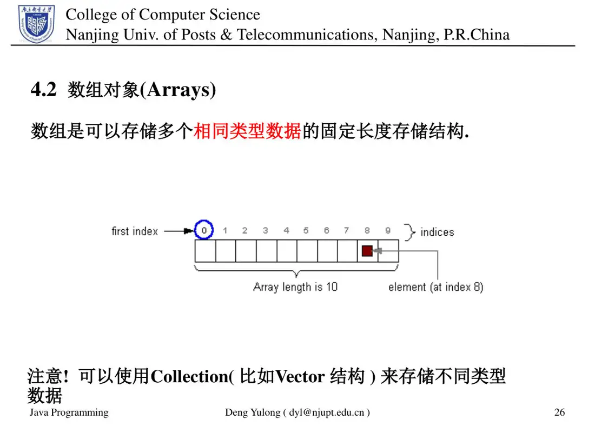

原文：

4.2 数组对象(Arrays)

数组是可以存储多个相同类型数据的固定长度存储结构.

注意! 可以使用Collection( 比如Vector 结构 ) 来存储不同类型数据

南京郵電大學Nanjing U 圆 mmnciions

College of Computer Science Nanjing Univ. of Posts & Telecommunications, Nanjing, P.R.China

Java Programming

Deng Yulong ( dyl@njupt.edu.cn )

26

### 4.2.1 创建和使用数组

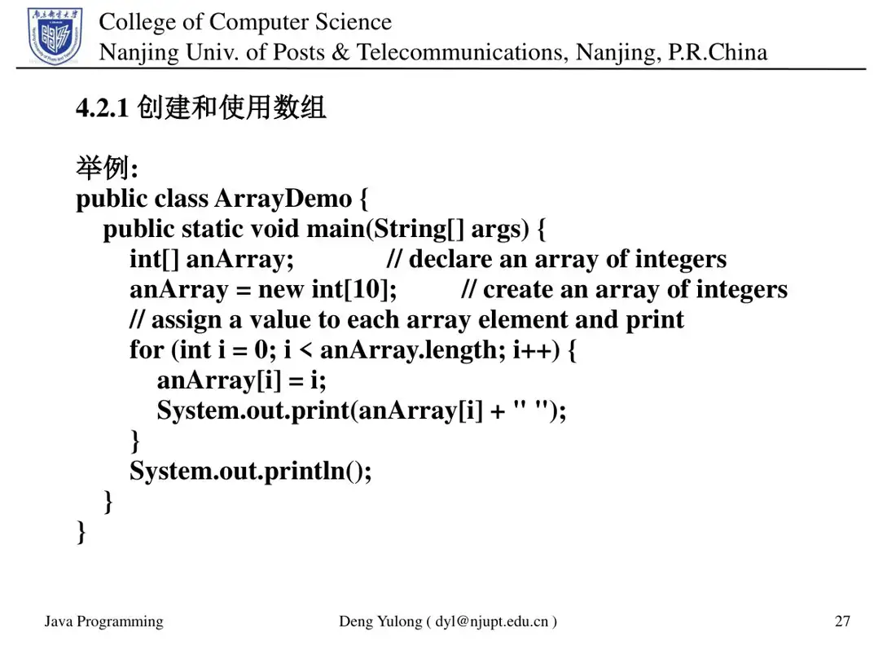

原文：

4.2.1 创建和使用数组

南京郵電大學Nanjing Unn

College of Computer Science Nanjing Univ. of Posts & Telecommunications, Nanjing, P.R.China

Java Programming

Deng Yulong ( dyl@njupt.edu.cn )

27

### • 声明一个变量来引用数组

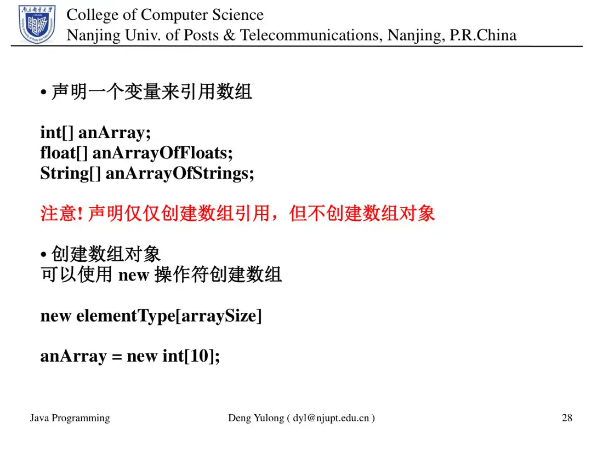

原文：

• 声明一个变量来引用数组

注意! 声明仅仅创建数组引用，但不创建数组对象

• 创建数组对象可以使用 new 操作符创建数组

new elementType[arraySize]

anArray = new int[10];

南京郵電大學Nanjing Ut 圆

College of Computer Science Nanjing Univ. of Posts & Telecommunications, Nanjing, P.R.China

Java Programming

Deng Yulong ( dyl@njupt.edu.cn )

28

### • 初始化和访问数组元素

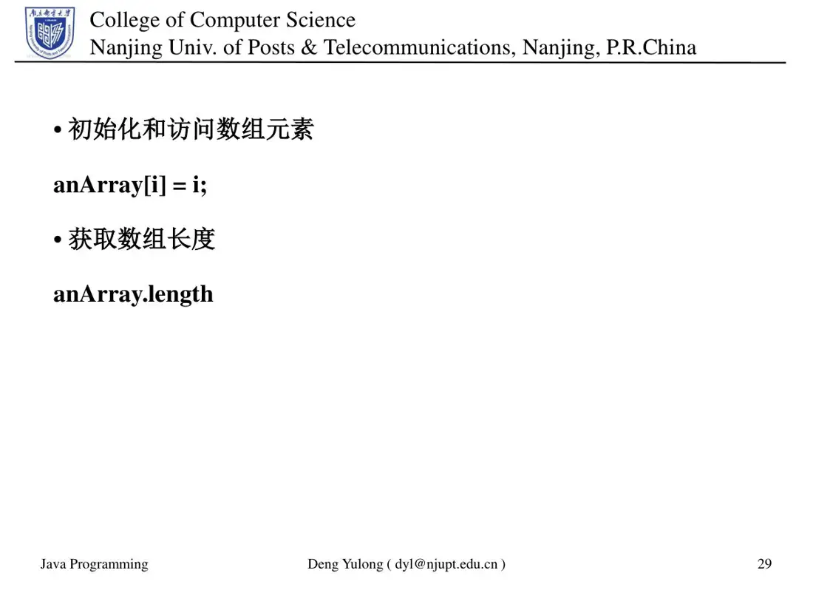

原文：

• 初始化和访问数组元素

anArray[i] = i;

• 获取数组长度

anArray.length

南京郵電大學Nanjing Unn

College of Computer Science Nanjing Univ. of Posts & Telecommunications, Nanjing, P.R.China

Java Programming

Deng Yulong ( dyl@njupt.edu.cn )

29

### 4.2.2对象的数组

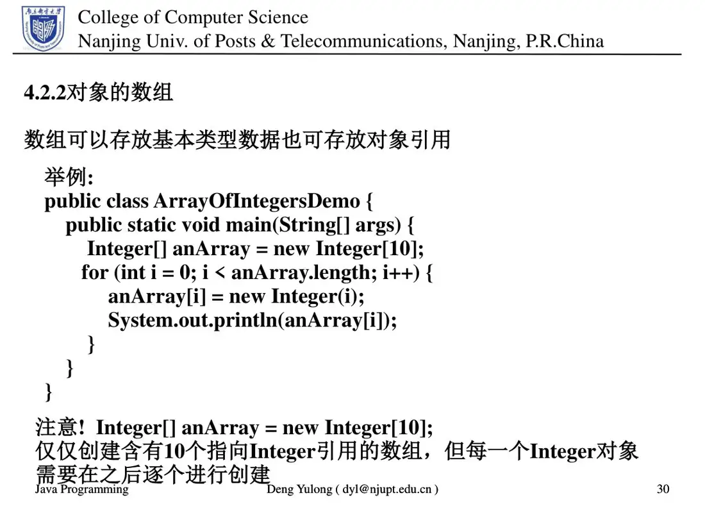

原文：

4.2.2对象的数组

数组可以存放基本类型数据也可存放对象引用

南京郵電大學Nanjing Unn

College of Computer Science Nanjing Univ. of Posts & Telecommunications, Nanjing, P.R.China

30

### 4.2.3 数组的数组

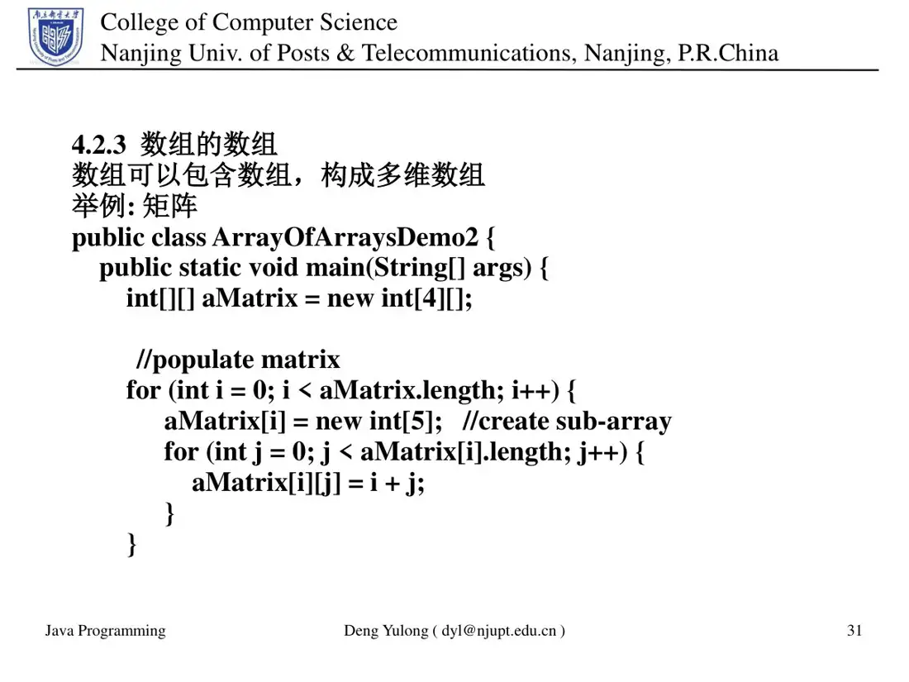

原文：

4.2.3 数组的数组

数组可以包含数组，构成多维数组

举例: 矩阵

南京郵電大學Nanjig Unive

College of Computer Science Nanjing Univ. of Posts & Telecommunications, Nanjing, P.R.China

Java Programming

Deng Yulong ( dyl@njupt.edu.cn )

31

### 南京郵電大學Nanjing U 圆 mmnciions

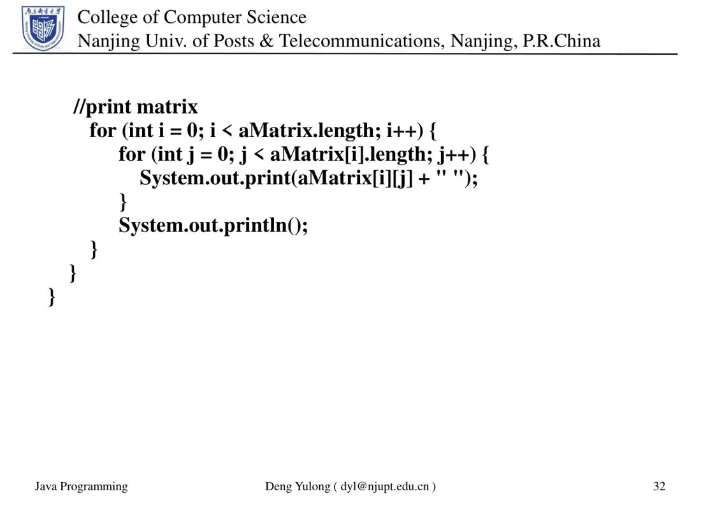

原文：

南京郵電大學Nanjing U 圆 mmnciions

College of Computer Science Nanjing Univ. of Posts & Telecommunications, Nanjing, P.R.China

Java Programming

Deng Yulong ( dyl@njupt.edu.cn )

32

### 4.2.4 数组复制

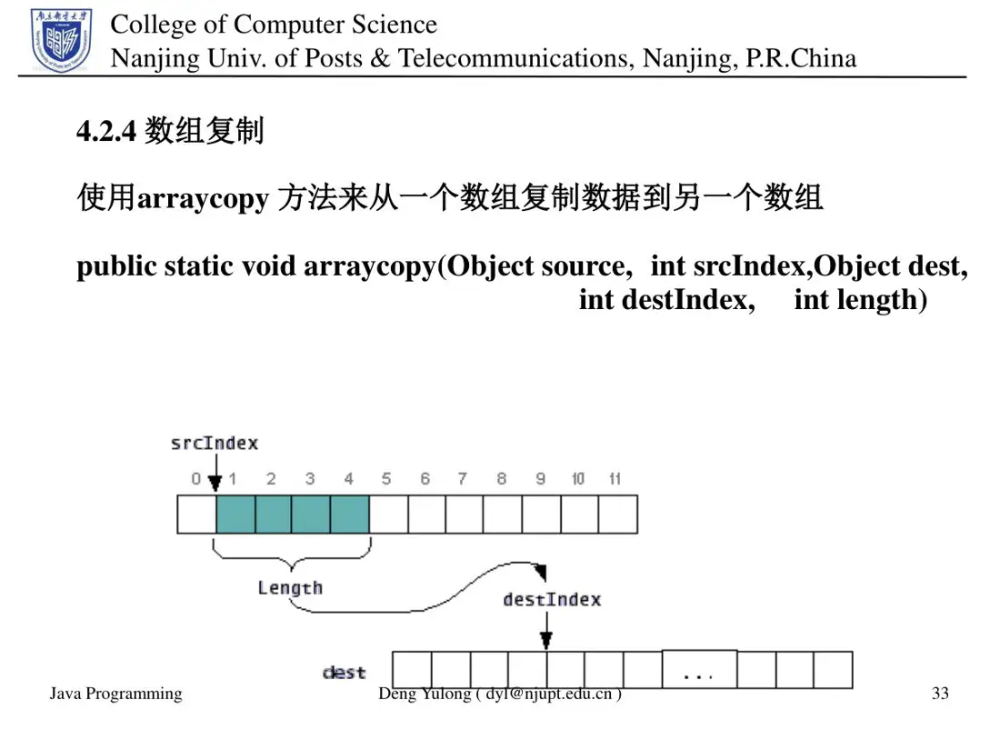

原文：

4.2.4 数组复制

使用arraycopy 方法来从一个数组复制数据到另一个数组

南京郵電大學Nanjing U 圆 mmnciions

College of Computer Science Nanjing Univ. of Posts & Telecommunications, Nanjing, P.R.China

33

### 举例:

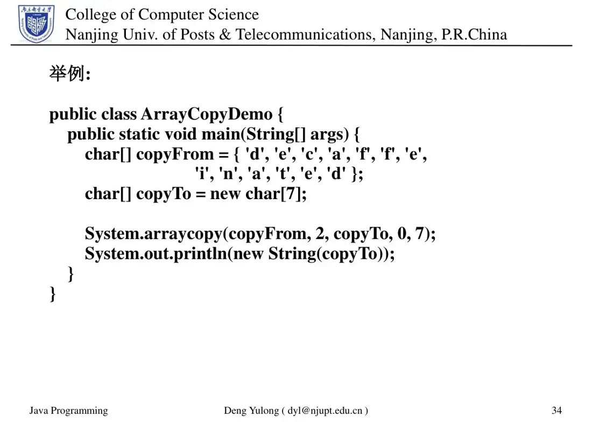

原文：

举例:

南京郵電大學

College of Computer Science Nanjing Univ. of Posts & Telecommunications, Nanjing, P.R.China

Java Programming

Deng Yulong ( dyl@njupt.edu.cn )

34

### 4.3 字符对象(Character)和字符串对象(String)

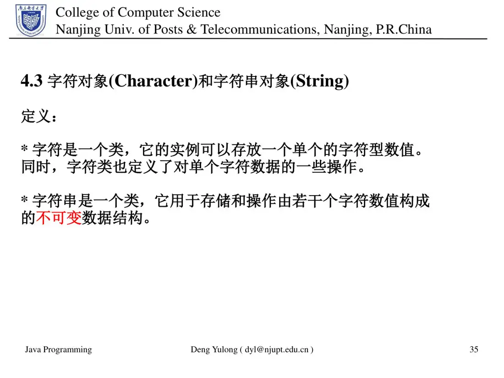

原文：

4.3 字符对象(Character)和字符串对象(String)

定义：

\* 字符是一个类，它的实例可以存放一个单个的字符型数值。同时，字符类也定义了对单个字符数据的一些操作。

\* 字符串是一个类，它用于存储和操作由若干个字符数值构成的不可变数据结构。

南京郵電大學Nanjing U 圆 mmnciions

College of Computer Science Nanjing Univ. of Posts & Telecommunications, Nanjing, P.R.China

Java Programming

Deng Yulong ( dyl@njupt.edu.cn )

35

### 4.3.1 字符

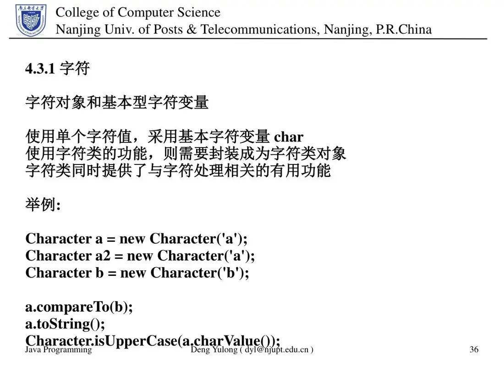

原文：

4.3.1 字符

字符对象和基本型字符变量

举例:

南京郵電大學

College of Computer Science Nanjing Univ. of Posts & Telecommunications, Nanjing, P.R.China

36

### 举例：

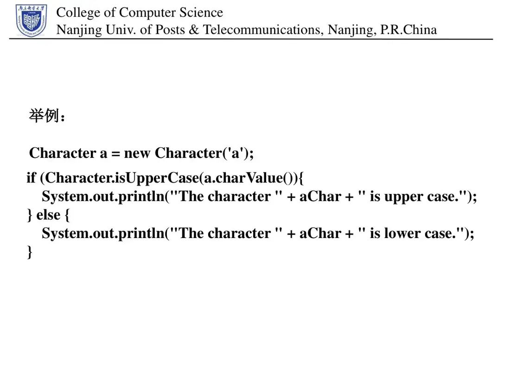

原文：

举例：

南京郵電大學Nanjing U 圆 mmnciions

College of Computer Science Nanjing Univ. of Posts & Telecommunications, Nanjing, P.R.China

### 4.3.2 字符串

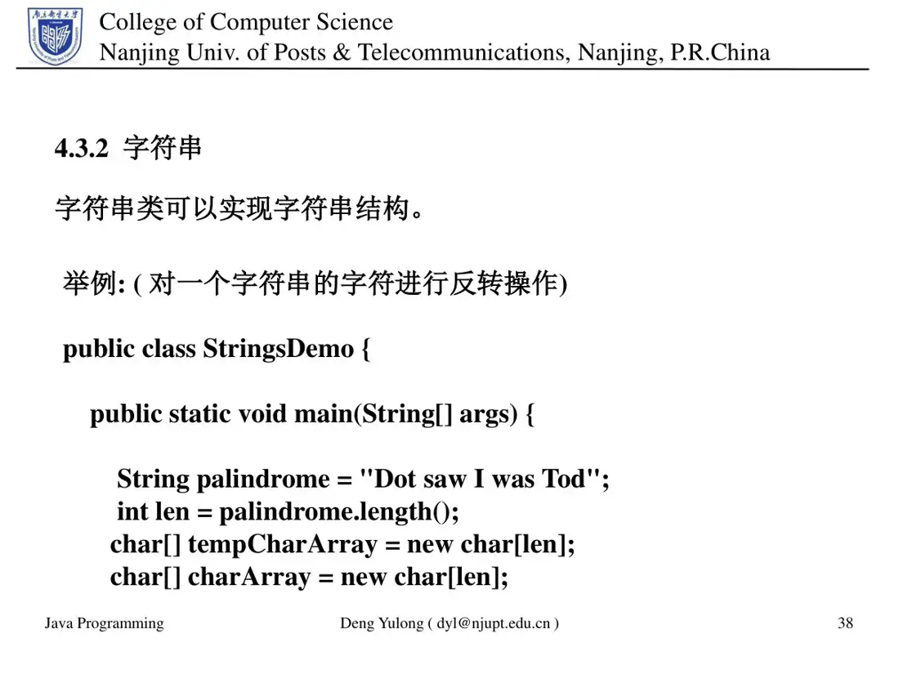

原文：

4.3.2 字符串

字符串类可以实现字符串结构。

举例: ( 对一个字符串的字符进行反转操作)

public static void main(String[] args) {

南京郵電大學Nanjing Ut 圆

College of Computer Science Nanjing Univ. of Posts & Telecommunications, Nanjing, P.R.China

Java Programming

Deng Yulong ( dyl@njupt.edu.cn )

38

### 南京郵電大學Nanjig Unive

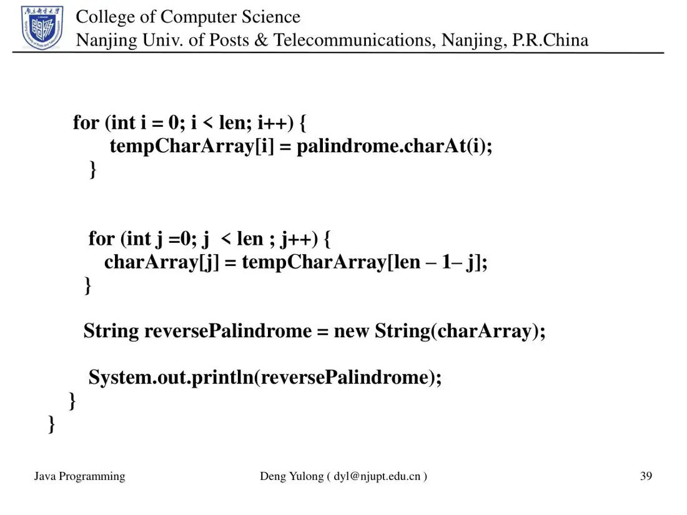

原文：

南京郵電大學Nanjig Unive

College of Computer Science Nanjing Univ. of Posts & Telecommunications, Nanjing, P.R.China

Java Programming

Deng Yulong ( dyl@njupt.edu.cn )

39

### 4.3.3 创建字符串

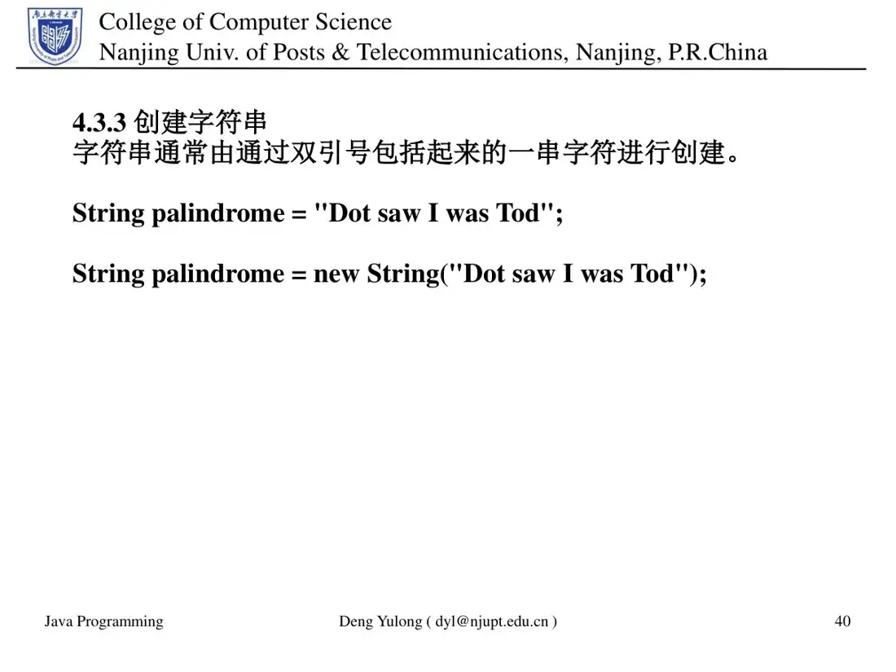

原文：

4.3.3 创建字符串

字符串通常由通过双引号包括起来的一串字符进行创建。

南京郵電大學Nanjing U 圆 mmnciions

College of Computer Science Nanjing Univ. of Posts & Telecommunications, Nanjing, P.R.China

Java Programming

Deng Yulong ( dyl@njupt.edu.cn )

40

### 4.3.4 得到字符串的长度

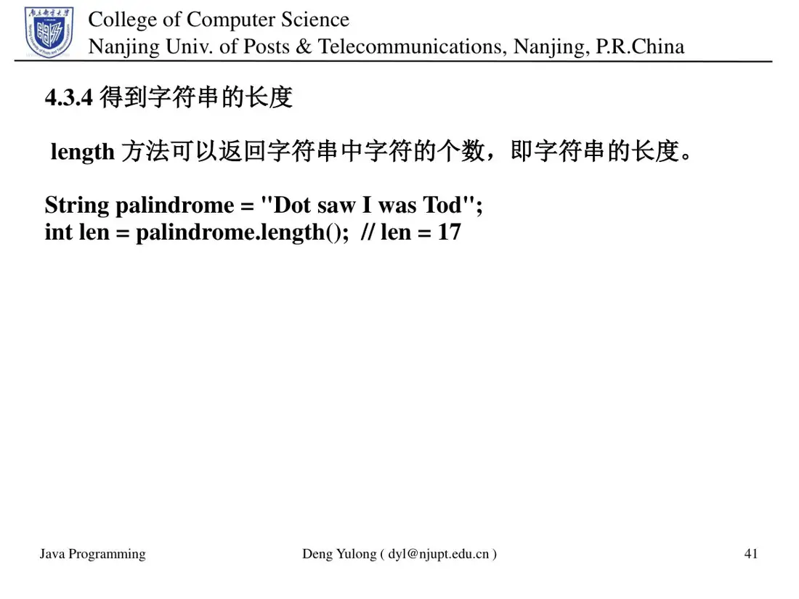

原文：

4.3.4 得到字符串的长度

length 方法可以返回字符串中字符的个数，即字符串的长度。

南京郵電大學Nanjing U 圆 mmnciions

College of Computer Science Nanjing Univ. of Posts & Telecommunications, Nanjing, P.R.China

Java Programming

Deng Yulong ( dyl@njupt.edu.cn )

41

### 4.3.5通过索引从字符串中取得对应字符

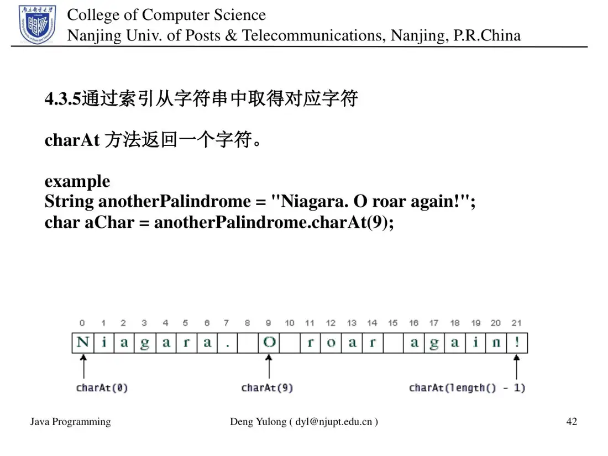

原文：

4.3.5通过索引从字符串中取得对应字符

charAt 方法返回一个字符。

example String anotherPalindrome = "Niagara. O roar again!"; char aChar = anotherPalindrome.charAt(9);

南京郵電大學Nanjing Ut 圆

College of Computer Science Nanjing Univ. of Posts & Telecommunications, Nanjing, P.R.China

Java Programming

Deng Yulong ( dyl@njupt.edu.cn )

42

### substring 方法返回一个以上的字符

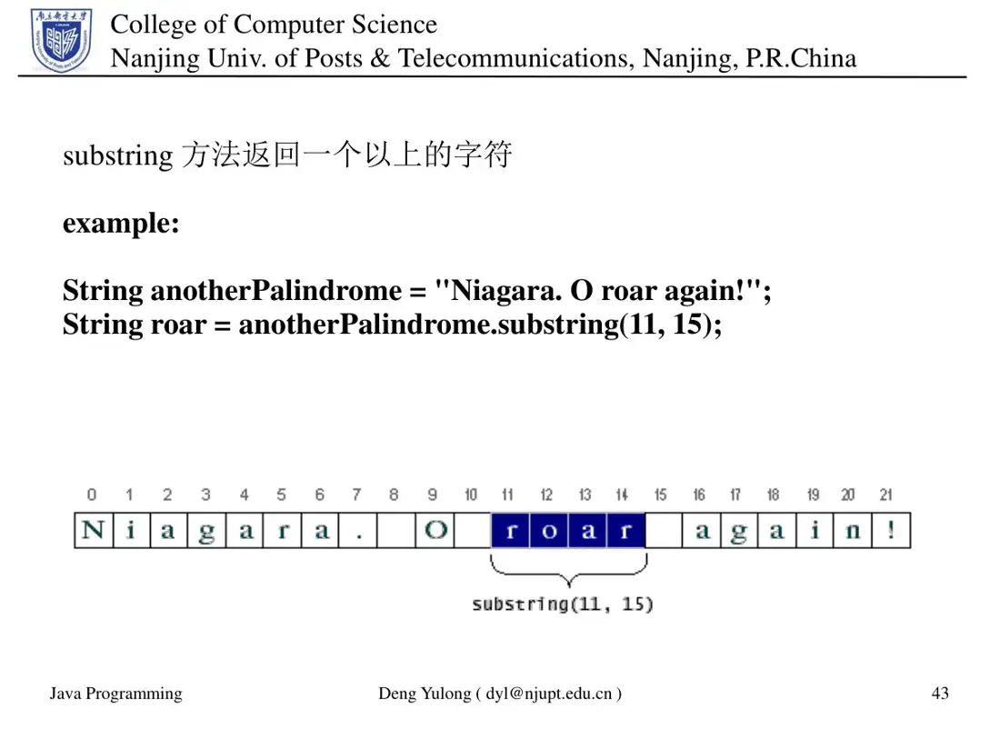

原文：

substring 方法返回一个以上的字符

example:

String anotherPalindrome = "Niagara. O roar again!"; String roar = anotherPalindrome.substring(11, 15);

南京郵電大學Nanjing Ut 圆

College of Computer Science Nanjing Univ. of Posts & Telecommunications, Nanjing, P.R.China

Java Programming

Deng Yulong ( dyl@njupt.edu.cn )

43

### 4.3.6 在字符串内搜索字符或子串

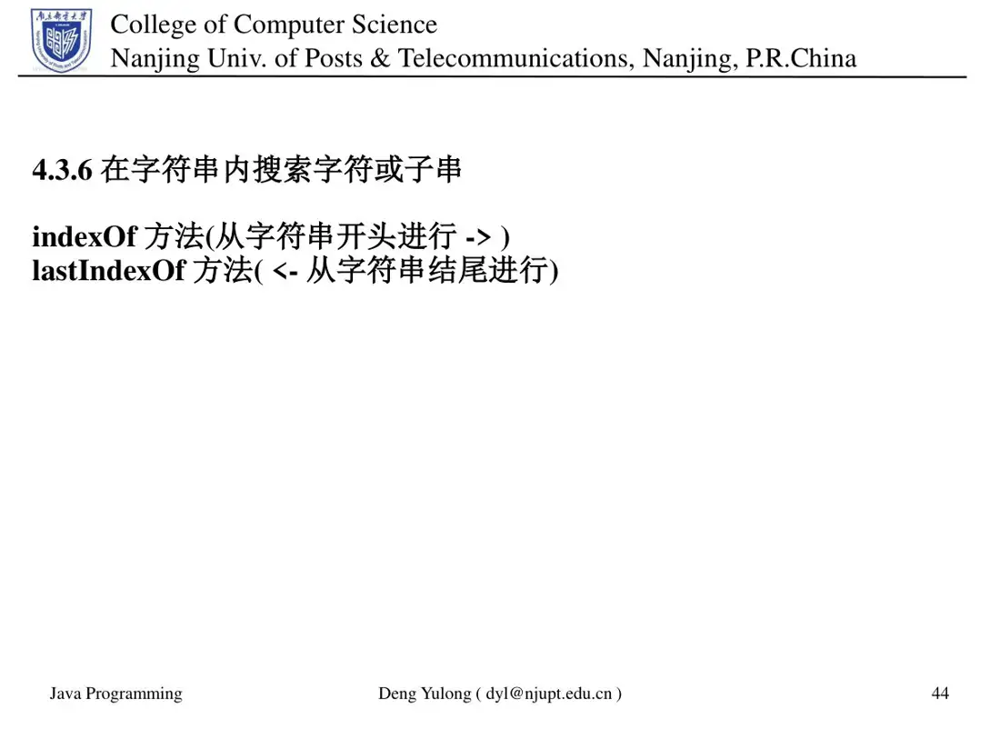

原文：

4.3.6 在字符串内搜索字符或子串

indexOf 方法(从字符串开头进行 -> )

lastIndexOf 方法( <- 从字符串结尾进行)

南京郵電大學Nanjing U 圆 mmnciions

College of Computer Science Nanjing Univ. of Posts & Telecommunications, Nanjing, P.R.China

Java Programming

Deng Yulong ( dyl@njupt.edu.cn )

44

### 4.3.7 字符串比较

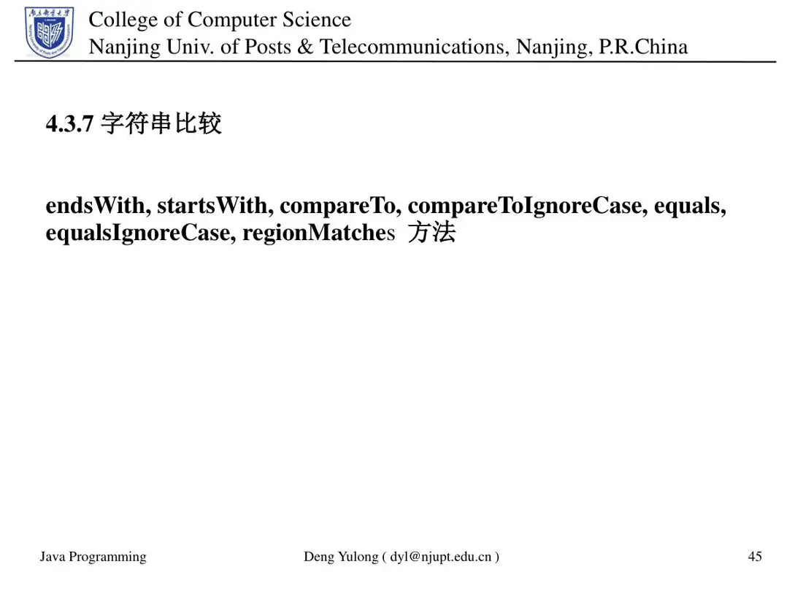

原文：

4.3.7 字符串比较

endsWith, startsWith, compareTo, compareToIgnoreCase, equals,equalsIgnoreCase, regionMatches 方法

南京郵電大學Nanjing U 圆 mmnciions

College of Computer Science Nanjing Univ. of Posts & Telecommunications, Nanjing, P.R.China

Java Programming

Deng Yulong ( dyl@njupt.edu.cn )

45

### 4.3.8 字符串操作

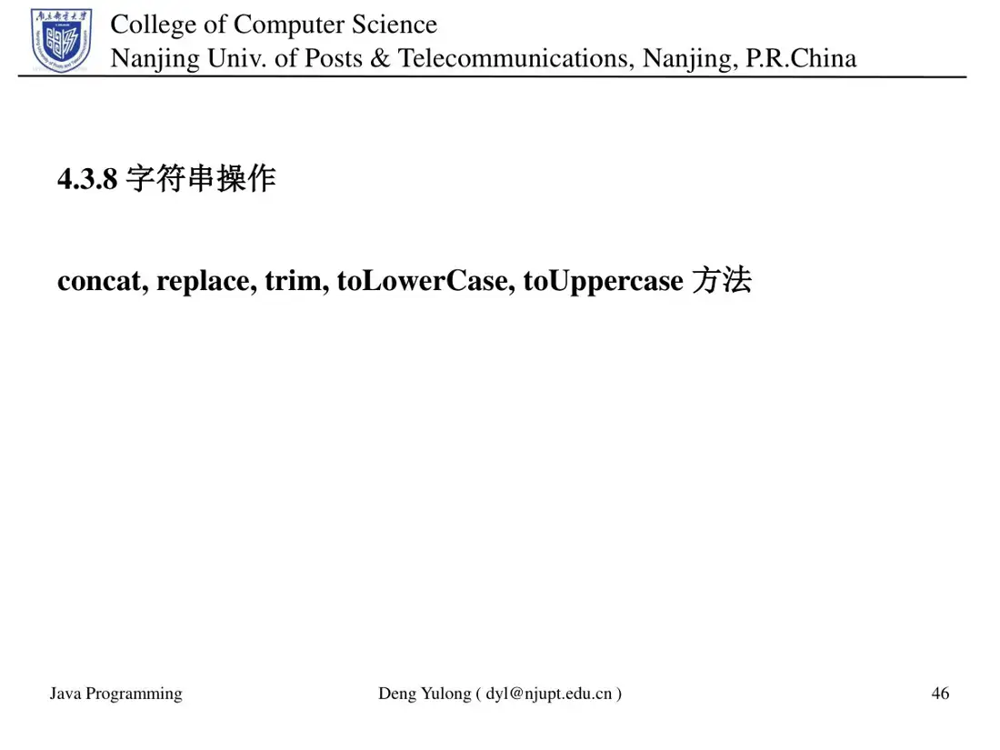

原文：

4.3.8 字符串操作

concat, replace, trim, toLowerCase, toUppercase 方法

南京郵電大學

College of Computer Science Nanjing Univ. of Posts & Telecommunications, Nanjing, P.R.China

Java Programming

Deng Yulong ( dyl@njupt.edu.cn )

46

### 4.3.9字符串和编译器

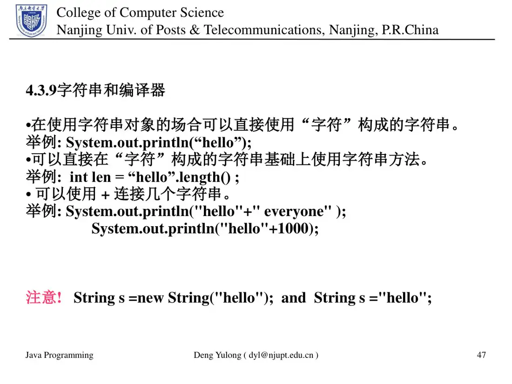

原文：

4.3.9字符串和编译器

•在使用字符串对象的场合可以直接使用“字符”构成的字符串。

举例: System.out.println(“hello”);

• 可以使用 + 连接几个字符串。

举例: System.out.println("hello"+" everyone" ); System.out.println("hello"+1000);

注意! String s =new String("hello"); and String s ="hello";

南京郵電大學Nanjing Ut 圆

College of Computer Science Nanjing Univ. of Posts & Telecommunications, Nanjing, P.R.China

Java Programming

Deng Yulong ( dyl@njupt.edu.cn )

47

### 4.4 基本数据类型对象(数值类)(Numbers)

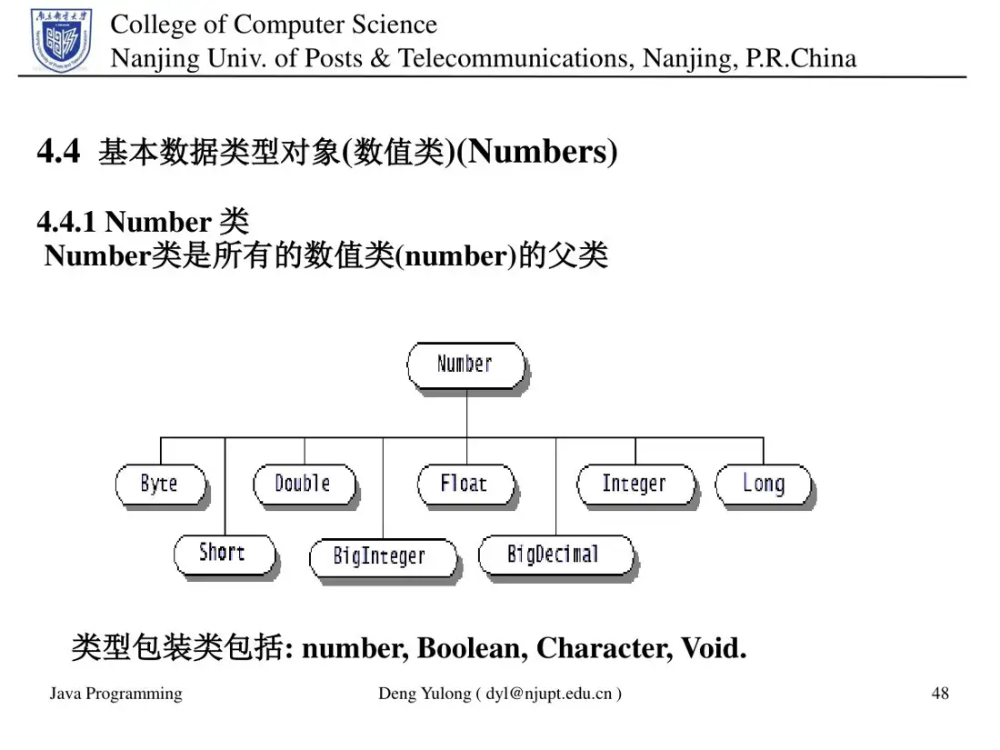

原文：

4.4 基本数据类型对象(数值类)(Numbers)

4.4.1 Number 类

Number类是所有的数值类(number)的父类

类型包装类包括: number, Boolean, Character, Void.

南京郵電大學Nanjing U 圆 mmnciions

College of Computer Science Nanjing Univ. of Posts & Telecommunications, Nanjing, P.R.China

Java Programming

Deng Yulong ( dyl@njupt.edu.cn )

48

### 类型包装类

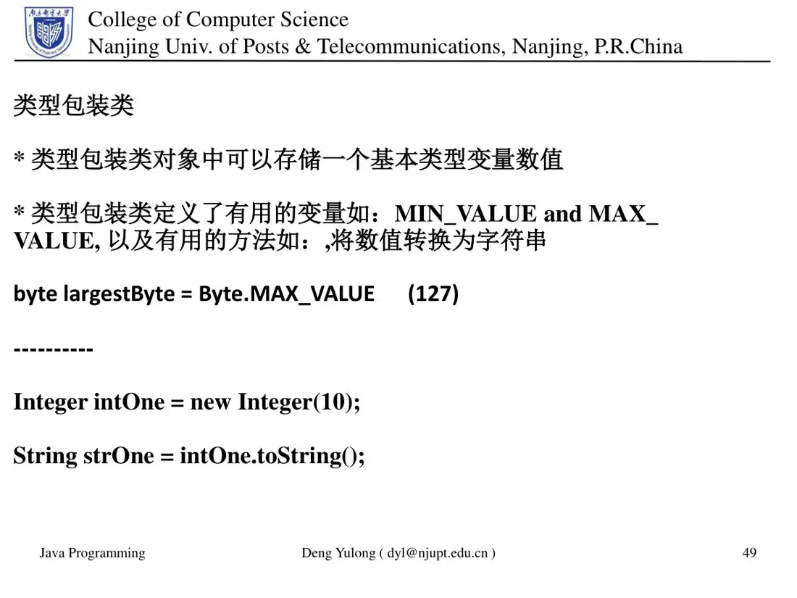

原文：

类型包装类

\* 类型包装类对象中可以存储一个基本类型变量数值

\* 类型包装类定义了有用的变量如：MIN\_VALUE and MAX\_VALUE, 以及有用的方法如：,将数值转换为字符串

byte largestByte = Byte.MAX\_VALUE (127)

Integer intOne = new Integer(10);

String strOne = intOne.toString();

南京郵電大學Nanjing U 圆 mmnciions

College of Computer Science Nanjing Univ. of Posts & Telecommunications, Nanjing, P.R.China

Java Programming

Deng Yulong ( dyl@njupt.edu.cn )

49

### 4.4.2将字符串转换为数字

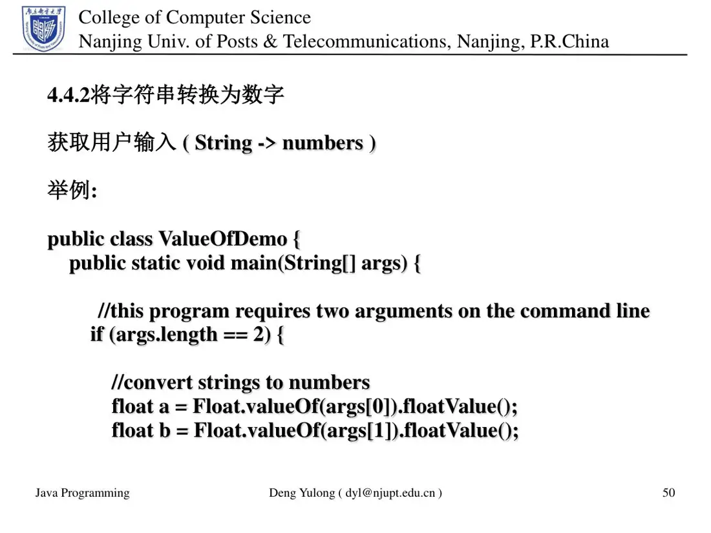

原文：

4.4.2将字符串转换为数字

举例:

//this program requires two arguments on the command line if (args.length == 2) {

//convert strings to numbers

float a = Float.valueOf(args[0]).floatValue();

float b = Float.valueOf(args[1]).floatValue();

南京郵電大學Nanjing U 圆 mmnciions

College of Computer Science Nanjing Univ. of Posts & Telecommunications, Nanjing, P.R.China

Java Programming

Deng Yulong ( dyl@njupt.edu.cn )

50

### 南京郵電大學Nanjing U 圆 mmnciions

原文：

南京郵電大學Nanjing U 圆 mmnciions

College of Computer Science Nanjing Univ. of Posts & Telecommunications, Nanjing, P.R.China

Java Programming

Deng Yulong ( dyl@njupt.edu.cn )

51

### 4.4.3 将数字转换为字符串

原文：

4.4.3 将数字转换为字符串

南京郵電大學Nanjing U 圆 mmnciions

College of Computer Science Nanjing Univ. of Posts & Telecommunications, Nanjing, P.R.China

Java Programming

Deng Yulong ( dyl@njupt.edu.cn )

52

### 4.4.4 数学运算

原文：

4.4.4 数学运算

基本数学运算 (java.lang)高级数学运算 (java.lang.math)

abs, ceil, floor, rint, round, min, max, exp, log, pow, sqrt, sin, cos, tan, asin, acos, atan, atan2, toDegrees, toRadians, random

注意! 类方法: 举例. Math.log(x) Math.PI Random number: int number = (int)(Math.random()\*10 + 1);

南京郵電大學Nanjing U 圆 mmnciions

College of Computer Science Nanjing Univ. of Posts & Telecommunications, Nanjing, P.R.China

Java Programming

Deng Yulong ( dyl@njupt.edu.cn )

53
