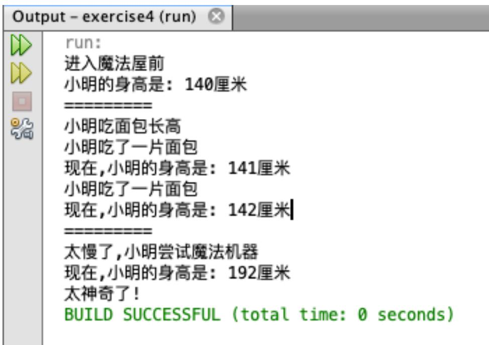

# 《Java程序设计》第5次作业：魔法屋的故事

原件经识别和整理；“参考解答”是我们补的。

本资料为南京邮电大学计算机学院《Java程序设计》课程2021年春季学期的第5次课后编程练习，旨在通过面向对象编程描述“魔法屋”的故事场景。

## 一、编程练习（共 2 题）

### 选择 1

**题目背景与要求：**

小明是一个矮个子，身高只有 140 厘米，他一直渴望能长高。有一天他在街上看到一座房子，墙上贴着大幅广告，上面写道：“魔法屋，让你增高不再是梦想！！！” 小明赶忙走了进去。

**练习 1 具体要求：**
小明在屋子里发现好多面包，这种面包只要吃下去一片就可以长高 1 厘米。尝试写程序描述上述故事。要求在程序中创建 3 种对象：魔法屋，面包以及小明。

参考解答：应创建 `MagicHouse`、`Bread` 和 `XiaoMing` 三个类，分别封装魔法屋环境、面包的增高功能和小明的身高属性及吃面包行为，通过对象交互实现“吃一片面包长高1厘米”的逻辑。

**推理与关键步骤：**

1.  **面向对象建模**：题目明确要求创建3种对象，需将现实实体映射为类。`XiaoMing` 作为主体拥有状态（身高）和行为（吃面包）；`Bread` 作为被消费对象提供增高效果；`MagicHouse` 作为场景容器或工厂，体现“在屋子里发现面包”的语境。
2.  **封装与交互**：身高变化应封装在 `XiaoMing` 内部，避免外部直接修改属性。`eat(Bread b)` 方法接收面包对象，执行 `height += 1`，体现对象间消息传递。
3.  **关键代码结构**：
    -   `class XiaoMing { private int height = 140; public void eat(Bread b) { height++; } }`
    -   `class Bread { }` （可为空类或含名称等属性，核心是作为参数类型标识）
    -   `class MagicHouse { private List<Bread> breads; public Bread getBread() { ... } }`
4.  **为何不选其他设计**：若将增高逻辑放在 `Bread` 或 `MagicHouse` 中，则违反“对象自治”原则，导致小明无法自主管理自身状态；若仅用基本数据类型而无对象封装，则违背题目“创建3种对象”的硬性要求。

知识点：[对象(Object)和类(Class)的概念、实例变量与方法](../../../topics/Java开发/对象与类的概念.md)、[消息(Message)的组成及其在对象通信中的作用](../../../topics/Java开发/消息传递机制.md)

### 选择 2

**题目背景与要求：**

光靠吃面包个子长得太慢了！小明在这座房子的地下室里又发现了一台古怪的机器，上面有个小门，门上的牌子写道：“警告：每次 50 厘米，不可反悔！”，于是他钻进了这台魔法机器。。。几分钟后他惊奇地发现自己已经变成了一个高个子，身高超过了 190 厘米！

**练习 2 具体要求：**
尝试写程序描述上述故事。要求在程序中创建新的一种对象：魔法机器。

## 二、提示与建议

1. **用程序讲述故事的方法**：根据故事的描述，创建相应对象并使用对象，并在故事的不同阶段，同步在文本命令行窗口输出相应的信息。
2. **设计建议**：建议在编写程序前先按照课堂上讲解的面向对象程序设计的方法设计好各个类以及类之间的关系。
3. **项目结构**：练习 1 和练习 2 的程序放入同一个项目中。四个对象对应的类可以分别放在四个源代码文件中，其中需要定义一个主类。

## 三、提交规范

参考解答：## 结论

只需在练习 1 已有“小明”“房子”等类的基础上，新增一个 `MagicMachine` 类，并在主类 `Main` 中创建魔法机器对象，调用其“变身”方法使小明的身高增加 50 厘米，最终输出身高超过 190 厘米的结果。

```java
// MagicMachine.java
public class MagicMachine {
    public void transform(Person p) {
        p.height += 50;
        System.out.println("小明钻进了魔法机器……");
        System.out.println("身高增加了 50 厘米，现在是 " + p.height + " 厘米。");
    }
}
```

```java
// Main.java
public class Main {
    public static void main(String[] args) {
        Person xiaoming = new Person("小明", 145);
        MagicMachine machine = new MagicMachine();

        System.out.println("小明原来的身高：" + xiaoming.height + " 厘米。");
        machine.transform(xiaoming);
        System.out.println("小明现在的身高：" + xiaoming.height + " 厘米。");
        if (xiaoming.height > 190) {
            System.out.println("小明已经变成了高个子，身高超过了 190 厘米！");
        }
    }
}
```

---

## 简要说明

- `MagicMachine` 类对应题目中的“魔法机器”对象，内部通过 `transform` 方法修改传入的 `Person` 对象的身高。
- 每次调用 `transform` 增加 50 厘米，与机器上“每次 50 厘米”的警告一致。
- 主类中先创建“小明”和“魔法机器”两个对象，再调用机器的方法完成故事中的关键事件。
- 若小明初始身高较低，则一次变身可能不足以超过 190 厘米；题目叙述中“几分钟后”暗示可能多次使用机器，因此可根据需要在主类中连续调用 `transform` 两次或设定合适的初始身高。

知识点：[对象(Object)和类(Class)的概念、实例变量与方法](../../../topics/Java开发/对象与类的概念.md)、[类之间的继承、聚合、合成、依赖关系及开闭原则(OCP)](../../../topics/Java开发/类之间的关系.md)、[方法的声明、调用、按值/按引用参数传递及方法的重载(Overloading)](../../../topics/Java开发/方法的定义与重载.md)

### 输出示例


*图注：展示了在 NetBeans 中完成作业后，需包含源代码编辑窗口和结果输出窗口的截图样式。*

参考解答：# 《Java软件开发》参考解答

## 题目分析

根据图片内容，这是一道关于 **Java 软件开发作业提交方法** 的题目，具体要求是：

1. 在 NetBeans 集成开发环境中完成 Java 程序编写
2. 运行程序并获取输出结果
3. 提交作业时需要包含**源代码编辑窗口**和**结果输出窗口**的截图

## 解题步骤

### 1. 编写 Java 源代码

在 NetBeans 中创建 Java 项目，编写符合题目要求的源代码。例如：

```java
public class Main {
    public static void main(String[] args) {
        System.out.println("Hello, Java Software Development!");
    }
}
```

### 2. 编译与运行

- 点击 NetBeans 工具栏的 **"运行项目"** 按钮（或按 `F6`）
- 确保程序编译无错误，并在下方 **"输出"** 窗口显示运行结果

### 3. 截图要求

提交的作业截图必须同时包含以下两个部分：

| 窗口 | 内容要求 |
|------|---------|
| **源代码编辑窗口** | 显示完整的 Java 源代码，包括类名、方法等 |
| **结果输出窗口** | 显示程序运行后的控制台输出结果 |

### 4. 提交作业

将包含上述两个窗口的截图保存为图片文件（如 `.jpg` 或 `.png` 格式），按照课程要求命名并提交。

## 关键点总结

- ✅ 截图需**同时展示**代码编辑区和运行输出区
- ✅ 确保代码完整可见，无遮挡
- ✅ 输出结果清晰可读
- ❌ 不要只提交代码文本或只提交输出结果

---

**注意**：由于图片仅展示了作业提交方法的示例样式，未包含具体的编程题目内容，以上解答基于图片所示的通用提交流程。如有具体编程题目，请提供题目文本以获得详细代码解答。

知识点：[第一个Java程序（源文件创建、javac编译、类定义、main方法）](../../../topics/Java开发/HelloWorld程序结构.md)、[System.out.printf格式化输出与Scanner类输入](../../../topics/Java开发/输入输出基础.md)

### 提交步骤

1. 在 NetBeans 里完成了作业 5 的程序后，将你的屏幕截图文件（在这个截图中需要包含源代码编辑窗口和结果输出窗口）(JPG 文件或 PNG 文件)上传到对应大班 QQ 群的“第 5 次作业提交”文件夹中即可。
2. **截图文件的命名方法**：`学号_姓名_第 5 次作业.JPG`
   - 例如：学号为 B19030101 的同学，姓名为“我是学霸”，则截图文件命名为：`B19030101_我是学霸_第 5 次作业.JPG`

参考解答：**结论**：本题为操作说明题，无唯一代码答案。核心要求是提交包含“源代码编辑窗口”和“结果输出窗口”的 NetBeans 运行截图，并严格按照 `学号_姓名_第 5 次作业.JPG` 格式命名文件。

**推理与执行步骤**：

1.  **完成开发**：在 NetBeans IDE 中编写并成功运行“作业 5”所需的 Java 程序，确保控制台或 GUI 界面有预期的输出结果。
2.  **截取屏幕**：使用截图工具截取整个 NetBeans 窗口，必须同时清晰展示以下两个区域：
    *   左侧或主区域的**源代码编辑窗口**（显示 `.java` 文件内容）。
    *   底部或弹出窗口的**结果输出窗口**（显示程序运行后的 Output/Console 信息）。
3.  **保存文件**：将截图保存为 `.JPG` 或 `.PNG` 格式。
4.  **规范命名**：根据公式重命名文件：
    $$ \text{文件名} = \text{学号} + \text{"\_"} + \text{姓名} + \text{"\_第 5 次作业.JPG"} $$
    *   例如：若学号为 $B19030101$，姓名为“张三”，则文件名为 `B19030101_张三_第 5 次作业.JPG`。
5.  **提交上传**：登录对应大班 QQ 群，找到“第 5 次作业提交”文件夹，上传命名正确的截图文件。

**注意事项**：
*   若只截取代码而无运行结果，或只截取结果而无代码，均不符合“包含源代码编辑窗口和结果输出窗口”的要求，可能导致扣分。
*   文件名中的下划线 `_` 和空格需严格遵循示例，避免使用特殊字符导致系统识别错误。

知识点：[第一个Java程序（源文件创建、javac编译、类定义、main方法）](../../../topics/Java开发/HelloWorld程序结构.md)、[System.out.printf格式化输出与Scanner类输入](../../../topics/Java开发/输入输出基础.md)、[if-else、switch、while、do-while、for语句及break/continue/return分支控制](../../../topics/Java开发/流程控制语句.md)

### 截止时间

第 5 次作业提交的截止时间是 2021 年 4 月 5 日。请同学们在截止日期前完成作业提交。

参考解答：**结论**：作业提交的截止时间为 **2021 年 4 月 5 日**。

**推理过程**：
- 题目明确给出第 5 次作业提交的截止时间为 2021 年 4 月 5 日。
- 无计算过程，属于直接使用题目给定的时间信息。

**注意事项**：
- 该时间与开发工具使用无关，属于作业管理信息。
- 使用 NetBeans 完成 Java 代码编写后，应在截止时间前通过课程平台提交。

知识点：[Java平台、JVM定义及编译解释执行原理](../../../topics/Java开发/Java平台与JVM.md)
