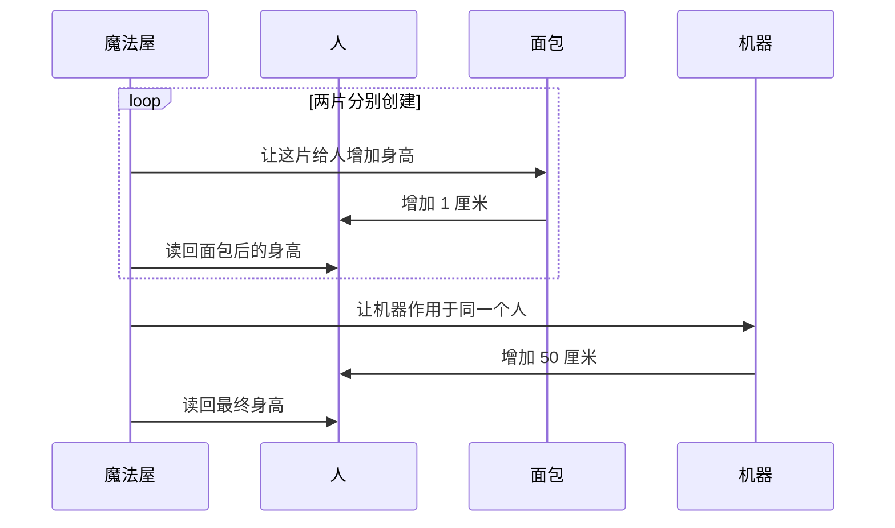

# 《Java程序设计》第5次作业：魔法屋的对象与状态

本题让两段练习在同一个项目中衔接：一开始需要屋子、面包和人，第二段再加入机器。原件第 3 页的输出图示采用两片面包，所以身高从 140 先到 141、再到 142，使用机器后为 192 厘米。题目要求呈现各阶段，不要求照抄截图或旧提交模板。下文用四个源文件给出自编实现。

## 哪个对象真正拥有会变化的数值

**参考解答**：身高属于人，不属于屋子，也不应在每段故事里各存一份。面包和机器只负责把各自的作用施加给==传入的同一个人==，屋子排出先后顺序并读回身高。先规定职责，再写调用，避免输出按预期变化却没人真正更新对象。

| 类 | 保存什么 | 负责什么 |
| --- | --- | --- |
| `Person` | 当前身高 | 读取身高、应用正增量 |
| `Bread` | 这一片是否吃过 | 第一次使人增加 1 厘米，同一片不重复生效 |
| `MagicMachine` | 本题不需要记录人的副本 | 一次使人增加 50 厘米 |
| `MagicHouse` | 不复制人的身高 | 组织两段练习并输出观察结果 |

一片只能吃一次是本示例对“同一片面包”的建模选择；需要两片时创建两个面包实例，而不是对同一实例调用两次。[对象与类](../../../topics/Java开发/对象与类的概念.md)区分实例数和类数，[消息传递](../../../topics/Java开发/消息传递机制.md)描述一次方法调用怎样更新对象。

## 四个源文件

将下面四段分别保存到与公开类同名的源文件中，放在同一目录。

```java
public class Person {
    private int height;

    public Person(int height) {
        if (height <= 0) {
            throw new IllegalArgumentException("height must be positive");
        }
        this.height = height;
    }

    public int getHeight() {
        return height;
    }

    void growBy(int cm) {
        if (cm <= 0) {
            throw new IllegalArgumentException("growth must be positive");
        }
        height = Math.addExact(height, cm);
    }
}
```

```java
public class Bread {
    private boolean eaten;

    public boolean eatBy(Person person) {
        if (eaten) {
            return false;
        }
        person.growBy(1);
        eaten = true;
        return true;
    }
}
```

```java
public class MagicMachine {
    public void grow(Person person) {
        person.growBy(50);
    }
}
```

```java
public class MagicHouse {
    private void show(String stage, Person person) {
        System.out.println(stage + ": " + person.getHeight() + " cm");
    }

    void run(Person person) {
        show("before", person);
        for (int i = 0; i < 2; i++) {
            Bread piece = new Bread();
            piece.eatBy(person);
            show("after bread " + (i + 1), person);
        }
        MagicMachine machine = new MagicMachine();
        machine.grow(person);
        show("after machine", person);
    }

    public static void main(String[] args) {
        new MagicHouse().run(new Person(140));
    }
}
```

第一段用屋子、人和两个面包实例，仍然只有三种类；机器对象在第二段才创建。以 `MagicHouse` 为[程序入口](../../../topics/Java开发/HelloWorld程序结构.md)，用 JDK 编译四个文件并运行，输出如下：

```text
before: 140 cm
after bread 1: 141 cm
after bread 2: 142 cm
after machine: 192 cm
```



> [!TIP]
> ==打印值与写入对象状态不是同一件事==。把一片面包交给另一个人测试：第一个人的身高应不变；重复使用已经吃掉的同一片，则两人都不应再长高。这个检查能区分“类的实例各自存状态”与“全班对象共享一份全局变量”。

这里没有用继承表达“人在屋子里”或“机器作用于人”；它们是独立对象之间的使用关系，可对照[类之间的关系](../../../topics/Java开发/类之间的关系.md)。若把增长部分写在屋子里而让面包、机器只剩名字，虽然也能打印正确的 192，却没有练到把行为分配给对象。
