# 《Java程序设计》第5章 Java类的语法结构和体系结构（课件）

原件的每一页，下面附识别出的文字。

### Chap 5 Java类的语法结构和体系结构

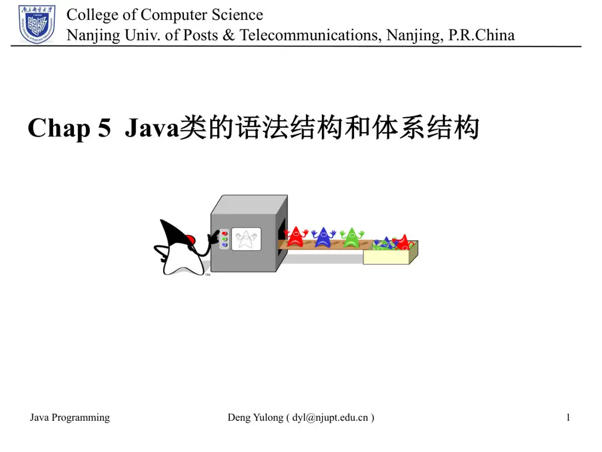

原文：

Chap 5 Java类的语法结构和体系结构

南京郵電大學易

College of Computer Science Nanjing Univ. of Posts & Telecommunications, Nanjing, P.R.China

Java Programming

Deng Yulong ( dyl@njupt.edu.cn )

1

### 5.1 Java类的语法结构

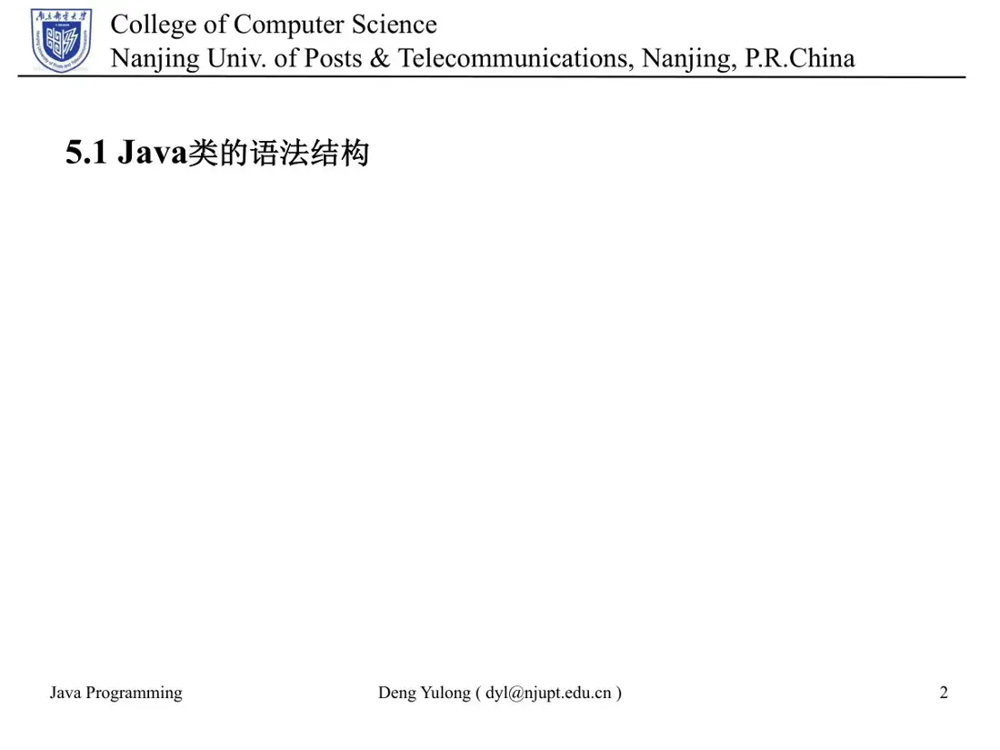

原文：

5.1 Java类的语法结构

南京郵電大學易

College of Computer Science Nanjing Univ. of Posts & Telecommunications, Nanjing, P.R.China

Java Programming

Deng Yulong ( dyl@njupt.edu.cn )

2

### 堆栈

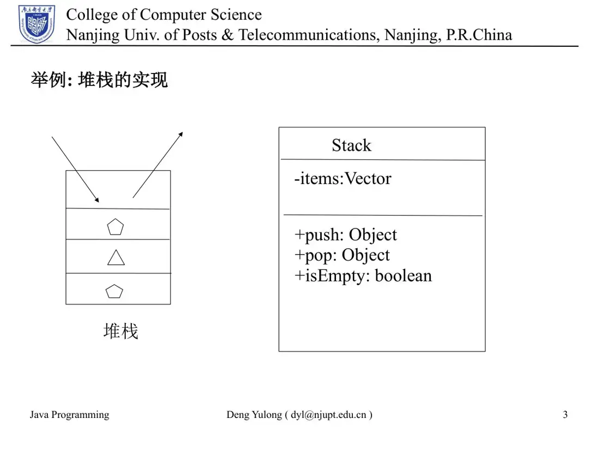

原文：

堆栈

举例: 堆栈的实现

南京郵電大學易

College of Computer Science Nanjing Univ. of Posts & Telecommunications, Nanjing, P.R.China

Java Programming

Deng Yulong ( dyl@njupt.edu.cn )

3

### 南京郵電大學易

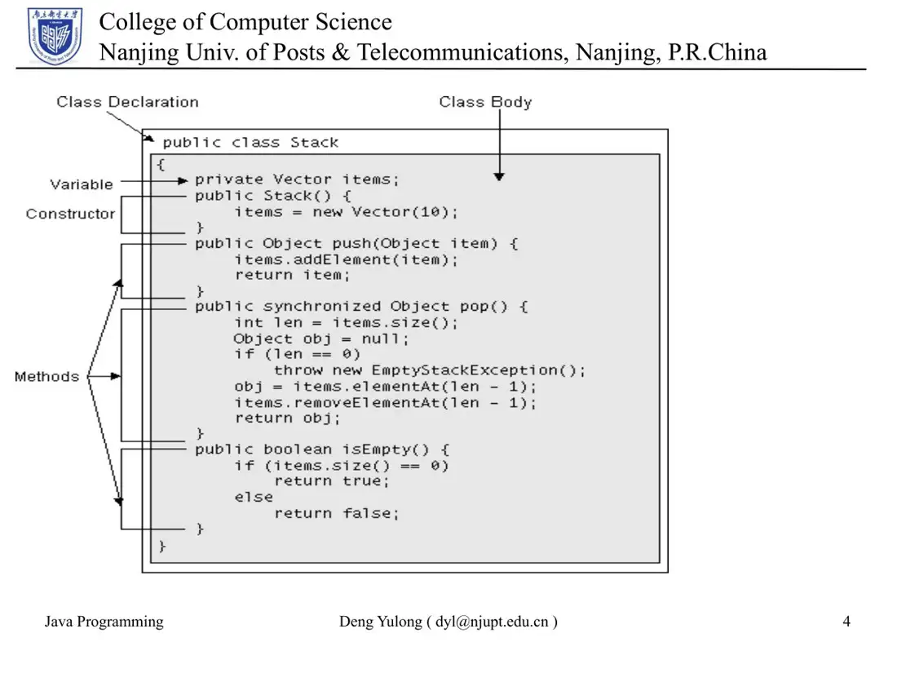

原文：

南京郵電大學易

College of Computer Science Nanjing Univ. of Posts & Telecommunications, Nanjing, P.R.China

Java Programming

Deng Yulong ( dyl@njupt.edu.cn )

4

### 类的定义由下面两个部分组成:

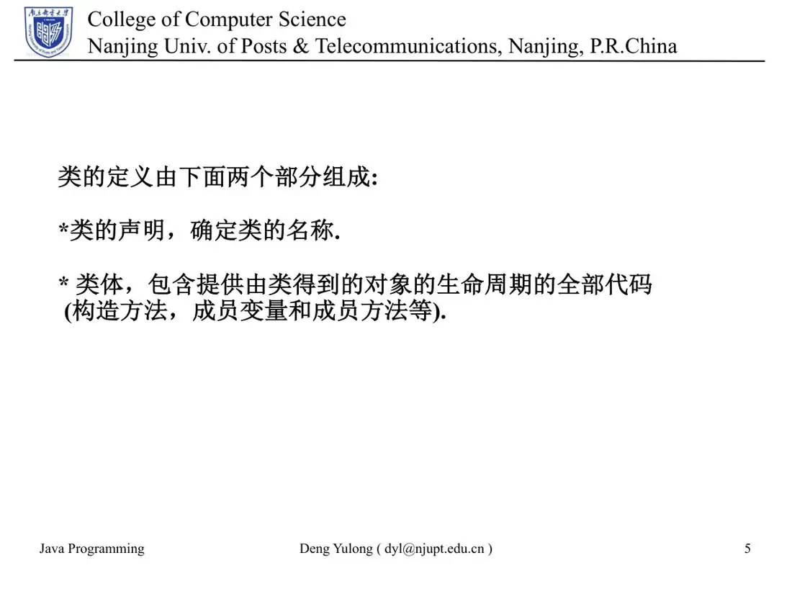

原文：

类的定义由下面两个部分组成:

\*类的声明，确定类的名称.

\* 类体，包含提供由类得到的对象的生命周期的全部代码(构造方法，成员变量和成员方法等).

南京郵電大學易

College of Computer Science Nanjing Univ. of Posts & Telecommunications, Nanjing, P.R.China

Java Programming

Deng Yulong ( dyl@njupt.edu.cn )

5

### 5.1.1声明一个类

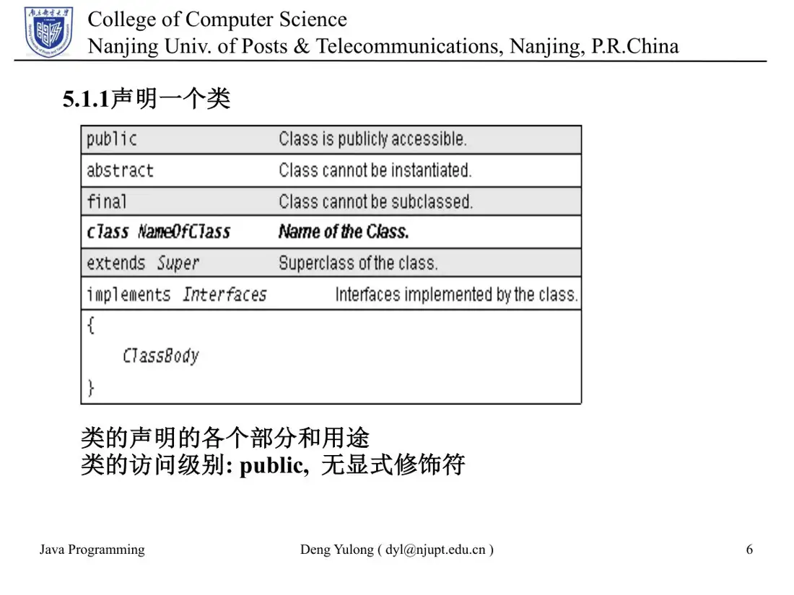

原文：

5.1.1声明一个类

<table><tr><td>public</td><td>Class is publicly accessible.</td></tr><tr><td>abstract</td><td>Class cannot be instantiated.</td></tr><tr><td>final</td><td>Class cannot be subclassed.</td></tr><tr><td>class NameOfClass</td><td>Name of the Class.</td></tr><tr><td>extends Super</td><td>Superclass of the class.</td></tr><tr><td>implements Interfaces</td><td>Interfaces implemented by the class.</td></tr><tr><td>{</td><td></td></tr><tr><td>ClassBody</td><td></td></tr><tr><td>}</td><td></td></tr></table>

类的声明的各个部分和用途

类的访问级别: public, 无显式修饰符

南京郵電大學易

College of Computer Science Nanjing Univ. of Posts & Telecommunications, Nanjing, P.R.China

Java Programming

Deng Yulong ( dyl@njupt.edu.cn )

6

### 5.1.2 声明成员变量

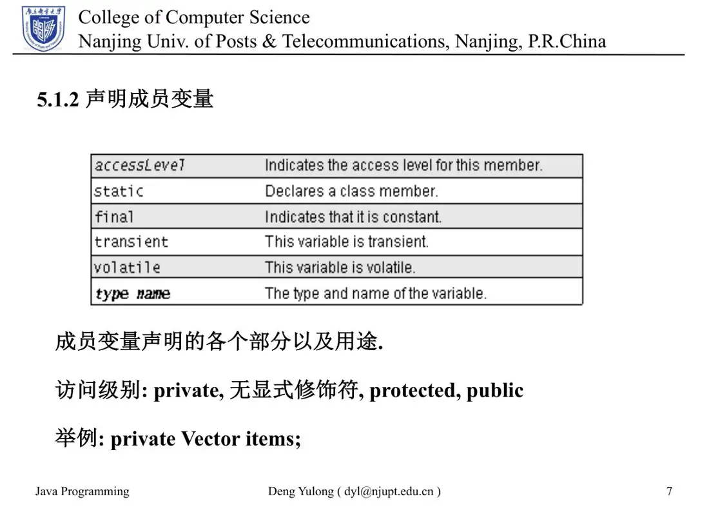

原文：

5.1.2 声明成员变量

<table><tr><td>accessLevel</td><td>Indicates the access level for this member.</td></tr><tr><td>static</td><td>Declares a class member.</td></tr><tr><td>final</td><td>Indicates that it is constant.</td></tr><tr><td>transient</td><td>This variable is transient.</td></tr><tr><td>volatile</td><td>This variable is volatile.</td></tr><tr><td>type name</td><td>The type and name of the variable.</td></tr></table>

成员变量声明的各个部分以及用途.

访问级别: private, 无显式修饰符, protected, public

举例: private Vector items;

南京郵電大學易

College of Computer Science Nanjing Univ. of Posts & Telecommunications, Nanjing, P.R.China

Java Programming

Deng Yulong ( dyl@njupt.edu.cn )

7

### 5.1.3 定义方法

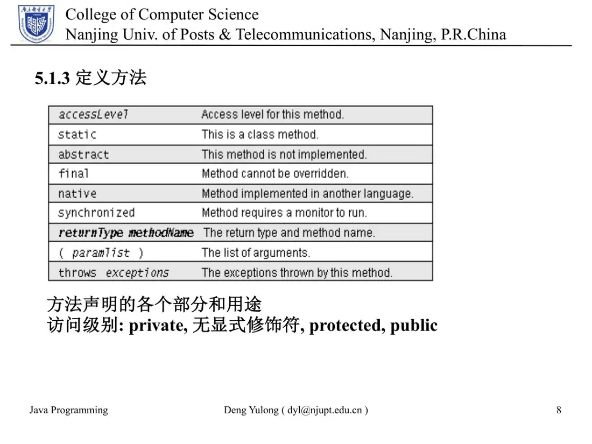

原文：

5.1.3 定义方法

<table><tr><td>accessLevel</td><td>Access level for this method.</td></tr><tr><td>static</td><td>This is a class method.</td></tr><tr><td>abstract</td><td>This method is not implemented.</td></tr><tr><td>final</td><td>Method cannot be overridden.</td></tr><tr><td>native</td><td>Method implemented in another language.</td></tr><tr><td>synchronized</td><td>Method requires a monitor to run.</td></tr><tr><td>returnType methodName</td><td>The return type and method name.</td></tr><tr><td>(paramList)</td><td>The list of arguments.</td></tr><tr><td>throws exceptions</td><td>The exceptions thrown by this method.</td></tr></table>

方法声明的各个部分和用途

访问级别: private, 无显式修饰符, protected, public

南京郵電大學易

College of Computer Science Nanjing Univ. of Posts & Telecommunications, Nanjing, P.R.China

Java Programming

Deng Yulong ( dyl@njupt.edu.cn )

8

### 举例:

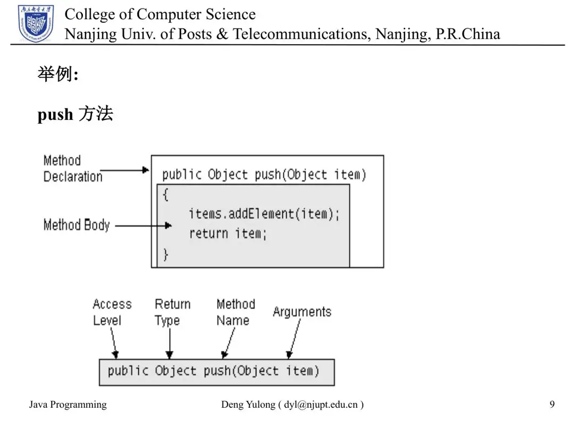

原文：

举例:

push 方法

南京郵電大學易

College of Computer Science Nanjing Univ. of Posts & Telecommunications, Nanjing, P.R.China

Java Programming

Deng Yulong ( dyl@njupt.edu.cn )

9

### • 方法名的相关问题

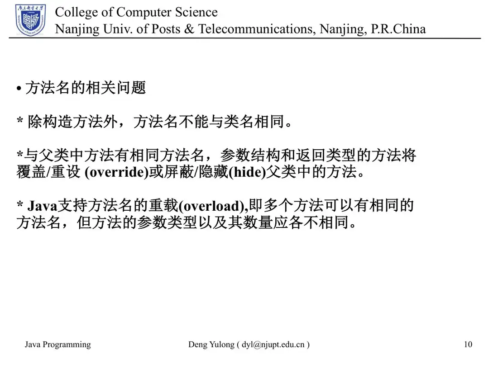

原文：

• 方法名的相关问题

\* 除构造方法外，方法名不能与类名相同。

\*与父类中方法有相同方法名，参数结构和返回类型的方法将覆盖/重设 (override)或屏蔽/隐藏(hide)父类中的方法。

\* Java支持方法名的重载(overload),即多个方法可以有相同的方法名，但方法的参数类型以及其数量应各不相同。

南京郵電大學易

College of Computer Science Nanjing Univ. of Posts & Telecommunications, Nanjing, P.R.China

Java Programming

Deng Yulong ( dyl@njupt.edu.cn )

10

### 重载举例：

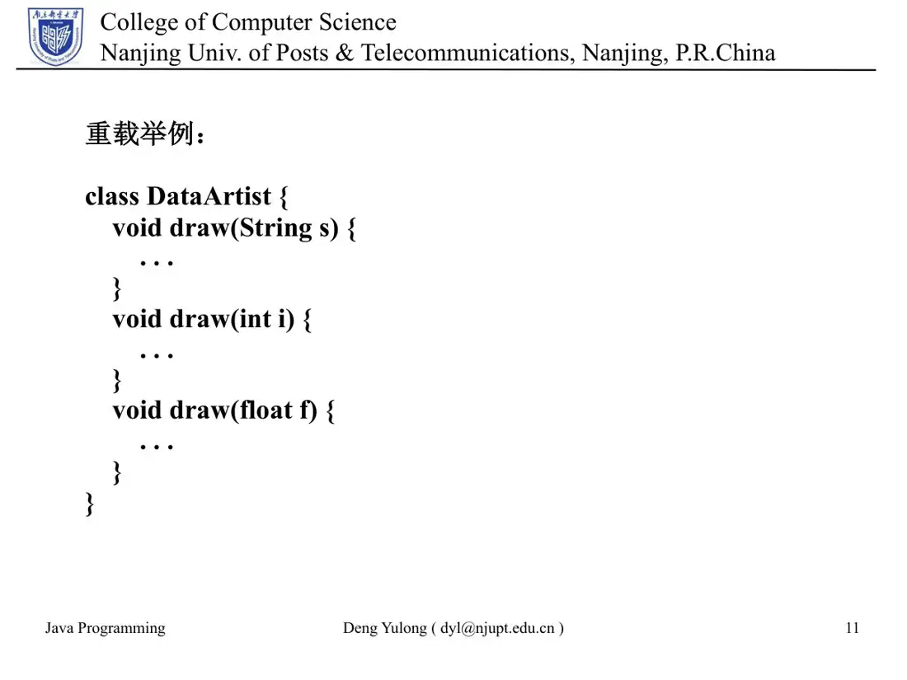

原文：

重载举例：

南京郵電大學易

College of Computer Science Nanjing Univ. of Posts & Telecommunications, Nanjing, P.R.China

Java Programming

Deng Yulong ( dyl@njupt.edu.cn )

11

### 5.1.4 类的构造方法

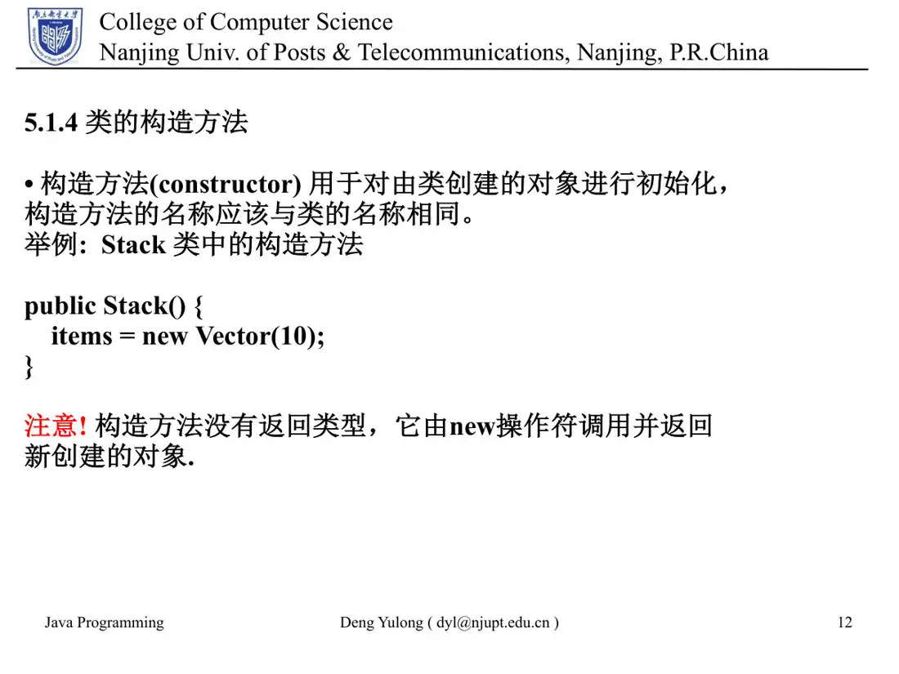

原文：

5.1.4 类的构造方法

• 构造方法(constructor) 用于对由类创建的对象进行初始化，构造方法的名称应该与类的名称相同。

举例: Stack 类中的构造方法

注意! 构造方法没有返回类型，它由new操作符调用并返回新创建的对象.

南京郵電大學易

College of Computer Science Nanjing Univ. of Posts & Telecommunications, Nanjing, P.R.China

Java Programming

Deng Yulong ( dyl@njupt.edu.cn )

12

### 南京郵電大學易

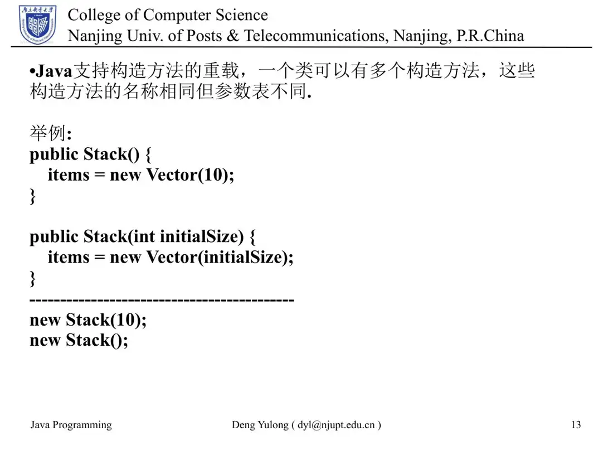

原文：

•Java支持构造方法的重载，一个类可以有多个构造方法，这些构造方法的名称相同但参数表不同.

南京郵電大學易

College of Computer Science Nanjing Univ. of Posts & Telecommunications, Nanjing, P.R.China

Java Programming

Deng Yulong ( dyl@njupt.edu.cn )

13

### 南京郵電大學易

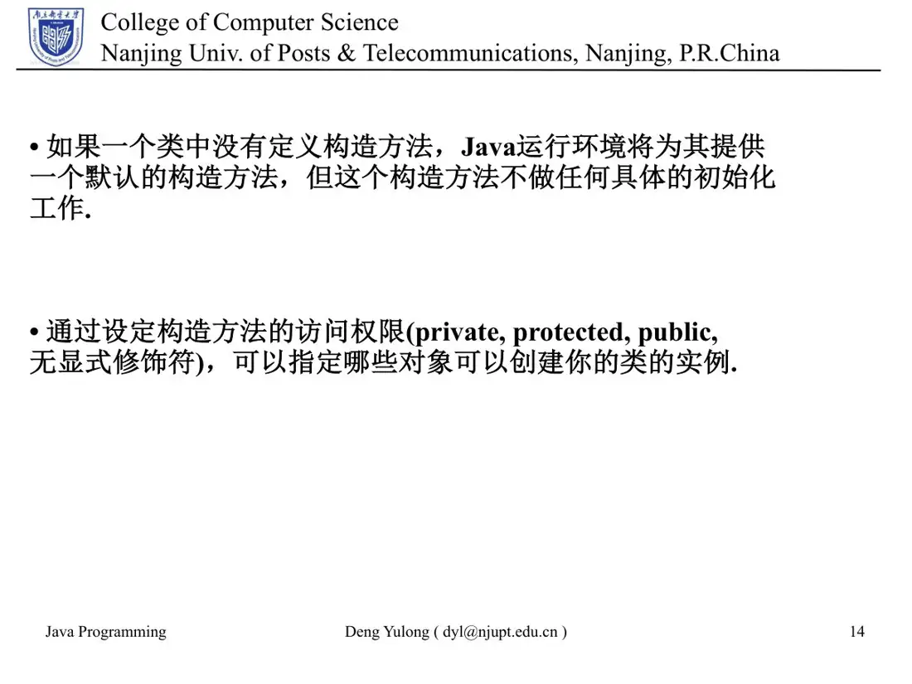

原文：

• 如果一个类中没有定义构造方法，Java运行环境将为其提供一个默认的构造方法，但这个构造方法不做任何具体的初始化工作.

• 通过设定构造方法的访问权限(private, protected, public,无显式修饰符)，可以指定哪些对象可以创建你的类的实例.

南京郵電大學易

College of Computer Science Nanjing Univ. of Posts & Telecommunications, Nanjing, P.R.China

Java Programming

Deng Yulong ( dyl@njupt.edu.cn )

14

### 5.1.5 在方法和构造方法中传递参数

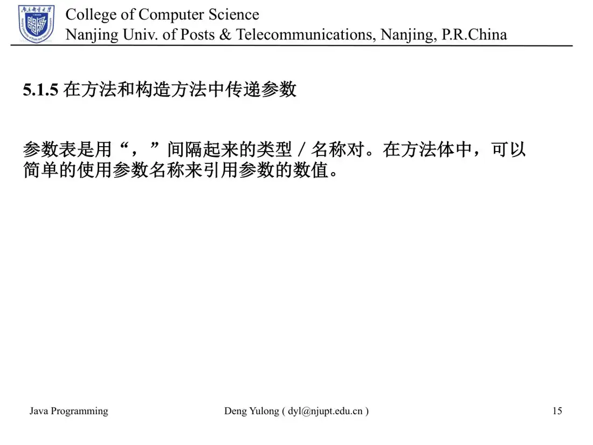

原文：

5.1.5 在方法和构造方法中传递参数

参数表是用“，”间隔起来的类型／名称对。在方法体中，可以简单的使用参数名称来引用参数的数值。

南京郵電大學易

College of Computer Science Nanjing Univ. of Posts & Telecommunications, Nanjing, P.R.China

Java Programming

Deng Yulong ( dyl@njupt.edu.cn )

15

### •参数名称

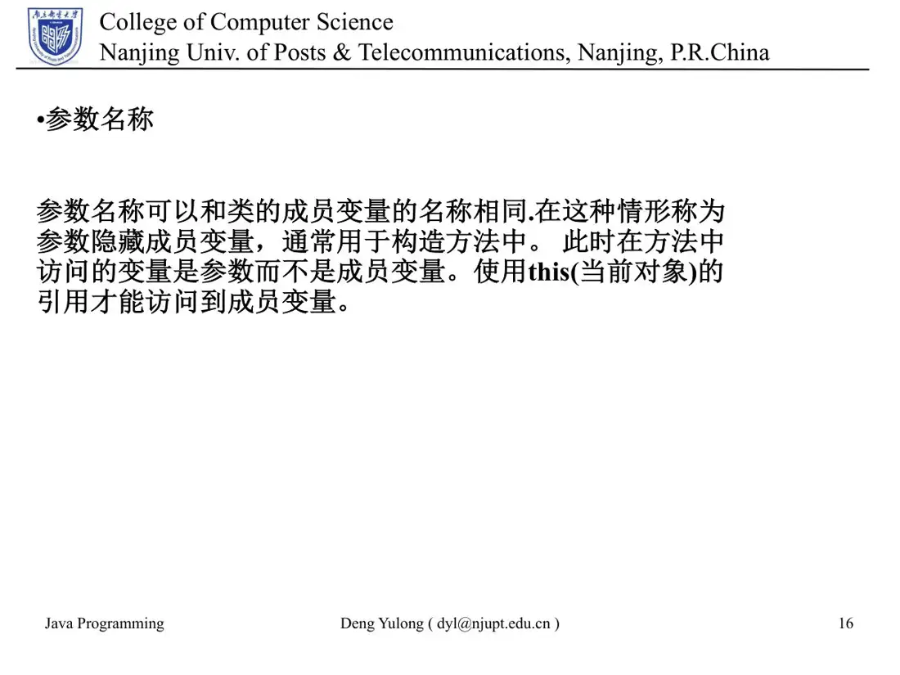

原文：

•参数名称

参数名称可以和类的成员变量的名称相同.在这种情形称为参数隐藏成员变量，通常用于构造方法中。 此时在方法中访问的变量是参数而不是成员变量。使用this(当前对象)的引用才能访问到成员变量。

南京郵電大學易

College of Computer Science Nanjing Univ. of Posts & Telecommunications, Nanjing, P.R.China

Java Programming

Deng Yulong ( dyl@njupt.edu.cn )

16

### 南京郵電大學易

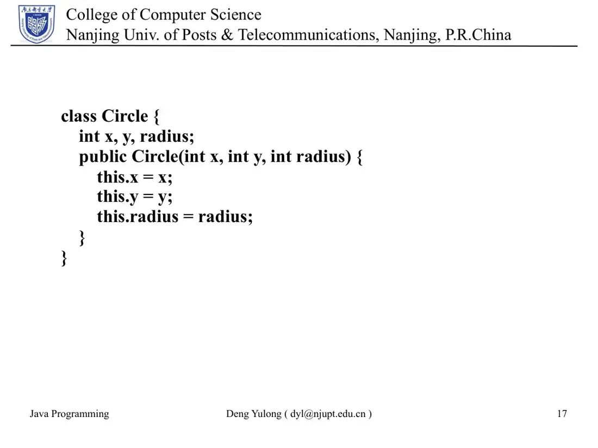

原文：

南京郵電大學易

College of Computer Science Nanjing Univ. of Posts & Telecommunications, Nanjing, P.R.China

Java Programming

Deng Yulong ( dyl@njupt.edu.cn )

17

### • 参数类型

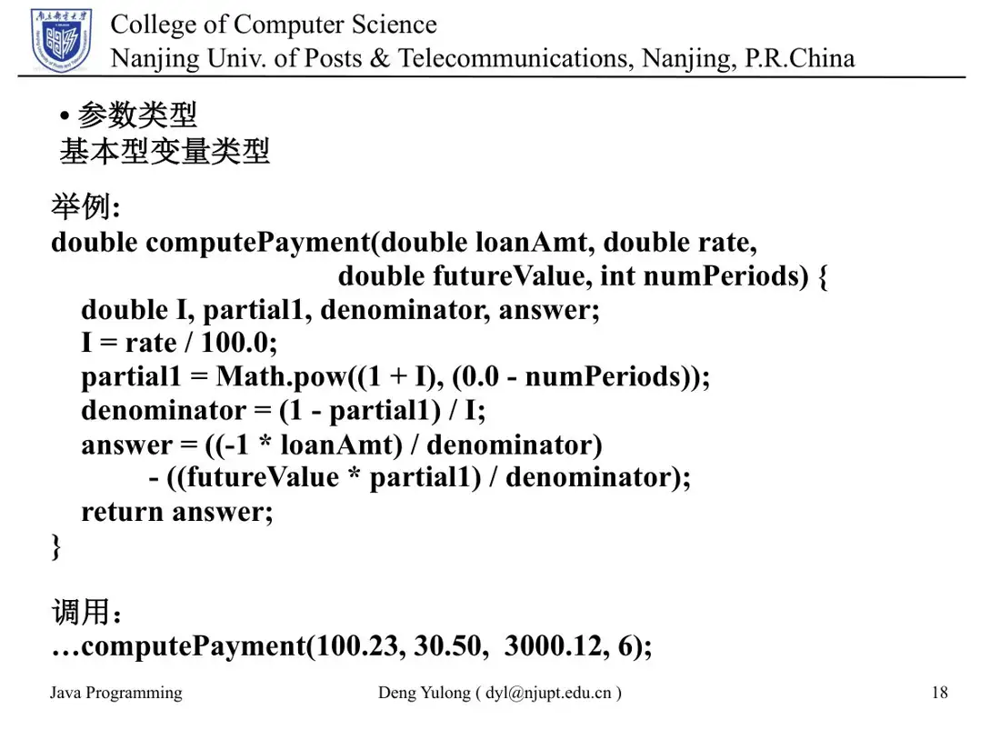

原文：

• 参数类型

基本型变量类型

南京郵電大學易

College of Computer Science Nanjing Univ. of Posts & Telecommunications, Nanjing, P.R.China

Java Programming

Deng Yulong ( dyl@njupt.edu.cn )

18

### • 参数类型

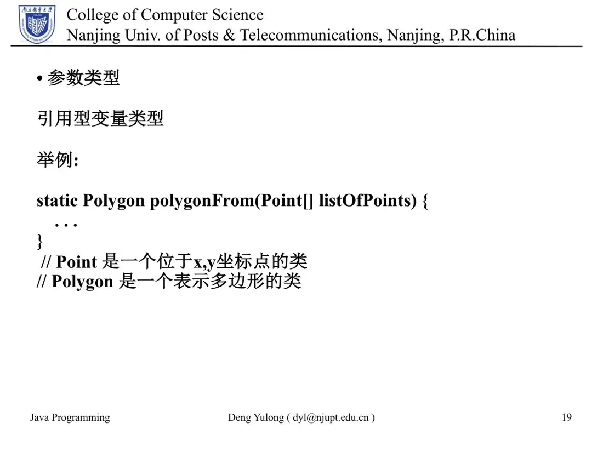

原文：

• 参数类型

引用型变量类型

举例:

南京郵電大學易

College of Computer Science Nanjing Univ. of Posts & Telecommunications, Nanjing, P.R.China

Java Programming

Deng Yulong ( dyl@njupt.edu.cn )

19

### • 参数类型引用型变量类型

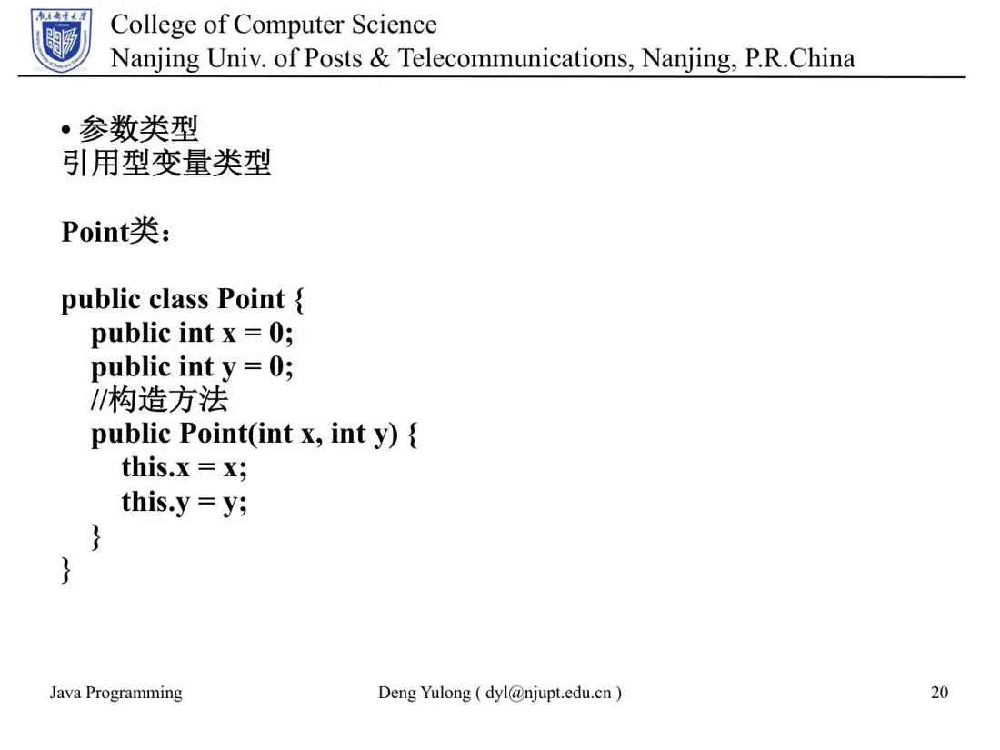

原文：

• 参数类型引用型变量类型

Point类：

南京郵電大學易

College of Computer Science Nanjing Univ. of Posts & Telecommunications, Nanjing, P.R.China

Java Programming

Deng Yulong ( dyl@njupt.edu.cn )

20

### • 参数类型

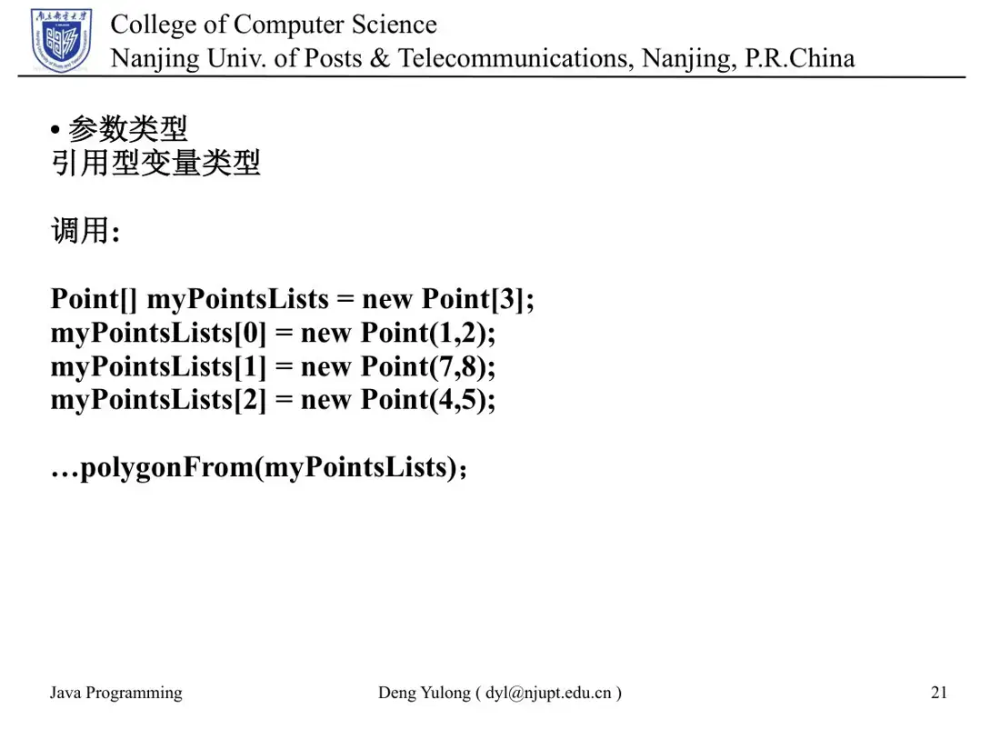

原文：

• 参数类型

引用型变量类型

调用:

…polygonFrom(myPointsLists)；

南京郵電大學易

College of Computer Science Nanjing Univ. of Posts & Telecommunications, Nanjing, P.R.China

Java Programming

Deng Yulong ( dyl@njupt.edu.cn )

21

### 举例:

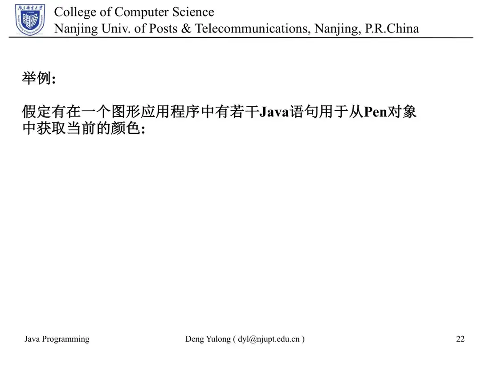

原文：

举例:

假定有在一个图形应用程序中有若干Java语句用于从Pen对象中获取当前的颜色:

南京郵電大學易

College of Computer Science Nanjing Univ. of Posts & Telecommunications, Nanjing, P.R.China

Java Programming

Deng Yulong ( dyl@njupt.edu.cn )

22

### 南京郵電大學易

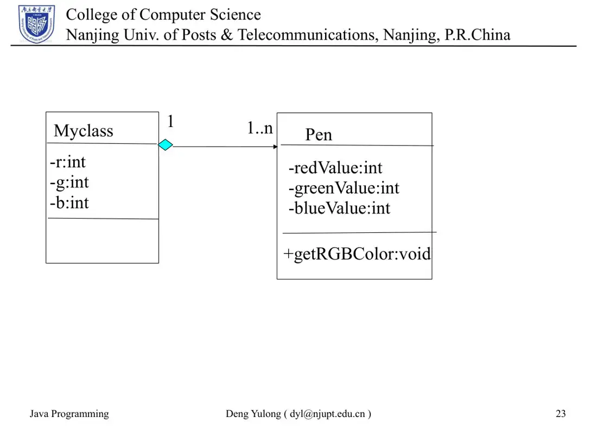

原文：

南京郵電大學易

College of Computer Science Nanjing Univ. of Posts & Telecommunications, Nanjing, P.R.China

Java Programming

Deng Yulong ( dyl@njupt.edu.cn )

23

### 南京郵電大學易

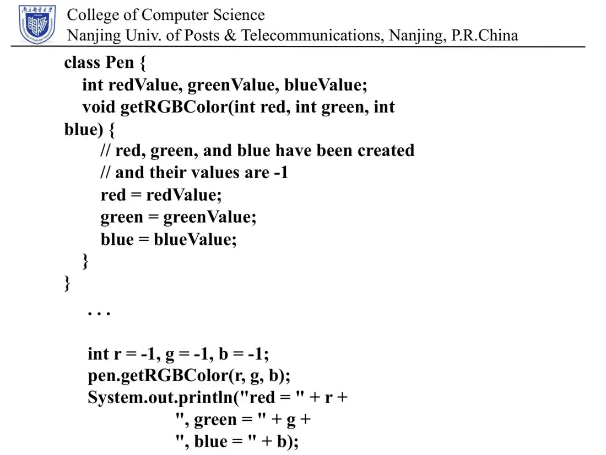

原文：

南京郵電大學易

College of Computer Science Nanjing Univ. of Posts & Telecommunications, Nanjing, P.R.China

### 对变量的本地拷贝的改变不会影响调用时使用的参数。

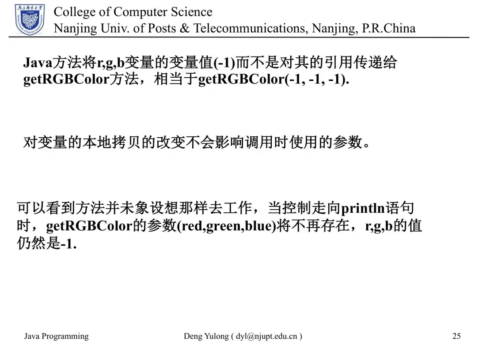

原文：

Java方法将 $\mathbf { \sigma } _ { \mathbf { r } , \mathbf { g } , \mathbf { b } }$ 变量的变量值(-1)而不是对其的引用传递给getRGBColor方法，相当于getRGBColor(-1, -1, -1).

对变量的本地拷贝的改变不会影响调用时使用的参数。

可以看到方法并未象设想那样去工作，当控制走向println语句时，getRGBColor的参数(red,green,blue)将不再存在， $\mathbf { r } , \mathbf { g } , \mathbf { b }$ 的值仍然是-1.

南京郵電大學易

College of Computer Science Nanjing Univ. of Posts & Telecommunications, Nanjing, P.R.China

Java Programming

Deng Yulong ( dyl@njupt.edu.cn )

25

### 南京郵電大學易

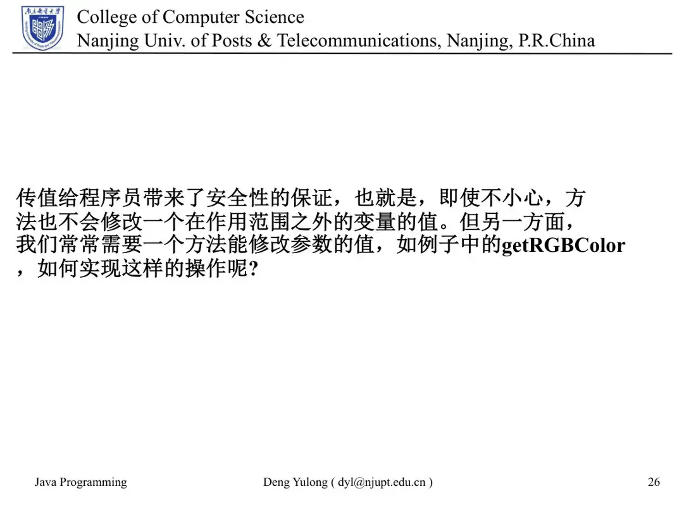

原文：

传值给程序员带来了安全性的保证，也就是，即使不小心，方法也不会修改一个在作用范围之外的变量的值。但另一方面，我们常常需要一个方法能修改参数的值，如例子中的getRGBColor，如何实现这样的操作呢?

南京郵電大學易

College of Computer Science Nanjing Univ. of Posts & Telecommunications, Nanjing, P.R.China

Java Programming

Deng Yulong ( dyl@njupt.edu.cn )

26

### 南京郵電大學易

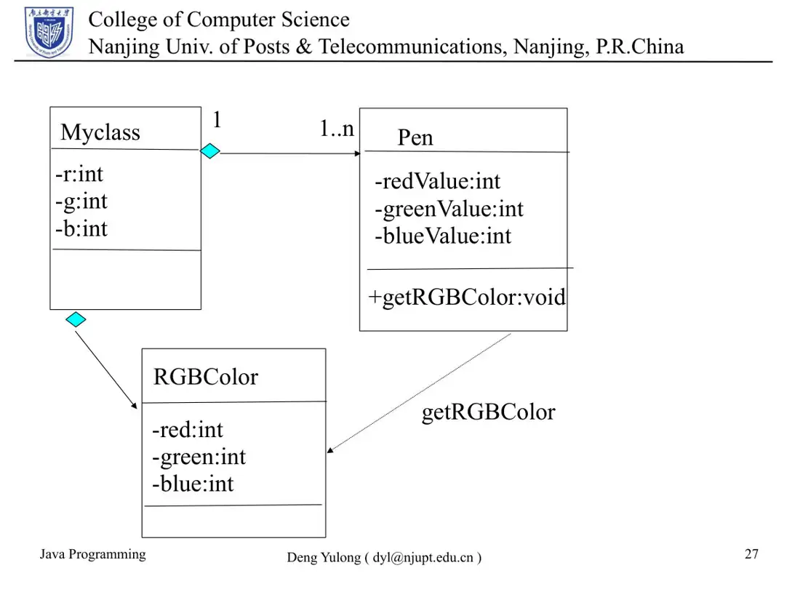

原文：

南京郵電大學易

College of Computer Science Nanjing Univ. of Posts & Telecommunications, Nanjing, P.R.China

Java Programming

Deng Yulong ( dyl@njupt.edu.cn )

27

### 引入一个新的对象RGBColor,来保存red,green,blue值:

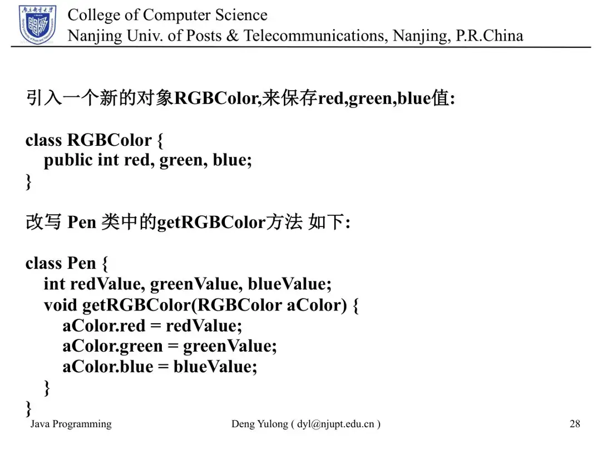

原文：

引入一个新的对象RGBColor,来保存red,green,blue值:

南京郵電大學易

College of Computer Science Nanjing Univ. of Posts & Telecommunications, Nanjing, P.R.China

28

### 改写调用过程:

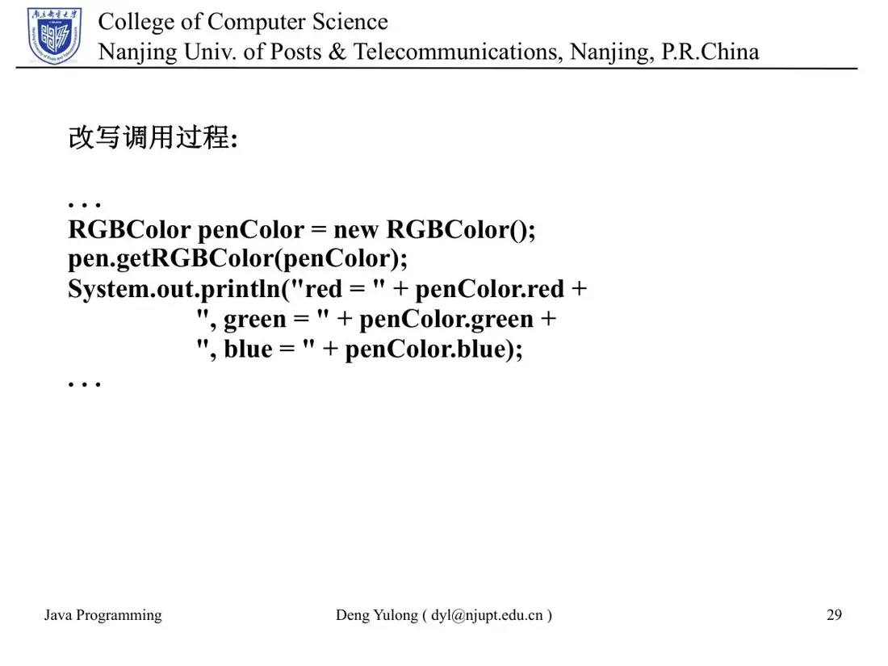

原文：

改写调用过程:

南京郵電大學易

College of Computer Science Nanjing Univ. of Posts & Telecommunications, Nanjing, P.R.China

Java Programming

Deng Yulong ( dyl@njupt.edu.cn )

29

### 5.1.6 方法的返回值

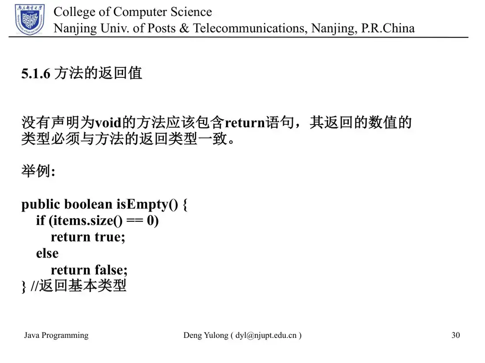

原文：

5.1.6 方法的返回值

没有声明为void的方法应该包含return语句，其返回的数值的类型必须与方法的返回类型一致。

举例:

南京郵電大學易

College of Computer Science Nanjing Univ. of Posts & Telecommunications, Nanjing, P.R.China

Java Programming

Deng Yulong ( dyl@njupt.edu.cn )

30

### 注意! 当方法返回一个对象时，该对象的类必须与返回类型的类完全相同或者是其子类。

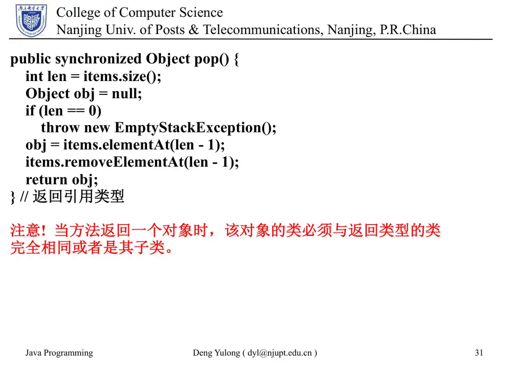

原文：

注意! 当方法返回一个对象时，该对象的类必须与返回类型的类完全相同或者是其子类。

南京郵電大學易

College of Computer Science Nanjing Univ. of Posts & Telecommunications, Nanjing, P.R.China

Java Programming

Deng Yulong ( dyl@njupt.edu.cn )

31

### 举例:

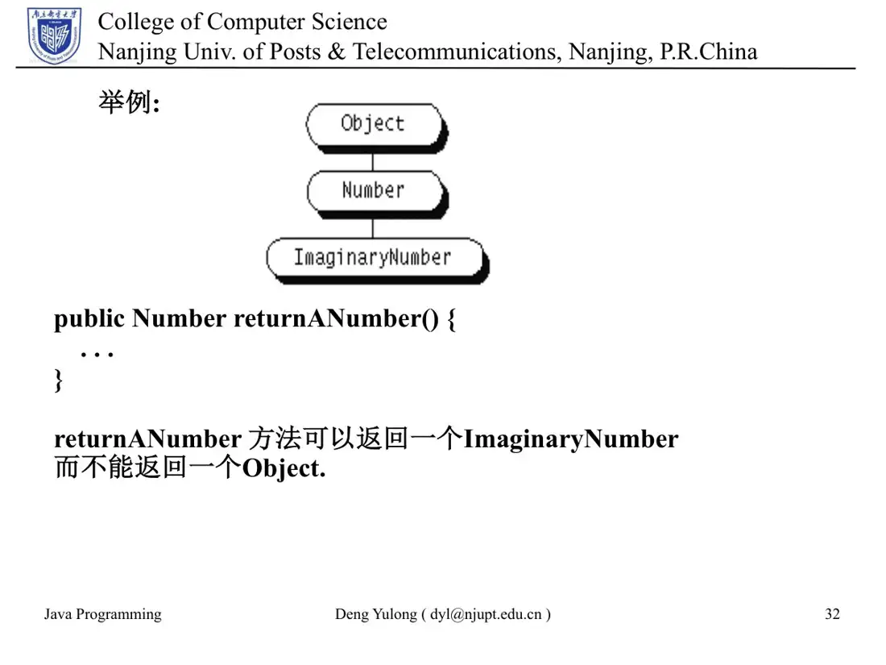

原文：

举例:

public Number returnANumber() { }

returnANumber 方法可以返回一个ImaginaryNumber而不能返回一个Object.

南京郵電大學易

College of Computer Science Nanjing Univ. of Posts & Telecommunications, Nanjing, P.R.China

Java Programming

Deng Yulong ( dyl@njupt.edu.cn )

32

### 5.1.7使用this关键字

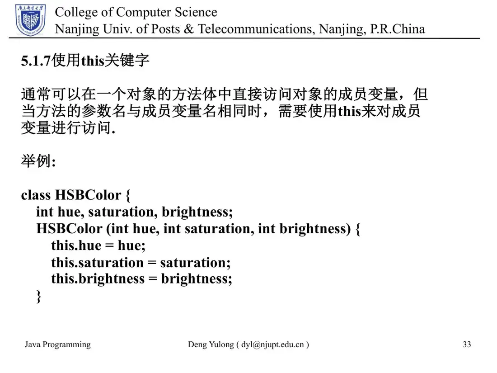

原文：

5.1.7使用this关键字

通常可以在一个对象的方法体中直接访问对象的成员变量，但当方法的参数名与成员变量名相同时，需要使用this来对成员变量进行访问.

举例:

南京郵電大學易

College of Computer Science Nanjing Univ. of Posts & Telecommunications, Nanjing, P.R.China

Java Programming

Deng Yulong ( dyl@njupt.edu.cn )

33

### 另外，在同一个类中，也可以使用this来调用其他构造方法。

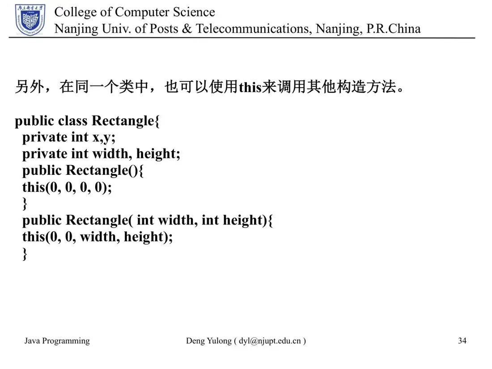

原文：

另外，在同一个类中，也可以使用this来调用其他构造方法。

南京郵電大學易

College of Computer Science Nanjing Univ. of Posts & Telecommunications, Nanjing, P.R.China

Java Programming

Deng Yulong ( dyl@njupt.edu.cn )

34

### 南京郵電大學易

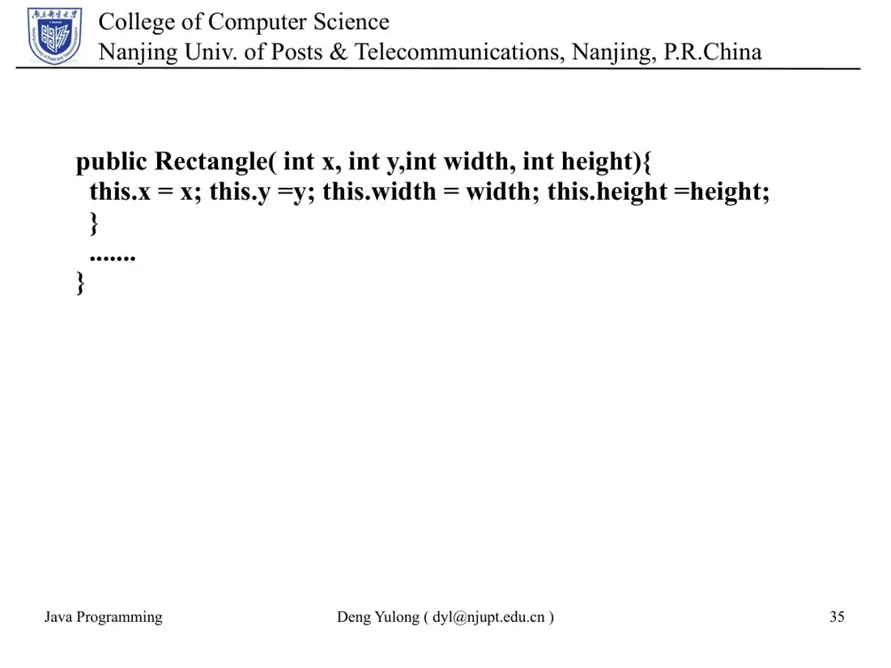

原文：

南京郵電大學易

College of Computer Science Nanjing Univ. of Posts & Telecommunications, Nanjing, P.R.China

Java Programming

Deng Yulong ( dyl@njupt.edu.cn )

35

### 5.1.8 对类的成员的访问控制

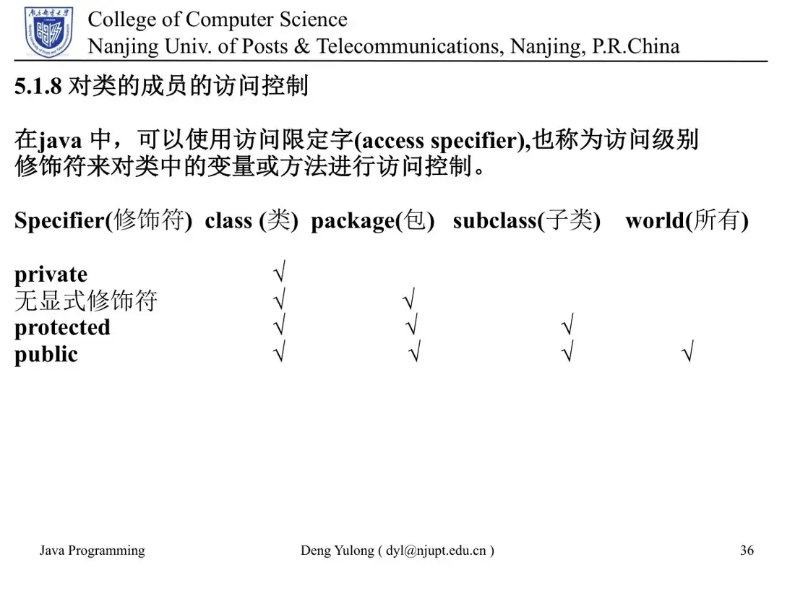

原文：

5.1.8 对类的成员的访问控制

在java 中，可以使用访问限定字(access specifier),也称为访问级别修饰符来对类中的变量或方法进行访问控制。

Specifier(修饰符) class (类) package(包) subclass(子类) world(所有)

<table><tr><td>private</td><td>√</td><td></td><td></td><td></td></tr><tr><td>无显式修饰符</td><td>√</td><td>√</td><td></td><td></td></tr><tr><td>protected</td><td>√</td><td>√</td><td>√</td><td></td></tr><tr><td>public</td><td>√</td><td>√</td><td>√</td><td>√</td></tr></table>

南京郵電大學易

College of Computer Science Nanjing Univ. of Posts & Telecommunications, Nanjing, P.R.China

Java Programming

Deng Yulong ( dyl@njupt.edu.cn )

36

### 举例

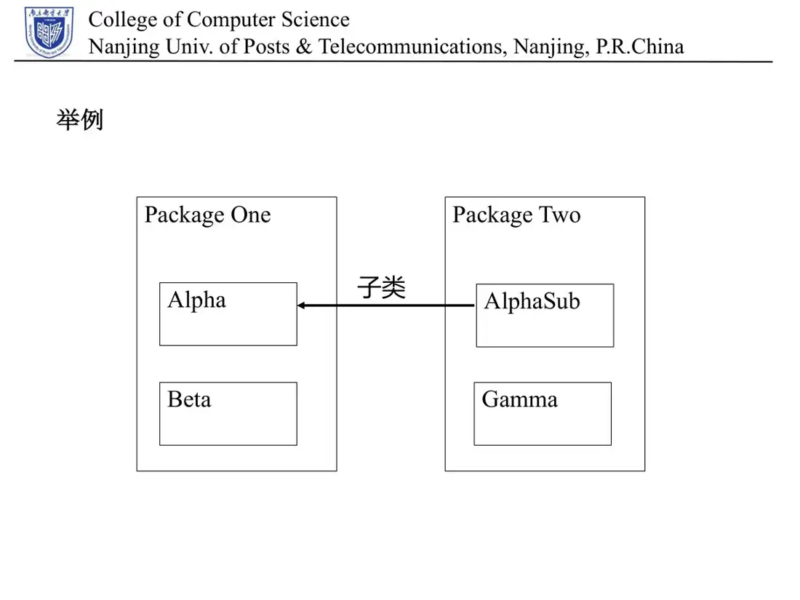

原文：

举例

Package One

Package Two

Alpha

Beta

子类

AlphaSub

Gamma

南京郵電大學易

College of Computer Science Nanjing Univ. of Posts & Telecommunications, Nanjing, P.R.China

### Alpha类成员的访问范围

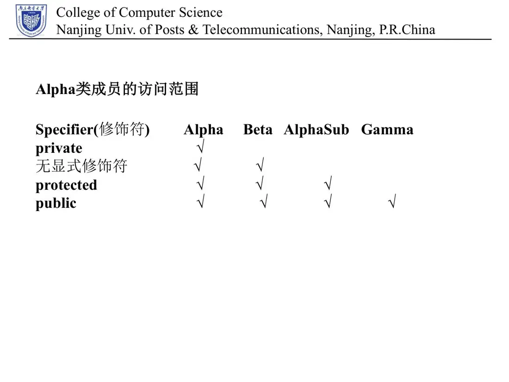

原文：

Alpha类成员的访问范围
<table><tr><td>Specifier(修饰符)</td><td>Alpha</td><td>Beta</td><td>AlphaSub</td><td>Gamma</td></tr><tr><td>private</td><td>√</td><td></td><td></td><td></td></tr><tr><td>无显式修饰符</td><td>√</td><td>√</td><td></td><td></td></tr><tr><td>protected</td><td>√</td><td>√</td><td>√</td><td></td></tr><tr><td>public</td><td>√</td><td>√</td><td>√</td><td>√</td></tr></table>

南京郵電大學易

College of Computer Science Nanjing Univ. of Posts & Telecommunications, Nanjing, P.R.China

### 5.1.9 理解实例的成员和类的成员

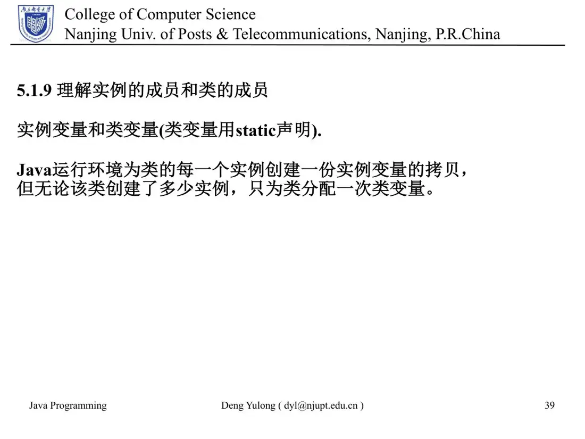

原文：

5.1.9 理解实例的成员和类的成员

实例变量和类变量(类变量用static声明).

Java运行环境为类的每一个实例创建一份实例变量的拷贝，但无论该类创建了多少实例，只为类分配一次类变量。

南京郵電大學易

College of Computer Science Nanjing Univ. of Posts & Telecommunications, Nanjing, P.R.China

Java Programming

Deng Yulong ( dyl@njupt.edu.cn )

39

### 举例: public class AClass {

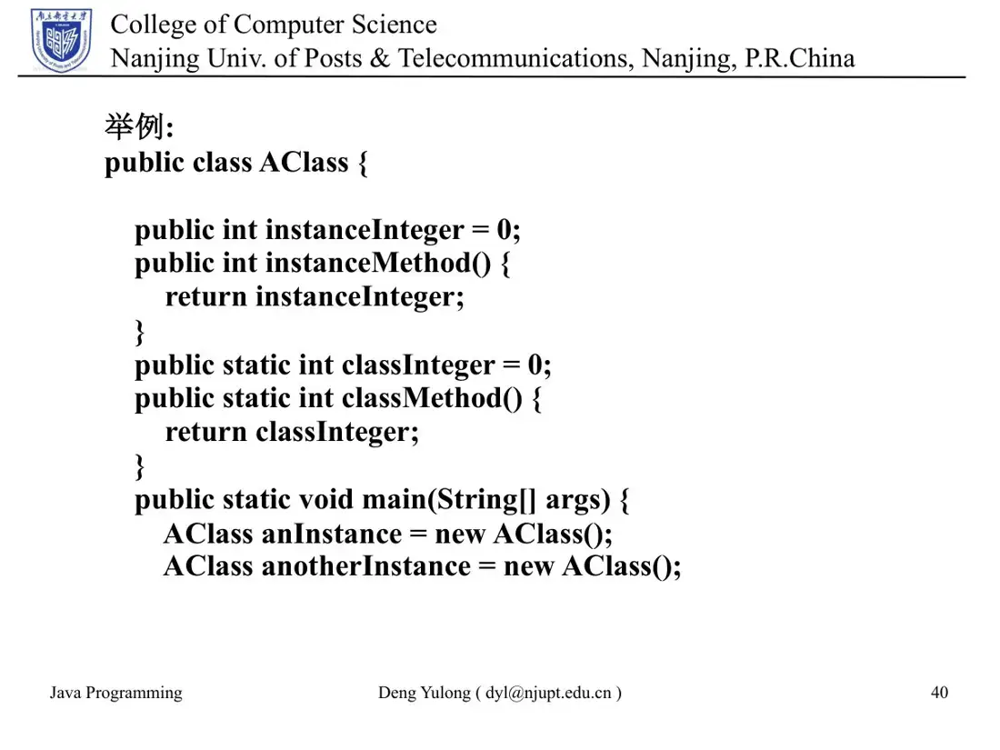

原文：

举例: public class AClass {

南京郵電大學易

College of Computer Science Nanjing Univ. of Posts & Telecommunications, Nanjing, P.R.China

Java Programming

Deng Yulong ( dyl@njupt.edu.cn )

40

### 南京郵電大學易

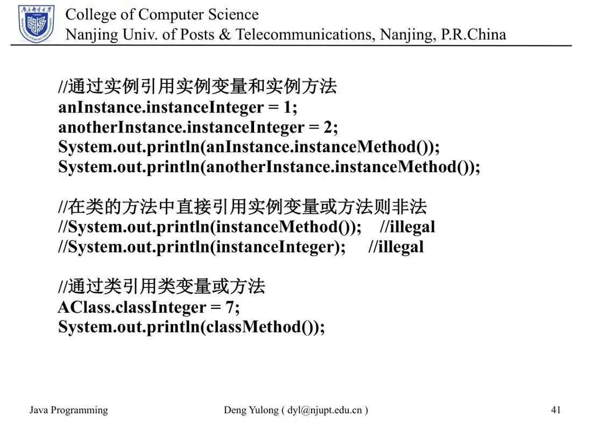

原文：

南京郵電大學易

College of Computer Science Nanjing Univ. of Posts & Telecommunications, Nanjing, P.R.China

Java Programming

Deng Yulong ( dyl@njupt.edu.cn )

41

### 南京郵電大學易

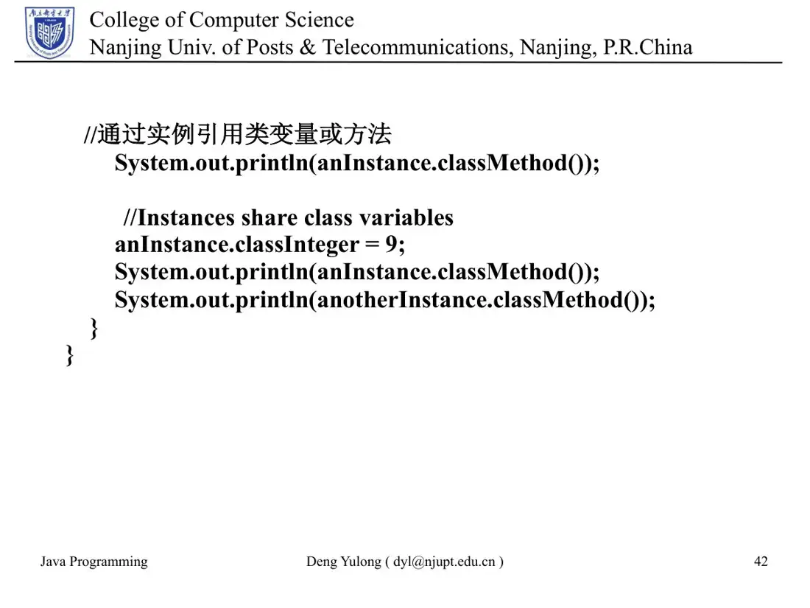

原文：

//通过实例引用类变量或方法System.out.println(anInstance.classMethod());

南京郵電大學易

College of Computer Science Nanjing Univ. of Posts & Telecommunications, Nanjing, P.R.China

Java Programming

Deng Yulong ( dyl@njupt.edu.cn )

42

### anInstance

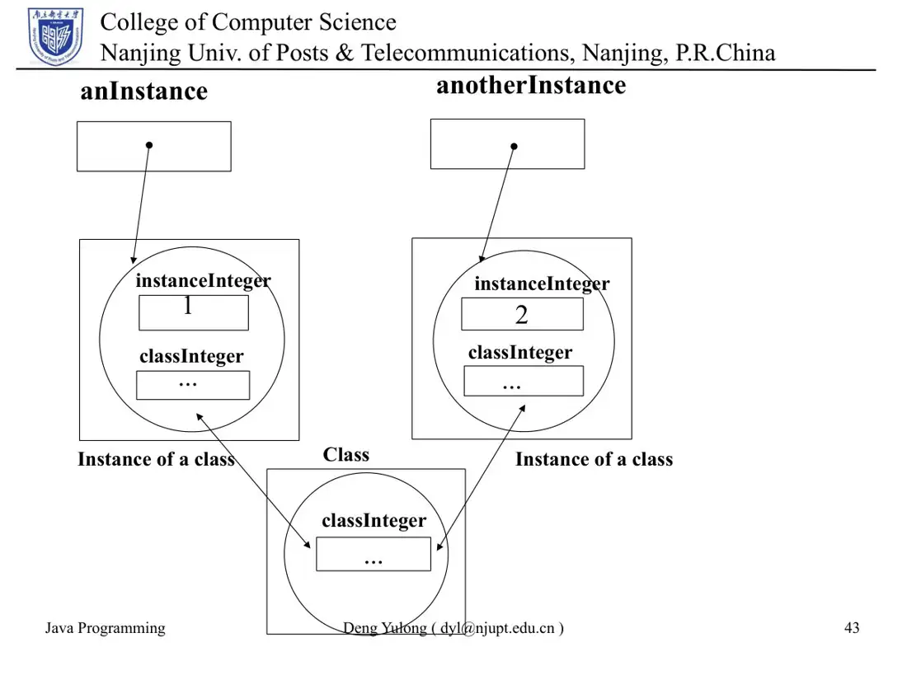

原文：

anInstance

anotherInstance

南京郵電大學易

College of Computer Science Nanjing Univ. of Posts & Telecommunications, Nanjing, P.R.China

43

### 5.1.10 对实例的成员变量和类变量进行初始化

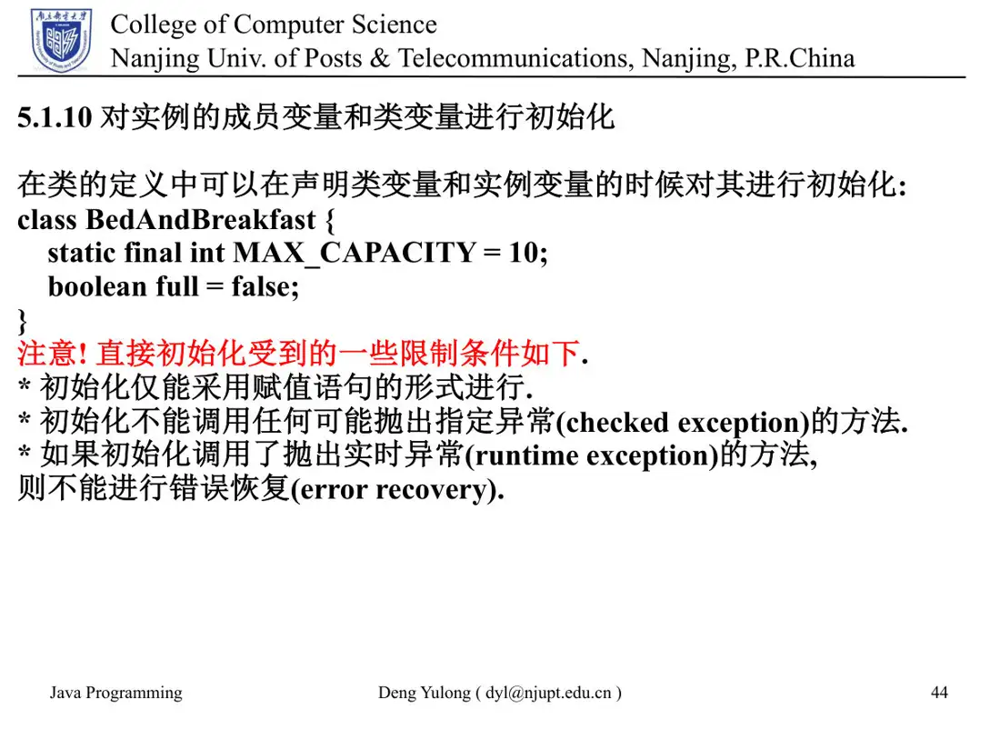

原文：

5.1.10 对实例的成员变量和类变量进行初始化

在类的定义中可以在声明类变量和实例变量的时候对其进行初始化:

注意! 直接初始化受到的一些限制条件如下.

\* 初始化仅能采用赋值语句的形式进行.

南京郵電大學易

College of Computer Science Nanjing Univ. of Posts & Telecommunications, Nanjing, P.R.China

Java Programming

Deng Yulong ( dyl@njupt.edu.cn )

44

### 南京郵電大學004

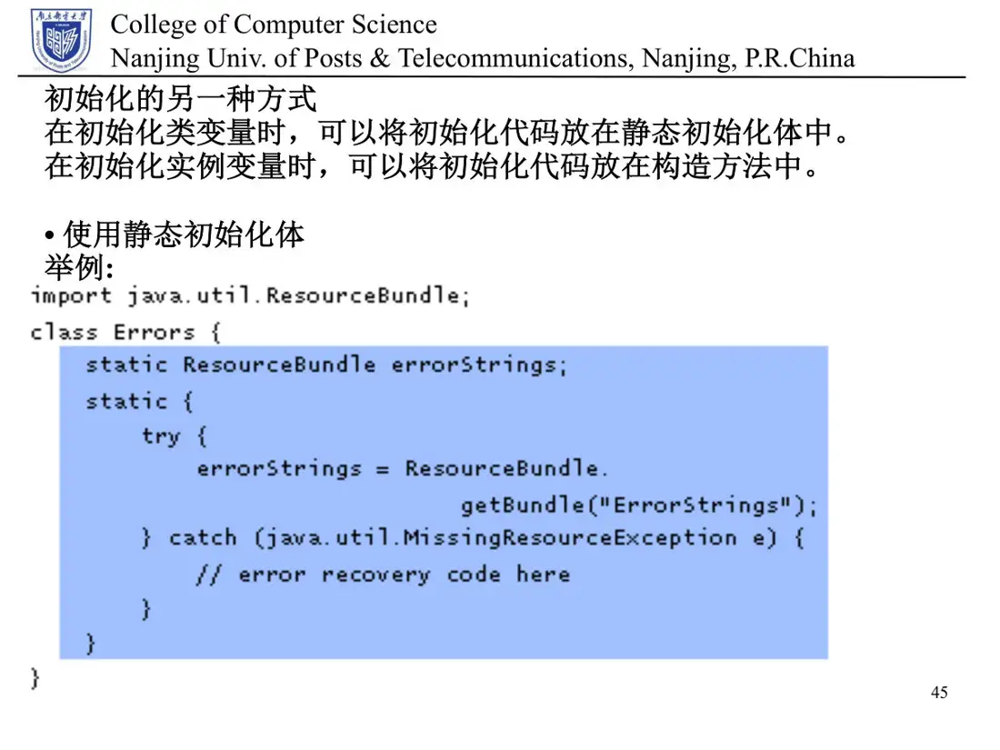

原文：

初始化的另一种方式在初始化类变量时，可以将初始化代码放在静态初始化体中。在初始化实例变量时，可以将初始化代码放在构造方法中。

南京郵電大學004

College of Computer Science Nanjing Univ. of Posts & Telecommunications, Nanjing, P.R.China

45

### •初始化实例变量

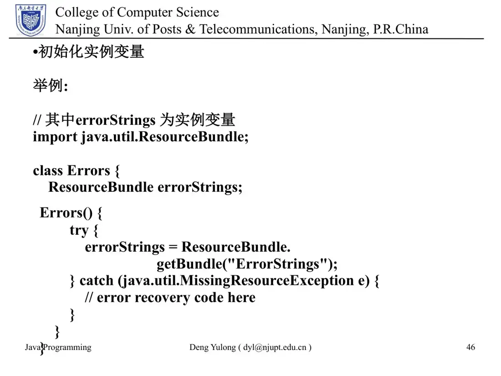

原文：

•初始化实例变量

举例:

// 其中errorStrings 为实例变量import java.util.ResourceBundle;

南京郵電大學易

College of Computer Science Nanjing Univ. of Posts & Telecommunications, Nanjing, P.R.China

46

### 举例：

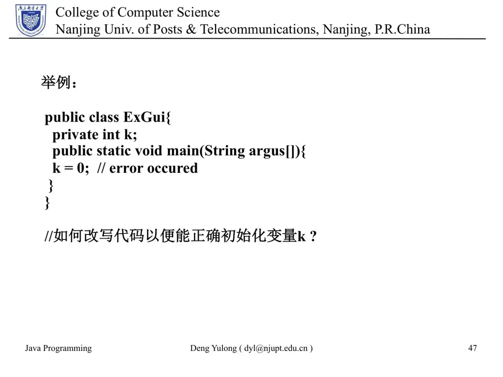

原文：

举例：

//如何改写代码以便能正确初始化变量k ?

南京郵電大學易

College of Computer Science Nanjing Univ. of Posts & Telecommunications, Nanjing, P.R.China

Java Programming

Deng Yulong ( dyl@njupt.edu.cn )

47

### // 以下代码是否正确？

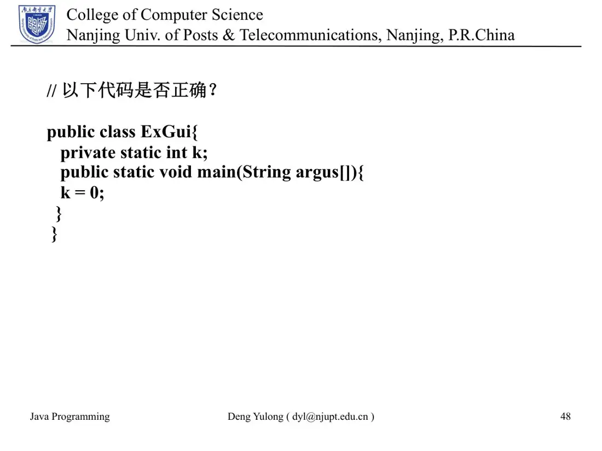

原文：

// 以下代码是否正确？

南京郵電大學易

College of Computer Science Nanjing Univ. of Posts & Telecommunications, Nanjing, P.R.China

Java Programming

Deng Yulong ( dyl@njupt.edu.cn )

48

### 5.2 继承和方法覆盖及屏蔽（重设及隐藏）

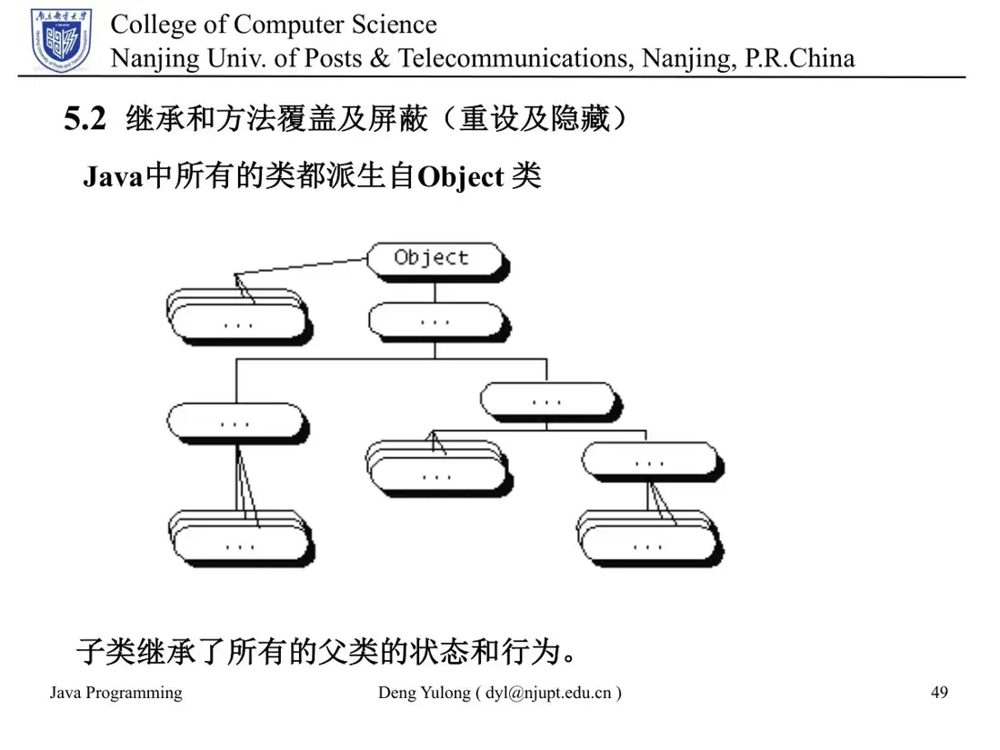

原文：

5.2 继承和方法覆盖及屏蔽（重设及隐藏）

Java中所有的类都派生自Object 类

子类继承了所有的父类的状态和行为。

南京郵電大學易

College of Computer Science Nanjing Univ. of Posts & Telecommunications, Nanjing, P.R.China

Java Programming

Deng Yulong ( dyl@njupt.edu.cn )

49

### 南京郵電大學易

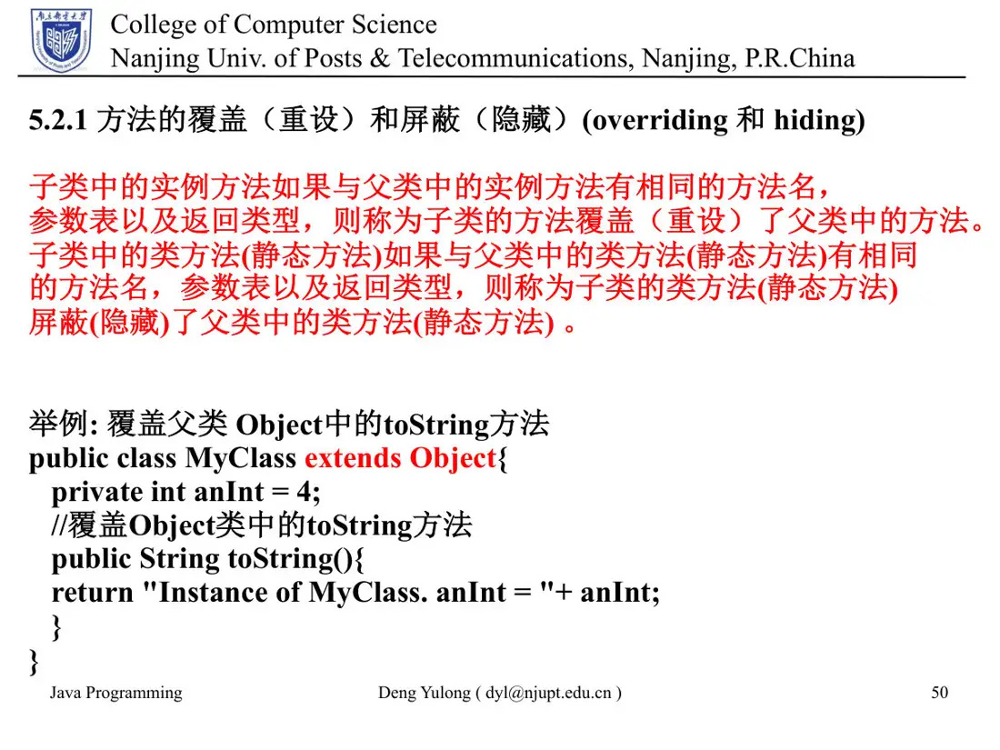

原文：

5.2.1 方法的覆盖（重设）和屏蔽（隐藏）(overriding 和 hiding)

子类中的实例方法如果与父类中的实例方法有相同的方法名，参数表以及返回类型，则称为子类的方法覆盖（重设）了父类中的方法。子类中的类方法(静态方法)如果与父类中的类方法(静态方法)有相同的方法名，参数表以及返回类型，则称为子类的类方法(静态方法)屏蔽(隐藏)了父类中的类方法(静态方法) 。

南京郵電大學易

College of Computer Science Nanjing Univ. of Posts & Telecommunications, Nanjing, P.R.China

Java Programming

Deng Yulong ( dyl@njupt.edu.cn )

50

### 南京郵電大學易

原文：

南京郵電大學易

College of Computer Science Nanjing Univ. of Posts & Telecommunications, Nanjing, P.R.China

Java Programming

Deng Yulong ( dyl@njupt.edu.cn )

51

### 注意!

原文：

注意!

\* 覆盖的方法的访问范围不能小于被覆盖的方法.

\*覆盖的方法抛出的异常不能多于被覆盖的方法.

\* 子类中不能覆盖父类中声明为final的方法.

\* 子类中必须覆盖父类中声明为abstract的方法，否则子类仍为抽象的.

\* 子类中不能覆盖在父类中声明为static的方法.如果子类中定义了一个与父类中的类方法同名且同参数的方法，则称子类中的方法屏蔽了父类中的方法。

南京郵電大學易

College of Computer Science Nanjing Univ. of Posts & Telecommunications, Nanjing, P.R.China

Java Programming

Deng Yulong ( dyl@njupt.edu.cn )

52

### 举例:

原文：

举例:

南京郵電大學易

College of Computer Science Nanjing Univ. of Posts & Telecommunications, Nanjing, P.R.China

Java Programming

Deng Yulong ( dyl@njupt.edu.cn )

53

### 南京郵電大學易

原文：

南京郵電大學易

College of Computer Science Nanjing Univ. of Posts & Telecommunications, Nanjing, P.R.China

Java Programming

Deng Yulong ( dyl@njupt.edu.cn )

54

### 举例：

原文：

举例：

南京郵電大學易

College of Computer Science Nanjing Univ. of Posts & Telecommunications, Nanjing, P.R.China

Java Programming

Deng Yulong ( dyl@njupt.edu.cn )

55

### 南京郵電大學易

原文：

南京郵電大學易

College of Computer Science Nanjing Univ. of Posts & Telecommunications, Nanjing, P.R.China

Java Programming

Deng Yulong ( dyl@njupt.edu.cn )

56

### 南京郵電大學易

原文：

注意!运行环境将调用编译时刻引用指向的类方法运行环境将调用运行时刻引用指向的实例方法

南京郵電大學易

College of Computer Science Nanjing Univ. of Posts & Telecommunications, Nanjing, P.R.China

Java Programming

Deng Yulong ( dyl@njupt.edu.cn )

57

### 5.2.2 成员变量屏蔽 (隐藏)

原文：

5.2.2 成员变量屏蔽 (隐藏)

定义在子类中的变量如果与父类中的变量同名，即使类型不同，也会屏蔽(隐藏)父类中定义的变量（注意!不建议这种做法）

南京郵電大學易

College of Computer Science Nanjing Univ. of Posts & Telecommunications, Nanjing, P.R.China

Java Programming

Deng Yulong ( dyl@njupt.edu.cn )

58

### 5.2.3 使用Super关键字

原文：

5.2.3 使用Super关键字

在子类中，可以使用super关键字引用被屏蔽的成员变量或是被覆盖的方法.

举例:

//Superclass.java

public class Superclass{ public boolean aVariable; public void aMethod(){ aVariable = true; } }

南京郵電大學易

College of Computer Science Nanjing Univ. of Posts & Telecommunications, Nanjing, P.R.China

Java Programming

Deng Yulong ( dyl@njupt.edu.cn )

59

### 南京郵電大學易

原文：

南京郵電大學易

College of Computer Science Nanjing Univ. of Posts & Telecommunications, Nanjing, P.R.China

Java Programming

Deng Yulong ( dyl@njupt.edu.cn )

60

### 也可以在构造方法中使用super调用父类中的构造方法.

原文：

也可以在构造方法中使用super调用父类中的构造方法.

注意!

\*super调用必须是子类中构造方法的第1条语句.

\*如果子类对父类的构造方法没有进行任何的调用(包含super这种方式)，则运行环境将会调用父类默认的构造方法。

南京郵電大學易

College of Computer Science Nanjing Univ. of Posts & Telecommunications, Nanjing, P.R.China

Java Programming

Deng Yulong ( dyl@njupt.edu.cn )

61

### 南京郵電大學易

原文：

南京郵電大學易

College of Computer Science Nanjing Univ. of Posts & Telecommunications, Nanjing, P.R.China

Java Programming

Deng Yulong ( dyl@njupt.edu.cn )

62

### 5.2.4 Object类的常用方法

原文：

5.2.4 Object类的常用方法

在java系统中每个类都是Object类的直接或间接的子类.

南京郵電大學易

College of Computer Science Nanjing Univ. of Posts & Telecommunications, Nanjing, P.R.China

Java Programming

Deng Yulong ( dyl@njupt.edu.cn )

63

### • clone方法

原文：

• clone方法

\* 可以使用clone方法从已经存在的对象创建出一个对象.aCloneableObject.clone();

\*在类的声明时加入对Cloneable接口的实现即可将类变成可以被克隆的类.

注意!

不能使用new以及构造方法来创建克隆对象而应该调用super.clone() 来进行这一操作.

南京郵電大學易

College of Computer Science Nanjing Univ. of Posts & Telecommunications, Nanjing, P.R.China

Java Programming

Deng Yulong ( dyl@njupt.edu.cn )

64

### 南京郵電大學易

原文：

南京郵電大學易

College of Computer Science Nanjing Univ. of Posts & Telecommunications, Nanjing, P.R.China

Java Programming

Deng Yulong ( dyl@njupt.edu.cn )

65

### • equals and hashCode 方法

原文：

• equals and hashCode 方法

\* equals方法比较两个对象是否相等并返回true或false.

\* hashCode方法返回对象在哈希表中的散列值.

\* 覆盖equals方法时必须同时覆盖hashCode方法.

\*必须保证同样的对象返回同样的哈希值.

南京郵電大學易

College of Computer Science Nanjing Univ. of Posts & Telecommunications, Nanjing, P.R.China

Java Programming

Deng Yulong ( dyl@njupt.edu.cn )

66

### 举例:

原文：

举例:

Integer one = new Integer(1), anotherOne = new Integer(1);

if (one.equals(anotherOne)) System.out.println("objects are equal");

南京郵電大學易

College of Computer Science Nanjing Univ. of Posts & Telecommunications, Nanjing, P.R.China

Java Programming

Deng Yulong ( dyl@njupt.edu.cn )

67

### •finalize 方法

原文：

•finalize 方法

finalize方法用于将一个对象在被垃圾回收前清除掉.一般情况下不需要对其进行覆盖。

•toString 方法

toString方法返回表示对象的一个字符串.

举例: System.out.println(Thread.currentThread().toString());

南京郵電大學易

College of Computer Science Nanjing Univ. of Posts & Telecommunications, Nanjing, P.R.China

Java Programming

Deng Yulong ( dyl@njupt.edu.cn )

68

### • getClass 方法

原文：

• getClass 方法

getClass方法用于返回一个对象的类的实时表示，它是一个final方法并返回一个类对象(Class object).

举例: void PrintClassName(Object obj) { System.out.println("The Object's class is " + obj.getClass().getName()); }

南京郵電大學易

College of Computer Science Nanjing Univ. of Posts & Telecommunications, Nanjing, P.R.China

Java Programming

Deng Yulong ( dyl@njupt.edu.cn )

69

### \* 声明为final的类不能派生子类.

原文：

5.2.5 终止类和终止方法(Final Classes and Methods)

\* 声明为final的类不能派生子类.

定义一个终止类的目的在于禁止派生以增强系统安全性或获取一个更好的面向对象设计方案

南京郵電大學易

College of Computer Science Nanjing Univ. of Posts & Telecommunications, Nanjing, P.R.China

Java Programming

Deng Yulong ( dyl@njupt.edu.cn )

70

### \* 声明为final的方法不能被子类覆盖

原文：

\* 声明为final的方法不能被子类覆盖

class ChessAlgorithm { final void nextMove(ChessPiece pieceMoved, BoardLocation newLocation) { ... } . . .}

南京郵電大學易

College of Computer Science Nanjing Univ. of Posts & Telecommunications, Nanjing, P.R.China

Java Programming

Deng Yulong ( dyl@njupt.edu.cn )

71

### 注意! 标注为static或private的方法自动设定为final方法.

原文：

注意! 标注为static或private的方法自动设定为final方法.

\* 声名为final的变量即为常数.

注意! 如果将一个引用类型的变量标注为final，则将无法改变该变量的引用指向，但可以改变其指向对象的内容。

南京郵電大學易

College of Computer Science Nanjing Univ. of Posts & Telecommunications, Nanjing, P.R.China

Java Programming

Deng Yulong ( dyl@njupt.edu.cn )

72

### \*抽象类是只能被派生的类而本身不能被实例化.

原文：

5.2.6 抽象类和抽象方法 (Abstract Classes and Methods)

\*抽象类是只能被派生的类而本身不能被实例化.

\*抽象方法是一个没有定义任何实现的方法.抽象类可以包含抽象方法并将其部分或全部的具体实现交给子类完成。

南京郵電大學易

College of Computer Science Nanjing Univ. of Posts & Telecommunications, Nanjing, P.R.China

Java Programming

Deng Yulong ( dyl@njupt.edu.cn )

73

### 举例:

原文：

举例:

Rectangle,Line,bezier,Circle 类从同样一个父类GraphicObject继承状态和行为

南京郵電大學易

College of Computer Science Nanjing Univ. of Posts & Telecommunications, Nanjing, P.R.China

Java Programming

Deng Yulong ( dyl@njupt.edu.cn )

74

### 南京郵電大學易

原文：

南京郵電大學易

College of Computer Science Nanjing Univ. of Posts & Telecommunications, Nanjing, P.R.China

Java Programming

Deng Yulong ( dyl@njupt.edu.cn )

75

### 注意!

原文：

注意!

\* 不要求抽象类一定要包含抽象方法，它也可以包含非抽象的方法以及变量

\* 抽象类的子类必须提供父类中所有的抽象方法的实现，否则它仍然是一个抽象类.

\* 除了间接地创建抽象类的子类的实例外，不能创建抽象类的实例

\* 可以声明指向抽象类的引用型变量

南京郵電大學易

College of Computer Science Nanjing Univ. of Posts & Telecommunications, Nanjing, P.R.China

Java Programming

Deng Yulong ( dyl@njupt.edu.cn )

76

### 5.3 嵌套类(Nested Classes)

原文：

5.3 嵌套类(Nested Classes)

嵌套类是指一个类是另一个类的成员.

南京郵電大學易

College of Computer Science Nanjing Univ. of Posts & Telecommunications, Nanjing, P.R.China

Java Programming

Deng Yulong ( dyl@njupt.edu.cn )

77

### 静态嵌套类和内部类(非静态嵌套类)

原文：

静态嵌套类和内部类(非静态嵌套类)

南京郵電大學易

College of Computer Science Nanjing Univ. of Posts & Telecommunications, Nanjing, P.R.China

Java Programming

Deng Yulong ( dyl@njupt.edu.cn )

78

### 注意!

原文：

注意!

\* 静态嵌套类不能直接使用外部类的实例变量和方法，而应该通过对象引用进行这一操作

\* 内部类的实例存在于其外部类的实例中，内部类可以直接访问其外部类中的实例变量或方法.

\*内部类也可以定义为抽象类.

\*内部类可以定义为被其他内部类实现的接口.

\* 内部类可以声明为private或protected.

\* 内部类不能声明任何静态成员

内部类的实例仅存活于外部内的实例中

南京郵電大學易

College of Computer Science Nanjing Univ. of Posts & Telecommunications, Nanjing, P.R.China

Java Programming

Deng Yulong ( dyl@njupt.edu.cn )

79

### 举例:

原文：

举例:

注意： Iterator接口使用时需要满足排斥性，即不允许2个或2个以上的同时操作。

南京郵電大學易

College of Computer Science Nanjing Univ. of Posts & Telecommunications, Nanjing, P.R.China

Java Programming

Deng Yulong ( dyl@njupt.edu.cn )

80

### 南京郵電大學易

原文：

南京郵電大學易

College of Computer Science Nanjing Univ. of Posts & Telecommunications, Nanjing, P.R.China

Java Programming

Deng Yulong ( dyl@njupt.edu.cn )

81

### 南京郵電大學易

原文：

南京郵電大學易

College of Computer Science Nanjing Univ. of Posts & Telecommunications, Nanjing, P.R.China

Java Programming

Deng Yulong ( dyl@njupt.edu.cn )

82

### 也可以定义一个无需命名的内部类，称为匿名类

原文：

也可以定义一个无需命名的内部类，称为匿名类

南京郵電大學易

College of Computer Science Nanjing Univ. of Posts & Telecommunications, Nanjing, P.R.China

Java Programming

Deng Yulong ( dyl@njupt.edu.cn )

83

### 南京郵電大學易

原文：

南京郵電大學易

College of Computer Science Nanjing Univ. of Posts & Telecommunications, Nanjing, P.R.China

Java Programming

Deng Yulong ( dyl@njupt.edu.cn )

84
