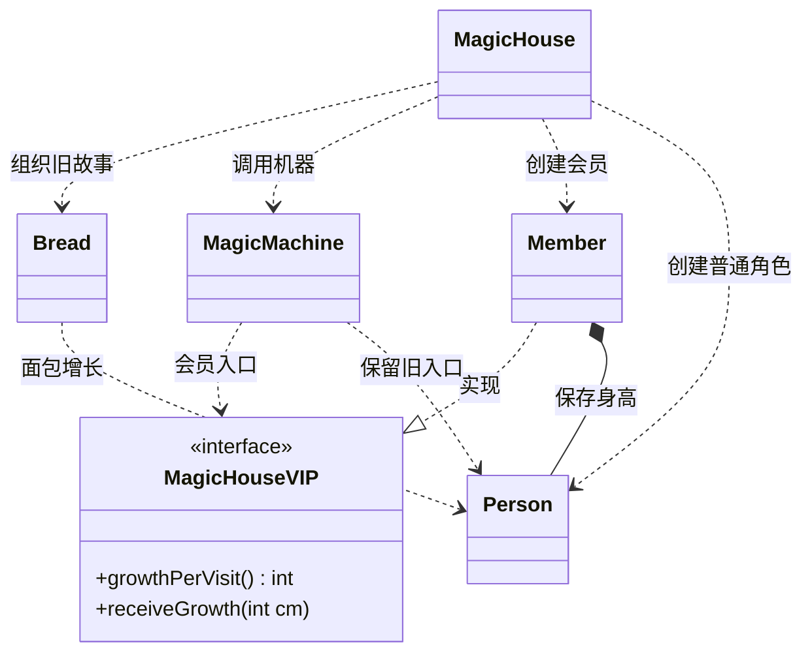

# 《Java程序设计》第6次作业：用接口扩展魔法屋

本题延续[第 5 次作业](Java程序设计第5次作业：魔法屋的故事.md)：先运行旧故事，再让机器通过新建的会员接口服务两个新对象，最后用一张 UML 图说明类间关系。原件第 6、7 页的输出截图核对了三段数值：旧角色最终为 192 厘米，两个新角色分别由 130 变成 160、由 145 变成 185。下面仅复现可检查的行为，不复用原图、对话或旧提交方式。

## 让机器依赖接口，不依赖会员类的字段

**参考解答**：先问机器必须知道什么：本次加多少、怎样更新眼前对象。它不需要访问姓名、年龄或其他个人信息。原故事用两个角色的性别区分增长量；以下把两个角色的既定增长量作为虚构测试方案直接传入，用来复现题给样例，不做真实身份判断。

保留第 5 次作业的 `Person.java`、`Bread.java` 不变，新增下面两个文件。会员类把身高交给已有 `Person` 对象保存，避免两处状态改着改着不一致。`PLUS_30` 与 `PLUS_40` 只是示例里两种方案，并不会让机器与枚举耦合。

```java
public interface MagicHouseVIP {
    int growthPerVisit();
    void receiveGrowth(int cm);
}
```

```java
public class Member implements MagicHouseVIP {
    public enum Plan {
        PLUS_30(30), PLUS_40(40);

        final int centimeters;

        Plan(int centimeters) {
            this.centimeters = centimeters;
        }
    }

    private final Person person;
    private final Plan plan;

    public Member(int height, Plan plan) {
        this.person = new Person(height);
        this.plan = java.util.Objects.requireNonNull(plan);
    }

    public int getHeight() {
        return person.getHeight();
    }

    @Override
    public int growthPerVisit() {
        return plan.centimeters;
    }

    @Override
    public void receiveGrowth(int cm) {
        person.growBy(cm);
    }
}
```

替换 `MagicMachine.java`：旧的 `grow(Person)` 仍按 50 厘米执行；添加会员入口后，它只通过[接口](../../../topics/Java开发/接口的基础概念.md)问增量并发起更新。

```java
public class MagicMachine {
    public void grow(Person person) {
        person.growBy(50);
    }

    public void grow(MagicHouseVIP member) {
        member.receiveGrowth(member.growthPerVisit());
    }
}
```

## 在项目入口续接第二段故事

替换 `MagicHouse.java`，仍以该类作为整个项目的入口。旧的 `run(Person)` 方法保留；只在入口之后续接新的方法。

```java
public class MagicHouse {
    private void show(String stage, Person person) {
        System.out.println(stage + ": " + person.getHeight() + " cm");
    }

    void run(Person person) {
        show("before", person);
        for (int i = 0; i < 2; i++) {
            Bread piece = new Bread();
            piece.eatBy(person);
            show("after bread " + (i + 1), person);
        }
        MagicMachine machine = new MagicMachine();
        machine.grow(person);
        show("after machine", person);
    }

    void runSequel() {
        Member fang = new Member(130, Member.Plan.PLUS_30);
        Member zhang = new Member(145, Member.Plan.PLUS_40);
        MagicMachine machine = new MagicMachine();
        System.out.println("member heights: " + fang.getHeight()
                + ", " + zhang.getHeight());
        machine.grow(fang);
        machine.grow(zhang);
        System.out.println("after visits: " + fang.getHeight()
                + ", " + zhang.getHeight());
    }

    public static void main(String[] args) {
        MagicHouse house = new MagicHouse();
        house.run(new Person(140));
        house.runSequel();
    }
}
```

编译同一目录的六个 .java 文件，以 `MagicHouse` 启动。旧输出仍为 `140 → 141 → 142 → 192`，随后显示两名新会员之前为 `130, 145`、之后为 `160, 185`。核对的不只是末值：也要检查访问顺序没有把其中一人的增量加到另一人身上。

## 用一张图检查扩展点



> [!TIP]
> ==真的只依赖接口吗==？可写一个只实现两个方法的测试对象，设增量为 25，传给同一台机器应生效。如果必须先把它转换为 `Member` 才能运行，机器仍绑定了具体类，只是形式上加了接口。

这里有两层区别：同名的 `grow` 是[方法重载](../../../topics/Java开发/方法的定义与重载.md)，编译时根据实参类型选入口；会员入口内部调用的接口方法则由实际对象实现。对照[类之间的关系](../../../topics/Java开发/类之间的关系.md)，不用继承来表示会员持有一个身高对象，也不把旧角色强行改成会员。
