# 《Java程序设计》第6章 接口和包管理（课件）

原件的每一页，下面附识别出的文字。

### Chap 6 接口和包管理

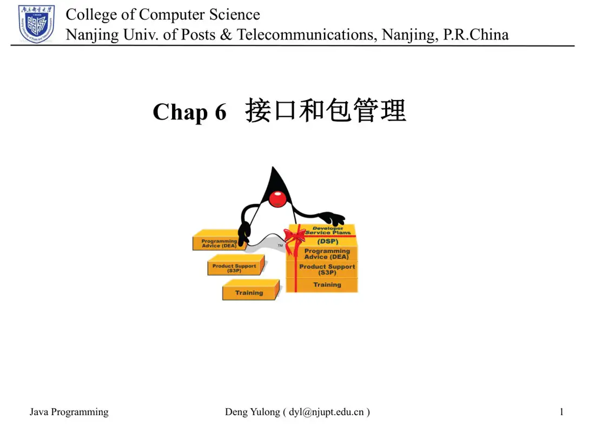

原文：

Chap 6 接口和包管理

南京郵電大學易

College of Computer Science Nanjing Univ. of Posts & Telecommunications, Nanjing, P.R.China

Java Programming

Deng Yulong ( dyl@njupt.edu.cn )

1

### 6.1 接口

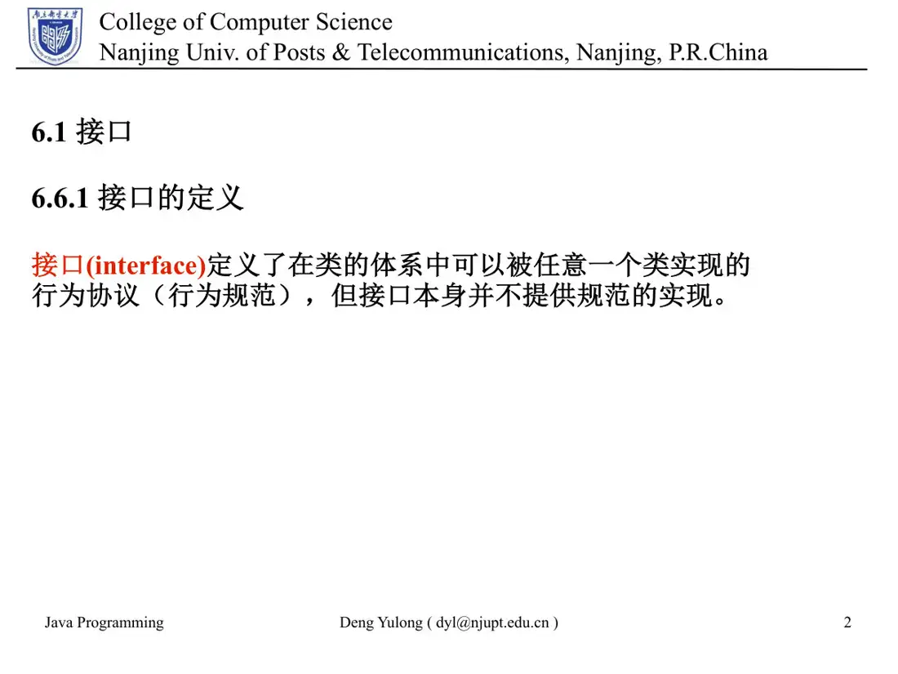

原文：

6.1 接口

6.6.1 接口的定义

接口(interface)定义了在类的体系中可以被任意一个类实现的行为协议（行为规范），但接口本身并不提供规范的实现。

南京郵電大學易

College of Computer Science Nanjing Univ. of Posts & Telecommunications, Nanjing, P.R.China

Java Programming

Deng Yulong ( dyl@njupt.edu.cn )

2

### 举例：标准电源插座和电器的标准插头

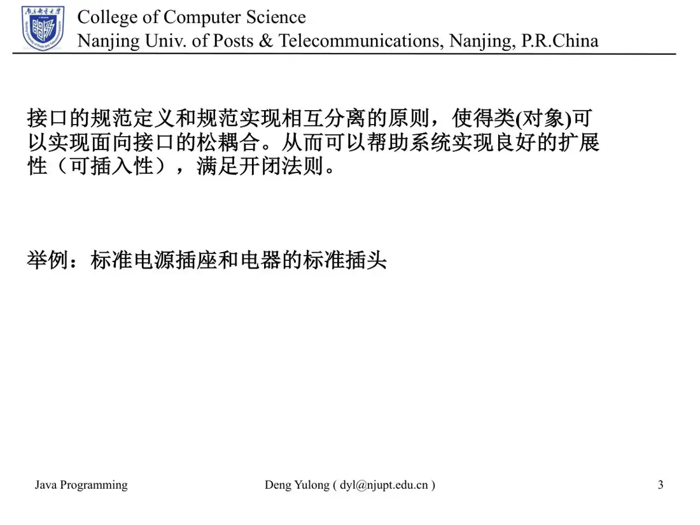

原文：

接口的规范定义和规范实现相互分离的原则，使得类(对象)可以实现面向接口的松耦合。从而可以帮助系统实现良好的扩展性（可插入性），满足开闭法则。

举例：标准电源插座和电器的标准插头

南京郵電大學易

College of Computer Science Nanjing Univ. of Posts & Telecommunications, Nanjing, P.R.China

Java Programming

Deng Yulong ( dyl@njupt.edu.cn )

3

### 6.1.2 接口的语法结构

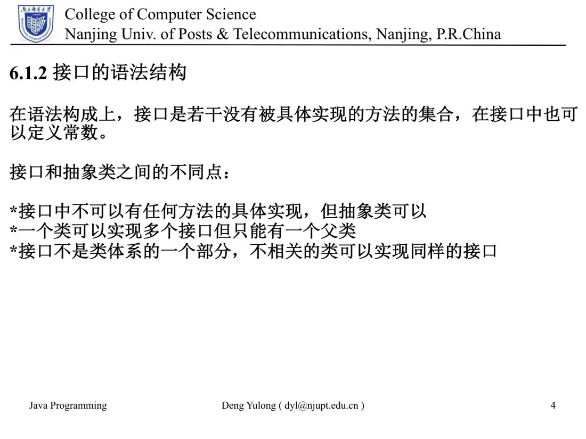

原文：

6.1.2 接口的语法结构

在语法构成上，接口是若干没有被具体实现的方法的集合，在接口中也可以定义常数。

接口和抽象类之间的不同点：

\*接口中不可以有任何方法的具体实现，但抽象类可以

\*一个类可以实现多个接口但只能有一个父类

\*接口不是类体系的一个部分，不相关的类可以实现同样的接口

南京郵電大學易

College of Computer Science Nanjing Univ. of Posts & Telecommunications, Nanjing, P.R.China

Java Programming

Deng Yulong ( dyl@njupt.edu.cn )

4

### 语法构成上，接口的由两部份组成：

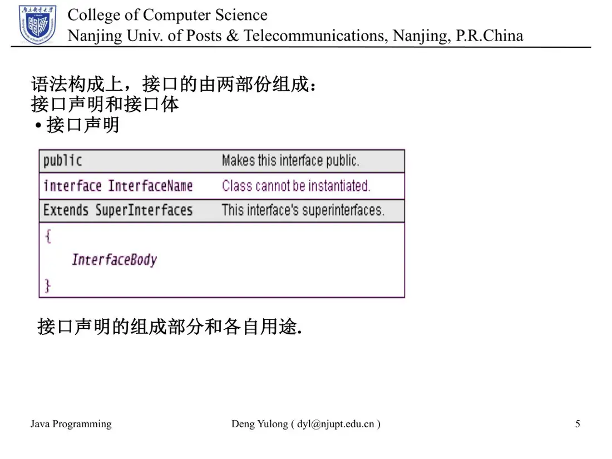

原文：

语法构成上，接口的由两部份组成：

接口声明和接口体

• 接口声明

<table><tr><td>public</td><td>Makes this interface public.</td></tr><tr><td>interface InterfaceName</td><td>Class cannot be instantiated.</td></tr><tr><td>Extends SuperInterfaces</td><td>This interface&#x27;s superinterfaces.</td></tr><tr><td>{InterfaceBody}</td><td></td></tr></table>

接口声明的组成部分和各自用途.

南京郵電大學易

College of Computer Science Nanjing Univ. of Posts & Telecommunications, Nanjing, P.R.China

Java Programming

Deng Yulong ( dyl@njupt.edu.cn )

5

### • 接口体

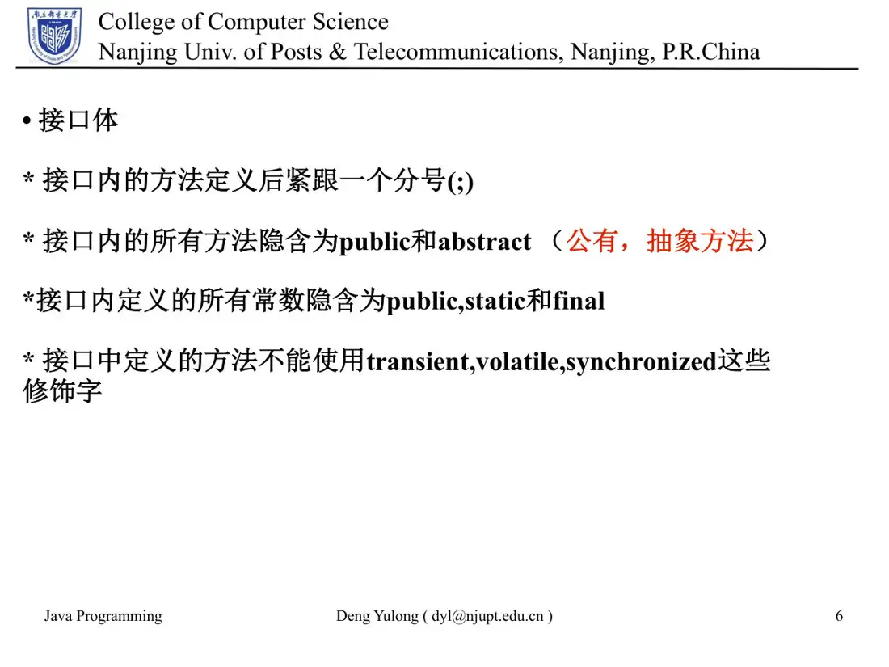

原文：

• 接口体

\* 接口内的方法定义后紧跟一个分号(;)

\* 接口内的所有方法隐含为public和abstract （公有，抽象方法）

\*接口内定义的所有常数隐含为public,static和final

\* 接口中定义的方法不能使用transient,volatile,synchronized这些修饰字

南京郵電大學易

College of Computer Science Nanjing Univ. of Posts & Telecommunications, Nanjing, P.R.China

Java Programming

Deng Yulong ( dyl@njupt.edu.cn )

6

### 举例：

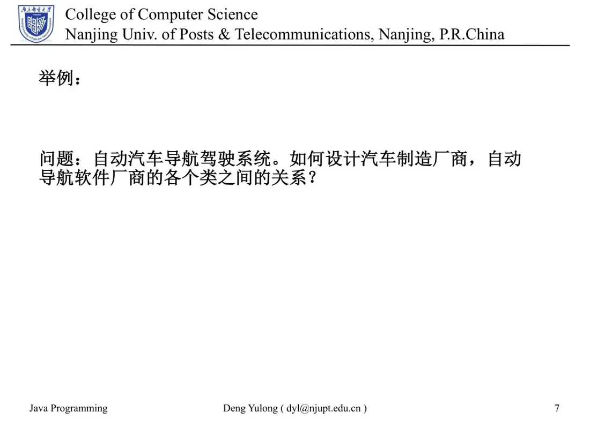

原文：

举例：

问题：自动汽车导航驾驶系统。如何设计汽车制造厂商，自动导航软件厂商的各个类之间的关系？

南京郵電大學易

College of Computer Science Nanjing Univ. of Posts & Telecommunications, Nanjing, P.R.China

Java Programming

Deng Yulong ( dyl@njupt.edu.cn )

7

### 南京郵電大學易

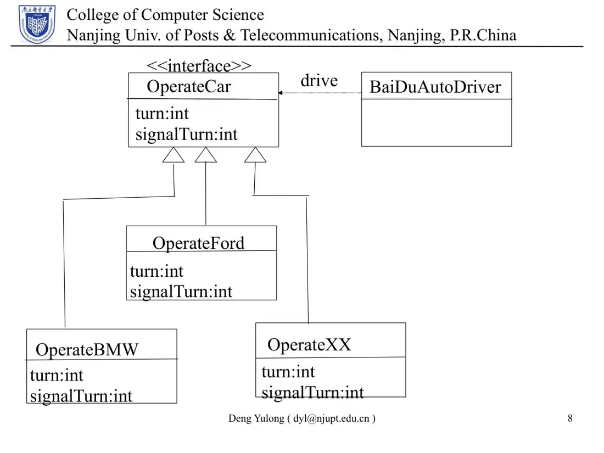

原文：

南京郵電大學易

College of Computer Science Nanjing Univ. of Posts & Telecommunications, Nanjing, P.R.China

8

### OperateCar 接口定义:

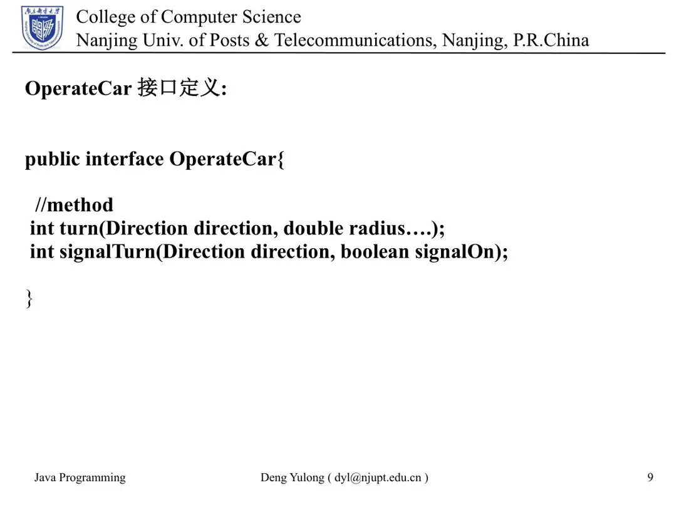

原文：

OperateCar 接口定义:

public interface OperateCar{

//method int turn(Direction direction, double radius….); int signalTurn(Direction direction, boolean signalOn);

南京郵電大學易

College of Computer Science Nanjing Univ. of Posts & Telecommunications, Nanjing, P.R.China

Java Programming

Deng Yulong ( dyl@njupt.edu.cn )

9

### 某个汽车制造商对OperateCar接口的实现；

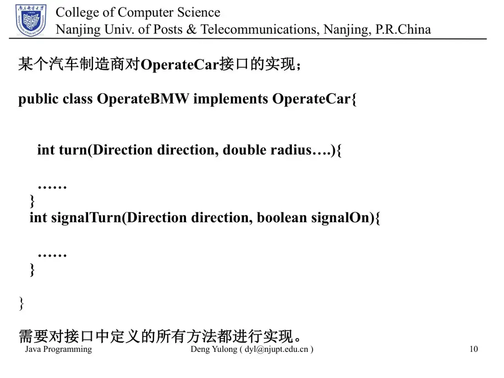

原文：

某个汽车制造商对OperateCar接口的实现；

public class OperateBMW implements OperateCar{

int turn(Direction direction, double radius….){

} int signalTurn(Direction direction, boolean signalOn){

需要对接口中定义的所有方法都进行实现。Java Programming Deng Yulong ( dyl@njupt.edu.cn )

南京郵電大學易

College of Computer Science Nanjing Univ. of Posts & Telecommunications, Nanjing, P.R.China

10

### 导航软件对象使用汽车对象，进行导航操作

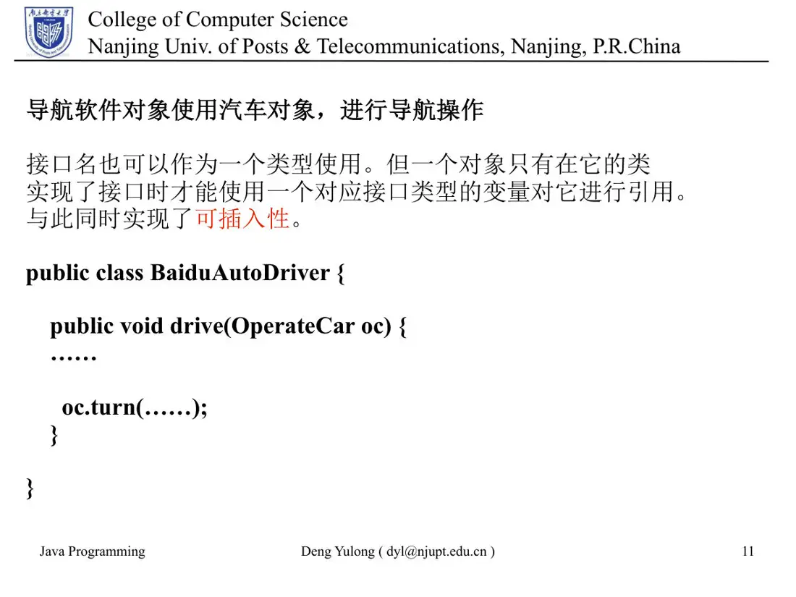

原文：

导航软件对象使用汽车对象，进行导航操作

接口名也可以作为一个类型使用。但一个对象只有在它的类实现了接口时才能使用一个对应接口类型的变量对它进行引用。与此同时实现了可插入性。

public class BaiduAutoDriver {

南京郵電大學易

College of Computer Science Nanjing Univ. of Posts & Telecommunications, Nanjing, P.R.China

Java Programming

Deng Yulong ( dyl@njupt.edu.cn )

11

### 举例: 股票交易信息系统

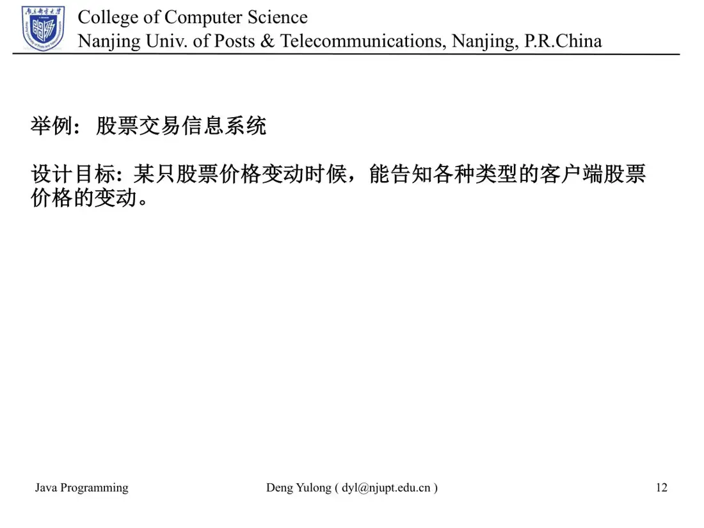

原文：

举例: 股票交易信息系统

设计目标: 某只股票价格变动时候，能告知各种类型的客户端股票价格的变动。

南京郵電大學易

College of Computer Science Nanjing Univ. of Posts & Telecommunications, Nanjing, P.R.China

Java Programming

Deng Yulong ( dyl@njupt.edu.cn )

12

### 13

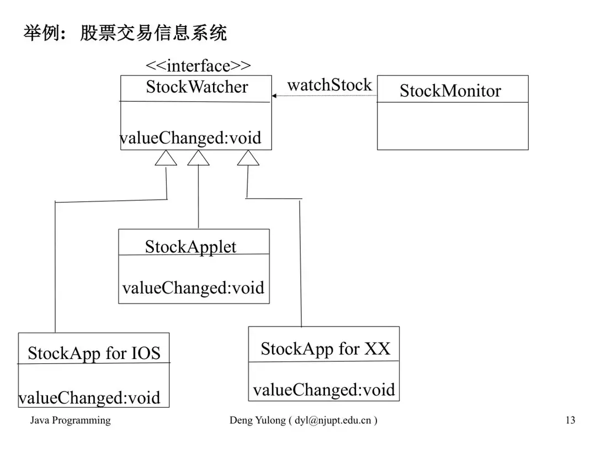

原文：

13

### 举例: 股票交易信息系统

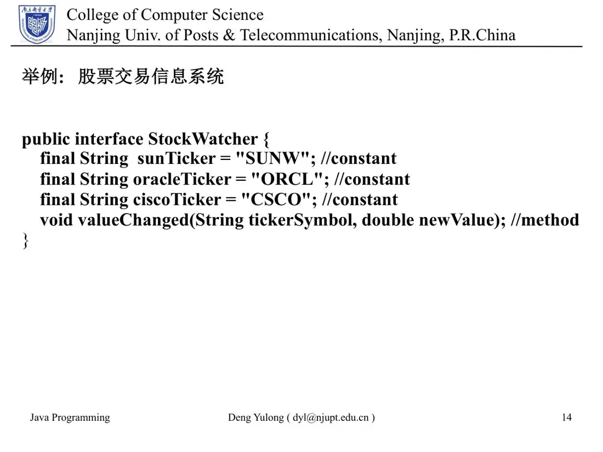

原文：

举例: 股票交易信息系统

南京郵電大學易

College of Computer Science Nanjing Univ. of Posts & Telecommunications, Nanjing, P.R.China

Java Programming

Deng Yulong ( dyl@njupt.edu.cn )

14

### 6.1.3 实现接口

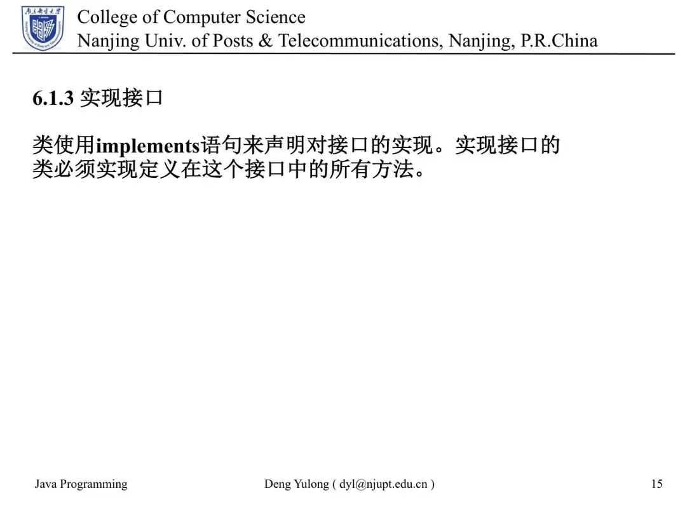

原文：

6.1.3 实现接口

类使用implements语句来声明对接口的实现。实现接口的类必须实现定义在这个接口中的所有方法。

南京郵電大學易

College of Computer Science Nanjing Univ. of Posts & Telecommunications, Nanjing, P.R.China

Java Programming

Deng Yulong ( dyl@njupt.edu.cn )

15

### 举例:

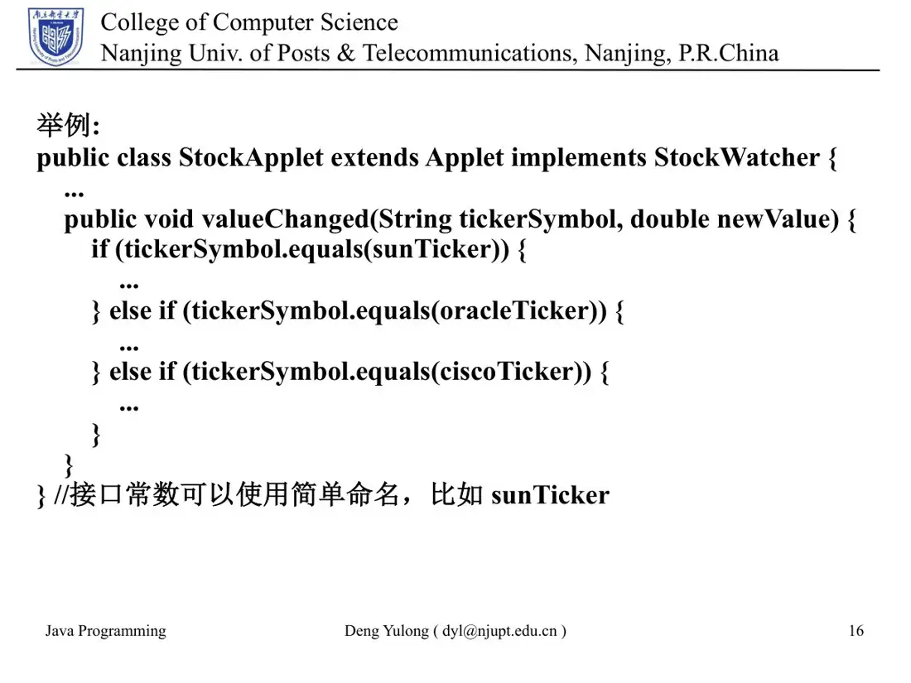

原文：

举例:

public class StockApplet extends Applet implements StockWatcher {

南京郵電大學易

College of Computer Science Nanjing Univ. of Posts & Telecommunications, Nanjing, P.R.China

Java Programming

Deng Yulong ( dyl@njupt.edu.cn )

16

### 6.1.4 使用接口类型

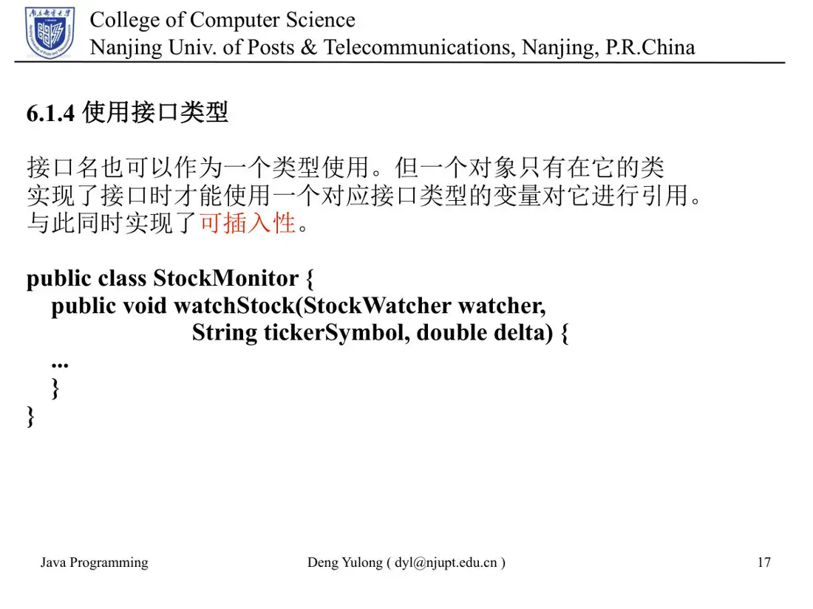

原文：

6.1.4 使用接口类型

接口名也可以作为一个类型使用。但一个对象只有在它的类实现了接口时才能使用一个对应接口类型的变量对它进行引用。与此同时实现了可插入性。

public class StockMonitor { public void watchStock(StockWatcher watcher, String tickerSymbol, double delta) { } }

南京郵電大學易

College of Computer Science Nanjing Univ. of Posts & Telecommunications, Nanjing, P.R.China

Java Programming

Deng Yulong ( dyl@njupt.edu.cn )

17

### 6.1.5 注意! 接口不能生长

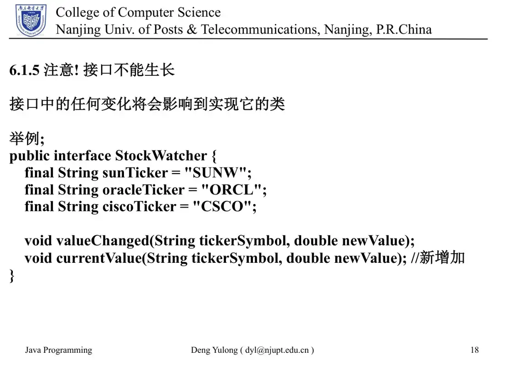

原文：

6.1.5 注意! 接口不能生长

接口中的任何变化将会影响到实现它的类

南京郵電大學易

College of Computer Science Nanjing Univ. of Posts & Telecommunications, Nanjing, P.R.China

Java Programming

Deng Yulong ( dyl@njupt.edu.cn )

18

### 南京郵電大學易

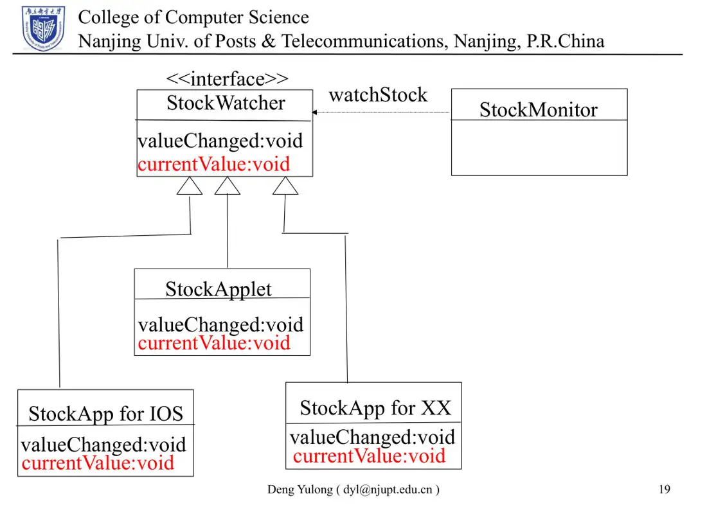

原文：

南京郵電大學易

College of Computer Science Nanjing Univ. of Posts & Telecommunications, Nanjing, P.R.China

Deng Yulong ( dyl@njupt.edu.cn )

19

### 南京郵電大學易

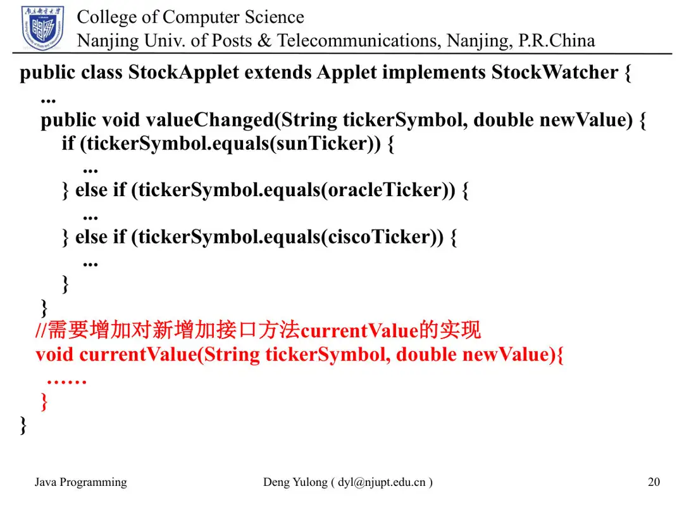

原文：

南京郵電大學易

College of Computer Science Nanjing Univ. of Posts & Telecommunications, Nanjing, P.R.China

Java Programming

Deng Yulong ( dyl@njupt.edu.cn )

20

### 在这种情况下，应该创建一个子接口来反应接口的变化。

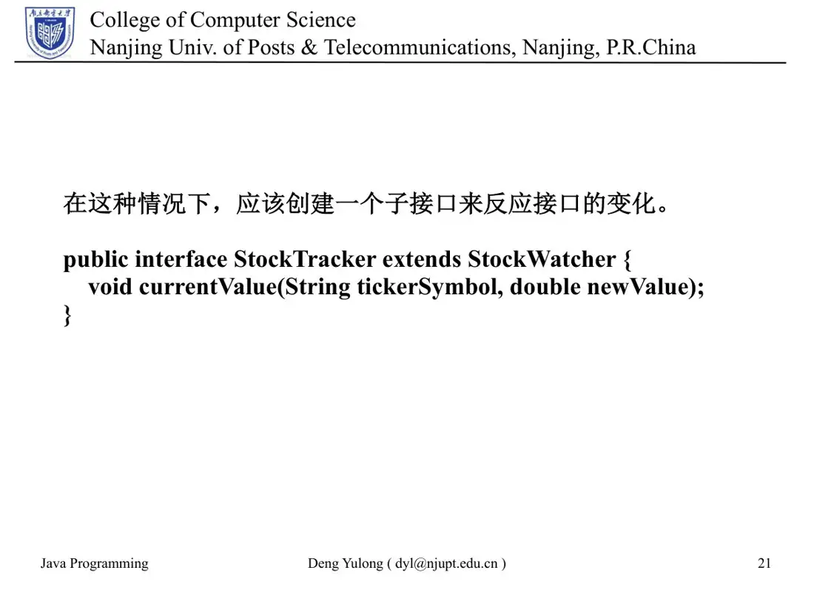

原文：

在这种情况下，应该创建一个子接口来反应接口的变化。

public interface StockTracker extends StockWatcher { void currentValue(String tickerSymbol, double newValue); }

南京郵電大學易

College of Computer Science Nanjing Univ. of Posts & Telecommunications, Nanjing, P.R.China

Java Programming

Deng Yulong ( dyl@njupt.edu.cn )

21

### 南京郵電大學易

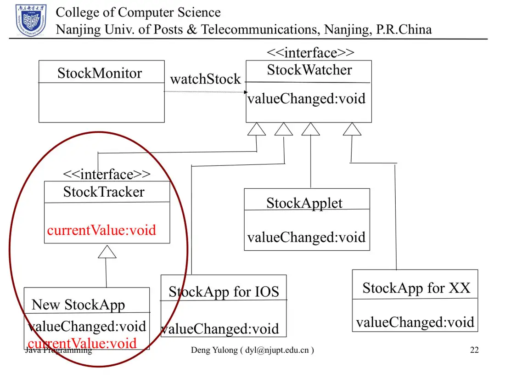

原文：

南京郵電大學易

College of Computer Science Nanjing Univ. of Posts & Telecommunications, Nanjing, P.R.China

22

### 6.1.6 系统设计中利用接口实现可插入性。

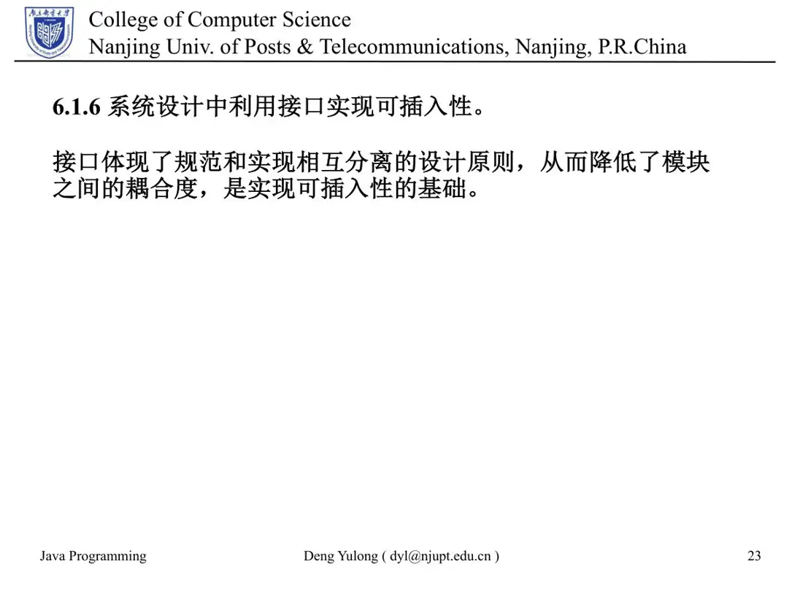

原文：

6.1.6 系统设计中利用接口实现可插入性。

接口体现了规范和实现相互分离的设计原则，从而降低了模块之间的耦合度，是实现可插入性的基础。

南京郵電大學易

College of Computer Science Nanjing Univ. of Posts & Telecommunications, Nanjing, P.R.China

Java Programming

Deng Yulong ( dyl@njupt.edu.cn )

23

### 举例：

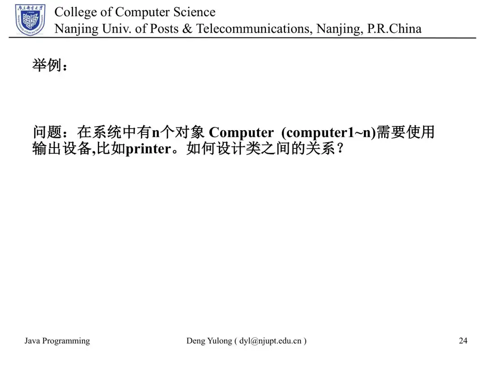

原文：

举例：

问题：在系统中有n个对象 Computer (computer1\~n)需要使用输出设备,比如printer。如何设计类之间的关系？

南京郵電大學易

College of Computer Science Nanjing Univ. of Posts & Telecommunications, Nanjing, P.R.China

Java Programming

Deng Yulong ( dyl@njupt.edu.cn )

24

### Computer1 myprinter:Printer print:void

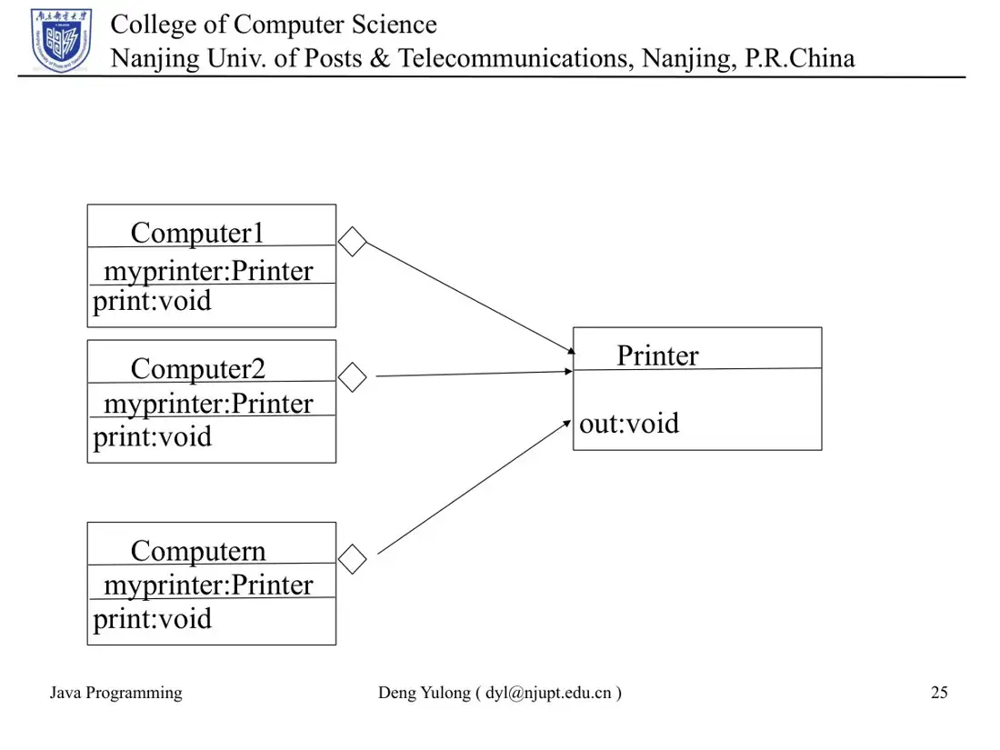

原文：

Computer1 myprinter:Printer print:void

Computer2 myprinter:Printer print:void

Computern myprinter:Printer print:void

南京郵電大學易

College of Computer Science Nanjing Univ. of Posts & Telecommunications, Nanjing, P.R.China

Java Programming

Deng Yulong ( dyl@njupt.edu.cn )

25

### 南京郵電大學1948

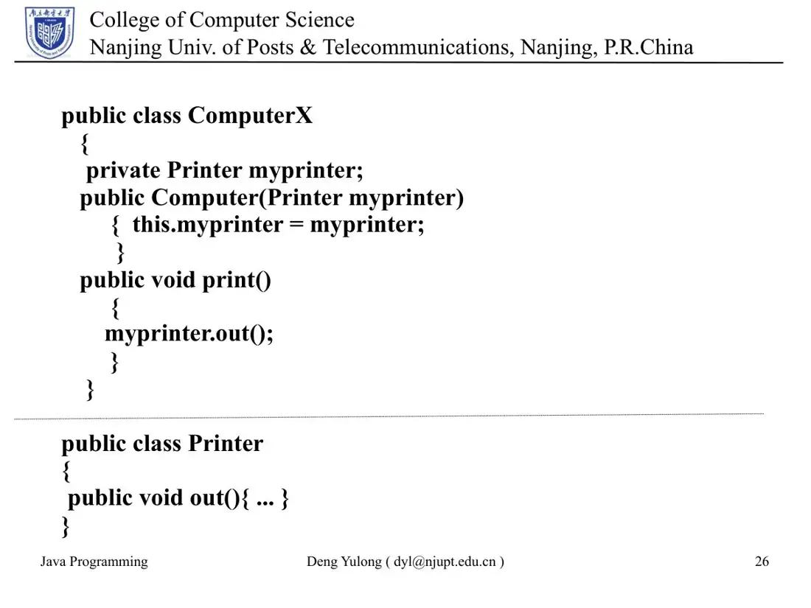

原文：

南京郵電大學1948

College of Computer Science Nanjing Univ. of Posts & Telecommunications, Nanjing, P.R.China

Java Programming

Deng Yulong ( dyl@njupt.edu.cn )

26

### 新型打印机 (NewPrinter)出现

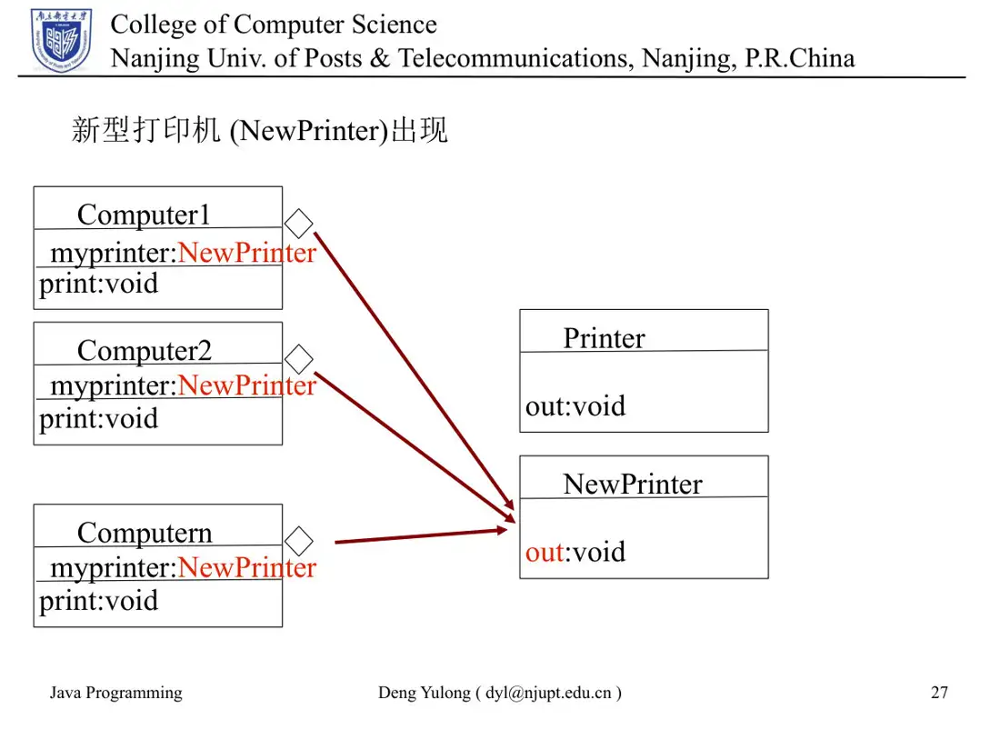

原文：

新型打印机 (NewPrinter)出现

Computer1 myprinter:NewPrinter print:void

Computer2 myprinter:NewPrinter print:void

Computern myprinter:NewPrinter print:void

Printer

out:void

NewPrinter

out:void

南京郵電大學1948

College of Computer Science Nanjing Univ. of Posts & Telecommunications, Nanjing, P.R.China

Java Programming

Deng Yulong ( dyl@njupt.edu.cn )

27

### 南京郵電大學1948

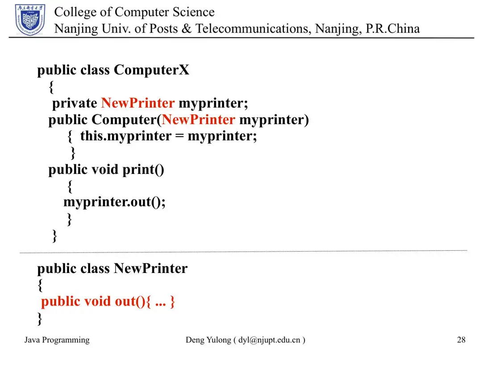

原文：

南京郵電大學1948

College of Computer Science Nanjing Univ. of Posts & Telecommunications, Nanjing, P.R.China

28

### 简单工厂模式

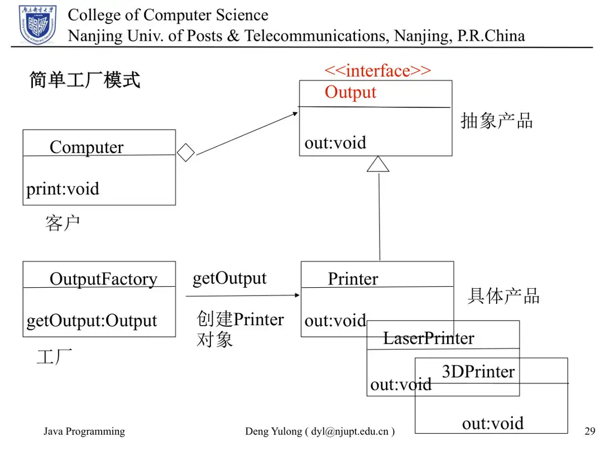

原文：

简单工厂模式

Computer

客户

南京郵電大學易

College of Computer Science Nanjing Univ. of Posts & Telecommunications, Nanjing, P.R.China

Java Programming

29

### 南京郵電大學易

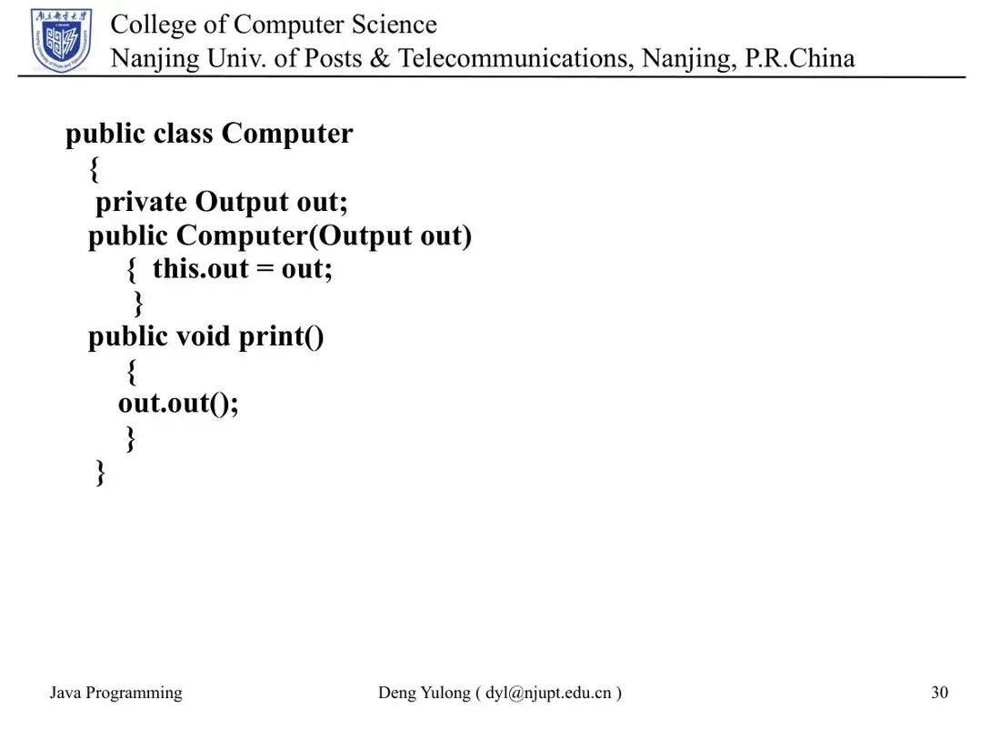

原文：

南京郵電大學易

College of Computer Science Nanjing Univ. of Posts & Telecommunications, Nanjing, P.R.China

Java Programming

Deng Yulong ( dyl@njupt.edu.cn )

30

### 南京郵電大學易

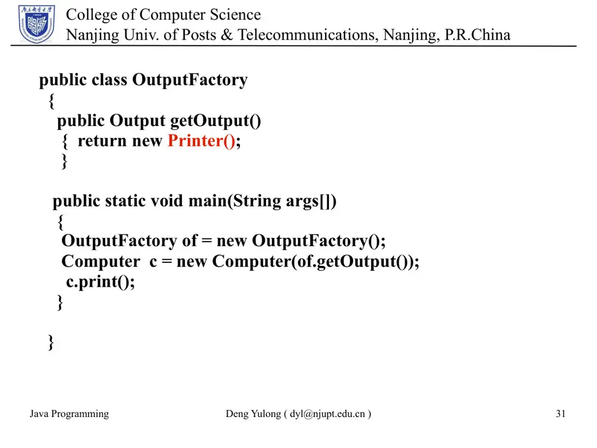

原文：

南京郵電大學易

College of Computer Science Nanjing Univ. of Posts & Telecommunications, Nanjing, P.R.China

Java Programming

Deng Yulong ( dyl@njupt.edu.cn )

31

### 南京郵電大學易

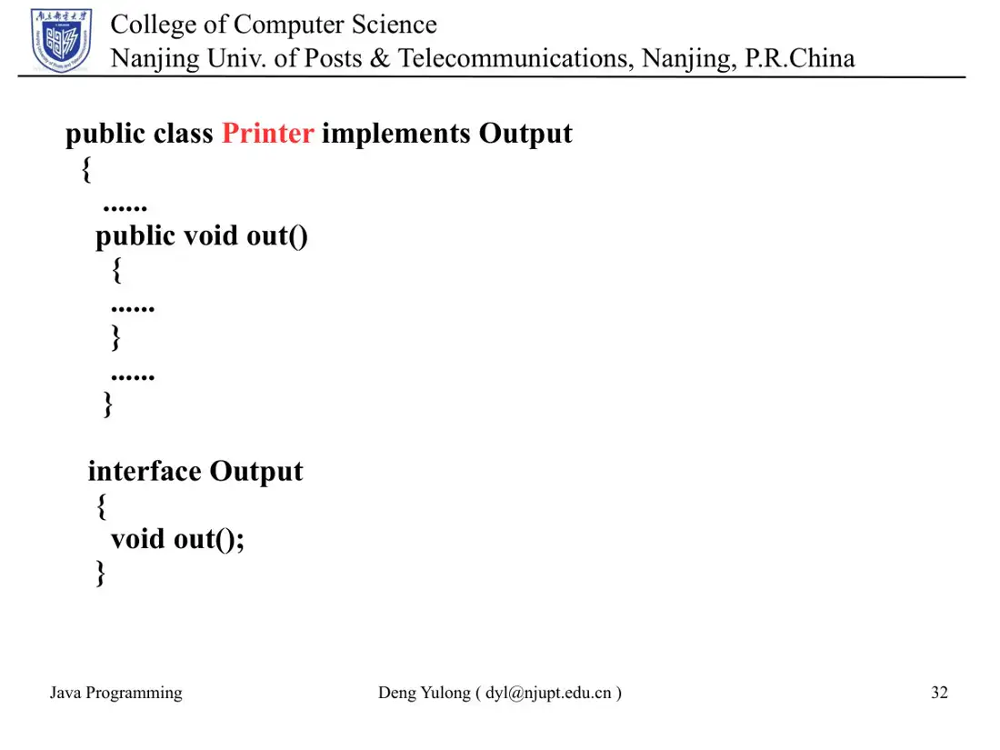

原文：

南京郵電大學易

College of Computer Science Nanjing Univ. of Posts & Telecommunications, Nanjing, P.R.China

Java Programming

Deng Yulong ( dyl@njupt.edu.cn )

32

### 6.2 创建和使用包( packages)

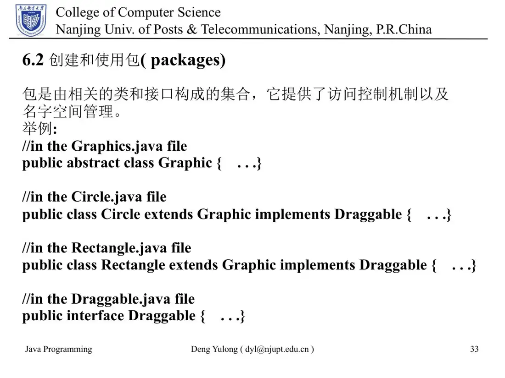

原文：

6.2 创建和使用包( packages)

包是由相关的类和接口构成的集合，它提供了访问控制机制以及名字空间管理。

举例:

//in the Graphics.java file public abstract class Graphic { . . .}

//in the Circle.java file public class Circle extends Graphic implements Draggable { . . .}

//in the Rectangle.java file public class Rectangle extends Graphic implements Draggable { . . .}

//in the Draggable.java filepublic interface Draggable { . . .}考虑到如下原因，你应该将这些类和接口放入一个包中：

南京郵電大學易

College of Computer Science Nanjing Univ. of Posts & Telecommunications, Nanjing, P.R.China

Java Programming

Deng Yulong ( dyl@njupt.edu.cn )

33

### \*你和其他程序员能确定这些类和接口是相关的。

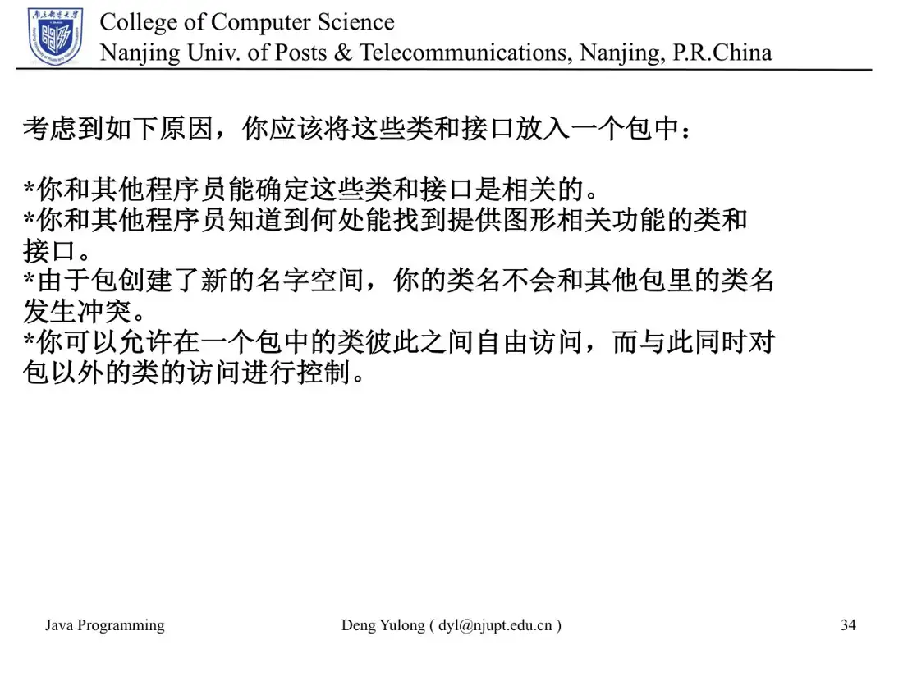

原文：

\*你和其他程序员能确定这些类和接口是相关的。

\*你和其他程序员知道到何处能找到提供图形相关功能的类和接口。

\*由于包创建了新的名字空间，你的类名不会和其他包里的类名发生冲突。

\*你可以允许在一个包中的类彼此之间自由访问，而与此同时对包以外的类的访问进行控制。

南京郵電大學易

College of Computer Science Nanjing Univ. of Posts & Telecommunications, Nanjing, P.R.China

Java Programming

Deng Yulong ( dyl@njupt.edu.cn )

34

### 6.2.1 创建一个包

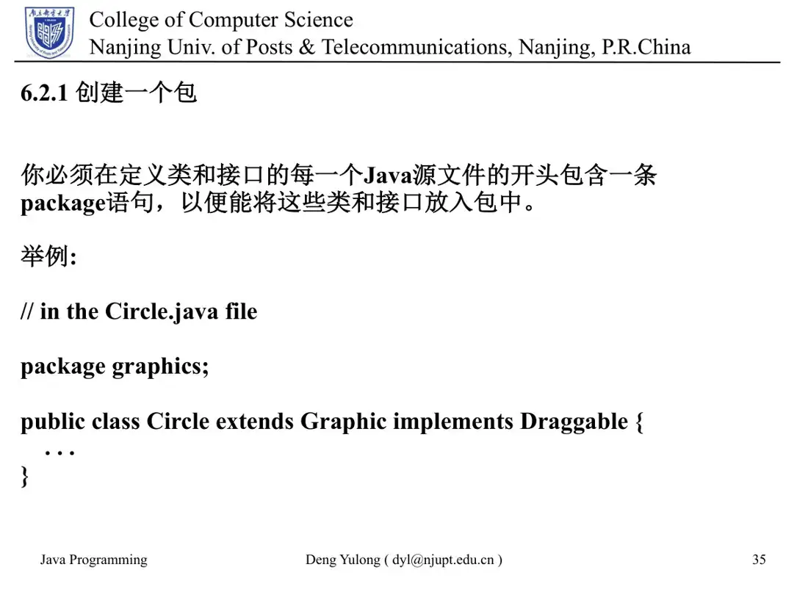

原文：

6.2.1 创建一个包

你必须在定义类和接口的每一个Java源文件的开头包含一条package语句，以便能将这些类和接口放入包中。

举例:

// in the Circle.java file

package graphics;

public class Circle extends Graphic implements Draggable { }

南京郵電大學易

College of Computer Science Nanjing Univ. of Posts & Telecommunications, Nanjing, P.R.China

Java Programming

Deng Yulong ( dyl@njupt.edu.cn )

35

### // in the Rectangle.java file

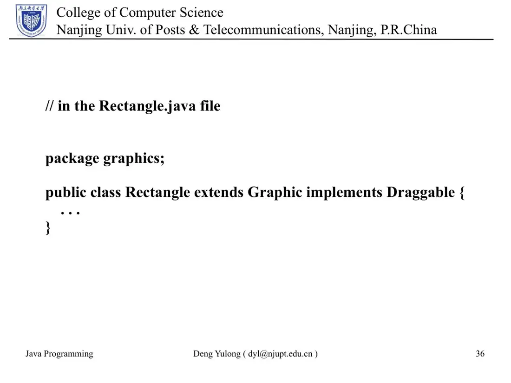

原文：

// in the Rectangle.java file

package graphics;

public class Rectangle extends Graphic implements Draggable { }

南京郵電大學易

College of Computer Science Nanjing Univ. of Posts & Telecommunications, Nanjing, P.R.China

Java Programming

Deng Yulong ( dyl@njupt.edu.cn )

36

### 注意!

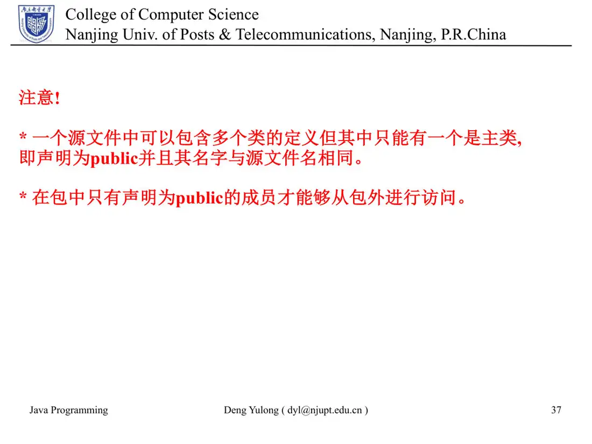

原文：

注意!

\* 一个源文件中可以包含多个类的定义但其中只能有一个是主类,即声明为public并且其名字与源文件名相同。

\* 在包中只有声明为public的成员才能够从包外进行访问。

南京郵電大學易

College of Computer Science Nanjing Univ. of Posts & Telecommunications, Nanjing, P.R.China

Java Programming

Deng Yulong ( dyl@njupt.edu.cn )

37

### 6.2.2 包的命名方法

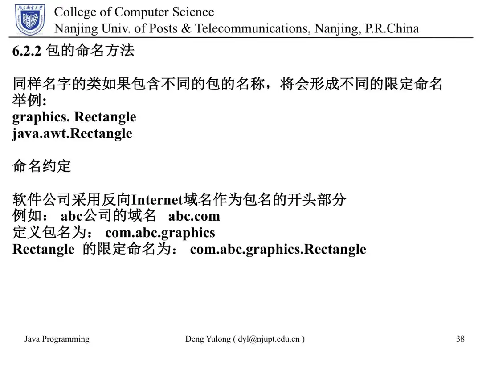

原文：

6.2.2 包的命名方法

同样名字的类如果包含不同的包的名称，将会形成不同的限定命名举例:graphics. Rectanglejava.awt.Rectangle

命名约定

软件公司采用反向Internet域名作为包名的开头部分

例如： abc公司的域名 abc.com

定义包名为： com.abc.graphics

Rectangle 的限定命名为： com.abc.graphics.Rectangle

南京郵電大學易

College of Computer Science Nanjing Univ. of Posts & Telecommunications, Nanjing, P.R.China

Java Programming

Deng Yulong ( dyl@njupt.edu.cn )

38

### 6.2.3使用包中的成员

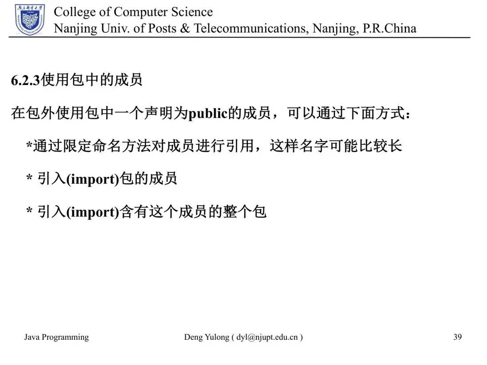

原文：

6.2.3使用包中的成员

在包外使用包中一个声明为public的成员，可以通过下面方式：

\*通过限定命名方法对成员进行引用，这样名字可能比较长

\* 引入(import)包的成员

\* 引入(import)含有这个成员的整个包

南京郵電大學易

College of Computer Science Nanjing Univ. of Posts & Telecommunications, Nanjing, P.R.China

Java Programming

Deng Yulong ( dyl@njupt.edu.cn )

39

### •通过名字来引用包中的成员

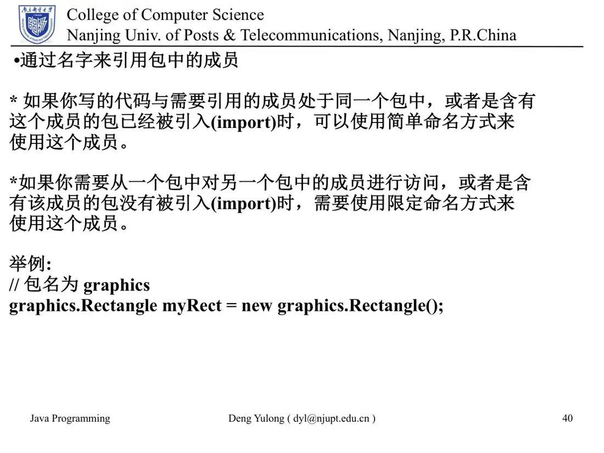

原文：

•通过名字来引用包中的成员

\* 如果你写的代码与需要引用的成员处于同一个包中，或者是含有这个成员的包已经被引入(import)时，可以使用简单命名方式来使用这个成员。

\*如果你需要从一个包中对另一个包中的成员进行访问，或者是含有该成员的包没有被引入(import)时，需要使用限定命名方式来使用这个成员。

举例:

// 包名为 graphics

graphics.Rectangle myRect = new graphics.Rectangle();

南京郵電大學易

College of Computer Science Nanjing Univ. of Posts & Telecommunications, Nanjing, P.R.China

Java Programming

Deng Yulong ( dyl@njupt.edu.cn )

40

### • 引入包中的成员

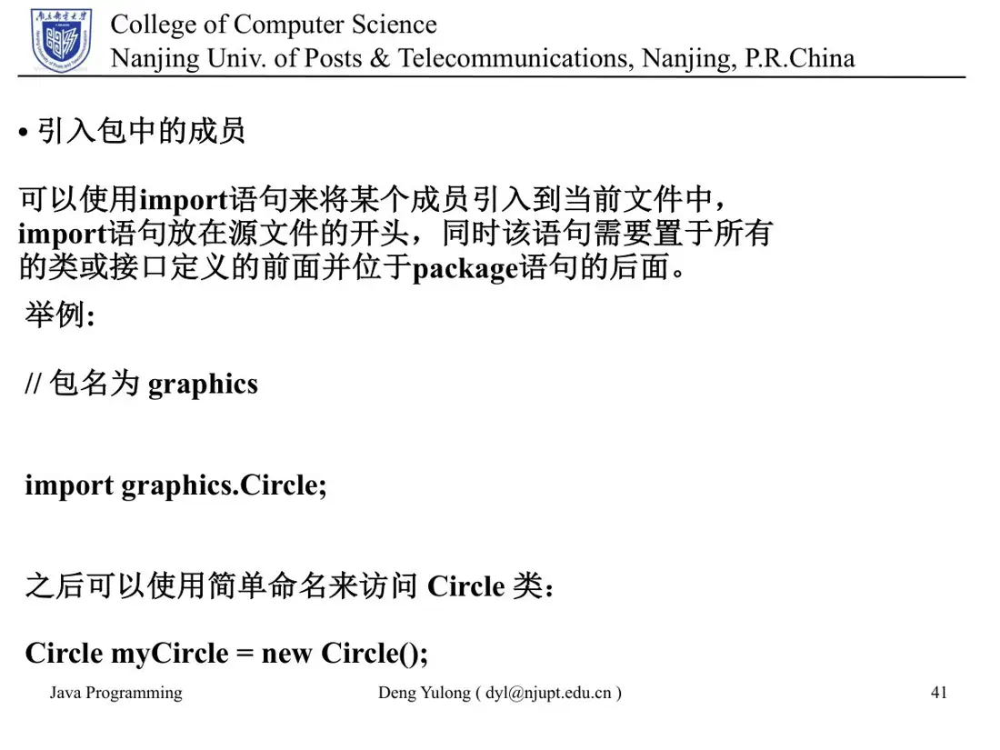

原文：

• 引入包中的成员

可以使用import语句来将某个成员引入到当前文件中，import语句放在源文件的开头，同时该语句需要置于所有的类或接口定义的前面并位于package语句的后面。

举例:

// 包名为 graphics

import graphics.Circle;

之后可以使用简单命名来访问 Circle 类：

Java Programming

南京郵電大學易

College of Computer Science Nanjing Univ. of Posts & Telecommunications, Nanjing, P.R.China

Deng Yulong ( dyl@njupt.edu.cn )

41

### •引入整个包

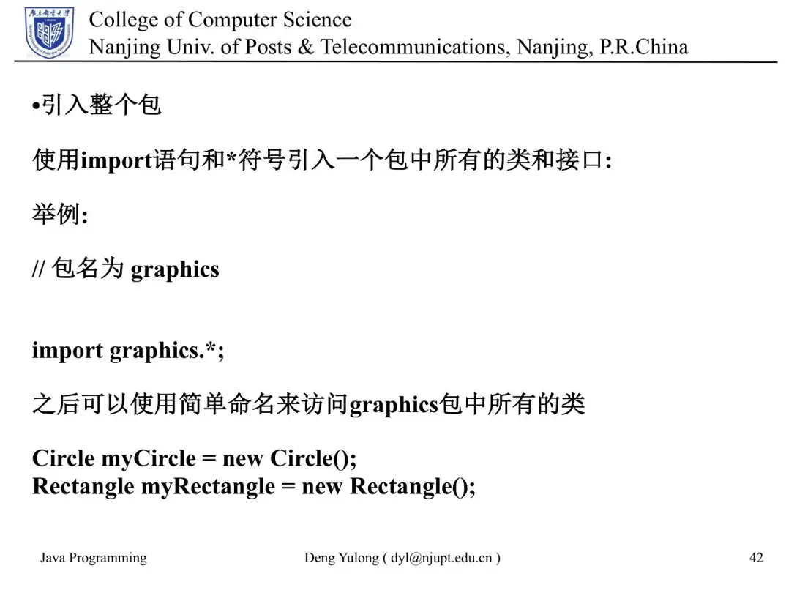

原文：

•引入整个包

使用import语句和\*符号引入一个包中所有的类和接口:

举例:

// 包名为 graphics

import graphics.\*;

之后可以使用简单命名来访问graphics包中所有的类

Circle myCircle = new Circle(); Rectangle myRectangle = new Rectangle();

南京郵電大學易

College of Computer Science Nanjing Univ. of Posts & Telecommunications, Nanjing, P.R.China

Java Programming

Deng Yulong ( dyl@njupt.edu.cn )

42

### Java运行环境会自动引入下面三个包

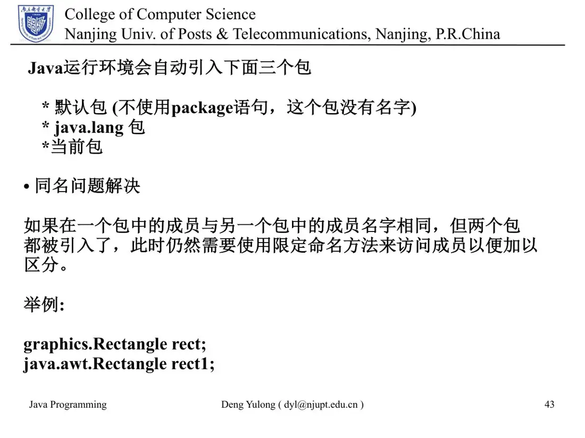

原文：

Java运行环境会自动引入下面三个包

\* 默认包 (不使用package语句，这个包没有名字)

\* java.lang 包

\*当前包

• 同名问题解决

如果在一个包中的成员与另一个包中的成员名字相同，但两个包都被引入了，此时仍然需要使用限定命名方法来访问成员以便加以区分。

举例:

graphics.Rectangle rect; java.awt.Rectangle rect1;

南京郵電大學易

College of Computer Science Nanjing Univ. of Posts & Telecommunications, Nanjing, P.R.China

Java Programming

Deng Yulong ( dyl@njupt.edu.cn )

43

### 6.2.4 管理源代码和(class)字节码文件

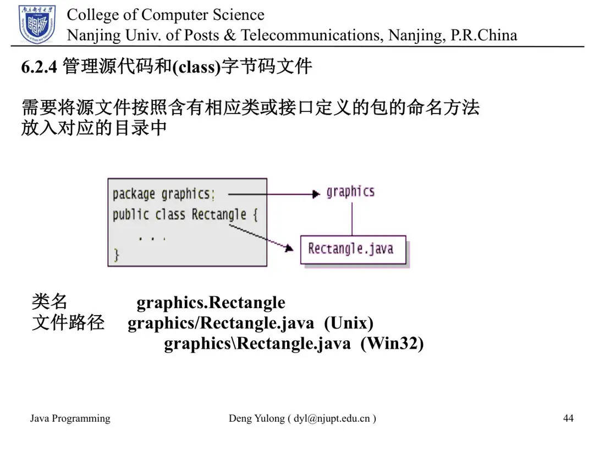

原文：

6.2.4 管理源代码和(class)字节码文件

需要将源文件按照含有相应类或接口定义的包的命名方法放入对应的目录中

类名 graphics.Rectangle 文件路径 graphics/Rectangle.java (Unix) graphics\Rectangle.java (Win32)

南京郵電大學易

College of Computer Science Nanjing Univ. of Posts & Telecommunications, Nanjing, P.R.China

Java Programming

Deng Yulong ( dyl@njupt.edu.cn )

44

### 举例：（包含源文件和class文件）

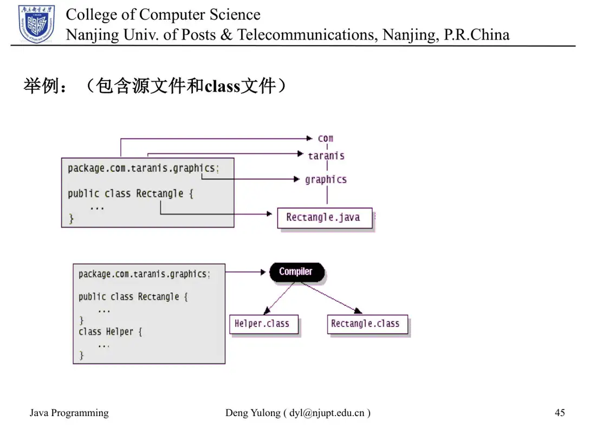

原文：

举例：（包含源文件和class文件）

Helper.class

Rectangle.class

南京郵電大學易

College of Computer Science Nanjing Univ. of Posts & Telecommunications, Nanjing, P.R.China

Java Programming

Deng Yulong ( dyl@njupt.edu.cn )

45

### 南京郵電大學易

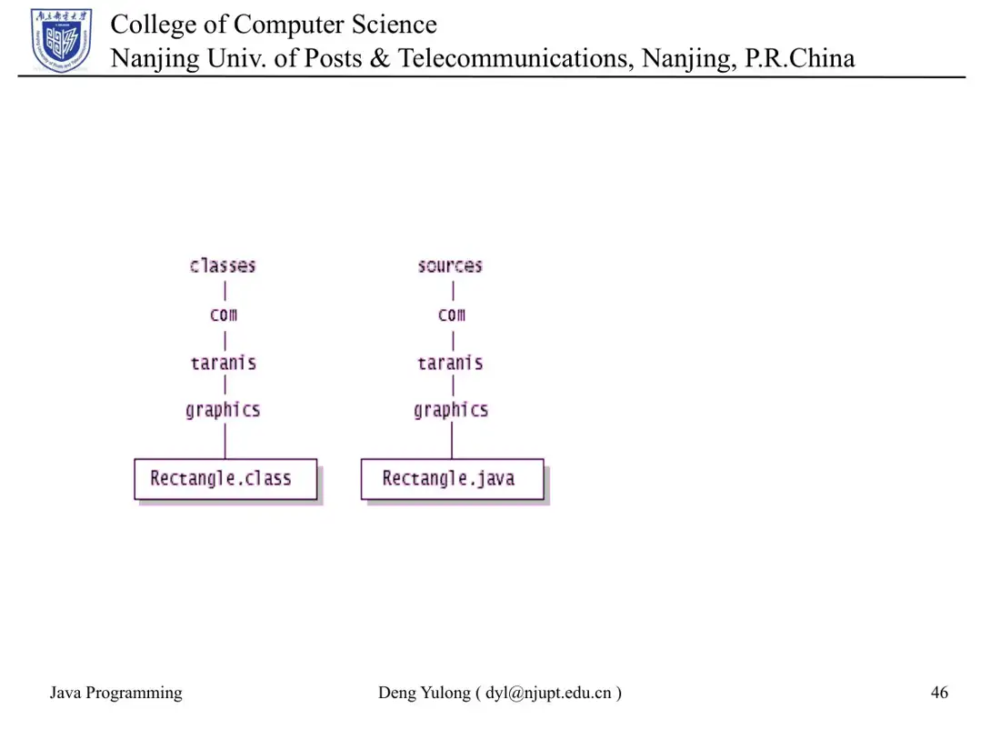

原文：

南京郵電大學易

College of Computer Science Nanjing Univ. of Posts & Telecommunications, Nanjing, P.R.China

Java Programming

Deng Yulong ( dyl@njupt.edu.cn )

46

### \* 列入class path中的目录应该为包对应目录路径中的第一层目录。

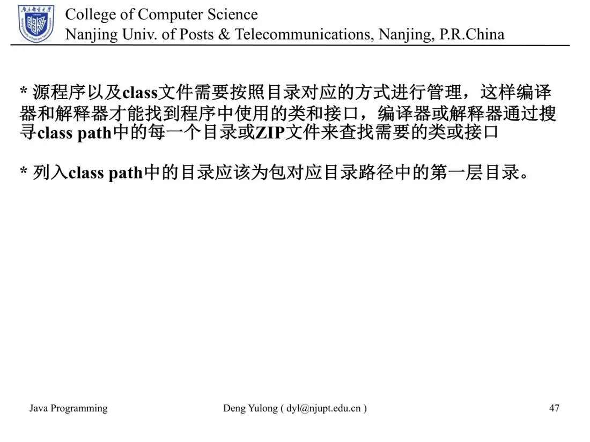

原文：

\* 源程序以及class文件需要按照目录对应的方式进行管理，这样编译器和解释器才能找到程序中使用的类和接口，编译器或解释器通过搜寻class path中的每一个目录或ZIP文件来查找需要的类或接口

\* 列入class path中的目录应该为包对应目录路径中的第一层目录。

南京郵電大學易

College of Computer Science Nanjing Univ. of Posts & Telecommunications, Nanjing, P.R.China

Java Programming

Deng Yulong ( dyl@njupt.edu.cn )

47

### 南京郵電大學易

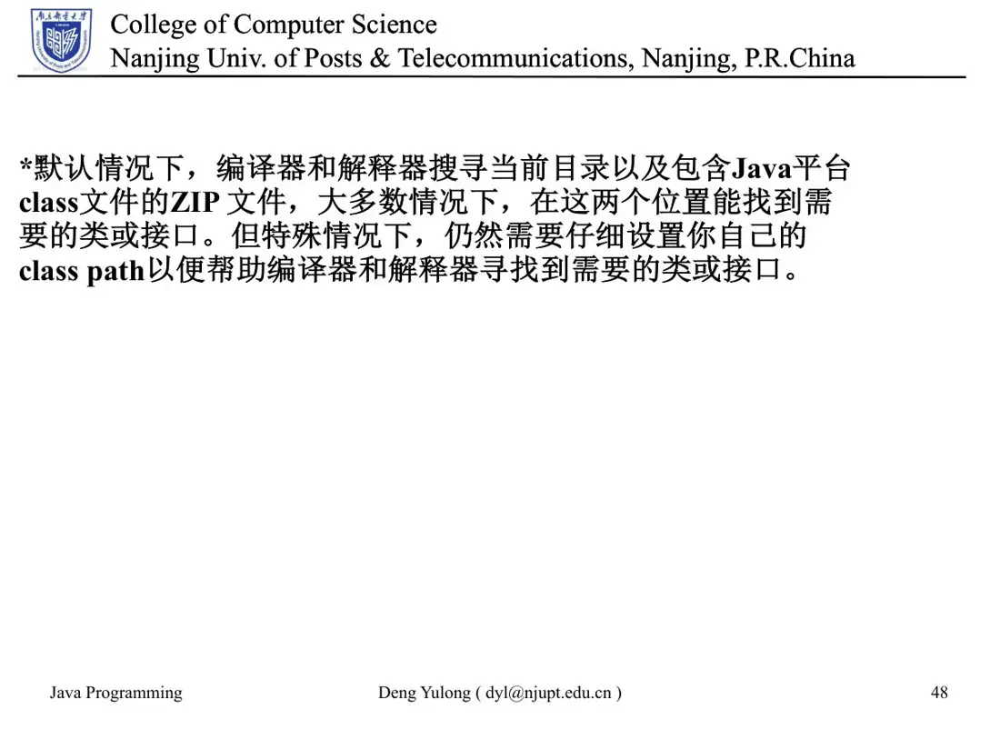

原文：

\*默认情况下，编译器和解释器搜寻当前目录以及包含Java平台class文件的ZIP 文件，大多数情况下，在这两个位置能找到需要的类或接口。但特殊情况下，仍然需要仔细设置你自己的class path以便帮助编译器和解释器寻找到需要的类或接口。

南京郵電大學易

College of Computer Science Nanjing Univ. of Posts & Telecommunications, Nanjing, P.R.China

Java Programming

Deng Yulong ( dyl@njupt.edu.cn )

48
