# 《Java程序设计》第7章 泛型和异常处理（课件）

原件的每一页，下面附识别出的文字。

### Chap 7 泛型和异常处理

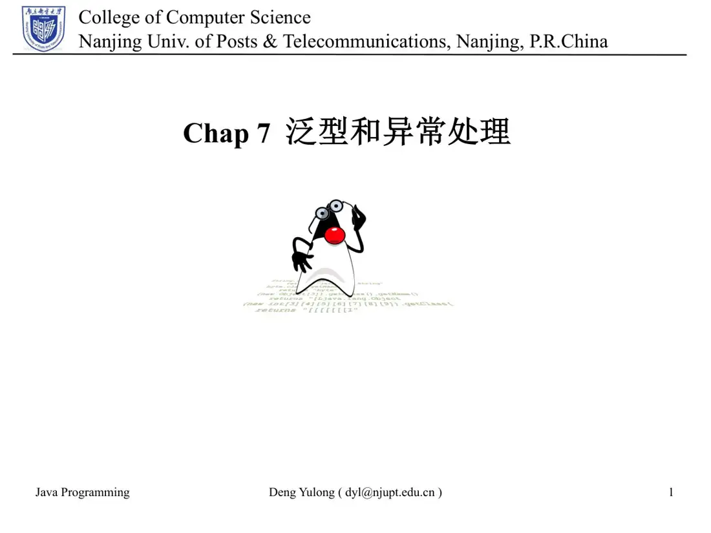

原文：

Chap 7 泛型和异常处理

南京郵電大學易

College of Computer Science Nanjing Univ. of Posts & Telecommunications, Nanjing, P.R.China

Java Programming

Deng Yulong ( dyl@njupt.edu.cn )

1

### 7.1 泛型(Generics)

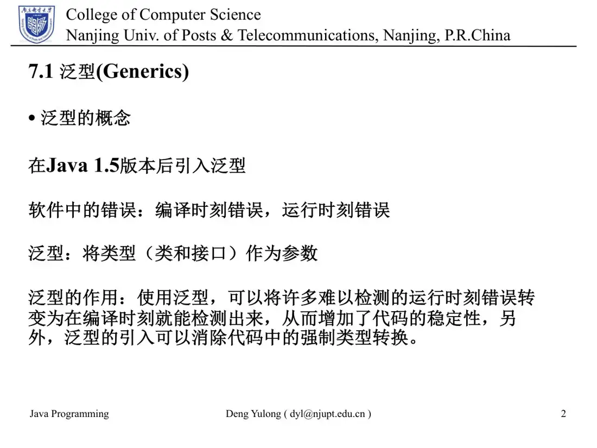

原文：

7.1 泛型(Generics)

• 泛型的概念

在Java 1.5版本后引入泛型

软件中的错误：编译时刻错误，运行时刻错误

泛型：将类型（类和接口）作为参数

泛型的作用：使用泛型，可以将许多难以检测的运行时刻错误转变为在编译时刻就能检测出来，从而增加了代码的稳定性，另外，泛型的引入可以消除代码中的强制类型转换。

南京郵電大學104

College of Computer Science Nanjing Univ. of Posts & Telecommunications, Nanjing, P.R.China

Java Programming

Deng Yulong ( dyl@njupt.edu.cn )

2

### • 泛型的定义和使用

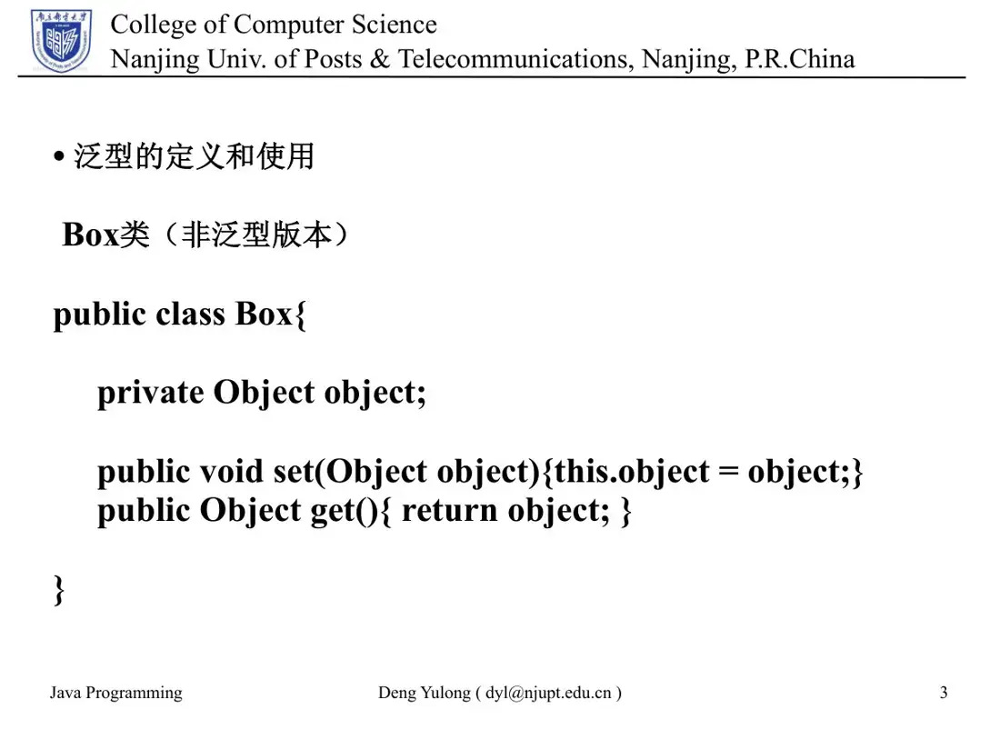

原文：

• 泛型的定义和使用

Box类（非泛型版本）

public class Box{

private Object object;

public void set(Object object){this.object = object;} public Object get(){ return object; }

南京郵電大學104Tel

College of Computer Science Nanjing Univ. of Posts & Telecommunications, Nanjing, P.R.China

Java Programming

Deng Yulong ( dyl@njupt.edu.cn )

3

### 南京郵電大學1048om

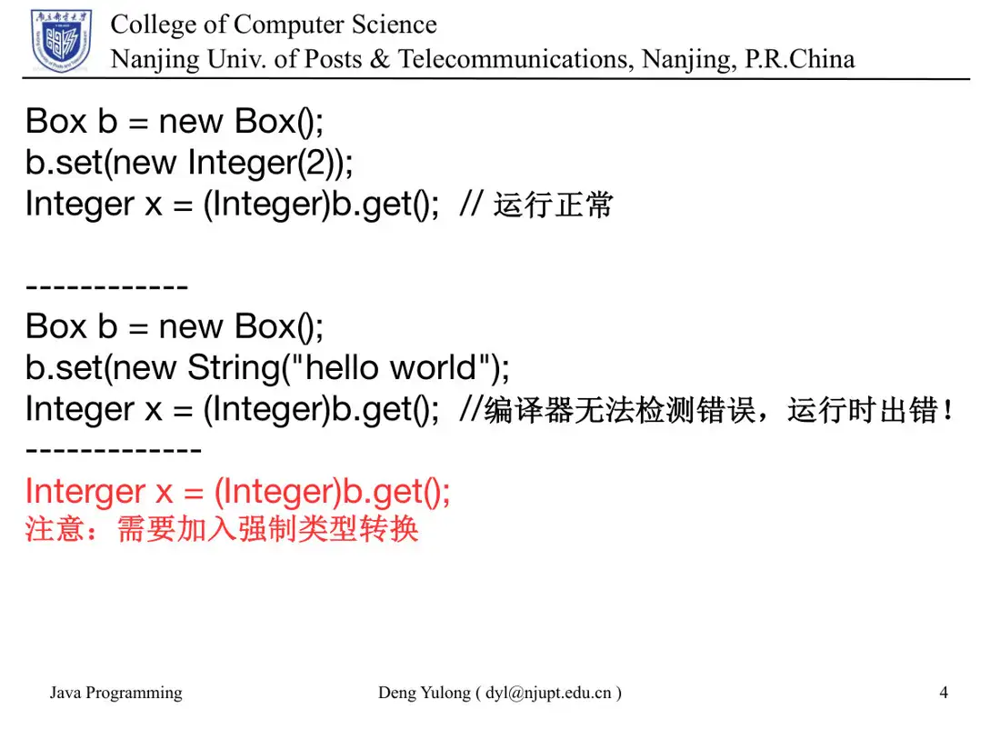

原文：

南京郵電大學1048om

College of Computer Science Nanjing Univ. of Posts & Telecommunications, Nanjing, P.R.China

Java Programming

Deng Yulong ( dyl@njupt.edu.cn )

4

### • 泛型的定义和使用

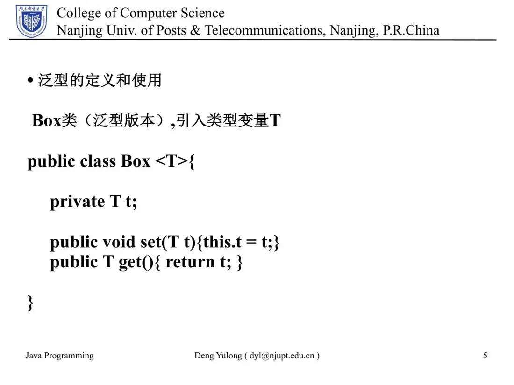

原文：

• 泛型的定义和使用

Box类（泛型版本）,引入类型变量T

public class Box <T>{

private T t;

public void set(T t){this.t = t;} public T get(){ return t; }

南京郵電大學848ofPosts

College of Computer Science Nanjing Univ. of Posts & Telecommunications, Nanjing, P.R.China

Java Programming

Deng Yulong ( dyl@njupt.edu.cn )

5

### 使用泛型， 需要使用具体类型替代 T

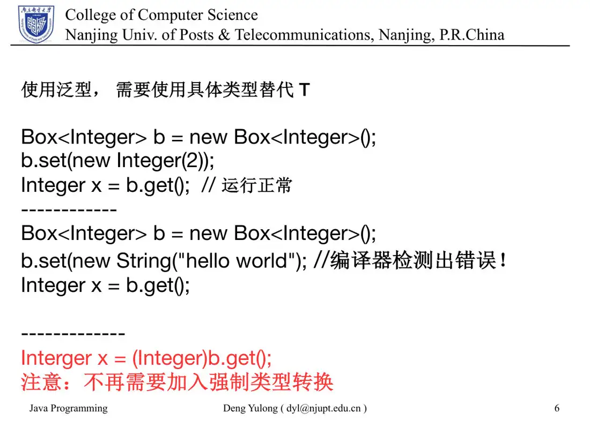

原文：

使用泛型， 需要使用具体类型替代 T

南京郵電大學ofPosts

College of Computer Science Nanjing Univ. of Posts & Telecommunications, Nanjing, P.R.China

Java Programming

Deng Yulong ( dyl@njupt.edu.cn )

6

### 7.2 异常(exception)的定义

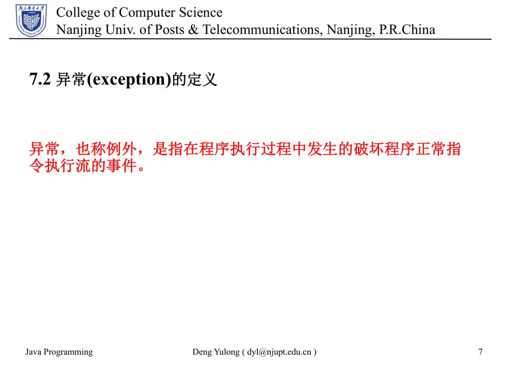

原文：

7.2 异常(exception)的定义

异常，也称例外，是指在程序执行过程中发生的破坏程序正常指令执行流的事件。

南京郵電大學易

College of Computer Science Nanjing Univ. of Posts & Telecommunications, Nanjing, P.R.China

Java Programming

Deng Yulong ( dyl@njupt.edu.cn )

7

### 错误

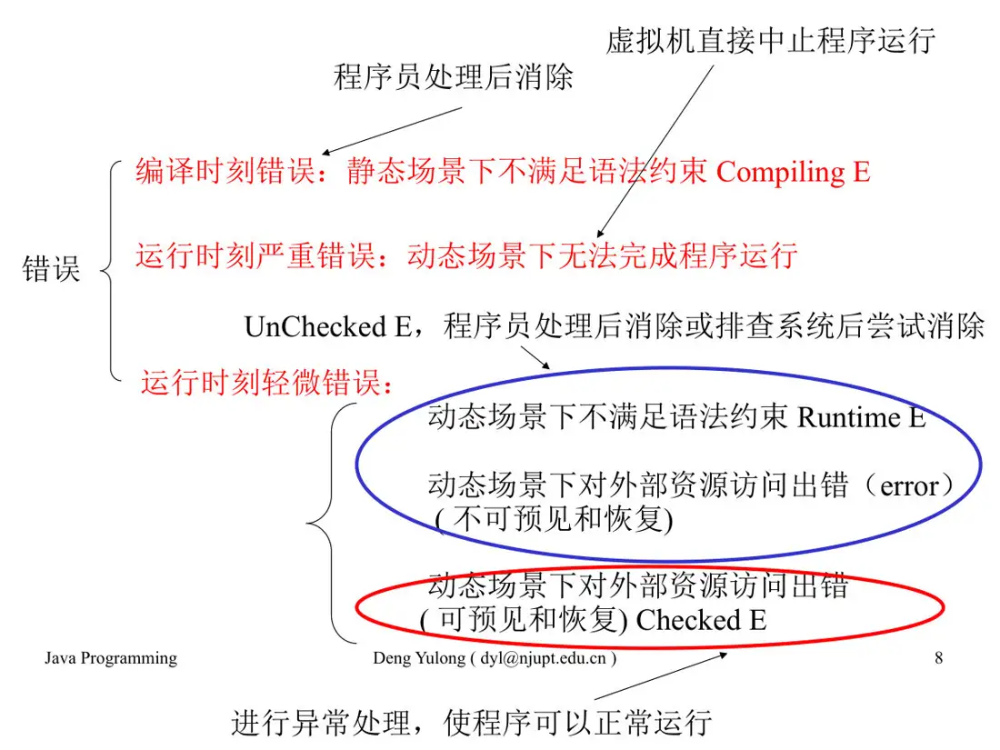

原文：

错误

### 7.2 异常处理的语法结构和处理过程

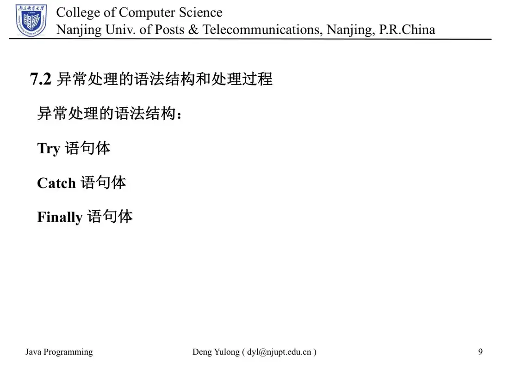

原文：

7.2 异常处理的语法结构和处理过程

异常处理的语法结构：

Try 语句体

Catch 语句体

Finally 语句体

南京郵電大學易

College of Computer Science Nanjing Univ. of Posts & Telecommunications, Nanjing, P.R.China

Java Programming

Deng Yulong ( dyl@njupt.edu.cn )

9

### 南京郵電大學易

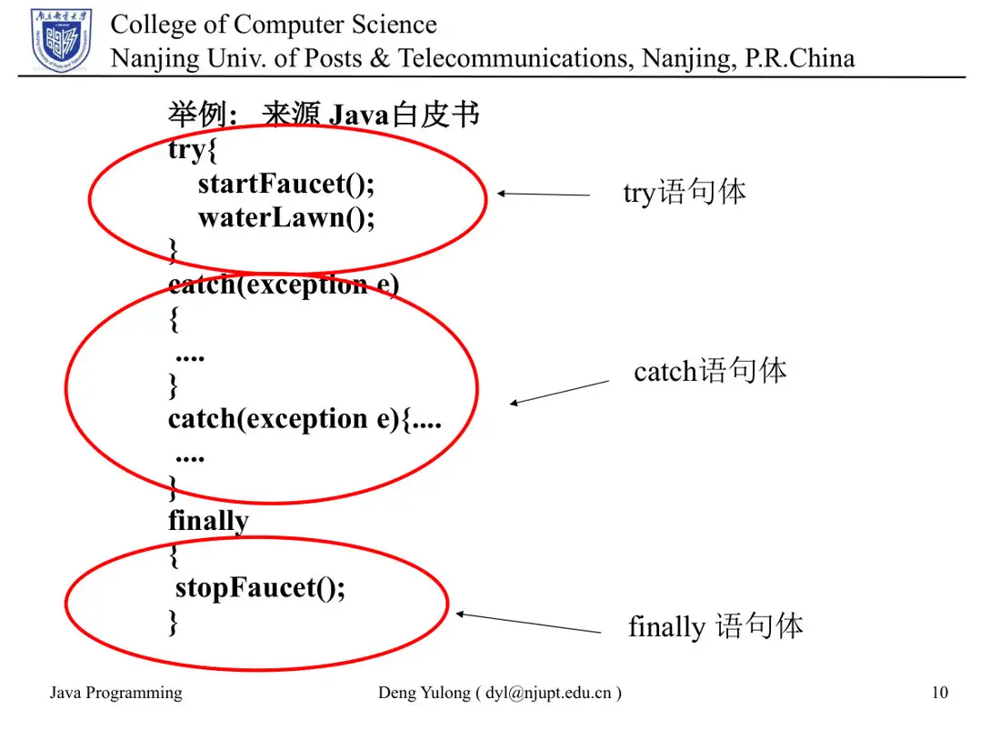

原文：

南京郵電大學易

College of Computer Science Nanjing Univ. of Posts & Telecommunications, Nanjing, P.R.China

Java Programming

10

### • try 语句体

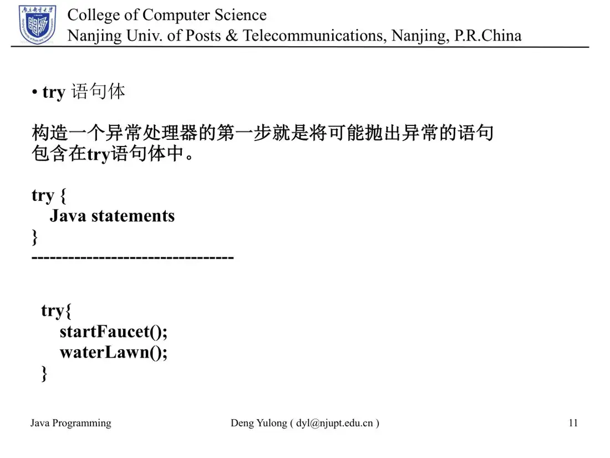

原文：

• try 语句体

构造一个异常处理器的第一步就是将可能抛出异常的语句包含在try语句体中。

南京郵電大學易

College of Computer Science Nanjing Univ. of Posts & Telecommunications, Nanjing, P.R.China

Java Programming

Deng Yulong ( dyl@njupt.edu.cn )

11

### • catch 语句体

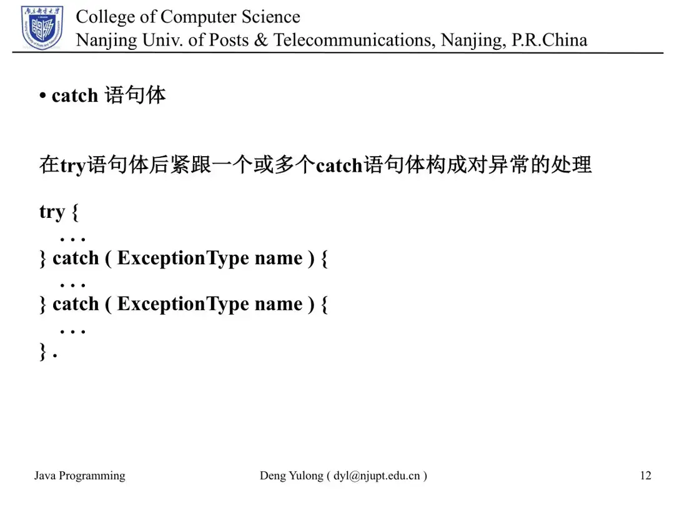

原文：

• catch 语句体

南京郵電大學易

College of Computer Science Nanjing Univ. of Posts & Telecommunications, Nanjing, P.R.China

Java Programming

Deng Yulong ( dyl@njupt.edu.cn )

12

### \* 异常名称必须与需要俘获的异常一致。

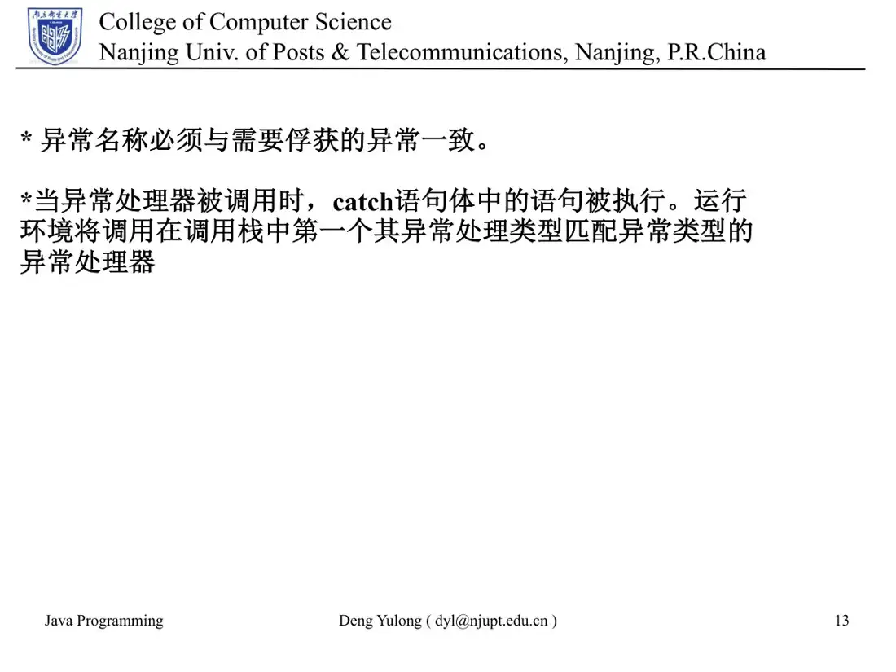

原文：

\* 异常名称必须与需要俘获的异常一致。

\*当异常处理器被调用时，catch语句体中的语句被执行。运行环境将调用在调用栈中第一个其异常处理类型匹配异常类型的异常处理器

南京郵電大學易

College of Computer Science Nanjing Univ. of Posts & Telecommunications, Nanjing, P.R.China

Java Programming

Deng Yulong ( dyl@njupt.edu.cn )

13

### 南京郵電大學易

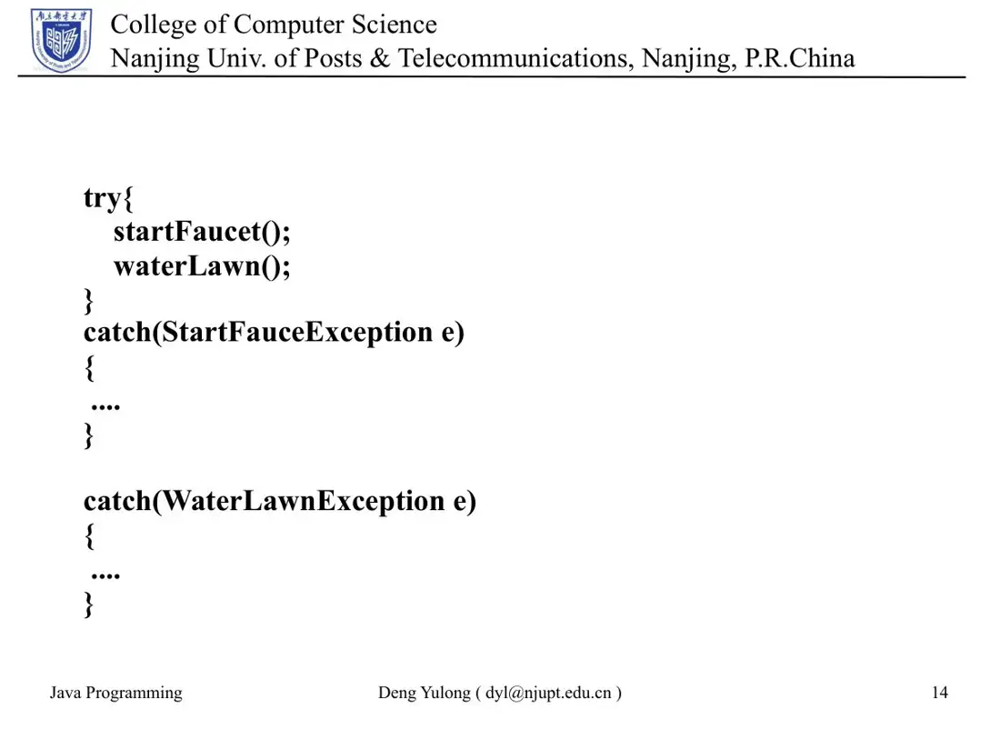

原文：

南京郵電大學易

College of Computer Science Nanjing Univ. of Posts & Telecommunications, Nanjing, P.R.China

Java Programming

Deng Yulong ( dyl@njupt.edu.cn )

14

### • finally语句体

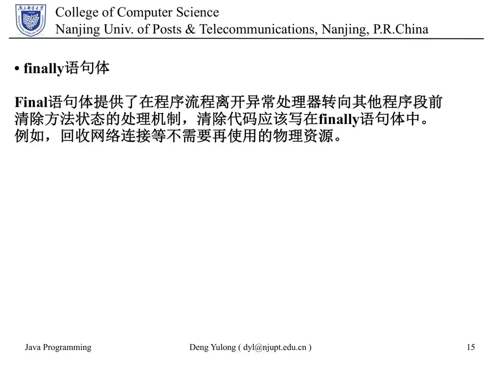

原文：

• finally语句体

Final语句体提供了在程序流程离开异常处理器转向其他程序段前清除方法状态的处理机制，清除代码应该写在finally语句体中。例如，回收网络连接等不需要再使用的物理资源。

南京郵電大學易

College of Computer Science Nanjing Univ. of Posts & Telecommunications, Nanjing, P.R.China

Java Programming

Deng Yulong ( dyl@njupt.edu.cn )

15

### 南京郵電大學易

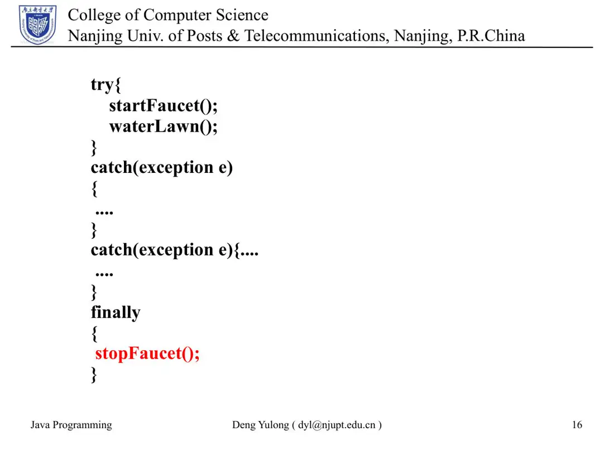

原文：

南京郵電大學易

College of Computer Science Nanjing Univ. of Posts & Telecommunications, Nanjing, P.R.China

Java Programming

Deng Yulong ( dyl@njupt.edu.cn )

16

### 异常处理的动态过程：

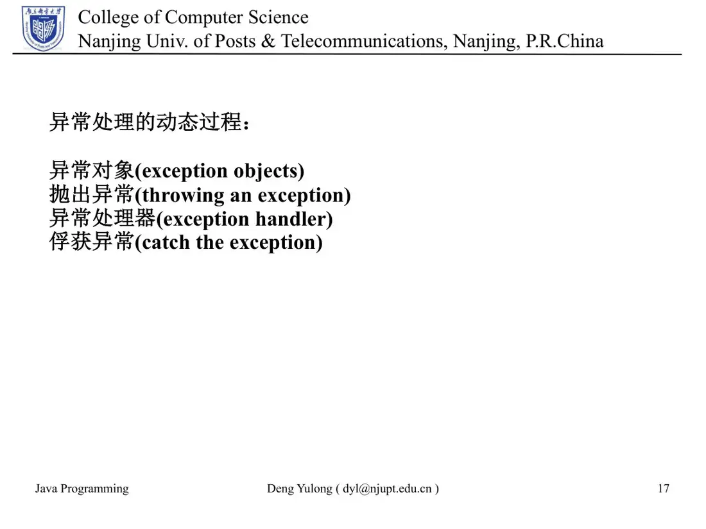

原文：

异常处理的动态过程：

异常对象(exception objects)

抛出异常(throwing an exception)

异常处理器(exception handler)

俘获异常(catch the exception)

南京郵電大學易

College of Computer Science Nanjing Univ. of Posts & Telecommunications, Nanjing, P.R.China

Java Programming

Deng Yulong ( dyl@njupt.edu.cn )

17

### 南京郵電大學易

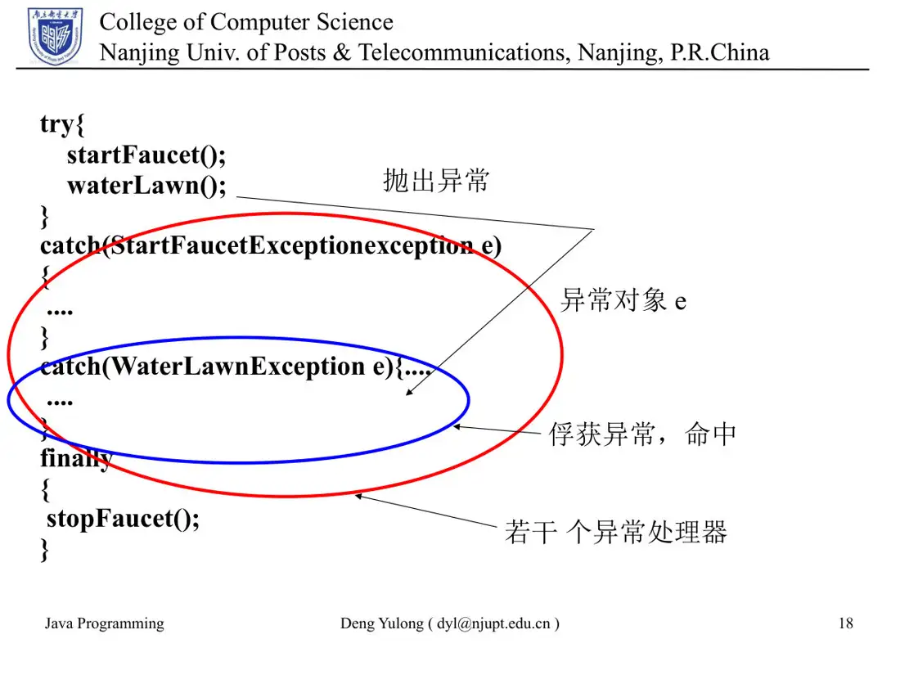

原文：

南京郵電大學易

College of Computer Science Nanjing Univ. of Posts & Telecommunications, Nanjing, P.R.China

Java Programming

Deng Yulong ( dyl@njupt.edu.cn )

18

### 异常的分类：

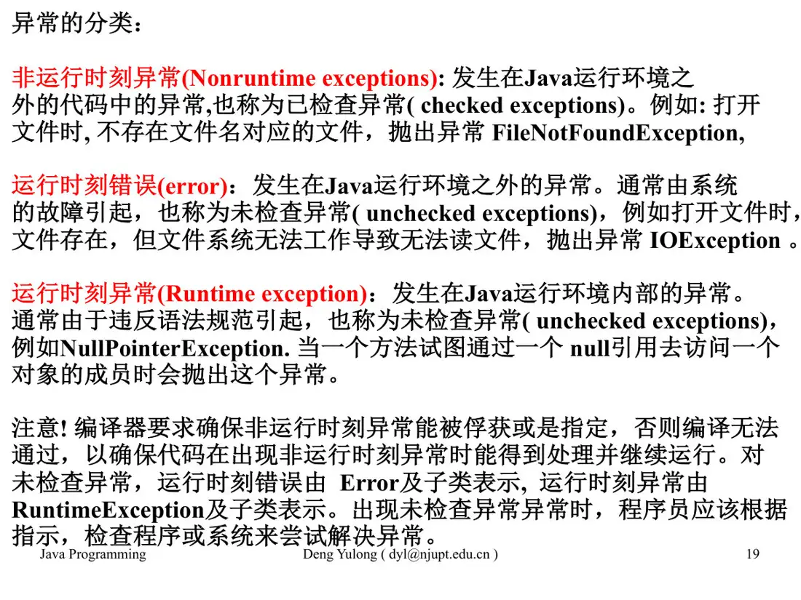

原文：

异常的分类：

非运行时刻异常(Nonruntime exceptions): 发生在Java运行环境之外的代码中的异常,也称为已检查异常( checked exceptions)。例如: 打开文件时, 不存在文件名对应的文件，抛出异常 FileNotFoundException,

运行时刻错误(error)：发生在Java运行环境之外的异常。通常由系统的故障引起，也称为未检查异常( unchecked exceptions)，例如打开文件时，文件存在，但文件系统无法工作导致无法读文件，抛出异常 IOException 。

运行时刻异常(Runtime exception)：发生在Java运行环境内部的异常。

通常由于违反语法规范引起，也称为未检查异常( unchecked exceptions)，例如NullPointerException. 当一个方法试图通过一个 null引用去访问一个对象的成员时会抛出这个异常。

注意! 编译器要求确保非运行时刻异常能被俘获或是指定，否则编译无法通过，以确保代码在出现非运行时刻异常时能得到处理并继续运行。对未检查异常，运行时刻错误由 Error及子类表示, 运行时刻异常由RuntimeException及子类表示。出现未检查异常异常时，程序员应该根据指示，检查程序或系统来尝试解决异常。

Java Programming

Deng Yulong ( dyl@njupt.edu.cn )

19

### • 俘获和指明异常

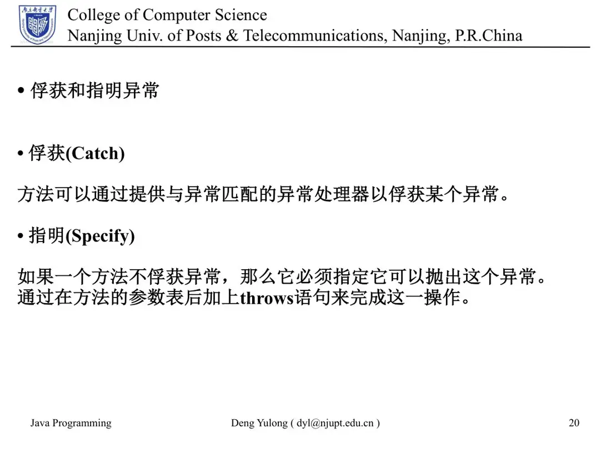

原文：

• 俘获和指明异常

• 俘获(Catch)

方法可以通过提供与异常匹配的异常处理器以俘获某个异常。

• 指明(Specify)

如果一个方法不俘获异常，那么它必须指定它可以抛出这个异常。通过在方法的参数表后加上throws语句来完成这一操作。

南京郵電大學易

College of Computer Science Nanjing Univ. of Posts & Telecommunications, Nanjing, P.R.China

Java Programming

Deng Yulong ( dyl@njupt.edu.cn )

20

### 南京郵電大學易

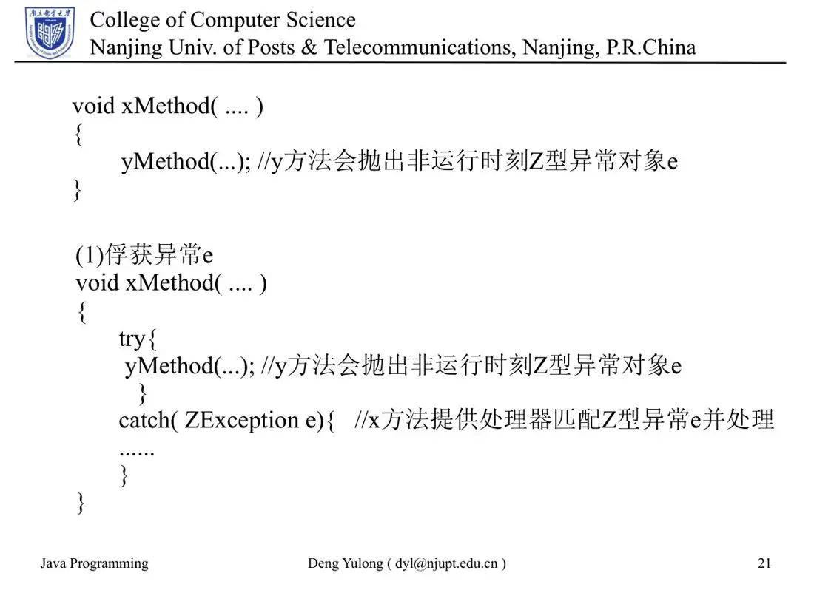

原文：

南京郵電大學易

College of Computer Science Nanjing Univ. of Posts & Telecommunications, Nanjing, P.R.China

### 南京郵電大學易

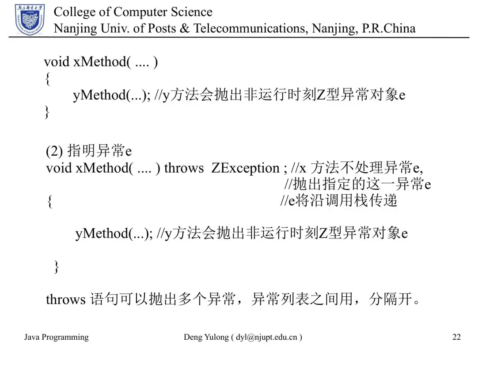

原文：

南京郵電大學易

College of Computer Science Nanjing Univ. of Posts & Telecommunications, Nanjing, P.R.China

Java Programming

Deng Yulong ( dyl@njupt.edu.cn )

22

### 编写抛出异常的代码

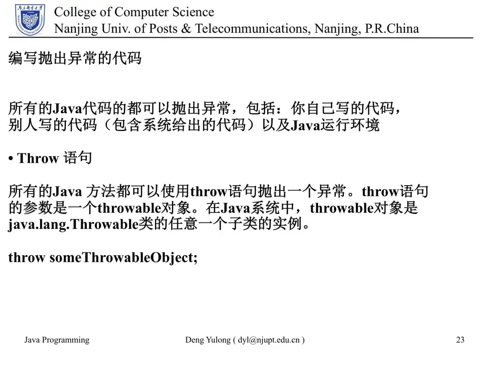

原文：

编写抛出异常的代码

所有的Java代码的都可以抛出异常，包括：你自己写的代码，别人写的代码（包含系统给出的代码）以及Java运行环境

• Throw 语句

所有的Java 方法都可以使用throw语句抛出一个异常。throw语句的参数是一个throwable对象。在Java系统中，throwable对象是java.lang.Throwable类的任意一个子类的实例。

throw someThrowableObject;

南京郵電大學易

College of Computer Science Nanjing Univ. of Posts & Telecommunications, Nanjing, P.R.China

Java Programming

Deng Yulong ( dyl@njupt.edu.cn )

23

### 举例:

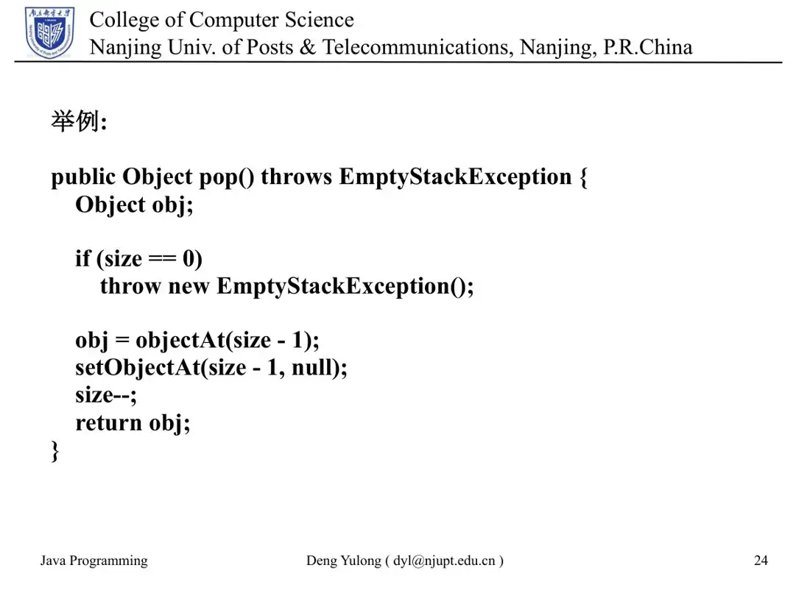

原文：

举例:

南京郵電大學易

College of Computer Science Nanjing Univ. of Posts & Telecommunications, Nanjing, P.R.China

Java Programming

Deng Yulong ( dyl@njupt.edu.cn )

24

### 7.3 异常处理为软件设计带来的贡献(优点)

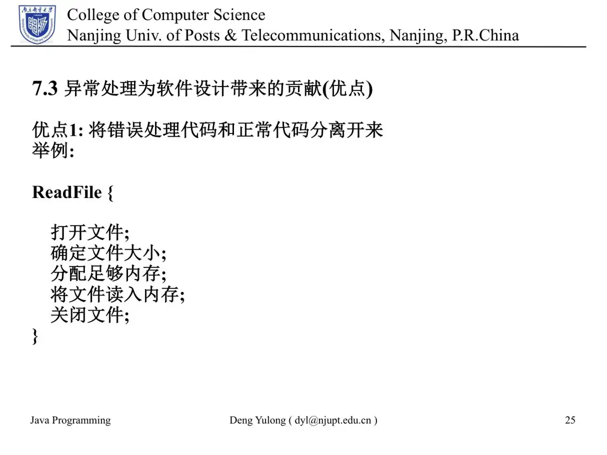

原文：

7.3 异常处理为软件设计带来的贡献(优点)

优点1: 将错误处理代码和正常代码分离开来举例:

ReadFile {

打开文件;确定文件大小;分配足够内存;将文件读入内存;关闭文件;

南京郵電大學易

College of Computer Science Nanjing Univ. of Posts & Telecommunications, Nanjing, P.R.China

Java Programming

Deng Yulong ( dyl@njupt.edu.cn )

25

### 潜在的错误:

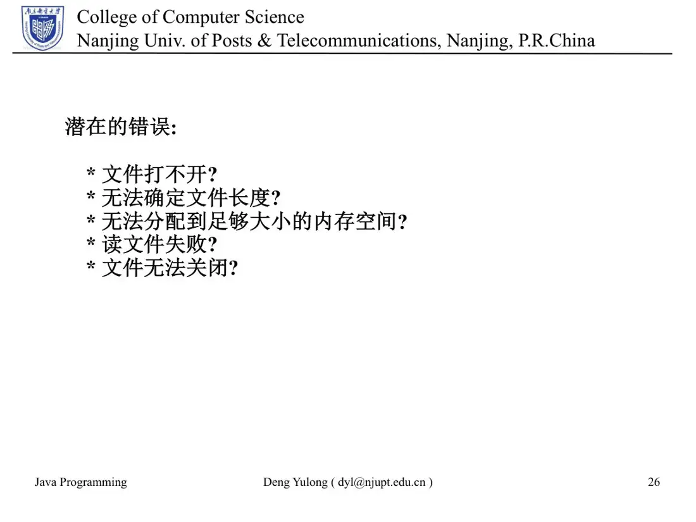

原文：

潜在的错误:

\* 文件打不开?

\* 无法确定文件长度?

\* 无法分配到足够大小的内存空间?

\* 读文件失败?

\* 文件无法关闭?

南京郵電大學易

College of Computer Science Nanjing Univ. of Posts & Telecommunications, Nanjing, P.R.China

Java Programming

Deng Yulong ( dyl@njupt.edu.cn )

26

### 南京郵電大學易

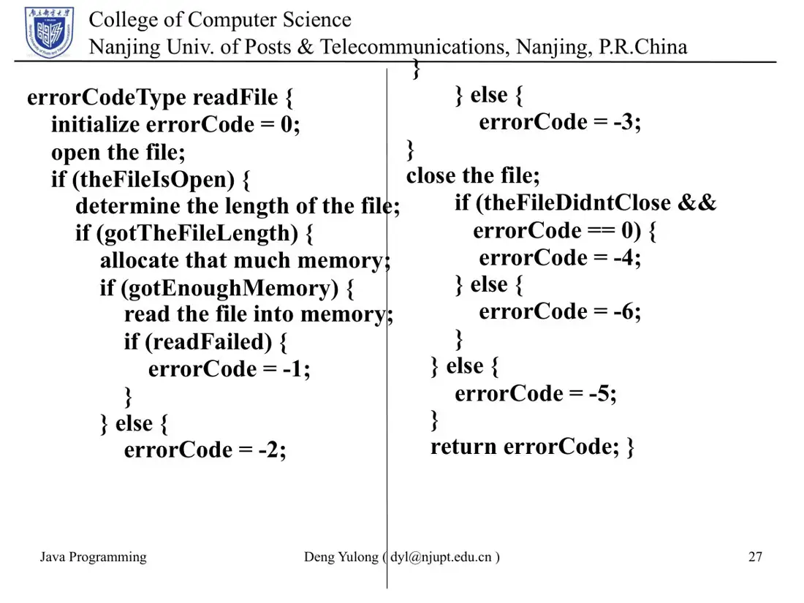

原文：

南京郵電大學易

College of Computer Science Nanjing Univ. of Posts & Telecommunications, Nanjing, P.R.China

Java Programming

Deng Yulong ( dyl@njupt.edu.cn )

27

### 南京郵電大學易

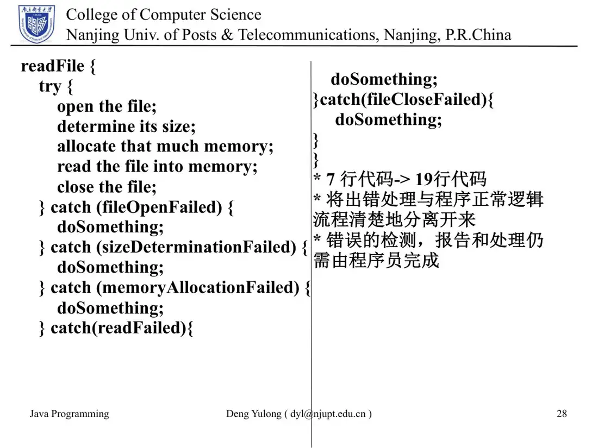

原文：

南京郵電大學易

College of Computer Science Nanjing Univ. of Posts & Telecommunications, Nanjing, P.R.China

Java Programming

Deng Yulong ( dyl@njupt.edu.cn )

28

### \* 7 行代码 -> 29 行代码

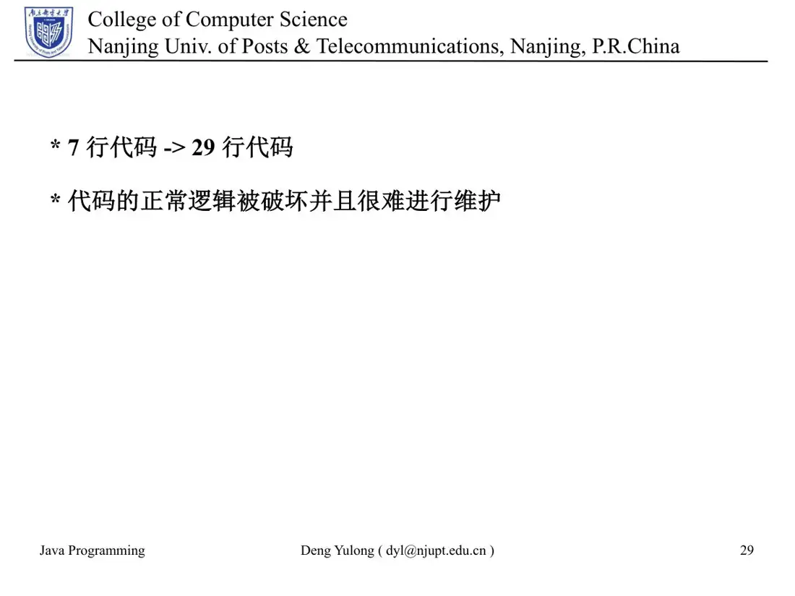

原文：

\* 7 行代码 -> 29 行代码

\* 代码的正常逻辑被破坏并且很难进行维护

南京郵電大學易

College of Computer Science Nanjing Univ. of Posts & Telecommunications, Nanjing, P.R.China

Java Programming

Deng Yulong ( dyl@njupt.edu.cn )

29

### 优点2: 沿调用堆栈向上传递错误

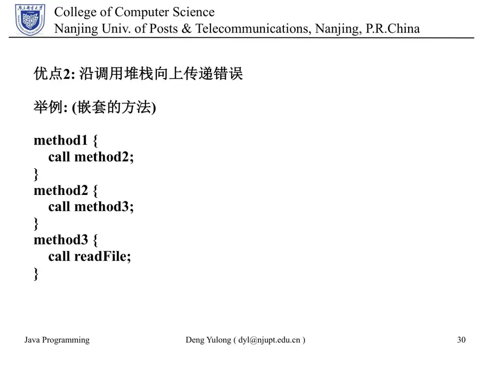

原文：

优点2: 沿调用堆栈向上传递错误

举例: (嵌套的方法)

南京郵電大學易

College of Computer Science Nanjing Univ. of Posts & Telecommunications, Nanjing, P.R.China

Java Programming

Deng Yulong ( dyl@njupt.edu.cn )

30

### 假设method1是唯一一个对readFile可能出错感兴趣的方法.

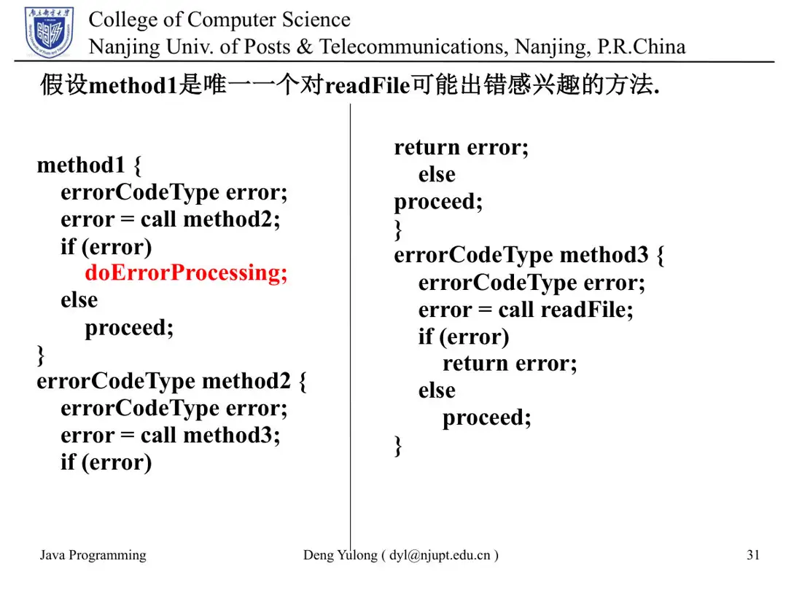

原文：

假设method1是唯一一个对readFile可能出错感兴趣的方法.

南京郵電大學易

College of Computer Science Nanjing Univ. of Posts & Telecommunications, Nanjing, P.R.China

Java Programming

Deng Yulong ( dyl@njupt.edu.cn )

31

### 南京郵電大學易

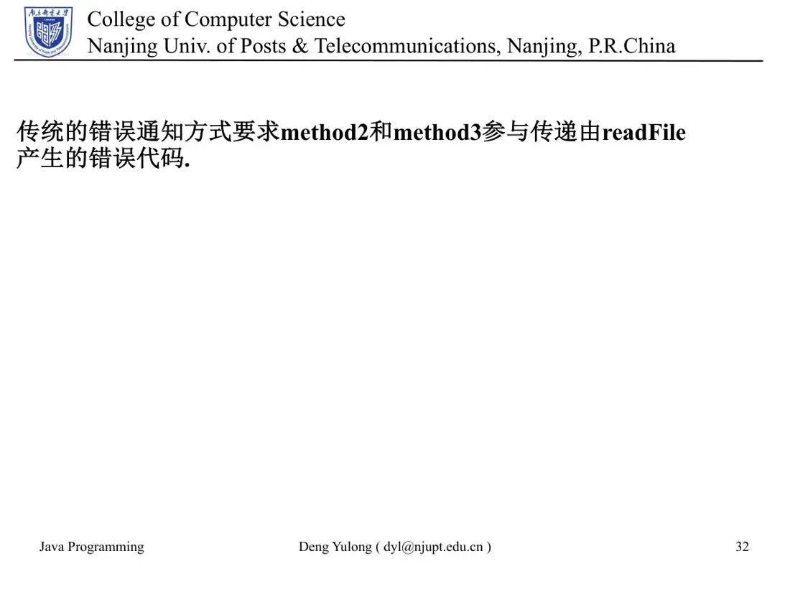

原文：

传统的错误通知方式要求method2和method3参与传递由readFile产生的错误代码.

南京郵電大學易

College of Computer Science Nanjing Univ. of Posts & Telecommunications, Nanjing, P.R.China

Java Programming

Deng Yulong ( dyl@njupt.edu.cn )

32

### 南京郵電大學易

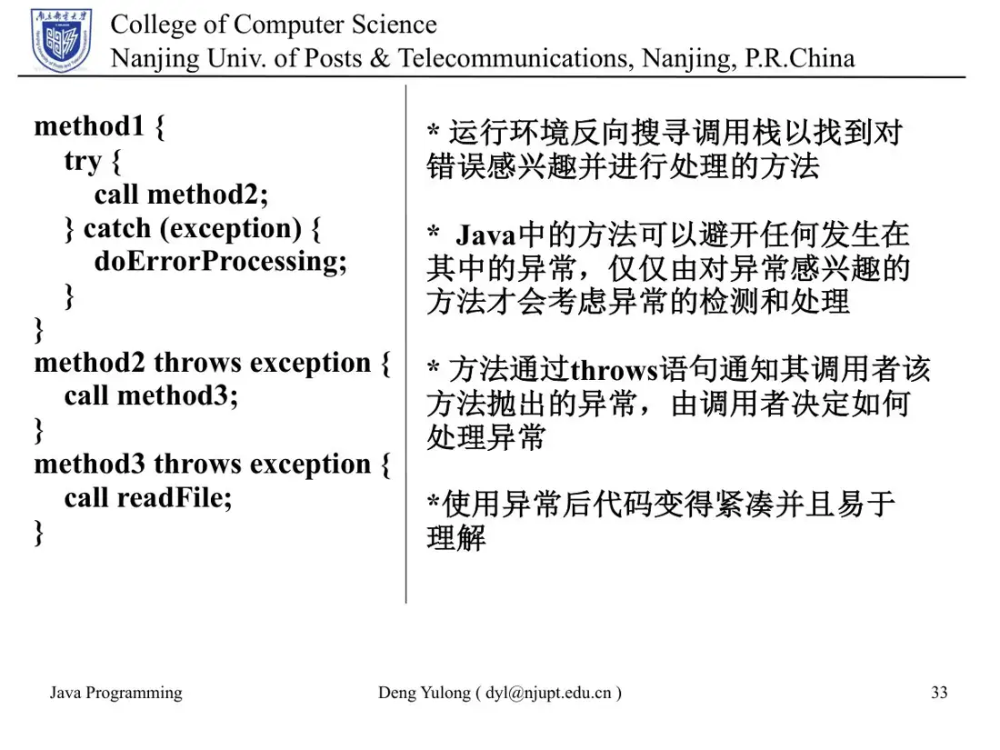

原文：

南京郵電大學易

College of Computer Science Nanjing Univ. of Posts & Telecommunications, Nanjing, P.R.China

Java Programming

Deng Yulong ( dyl@njupt.edu.cn )

33

### 优点 3: 分组区分错误类型

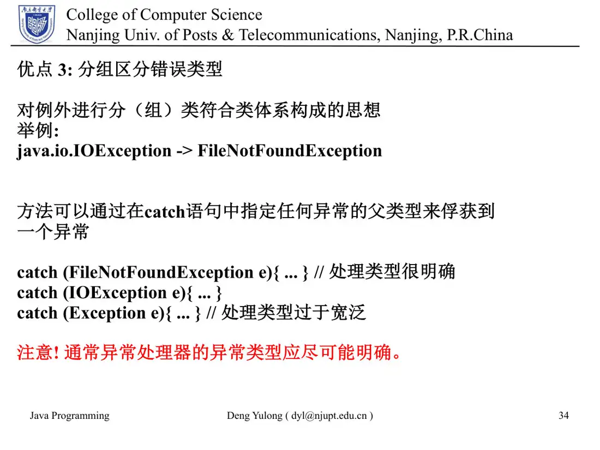

原文：

优点 3: 分组区分错误类型

对例外进行分（组）类符合类体系构成的思想举例:java.io.IOException -> FileNotFoundException

方法可以通过在catch语句中指定任何异常的父类型来俘获到一个异常

注意! 通常异常处理器的异常类型应尽可能明确。

南京郵電大學易

College of Computer Science Nanjing Univ. of Posts & Telecommunications, Nanjing, P.R.China

Java Programming

Deng Yulong ( dyl@njupt.edu.cn )

34

### 7.4 使用异常处理注意的问题

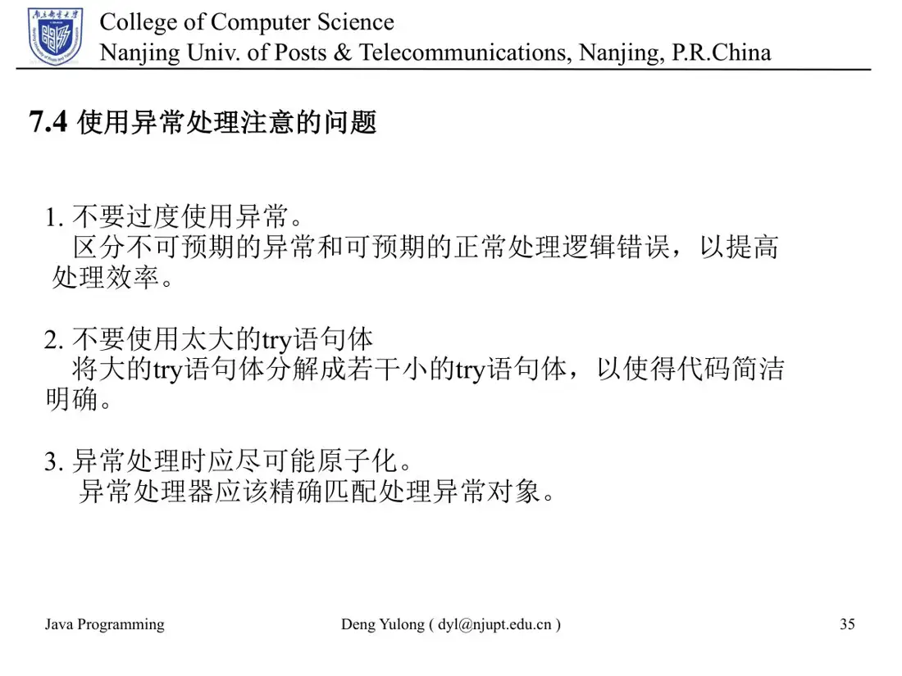

原文：

7.4 使用异常处理注意的问题

1. 不要过度使用异常。

区分不可预期的异常和可预期的正常处理逻辑错误，以提高处理效率。

2. 不要使用太大的try语句体

将大的try语句体分解成若干小的try语句体，以使得代码简洁明确。

3. 异常处理时应尽可能原子化。

异常处理器应该精确匹配处理异常对象。

南京郵電大學易

College of Computer Science Nanjing Univ. of Posts & Telecommunications, Nanjing, P.R.China

Java Programming

Deng Yulong ( dyl@njupt.edu.cn )

35
