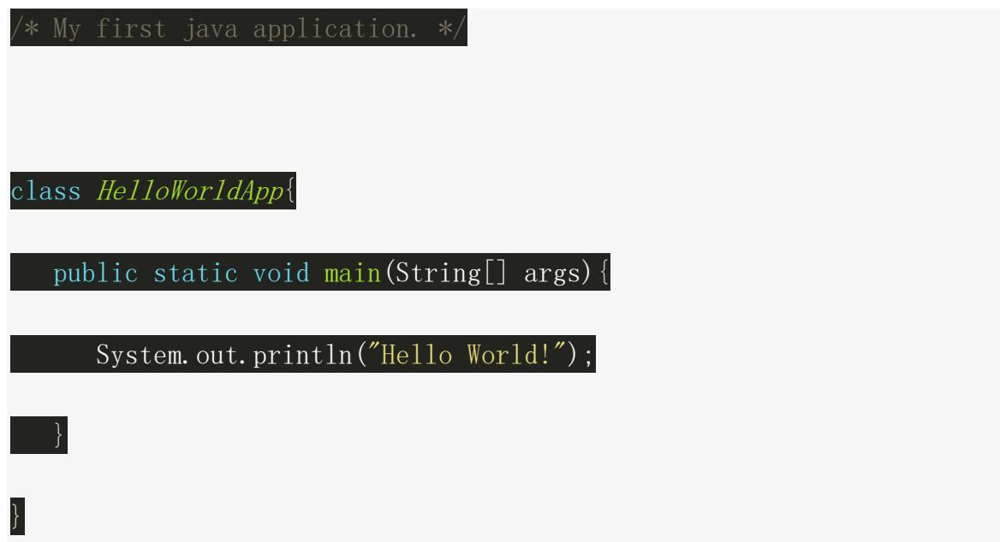

# 《Java程序设计》课后编程练习第1次作业

原件经识别和整理；“参考解答”是我们补的。

# 《Java 程序设计》课后编程练习第 1 次作业

来源：2021 年 2 月，南京邮电大学计算机学院提供的原始作业文档整理。

## 一、练习 1：创建第一个应用程序

### 练习 1

**目标**：创建并运行名为 `HelloWorldApp` 的第一个 Java 应用程序。



**操作步骤**：

1.  **安装环境**：安装 Java 开发工具并确保可以正常运行（需包含：Java SE Development Kits, NetBeans）。
2.  **创建项目**：在 NetBeans 中创建一个新项目。
3.  **编写代码**：创建 Java 类 `HelloWorldApp` 并编写源代码文件 `HelloWorldApp.java`。
4.  **编译代码**：将源代码编译成为 `.class` 文件。
5.  **运行程序**：运行 `HelloWorldApp` 程序，在 NetBeans 的输出窗口中查看运行结果。

---

## 二、练习 2：探索 NetBeans 项目

参考解答：**结论**  
`HelloWorldApp` 的核心在于 Java 项目结构、类名与文件名一致、编译生成 `.class` 文件，以及 `main` 方法作为程序入口。

---

### 练习 1：HelloWorldApp

**关键步骤与说明**

1. **安装环境**  
   - 安装 **JDK**（Java SE Development Kit）和 **NetBeans**。  
   - 验证 JDK 是否正常：在命令行输入 `java -version` 和 `javac -version`，能显示版本信息即可。

2. **创建项目**  
   - 打开 NetBeans → `File` → `New Project` → 选择 `Java` → `Java Application` → 点击 `Next`。  
   - 在 `Project Name` 中输入 `HelloWorldApp`，确保勾选 `Create Main Class` 并填写 `helloworldapp.HelloWorldApp`（或直接填 `HelloWorldApp`，取决于包结构）。  
   - 点击 `Finish`。

3. **编写代码**  
   在自动生成的 `HelloWorldApp.java` 中写入：

   ```java
   public class HelloWorldApp {
       public static void main(String[] args) {
           System.out.println("Hello World!");
       }
   }
   ```

   - 类名 `HelloWorldApp` 必须与文件名 `HelloWorldApp.java` 完全一致（包括大小写）。
   - `main` 方法是程序入口，签名必须为 `public static void main(String[] args)`。

4. **编译代码**  
   - 保存文件后，NetBeans 自动编译，或右键项目 → `Build`。  
   - 编译成功后会在项目 `build/classes` 目录下生成 `HelloWorldApp.class` 文件。  
   - 命令行手动编译：`javac HelloWorldApp.java`。

5. **运行程序**  
   - 右键项目 → `Run`，或点击工具栏绿色运行按钮。  
   - NetBeans 输出窗口显示：  
     ```
     Hello World!
     ```

**常见错误**  
- 类名与文件名不一致 → `class HelloWorldApp is public, should be declared in a file named HelloWorldApp.java`  
- 缺少 `main` 方法 → 运行时报错 “Main method not found”

---

### 练习 2：探索 NetBeans 项目

**结论**  
NetBeans 项目的核心文件是 `build.xml`、`nbproject` 配置和 `src` 源代码目录；项目通过 Ant 构建系统管理编译与运行。

**关键结构说明**

| 项目元素 | 作用 |
|---------|------|
| `src/` | 存放 `.java` 源文件（按包结构组织） |
| `build/` | 编译输出目录，包含 `.class` 文件 |
| `nbproject/` | NetBeans 项目配置（如 `project.properties`、`build-impl.xml`） |
| `build.xml` | Ant 构建脚本，定义 `clean`、`compile`、`run` 等任务 |
| `manifest.mf` | 可执行 JAR 的清单文件（生成 JAR 时使用） |

**操作建议**  
- 在 NetBeans 的 `Projects` 窗口展开项目，查看 `Source Packages`、`Libraries` 等节点。  
- 右键项目 → `Properties` 可修改 JDK 版本、运行参数、库依赖等。  
- 用 IDE 的 `Clean and Build` 可重新生成 `build` 目录并验证编译是否成功。

这样，你就完成了从环境配置到项目探索的基本流程。

知识点：[第一个Java程序（源文件创建、javac编译、类定义、main方法）](../../../topics/Java开发/HelloWorld程序结构.md)、[Java平台、JVM定义及编译解释执行原理](../../../topics/Java开发/Java平台与JVM.md)

### 练习 2

**注意**：在这一练习中，你可以通过 NetBeans 中的“项目属性”菜单 -> “构建” -> “编译”，关闭“在保存时编译”选项。

**操作步骤**：

1.  在 NetBeans 中创建一个项目。
2.  创建 Java 类 `HelloWorldApp` 并编写源代码 `HelloWorldApp.java`。
3.  在文件系统中找到已创建的项目文件夹，并定位到 `HelloWorldApp.java` 文件。
4.  编译源代码，在项目文件夹中找到生成的 `.class` 文件。
5.  构建项目，在项目文件夹中查看发生的变化。
6.  （可选）尝试在操作系统的文本命令行窗口运行 `HelloWorldApp` 程序。

---

## 三、第 1 次作业提交方法

在 NetBeans 里完成了练习 1 的 HelloWorld 程序后，将你的屏幕截图文件（JPG 文件或 PNG 文件）上传到对应大班 QQ 群的“第 1 次作业提交”中即可。**练习 2 不需要提交**。


**截图文件命名规范**：
格式为：`学号_姓名_第 1 次作业.JPG`
*   例如：学号为 B18030101 的同学，姓名为“我是学霸”，则截图文件命名为：`B18030101_我是学霸_第 1 次作业.JPG`

**截止时间**：
第 1 次作业提交的截止时间是 **2021 年 3 月 3 日**，请同学们在截止日期前完成作业提交，谢谢。

**截图方式参考**：
（参考下方 NetBeans 运行界面截图样式）

```text
ENG 11:27AM
HelloWorldApp - Apache NetBeans IDE 11.2
File Edit View Navigate Source Refactor Run Debug Profile Team Tools Window Help
(default config> CC Projects × Files Services Start Page ×
HelloWorldapp.java × HelloForldAp Source
Source Packages (default package>
10 HelloWorldápp java
11 public class HelloWorldApp{ Test Packages Librais
12 public static void main(String args[])
14 main - Navigator X
作业截屏参考样式 Man selo or dap
main(String[] args)
HelloVorldApp>main > > Output - HelloWorldApp (run)×
13:25 I

参考解答：## 练习 2 参考结论

1. **`.java` 文件位置**：项目目录下的 `src/` 文件夹中。
2. **手动编译命令**：在终端进入 `src/` 目录执行 `javac HelloWorldApp.java`。
3. **`.class` 文件位置**：手动编译后生成在 `src/` 目录下（与 `.java` 同级）；NetBeans“构建项目”后生成在 `build/classes/` 目录下。
4. **构建项目的变化**：自动生成 `build/` 目录，内含编译好的 `.class` 文件及项目元数据。
5. **命令行运行命令**：`java HelloWorldApp`（需在 `.class` 文件所在目录执行）。

---

## 各步骤简明推理与关键操作

### 步骤 1-2：创建项目与源文件
NetBeans 默认将 Java 源代码放在项目的 `src/` 目录下，因此 `HelloWorldApp.java` 的完整路径通常为：
```text
<项目根目录>/src/HelloWorldApp.java
```

### 步骤 3-4：定位并手动编译
关闭了“保存时自动编译”，因此必须手动调用 JDK 编译器 `javac`。

**关键步骤**：打开操作系统终端，切换到源文件所在目录后执行编译：
```bash
cd <项目根目录>/src
javac HelloWorldApp.java
```
编译成功后，`javac` 会在**当前目录**（即 `src/`）下生成字节码文件：
```text
<项目根目录>/src/HelloWorldApp.class
```

### 步骤 5：构建项目（Build Project）
在 NetBeans 中选择“构建项目”时，IDE 会使用其内部构建脚本（Ant 或 Maven），将输出目录与源码目录分离，以保持项目整洁。

**发生的变化**：
- 项目根目录下新增 `build/` 文件夹。
- 编译生成的 `.class` 文件被放置在标准输出路径：
  ```text
  <项目根目录>/build/classes/HelloWorldApp.class
  ```
- 若之前手动在 `src/` 下生成了 `.class` 文件，它依然保留在 `src/` 中（IDE 构建不会清理手动编译的文件）。

### 步骤 6：命令行运行程序
Java 虚拟机（JVM）通过 `java` 命令加载并执行 `.class` 文件。

**关键步骤**：必须在包含 `.class` 文件的目录下运行，且**不需要加 `.class` 后缀**：
```bash
# 如果在 build 后运行，需进入 build/classes 目录
cd <项目根目录>/build/classes
java HelloWorldApp
```
> **注意**：如果类声明了包名（如 `package com.example;`），则必须在包的根目录执行 `java com.example.HelloWorldApp`。本题为默认包（无 `package` 声明），直接在 `.class` 所在目录运行类名即可。

---

## 作业提交要点（非练习 2，但属本页面要求）

| 检查项 | 正确规范 | 常见错误 |
| :--- | :--- | :--- |
| **提交内容** | 仅提交**练习 1** 的 NetBeans 运行界面截图（JPG/PNG） | 误交练习 2 的内容或源代码文件 |
| **命名格式** | `学号_姓名_第 1 次作业.JPG`（如 `B18030101_我是学霸_第 1 次作业.JPG`） | 使用空格、缺漏下划线、写错扩展名 |
| **截止时间** | 2021 年 3 月 3 日前传至大班 QQ 群对应相册/文件 | 逾期提交 |

知识点：[第一个Java程序（源文件创建、javac编译、类定义、main方法）](../../../topics/Java开发/HelloWorld程序结构.md)、[Java平台、JVM定义及编译解释执行原理](../../../topics/Java开发/Java平台与JVM.md)
