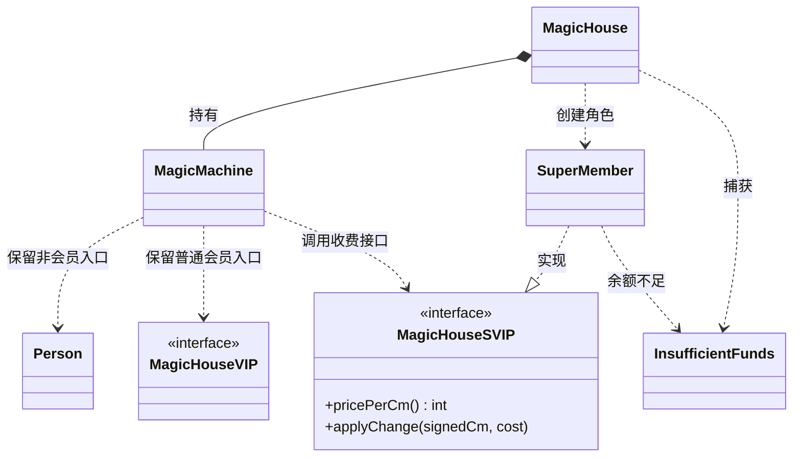

# 《Java程序设计》课后编程练习第7次作业

原件来自南京邮电大学计算机学院（2021 年 4 月）。以下概述题意；代码、状态图和边界说明是补写，不是原件自带答案。

## 两次使用机器，为什么结果不同？

这次作业只讲「魔法屋」的第二段续集，不重演前两段。普通会员仍是每次按题设规定的档位增高 30 或 40 厘米。超级会员能选择增高或降低及厘米数；题设两个收费档位分别为每厘米 5 元和 10 元，方向不改变单价。本故事的主人公用 10 元档位，身高起点为 192 厘米。

注册赠两个 50 元红包，但领取不等于充值。首次尝试降低 10 厘米时费用是 100 元，实际余额仍是零，机器报警并锁门，老板救援后身高仍为 192 厘米。再收到五个 50 元红包，合计 350 元充值；第二次同样扣 100 元，身高为 182 厘米，余额为 250 元。这些数值可在原件第 8—9 页的输出示例中逐项核对。

| 状态 | 未充值红包 | 账户可用余额 | 身高 |
|---|---:|---:|---:|
| 注册后、首次尝试前 | 100 元 | 0 元 | 192 厘米 |
| 报警、救援之后 | 100 元 | 0 元 | 192 厘米 |
| 补偿并全部充值后 | 0 元 | 350 元 | 192 厘米 |
| 第二次成功后 | 0 元 | 250 元 | 182 厘米 |

**参考解答**

> [!TIP]
> ==题面写着「有红包却没余额」==，就把待充值红包和账户余额分成两个字段。==失败后身高不能变==，就先把新身高和费用都算完并校验，最后才更新两个字段。不能在抛出余额异常以后再靠反向加减做回滚。

沿用[第 6 次作业](Java程序设计第6次作业.md)的 `Person`、`Bread`、`MagicHouseVIP`、`Member`。下面的类型分别保存为同名文件。新增的会员接口只暴露机器需要的能力：查询费用档位、原子更新费用和身高。这里的「原子」只指这份单线程作业中，要么两项都改，要么哪项都不改，不等价于多线程同步。

```java
public interface MagicHouseSVIP {
    int pricePerCm();
    void applyChange(int signedCm, int cost) throws InsufficientFunds;
}
```

```java
public class InsufficientFunds extends Exception {
    public InsufficientFunds(int balance, int cost) {
        super("余额 " + balance + " 元，需 " + cost + " 元");
    }
}
```

```java
public class SuperMember implements MagicHouseSVIP {
    public enum Rate {
        FIVE(5), TEN(10);
        private final int yuan;
        Rate(int yuan) {
            this.yuan = yuan;
        }
    }

    private final Rate rate;
    private int height;
    private int pending;
    private int balance;

    public SuperMember(int height, Rate rate) {
        if (height <= 0) throw new IllegalArgumentException("身高须为正");
        this.height = height;
        this.rate = java.util.Objects.requireNonNull(rate);
    }

    public int height() { return height; }
    public int pending() { return pending; }
    public int balance() { return balance; }

    public void receiveRedPackets(int count) {
        if (count <= 0) throw new IllegalArgumentException("红包数须为正");
        pending = Math.addExact(pending, Math.multiplyExact(count, 50));
    }

    public void redeemAll() {
        balance = Math.addExact(balance, pending);
        pending = 0;
    }

    @Override
    public int pricePerCm() {
        return rate.yuan;
    }

    @Override
    public void applyChange(int signedCm, int cost) throws InsufficientFunds {
        if (signedCm == 0 || cost <= 0)
            throw new IllegalArgumentException("尺寸和费用不合法");
        int nextHeight = Math.addExact(height, signedCm);
        if (nextHeight <= 0) throw new IllegalArgumentException("身高须为正");
        if (cost > balance) throw new InsufficientFunds(balance, cost);
        balance -= cost;
        height = nextHeight;
    }
}
```

替换机器文件，保留原有两个 `grow` 入口，另加一个带方向和金额检查的入口。方向用独立的布尔量表示，厘米数为正，故降低时也要付正的费用；这样不会把降低误写成退款。

```java
public class MagicMachine {
    public void grow(Person person) {
        person.growBy(50);
    }

    public void grow(MagicHouseVIP member) {
        member.receiveGrowth(member.growthPerVisit());
    }

    public void adjust(MagicHouseSVIP member, boolean grow, int cm)
            throws InsufficientFunds {
        if (cm <= 0) throw new IllegalArgumentException("尺寸须为正");
        int price = member.pricePerCm();
        if (price <= 0) throw new IllegalArgumentException("单价须为正");
        int cost = Math.multiplyExact(cm, price);
        member.applyChange(grow ? cm : -cm, cost);
    }
}
```

以下入口只讲本段故事，并以文本输出表示报警、锁门与救援。余额不足是业务异常；无效尺寸和整数溢出是不同的错误，不应一律解释为卡人。

```java
public class MagicHouse {
    private final MagicMachine machine = new MagicMachine();

    private void narrateAttempt(SuperMember member) {
        try {
            machine.adjust(member, false, 10);
            System.out.println("变矮成功");
        } catch (InsufficientFunds e) {
            System.out.println("余额不足，报警并锁门：" + e.getMessage());
            System.out.println("老板打开门救援");
        }
        System.out.printf("身高：%d 厘米，账户余额：%d 元%n",
                member.height(), member.balance());
    }

    public static void main(String[] args) {
        MagicHouse house = new MagicHouse();
        SuperMember ming = new SuperMember(192, SuperMember.Rate.TEN);
        ming.receiveRedPackets(2);
        house.narrateAttempt(ming);
        ming.receiveRedPackets(5);
        ming.redeemAll();
        System.out.printf("全部充值后账户余额：%d 元%n", ming.balance());
        house.narrateAttempt(ming);
    }
}
```

将新增或替换的五个文件与沿用的四个文件放在同一目录编译，以 `MagicHouse` 为入口。第一次输出报警及救援，再显示 192 厘米、0 元；充值后先显示 350 元，第二次显示 182 厘米、250 元。还应验证余额恰好够时交易成功、长度为零不扣钱、降低到零不扣钱，以及收费乘法溢出时不会发生业务更新。

## 交付图如何对应代码



在[接口](../../../topics/Java开发/接口的基础概念.md)的基础上，画[一页 UML](../../../topics/Java开发/UML模型图.md)时说明新增类型如何依赖旧接口，别把所有关系画成继承。未修改的旧类也可保留在整份作业项目的设计图中。历史提交要求是分别交一张同时显示源码和结果的截图、一张单页 UML 图，格式 JPG 或 PNG，以学号、姓名、作业序号和「代码图」「设计图」区分。原件所列截止时间为 2021 年 5 月 26 日，并非现行通知。
