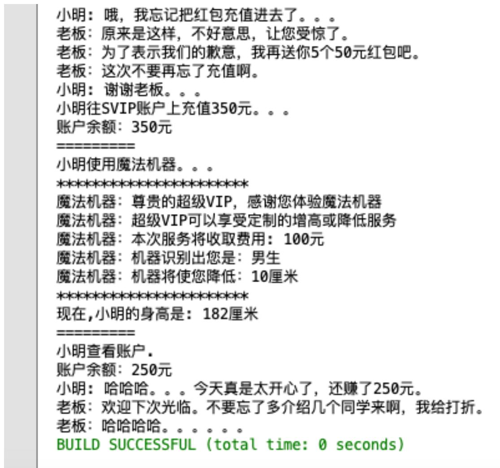

# 《Java程序设计》课后编程练习第7次作业

原件经识别和整理；“参考解答”是我们补的。

用程序讲述故事——“魔法屋的故事”续集 2：魔法机器里的惊魂一刻！

小明从魔法屋回来后，192 厘米的个子让他很是自豪，但时间长了有点鹤立鸡群的感觉，而且老是撞在门框上。他想把身高变矮一点，于是他又来到了魔法屋。

老板：“好久不见，怎么？还想长高啊？！”

“不不，我想变矮一点可以吗？”小明问道。

老板：“可以啊，刚推出的服务，不过要超级 VIP 会员才可以享受欧！”

小明：“多少钱变矮？”

老板：“高矮一个价：男生每厘米 10 元，女生每厘米 5 元。”

小明：“老板打折不？我口袋里没钱啊！”

老板：“现在注册就送两个 50 元的红包。”

小明：“贵了点，不过有了 100 元，我正好减 10 厘米，不用花钱。”小明打起了算盘。

于是小明注册了超级 VIP 会员。来到地下室，魔法机器还在老地方，上面多了一个选择开关和一个数字键盘，小门上的牌子写道：“告示：本机版本已升级，可自动识别性别，普通 VIP 会员：女生每次增高 30 厘米，男生每次增高 40 厘米。超级 VIP 会员：可自由选择变高或变矮的尺寸，女生身高每变化 1 厘米收费 5 元，男生身高每变化 1 厘米收费 10 元。欢迎体验！”。小明把选择开关打到变矮，在键盘上输入 10 厘米。然后钻进了魔法机器……一阵嗡嗡的启动声后机器里突然闪烁起了耀眼的红光，伴随嘀嘀嘀的报警声，一个冷冰冰的声音说道：“错误：账户余额不足，机器停止工作！！！”接着是咔嚓的一声，小明赶紧去拉门把手，发现小门已经被自动反锁上了。“救命啊……快来人啊……我被卡在机器里了！！！”小明大声求救。

老板及时赶到，把小明从机器里拽了出来。

小明：“吓坏我了，什么破机器啊这是。”

老板：“还好身高没变，实在是抱歉……”

老板：“麻烦您查看一下账户余额，谢谢。”

账户余额显示为：0 元

小明：

我€#&%

老板：“啊，没钱你变个啥啊？”

小明：“哦，我忘记把红包充值进去了。”

老板：“原来是这样，不好意思让您受惊了。为了表示我们的歉意，我再送你 5 个 50 元红包吧。这次不要再忘了充值啊。”

小明：

小明把 350 元红包全部充值到账户上，再次钻进魔法机器。小明出来发现自己的身高成功地降低到了 182 厘米！

小明：“哈哈哈……今天真是太开心了，还白赚了 250 元。”

老板：“欢迎下次光临。不要忘了多介绍几个同学来照顾生意啊，我给打折。哈哈哈哈……”

尝试编写程序描述上述故事。要求在程序中设计“魔法屋超级会员”的接口（注意：代码中应使用对应英文命名，例如 MagicHouseSVIP），为小明设计新的类并且创建对象：小明。修改原有的魔法机器的代码，使其可以通过该接口完成对超级会员身高的升高或降低操作。尝试设计并使用异常处理机制完成机器故障的错误检测。修改原有的魔法屋的代码，讲述本次作业的故事续集。

## 提示

1. 用程序讲述故事就是根据故事的描述，创建相应对象并使用对象，并在故事的不同阶段，同步在文本命令行窗口输出相应的信息。

2. 建议在编写程序前先按照课堂上讲解的面向对象程序设计的方法设计好各个类以及类之间的关系。

3. 在第 6 次作业项目的基础上完成本次作业，修改以及新增代码，与此同时，尽可能遵循开闭法则，即减少对第 6 次作业已有的代码的修改，但为简化程序设计，对只涉及到小明的代码可以编写新的版本。本次作业不需要在讲述续集 2 故事前重复讲述最初故事以及续集 1 故事。

## 输出示例

Output - assignment7 (run)

并并并并并并并并并并并并并并并并并并并并并并并并并并并并并并

魔法屋的故事续集 2---魔法机器里的惊魂一刻！

老板：欢迎光临魔法屋！

老板：好久不见，有什么能帮您的吗？

小明：我想要变矮一点点，请问你们提供变矮服务吗？

老板：您真幸运，我们刚推出了超级 VIP 会员！

老板：超级 VIP 会员，可变高，可变矮，任君选择。

老板：注册就送 50 元账户充值红包两个.

小明：变矮多少钱？

老板：高矮一个价：男生每厘米 10 元，女生每厘米 5 元

小明：有点贵啊，试试吧，反正送了 100 元！我就减 10 厘米！

进入魔法屋前

小明的身高是：192 厘米

小明使用魔法机器。。。

\*oooooooooolooooooooook

魔法机器：尊贵的超级 VIP，感谢您体验魔法机器

魔法机器：超级 VIP 可以享受定制的增高或降低服务

魔法机器：本次服务将收取费用：100 元

魔法机器：错误：账户余额不足，机器停止工作！！

紧急呼叫老板，魔法机器里面卡人了。。。

小明：救命啊！！！！！！！我被卡在机器里了！！！

老板打开机器，把小明拽了出来。

小明：吓坏我了，什么破机器啊这是。

老板拿出尺子量了量，小明的身高是：192 厘米

老板：还好身高没变，实在是抱歉。。。

老板：麻烦您查看一下账户余额，谢谢。

小明：好。

账户余额：0 元

老板：啊，没钱你变个啥啊？

在 NetBeans 里完成了作业 7 的程序后，将你的两个文件（1）程序屏幕截图文件（在这个截图中需要包含源代码编辑窗口和结果输出窗口）(JPG 文件或 PNG 文件)（2）系统设计方案（即用 UML 描述的你在程序中所设计的各个类图以及它们之间的关系图，可参考课件上第 2 章、第 4 章、第 5 章等相应程序的系统设计图范例）(可在纸上手绘后拍照或直接用电脑软件作图，要求在一幅页面上绘制系统的设计方案，最后只能形成 1 个图像文件)（JPG 文件或 PNG 文件)上传到对应大班 QQ 群的“第 7 次作业提交”文件夹中即可。

（1）程序屏幕截图文件的命名方法：学号_姓名_第 7 次作业_代码图.JPG. 例如：学号为 B18030101 的同学，姓名为“我是学霸”，则截图文件命名为：B18030101_我是学霸_第 7 次作业_代码图.JPG

（2）系统设计方案文件的命名方法：学号_姓名_第 7 次作业_设计图.JPG. 例如：学号为 B18030101 的同学，姓名为“我是学霸”，则截图文件命名为：B18030101_我是学霸_第 7 次作业_设计图.JPG

第 7 次作业提交的截止时间是 2021 年 5 月 26 日，请同学们在截止日期前完成作业提交，谢谢。
