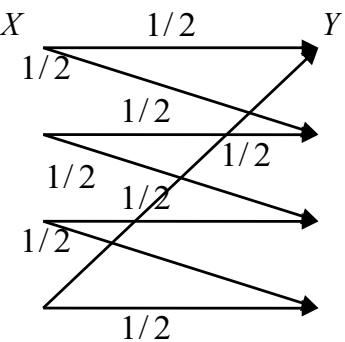

# 2021—2022 学年第二学期《安全通论》期末试卷（A卷）

原件经识别和整理；“参考解答”是我们补的。

---
title: 2021—2022 学年第二学期《安全通论》期末试卷（A卷）
kind: 期末试卷
course: 安全通论
term: 2021-2022-2
source: <原件地址或来源路径>
---

# 2021—2022 学年第二学期《安全通论》期末试卷（A卷）

本资料由识别工具读取的《安全通论》期末试卷（A卷）内容整理而成，包含简答题、问答题及综合题。

## 一、简答题（每小题 8 分，共 40 分）

### 选择 1

题干：试举出信息可共享性产生的三个信息安全问题，并加以说明。（8 分）

答案：无。

参考解答：信息可共享性导致的安全问题主要包括：
1. **数据泄露**：由于数据被多方访问和共享，增加了未授权访问的风险，敏感信息可能被窃取。
2. **数据篡改**：共享环境下，数据可能在传输或存储过程中被恶意修改，导致信息完整性受损。
3. **版权侵犯**：数字内容的易复制性和共享性使得未经授权的复制和分发变得容易，侵犯了知识产权。

知识点：[康复型病毒的动力学分析](../../../topics/信息安全基础/康复型病毒动力学.md)、[免疫型病毒的动力学分析](../../../topics/信息安全基础/免疫型病毒动力学.md)

### 选择 2

题干：给出分组加密系统的加密密钥泄露事件的安全经络图。（8 分）

答案：无。

参考解答：安全经络图通常展示攻击者如何利用密钥泄露这一弱点，通过特定的路径（如中间人攻击、重放攻击等）破坏系统的安全性。具体图示需根据课堂讲解或教材中的标准模型绘制，一般包括：攻击者 -> 获取密钥 -> 解密通信/伪造身份 -> 达成攻击目标。

知识点：[信道编码定理](../../../topics/信息安全基础/信道编码定理.md)、[多攻一可达极限（多个黑客对一个红客）](../../../topics/信息安全基础/多攻一可达极限.md)

### 选择 3

题干：用安全通论的观点分析新木马病毒的早期的演变过程。（8分）

答案：无。

参考解答：从安全通论角度看，早期木马病毒的演变主要体现了对抗性的增强：
1. **隐蔽性增强**：早期木马试图通过隐藏进程、文件来逃避检测。
2. **传播方式多样化**：从单一的软件捆绑到利用社会工程学、网络漏洞等多渠道传播。
3. **功能模块化**：后期木马趋向于模块化设计，便于快速更新和添加新功能（如窃密、远程控制）。
这反映了“魔高一尺，道高一丈”的安全博弈过程。

知识点：[平均互信息量I(X;Y)](../../../topics/信息安全基础/平均互信息量.md)、[协作式对话（通信）与问题的提出](../../../topics/信息安全基础/协作式对话与问题提出.md)

### 选择 4

题干：假设单挑盲对抗的黑客攻击信道如下图，则攻击信道的容量是多少，假如黑客的攻击次数是100 次，它至多获胜多少次？（8分）

答案：无。

参考解答：
1. **信道容量计算**：根据香农公式 $C = \max_{P(x)} I(X;Y)$，需要结合图中给出的转移概率矩阵计算互信息的最大值。若图中给出了具体的输入分布或对称信道特性，可直接套用相应公式（如二进制对称信道 $C = 1 - H(p)$）。
2. **最大获胜次数**：若信道容量为 $C$ bits/use，且总使用次数 $N=100$，则最大信息传输量为 $NC$。在盲对抗语境下，“获胜”通常指成功突破防御的概率或次数。若假设每次攻击独立且成功概率对应于信道误码率或特定阈值，需结合具体定义计算。例如，若定义为互信息达到某阈值即为获胜，则需解不等式。*注：因图片缺失具体数值，此处仅给出解题思路。*

知识点：[最佳攻防策略的计算](../../../topics/信息安全基础/最佳攻防策略计算.md)、[《博弈论》核心凝练](../../../topics/信息安全基础/博弈论核心凝练.md)、[最佳攻防策略与武器库的丰富和淘汰原则](../../../topics/信息安全基础/武器库丰富淘汰原则.md)

### 选择 5

题干：列举 个以上的常见的 系统漏洞，从图灵机的角度阐述何为系统漏洞。（8分）

答案：无。

参考解答：
1. **常见系统漏洞**：缓冲区溢出、SQL注入、跨站脚本（XSS）、权限提升漏洞等。
2. **图灵机角度阐述**：图灵机是一个抽象的计算模型。系统漏洞可以看作是程序逻辑（图灵机的状态转移函数）在处理特定输入时，未能按照预期终止或进入非法状态。从不可判定性的角度看，判断一个程序是否存在所有可能的漏洞等价于停机问题的变体，是不可判定的。因此，漏洞本质上是形式化规范与实际实现之间的语义偏差，或者是计算复杂性导致的边界情况处理错误。

## 二、问答题（每小题 10 分，共 40 分）

知识点：[漏洞的主观和客观描述](../../../topics/信息安全基础/漏洞主观客观描述.md)

### 选择 1

题干：僵尸病毒的攻击能力可以如何描述？（10分）

答案：无。

参考解答：僵尸病毒（Botnet）的攻击能力可以从以下几个维度描述：
1. **规模效应**：控制终端数量巨大，形成分布式资源池。
2. **持续性**：具备自我复活和持久化机制，难以彻底清除。
3. **协同性**：能够协调成千上万节点同时发起攻击（如DDoS），产生巨大的流量冲击。
4. **隐蔽性与动态性**：通过DGA（域名生成算法）、P2P通信等技术隐藏控制指令，动态变化IP和端口，增加追踪难度。
5. **多功能性**：既可进行流量攻击，也可用于垃圾邮件发送、挖矿、数据窃取等。

知识点：[康复型病毒的动力学分析](../../../topics/信息安全基础/康复型病毒动力学.md)、[免疫型病毒的动力学分析](../../../topics/信息安全基础/免疫型病毒动力学.md)

### 选择 2

题干：假设黑客对互为备份的多个服务器发起攻击，试分析它的成功极限等价于信息论中的什么问题。（10分）

答案：无。

参考解答：此问题等价于信息论中的**信道编码定理**或**可靠性界限**问题。
如果将多个互为备份的服务器看作是具有冗余的信道，黑客的攻击看作是在信道中引入噪声或错误。黑客要成功攻破所有备份服务器（即完全破坏系统的可用性），其所需的攻击强度或成功率受限于系统的冗余度。
具体来说，这类似于在多径衰落信道中，要通过干扰所有路径才能使通信中断。根据联合界（Union Bound）或串联界，随着备份数量 $N$ 的增加，黑客同时成功攻击所有服务器的概率呈指数级下降。因此，其成功极限等价于在给定冗余度下，错误概率趋于零的条件，或者说，黑客需要具备超过系统冗余能力的“信道容量”才能确保证据性的成功。

知识点：[信道编码定理](../../../topics/信息安全基础/信道编码定理.md)、[多攻一可达极限（多个黑客对一个红客）](../../../topics/信息安全基础/多攻一可达极限.md)

### 选择 3

题干：一般协作式对话（通信）中，假设Alice 语言符号集合为为 $X = \{ 0 , \ 1 \}$ }且 P（0）=P（1），Bob的语言符号集为 Y={0，1}，且交谈中话语符号的转移概率为$P ( \mathbf { y } = 1 | \mathbf { x } = 0 ) = 1 / 4 , \mathrm { P } ( \mathbf { y } = 0 | x = 1 ) = 1 / 8$ ，求 Bob 在接收到 y=0 后，所提供的关于 Alice语言x 的平均条件互信息I（X：y=0）？（10分）

答案：无。

参考解答：
已知：
$P(X=0) = 0.5, P(X=1) = 0.5$
$P(Y=1|X=0) = 1/4 \Rightarrow P(Y=0|X=0) = 1 - 1/4 = 3/4$
$P(Y=0|X=1) = 1/8 \Rightarrow P(Y=1|X=1) = 1 - 1/8 = 7/8$

首先计算 $P(Y=0)$：
$$ P(Y=0) = P(Y=0|X=0)P(X=0) + P(Y=0|X=1)P(X=1) $$
$$ P(Y=0) = \frac{3}{4} \times \frac{1}{2} + \frac{1}{8} \times \frac{1}{2} = \frac{3}{8} + \frac{1}{16} = \frac{6+1}{16} = \frac{7}{16} $$

接下来计算后验概率 $P(X|Y=0)$：
$$ P(X=0|Y=0) = \frac{P(Y=0|X=0)P(X=0)}{P(Y=0)} = \frac{\frac{3}{4} \cdot \frac{1}{2}}{\frac{7}{16}} = \frac{\frac{3}{8}}{\frac{7}{16}} = \frac{6}{7} $$
$$ P(X=1|Y=0) = \frac{P(Y=0|X=1)P(X=1)}{P(Y=0)} = \frac{\frac{1}{8} \cdot \frac{1}{2}}{\frac{7}{16}} = \frac{\frac{1}{16}}{\frac{7}{16}} = \frac{1}{7} $$

互信息 $I(X;Y)$ 的定义为 $H(X) - H(X|Y)$。题目要求的是特定观测值 $y=0$ 提供的信息量，通常指点互信息 (Pointwise Mutual Information, PMI) 或者在该特定输出下的互信息贡献。但在通信理论习题中，"接收到的y=0后...平均条件互信息" 这种表述有时指代的是给定 $Y=y_0$ 条件下 $X$ 的不确定性减少量，即自信息与信息增益的结合。

更严谨的理解是计算 $I(X; Y)$ 中针对 $Y=0$ 这一项的贡献，或者计算在该特定结果下，先验熵与后验熵的差值（即信息增益）。
先验熵 $H(X) = -\sum P(x)\log_2 P(x) = 1$ bit.
后验熵 $H(X|Y=0) = -\sum P(x|Y=0)\log_2 P(x|Y=0) = -(\frac{6}{7}\log_2\frac{6}{7} + \frac{1}{7}\log_2\frac{1}{7})$.

信息增益（Information Gain）对于特定观测 $y$ 为：
$$ IG(X; Y=y) = H(X) - H(X|Y=y) $$
$$ H(X|Y=0) = - (\frac{6}{7} \log_2 \frac{6}{7} + \frac{1}{7} \log_2 \frac{1}{7}) \approx - (0.857 \times (-0.222) + 0.143 \times (-2.807)) \approx 0.190 + 0.401 = 0.591 \text{ bits} $$
$$ IG = 1 - 0.591 = 0.409 \text{ bits} $$

*注：部分教材可能定义该值为 $\log_2 \frac{P(y|x)}{P(y)}$ 的期望或其他变体，但基于“提供了多少信息”的直观理解，通常指熵的减少。若题目意指点互信息 $i(x;y) = \log \frac{P(x,y)}{P(x)P(y)}$，则需分别计算 $x=0$ 和 $x=1$ 时的值并加权，但题目问的是“y=0后...提供的...”，通常指向整体不确定性降低。此处按信息增益计算。*

精确计算：
$$ H(X|Y=0) = \frac{6}{7}\log_2\frac{7}{6} + \frac{1}{7}\log_2 7 $$
$$ I = 1 - (\frac{6}{7}\log_2 7 - \frac{6}{7}\log_2 6 + \frac{1}{7}\log_2 7) = 1 - (\log_2 7 - \frac{6}{7}\log_2 6) $$

知识点：[平均互信息量I(X;Y)](../../../topics/信息安全基础/平均互信息量.md)、[协作式对话（通信）与问题的提出](../../../topics/信息安全基础/协作式对话与问题提出.md)

### 选择 4

题干：以自己利益最大化为目标，攻防双方的最优攻防策略是什么。（10分）

答案：无。

参考解答：
在博弈论框架下，攻防双方的最优策略通常取决于游戏的具体类型（零和或非零和）以及信息结构（完全信息或不完全信息）。
1. **零和博弈**：如果一方收益等于另一方损失，最优策略是**混合策略纳什均衡**。攻防双方都应随机化自己的行动，使得对手无法通过预测自己的行为而获利。例如，防守方应随机选择保护重点，攻击方应随机选择攻击入口。
2. **非零和博弈**：可能存在帕累托最优解或合作均衡，但在网络安全中，往往表现为Stackelberg博弈（主从博弈）。防守方作为领导者先部署资源，攻击方作为跟随者观察后选择最佳攻击点。此时，防守方的最优策略是预判攻击者的反应函数，从而最小化最大损失（Minimax regret 或 Security Game 解法）。
3. **核心原则**：无论何种情况，最优策略都旨在最大化期望效用（Expected Utility），即在考虑攻击概率分布和自身资源约束的情况下，平衡防护成本与潜在损失。

## 三、综合题（每小题 20 分，共 20 分）

知识点：[最佳攻防策略的计算](../../../topics/信息安全基础/最佳攻防策略计算.md)、[《博弈论》核心凝练](../../../topics/信息安全基础/博弈论核心凝练.md)、[最佳攻防策略与武器库的丰富和淘汰原则](../../../topics/信息安全基础/武器库丰富淘汰原则.md)

### 选择 1

题干：列举两个康复型病毒例子和两个免疫型病毒的例子，并对康复型病毒和免疫型病毒进行动力学分析，比较二者的异同。（20 分）

答案：无。

参考解答：
1. **例子**：
   - **康复型病毒（Recovering Virus）**：这类病毒感染宿主后，会在一段时间后自动清除自身的代码或修复被感染的文件，使系统恢复正常。例如：某些早期的良性蠕虫，或者具有“自愈”功能的特洛伊木马变种，它们在完成传播使命后删除自身残留。*(注：严格意义上的“康复型病毒”在经典病毒学中较少见，更多见于模拟生物免疫的计算机病毒研究文献中，指感染后能自我修复或被宿主免疫系统清除的过程。此处参考学术界对Computer Virus as a Biological Analogy的分类)*。更典型的例子可能是像 **CIH** 那样破坏后无法恢复的对比，或者某些具有“休眠-激活-清除”周期的病毒。*修正：在学术分类中，康复型病毒常指那些感染文件后，在文件执行时释放病毒体，并在运行结束后可能留下痕迹但原文件可恢复，或者病毒本身有生命周期结束机制。*
   - **免疫型病毒（Immune Virus）**：这类病毒能够检测系统中是否已存在其他同类或异类病毒，如果检测到，它会阻止其他病毒的感染或主动清除竞争对手，从而独占系统资源。例如：**Worm.Sasser** 具有一定的排他性特征；或者一些专门设计的实验性病毒，如 **Virus.Macro.Immune**。

2. **动力学分析与比较**：
   - **相同点**：
     - 两者都遵循传染病动力学模型（如SIR, SIS模型）的基本框架，涉及易感者(S)、感染者(I)和移除者(R)。
     - 都需要依赖宿主系统进行传播和生存。
     - 都会受到系统补丁、杀毒软件等外部干预的影响。
   
   - **不同点**：
     - **生命周期行为**：康复型病毒强调“治愈”或“退出”，其动力学曲线最终会趋向于零感染率（如果没有新传入），因为病毒主动消失或宿主恢复免疫力。免疫型病毒强调“竞争”和“独占”，其动力学曲线可能趋向于一个稳定的共存状态或单一病毒主导的状态，即使没有新传入，只要宿主存在，病毒就可能长期潜伏。
     - **相互作用**：康复型病毒通常不与其它病毒发生直接互动（除了竞争资源）。免疫型病毒则具有主动的交互行为，会识别并攻击其他病毒，改变其他病毒的感染率和存活率。
     - **数学模型差异**：康复型病毒的模型更接近标准的SIR模型，其中R代表恢复/清除。免疫型病毒的模型需要引入额外的变量来表示“免疫状态”或“竞争抑制因子”，方程中会出现交叉抑制项。

知识点：[康复型病毒的动力学分析](../../../topics/信息安全基础/康复型病毒动力学.md)、[免疫型病毒的动力学分析](../../../topics/信息安全基础/免疫型病毒动力学.md)
