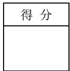

# 2021—2022 学年第二学期《安全通论》期末试卷（A卷）

原件经识别和整理；“参考解答”是我们补的。

## 一、简答题（每小题 8 分，共 40 分）

### 选择 1

题干：试举出信息可共享性产生的三个信息安全问题，并加以说明。（8 分）

答案：无。

知识点：[康复型病毒的动力学分析](../../../topics/信息安全基础/康复型病毒动力学.md)、[免疫型病毒的动力学分析](../../../topics/信息安全基础/免疫型病毒动力学.md)

### 选择 2

题干：给出分组加密系统的加密密钥泄露事件的安全经络图。（8 分）

答案：无。

知识点：[信道编码定理](../../../topics/信息安全基础/信道编码定理.md)、[多攻一可达极限（多个黑客对一个红客）](../../../topics/信息安全基础/多攻一可达极限.md)

### 选择 3

题干：用安全通论的观点分析新木马病毒的早期的演变过程。（8分）

答案：无。

知识点：[平均互信息量I(X;Y)](../../../topics/信息安全基础/平均互信息量.md)、[协作式对话（通信）与问题的提出](../../../topics/信息安全基础/协作式对话与问题提出.md)

### 选择 4

题干：假设单挑盲对抗的黑客攻击信道如下图，则攻击信道的容量是多少，假如黑客的攻击次数是100 次，它至多获胜多少次？（8分）

答案：无。

知识点：[最佳攻防策略的计算](../../../topics/信息安全基础/最佳攻防策略计算.md)、[《博弈论》核心凝练](../../../topics/信息安全基础/博弈论核心凝练.md)、[最佳攻防策略与武器库的丰富和淘汰原则](../../../topics/信息安全基础/武器库丰富淘汰原则.md)

### 选择 5

题干：列举 个以上的常见的 系统漏洞，从图灵机的角度阐述何为系统漏洞。（8分）

答案：无。

知识点：[漏洞的主观和客观描述](../../../topics/信息安全基础/漏洞主观客观描述.md)

### 选择 1

题干：僵尸病毒的攻击能力可以如何描述？（10分）

答案：无。

知识点：[康复型病毒的动力学分析](../../../topics/信息安全基础/康复型病毒动力学.md)、[免疫型病毒的动力学分析](../../../topics/信息安全基础/免疫型病毒动力学.md)

### 选择 2

题干：假设黑客对互为备份的多个服务器发起攻击，试分析它的成功极限等价于信息论中的什么问题。（10分）

答案：无。

知识点：[信道编码定理](../../../topics/信息安全基础/信道编码定理.md)、[多攻一可达极限（多个黑客对一个红客）](../../../topics/信息安全基础/多攻一可达极限.md)

### 选择 3

题干：一般协作式对话（通信）中，假设Alice 语言符号集合为为 $X = \{ 0 , \ 1 \}$ }且 P（0）=P（1），Bob的语言符号集为 Y={0，1}，且交谈中话语符号的转移概率为$P ( \mathbf { y } = 1 | \mathbf { x } = 0 ) = 1 / 4 , \mathrm { P } ( \mathbf { y } = 0 | x = 1 ) = 1 / 8$ ，求 Bob 在接收到 y=0 后，所提供的关于 Alice语言x 的平均条件互信息I（X：y=0）？（10分）

答案：无。

知识点：[平均互信息量I(X;Y)](../../../topics/信息安全基础/平均互信息量.md)、[协作式对话（通信）与问题的提出](../../../topics/信息安全基础/协作式对话与问题提出.md)

### 选择 4

题干：以自己利益最大化为目标，攻防双方的最优攻防策略是什么。（10分）

答案：无。

知识点：[最佳攻防策略的计算](../../../topics/信息安全基础/最佳攻防策略计算.md)、[《博弈论》核心凝练](../../../topics/信息安全基础/博弈论核心凝练.md)、[最佳攻防策略与武器库的丰富和淘汰原则](../../../topics/信息安全基础/武器库丰富淘汰原则.md)

### 选择 1

题干：列举两个康复型病毒例子和两个免疫型病毒的例子，并对康复型病毒和免疫型病毒进行动力学分析，比较二者的异同。（20 分）

答案：无。

知识点：[康复型病毒的动力学分析](../../../topics/信息安全基础/康复型病毒动力学.md)、[免疫型病毒的动力学分析](../../../topics/信息安全基础/免疫型病毒动力学.md)
