# 《安全通论》第10章 安全对抗的宏观描述（课件）

原件的每一页，下面附识别出的文字。

### 第10章---安全对抗的宏观描述

原文：

第10章---安全对抗的宏观描述

### 10安全对抗的宏观描述

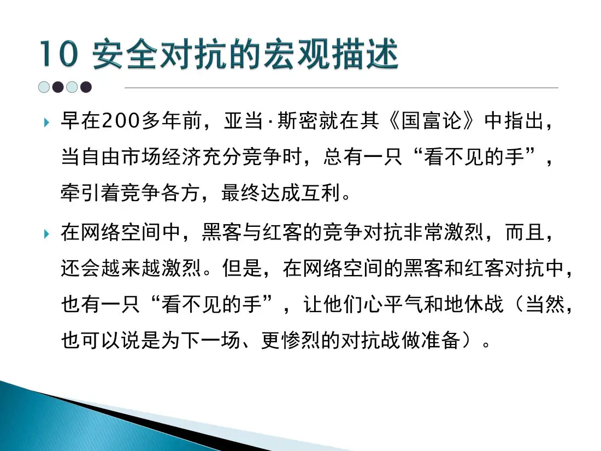

原文：

10安全对抗的宏观描述

早在200多年前，亚当·斯密就在其《国富论》中指出，当自由市场经济充分竞争时，总有一只“看不见的手”，牵引着竞争各方，最终达成互利。

在网络空间中，黑客与红客的竞争对抗非常激烈，而且，还会越来越激烈。但是，在网络空间的黑客和红客对抗中，也有一只“看不见的手”，让他们心平气和地休战（当然，也可以说是为下一场、更惨烈的对抗战做准备）。

### 10安全对抗的宏观描述

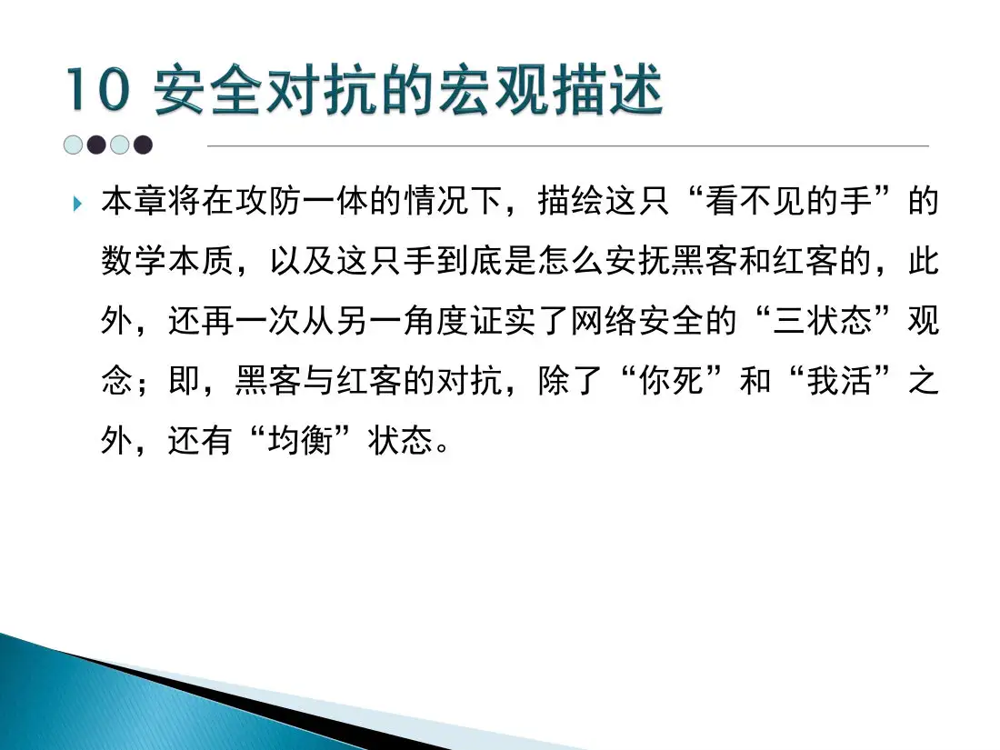

原文：

10安全对抗的宏观描述

本章将在攻防一体的情况下，描绘这只“看不见的手”的数学本质，以及这只手到底是怎么安抚黑客和红客的，此外，还再一次从另一角度证实了网络安全的“三状态”观念；即，黑客与红客的对抗，除了“你死”和“我活”之外，还有“均衡”状态。

### 第10章安全对抗的宏观描述

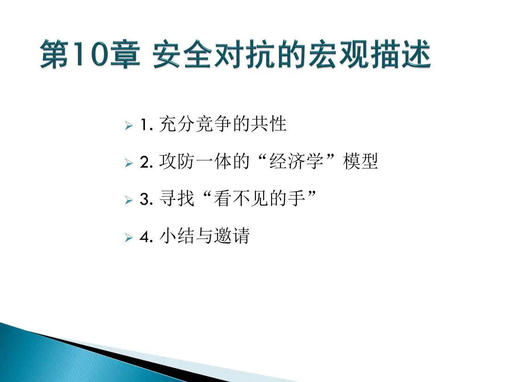

原文：

第10章安全对抗的宏观描述

➢ 1. 充分竞争的共性

➢ 2. 攻防一体的“经济学”模型

➢ 3. 寻找“看不见的手”

➢ 4. 小结与邀请

### 10.1 充分竞争的共性

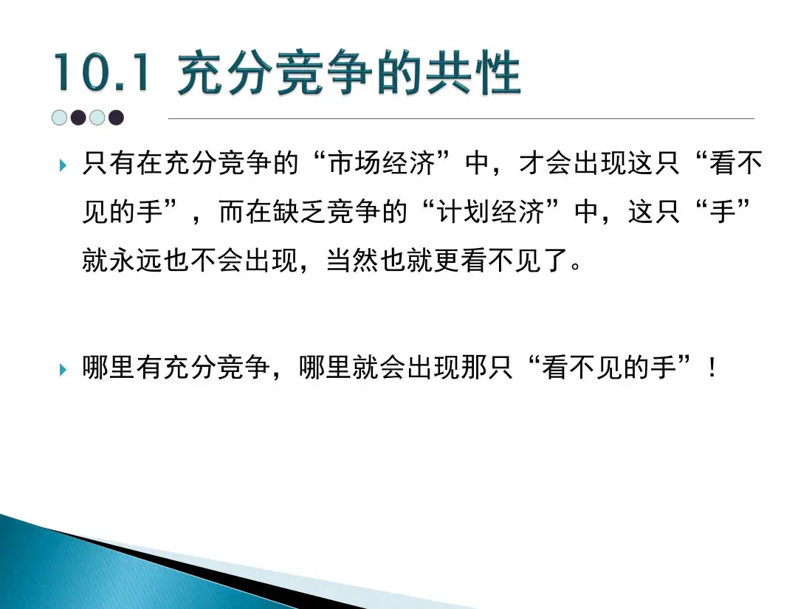

原文：

10.1 充分竞争的共性

 只有在充分竞争的“市场经济”中，才会出现这只“看不见的手”，而在缺乏竞争的“计划经济”中，这只“手”就永远也不会出现，当然也就更看不见了。

哪里有充分竞争，哪里就会出现那只“看不见的手”！

### 10.1 充分竞争的共性

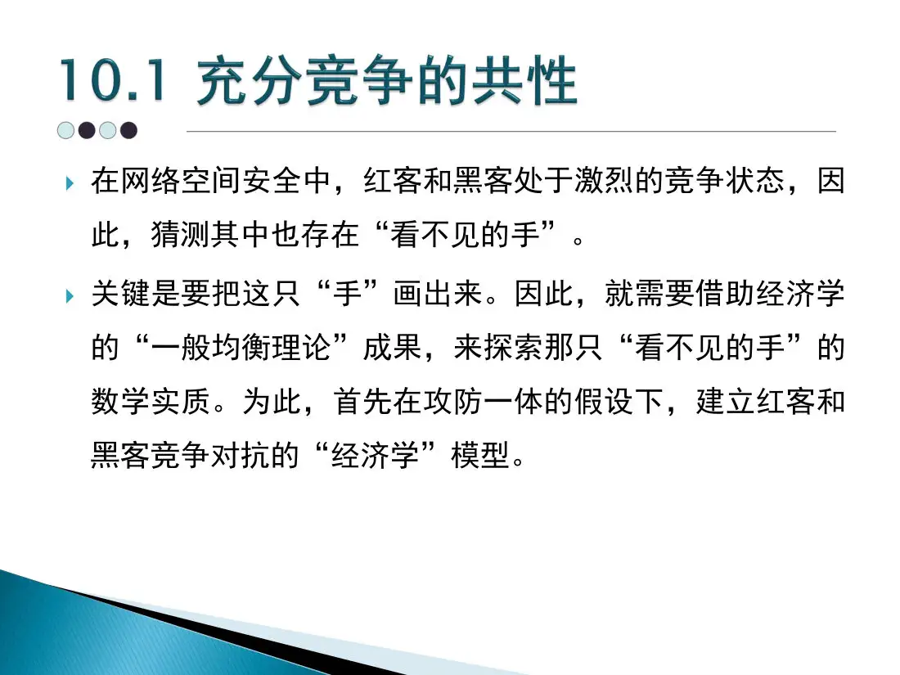

原文：

10.1 充分竞争的共性

在网络空间安全中，红客和黑客处于激烈的竞争状态，因此，猜测其中也存在“看不见的手”。

关键是要把这只“手”画出来。因此，就需要借助经济学的“一般均衡理论”成果，来探索那只“看不见的手”的数学实质。为此，首先在攻防一体的假设下，建立红客和黑客竞争对抗的“经济学”模型。

### 10.2 攻防一体的“经济学”模型

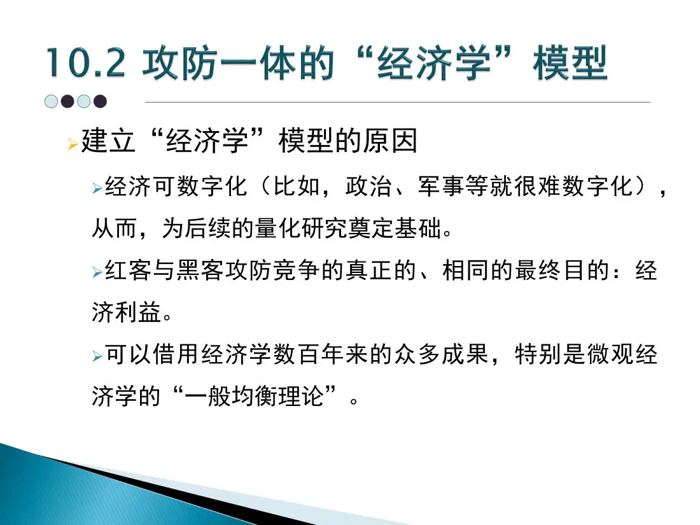

原文：

10.2 攻防一体的“经济学”模型

➢建立“经济学”模型的原因

➢经济可数字化（比如，政治、军事等就很难数字化），从而，为后续的量化研究奠定基础。

➢红客与黑客攻防竞争的真正的、相同的最终目的：经济利益。

➢可以借用经济学数百年来的众多成果，特别是微观经济学的“一般均衡理论”。

### 10.2 攻防一体的“经济学”模型

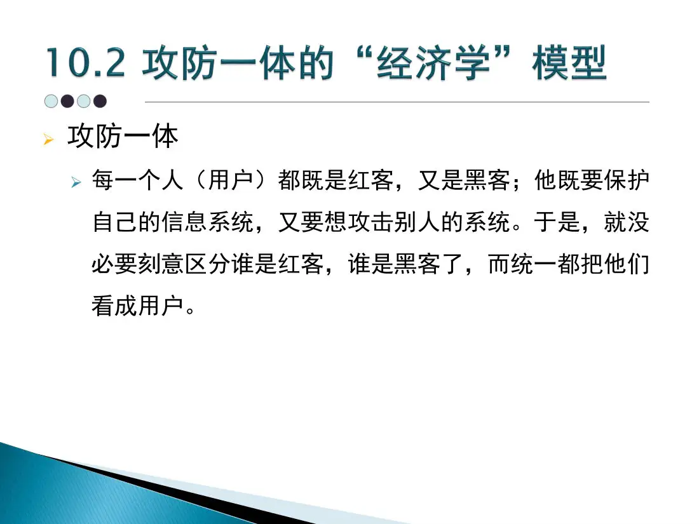

原文：

10.2 攻防一体的“经济学”模型

攻防一体

➢ 每一个人（用户）都既是红客，又是黑客；他既要保护自己的信息系统，又要想攻击别人的系统。于是，就没必要刻意区分谁是红客，谁是黑客了，而统一都把他们看成用户。

### 10.2 攻防一体的“经济学”模型

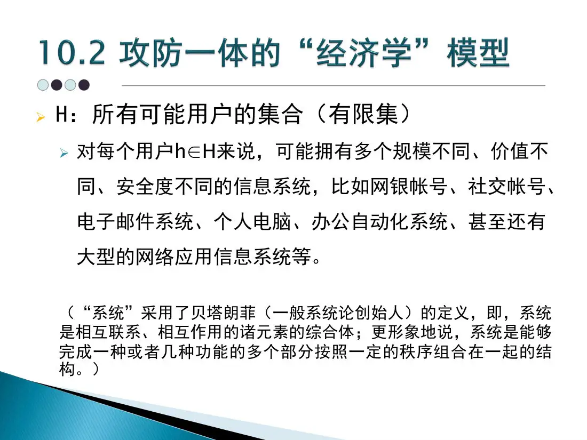

原文：

10.2 攻防一体的“经济学”模型

➢ H：所有可能用户的集合（有限集）

➢ 对每个用户h∈H来说，可能拥有多个规模不同、价值不同、安全度不同的信息系统，比如网银帐号、社交帐号、电子邮件系统、个人电脑、办公自动化系统、甚至还有大型的网络应用信息系统等。

（“系统”采用了贝塔朗菲（一般系统论创始人）的定义，即，系统是相互联系、相互作用的诸元素的综合体；更形象地说，系统是能够完成一种或者几种功能的多个部分按照一定的秩序组合在一起的结构。）

### 10.2 攻防一体的“经济学”模型

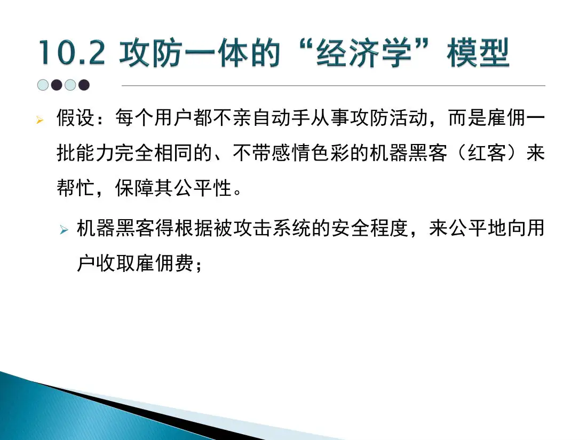

原文：

10.2 攻防一体的“经济学”模型

➢ 假设：每个用户都不亲自动手从事攻防活动，而是雇佣一批能力完全相同的、不带感情色彩的机器黑客（红客）来帮忙，保障其公平性。

➢ 机器黑客得根据被攻击系统的安全程度，来公平地向用户收取雇佣费；

### 10.2 攻防一体的“经济学”模型

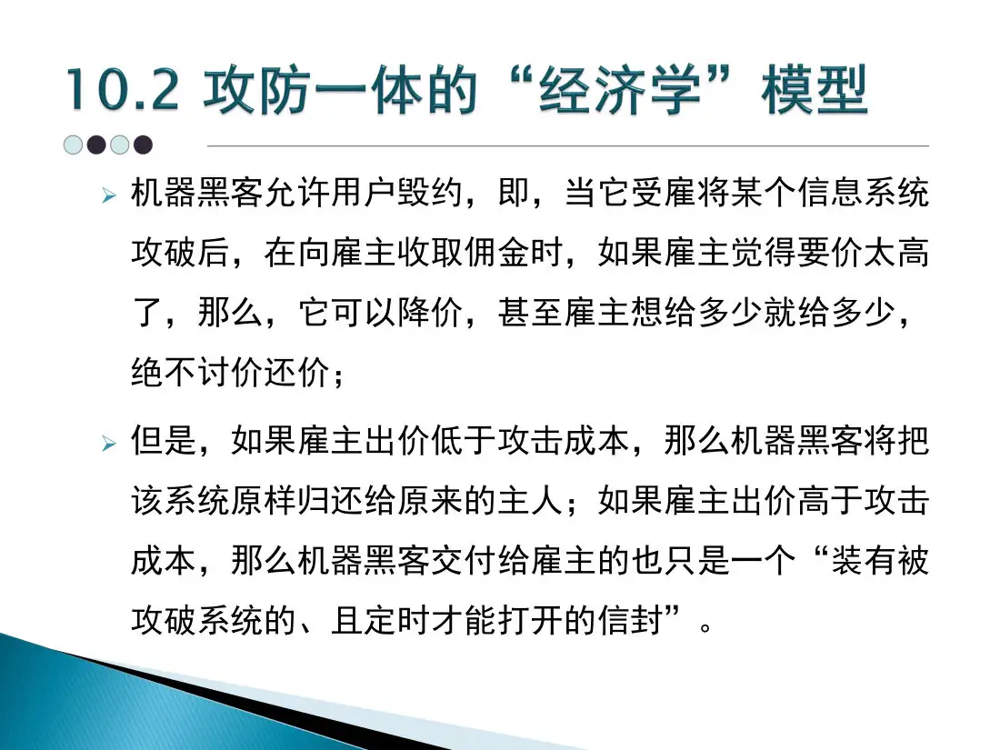

原文：

10.2 攻防一体的“经济学”模型

➢ 机器黑客允许用户毁约，即，当它受雇将某个信息系统攻破后，在向雇主收取佣金时，如果雇主觉得要价太高了，那么，它可以降价，甚至雇主想给多少就给多少，绝不讨价还价；

➢ 但是，如果雇主出价低于攻击成本，那么机器黑客将把该系统原样归还给原来的主人；如果雇主出价高于攻击成本，那么机器黑客交付给雇主的也只是一个“装有被攻破系统的、且定时才能打开的信封”。

### 10.2 攻防一体的“经济学”模型

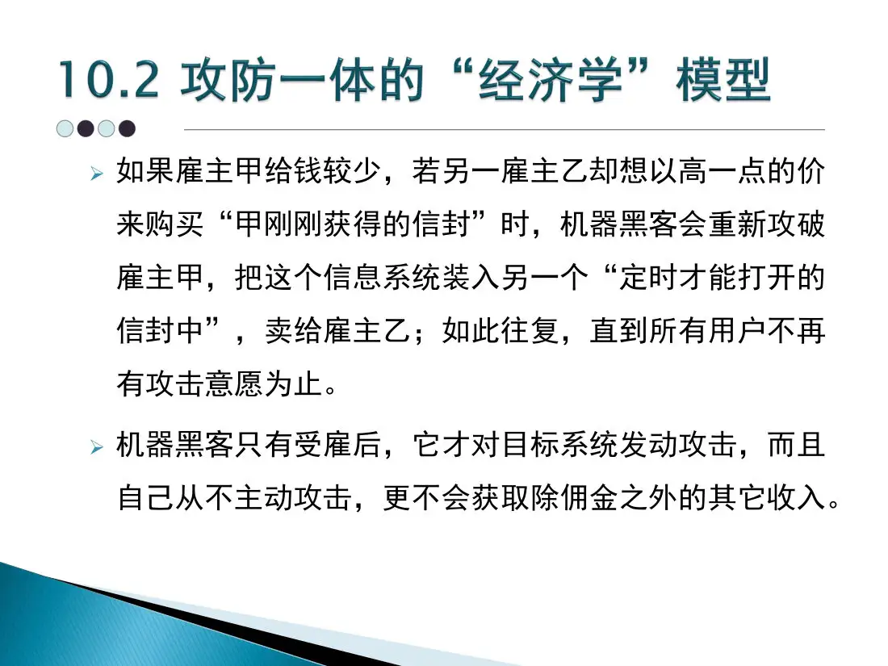

原文：

10.2 攻防一体的“经济学”模型

如果雇主甲给钱较少，若另一雇主乙却想以高一点的价来购买“甲刚刚获得的信封”时，机器黑客会重新攻破雇主甲，把这个信息系统装入另一个“定时才能打开的信封中”，卖给雇主乙；如此往复，直到所有用户不再有攻击意愿为止。

➢ 机器黑客只有受雇后，它才对目标系统发动攻击，而且自己从不主动攻击，更不会获取除佣金之外的其它收入。

### 10.2 攻防一体的“经济学”模型

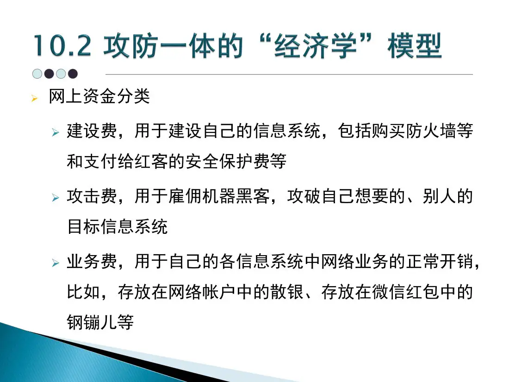

原文：

10.2 攻防一体的“经济学”模型

➢ 网上资金分类

➢ 建设费，用于建设自己的信息系统，包括购买防火墙等和支付给红客的安全保护费等

➢ 攻击费，用于雇佣机器黑客，攻破自己想要的、别人的目标信息系统

➢ 业务费，用于自己的各信息系统中网络业务的正常开销，比如，存放在网络帐户中的散银、存放在微信红包中的钢镚儿等

### 10.2 攻防一体的“经济学”模型

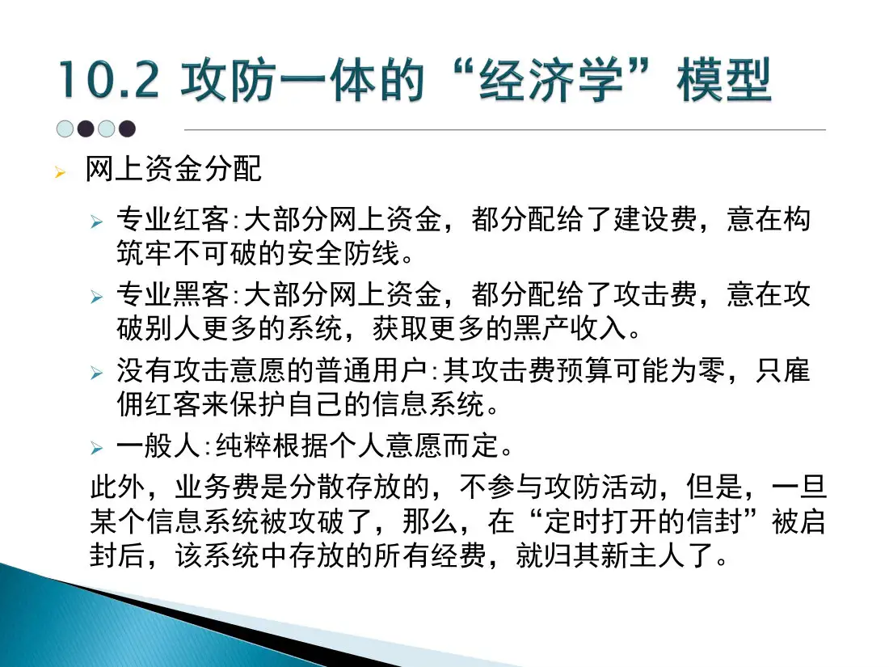

原文：

10.2 攻防一体的“经济学”模型

➢ 网上资金分配

➢ 专业红客:大部分网上资金，都分配给了建设费，意在构筑牢不可破的安全防线。

➢ 专业黑客:大部分网上资金，都分配给了攻击费，意在攻破别人更多的系统，获取更多的黑产收入。

➢ 没有攻击意愿的普通用户:其攻击费预算可能为零，只雇佣红客来保护自己的信息系统。

V 一般人:纯粹根据个人意愿而定。

此外，业务费是分散存放的，不参与攻防活动，但是，一旦某个信息系统被攻破了，那么，在“定时打开的信封”被启封后，该系统中存放的所有经费，就归其新主人了。

### 10.2 攻防一体的“经济学”模型

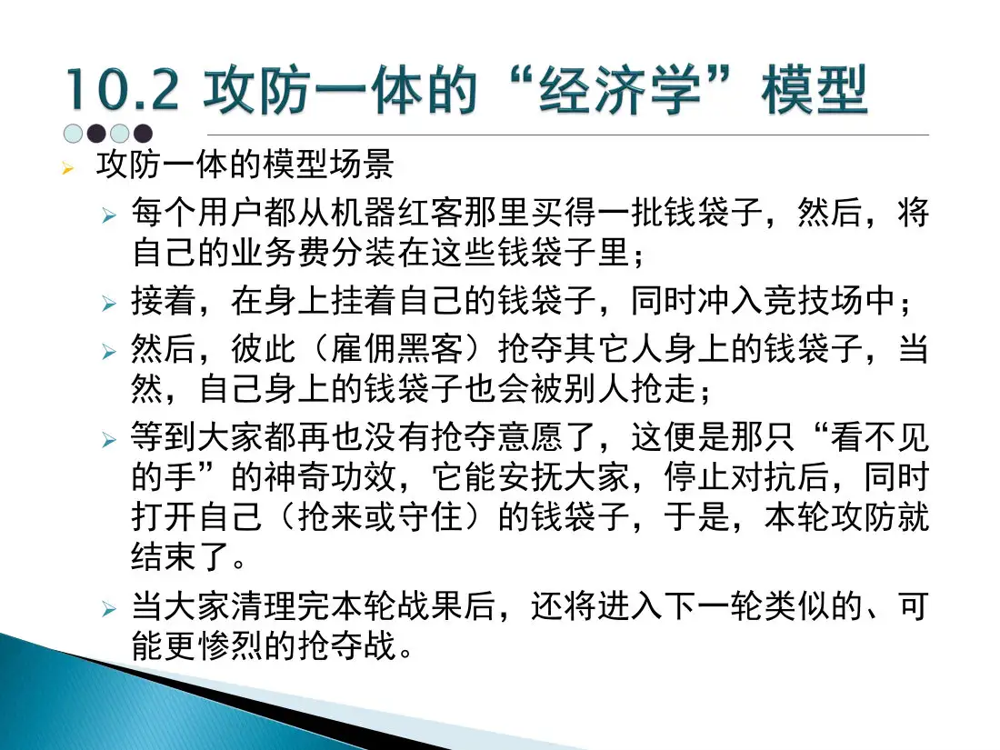

原文：

10.2 攻防一体的“经济学”模型

攻防一体的模型场景

➢ 每个用户都从机器红客那里买得一批钱袋子，然后，将自己的业务费分装在这些钱袋子里；

➢ 接着，在身上挂着自己的钱袋子，同时冲入竞技场中；

➢ 然后，彼此（雇佣黑客）抢夺其它人身上的钱袋子，当然，自己身上的钱袋子也会被别人抢走；

➢ 等到大家都再也没有抢夺意愿了，这便是那只“看不见的手”的神奇功效，它能安抚大家，停止对抗后，同时打开自己（抢来或守住）的钱袋子，于是，本轮攻防就结束了。

➢ 当大家清理完本轮战果后，还将进入下一轮类似的、可能更惨烈的抢夺战。

### 10.2 攻防一体的“经济学”模型

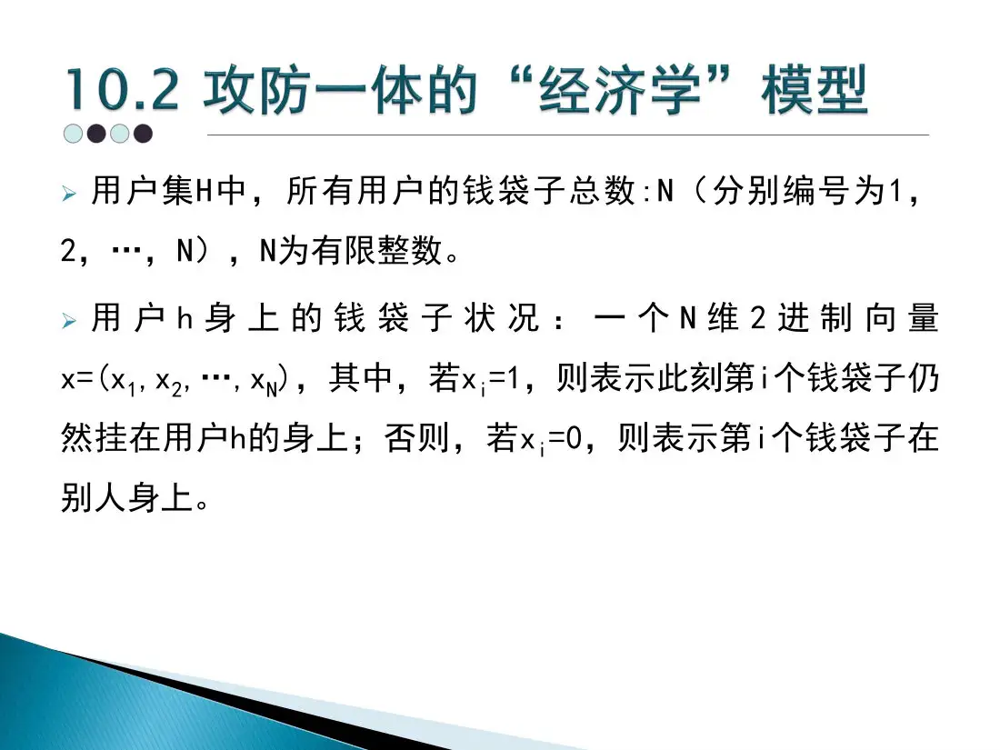

原文：

10.2 攻防一体的“经济学”模型

➢ 用户集H中，所有用户的钱袋子总数:N（分别编号为1，2，…，N），N为有限整数。

➢ 用 户 h 身 上 的 钱 袋 子 状 况 ： 一 个 N 维 2 进 制 向 量$\mathsf { x } = ( \mathsf { x } _ { 1 } , \mathsf { x } _ { 2 } , \mathsf { \Omega } \cdots , \mathsf { x } _ { \mathsf { N } } )$ ，其中，若 $x _ { i } = 1$ ，则表示此刻第i个钱袋子仍然挂在用户h的身上；否则，若 $x _ { i } = 0$ ，则表示第i个钱袋子在别人身上。

### 10.2 攻防一体的“经济学”模型

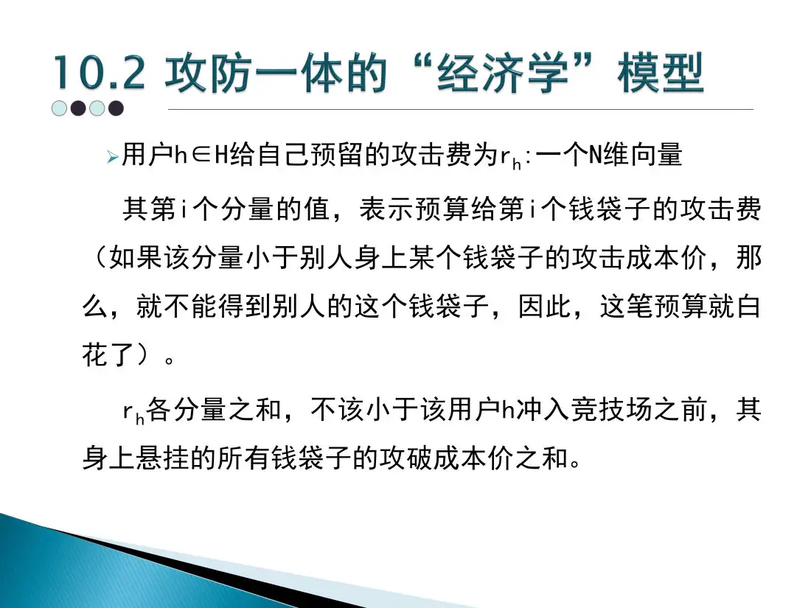

原文：

10.2 攻防一体的“经济学”模型

➢用户h∈H给自己预留的攻击费为 $\boldsymbol { \mathsf { r } } _ { \mathsf { h } }$ :一个N维向量

其第i个分量的值，表示预算给第i个钱袋子的攻击费（如果该分量小于别人身上某个钱袋子的攻击成本价，那么，就不能得到别人的这个钱袋子，因此，这笔预算就白花了）。

$\boldsymbol { \mathsf { r } } _ { \mathsf { h } }$ 各分量之和，不该小于该用户h冲入竞技场之前，其身上悬挂的所有钱袋子的攻破成本价之和。

### 10.2 攻防一体的“经济学”模型

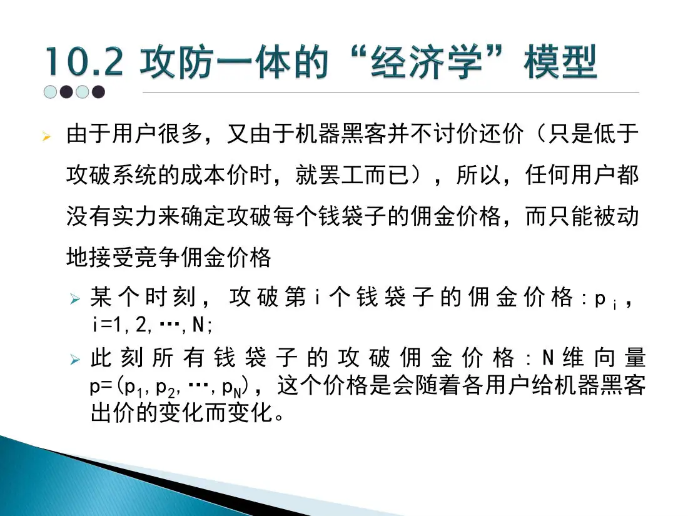

原文：

10.2 攻防一体的“经济学”模型

由于用户很多，又由于机器黑客并不讨价还价（只是低于攻破系统的成本价时，就罢工而已），所以，任何用户都没有实力来确定攻破每个钱袋子的佣金价格，而只能被动地接受竞争佣金价格

➢ 某 个 时 刻 ， 攻 破 第 i 个 钱 袋 子 的 佣 金 价 格 : p i ，i=1,2,…,N;

➢ 此 刻 所 有 钱 袋 子 的 攻 破 佣 金 价 格 : N 维 向 量$\mathsf { p } = ( \mathsf { p } _ { 1 } , \mathsf { p } _ { 2 } , \cdots , \mathsf { p } _ { \mathsf { N } } )$ ，这个价格是会随着各用户给机器黑客出价的变化而变化。

### 10.2 攻防一体的“经济学”模型

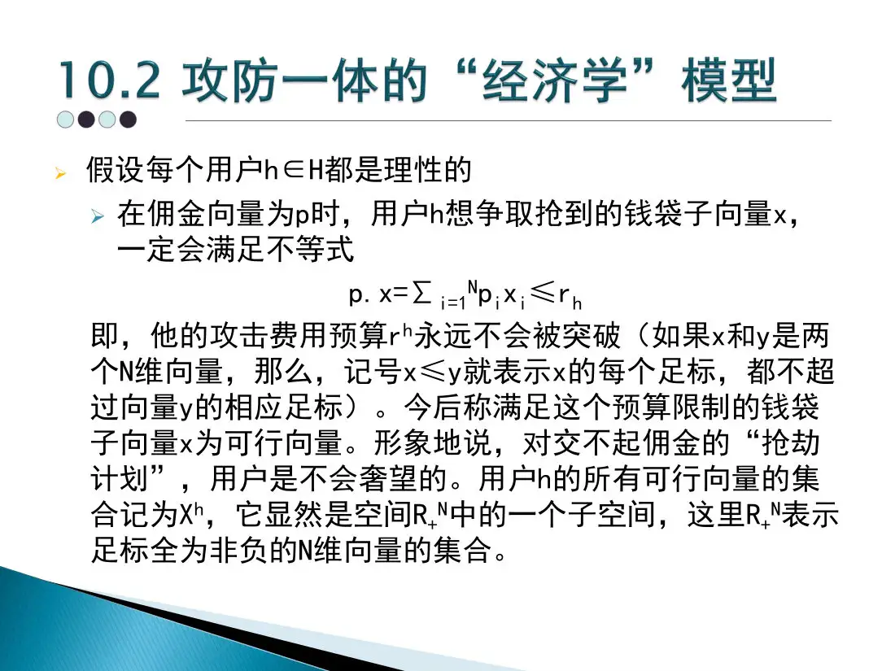

原文：

10.2 攻防一体的“经济学”模型

➢ 假设每个用户 $\mathsf { h } \in \mathsf { H }$ 都是理性的

➢ 在佣金向量为p时，用户h想争取抢到的钱袋子向量x，一定会满足不等式

$$
p. x = \sum_ {i = 1} ^ {N} p _ {i} x _ {i} \leqslant r _ {h}
$$

即，他的攻击费用预算 $r ^ { h }$ 永远不会被突破（如果x和y是两个N维向量，那么，记号 $\mathbf { \nabla } \cdot \mathbf { x } \leqslant \mathbf { y }$ 就表示x的每个足标，都不超过向量y的相应足标）。今后称满足这个预算限制的钱袋子向量x为可行向量。形象地说，对交不起佣金的“抢劫计划”，用户是不会奢望的。用户h的所有可行向量的集合记为Xh，它显然是空间 ${ \sf R } _ { + } ^ { \textsf { N } }$ 中的一个子空间，这里 ${ \sf R } _ { + } ^ { \sf N }$ 表示足标全为非负的N维向量的集合。

### 10.2 攻防一体的“经济学”模型

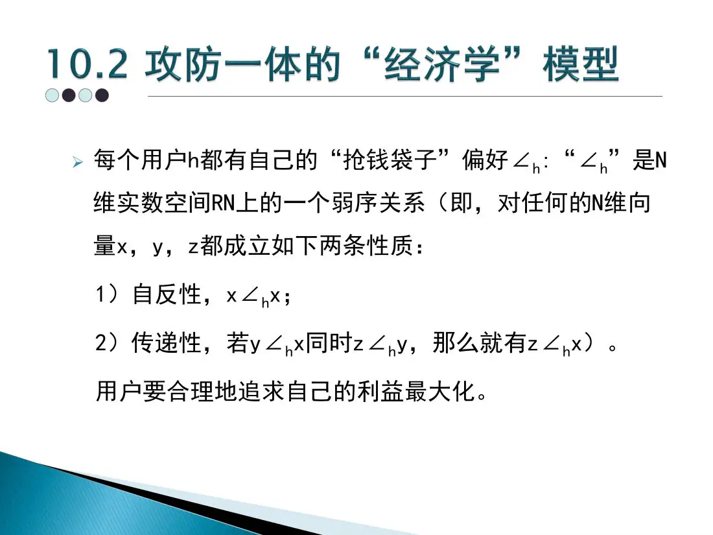

原文：

➢ 每个用户h都有自己的“抢钱袋子”偏好 $\angle _ { n } \cdot ^ { 6 6 } \angle _ { n } ^ { 3 3 }$ 是N维实数空间RN上的一个弱序关系（即，对任何的N维向量x，y，z都成立如下两条性质：

1）自反性， $\tt { x } \angle \tt { _ { h } } x$ ；

2）传递性，若 $\forall < \boldsymbol { \mathsf { \Pi } } _ { \mathsf { h } } \mathsf { X }$ 同时 $z < \gamma _ { \mathsf { h } } \mathsf { y }$ ，那么就有 $\boldsymbol { z } < _ { \mathsf { h } } \boldsymbol { x } )$ 用户要合理地追求自己的利益最大化。

10.2 攻防一体的“经济学”模型

### 10.2 攻防一体的“经济学”模型

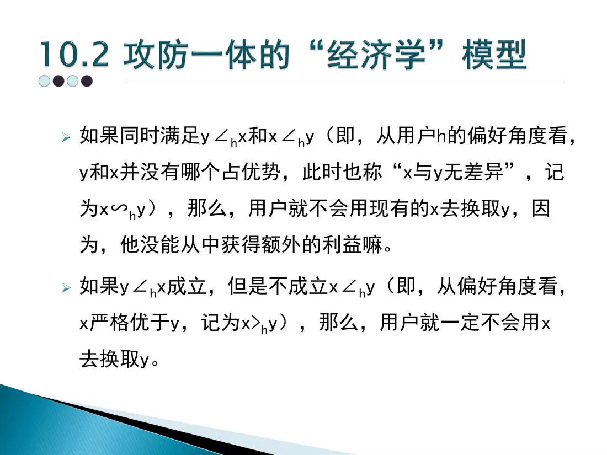

原文：

➢ 如果同时满足 $\mathsf { y } < \mathsf { \Omega } _ { \mathsf { h } } \mathsf { x }$ 和 $\tt { x } \angle \tt { _ h } \tt { y }$ （即，从用户h的偏好角度看，y和x并没有哪个占优势，此时也称“x与y无差异”，记为 $x ^ { \omega } { } _ { \mathsf { h } } { \mathsf { y } } )$ ，那么，用户就不会用现有的x去换取y，因为，他没能从中获得额外的利益嘛。

➢ 如果 $\tt y < \tt h ^ { \tt X }$ 成立，但是不成立 $\tt { x } \angle \tt { _ h } \tt { y }$ （即，从偏好角度看，$x ^ { \frac { \pi } { p } }$ 格优于y，记为 $\ b x > _ { \mathsf { h } } \ b y )$ ，那么，用户就一定不会用x去换取y。

10.2 攻防一体的“经济学”模型

### 10.2 攻防一体的“经济学”模型

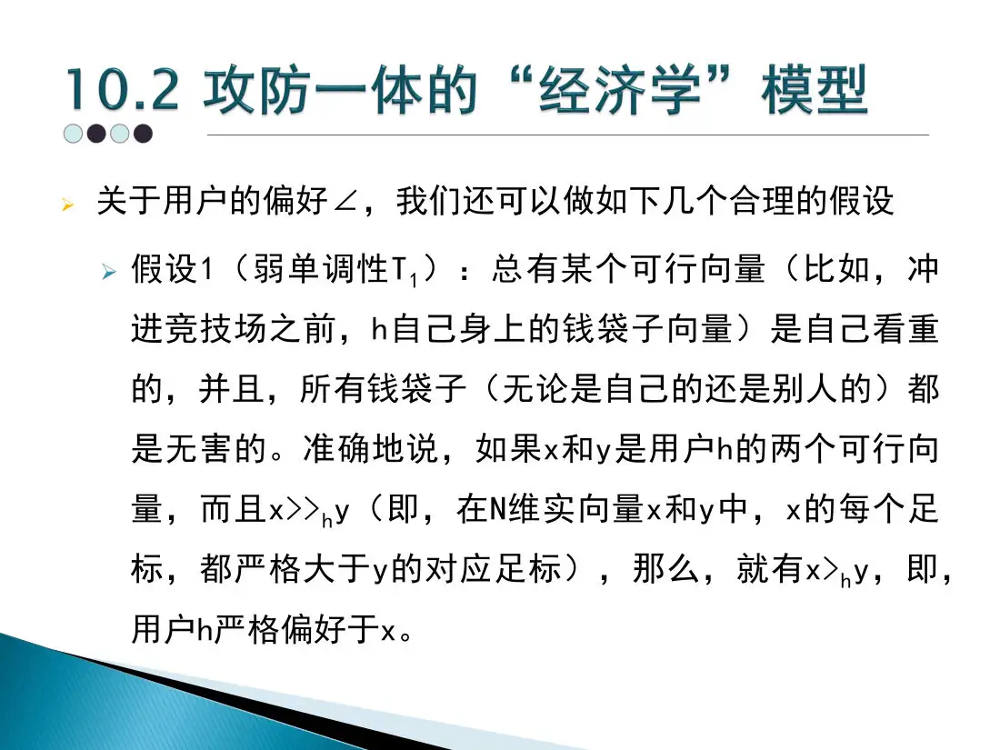

原文：

10.2 攻防一体的“经济学”模型

➢ 关于用户的偏好∠，我们还可以做如下几个合理的假设

➢ 假设1（弱单调性 ${ \sf I } _ { 1 } .$ ）：总有某个可行向量（比如，冲进竞技场之前，h自己身上的钱袋子向量）是自己看重的，并且，所有钱袋子（无论是自己的还是别人的）都是无害的。准确地说，如果x和y是用户h的两个可行向量，而且 $\mathsf { x } { \geq } \rangle _ { \mathsf { h } } \mathsf { y }$ （即，在N维实向量x和y中，x的每个足标，都严格大于y的对应足标），那么，就有 $\mathsf { x } \geq _ { \mathsf { h } } \mathsf { y }$ ，即，用户h严格偏好于x。

### 10.2 攻防一体的“经济学”模型

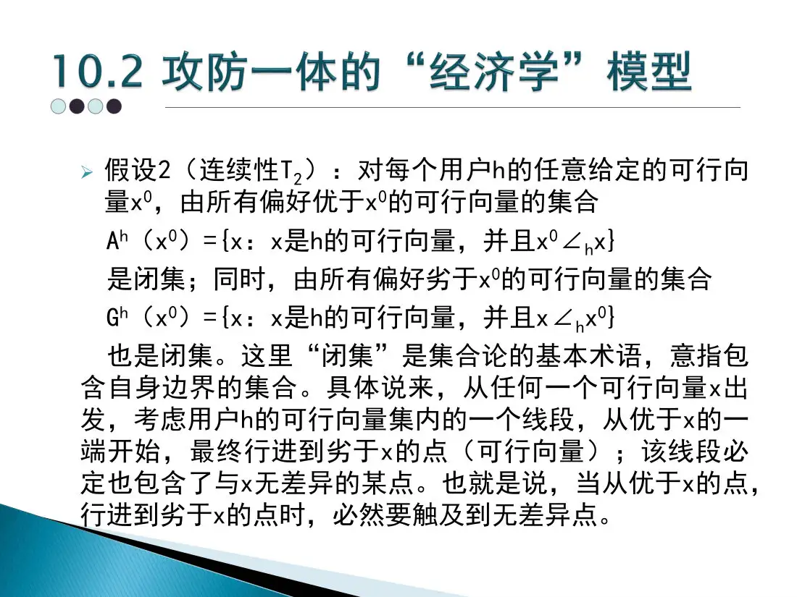

原文：

假设2（连续性 $\mathsf { T } _ { 2 } )$ ）：对每个用户h的任意给定的可行向量 $\mathsf { x } ^ { 0 }$ ，由所有偏好优于 $\cdot \mathbf { x } ^ { 0 }$ 的可行向量的集合$A ^ { \mathsf { h } } \left( \mathsf { x } ^ { 0 } \right) = \left\{ \mathsf { x } : \ x \right.$ 是h的可行向量，并且 $\boldsymbol { \mathbf { \ell } } _ { \mathsf { X } } { } ^ { 0 } \angle _ { \mathsf { h } } \boldsymbol { \mathbf { \ell } } _ { \mathsf { X } } \}$ 是闭集；同时，由所有偏好劣于 $\cdot \mathbf { x } ^ { 0 }$ 的可行向量的集合$\mathtt { G } ^ { \mathtt { h } } \mathtt { \Psi } ( \mathtt { x } ^ { 0 } ) = \mathtt { j } \mathtt { x } : \mathtt { x }$ 是h的可行向量，并且 $\boldsymbol { \mathbf { \rho } } _ { \times } \angle \mathbf { \rho } _ { \mathsf { h } } \boldsymbol { \mathbf { \rho } } _ { \times } ^ { 0 } \}$

也是闭集。这里“闭集”是集合论的基本术语，意指包含自身边界的集合。具体说来，从任何一个可行向量x出发，考虑用户h的可行向量集内的一个线段，从优于x的一端开始，最终行进到劣于x的点（可行向量）；该线段必定也包含了与x无差异的某点。也就是说，当从优于x的点，行进到劣于x的点时，必然要触及到无差异点。

10.2 攻防一体的“经济学”模型

### 10.2 攻防一体的“经济学”模型

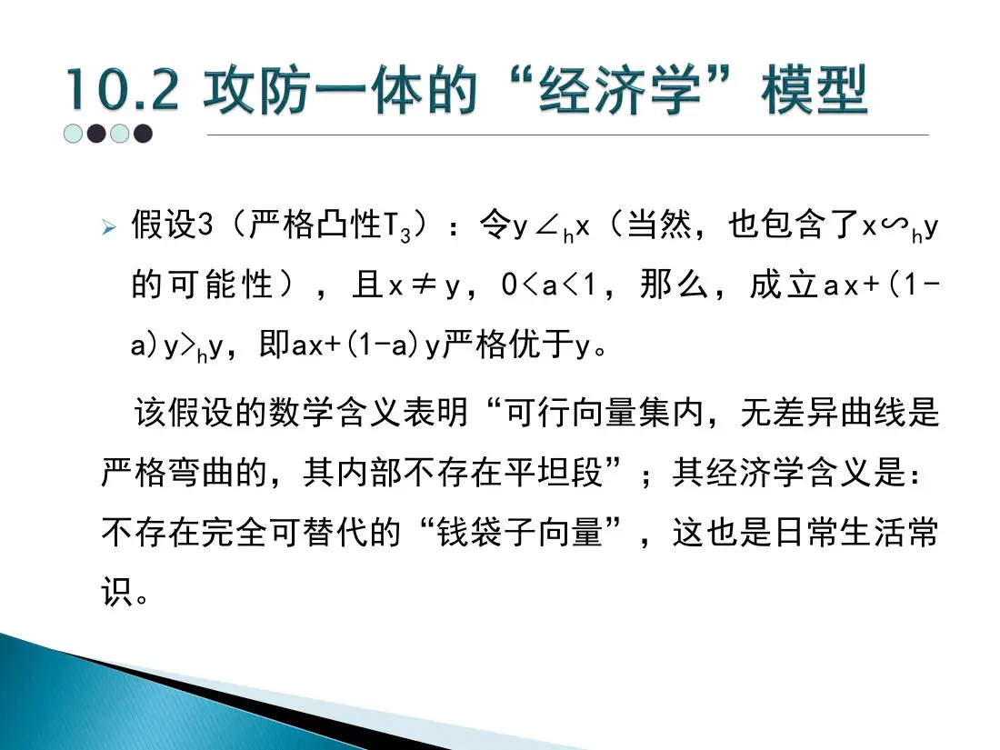

原文：

10.2 攻防一体的“经济学”模型

➢ 假设3（严格凸性 ${ \sf I } _ { 3 } )$ ：令 $\forall < \boldsymbol { \mathsf { \tau } } _ { \mathsf { h } } \boldsymbol { \mathsf { x } }$ （当然，也包含了 $x ^ { \omega } { } _ { \mathsf { h } } { \mathsf { y } }$ 的可能性），且 $\mathsf { x } \neq \mathsf { y }$ ，0< a<1，那么，成立 ${ \sf a x } + ( 1 -$ a) $\mathsf { y } > _ { \mathsf { h } } \mathsf { y }$ ，即 $a x + ( 1 - a ) y .$ 严格优于y。

该假设的数学含义表明“可行向量集内，无差异曲线是严格弯曲的，其内部不存在平坦段”；其经济学含义是：不存在完全可替代的“钱袋子向量”，这也是日常生活常识。

### 10.3 寻找“看不见的手”

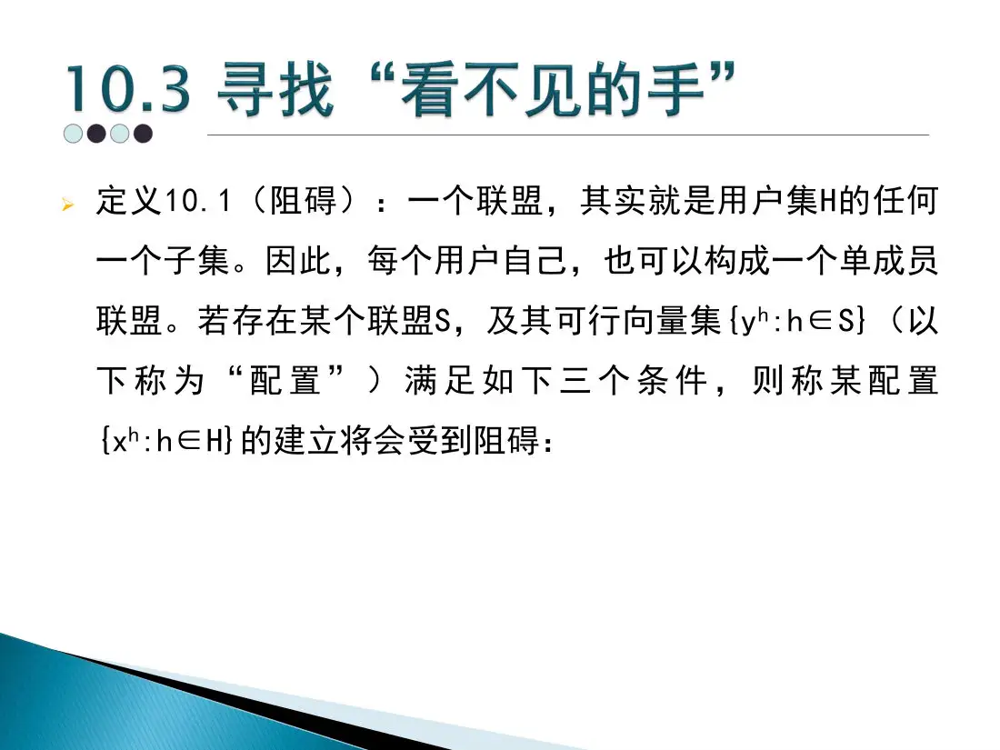

原文：

10.3 寻找“看不见的手”

➢ 定义10.1（阻碍）：一个联盟，其实就是用户集H的任何一个子集。因此，每个用户自己，也可以构成一个单成员联盟。若存在某个联盟S，及其可行向量集 $\{ \boldsymbol { \mathsf { y } } ^ { \boldsymbol { \mathsf { h } } } : \boldsymbol { \mathsf { h } } \in \mathbb { S } \}$ （以下称为“配置”）满足如下三个条件，则称某配置$\{ x ^ { h } : h \in$ H}的建立将会受到阻碍：

### 10.3 寻找“看不见的手”

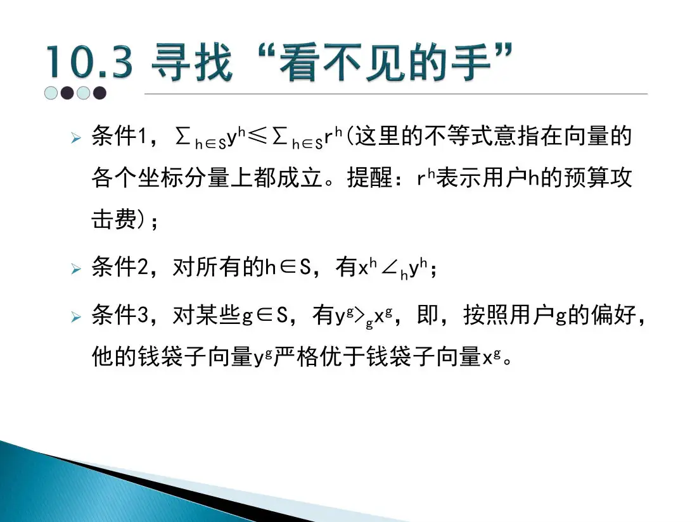

原文：

10.3 寻找“看不见的手”

➢ 条件1， $\begin{array} { r } { \sum _ { \mathfrak { h } \in \mathfrak { s } } \mathfrak { y } ^ { \mathfrak { h } } { \leqslant } \sum _ { \mathfrak { h } \in \mathfrak { s } } \mathfrak { r } ^ { \mathfrak { h } } } \end{array}$ (这里的不等式意指在向量的各个坐标分量上都成立。提醒： $\boldsymbol { r } ^ { \mathrm { h } }$ 表示用户h的预算攻击费)；

条件2，对所有的 $\boldsymbol { \mathsf { h } } \in \mathsf { S }$ ，有 $\mathsf { x } ^ { \mathsf { h } } \angle _ { \mathsf { h } } \mathsf { y } ^ { \mathsf { h } }$

➢ 条件3，对某些 $\mathsf { g } \in \mathsf { S }$ ，有 $\boldsymbol { \mathsf { y } } ^ { \mathsf { g } } \rangle _ { \mathsf { g } } \boldsymbol { \mathsf { x } } ^ { \mathsf { g } }$ ，即，按照用户g的偏好，他的钱袋子向量 $\mathsf { y } ^ { \mathsf { g } }$ 严格优于钱袋子向量 $\mathsf { X } ^ { \mathsf { g } }$ 。

### 10.3寻找“看不见的手”

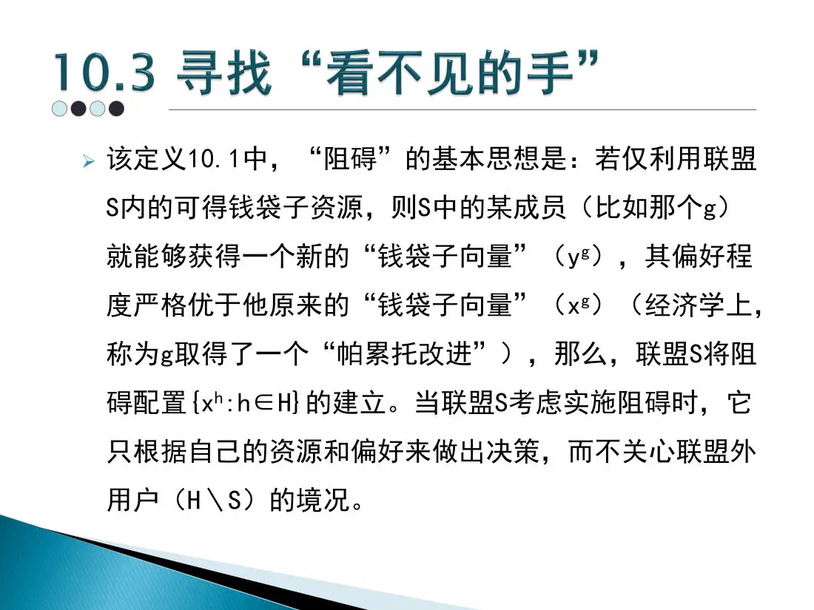

原文：

10.3寻找“看不见的手”

➢ 该定义10.1中，“阻碍”的基本思想是：若仅利用联盟S内的可得钱袋子资源，则S中的某成员（比如那个g）就能够获得一个新的“钱袋子向量”（yg），其偏好程度严格优于他原来的“钱袋子向量”（xg）（经济学上，称为g取得了一个“帕累托改进”），那么，联盟S将阻碍配置 $\{ x ^ { \boldsymbol { \mathsf { h } } } : \boldsymbol { \mathsf { h } } \in \boldsymbol { \mathsf { H } } \}$ 的建立。当联盟S考虑实施阻碍时，它只根据自己的资源和偏好来做出决策，而不关心联盟外用户（H＼S）的境况。

### 10.3 寻找“看不见的手”

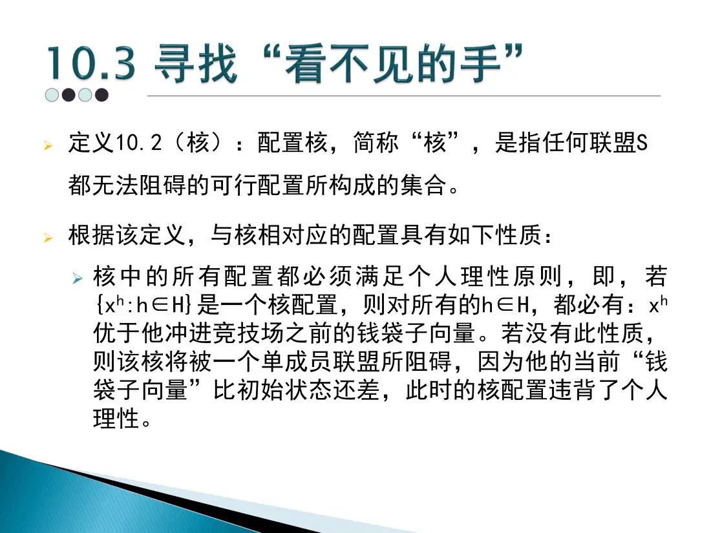

原文：

10.3 寻找“看不见的手”

➢ 定义10.2（核）：配置核，简称“核”，是指任何联盟S都无法阻碍的可行配置所构成的集合。

➢ 根据该定义，与核相对应的配置具有如下性质：

➢ 核中的所有配置都必须满足个人理性原则，即，若$\{ x ^ { \boldsymbol { \mathsf { h } } } : \boldsymbol { \mathsf { h } } \in \boldsymbol { \mathsf { H } } \}$ 是一个核配置，则对所有的h∈H，都必有： $\mathsf { x } ^ { \mathsf { h } }$ 优于他冲进竞技场之前的钱袋子向量。若没有此性质，则该核将被一个单成员联盟所阻碍，因为他的当前“钱袋子向量”比初始状态还差，此时的核配置违背了个人理性。

### 10.3 寻找“看不见的手”

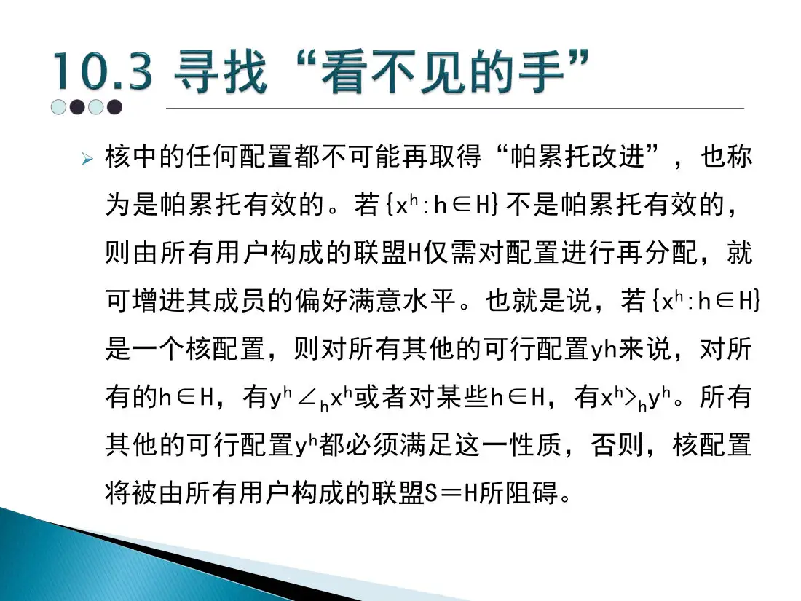

原文：

10.3 寻找“看不见的手”

➢ 核中的任何配置都不可能再取得“帕累托改进”，也称为是帕累托有效的。若 $\{ x ^ { \boldsymbol { \mathsf { h } } } : \boldsymbol { \mathsf { h } } \in \boldsymbol { \mathsf { H } } \}$ 不是帕累托有效的，则由所有用户构成的联盟H仅需对配置进行再分配，就可增进其成员的偏好满意水平。也就是说，若 $\{ x ^ { \boldsymbol { \mathsf { h } } } : \boldsymbol { \mathsf { h } } \in \boldsymbol { \mathsf { H } } \}$ 是一个核配置，则对所有其他的可行配置yh来说，对所有的 $h \in H$ ，有 $\boldsymbol { \mathsf { y } } ^ { \mathsf { h } } \angle _ { \mathsf { h } } \boldsymbol { \mathsf { x } } ^ { \mathsf { h } }$ 或者对某些 $h \in H$ ，有 $\mathsf { x } ^ { \mathsf { h } } \bigl \rangle _ { \mathsf { h } } \mathsf { y } ^ { \mathsf { h } }$ 。所有其他的可行配置 $\mathsf { y } ^ { \mathsf { h } }$ 都必须满足这一性质，否则，核配置将被由所有用户构成的联盟S＝H所阻碍。

### 10.3寻找“看不见的手”

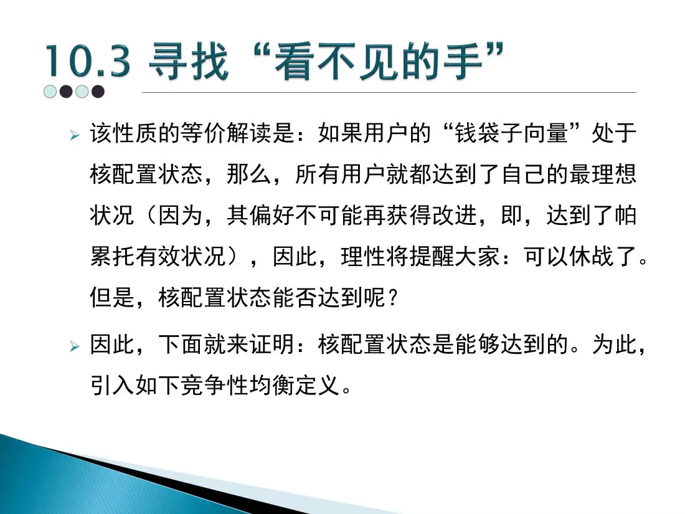

原文：

10.3寻找“看不见的手”

该性质的等价解读是：如果用户的“钱袋子向量”处于核配置状态，那么，所有用户就都达到了自己的最理想状况（因为，其偏好不可能再获得改进，即，达到了帕累托有效状况），因此，理性将提醒大家：可以休战了。但是，核配置状态能否达到呢？

➢ 因此，下面就来证明：核配置状态是能够达到的。为此，引入如下竞争性均衡定义。

### 10.4 小结与邀请

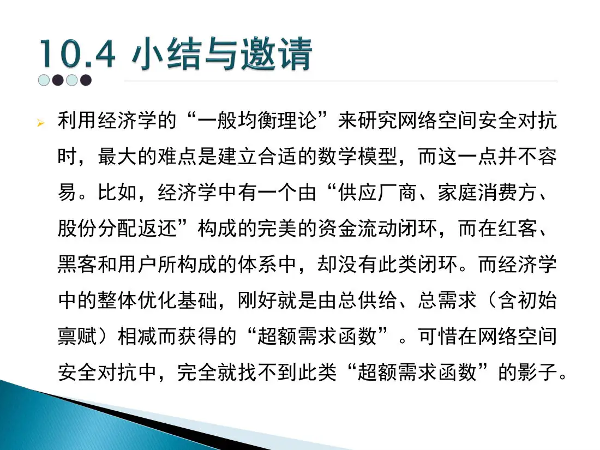

原文：

10.4 小结与邀请

➢ 利用经济学的“一般均衡理论”来研究网络空间安全对抗时，最大的难点是建立合适的数学模型，而这一点并不容易。比如，经济学中有一个由“供应厂商、家庭消费方、股份分配返还”构成的完美的资金流动闭环，而在红客、黑客和用户所构成的体系中，却没有此类闭环。而经济学中的整体优化基础，刚好就是由总供给、总需求（含初始禀赋）相减而获得的“超额需求函数”。可惜在网络空间安全对抗中，完全就找不到此类“超额需求函数”的影子。

### 10.4 小结与邀请

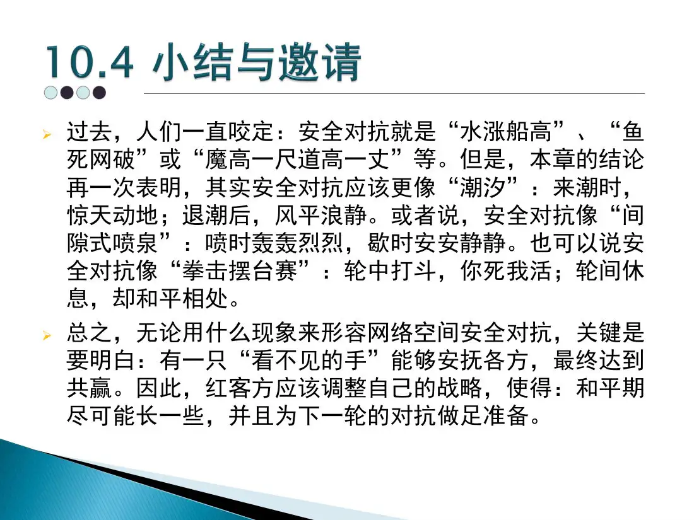

原文：

10.4 小结与邀请

➢ 过去，人们一直咬定：安全对抗就是“水涨船高”、“鱼死网破”或“魔高一尺道高一丈”等。但是，本章的结论再一次表明，其实安全对抗应该更像“潮汐”：来潮时，惊天动地；退潮后，风平浪静。或者说，安全对抗像“间隙式喷泉”：喷时轰轰烈烈，歇时安安静静。也可以说安全对抗像“拳击摆台赛”：轮中打斗，你死我活；轮间休息，却和平相处。

➢ 总之，无论用什么现象来形容网络空间安全对抗，关键是要明白：有一只“看不见的手”能够安抚各方，最终达到共赢。因此，红客方应该调整自己的战略，使得：和平期尽可能长一些，并且为下一轮的对抗做足准备。

### 本章结束，谢谢

原文：

本章结束，谢谢
