# 《安全通论》第11章 安全对抗的中观描述（课件）

原件的每一页，下面附识别出的文字。

### 第11章---安全对抗的中观描述

原文：

第11章---安全对抗的中观描述

### 11 安全对抗的中观描述

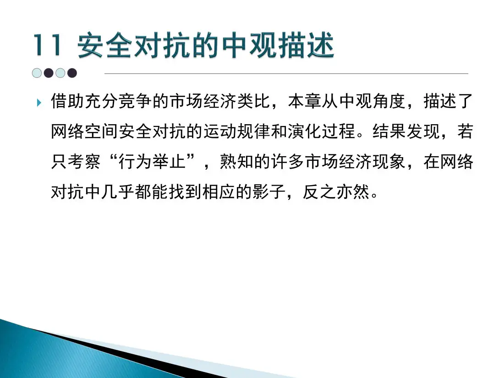

原文：

11 安全对抗的中观描述

 借助充分竞争的市场经济类比，本章从中观角度，描述了网络空间安全对抗的运动规律和演化过程。结果发现，若只考察“行为举止”，熟知的许多市场经济现象，在网络对抗中几乎都能找到相应的影子，反之亦然。

### 11 安全对抗的中观描述

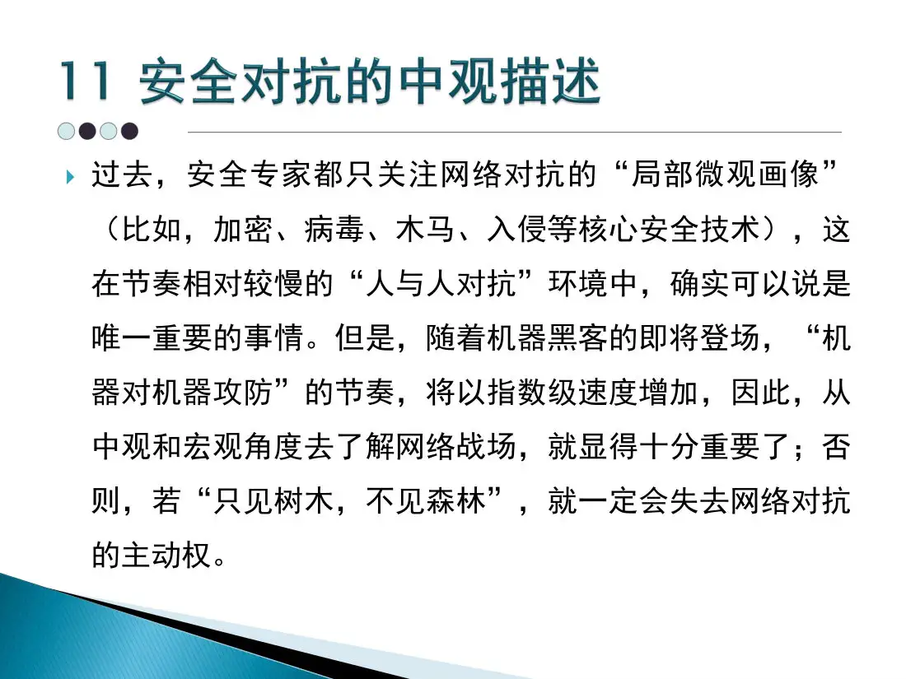

原文：

11 安全对抗的中观描述

过去，安全专家都只关注网络对抗的“局部微观画像”（比如，加密、病毒、木马、入侵等核心安全技术），这在节奏相对较慢的“人与人对抗”环境中，确实可以说是唯一重要的事情。但是，随着机器黑客的即将登场，“机器对机器攻防”的节奏，将以指数级速度增加，因此，从中观和宏观角度去了解网络战场，就显得十分重要了；否则，若“只见树木，不见森林”，就一定会失去网络对抗的主动权。

### 第11章安全对抗的中观描述

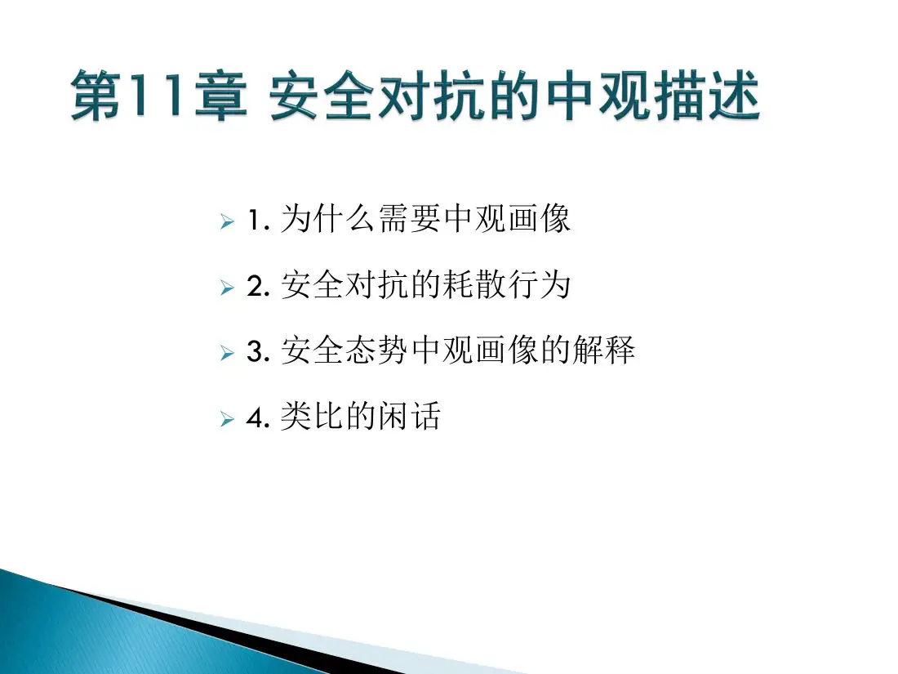

原文：

第11章安全对抗的中观描述

➢ 1. 为什么需要中观画像

➢ 2. 安全对抗的耗散行为

➢ 3. 安全态势中观画像的解释

4. 类比的闲话

### 11.1 为什么需要中观画像

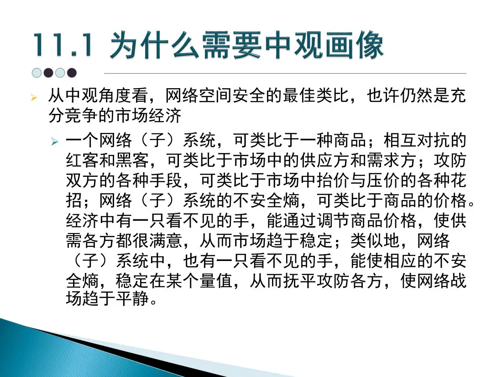

原文：

11.1 为什么需要中观画像

➢ 从中观角度看，网络空间安全的最佳类比，也许仍然是充分竞争的市场经济

一个网络（子）系统，可类比于一种商品；相互对抗的红客和黑客，可类比于市场中的供应方和需求方；攻防双方的各种手段，可类比于市场中抬价与压价的各种花招；网络（子）系统的不安全熵，可类比于商品的价格。经济中有一只看不见的手，能通过调节商品价格，使供需各方都很满意，从而市场趋于稳定；类似地，网络

（子）系统中，也有一只看不见的手，能使相应的不安全熵，稳定在某个量值，从而抚平攻防各方，使网络战场趋于平静。

### 11.1 为什么需要中观画像

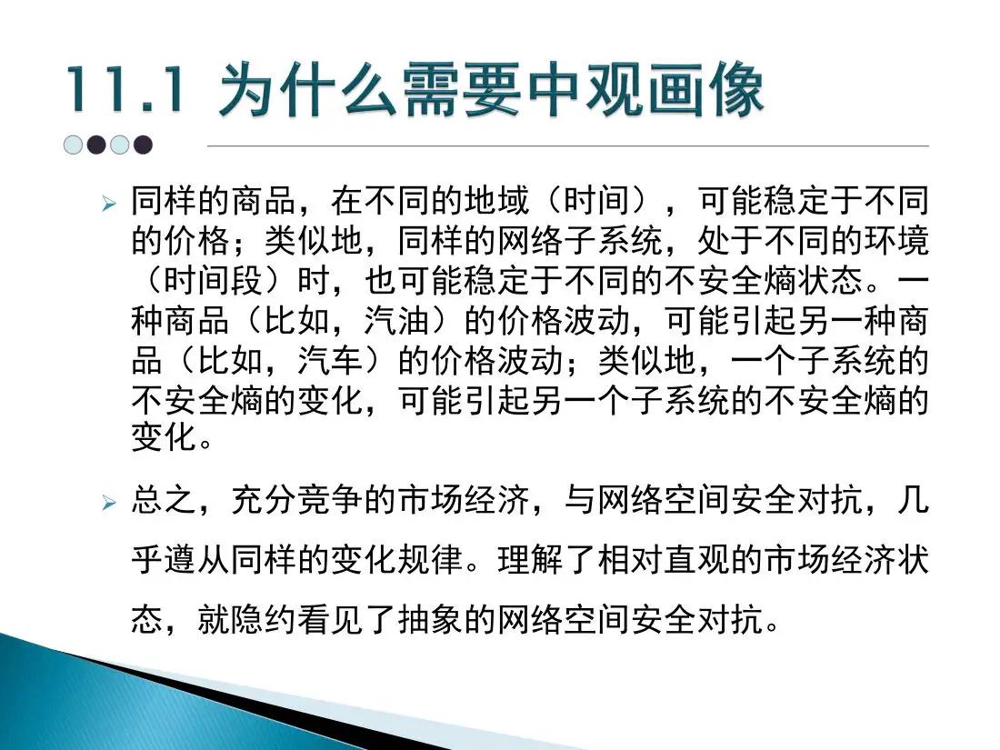

原文：

11.1 为什么需要中观画像

➢ 同样的商品，在不同的地域（时间），可能稳定于不同的价格；类似地，同样的网络子系统，处于不同的环境（时间段）时，也可能稳定于不同的不安全熵状态。一种商品（比如，汽油）的价格波动，可能引起另一种商品（比如，汽车）的价格波动；类似地，一个子系统的不安全熵的变化，可能引起另一个子系统的不安全熵的变化。

➢ 总之，充分竞争的市场经济，与网络空间安全对抗，几乎遵从同样的变化规律。理解了相对直观的市场经济状态，就隐约看见了抽象的网络空间安全对抗。

### 11.2 安全对抗的耗散行为

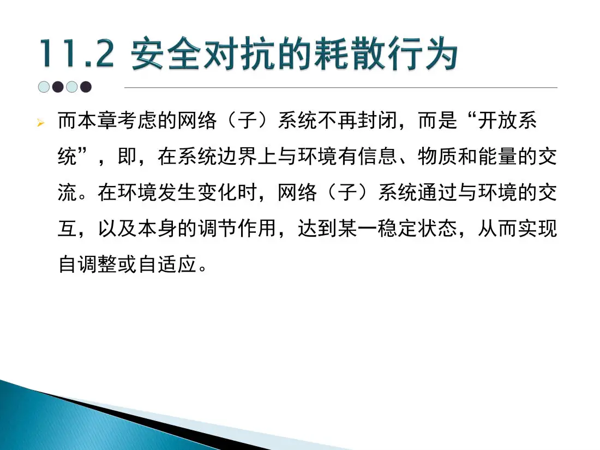

原文：

11.2 安全对抗的耗散行为

而本章考虑的网络（子）系统不再封闭，而是“开放系统”，即，在系统边界上与环境有信息、物质和能量的交流。在环境发生变化时，网络（子）系统通过与环境的交互，以及本身的调节作用，达到某一稳定状态，从而实现自调整或自适应。

### 11.2 安全对抗的耗散行为

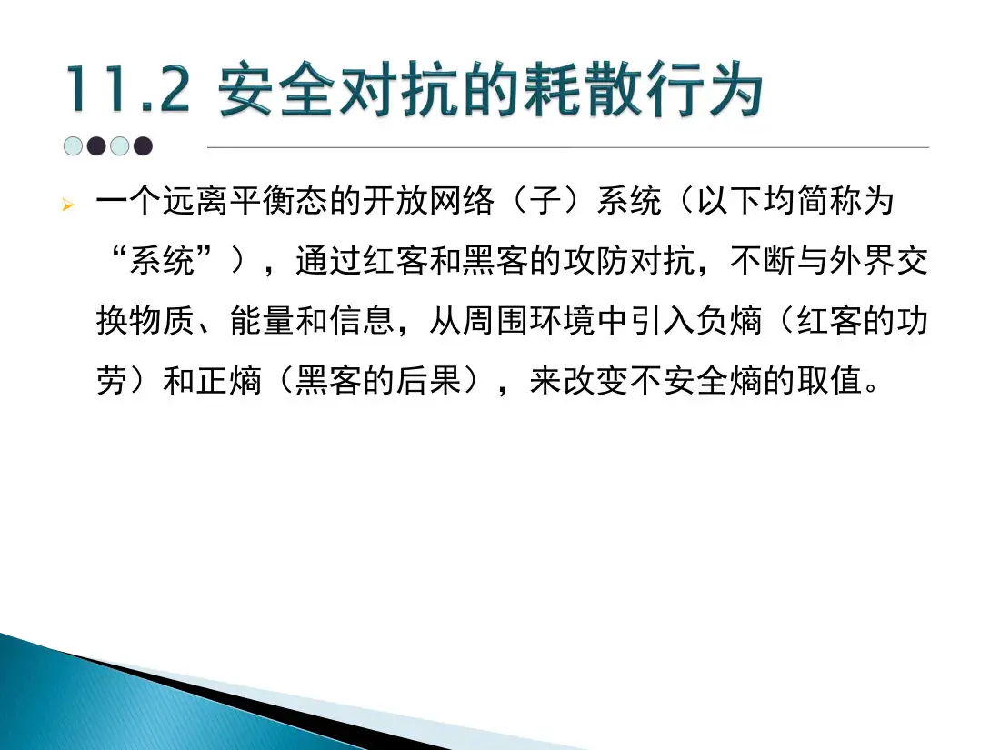

原文：

11.2 安全对抗的耗散行为

一个远离平衡态的开放网络（子）系统（以下均简称为“系统”），通过红客和黑客的攻防对抗，不断与外界交换物质、能量和信息，从周围环境中引入负熵（红客的功劳）和正熵（黑客的后果），来改变不安全熵的取值。

### 11.2 安全对抗的耗散行为

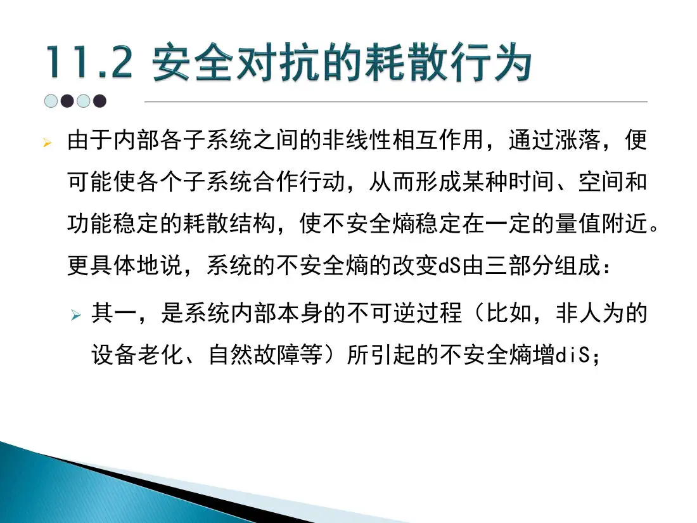

原文：

11.2 安全对抗的耗散行为

➢ 由于内部各子系统之间的非线性相互作用，通过涨落，便可能使各个子系统合作行动，从而形成某种时间、空间和功能稳定的耗散结构，使不安全熵稳定在一定的量值附近。更具体地说，系统的不安全熵的改变dS由三部分组成：

其一，是系统内部本身的不可逆过程（比如，非人为的设备老化、自然故障等）所引起的不安全熵增diS；

### 11.2 安全对抗的耗散行为

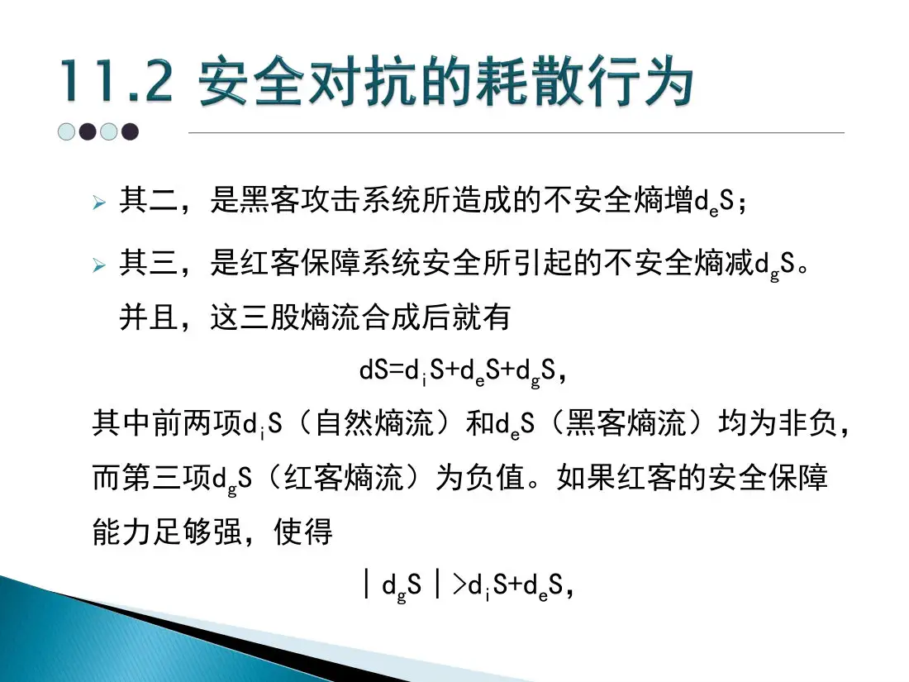

原文：

11.2 安全对抗的耗散行为

➢ 其二，是黑客攻击系统所造成的不安全熵增 ${ \mathsf { d } } _ { \mathsf { e } } { \mathsf { S } }$ ；

➢ 其三，是红客保障系统安全所引起的不安全熵减 ${ \mathsf { d } } _ { \mathsf { g } } { \mathsf { S } }$

并且，这三股熵流合成后就有

$$
d S = d _ {i} S + d _ {e} S + d _ {g} S,
$$

其中前两项 ${ \mathsf { d } } _ { \mathrm { i } } { \mathsf { S } }$ （自然熵流）和 ${ \mathsf { d } } _ { \mathsf { e } } \mathsf { S }$ （黑客熵流）均为非负，而第三项 ${ \mathsf { d } } _ { \mathsf { g } } { \mathsf { S } }$ （红客熵流）为负值。如果红客的安全保障能力足够强，使得

$$
\left| d _ {g} S \right| > d _ {i} S + d _ {e} S,
$$

### 11.2 安全对抗的耗散行为

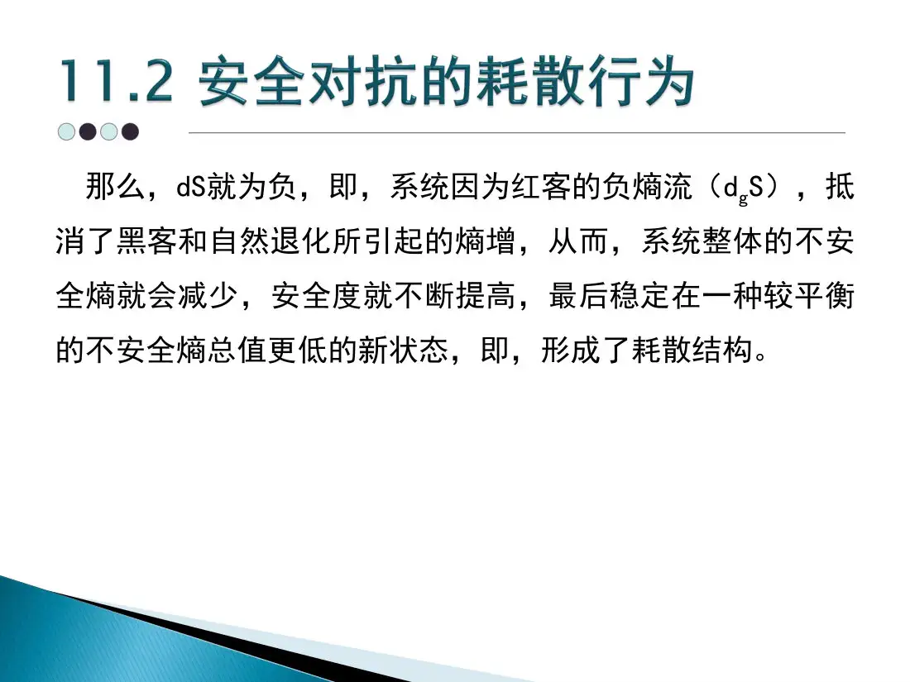

原文：

11.2 安全对抗的耗散行为

那么，dS就为负，即，系统因为红客的负熵流 $( { \mathsf { d } } _ { \mathsf { g } } { \mathsf { S } } )$ ，抵消了黑客和自然退化所引起的熵增，从而，系统整体的不安全熵就会减少，安全度就不断提高，最后稳定在一种较平衡的不安全熵总值更低的新状态，即，形成了耗散结构。

### 11.2 安全对抗的耗散行为

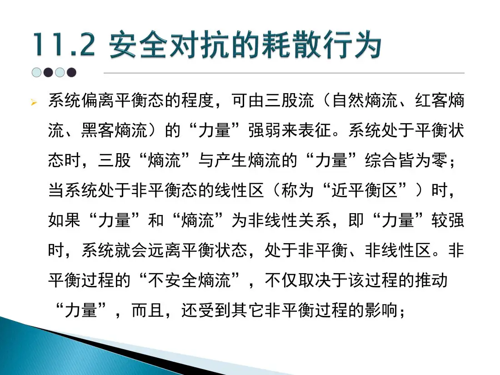

原文：

11.2 安全对抗的耗散行为

➢ 系统偏离平衡态的程度，可由三股流（自然熵流、红客熵流、黑客熵流）的“力量”强弱来表征。系统处于平衡状态时，三股“熵流”与产生熵流的“力量”综合皆为零；当系统处于非平衡态的线性区（称为“近平衡区”）时，如果“力量”和“熵流”为非线性关系，即“力量”较强时，系统就会远离平衡状态，处于非平衡、非线性区。非平衡过程的“不安全熵流”，不仅取决于该过程的推动“力量”，而且，还受到其它非平衡过程的影响；

### 11.2 安全对抗的耗散行为

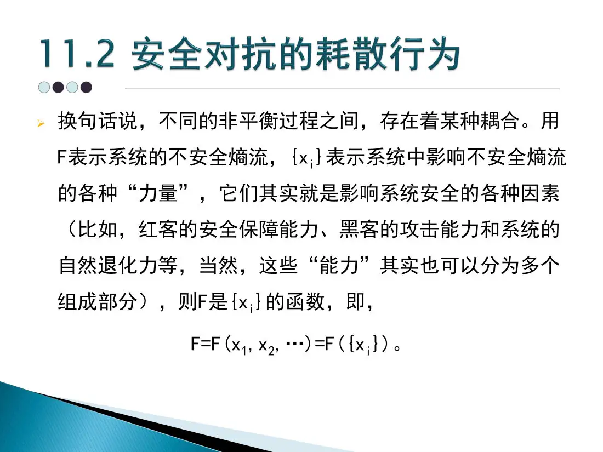

原文：

11.2 安全对抗的耗散行为

➢ 换句话说，不同的非平衡过程之间，存在着某种耦合。用F表示系统的不安全熵流， $\{ { \bf { x } } _ { \mathrm { { i } } } \}$ 表示系统中影响不安全熵流的各种“力量”，它们其实就是影响系统安全的各种因素（比如，红客的安全保障能力、黑客的攻击能力和系统的自然退化力等，当然，这些“能力”其实也可以分为多个组成部分），则F是 $\{ { \bf { x } } _ { \mathrm { { i } } } \}$ 的函数，即，

$$
F = F \left(x _ {1}, x _ {2}, \dots\right) = F \left(\left\{x _ {i} \right\}\right) 。
$$

### 11.2 安全对抗的耗散行为

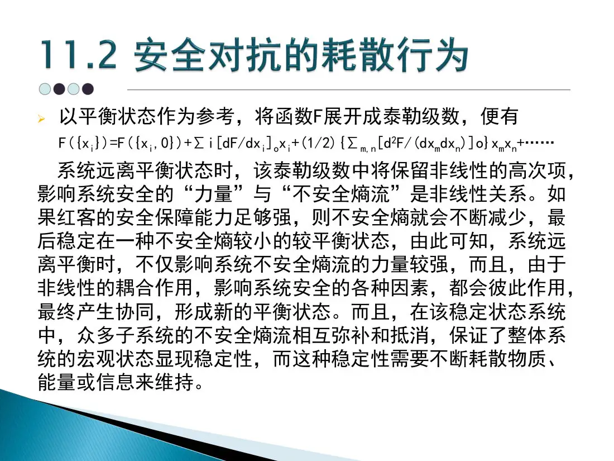

原文：

11.2 安全对抗的耗散行为

➢ 以平衡状态作为参考，将函数F展开成泰勒级数，便有

$$
F \left(\left\{x _ {i} \right\}\right) = F \left(\left\{x _ {i}, 0 \right\}\right) + \sum i [ d F / d x _ {i} ] _ {o} x _ {i} + (1 / 2) \left\{\sum_ {m, n} \left[ d ^ {2} F / \left(d x _ {m} d x _ {n}\right) \right] o \right\} x _ {m} x _ {n} + \dots \dots
$$

系统远离平衡状态时，该泰勒级数中将保留非线性的高次项，影响系统安全的“力量”与“不安全熵流”是非线性关系。如果红客的安全保障能力足够强，则不安全熵就会不断减少，最后稳定在一种不安全熵较小的较平衡状态，由此可知，系统远离平衡时，不仅影响系统不安全熵流的力量较强，而且，由于非线性的耦合作用，影响系统安全的各种因素，都会彼此作用，最终产生协同，形成新的平衡状态。而且，在该稳定状态系统中，众多子系统的不安全熵流相互弥补和抵消，保证了整体系统的宏观状态显现稳定性，而这种稳定性需要不断耗散物质、能量或信息来维持。

### 11.2 安全对抗的耗散行为

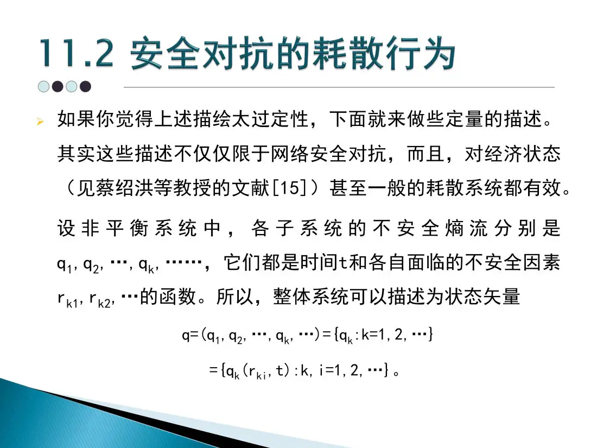

原文：

11.2 安全对抗的耗散行为

➢ 如果你觉得上述描绘太过定性，下面就来做些定量的描述。其实这些描述不仅仅限于网络安全对抗，而且，对经济状态（见蔡绍洪等教授的文献[15]）甚至一般的耗散系统都有效。设 非 平 衡 系 统 中 ， 各 子 系 统 的 不 安 全 熵 流 分 别 是${ \sf q } _ { 1 } , { \sf q } _ { 2 } , \mathrm { ~ \bar { ~ } { \sf q } ~ } _ { \mathrm { k } } , \mathrm  ~ \bar { ~ } { \sf ~ } { \sf ~ } { \sf ~ } { \sf ~ } { \sf ~ } { \sf ~ } { \sf ~ } { \sf ~ } { \sf ~ } { \sf ~ } { \sf ~ } { \sf ~ } { \sf ~ } { \sf ~ } { \sf ~ } { \sf ~ } { \sf ~ } { \sf ~ }$ ，它们都是时间t和各自面临的不安全因素$r _ { \mathrm { k } 1 } , r _ { \mathrm { k } 2 } , \cdots$ 的函数。所以，整体系统可以描述为状态矢量

$$
\begin{array}{r l} & {\mathsf {q} = (\mathsf {q} _ {1}, \mathsf {q} _ {2}, \dots , \mathsf {q} _ {k}, \dots) = \{\mathsf {q} _ {k}: k = 1, 2, \dots \}} \\ & {\qquad = \{\mathsf {q} _ {k} (r _ {k i}, t): k, i = 1, 2, \dots \}.} \end{array}
$$

### 11.2 安全对抗的耗散行为

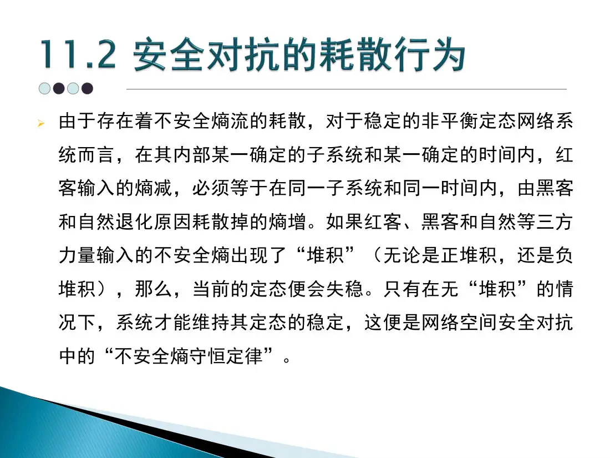

原文：

11.2 安全对抗的耗散行为

➢ 由于存在着不安全熵流的耗散，对于稳定的非平衡定态网络系统而言，在其内部某一确定的子系统和某一确定的时间内，红客输入的熵减，必须等于在同一子系统和同一时间内，由黑客和自然退化原因耗散掉的熵增。如果红客、黑客和自然等三方力量输入的不安全熵出现了“堆积”（无论是正堆积，还是负堆积），那么，当前的定态便会失稳。只有在无“堆积”的情况下，系统才能维持其定态的稳定，这便是网络空间安全对抗中的“不安全熵守恒定律”。

### 11.2 安全对抗的耗散行为

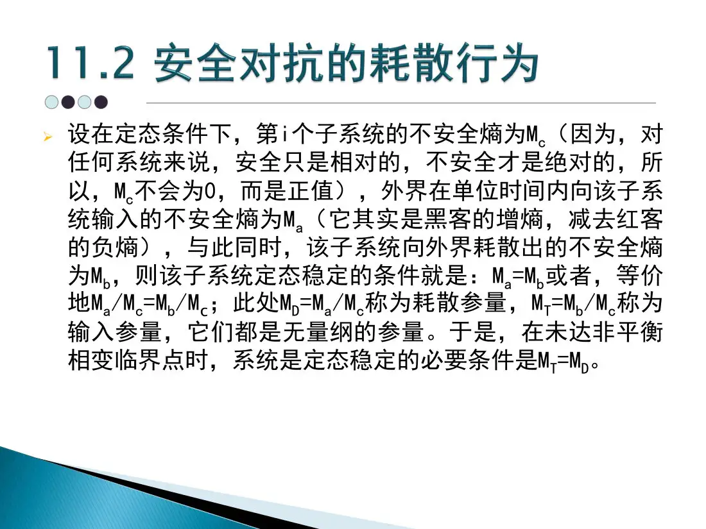

原文：

11.2 安全对抗的耗散行为

➢ 设在定态条件下，第i个子系统的不安全熵为 $\mathsf { M } _ { \mathrm { c } }$ （因为，对任何系统来说，安全只是相对的，不安全才是绝对的，所以， $\mathsf { M } _ { \mathrm { c } }$ 不会为0，而是正值），外界在单位时间内向该子系统输入的不安全熵为 $\mathsf { M } _ { \mathsf { a } }$ （它其实是黑客的增熵，减去红客的负熵），与此同时，该子系统向外界耗散出的不安全熵为 $\mathsf { M } _ { \mathrm { b } }$ ，则该子系统定态稳定的条件就是： $u _ { a } = u _ { b }$ 或者，等价地M $\mathsf { \Pi } _ { \mathsf { a } } / \mathsf { M } _ { \mathsf { c } } { = } \mathsf { M } _ { \mathsf { b } } / \mathsf { M } _ { \mathsf { c } }$ ；此处 $n _ { 0 } = M _ { a } / M _ { c }$ 称为耗散参量， $n _ { \mathrm { 7 } } = M _ { \mathrm { b } } / M _ { \mathrm { c } }$ 称为输入参量，它们都是无量纲的参量。于是，在未达非平衡相变临界点时，系统是定态稳定的必要条件是 $u _ { T } = u _ { \mathrm { 0 } }$

### 11.2 安全对抗的耗散行为

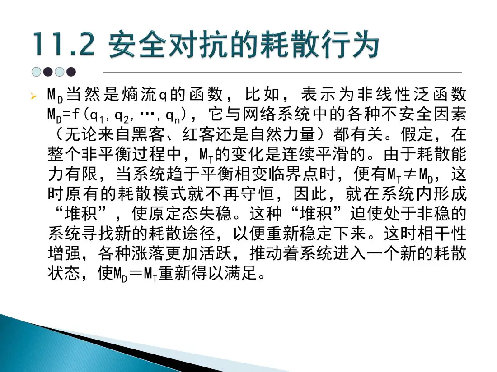

原文：

11.2 安全对抗的耗散行为

➢ $\mathsf { M } _ { \mathsf { D } }$ 当然是熵流 $\mathsf { q }$ 的函数，比如，表示为非线性泛函数${ \sf M } _ { \sf D } { = } { \sf f } \left( { \sf q } _ { 1 } , { \sf q } _ { 2 } , \cdots , { \sf q } _ { n } \right)$ ，它与网络系统中的各种不安全因素（无论来自黑客、红客还是自然力量）都有关。假定，在整个非平衡过程中， ${ \sf M } _ { \sf 7 }$ 的变化是连续平滑的。由于耗散能力有限，当系统趋于平衡相变临界点时，便有 $\mathsf { M } _ { \mathsf { T } } \neq \mathsf { M } _ { \mathsf { D } }$ ，这时原有的耗散模式就不再守恒，因此，就在系统内形成“堆积”，使原定态失稳。这种“堆积”迫使处于非稳的系统寻找新的耗散途径，以便重新稳定下来。这时相干性增强，各种涨落更加活跃，推动着系统进入一个新的耗散状态，使 ${ \sf M } _ { \sf D } = { \sf M } _ { \sf T }$ 重新得以满足。

### 11.2 安全对抗的耗散行为

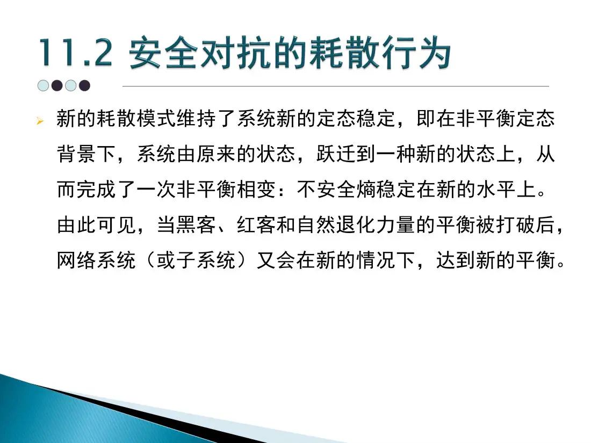

原文：

11.2 安全对抗的耗散行为

➢ 新的耗散模式维持了系统新的定态稳定，即在非平衡定态背景下，系统由原来的状态，跃迁到一种新的状态上，从而完成了一次非平衡相变：不安全熵稳定在新的水平上。由此可见，当黑客、红客和自然退化力量的平衡被打破后，网络系统（或子系统）又会在新的情况下，达到新的平衡。

### 11.3 安全态势中观画像的解释

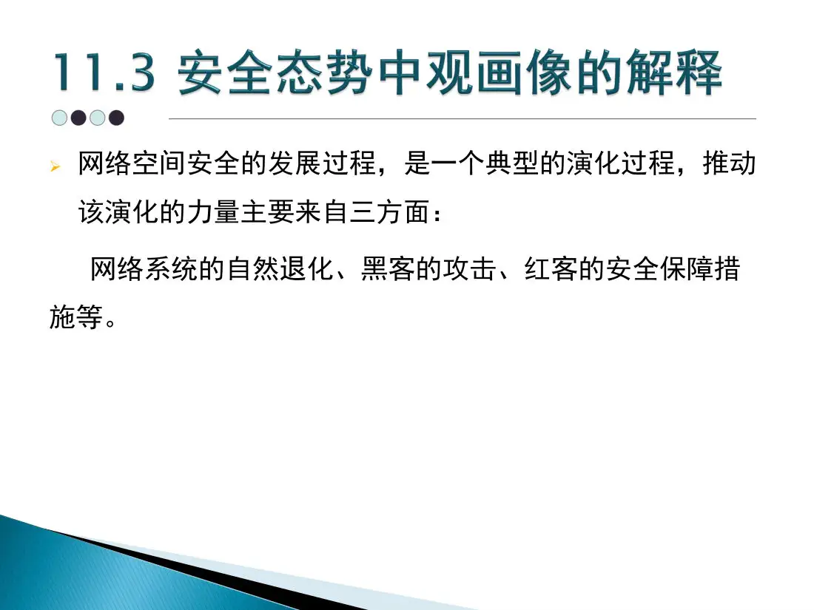

原文：

11.3 安全态势中观画像的解释

➢ 网络空间安全的发展过程，是一个典型的演化过程，推动该演化的力量主要来自三方面：

网络系统的自然退化、黑客的攻击、红客的安全保障措施等。

### 11.3 安全态势中观画像的解释

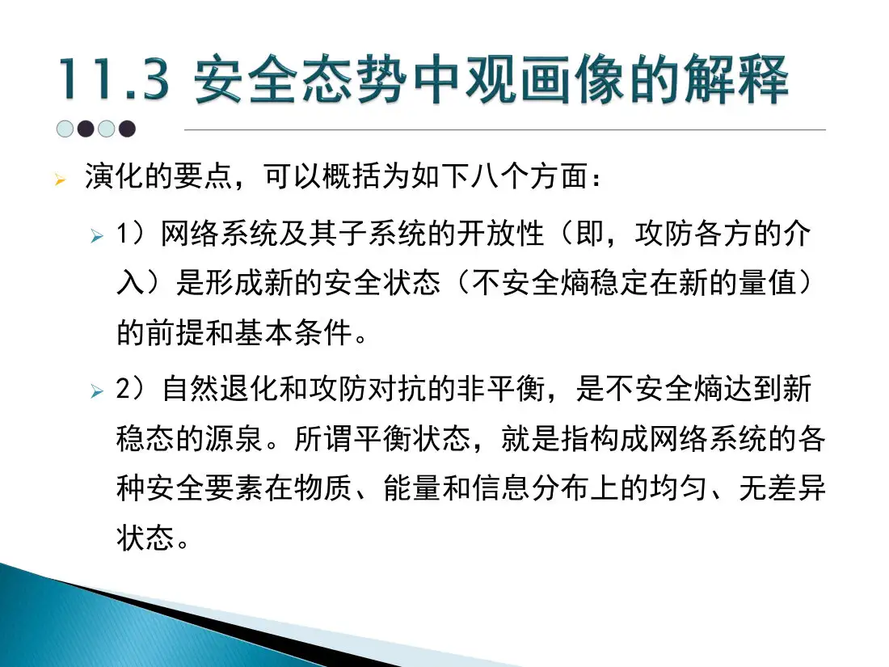

原文：

11.3 安全态势中观画像的解释

➢ 演化的要点，可以概括为如下八个方面：

➢ 1）网络系统及其子系统的开放性（即，攻防各方的介入）是形成新的安全状态（不安全熵稳定在新的量值）的前提和基本条件。

➢ 2）自然退化和攻防对抗的非平衡，是不安全熵达到新稳态的源泉。所谓平衡状态，就是指构成网络系统的各种安全要素在物质、能量和信息分布上的均匀、无差异状态。

### 11.3 安全态势中观画像的解释

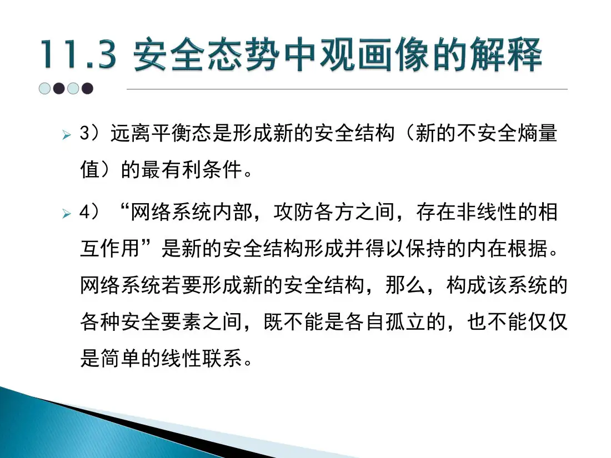

原文：

11.3 安全态势中观画像的解释

➢ 3）远离平衡态是形成新的安全结构（新的不安全熵量值）的最有利条件。

➢ 4）“网络系统内部，攻防各方之间，存在非线性的相互作用”是新的安全结构形成并得以保持的内在根据。网络系统若要形成新的安全结构，那么，构成该系统的各种安全要素之间，既不能是各自孤立的，也不能仅仅是简单的线性联系。

### 11.3 安全态势中观画像的解释

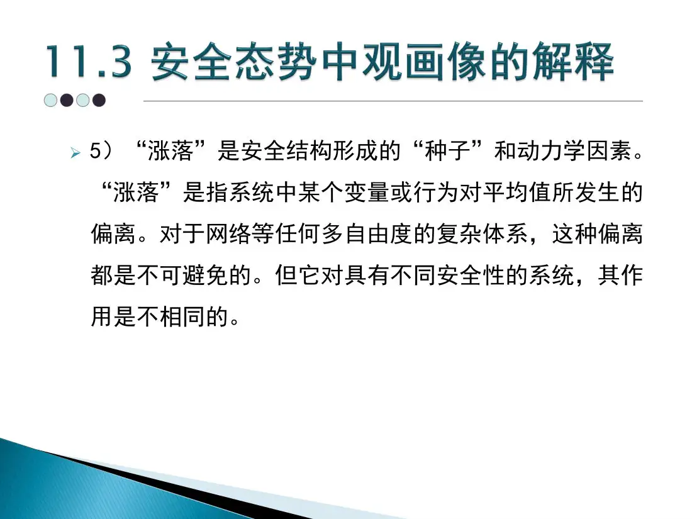

原文：

11.3 安全态势中观画像的解释

➢ 5）“涨落”是安全结构形成的“种子”和动力学因素。“涨落”是指系统中某个变量或行为对平均值所发生的偏离。对于网络等任何多自由度的复杂体系，这种偏离都是不可避免的。但它对具有不同安全性的系统，其作用是不相同的。

### 11.3 安全态势中观画像的解释

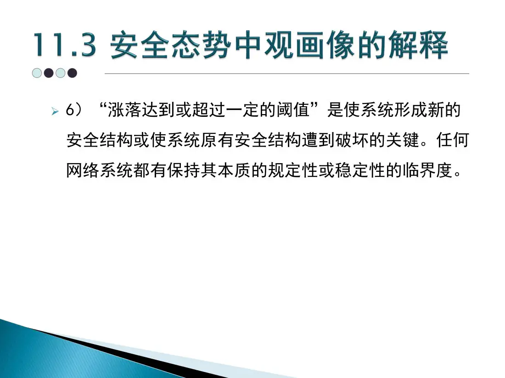

原文：

11.3 安全态势中观画像的解释

➢ 6）“涨落达到或超过一定的阈值”是使系统形成新的安全结构或使系统原有安全结构遭到破坏的关键。任何网络系统都有保持其本质的规定性或稳定性的临界度。

### 11.3 安全态势中观画像的解释

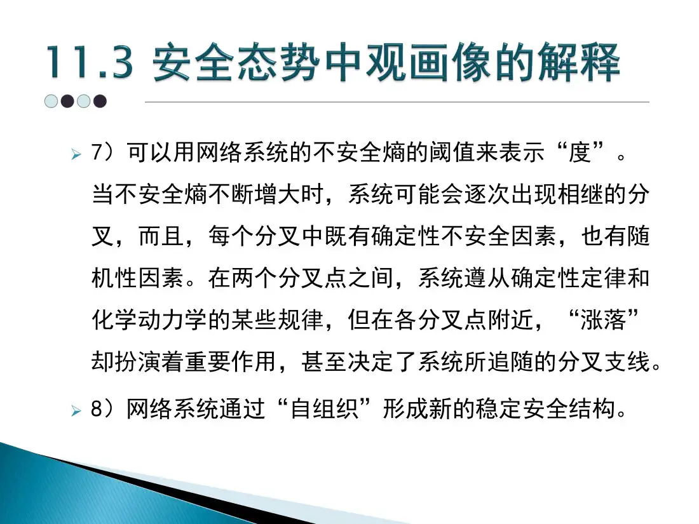

原文：

11.3 安全态势中观画像的解释

➢ 7）可以用网络系统的不安全熵的阈值来表示“度”。当不安全熵不断增大时，系统可能会逐次出现相继的分叉，而且，每个分叉中既有确定性不安全因素，也有随机性因素。在两个分叉点之间，系统遵从确定性定律和化学动力学的某些规律，但在各分叉点附近，“涨落”却扮演着重要作用，甚至决定了系统所追随的分叉支线。

➢ 8）网络系统通过“自组织”形成新的稳定安全结构。

### 11.4 类比的闲话

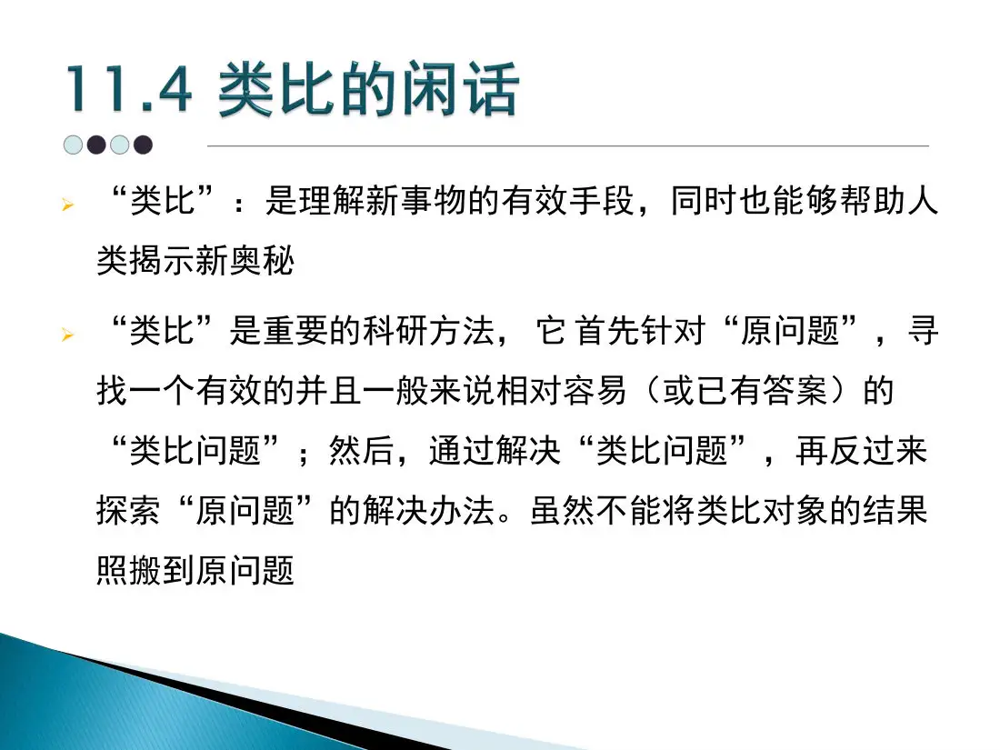

原文：

11.4 类比的闲话

➢ “类比”：是理解新事物的有效手段，同时也能够帮助人 类揭示新奥秘

“类比”是重要的科研方法，它首先针对“原问题”，寻找一个有效的并且一般来说相对容易（或已有答案）的“类比问题”；然后，通过解决“类比问题”，再反过来探索“原问题”的解决办法。虽然不能将类比对象的结果照搬到原问题

### 11.4 类比的闲话

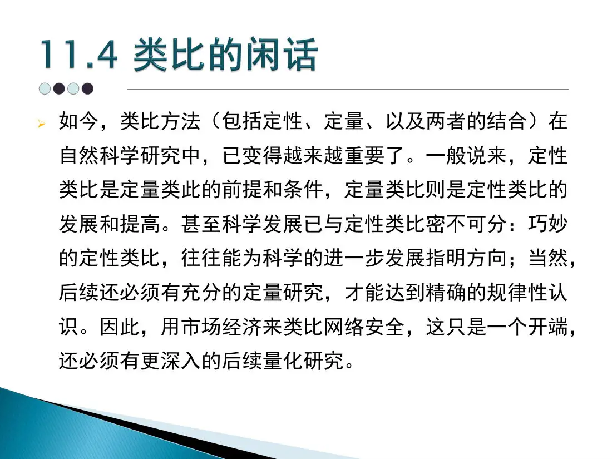

原文：

11.4 类比的闲话

➢ 如今，类比方法（包括定性、定量、以及两者的结合）在自然科学研究中，已变得越来越重要了。一般说来，定性类比是定量类此的前提和条件，定量类比则是定性类比的发展和提高。甚至科学发展已与定性类比密不可分：巧妙的定性类比，往往能为科学的进一步发展指明方向；当然，后续还必须有充分的定量研究，才能达到精确的规律性认识。因此，用市场经济来类比网络安全，这只是一个开端，还必须有更深入的后续量化研究。

### 11.4 类比的闲话

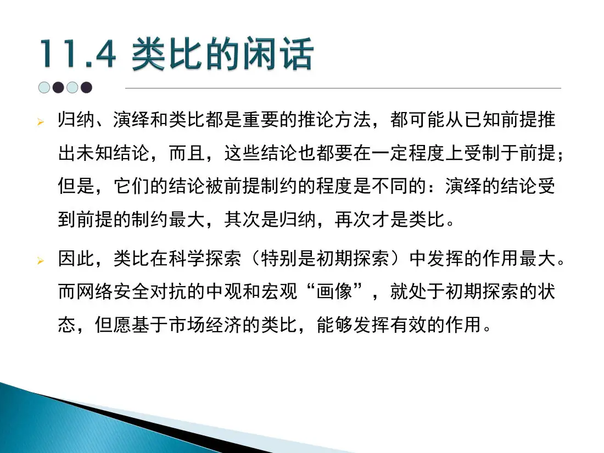

原文：

11.4 类比的闲话

归纳、演绎和类比都是重要的推论方法，都可能从已知前提推出未知结论，而且，这些结论也都要在一定程度上受制于前提；但是，它们的结论被前提制约的程度是不同的：演绎的结论受到前提的制约最大，其次是归纳，再次才是类比。

➢ 因此，类比在科学探索（特别是初期探索）中发挥的作用最大。而网络安全对抗的中观和宏观“画像”，就处于初期探索的状态，但愿基于市场经济的类比，能够发挥有效的作用。

### 本章结束，谢谢

原文：

本章结束，谢谢
