# 《安全通论》第12章 红客与黑客间接对抗的演化规律（课件）

原件的每一页，下面附识别出的文字。

### 第12章---红客与黑客间接对抗的演化规律

原文：

第12章---红客与黑客间接对抗的演化规律

### 第12章红客与黑客间接对抗的演化规律

原文：

第12章红客与黑客间接对抗的演化规律

随着网络安全攻防全民化趋势的发展，“间接对抗”将变得越来越普及，此时攻防双方完全可以雇佣专业的红客或黑客来为自己服务。另外，从演化规律来看，间接对抗与直接对抗，其实并无区别。

所以，本章借助进化论思想，以经济目标为量化手段，利用协同学中的现成结果，来建立网络空间安全攻防的演化模型，并给出具体的安全演化行为公式，及其解析解的稳定性分析。

### 第12章红客与黑客间接对抗的演化规律

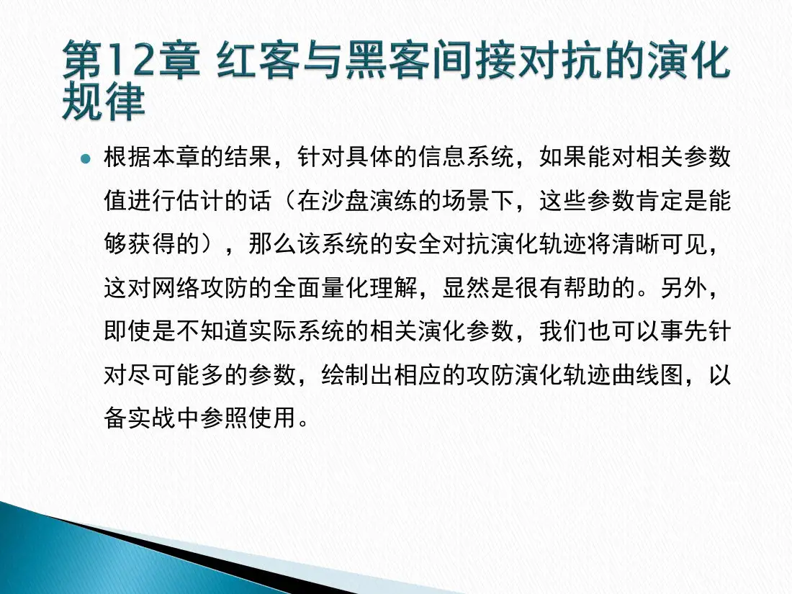

原文：

第12章红客与黑客间接对抗的演化规律

根据本章的结果，针对具体的信息系统，如果能对相关参数值进行估计的话（在沙盘演练的场景下，这些参数肯定是能够获得的），那么该系统的安全对抗演化轨迹将清晰可见，这对网络攻防的全面量化理解，显然是很有帮助的。另外，即使是不知道实际系统的相关演化参数，我们也可以事先针对尽可能多的参数，绘制出相应的攻防演化轨迹曲线图，以备实战中参照使用。

### 第12章红客与黑客间接对抗的演化规律

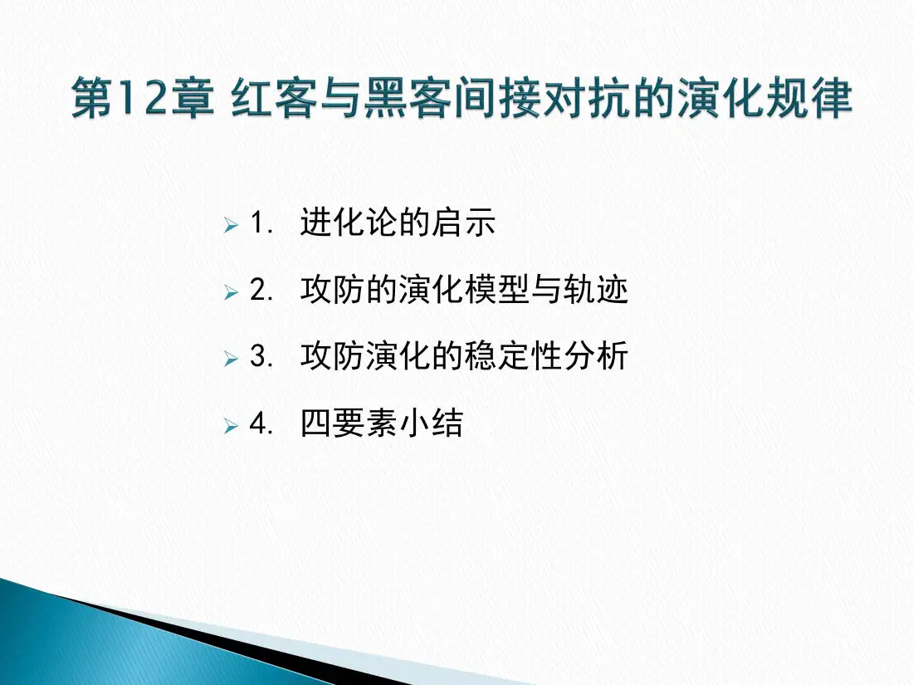

原文：

第12章红客与黑客间接对抗的演化规律

1. 进化论的启示
2. 攻防的演化模型与轨迹
3. 攻防演化的稳定性分析
4. 四要素小结

### 12.1 进化论的启示

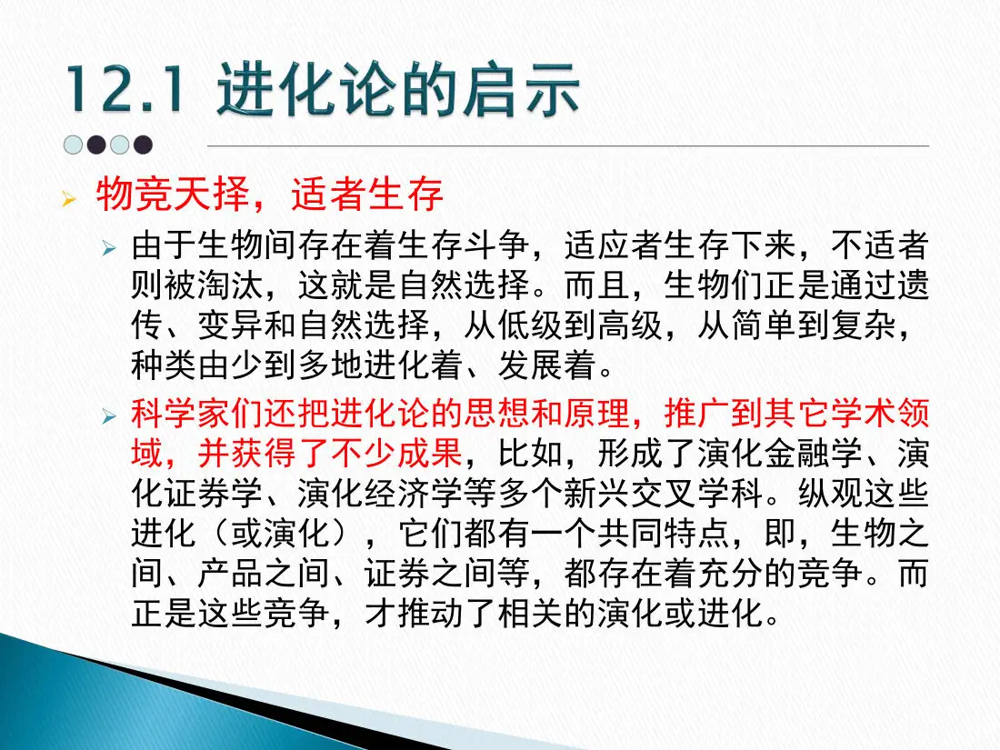

原文：

12.1 进化论的启示

物竞天择，适者生存

➢ 由于生物间存在着生存斗争，适应者生存下来，不适者则被淘汰，这就是自然选择。而且，生物们正是通过遗传、变异和自然选择，从低级到高级，从简单到复杂，种类由少到多地进化着、发展着。

科学家们还把进化论的思想和原理，推广到其它学术领域，并获得了不少成果，比如，形成了演化金融学、演化证券学、演化经济学等多个新兴交叉学科。纵观这些进化（或演化），它们都有一个共同特点，即，生物之间、产品之间、证券之间等，都存在着充分的竞争。而正是这些竞争，才推动了相关的演化或进化。

### 12.1 进化论的启示

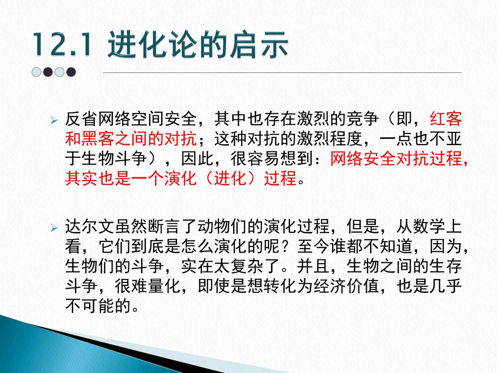

原文：

12.1 进化论的启示

反省网络空间安全，其中也存在激烈的竞争（即，红客和黑客之间的对抗；这种对抗的激烈程度，一点也不亚于生物斗争），因此，很容易想到：网络安全对抗过程，其实也是一个演化（进化）过程。

➢ 达尔文虽然断言了动物们的演化过程，但是，从数学上看，它们到底是怎么演化的呢？至今谁都不知道，因为，生物们的斗争，实在太复杂了。并且，生物之间的生存斗争，很难量化，即使是想转化为经济价值，也是几乎不可能的。

### 12.1 进化论的启示

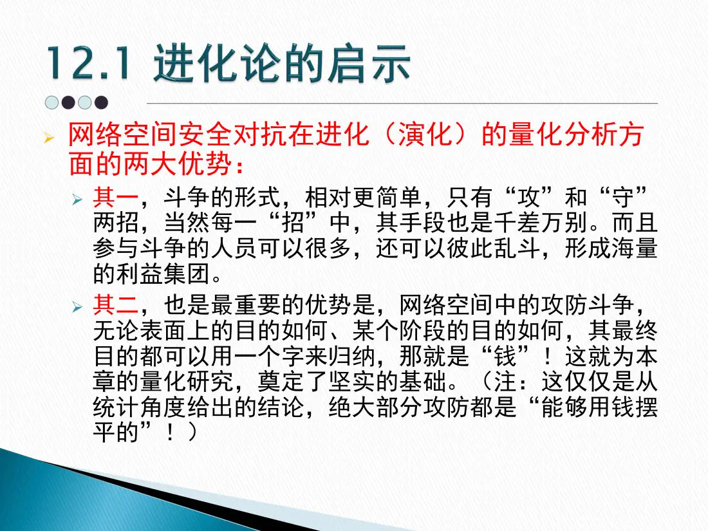

原文：

12.1 进化论的启示

网络空间安全对抗在进化（演化）的量化分析方面的两大优势：

➢ 其一，斗争的形式，相对更简单，只有“攻”和“守”两招，当然每一“招”中，其手段也是千差万别。而且参与斗争的人员可以很多，还可以彼此乱斗，形成海量的利益集团。

其二，也是最重要的优势是，网络空间中的攻防斗争，无论表面上的目的如何、某个阶段的目的如何，其最终目的都可以用一个字来归纳，那就是“钱”！这就为本章的量化研究，奠定了坚实的基础。（注：这仅仅是从统计角度给出的结论，绝大部分攻防都是“能够用钱摆平的”！）

### 12.1 进化论的启示

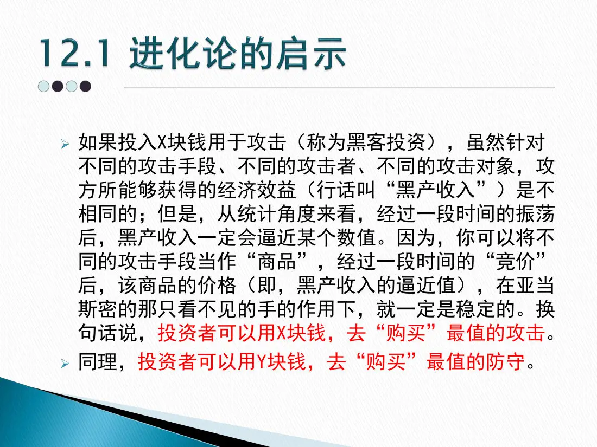

原文：

12.1 进化论的启示

如果投入X块钱用于攻击（称为黑客投资），虽然针对不同的攻击手段、不同的攻击者、不同的攻击对象，攻方所能够获得的经济效益（行话叫“黑产收入”）是不相同的；但是，从统计角度来看，经过一段时间的振荡后，黑产收入一定会逼近某个数值。因为，你可以将不同的攻击手段当作“商品”，经过一段时间的“竞价”后，该商品的价格（即，黑产收入的逼近值），在亚当斯密的那只看不见的手的作用下，就一定是稳定的。换句话说，投资者可以用X块钱，去“购买”最值的攻击。同理，投资者可以用Y块钱，去“购买”最值的防守。

### 12.1进化论的启示

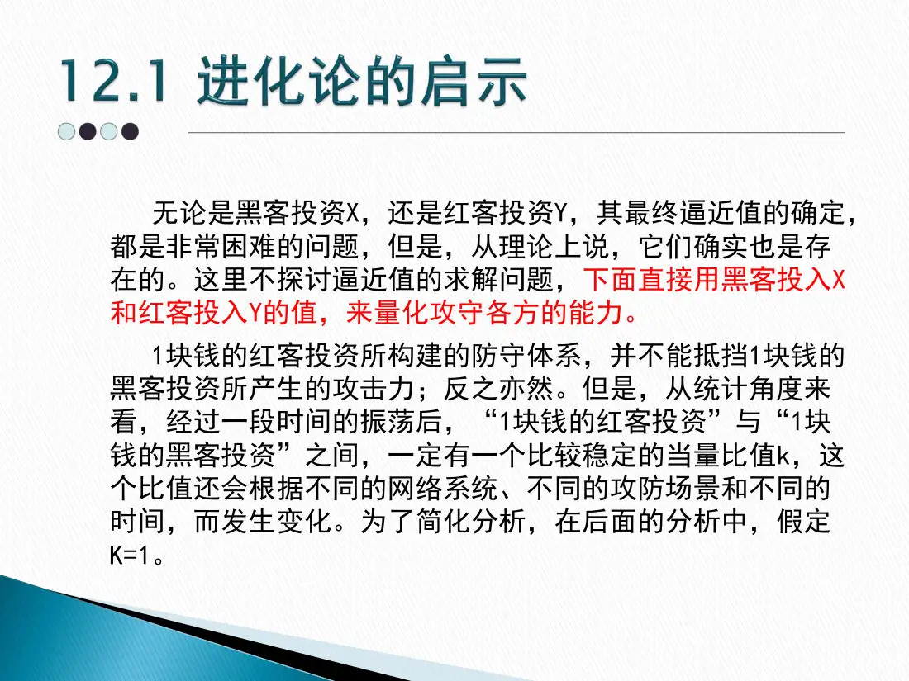

原文：

12.1进化论的启示

无论是黑客投资X，还是红客投资Y，其最终逼近值的确定，都是非常困难的问题，但是，从理论上说，它们确实也是存在的。这里不探讨逼近值的求解问题，下面直接用黑客投入X和红客投入Y的值，来量化攻守各方的能力。

1块钱的红客投资所构建的防守体系，并不能抵挡1块钱的黑客投资所产生的攻击力；反之亦然。但是，从统计角度来看，经过一段时间的振荡后，“1块钱的红客投资”与“1块钱的黑客投资”之间，一定有一个比较稳定的当量比值k，这个比值还会根据不同的网络系统、不同的攻防场景和不同的时间，而发生变化。为了简化分析，在后面的分析中，假定K=1。

### 12.2攻防的演化模型与轨迹

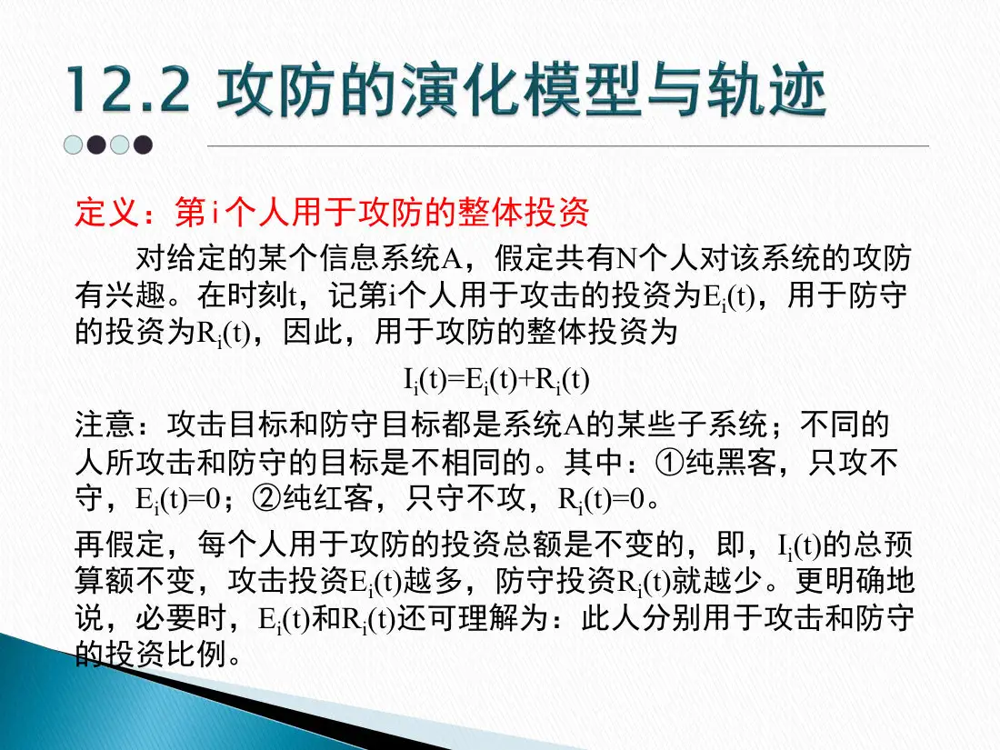

原文：

12.2攻防的演化模型与轨迹

定义：第i个人用于攻防的整体投资

对给定的某个信息系统A，假定共有N个人对该系统的攻防有兴趣。在时刻t，记第i个人用于攻击的投资为 $\mathrm { E _ { i } ( t ) }$ 用于防守的投资为 $\mathrm { R _ { i } ( t ) }$ ，因此，用于攻防的整体投资为

$$
\mathrm{I} _ {\mathrm{i}} (\mathrm{t}) = \mathrm{E} _ {\mathrm{i}} (\mathrm{t}) + \mathrm{R} _ {\mathrm{i}} (\mathrm{t})
$$

注意：攻击目标和防守目标都是系统A的某些子系统；不同的人所攻击和防守的目标是不相同的。其中：①纯黑客，只攻不守， $\mathrm { E _ { i } ( t ) = 0 }$ ；②纯红客，只守不攻， $\operatorname { R } _ { \mathrm { i } } ( { \mathrm { t } } ) = 0$ o

再假定，每个人用于攻防的投资总额是不变的，即， $\mathrm { I _ { i } ( t ) }$ 的总预算额不变，攻击投资 $\mathrm { E _ { i } ( t ) }$ 越多，防守投资 $\mathrm { R _ { i } ( t ) }$ 就越少。更明确地说，必要时， $\mathrm { E _ { i } ( t ) }$ 和 $\mathrm { R _ { i } ( t ) }$ 还可理解为：此人分别用于攻击和防守的投资比例。

### 12.2攻防的演化模型与轨迹

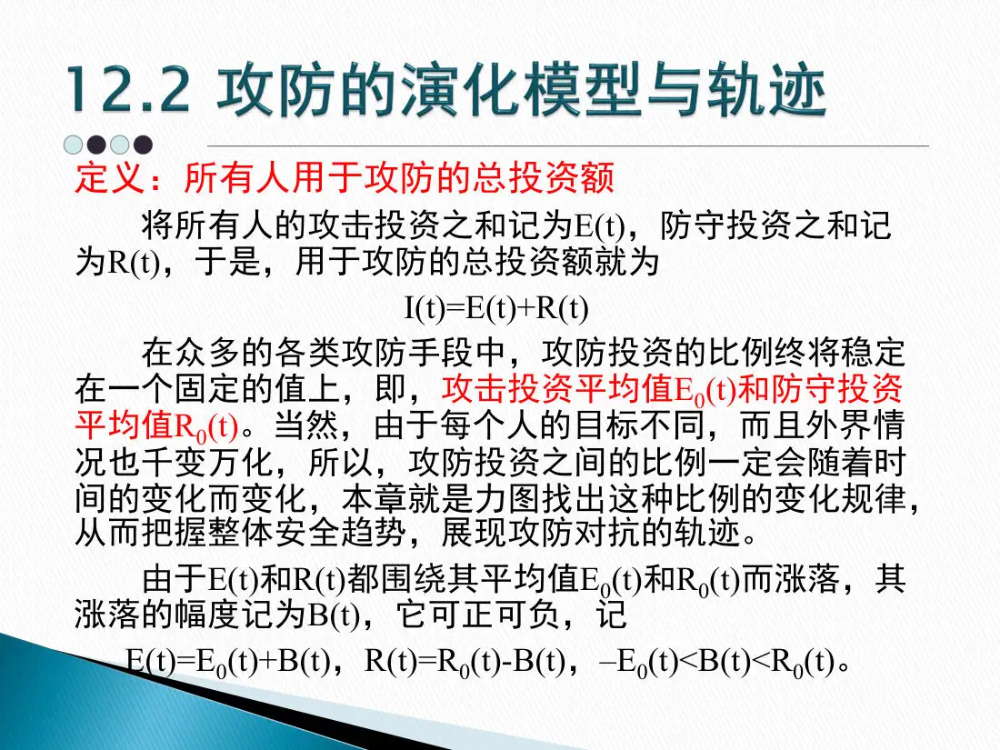

原文：

12.2攻防的演化模型与轨迹

定义：所有人用于攻防的总投资额

将所有人的攻击投资之和记为E(t)，防守投资之和记为R(t)，于是，用于攻防的总投资额就为

$$
\mathrm{I} (t) = \mathrm{E} (t) + \mathrm{R} (t)
$$

在众多的各类攻防手段中，攻防投资的比例终将稳定在一个固定的值上，即，攻击投资平均值 $\mathrm { E _ { 0 } ( t ) }$ 和防守投资平均值 $\mathrm { R _ { 0 } ( t ) }$ 。当然，由于每个人的目标不同，而且外界情况也千变万化，所以，攻防投资之间的比例一定会随着时间的变化而变化，本章就是力图找出这种比例的变化规律，从而把握整体安全趋势，展现攻防对抗的轨迹。

由于E(t)和R(t)都围绕其平均值 $\mathrm { E _ { 0 } ( t ) }$ 和 $\mathrm { R _ { 0 } ( t ) }$ 而涨落，其涨落的幅度记为B(t)，它可正可负，记

$$
\mathrm{E} (t) = \mathrm{E} _ {0} (t) + \mathrm{B} (t), \quad \mathrm{R} (t) = \mathrm{R} _ {0} (t) - \mathrm{B} (t), \quad - \mathrm{E} _ {0} (t) <   \mathrm{B} (t) <   \mathrm{R} _ {0} (t) 。
$$

### 12.2攻防的演化模型与轨迹

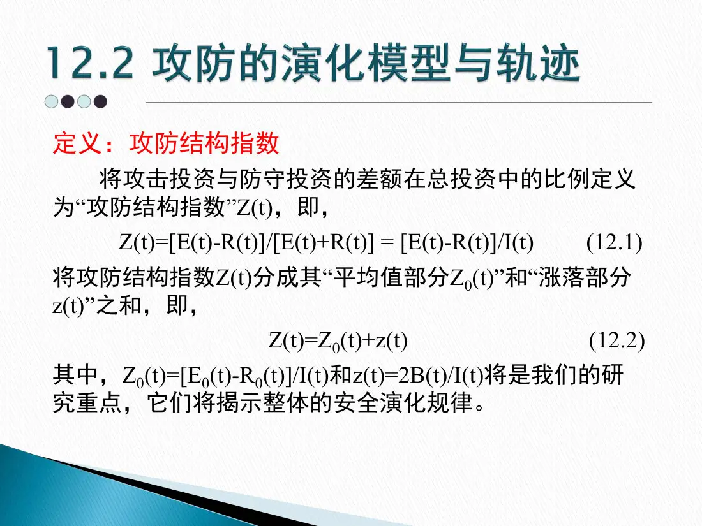

原文：

12.2攻防的演化模型与轨迹

定义：攻防结构指数

将攻击投资与防守投资的差额在总投资中的比例定义为“攻防结构指数”Z(t)，即，

$$
Z (t) = [ E (t) - R (t) ] / [ E (t) + R (t) ] = [ E (t) - R (t) ] / I (t)\tag{12.1}
$$

将攻防结构指数Z(t)分成其“平均值部分 $Z _ { 0 } ( \mathrm { t } ) ^ { , , }$ 和“涨落部分$\boldsymbol { z } ( \mathrm { t } ) ^ { \dag }$ 之和，即，

$$
Z (t) = Z _ {0} (t) + z (t)\tag{12.2}
$$

其中， ${ Z _ { 0 } ( \mathrm { t } ) } \mathrm { { = } } { \mathrm { { [ E _ { 0 } ( \mathrm { t } ) - R _ { 0 } ( \mathrm { t } ) ] / I ( \mathrm { t } ) } } }$ 和 $\mathrm { z ( t ) { = } } 2 \mathrm { B ( t ) / I ( t ) }$ 将是我们的研究重点，它们将揭示整体的安全演化规律。

### 12.2攻防的演化模型与轨迹

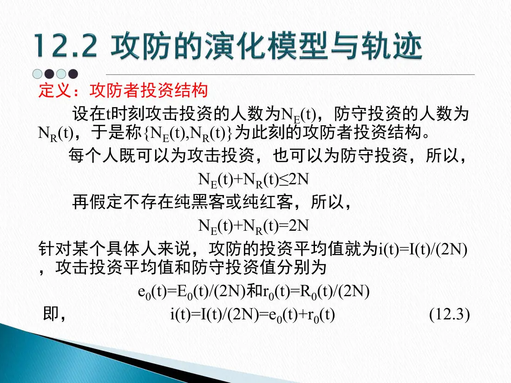

原文：

12.2攻防的演化模型与轨迹

定义：攻防者投资结构

设在t时刻攻击投资的人数为 $\mathrm { { N } _ { E } ( t ) }$ 防守投资的人数为$\mathrm { { N _ { R } ( t ) } }$ ，于是称 $\{ \mathrm { N _ { E } ( t ) , N _ { R } ( t ) } \}$ 为此刻的攻防者投资结构。

每个人既可以为攻击投资，也可以为防守投资，所以，

$$
\mathrm{N} _ {\mathrm{E}} (t) + \mathrm{N} _ {\mathrm{R}} (t) \leq 2 \mathrm{N}
$$

再假定不存在纯黑客或纯红客，所以，

$$
\mathrm{N} _ {\mathrm{E}} (t) + \mathrm{N} _ {\mathrm{R}} (t) = 2 \mathrm{N}
$$

针对某个具体人来说，攻防的投资平均值就为 $\mathrm { i } ( \mathrm { t } ) { = } \mathrm { I } ( \mathrm { t } ) / ( 2 \mathrm { N } )$ ，攻击投资平均值和防守投资值分别为

即，

$$
\begin{array}{r l} & {\mathbf {e} _ {0} (t) = \mathrm{E} _ {0} (t) / (2 \mathrm{N}) \text {和} \mathbf {r} _ {0} (t) = \mathrm{R} _ {0} (t) / (2 \mathrm{N})} \\ & {\quad \mathbf {i} (t) = \mathrm{I} (t) / (2 \mathrm{N}) = \mathbf {e} _ {0} (t) + \mathbf {r} _ {0} (t)} \end{array}\tag{12.3}
$$

### 12.2攻防的演化模型与轨迹

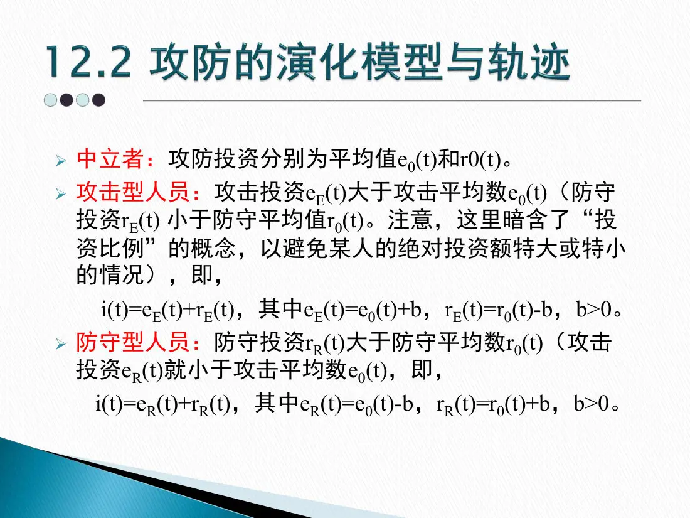

原文：

12.2攻防的演化模型与轨迹

➢ 中立者：攻防投资分别为平均值 $\mathrm { e } _ { 0 } ( \mathrm { t } )$ 和r0(t)。

➢ 攻击型人员：攻击投资 $\mathrm { e _ { E } ( t ) }$ 大于攻击平均数 $\mathrm { e } _ { 0 } ( \mathrm { t } )$ （防守投资 $\mathbf { r } _ { \mathrm { E } } ( \mathrm { t } )$ 小于防守平均值 $\mathbf { r } _ { 0 } ( \mathrm { t } )$ 。注意，这里暗含了“投资比例”的概念，以避免某人的绝对投资额特大或特小的情况），即，

$\mathrm { i } ( \mathrm { t } ) { = } \mathrm { e _ { E } } ( \mathrm { t } ) { + } \mathrm { r _ { E } } ( \mathrm { t } )$ ，其中 $\mathrm { e _ { E } ( t ) = e _ { 0 } ( t ) + b , ~ \Delta r _ { E } ( t ) = r _ { 0 } ( t ) - b , ~ \Delta b > 0 ~ }$ 。

➢ 防守型人员：防守投资 ${ \bf r } _ { \mathrm { R } } ( { \bf t } )$ 大于防守平均数 $\Gamma _ { 0 } ( \mathrm { t } )$ （攻击投资 $\mathrm { e _ { R } ( t ) }$ 就小于攻击平均数 $\mathrm { e } _ { 0 } ( \mathrm { t } )$ ，即，

i(t) $\mathrm { - e _ { R } ( t ) + r _ { R } ( t ) }$ ，其中 $\mathrm { e _ { \mathrm { R } } ( t ) = e _ { 0 } ( t ) - b , } ~ \mathrm { { r _ { \mathrm { R } } ( t ) = r _ { 0 } ( t ) + b , } ~ \ b > 0 }$ 。

### 12.2攻防的演化模型与轨迹

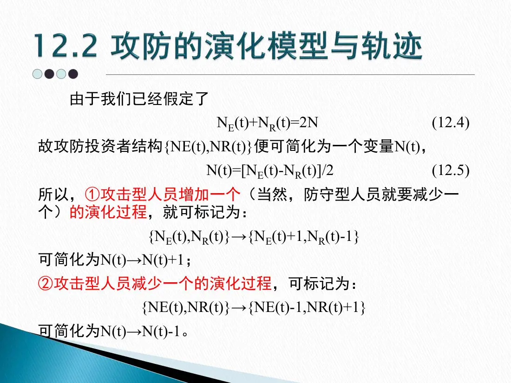

原文：

12.2攻防的演化模型与轨迹

由于我们已经假定了

$$
\mathrm{N} _ {\mathrm{E}} (\mathfrak {t}) + \mathrm{N} _ {\mathrm{R}} (\mathfrak {t}) = 2 \mathrm{N}\tag{12.4}
$$

故攻防投资者结构{NE(t),NR(t)}便可简化为一个变量N(t)，

$$
\mathrm{N} (t) = \left[ \mathrm{N} _ {\mathrm{E}} (t) - \mathrm{N} _ {\mathrm{R}} (t) \right] / 2\tag{12.5}
$$

所以，①攻击型人员增加一个（当然，防守型人员就要减少个）的演化过程，就可标记为：

$$
\{\mathrm{N} _ {\mathrm{E}} (t), \mathrm{N} _ {\mathrm{R}} (t) \} \rightarrow \{\mathrm{N} _ {\mathrm{E}} (t) + 1, \mathrm{N} _ {\mathrm{R}} (t) - 1 \}
$$

可简化为 $\mathrm { \Delta N ( t ) \to N ( t ) + 1 }$ ；

②攻击型人员减少一个的演化过程，可标记为：

$$
\{\mathrm{NE} (t), \mathrm{NR} (t) \} \rightarrow \{\mathrm{NE} (t) - 1, \mathrm{NR} (t) + 1 \}
$$

可简化为 $\mathrm { N } ( \mathrm { t } ) {  } \mathrm { N } ( \mathrm { t } ) { - } 1$ 。

### 12.2攻防的演化模型与轨迹

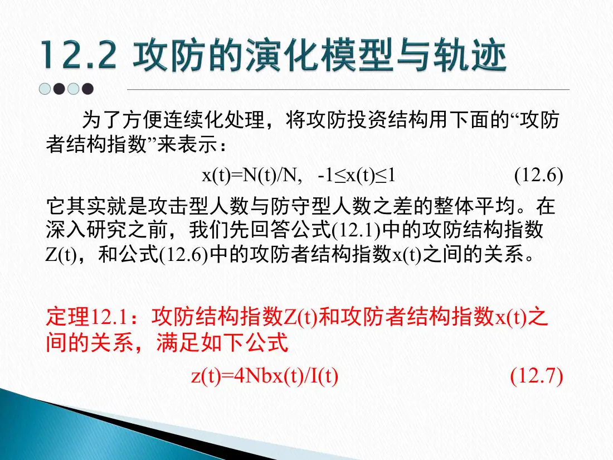

原文：

12.2攻防的演化模型与轨迹

为了方便连续化处理，将攻防投资结构用下面的“攻防者结构指数”来表示：

$$
\mathrm{x} (t) = \mathrm{N} (t) / \mathrm{N}, - 1 \leq \mathrm{x} (t) \leq 1\tag{12.6}
$$

它其实就是攻击型人数与防守型人数之差的整体平均。在深入研究之前，我们先回答公式(12.1)中的攻防结构指数Z(t)，和公式(12.6)中的攻防者结构指数x(t)之间的关系。

定理12.1：攻防结构指数Z(t)和攻防者结构指数x(t)之间的关系，满足如下公式

$$
\mathrm{z(t)=4Nbx(t)/I(t)}\tag{12.7}
$$

### 12.2攻防的演化模型与轨迹

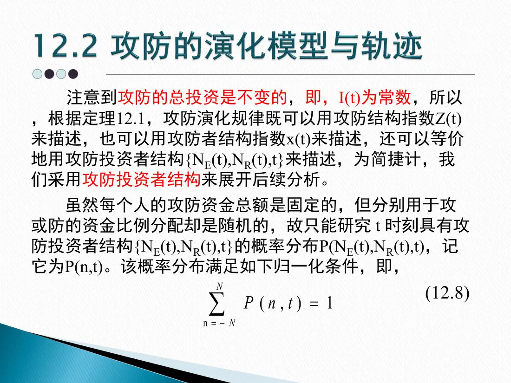

原文：

12.2攻防的演化模型与轨迹

注意到攻防的总投资是不变的，即，I(t)为常数，所以根据定理12.1，攻防演化规律既可以用攻防结构指数Z(t)来描述，也可以用攻防者结构指数x(t)来描述，还可以等价地用攻防投资者结构 $\{ \mathrm { N _ { E } ( t ) , N _ { R } ( t ) , t } \}$ 来描述，为简捷计，我们采用攻防投资者结构来展开后续分析。

虽然每个人的攻防资金总额是固定的，但分别用于攻或防的资金比例分配却是随机的，故只能研究 t 时刻具有攻防投资者结构 $\{ \mathrm { N _ { E } ( t ) , N _ { R } ( t ) , t } \}$ 的概率分布P $\small \mathrm { \langle N _ { E } ( t ) , N _ { R } ( t ) , t \rangle }$ ，记它为P(n,t)。该概率分布满足如下归一化条件，即，

$$
\sum_ {n = - N} ^ {N} P (n, t) = 1\tag{12.8}
$$

### 12.2攻防的演化模型与轨迹

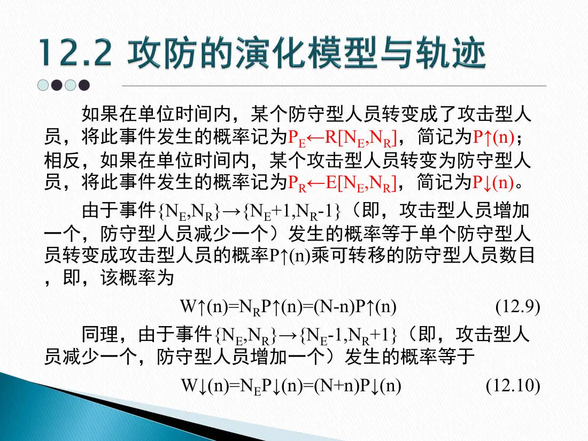

原文：

12.2攻防的演化模型与轨迹

如果在单位时间内，某个防守型人员转变成了攻击型人员，将此事件发生的概率记为 $\mathrm { P _ { E } {  } R } [ \mathrm { N _ { E } } , \mathrm { N _ { R } } ]$ 简记为P↑(n)；相反，如果在单位时间内，某个攻击型人员转变为防守型人员，将此事件发生的概率记为 $\mathrm { P _ { R } {  } E [ N _ { E } , N _ { R } ] }$ ，简记为P↓(n)。

由于事件 $\{ \mathrm { N _ { E } , N _ { R } } \} \longrightarrow \{ \mathrm { N _ { E } + 1 , N _ { R } - 1 } \}$ （即，攻击型人员增加一个，防守型人员减少一个）发生的概率等于单个防守型人员转变成攻击型人员的概率P↑(n)乘可转移的防守型人员数目，即，该概率为

$$
\mathrm{W} \uparrow (\mathrm{n}) = \mathrm{N} _ {\mathrm{R}} \mathrm{P} \uparrow (\mathrm{n}) = (\mathrm{N} - \mathrm{n}) \mathrm{P} \uparrow (\mathrm{n})\tag{12.9}
$$

同理，由于事件 $\{ \mathrm { N _ { E } , N _ { R } } \} { \longrightarrow } \{ \mathrm { N _ { E } - 1 , N _ { R } + 1 } \}$ （即，攻击型人员减少一个，防守型人员增加一个）发生的概率等于

$$
\mathrm{W} \downarrow (\mathrm{n}) = \mathrm{N} _ {\mathrm{E}} \mathrm{P} \downarrow (\mathrm{n}) = (\mathrm{N} + \mathrm{n}) \mathrm{P} \downarrow (\mathrm{n})\tag{12.10}
$$

### 12.2 攻防的演化模型与轨迹

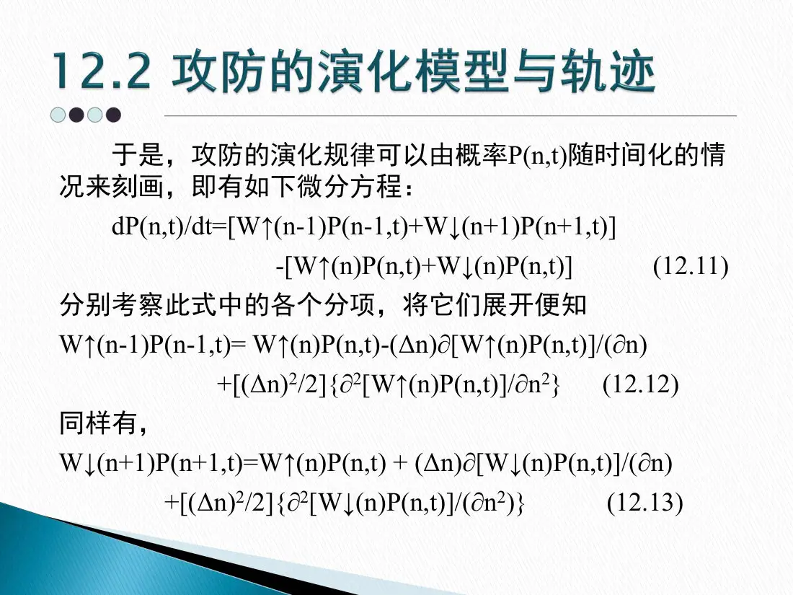

原文：

12.2 攻防的演化模型与轨迹

于是，攻防的演化规律可以由概率P(n,t)随时间化的情况来刻画，即有如下微分方程：

$$
\begin{array}{r l} \mathrm {dP(n,t) / dt = [W\uparrow (n - 1)P(n - 1,t)+ W\downarrow (n + 1)P(n + 1,t)]} \\ & - [ W \uparrow (n) P (n, t) + W \downarrow (n) P (n, t) ] \end{array}\tag{12.11}
$$

分别考察此式中的各个分项，将它们展开便知

$$
\begin{array}{r l} & {\mathrm {W\uparrow(n - 1)P(n - 1,t) = W\uparrow(n)P(n,t) - (\Delta n)\partial[W\uparrow(n)P(n,t)] / (\partial n)}} \\ & {\qquad + [ (\Delta n) ^ {2} / 2 ] \{\partial^ {2} [ \mathrm {W\uparrow(n)P(n,t)} ] / \partial n ^ {2} \}} \end{array} \tag {12.1}\tag{12.12}
$$

同样有，

$$
\begin{array}{r l} \mathrm{W} \downarrow (\mathrm{n+1}) \mathrm{P} (\mathrm{n+1}, \mathrm{t}) = & \mathrm{W} \uparrow (\mathrm{n}) \mathrm{P} (\mathrm{n}, \mathrm{t}) + (\Delta \mathrm{n}) \partial [ \mathrm{W} \downarrow (\mathrm{n}) \mathrm{P} (\mathrm{n}, \mathrm{t}) ] / (\partial \mathrm{n}) \\ & + [ (\Delta \mathrm{n}) ^ {2} / 2 ] \{\partial^ {2} [ \mathrm{W} \downarrow (\mathrm{n}) \mathrm{P} (\mathrm{n}, \mathrm{t}) ] / (\partial \mathrm{n} ^ {2}) \} \end{array} \tag {12.13}
$$

### 12.4 四要素小结

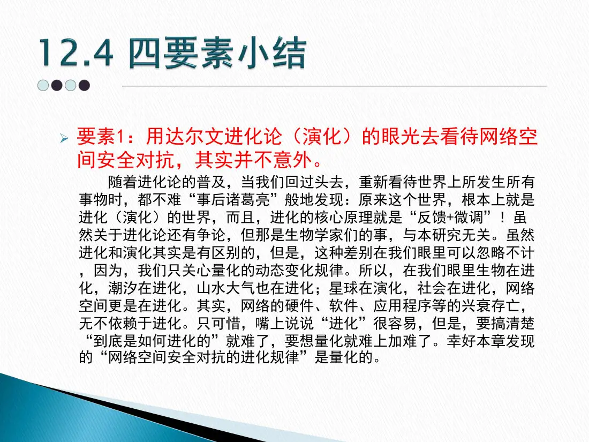

原文：

12.4 四要素小结

要素1：用达尔文进化论（演化）的眼光去看待网络空间安全对抗，其实并不意外。

随着进化论的普及，当我们回过头去，重新看待世界上所发生所有事物时，都不难“事后诸葛亮”般地发现：原来这个世界，根本上就是进化（演化）的世界，而且，进化的核心原理就是“反馈+微调”！虽然关于进化论还有争论，但那是生物学家们的事，与本研究无关。虽然进化和演化其实是有区别的，但是，这种差别在我们眼里可以忽略不计因为，我们只关心量化的动态变化规律。所以，在我们眼里生物在进化，潮汐在进化，山水大气也在进化；星球在演化，社会在进化，网络空间更是在进化。其实，网络的硬件、软件、应用程序等的兴衰存亡，无不依赖于进化。只可惜，嘴上说说“进化”很容易，但是，要搞清楚“到底是如何进化的”就难了，要想量化就难上加难了。幸好本章发现的“网络空间安全对抗的进化规律”是量化的。

### 12.4 四要素小结

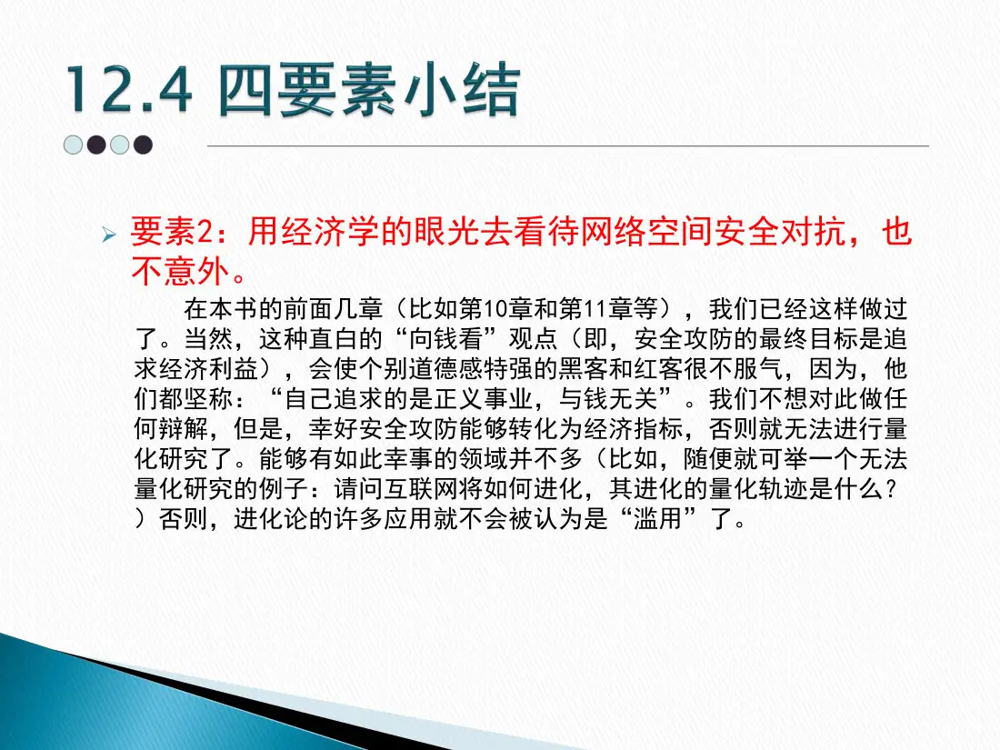

原文：

12.4 四要素小结

要素2：用经济学的眼光去看待网络空间安全对抗，也不意外。

在本书的前面几章（比如第10章和第11章等），我们已经这样做过了。当然，这种直白的“向钱看”观点（即，安全攻防的最终目标是追求经济利益），会使个别道德感特强的黑客和红客很不服气，因为，他们都坚称：“自己追求的是正义事业，与钱无关”。我们不想对此做任何辩解，但是，幸好安全攻防能够转化为经济指标，否则就无法进行量化研究了。能够有如此幸事的领域并不多（比如，随便就可举一个无法量化研究的例子：请问互联网将如何进化，其进化的量化轨迹是什么？）否则，进化论的许多应用就不会被认为是“滥用”了。

### 12.4 四要素小结

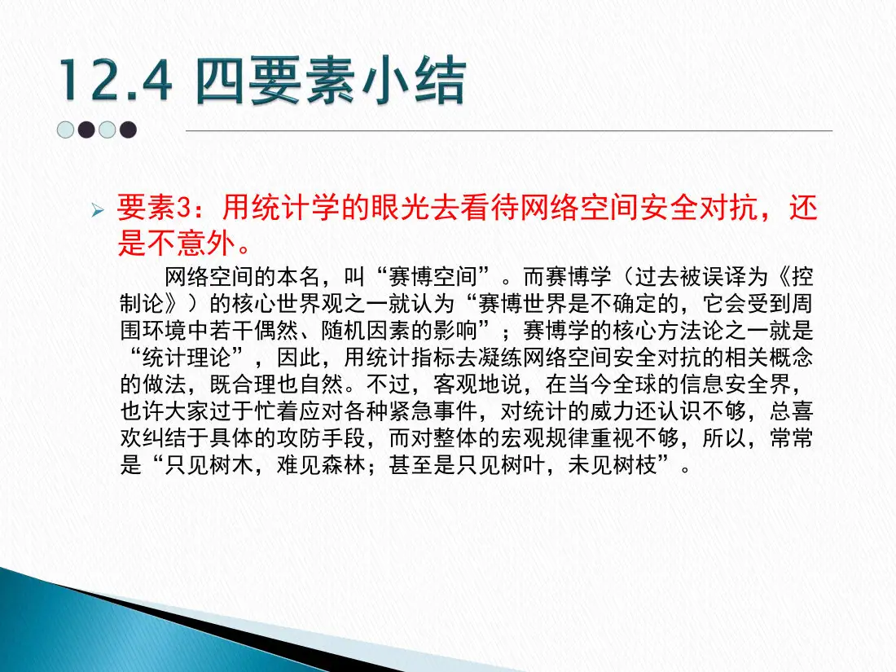

原文：

12.4 四要素小结

要素3：用统计学的眼光去看待网络空间安全对抗，还是不意外。

网络空间的本名，叫“赛博空间”。而赛博学（过去被误译为《控制论》）的核心世界观之一就认为“赛博世界是不确定的，它会受到周围环境中若干偶然、随机因素的影响”；赛博学的核心方法论之一就是“统计理论”，因此，用统计指标去凝练网络空间安全对抗的相关概念的做法，既合理也自然。不过，客观地说，在当今全球的信息安全界，也许大家过于忙着应对各种紧急事件，对统计的威力还认识不够，总喜欢纠结于具体的攻防手段，而对整体的宏观规律重视不够，所以，常常是“只见树木，难见森林；甚至是只见树叶，未见树枝”。

### 12.4 四要素小结

原文：

12.4 四要素小结

要素4：用协同学方法去建立和分析本文中的模型，仍然不意外。

本章的模型和数学推导基本上只是“小儿科”，最多可算做“一道普通的练习作业题”而已。实际上，对只有两种“力量”推动的协同系统，其协同规律基本上都可以照此办理。不过，遗憾的是，在网络安全领域，人们还来不及重视《协同学》、《系统论》、《控制论》、《突变理论》、《耗散结构理论》等动力学理论，甚至只拿它们当作某种新的哲学观而已，没有深入研究它们与网络空间安全的紧密联系。换句话说，本章其实“没有生产矿泉水”，而只是当了“大自然的搬运工”。

### 本章结束，谢谢

原文：

本章结束，谢谢
