# 《安全通论》第13章 网络安全生态学（课件）

原件的每一页，下面附识别出的文字。

### 第13章---网络安全生态学

原文：

第13章---网络安全生态学

### 第13章网络安全生态学

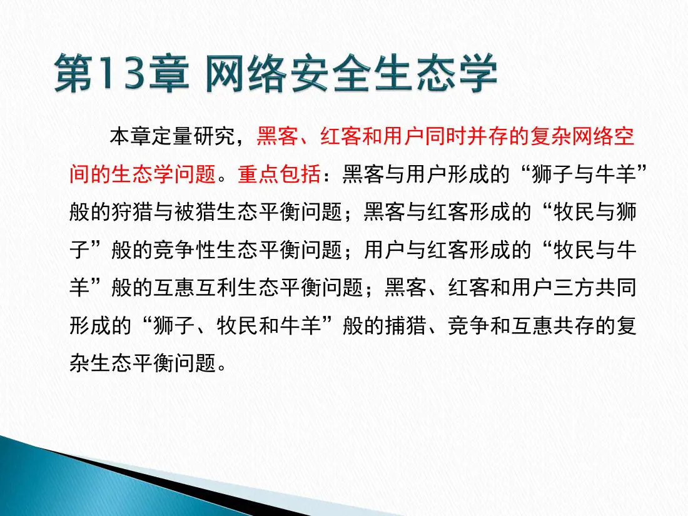

原文：

第13章网络安全生态学

本章定量研究，黑客、红客和用户同时并存的复杂网络空间的生态学问题。重点包括：黑客与用户形成的“狮子与牛羊”般的狩猎与被猎生态平衡问题；黑客与红客形成的“牧民与狮子”般的竞争性生态平衡问题；用户与红客形成的“牧民与牛羊”般的互惠互利生态平衡问题；黑客、红客和用户三方共同形成的“狮子、牧民和牛羊”般的捕猎、竞争和互惠共存的复杂生态平衡问题。

### 第13章网络安全生态学

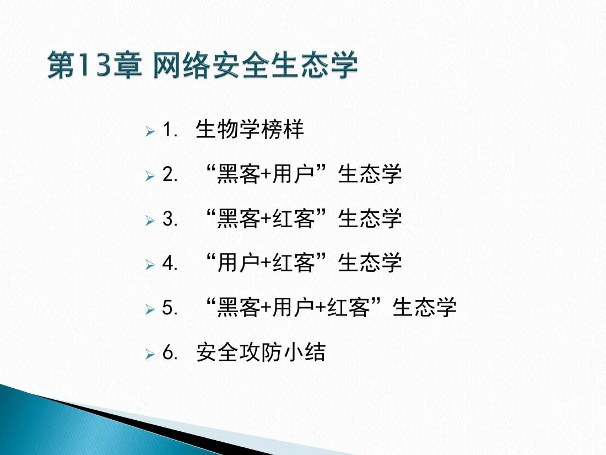

原文：

第13章网络安全生态学

1. 生物学榜样
2. “黑客+用户”生态学
3. “黑客+红客”生态学
4. “用户+红客”生态学
5. “黑客+用户+红客”生态学
6. 安全攻防小结

### 13.1 生物学榜样

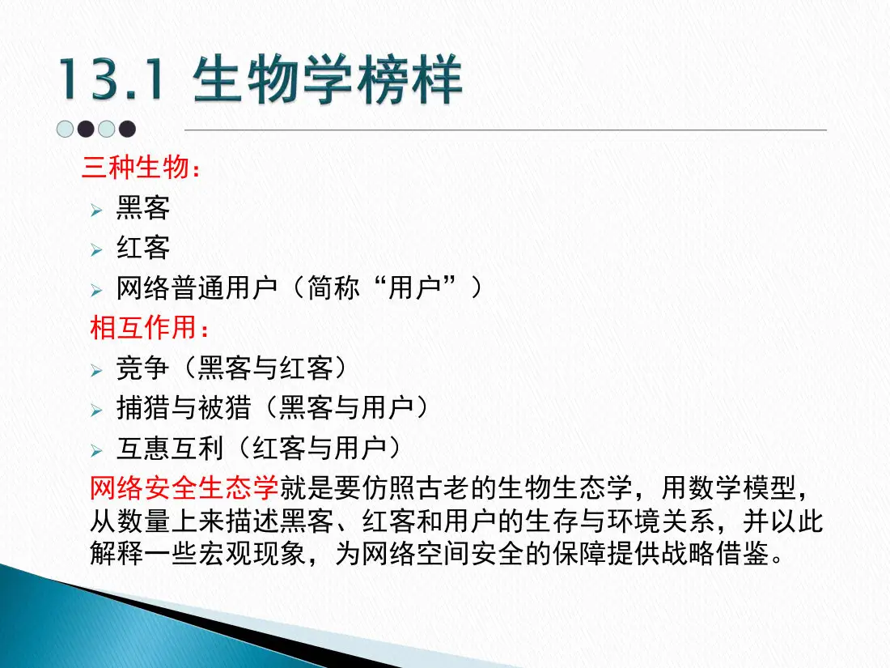

原文：

13.1 生物学榜样

三种生物：

➢ 黑客

➢ 红客

➢ 网络普通用户（简称“用户”）

相互作用：

➢ 竞争（黑客与红客）

➢ 捕猎与被猎（黑客与用户）

➢ 互惠互利（红客与用户）

网络安全生态学就是要仿照古老的生物生态学，用数学模型，从数量上来描述黑客、红客和用户的生存与环境关系，并以此解释一些宏观现象，为网络空间安全的保障提供战略借鉴。

### 13.1 生物学榜样

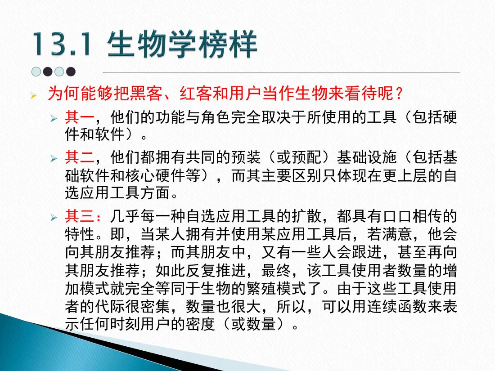

原文：

13.1 生物学榜样

为何能够把黑客、红客和用户当作生物来看待呢？

其一，他们的功能与角色完全取决于所使用的工具（包括硬件和软件）。

其二，他们都拥有共同的预装（或预配）基础设施（包括基础软件和核心硬件等），而其主要区别只体现在更上层的自选应用工具方面。

其三：几乎每一种自选应用工具的扩散，都具有口口相传的特性。即，当某人拥有并使用某应用工具后，若满意，他会向其朋友推荐；而其朋友中，又有一些人会跟进，甚至再向其朋友推荐；如此反复推进，最终，该工具使用者数量的增加模式就完全等同于生物的繁殖模式了。由于这些工具使用者的代际很密集，数量也很大，所以，可以用连续函数来表示任何时刻用户的密度（或数量）。

### 13.1 生物学榜样

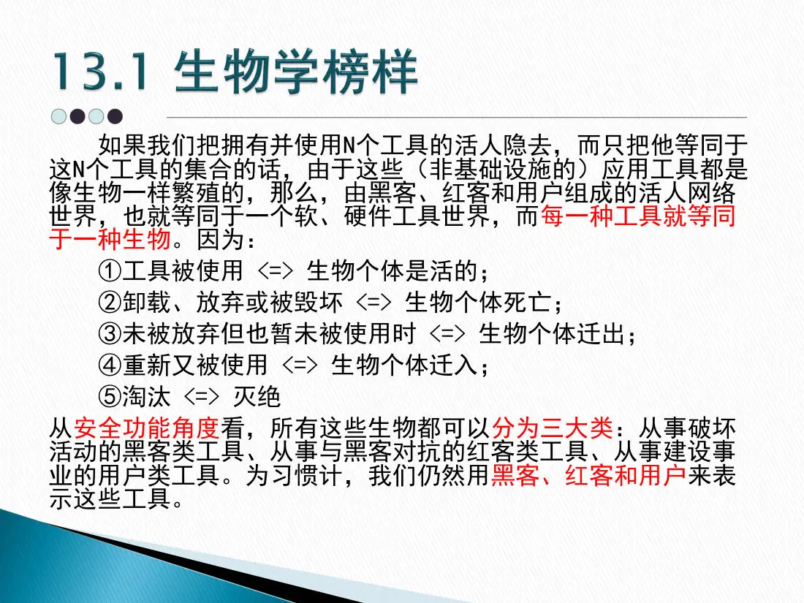

原文：

13.1 生物学榜样

如果我们把拥有并使用N个工具的活人隐去，而只把他等同于这N个工具的集合的话，由于这些（非基础设施的）应用工具都是像生物一样繁殖的，那么，由黑客、红客和用户组成的活人网络世界，也就等同于一个软、硬件工具世界，而每一种工具就等同于一种生物。因为：

①工具被使用 <=> 生物个体是活的；

②卸载、放弃或被毁坏 <=> 生物个体死亡；

③未被放弃但也暂未被使用时 <=> 生物个体迁出；

④重新又被使用 <=> 生物个体迁入；

⑤淘汰 <=> 灭绝

从安全功能角度看，所有这些生物都可以分为三大类：从事破坏活动的黑客类工具、从事与黑客对抗的红客类工具、从事建设事业的用户类工具。为习惯计，我们仍然用黑客、红客和用户来表示这些工具。

### 13.1 生物学榜样

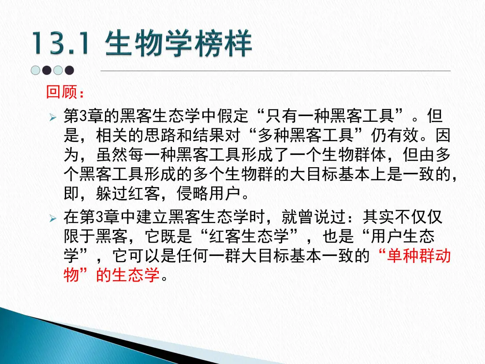

原文：

13.1 生物学榜样

回顾：

➢ 第3章的黑客生态学中假定“只有一种黑客工具”。但是，相关的思路和结果对“多种黑客工具”仍有效。因为，虽然每一种黑客工具形成了一个生物群体，但由多个黑客工具形成的多个生物群的大目标基本上是一致的，即，躲过红客，侵略用户。

➢ 在第3章中建立黑客生态学时，就曾说过：其实不仅仅限于黑客，它既是“红客生态学”，也是“用户生态学”，它可以是任何一群大目标基本一致的“单种群动物”的生态学。

### 13.1生物学榜样

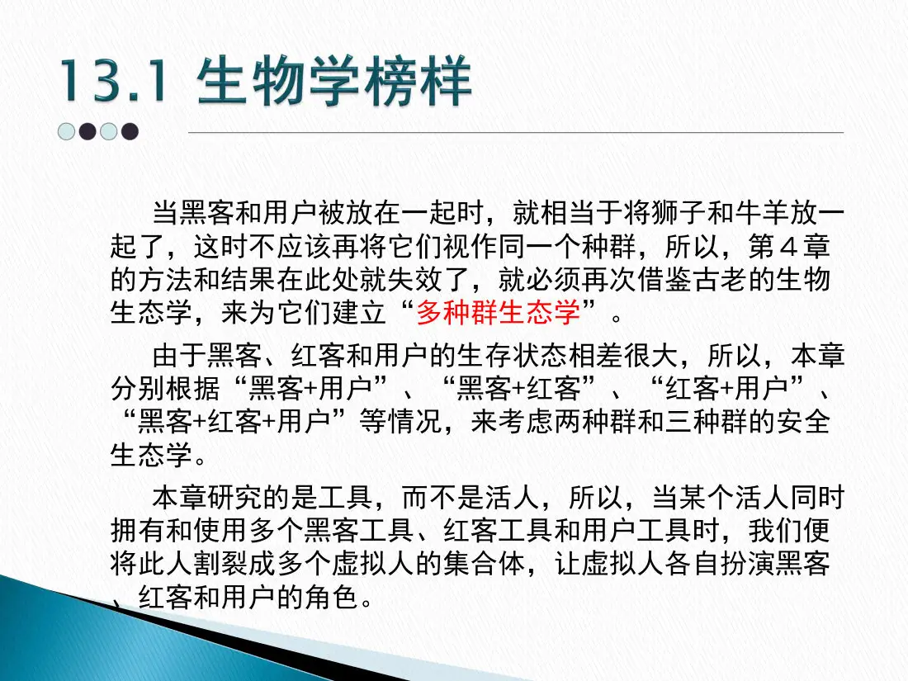

原文：

13.1生物学榜样

当黑客和用户被放在一起时，就相当于将狮子和牛羊放一起了，这时不应该再将它们视作同一个种群，所以，第4章的方法和结果在此处就失效了，就必须再次借鉴古老的生物生态学，来为它们建立“多种群生态学”。

由于黑客、红客和用户的生存状态相差很大，所以，本章分别根据“黑客+用户”、“黑客+红客”、“红客+用户”、“黑客+红客+用户”等情况，来考虑两种群和三种群的安全生态学。

本章研究的是工具，而不是活人，所以，当某个活人同时拥有和使用多个黑客工具、红客工具和用户工具时，我们便将此人割裂成多个虚拟人的集合体，让虚拟人各自扮演黑客红客和用户的角色。

### 13.2“黑客+用户”生态学

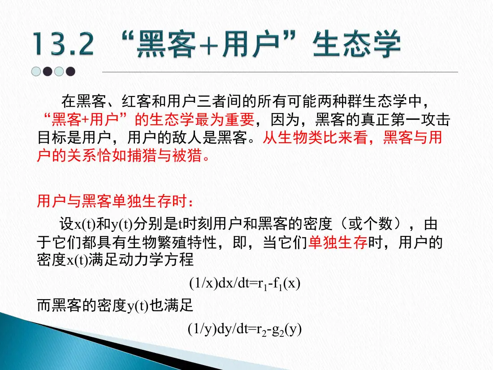

原文：

13.2“黑客+用户”生态学

在黑客、红客和用户三者间的所有可能两种群生态学中，“黑客+用户”的生态学最为重要，因为，黑客的真正第一攻击目标是用户，用户的敌人是黑客。从生物类比来看，黑客与用户的关系恰如捕猎与被猎。

用户与黑客单独生存时：

设x(t)和y(t)分别是t时刻用户和黑客的密度（或个数），由于它们都具有生物繁殖特性，即，当它们单独生存时，用户的密度x(t)满足动力学方程

$$
(1 / \mathrm{x}) \mathrm{dx} / \mathrm{dt} = \mathrm{r} _ {1} - \mathrm{f} _ {1} (\mathrm{x})
$$

而黑客的密度y(t)也满足

$$
(1 / \mathrm{y}) \mathrm{dy} / \mathrm{dt} = \mathrm{r} _ {2} - \mathrm{g} _ {2} (\mathrm{y})
$$

### 13.2“黑客+用户”生态学

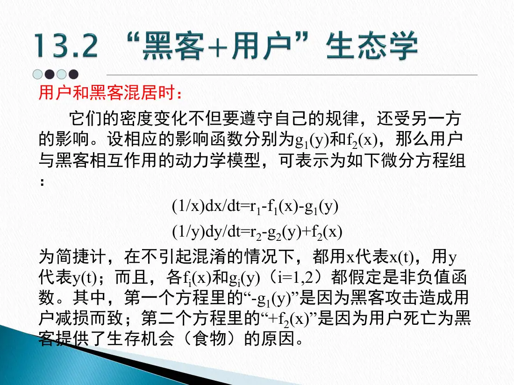

原文：

13.2“黑客+用户”生态学

用户和黑客混居时：

它们的密度变化不但要遵守自己的规律，还受另一方的影响。设相应的影响函数分别为 $\mathrm { g } _ { 1 } ( \mathrm { y } )$ 和 $\mathbf { f } _ { 2 } ( \mathbf { x } )$ ，那么用户与黑客相互作用的动力学模型，可表示为如下微分方程组

$$
\begin{array}{l} (1 / \mathrm{x}) \mathrm{dx} / \mathrm{dt} = \mathrm{r} _ {1} - \mathrm{f} _ {1} (\mathrm{x}) - \mathrm{g} _ {1} (\mathrm{y}) \\ (1 / \mathrm{y}) \mathrm{dy} / \mathrm{dt} = \mathrm{r} _ {2} - \mathrm{g} _ {2} (\mathrm{y}) + \mathrm{f} _ {2} (\mathrm{x}) \end{array}
$$

为简捷计，在不引起混淆的情况下，都用x代表x(t)，用y代表y(t)；而且，各 $\operatorname { f } _ { \mathrm { i } } ( \mathbf { x } )$ 和 $\mathrm { g _ { i } ( y ) } \ \mathrm { ( i { = } } 1 , 2 \mathrm { ) }$ 都假定是非负值函数。其中，第一个方程里的 $ { ^ { 6 6 } } \mathrm { - g _ { 1 } ( y ) ^ { \circ } }$ 是因为黑客攻击造成用户减损而致；第二个方程里的 $\mathbf { \hat { \mu } } ^ { \mathrm { 6 6 } } + \mathbf { f } _ { 2 } ( \mathbf { x } ) \mathbf { \ ' }$ 是因为用户死亡为黑客提供了生存机会（食物）的原因。

### 13.2“黑客+用户”生态学

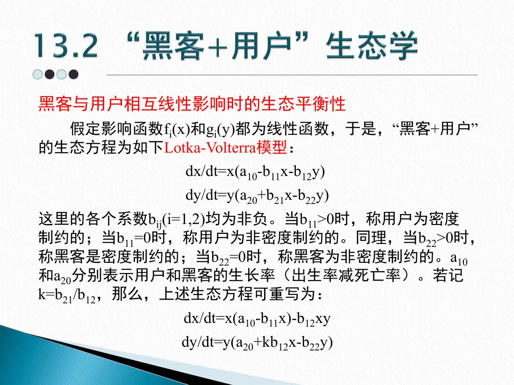

原文：

13.2“黑客+用户”生态学

黑客与用户相互线性影响时的生态平衡性

假定影响函数f(x)和g(y)都为线性函数，于是，“黑客+用户”的生态方程为如下Lotka-Volterra模型：

$$
\begin{array}{l} \mathrm {dx / dt = x(a_ {10} - b_ {11} x- b_ {12} y)} \\ \mathrm {dy / dt = y(a_ {20} + b_ {21} x- b_ {22} y)} \end{array}
$$

这里的各个系数 $\mathsf { b } _ { \mathrm { i j } } ( \mathrm { i } { = } 1 , 2 )$ 均为非负。当 $\mathsf { b } _ { 1 1 } { > } 0$ 时，称用户为密度制约的；当 $\mathtt { b } _ { 1 1 } { = } 0$ 时，称用户为非密度制约的。同理，当 ${ \sf b } _ { 2 2 } > 0$ 时，称黑客是密度制约的；当 $\mathtt { b } _ { 2 2 } = 0$ 时，称黑客为非密度制约的。 ${ \bf a } _ { 1 0 }$ 和 $\vert \mathbf { a } _ { 2 0 }$ 分别表示用户和黑客的生长率（出生率减死亡率）。若记$\mathrm { k } { = } \mathsf { b } _ { 2 1 } / \mathsf { b } _ { 1 2 }$ ，那么，上述生态方程可重写为：

$$
\begin{array}{l} \mathrm {dx / dt = x(a_ {10} - b_ {11} x) - b_ {12} xy} \\ \mathrm {dy / dt = y(a_ {20} + kb_ {12} x- b_ {22} y)} \end{array}
$$

### 13.2“黑客+用户”生态学

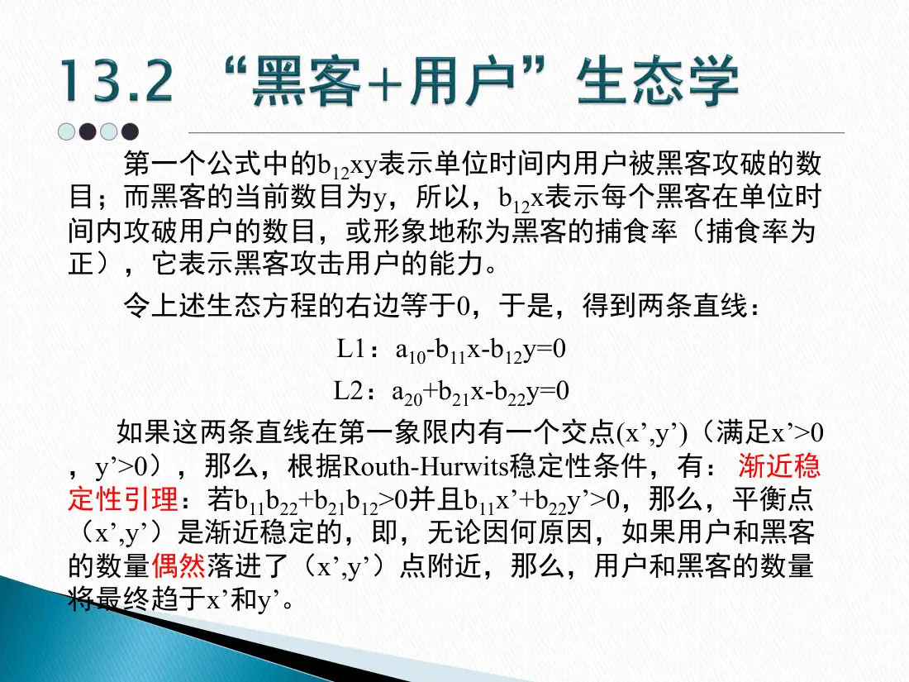

原文：

13.2“黑客+用户”生态学

第一个公式中的b $1 2 ^ { \mathrm { X y } }$ 表示单位时间内用户被黑客攻破的数目；而黑客的当前数目为y，所以， ${ \bf b } _ { 1 2 } \bf x$ 表示每个黑客在单位时间内攻破用户的数目，或形象地称为黑客的捕食率（捕食率为正），它表示黑客攻击用户的能力。

令上述生态方程的右边等于0，于是，得到两条直线：

$$
\begin{array}{l} \mathrm {L1: a _ {10} - b _ {11} x- b _ {12} y = 0} \\ \mathrm {L2: a _ {20} + b _ {21} x- b _ {22} y = 0} \end{array}
$$

如果这两条直线在第一象限内有一个交点 $( \mathbf { x } ^ { \prime } , \mathbf { y } ^ { \prime } )$ （满足 $\mathbf { \nabla } \mathbf { X } ^ { ' } > 0$ $\mathbf { y } ^ { \prime } { > } 0 )$ 那么，根据Routh-Hurwits稳定性条件，有：渐近稳定性引理：若 $b _ { 1 1 }  { \mathrm { b } } _ { 2 2 } +  { \mathrm { b } } _ { 2 1 }  { \mathrm { b } } _ { 1 2 } > 0$ 并且 ${ \bf b } _ { 1 1 } { \bf x } ^ { 3 } + { \bf b } _ { 2 2 } { \bf y } ^ { 3 } > 0$ ，那么，平衡点$( \mathbf { x } ^ { \prime } , \mathbf { y } ^ { \prime } )$ 是渐近稳定的，即，无论因何原因，如果用户和黑客的数量偶然落进了 $(  \mathbf { \vec { x } } ^ { \prime } , \mathbf { \vec { y } } ^ { \prime } )$ 点附近，那么，用户和黑客的数量将最终趋于x’和y’。

### 13.2“黑客+用户”生态学

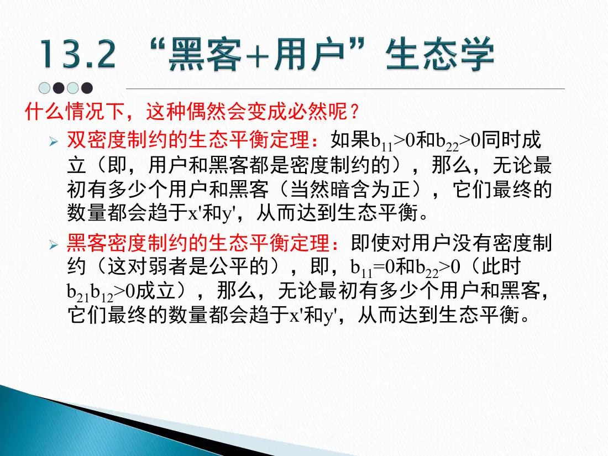

原文：

13.2“黑客+用户”生态学

什么情况下，这种偶然会变成必然呢？

双密度制约的生态平衡定理：如果 $\mathtt { b } _ { 1 1 } > 0$ 和 $\mathtt { b } _ { 2 2 } > 0$ 同时成立（即，用户和黑客都是密度制约的），那么，无论最初有多少个用户和黑客（当然暗含为正），它们最终的数量都会趋于x'和y'，从而达到生态平衡。

黑客密度制约的生态平衡定理：即使对用户没有密度制约（这对弱者是公平的），即， $\mathtt { b } _ { 1 1 } { = } 0$ 和 $\mathsf { b } _ { 2 2 } { > } 0$ （此时$b _ { 2 1 } b _ { 1 2 } > 0$ 成立），那么，无论最初有多少个用户和黑客，它们最终的数量都会趋于x'和y'，从而达到生态平衡。

### 13.2“黑客+用户”生态学

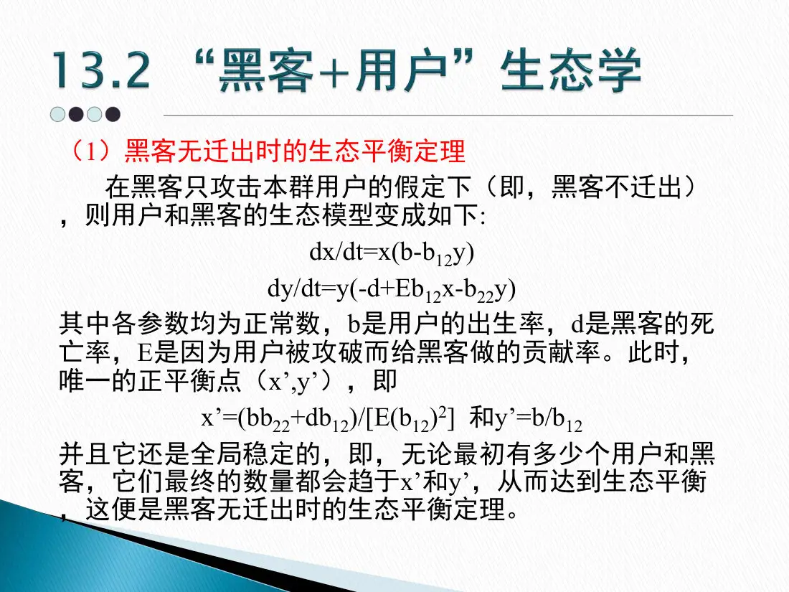

原文：

13.2“黑客+用户”生态学

（1）黑客无迁出时的生态平衡定理

在黑客只攻击本群用户的假定下（即，黑客不迁出）则用户和黑客的生态模型变成如下:

$$
\begin{array}{c} \mathrm {dx / dt = x(b- b_ {12} y)} \\ \mathrm {dy / dt = y(-d + Eb_ {12} x- b_ {22} y)} \end{array}
$$

其中各参数均为正常数，b是用户的出生率，d是黑客的死亡率，E是因为用户被攻破而给黑客做的贡献率。此时，唯一的正平衡点 $( \mathbf { x } ^ { \prime } , \mathbf { y } ^ { \prime } )$ ，即

$$
\mathbf {x} ^ {\prime} = (\mathbf {b b} _ {2 2} + \mathbf {d b} _ {1 2}) / [ \mathrm{E} (\mathbf {b} _ {1 2}) ^ {2} ] \text {和} \mathbf {y} ^ {\prime} = \mathbf {b} / \mathbf {b} _ {1 2}
$$

并且它还是全局稳定的，即，无论最初有多少个用户和黑客，它们最终的数量都会趋于x’和y’，从而达到生态平衡这便是黑客无迁出时的生态平衡定理。

### 13.2“黑客+用户”生态学

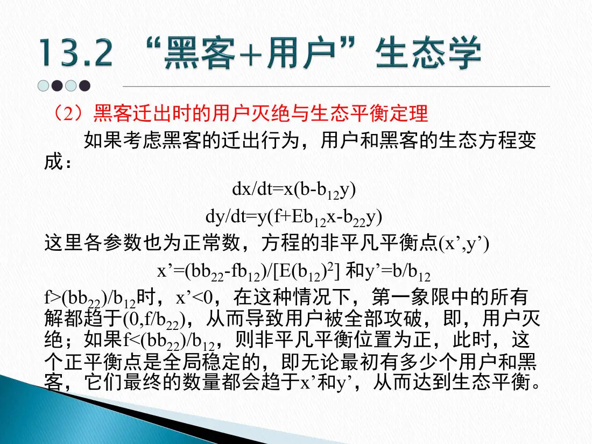

原文：

13.2“黑客+用户”生态学

（2）黑客迁出时的用户灭绝与生态平衡定理

如果考虑黑客的迁出行为，用户和黑客的生态方程变成：

$$
\begin{array}{r l} & \mathrm {dx / dt = x(b- b_ {12} y)} \\ & \mathrm {dy / dt = y(f + Eb_ {12} x- b_ {22} y)} \end{array}
$$

这里各参数也为正常数，方程的非平凡平衡点 $( \mathbf { x } ^ { \prime } , \mathbf { y } ^ { \prime } )$

$$
\mathrm{x} ^ {\prime} = (\mathrm{bb} _ {2 2} - \mathrm{fb} _ {1 2}) / [ \mathrm{E} (\mathrm{b} _ {1 2}) ^ {2} ] \text {和} \mathrm{y} ^ {\prime} = \mathrm{b} / \mathrm{b} _ {1 2}
$$

$\mathrm { f } > ( \mathrm { b } \mathsf { b } _ { 2 2 } ) / \mathsf { b } _ { 1 2 }$ 时， $\mathbf { \boldsymbol { x } } ^ { \prime } { < } 0$ 在这种情况下，第一象限中的所有解都趋于 $( 0 , \mathrm { f } /  { \mathbf { b } } _ { 2 2 } )$ ，从而导致用户被全部攻破，即，用户灭绝；如果 $\mathrm { f } { < } (  { \mathbf { b } }  { \mathbf { b } } _ { 2 2 } ) /  { \mathbf { b } } _ { 1 2 }$ 则非平凡平衡位置为正，此时，这个正平衡点是全局稳定的，即无论最初有多少个用户和黑客，它们最终的数量都会趋于x’和y’，从而达到生态平衡。

### 13.2“黑客+用户”生态学

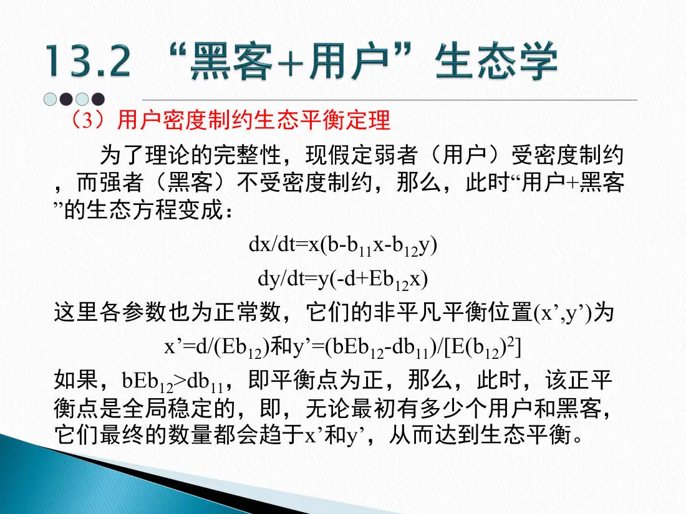

原文：

13.2“黑客+用户”生态学

（3）用户密度制约生态平衡定理

为了理论的完整性，现假定弱者（用户）受密度制约而强者（黑客）不受密度制约，那么，此时“用户+黑客”的生态方程变成：

$$
\begin{array}{r l} & \mathrm {dx / dt = x(b- b _ {11} x- b _ {12} y)} \\ & \mathrm {dy / dt = y(-d + Eb_ {12} x)} \end{array}
$$

这里各参数也为正常数，它们的非平凡平衡位置 $( \mathbf { x } ^ { \prime } , \mathbf { y } ^ { \prime } )$ 为

$$
\mathrm{x} ^ {\prime} = \mathrm{d} / (\mathrm{Eb} _ {1 2}) \text {和} \mathrm{y} ^ {\prime} = (\mathrm{bEb} _ {1 2} - \mathrm{db} _ {1 1}) / [ \mathrm{E} (\mathrm{b} _ {1 2}) ^ {2} ]
$$

如果， ${ \mathsf { b E b } } _ { 1 2 } { > } { \mathsf { d b } } _ { 1 1 }$ 即平衡点为正，那么，此时，该正平衡点是全局稳定的，即，无论最初有多少个用户和黑客，它们最终的数量都会趋于x’和y’，从而达到生态平衡。

### 13.2“黑客+用户”生态学

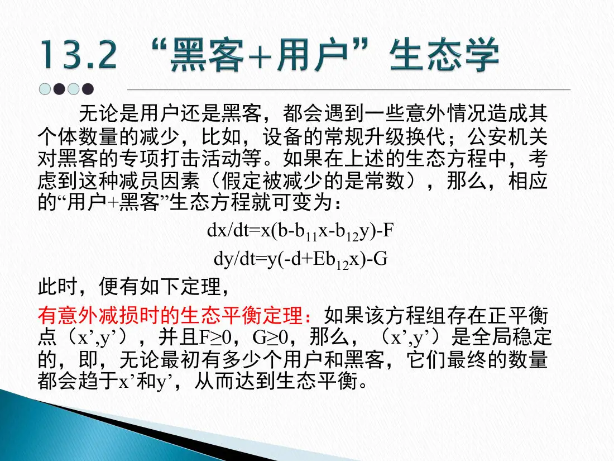

原文：

13.2“黑客+用户”生态学

无论是用户还是黑客，都会遇到一些意外情况造成其个体数量的减少，比如，设备的常规升级换代；公安机关对黑客的专项打击活动等。如果在上述的生态方程中，考虑到这种减员因素（假定被减少的是常数），那么，相应的“用户+黑客”生态方程就可变为：

$$
\begin{array}{r l} & \mathrm {dx / dt = x(b- b _ {11} x- b _ {12} y) - F} \\ & \mathrm {dy / dt = y(-d + Eb_ {12} x) - G} \end{array}
$$

此时，便有如下定理，

有意外减损时的生态平衡定理：如果该方程组存在正平衡点 $( \mathbf { x } ^ { \prime } , \mathbf { y } ^ { \prime } )$ 并且F≥0， $G { \ge } 0$ 那么， $( \mathbf { x } ^ { \prime } , \mathbf { y } ^ { \prime } )$ 是全局稳定的，即，无论最初有多少个用户和黑客，它们最终的数量都会趋于x’和y’，从而达到生态平衡。

### 13.3“黑客+红客”生态学

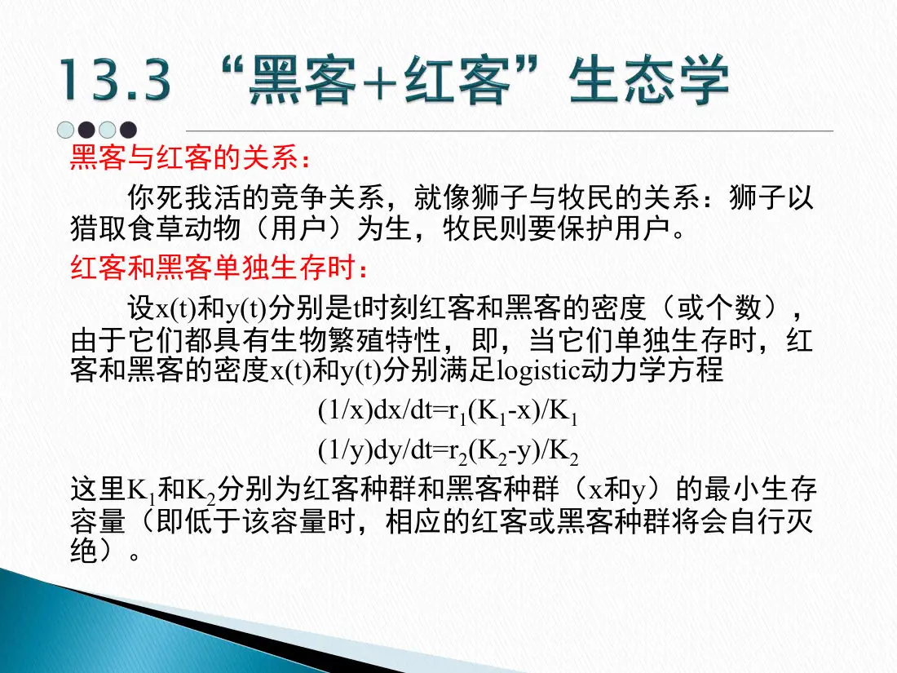

原文：

13.3“黑客+红客”生态学

黑客与红客的关系：

你死我活的竞争关系，就像狮子与牧民的关系：狮子以猎取食草动物（用户）为生，牧民则要保护用户。

红客和黑客单独生存时：

设x(t)和y(t)分别是t时刻红客和黑客的密度（或个数）由于它们都具有生物繁殖特性，即，当它们单独生存时，红客和黑客的密度x(t)和y(t)分别满足logistic动力学方程

$$
\begin{array}{l} (1 / \mathrm{x}) \mathrm{dx} / \mathrm{dt} = \mathrm{r} _ {1} (\mathrm{K} _ {1} - \mathrm{x}) / \mathrm{K} _ {1} \\ (1 / \mathrm{y}) \mathrm{dy} / \mathrm{dt} = \mathrm{r} _ {2} (\mathrm{K} _ {2} - \mathrm{y}) / \mathrm{K} _ {2} \end{array}
$$

这里 $\mathrm { K } _ { 1 }$ 和 $\mathrm { K } _ { 2 }$ 分别为红客种群和黑客种群（x和y）的最小生存容量（即低于该容量时，相应的红客或黑客种群将会自行灭绝）。

### 13.3“黑客+红客”生态学

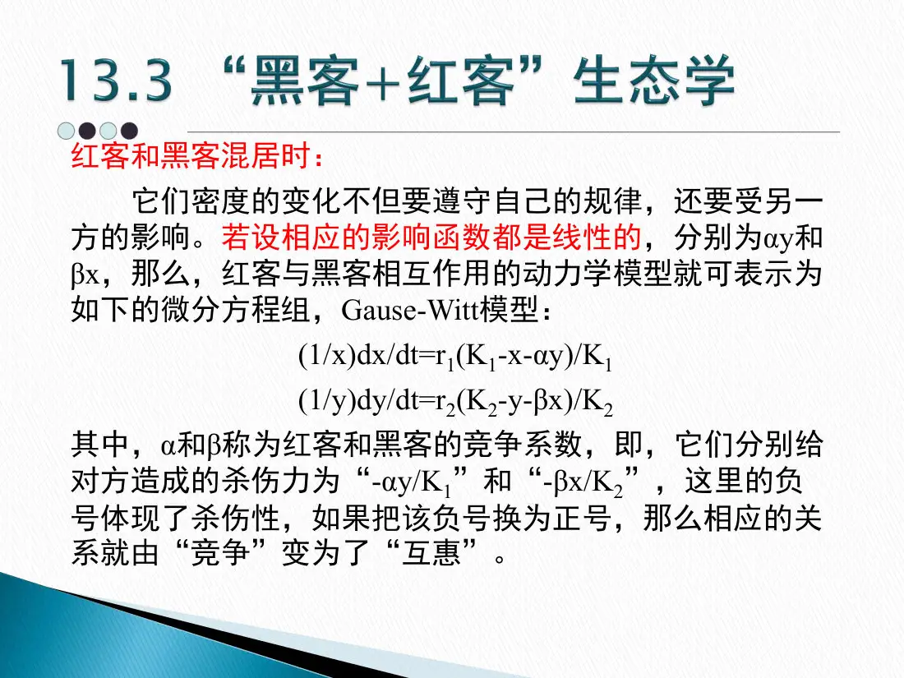

原文：

13.3“黑客+红客”生态学

红客和黑客混居时：

它们密度的变化不但要遵守自己的规律，还要受另一方的影响。若设相应的影响函数都是线性的，分别为αy和βx，那么，红客与黑客相互作用的动力学模型就可表示为如下的微分方程组，Gause-Witt模型：

$$
\begin{array}{l} (1 / \mathrm{x}) \mathrm{dx} / \mathrm{dt} = \mathrm{r} _ {1} (\mathrm{K} _ {1} - \mathrm{x} - \alpha \mathrm{y}) / \mathrm{K} _ {1} \\ (1 / \mathrm{y}) \mathrm{dy} / \mathrm{dt} = \mathrm{r} _ {2} (\mathrm{K} _ {2} - \mathrm{y} - \beta \mathrm{x}) / \mathrm{K} _ {2} \end{array}
$$

其中，α和β称为红客和黑客的竞争系数，即，它们分别给对方造成的杀伤力为 $\bar { \mathbf { \Sigma } } ^ { 6 6 } - \mathbf { \Delta } \mathrm { a y } / \mathrm { K } _ { 1 } \mathbf { \Sigma } ^ { 9 9 }$ 和 $\^ { 6 6 } - \beta \mathbf  \} \mathbf  \} \mathbf { \| } K _ { 2 } ^ { \mathbf { \| } 3 }$ ，这里的负号体现了杀伤性，如果把该负号换为正号，那么相应的关系就由“竞争”变为了“互惠”。

### 13.3“黑客+红客”生态学

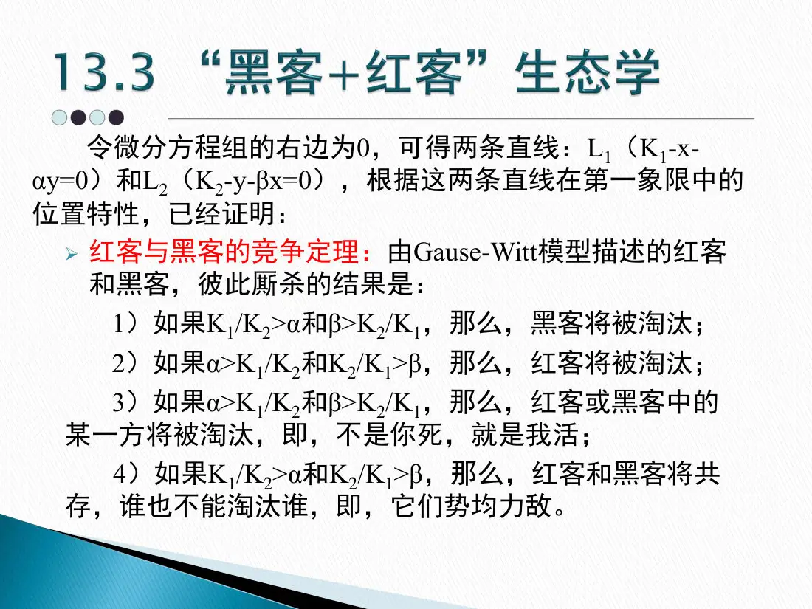

原文：

13.3“黑客+红客”生态学

令微分方程组的右边为0，可得两条直线： $\begin{array} { r l } { \mathrm { L } _ { 1 } } & { { } \mathrm { ( K } _ { 1 } \mathrm { - X } \mathrm { - } } \end{array}$ $\scriptstyle { \mathrm { a y } } = 0 )$ 和L2 $\scriptstyle \left( \operatorname { K } _ { 2 } - \mathbf { y } - \beta \mathbf { x } = 0 \right)$ ，根据这两条直线在第一象限中的位置特性，已经证明：

红客与黑客的竞争定理：由Gause-Witt模型描述的红客和黑客，彼此厮杀的结果是：

1）如果 $K _ { 1 } / K _ { 2 } > a$ 和 $\beta { \mathrm { { > K } } _ { 2 } } / \mathrm { K } _ { 1 }$ ，那么，黑客将被淘汰；

2）如果 $\alpha { > } K _ { 1 } / \mathrm { K } _ { 2 }$ 和 $\mathrm { K } _ { 2 } / \mathrm { K } _ { 1 } { > } \beta$ ，那么，红客将被淘汰；

3）如果 $\mathrm { a { > } K _ { 1 } / K _ { 2 } }$ 和 $\beta { > } \mathrm { K } _ { 2 } / \mathrm { K } _ { 1 }$ ，那么，红客或黑客中的某一方将被淘汰，即，不是你死，就是我活；

4）如果 $K _ { 1 } / K _ { 2 } > a$ 和 $\mathrm { K } _ { 2 } / \mathrm { K } _ { 1 } { > } \beta$ ，那么，红客和黑客将共存，谁也不能淘汰谁，即，它们势均力敌。

### 13.3“黑客+红客”生态学

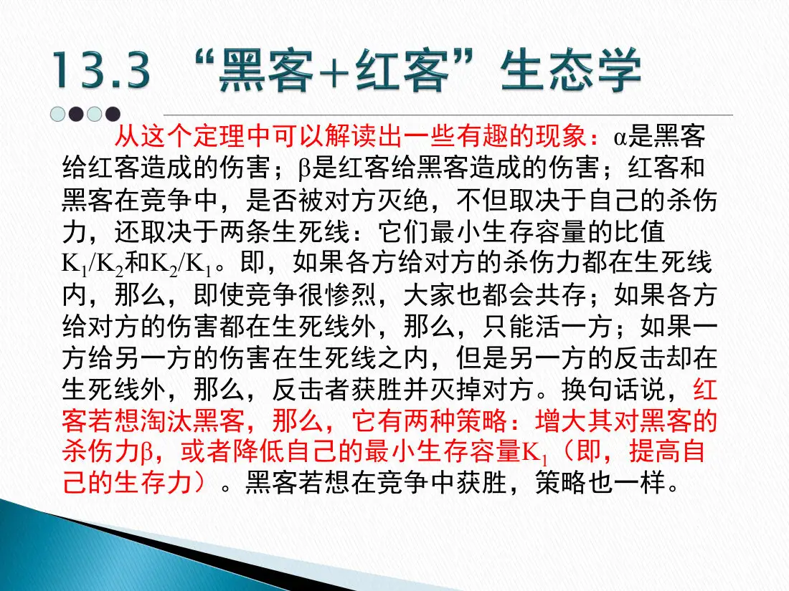

原文：

13.3“黑客+红客”生态学

从这个定理中可以解读出一些有趣的现象：α是黑客给红客造成的伤害；β是红客给黑客造成的伤害；红客和黑客在竞争中，是否被对方灭绝，不但取决于自己的杀伤力，还取决于两条生死线：它们最小生存容量的比值$\mathrm { K } _ { 1 } / \mathrm { K } _ { 2 }$ 和 $\mathrm { K } _ { 2 } / \mathrm { K } _ { 1 }$ 。即，如果各方给对方的杀伤力都在生死线内，那么，即使竞争很惨烈，大家也都会共存；如果各方给对方的伤害都在生死线外，那么，只能活一方；如果方给另一方的伤害在生死线之内，但是另一方的反击却在生死线外，那么，反击者获胜并灭掉对方。换句话说，红客若想淘汰黑客，那么，它有两种策略：增大其对黑客的杀伤力β，或者降低自己的最小生存容量 $\mathrm { K } _ { 1 }$ （即，提高自己的生存力）。黑客若想在竞争中获胜，策略也一样。

### 13.4“用户+红客”生态学

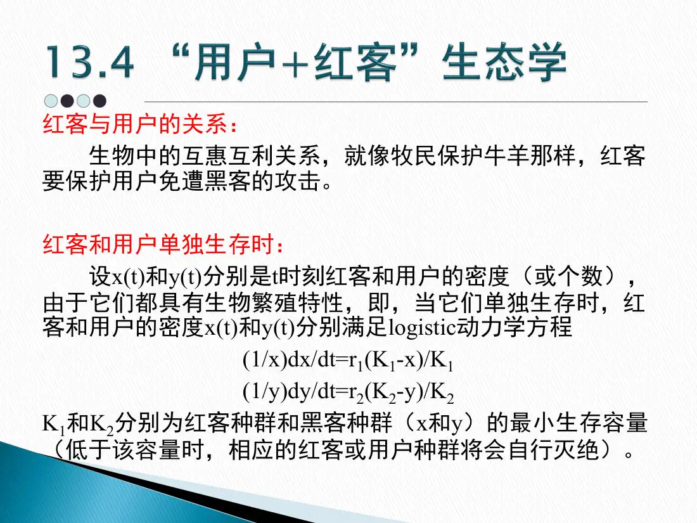

原文：

13.4“用户+红客”生态学

红客与用户的关系：

生物中的互惠互利关系，就像牧民保护牛羊那样，红客要保护用户免遭黑客的攻击。

红客和用户单独生存时：

设x(t)和y(t)分别是t时刻红客和用户的密度（或个数）由于它们都具有生物繁殖特性，即，当它们单独生存时，红客和用户的密度x(t)和y(t)分别满足logistic动力学方程

$$
\begin{array}{l} (1 / \mathrm{x}) \mathrm{dx} / \mathrm{dt} = \mathrm{r} _ {1} (\mathrm{K} _ {1} - \mathrm{x}) / \mathrm{K} _ {1} \\ (1 / \mathrm{y}) \mathrm{dy} / \mathrm{dt} = \mathrm{r} _ {2} (\mathrm{K} _ {2} - \mathrm{y}) / \mathrm{K} _ {2} \end{array}
$$

$\mathrm { K } _ { 1 }$ 和 $\mathrm { K } _ { 2 }$ 分别为红客种群和黑客种群（x和y）的最小生存容量（低于该容量时，相应的红客或用户种群将会自行灭绝）。

### 13.4“用户+红客”生态学

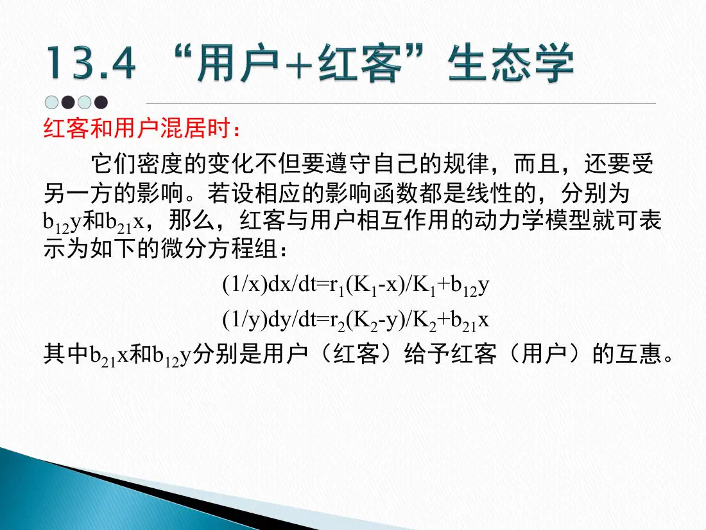

原文：

13.4“用户+红客”生态学

红客和用户混居时：

它们密度的变化不但要遵守自己的规律，而且，还要受另一方的影响。若设相应的影响函数都是线性的，分别为${ \sf b } _ { 1 2 } \mathrm { y }$ 和 $\mathsf { b } _ { 2 1 } \mathbf { x }$ 那么，红客与用户相互作用的动力学模型就可表示为如下的微分方程组：

$$
\begin{array}{l} (1 / \mathrm{x}) \mathrm{dx} / \mathrm{dt} = \mathrm{r} _ {1} (\mathrm{K} _ {1} - \mathrm{x}) / \mathrm{K} _ {1} + \mathrm{b} _ {1 2} \mathrm{y} \\ (1 / \mathrm{y}) \mathrm{dy} / \mathrm{dt} = \mathrm{r} _ {2} (\mathrm{K} _ {2} - \mathrm{y}) / \mathrm{K} _ {2} + \mathrm{b} _ {2 1} \mathrm{x} \end{array}
$$

其中 $\mathsf { b } _ { 2 1 } \mathbf { x }$ 和 ${ \sf b } _ { 1 2 } \mathrm { y }$ 分别是用户（红客）给予红客（用户）的互惠。

### 13.4“用户+红客”生态学

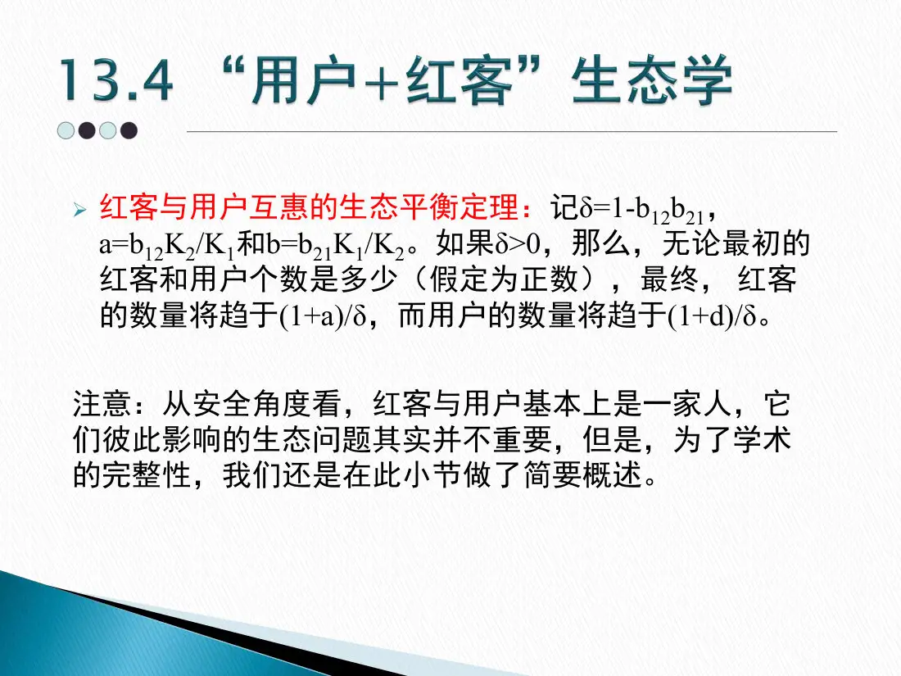

原文：

13.4“用户+红客”生态学

红客与用户互惠的生态平衡定理：记 $\delta \mathrm { = } 1 \mathrm { - } \mathsf { b } _ { 1 2 } \mathsf { b } _ { 2 1 }$ $\mathrm { a { = } b } _ { 1 2 } \mathrm { K } _ { 2 } / \mathrm { K } _ { 1 }$ 和 $\mathsf { b { = } } \mathsf { b } _ { 2 1 } \mathrm { K } _ { 1 } / \mathrm { K } _ { 2 }$ 。如果δ>0，那么，无论最初的红客和用户个数是多少（假定为正数），最终，红客的数量将趋于(1+a)/δ，而用户的数量将趋于(1+d)/δ。

注意：从安全角度看，红客与用户基本上是一家人，它们彼此影响的生态问题其实并不重要，但是，为了学术的完整性，我们还是在此小节做了简要概述。

### 13.5“黑客+用户+红客”生态学

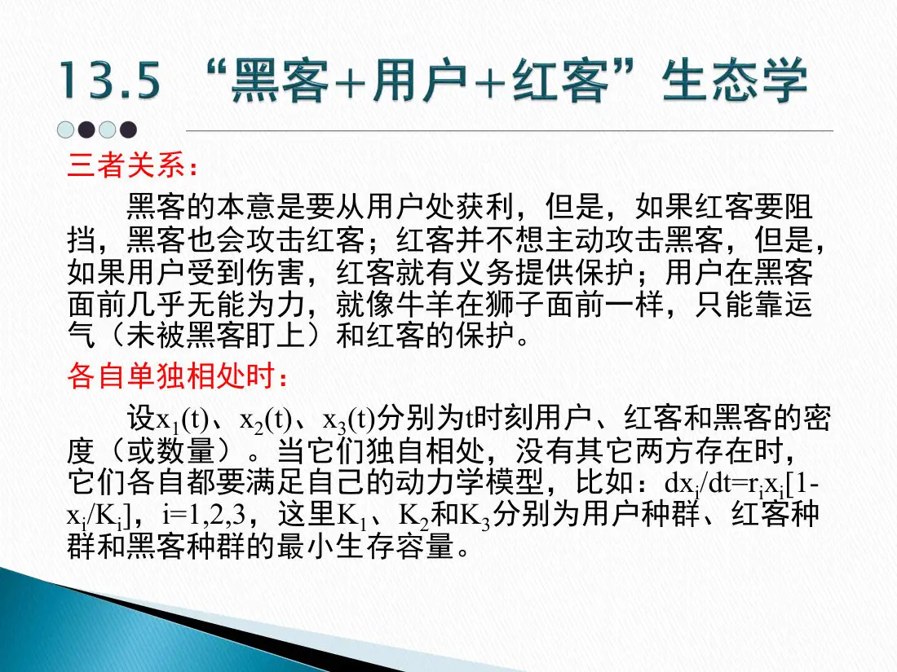

原文：

13.5“黑客+用户+红客”生态学

三者关系：

黑客的本意是要从用户处获利，但是，如果红客要阻挡，黑客也会攻击红客；红客并不想主动攻击黑客，但是，如果用户受到伤害，红客就有义务提供保护；用户在黑客面前几乎无能为力，就像牛羊在狮子面前一样，只能靠运气（未被黑客盯上）和红客的保护。

各自单独相处时：

设 $\mathrm { x } _ { 1 } ( \mathrm { t } ) , \ \mathrm { x } _ { 2 } ( \mathrm { t } ) , \ \mathrm { x } _ { 3 } ( \mathrm { t } )$ 分别为t时刻用户、红客和黑客的密度（或数量）。当它们独自相处，没有其它两方存在时，它们各自都要满足自己的动力学模型，比如： $\mathrm { { d } x _ { i } / \mathrm { { d t } = r _ { i } x _ { i } [ 1 - } }$ $\mathrm { x _ { i } / K _ { i } } ] , ~ \mathrm { i = } 1 , 2 , 3$ 这里 $\mathrm { ~ K ~ } _ { 1 } , \mathrm { ~ K ~ } _ { 2 }$ 和 $\mathrm { K } _ { 3 }$ 分别为用户种群、红客种群和黑客种群的最小生存容量。

### 13.5“黑客+用户+红客”生态学

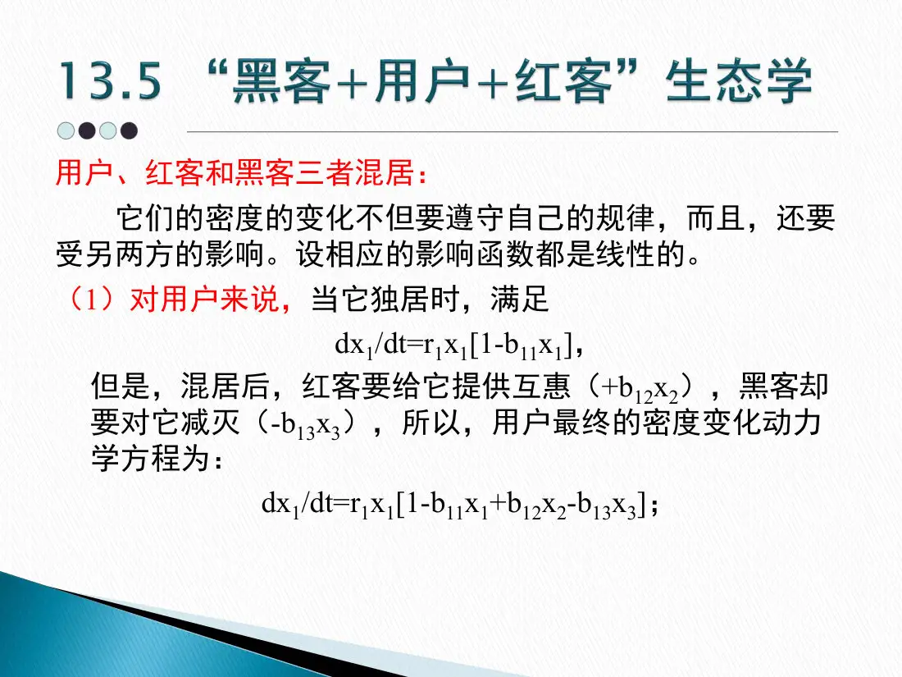

原文：

13.5“黑客+用户+红客”生态学

用户、红客和黑客三者混居：

它们的密度的变化不但要遵守自己的规律，而且，还要受另两方的影响。设相应的影响函数都是线性的。

（1）对用户来说，当它独居时，满足

$$
\mathrm{dx} _ {1} / \mathrm{dt} = \mathrm{r} _ {1} \mathrm{x} _ {1} [ 1 - \mathrm{b} _ {1 1} \mathrm{x} _ {1} ],
$$

但是，混居后，红客要给它提供互惠 $( + \mathsf { b } _ { 1 2 } \mathbf { x } _ { 2 } )$ 黑客却要对它减灭 $( - \mathsf { b } _ { 1 3 } \mathbf { x } _ { 3 } )$ ，所以，用户最终的密度变化动力学方程为：

$$
\mathrm{dx} _ {1} / \mathrm{dt} = \mathrm{r} _ {1} \mathrm{x} _ {1} \left[ 1 - \mathrm{b} _ {1 1} \mathrm{x} _ {1} + \mathrm{b} _ {1 2} \mathrm{x} _ {2} - \mathrm{b} _ {1 3} \mathrm{x} _ {3} \right];
$$

### 13.5“黑客+用户+红客”生态学

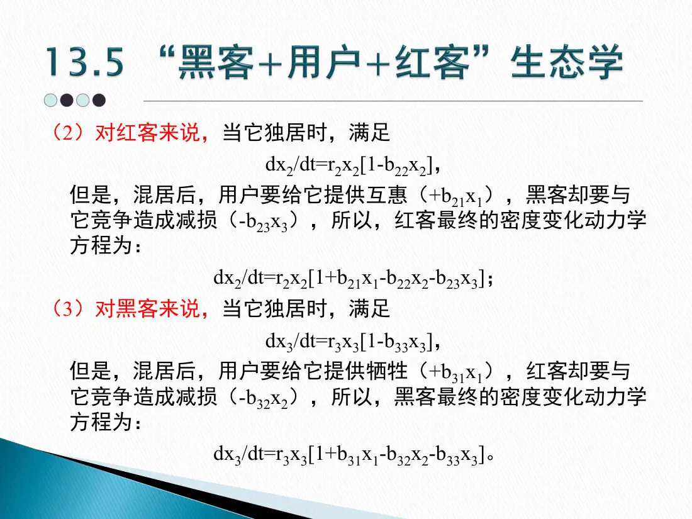

原文：

13.5“黑客+用户+红客”生态学

（2）对红客来说，当它独居时，满足

$$
\mathrm{dx} _ {2} / \mathrm{dt} = \mathrm{r} _ {2} \mathrm{x} _ {2} [ 1 - \mathrm{b} _ {2 2} \mathrm{x} _ {2} ],
$$

但是，混居后，用户要给它提供互惠 $( + \mathsf { b } _ { 2 1 } \mathbf { x } _ { 1 } )$ 黑客却要与它竞争造成减损 $( - \mathsf { b } _ { 2 3 } \mathbf { x } _ { 3 } )$ ，所以，红客最终的密度变化动力学方程为：

$$
\mathrm{dx} _ {2} / \mathrm{dt} = \mathrm{r} _ {2} \mathrm{x} _ {2} [ 1 + \mathrm{b} _ {2 1} \mathrm{x} _ {1} - \mathrm{b} _ {2 2} \mathrm{x} _ {2} - \mathrm{b} _ {2 3} \mathrm{x} _ {3} ];
$$

（3）对黑客来说，当它独居时，满足

$$
\mathrm{dx} _ {3} / \mathrm{dt} = \mathrm{r} _ {3} \mathrm{x} _ {3} [ 1 - \mathrm{b} _ {3 3} \mathrm{x} _ {3} ],
$$

但是，混居后，用户要给它提供牺牲 $( + \mathsf { b } _ { 3 1 } \mathsf { x } _ { 1 } )$ 红客却要与它竞争造成减损 $( - \mathsf { b } _ { 3 2 } \mathbf { X } _ { 2 } )$ ，所以，黑客最终的密度变化动力学方程为：

$$
\mathrm{dx} _ {3} / \mathrm{dt} = \mathrm{r} _ {3} \mathrm{x} _ {3} [ 1 + \mathrm{b} _ {3 1} \mathrm{x} _ {1} - \mathrm{b} _ {3 2} \mathrm{x} _ {2} - \mathrm{b} _ {3 3} \mathrm{x} _ {3} ] 。
$$

### 13.5“黑客+用户+红客”生态学

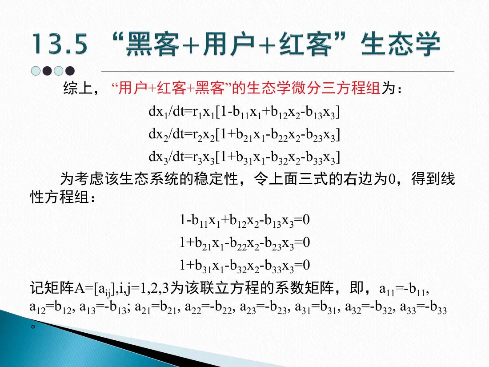

原文：

13.5“黑客+用户+红客”生态学

综上，“用户+红客+黑客”的生态学微分三方程组为：

$$
\begin{array}{l} \mathrm {dx_ {1} / dt = r_ {1} x_ {1} [1- b_ {11} x_ {1} + b_ {12} x_ {2} - b_ {13} x_ {3} ]} \\ \mathrm {dx_ {2} / dt = r_ {2} x_ {2} [1+ b_ {21} x_ {1} - b_ {22} x_ {2} - b_ {23} x_ {3} ]} \\ \mathrm {dx_ {3} / dt = r_ {3} x_ {3} [1+ b_ {31} x_ {1} - b_ {32} x_ {2} - b_ {33} x_ {3} ]} \end{array}
$$

为考虑该生态系统的稳定性，令上面三式的右边为0，得到线性方程组：

$$
\begin{array}{l} 1 - \mathbf {b} _ {1 1} \mathbf {x} _ {1} + \mathbf {b} _ {1 2} \mathbf {x} _ {2} - \mathbf {b} _ {1 3} \mathbf {x} _ {3} = 0 \\ 1 + \mathbf {b} _ {2 1} \mathbf {x} _ {1} - \mathbf {b} _ {2 2} \mathbf {x} _ {2} - \mathbf {b} _ {2 3} \mathbf {x} _ {3} = 0 \\ 1 + \mathbf {b} _ {3 1} \mathbf {x} _ {1} - \mathbf {b} _ {3 2} \mathbf {x} _ {2} - \mathbf {b} _ {3 3} \mathbf {x} _ {3} = 0 \end{array}
$$

记矩阵 $\mathrm { A } { = } [ \mathrm { a } _ { \mathrm { i } \mathrm { i } } ] , \mathrm { i } , \mathrm { j } { = } 1 , 2 , 3$ 为该联立方程的系数矩阵，即， $\mathsf { a } _ { 1 1 } \mathsf { = } \mathsf { - } \mathsf { b } _ { 1 1 }$ $\mathrm { a _ { 1 2 } = b _ { 1 2 } , a _ { 1 3 } = - b _ { 1 3 } ; a _ { 2 1 } = b _ { 2 1 } , a _ { 2 2 } = - b _ { 2 2 } , a _ { 2 3 } = - b _ { 2 3 } , a _ { 3 1 } = b _ { 3 1 } , a _ { 3 2 } = - b _ { 3 2 } , a _ { 3 3 } = - b _ { 3 3 } , a _ { 4 2 } = - b _ { 4 2 } , a _ { 4 3 } = - b _ { 4 2 } , a _ { 4 2 } = - b _ { 2 2 } , a _ { 4 2 } = - b _ { 4 2 } , a _ { 5 3 } = - b _ { 2 3 } , a _ { 6 2 } = - b _ { 1 2 } , a _ { 6 2 } = - b _ { 1 2 } , a _ { 7 2 } = - b _ { 1 2 } , a _ { 8 3 } = - b _ { 2 2 } , a _ { 1 2 } = - b _ { 1 2 } , a _ { 1 2 } = - b _ { 1 2 } . }$

### 13.5“黑客+用户+红客”生态学

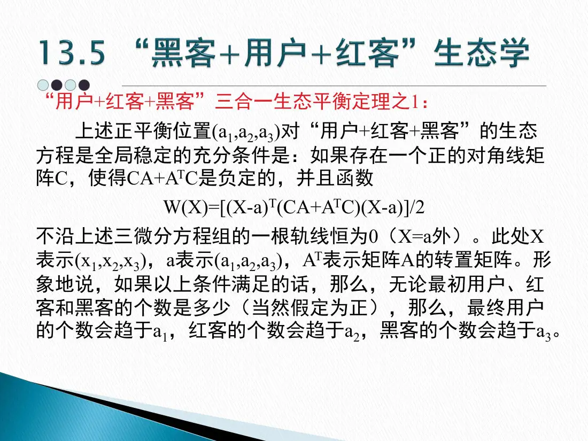

原文：

13.5“黑客+用户+红客”生态学

“用户+红客+黑客”三合一生态平衡定理之1：

上述正平衡位置 $\left( \mathbf { a } _ { 1 } , \mathbf { a } _ { 2 } , \mathbf { a } _ { 3 } \right)$ 对“用户+红客+黑客”的生态方程是全局稳定的充分条件是：如果存在一个正的对角线矩阵C，使得 $\mathrm { C A ^ { + } A ^ { \mathrm { T } } C }$ 是负定的，并且函数

$$
\mathrm{W} (\mathrm{X}) = [ (\mathrm{X} - \mathrm{a}) ^ {\mathrm{T}} (\mathrm{CA} + \mathrm{A} ^ {\mathrm{T}} \mathrm{C}) (\mathrm{X} - \mathrm{a}) ] / 2
$$

不沿上述三微分方程组的一根轨线恒为 $0 ( X = a 5 1 , )$ 。此处X表示 $\left( \mathbf { X } _ { 1 } , \mathbf { X } _ { 2 } , \mathbf { X } _ { 3 } \right)$ a表示 $\left( \mathbf { a } _ { 1 } , \mathbf { a } _ { 2 } , \mathbf { a } _ { 3 } \right)$ $\mathsf { A } ^ { \mathrm { T } }$ 表示矩阵A的转置矩阵。形象地说，如果以上条件满足的话，那么，无论最初用户、红客和黑客的个数是多少（当然假定为正），那么，最终用户的个数会趋于 ${ \bf \ddot { a } } _ { 1 }$ ，红客的个数会趋于 $\mathbf { \lambda } _ { \mathbf { \lambda } _ { 2 } }$ ，黑客的个数会趋于 ${ \bf \ddot { a } } _ { 3 }$

### 13.6 安全攻防小结

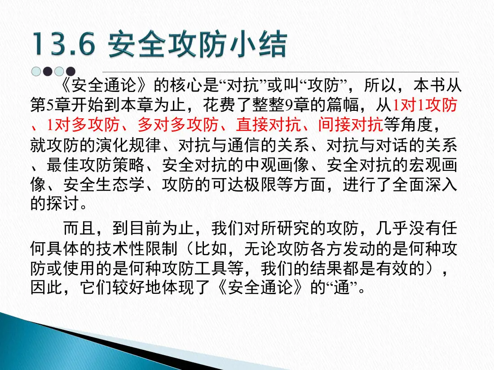

原文：

13.6 安全攻防小结

《安全通论》的核心是“对抗”或叫“攻防”，所以，本书从第5章开始到本章为止，花费了整整9章的篇幅，从1对1攻防1对多攻防、多对多攻防、直接对抗、间接对抗等角度，就攻防的演化规律、对抗与通信的关系、对抗与对话的关系、最佳攻防策略、安全对抗的中观画像、安全对抗的宏观画像、安全生态学、攻防的可达极限等方面，进行了全面深入的探讨。

而且，到目前为止，我们对所研究的攻防，几乎没有任何具体的技术性限制（比如，无论攻防各方发动的是何种攻防或使用的是何种攻防工具等，我们的结果都是有效的），因此，它们较好地体现了《安全通论》的“通”。

### 13.6 安全攻防小结

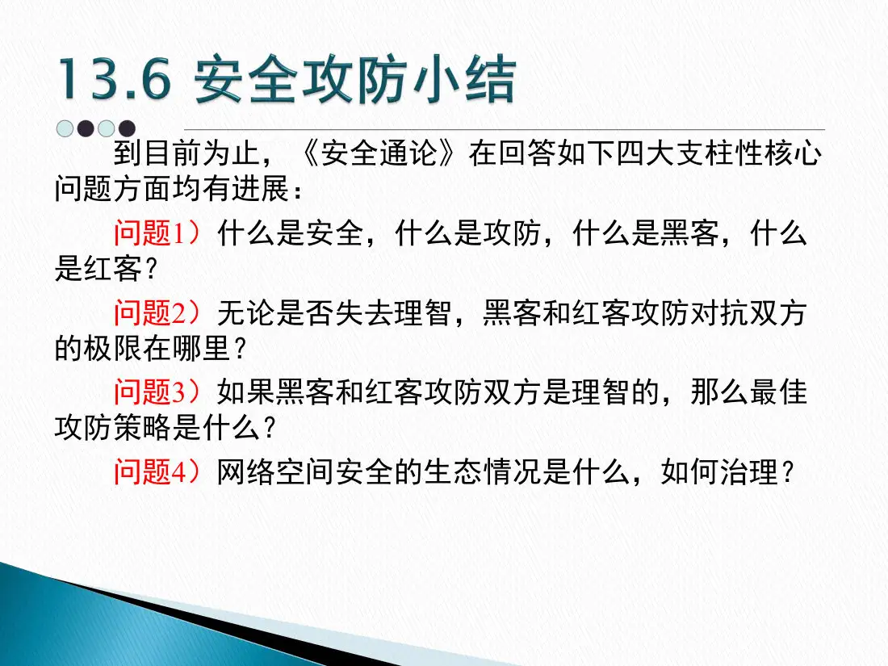

原文：

13.6 安全攻防小结

到目前为止，《安全通论》在回答如下四大支柱性核心问题方面均有进展：

问题1）什么是安全，什么是攻防，什么是黑客，什么是红客？

问题2）无论是否失去理智，黑客和红客攻防对抗双方的极限在哪里？

问题3）如果黑客和红客攻防双方是理智的，那么最佳攻防策略是什么？

问题4）网络空间安全的生态情况是什么，如何治理？

### 13.6 安全攻防小结

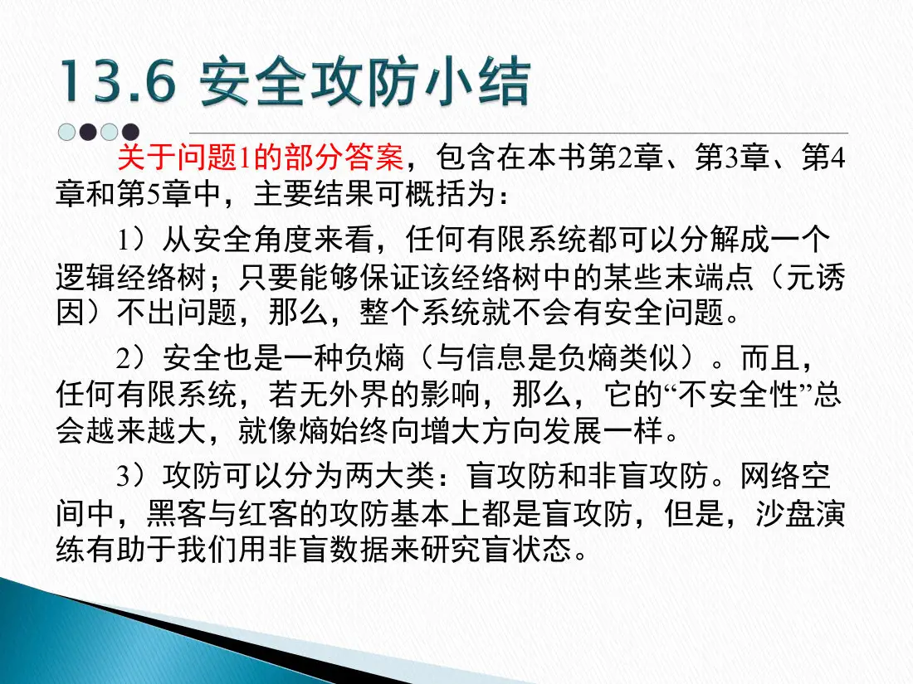

原文：

13.6 安全攻防小结

关于问题1的部分答案，包含在本书第2章、第3章、第4章和第5章中，主要结果可概括为：

1）从安全角度来看，任何有限系统都可以分解成一个逻辑经络树；只要能够保证该经络树中的某些末端点（元诱因）不出问题，那么，整个系统就不会有安全问题。

2）安全也是一种负熵（与信息是负熵类似）。而且，任何有限系统，若无外界的影响，那么，它的“不安全性”总会越来越大，就像熵始终向增大方向发展一样。

3）攻防可以分为两大类：盲攻防和非盲攻防。网络空间中，黑客与红客的攻防基本上都是盲攻防，但是，沙盘演练有助于我们用非盲数据来研究盲状态。

### 13.6 安全攻防小结

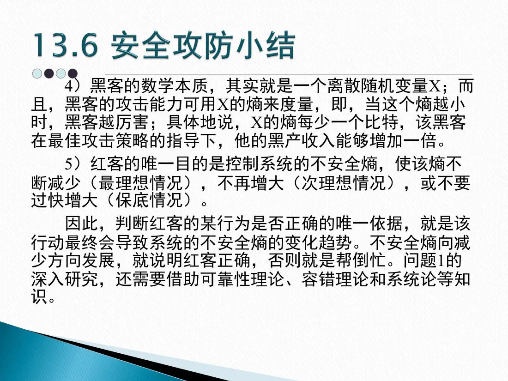

原文：

13.6 安全攻防小结

4）黑客的数学本质，其实就是一个离散随机变量X；而且，黑客的攻击能力可用X的熵来度量，即，当这个熵越小时，黑客越厉害；具体地说，X的熵每少一个比特，该黑客在最佳攻击策略的指导下，他的黑产收入能够增加一倍。

5）红客的唯一目的是控制系统的不安全熵，使该熵不断减少（最理想情况），不再增大（次理想情况），或不要过快增大（保底情况）。

因此，判断红客的某行为是否正确的唯一依据，就是该行动最终会导致系统的不安全熵的变化趋势。不安全熵向减少方向发展，就说明红客正确，否则就是帮倒忙。问题1的深入研究，还需要借助可靠性理论、容错理论和系统论等知识。

### 13.6 安全攻防小结

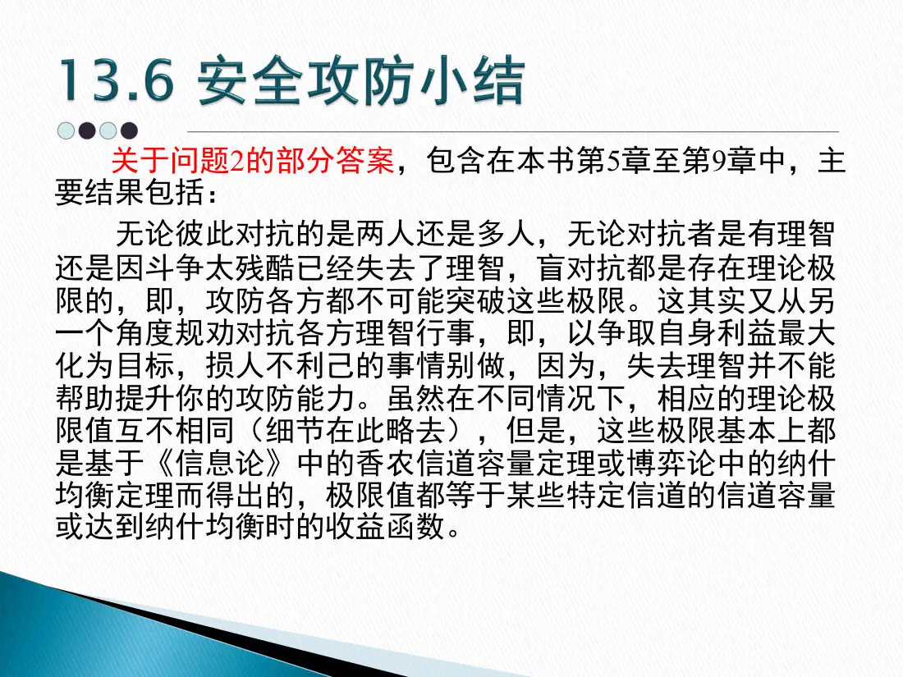

原文：

13.6 安全攻防小结

关于问题2的部分答案，包含在本书第5章至第9章中，主要结果包括：

无论彼此对抗的是两人还是多人，无论对抗者是有理智还是因斗争太残酷已经失去了理智，盲对抗都是存在理论极限的，即，攻防各方都不可能突破这些极限。这其实又从另一个角度规劝对抗各方理智行事，即，以争取自身利益最大化为目标，损人不利己的事情别做，因为，失去理智并不能帮助提升你的攻防能力。虽然在不同情况下，相应的理论极限值互不相同（细节在此略去），但是，这些极限基本上都是基于《信息论》中的香农信道容量定理或博弈论中的纳什均衡定理而得出的，极限值都等于某些特定信道的信道容量或达到纳什均衡时的收益函数。

### 13.6 安全攻防小结

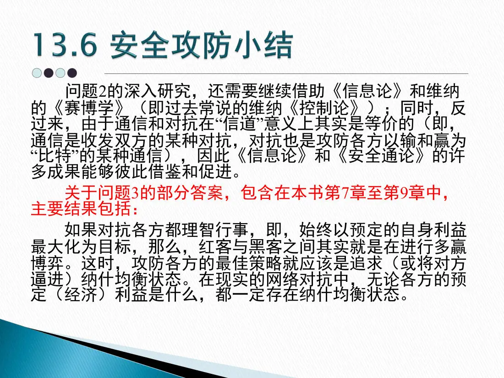

原文：

13.6 安全攻防小结

问题2的深入研究，还需要继续借助《信息论》和维纳的《赛博学》（即过去常说的维纳《控制论》）；同时，反过来，由于通信和对抗在“信道”意义上其实是等价的（即，通信是收发双方的某种对抗，对抗也是攻防各方以输和赢为“比特”的某种通信），因此《信息论》和《安全通论》的许多成果能够彼此借鉴和促进。

关于问题3的部分答案，包含在本书第7章至第9章中，主要结果包括：

如果对抗各方都理智行事，即，始终以预定的自身利益赢进）纳什均衡状态。在现实的网络对抗中，无论各方的预

### 13.6 安全攻防小结

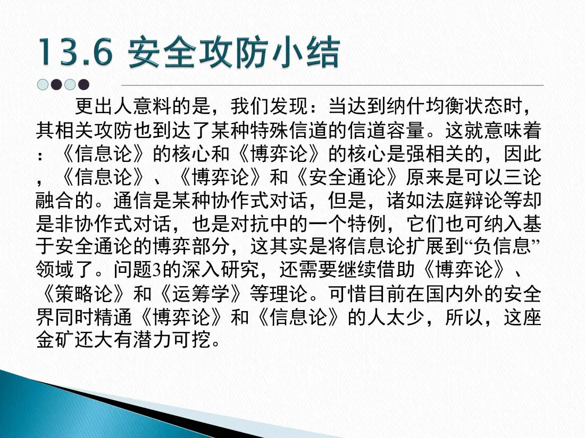

原文：

13.6 安全攻防小结

更出人意料的是，我们发现：当达到纳什均衡状态时，其相关攻防也到达了某种特殊信道的信道容量。这就意味着：《信息论》的核心和《博弈论》的核心是强相关的，因此《信息论》、《博弈论》和《安全通论》原来是可以三论融合的。通信是某种协作式对话，但是，诸如法庭辩论等却是非协作式对话，也是对抗中的一个特例，它们也可纳入基于安全通论的博弈部分，这其实是将信息论扩展到“负信息”领域了。问题3的深入研究，还需要继续借助《博弈论》、《策略论》和《运筹学》等理论。可惜目前在国内外的安全界同时精通《博弈论》和《信息论》的人太少，所以，这座金矿还大有潜力可挖。

### 13.6 安全攻防小结

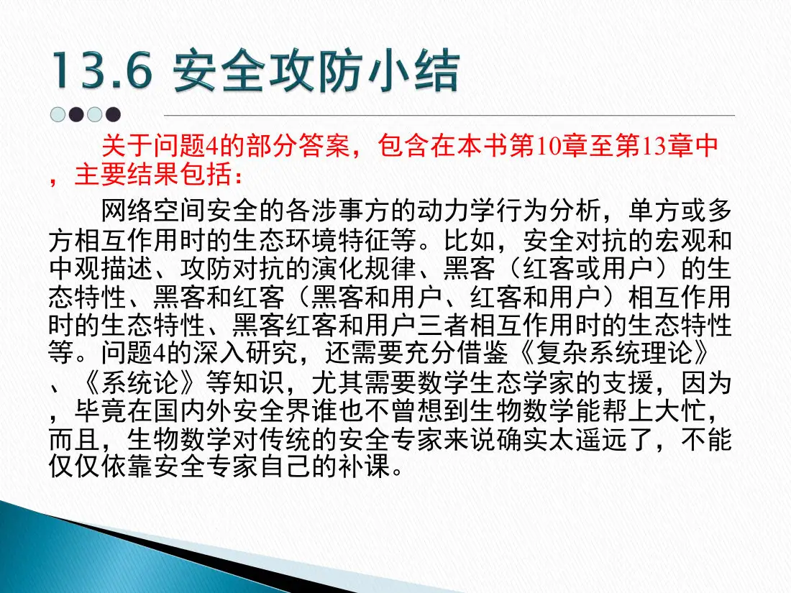

原文：

13.6 安全攻防小结

关于问题4的部分答案，包含在本书第10章至第13章中，主要结果包括：

网络空间安全的各涉事方的动力学行为分析，单方或多方相互作用时的生态环境特征等。比如，安全对抗的宏观和中观描述、攻防对抗的演化规律、黑客（红客或用户）的生态特性、黑客和红客（黑客和用户、红客和用户）相互作用时的生态特性、黑客红客和用户三者相互作用时的生态特性等。问题4的深入研究，还需要充分借鉴《复杂系统理论》《系统论》等知识，尤其需要数学生态学家的支援，因为毕竟在国内外安全界谁也不曾想到生物数学能帮上大忙，而且，生物数学对传统的安全专家来说确实太遥远了，不能仅仅依靠安全专家自己的补课。

### 13.6 安全攻防小结

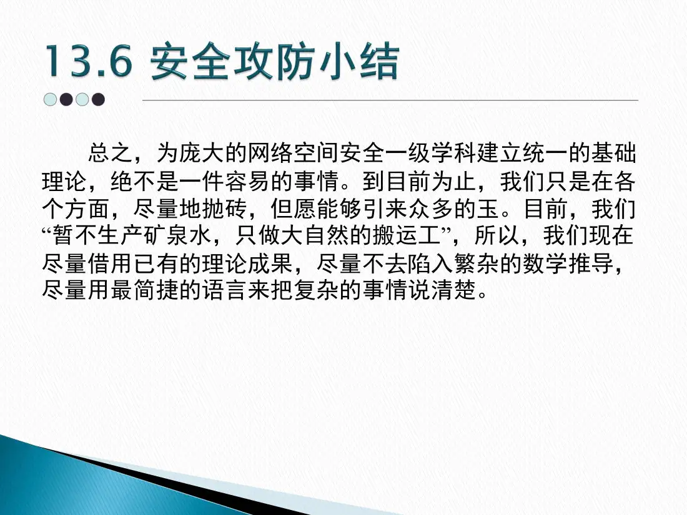

原文：

13.6 安全攻防小结

总之，为庞大的网络空间安全一级学科建立统一的基础理论，绝不是一件容易的事情。到目前为止，我们只是在各个方面，尽量地抛砖，但愿能够引来众多的玉。目前，我们“暂不生产矿泉水，只做大自然的搬运工”，所以，我们现在尽量借用已有的理论成果，尽量不去陷入繁杂的数学推导，尽量用最简捷的语言来把复杂的事情说清楚。

### 13.6 安全攻防小结

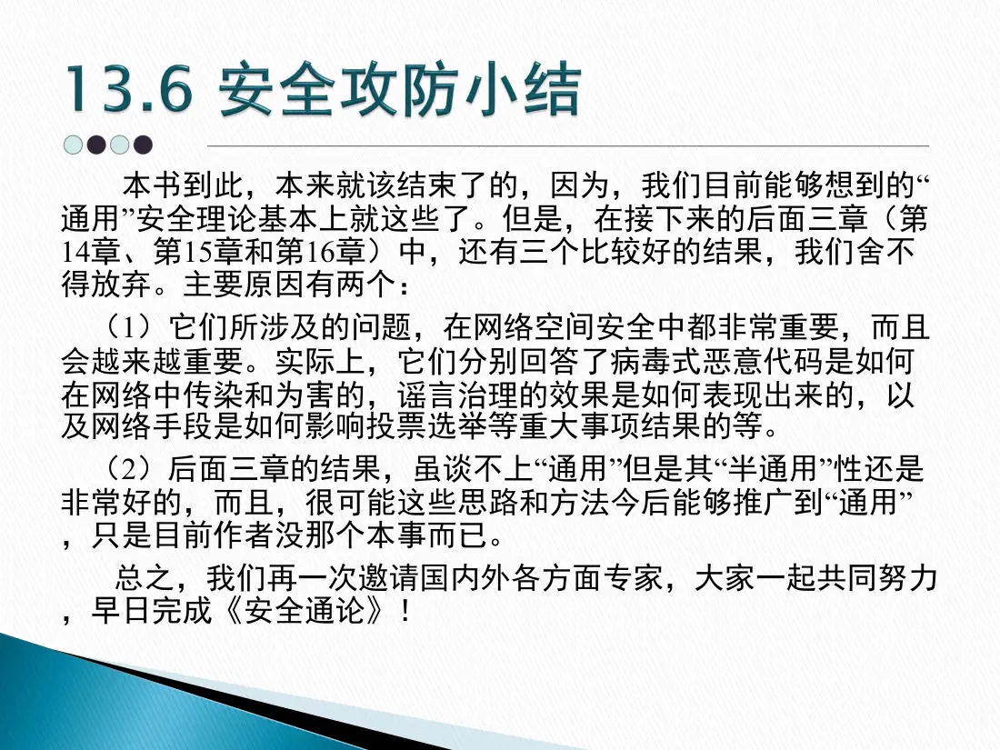

原文：

13.6 安全攻防小结

本书到此，本来就该结束了的，因为，我们目前能够想到的“通用”安全理论基本上就这些了。但是，在接下来的后面三章（第14章、第15章和第16章）中，还有三个比较好的结果，我们舍不得放弃。主要原因有两个：

（1）它们所涉及的问题，在网络空间安全中都非常重要，而且会越来越重要。实际上，它们分别回答了病毒式恶意代码是如何在网络中传染和为害的，谣言治理的效果是如何表现出来的，以及网络手段是如何影响投票选举等重大事项结果的等。

（2）后面三章的结果，虽谈不上“通用”但是其“半通用”性还是非常好的，而且，很可能这些思路和方法今后能够推广到“通用”，只是目前作者没那个本事而已。

总之，我们再一次邀请国内外各方面专家，大家一起共同努力，早日完成《安全通论》！

### 本章结束，谢谢

原文：

本章结束，谢谢
