# 《安全通论》第14章 计算机病毒的行为分析（课件）

原件的每一页，下面附识别出的文字。

### 第14章---计算机病毒的行为分析

原文：

第14章---计算机病毒的行为分析

### 第14章计算机病毒的行为分析

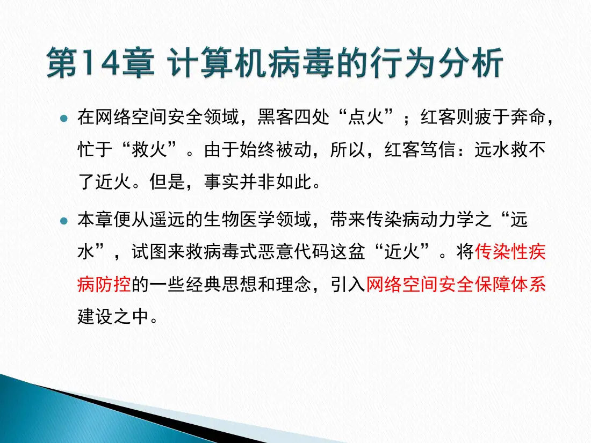

原文：

第14章计算机病毒的行为分析

⚫ 在网络空间安全领域，黑客四处“点火”；红客则疲于奔命，忙于“救火”。由于始终被动，所以，红客笃信：远水救不了近火。但是，事实并非如此。

⚫ 本章便从遥远的生物医学领域，带来传染病动力学之“远水”，试图来救病毒式恶意代码这盆“近火”。将传染性疾病防控的一些经典思想和理念，引入网络空间安全保障体系建设之中。

### 第14章计算机病毒的行为分析

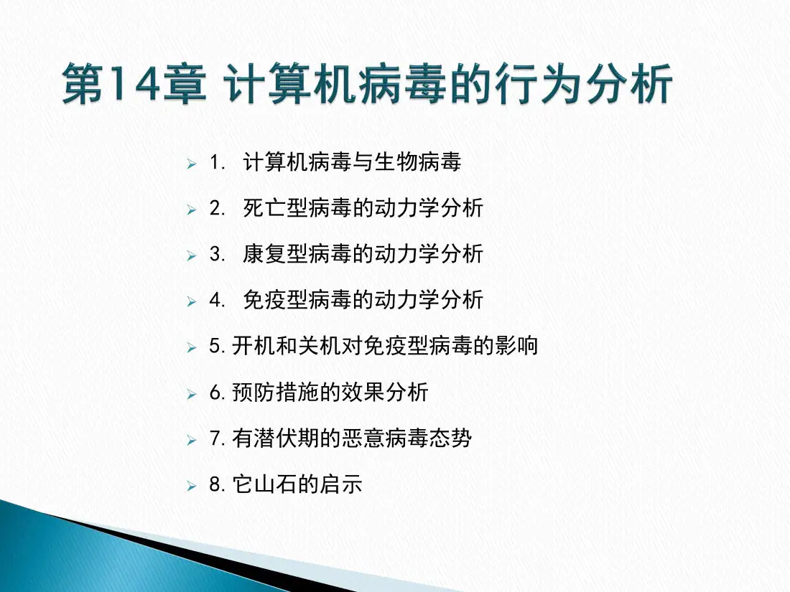

原文：

第14章计算机病毒的行为分析

1. 计算机病毒与生物病毒
2. 死亡型病毒的动力学分析
3. 康复型病毒的动力学分析
4. 免疫型病毒的动力学分析
5. 开机和关机对免疫型病毒的影响
6. 预防措施的效果分析
7. 有潜伏期的恶意病毒态势
8. 它山石的启示

### 14.1计算机病毒与生物病毒

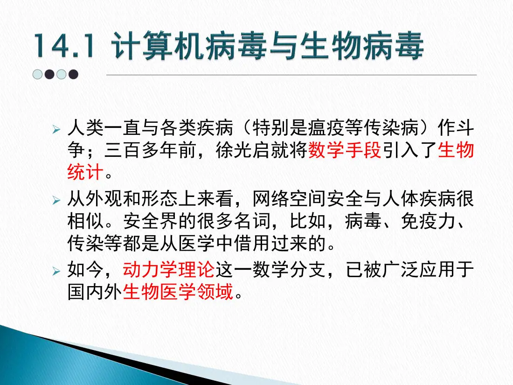

原文：

14.1计算机病毒与生物病毒

人类一直与各类疾病（特别是瘟疫等传染病）作斗争；三百多年前，徐光启就将数学手段引入了生物统计。

➢ 从外观和形态上来看，网络空间安全与人体疾病很相似。安全界的很多名词，比如，病毒、免疫力、传染等都是从医学中借用过来的。

如今，动力学理论这一数学分支，已被广泛应用于国内外生物医学领域。

### 14.1计算机病毒与生物病毒

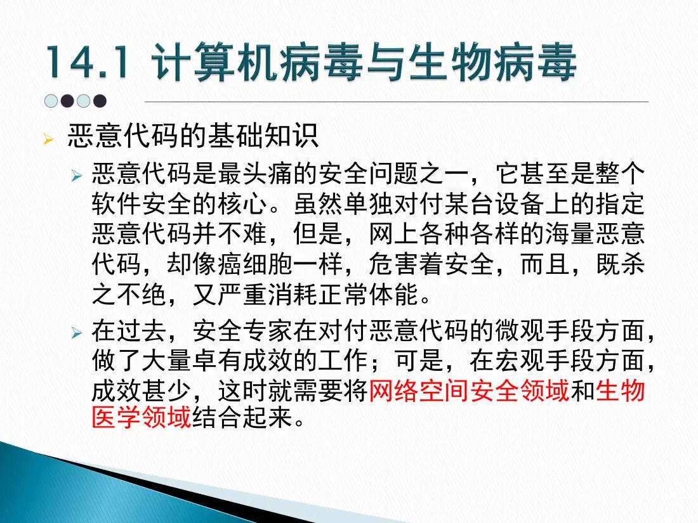

原文：

14.1计算机病毒与生物病毒

恶意代码的基础知识

➢ 恶意代码是最头痛的安全问题之一，它甚至是整个软件安全的核心。虽然单独对付某台设备上的指定恶意代码并不难，但是，网上各种各样的海量恶意代码，却像癌细胞一样，危害着安全，而且，既杀之不绝，又严重消耗正常体能。

在过去，安全专家在对付恶意代码的微观手段方面，做了大量卓有成效的工作；可是，在宏观手段方面，成效甚少，这时就需要将网络空间安全领域和生物医学领域结合起来。

### 14.1计算机病毒与生物病毒

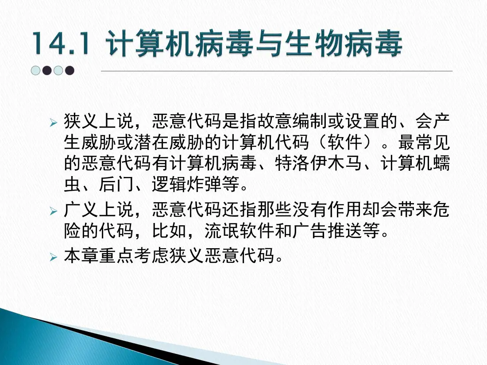

原文：

14.1计算机病毒与生物病毒

➢ 狭义上说，恶意代码是指故意编制或设置的、会产生威胁或潜在威胁的计算机代码（软件）。最常见的恶意代码有计算机病毒、特洛伊木马、计算机蠕虫、后门、逻辑炸弹等。

广义上说，恶意代码还指那些没有作用却会带来危险的代码，比如，流氓软件和广告推送等。

➢ 本章重点考虑狭义恶意代码。

### 14.1计算机病毒与生物病毒

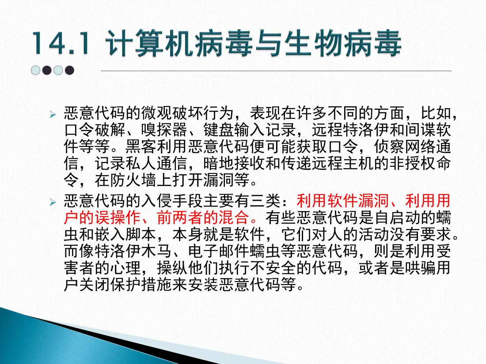

原文：

14.1计算机病毒与生物病毒

恶意代码的微观破坏行为，表现在许多不同的方面，比如，口令破解、嗅探器、键盘输入记录，远程特洛伊和间谍软件等等。黑客利用恶意代码便可能获取口令，侦察网络通信，记录私人通信，暗地接收和传递远程主机的非授权命令，在防火墙上打开漏洞等。

恶意代码的入侵手段主要有三类：利用软件漏洞、利用用户的误操作、前两者的混合。有些恶意代码是自启动的蠕虫和嵌入脚本，本身就是软件，它们对人的活动没有要求。而像特洛伊木马、电子邮件蠕虫等恶意代码，则是利用受害者的心理，操纵他们执行不安全的代码，或者是哄骗用户关闭保护措施来安装恶意代码等。

### 14.1计算机病毒与生物病毒

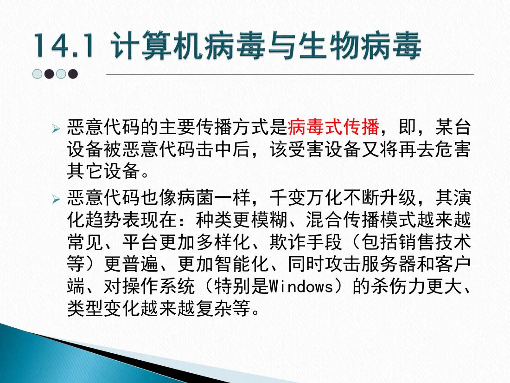

原文：

14.1计算机病毒与生物病毒

恶意代码的主要传播方式是病毒式传播，即，某台设备被恶意代码击中后，该受害设备又将再去危害其它设备。

恶意代码也像病菌一样，千变万化不断升级，其演化趋势表现在：种类更模糊、混合传播模式越来越常见、平台更加多样化、欺诈手段（包括销售技术等）更普遍、更加智能化、同时攻击服务器和客户端、对操作系统（特别是Windows）的杀伤力更大、类型变化越来越复杂等。

### 14.1计算机病毒与生物病毒

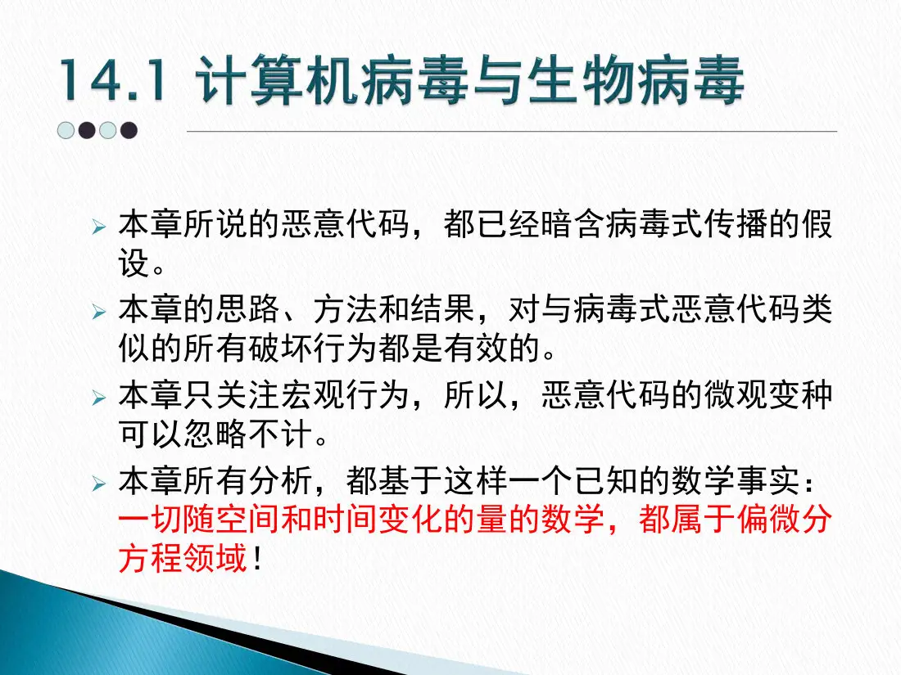

原文：

14.1计算机病毒与生物病毒

➢ 本章所说的恶意代码，都已经暗含病毒式传播的假设。

本章的思路、方法和结果，对与病毒式恶意代码类似的所有破坏行为都是有效的。

➢ 本章只关注宏观行为，所以，恶意代码的微观变种可以忽略不计。

本章所有分析，都基于这样一个已知的数学事实：一切随空间和时间变化的量的数学，都属于偏微分方程领域！

### 14.2死亡型病毒的动力学分析

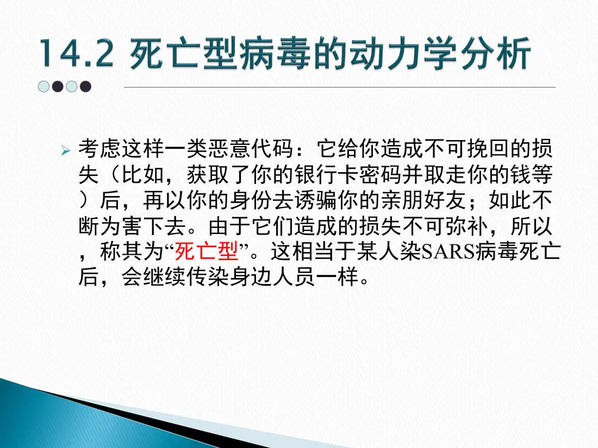

原文：

14.2死亡型病毒的动力学分析

考虑这样一类恶意代码：它给你造成不可挽回的损失（比如，获取了你的银行卡密码并取走你的钱等）后，再以你的身份去诱骗你的亲朋好友；如此不断为害下去。由于它们造成的损失不可弥补，所以，称其为“死亡型”。这相当于某人染SARS病毒死亡后，会继续传染身边人员一样。

### 14.2死亡型病毒的动力学分析

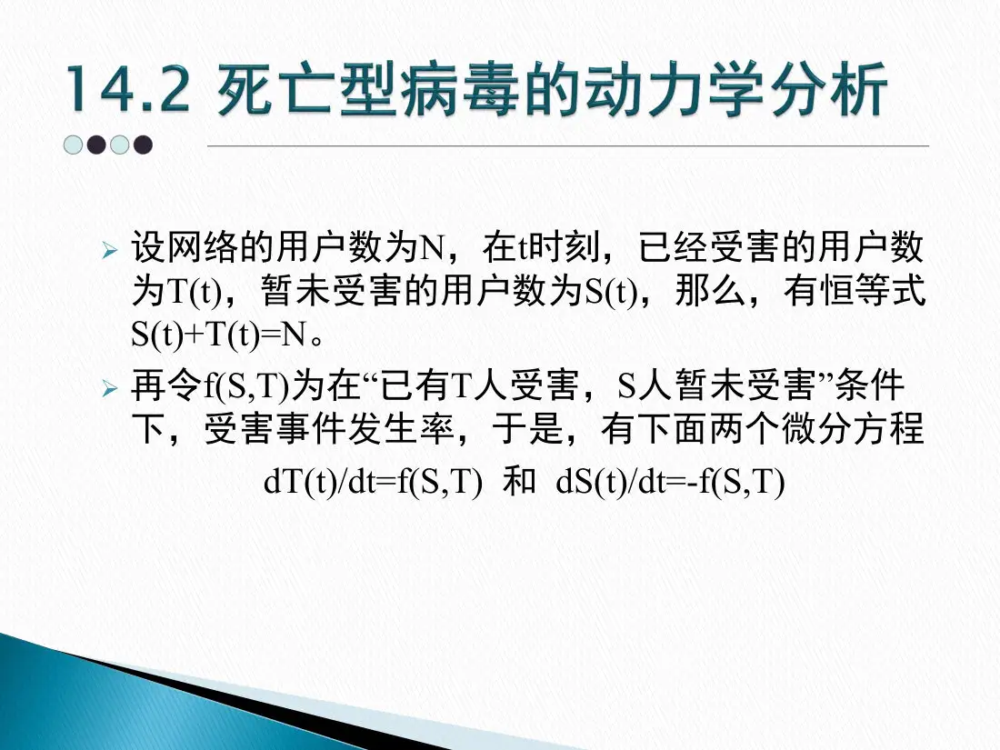

原文：

14.2死亡型病毒的动力学分析

➢ 设网络的用户数为N，在t时刻，已经受害的用户数为T(t)，暂未受害的用户数为S(t)，那么，有恒等式S(t)+T(t)=N。

➢ 再令f(S,T)为在“已有T人受害，S人暂未受害”条件下，受害事件发生率，于是，有下面两个微分方程

dT(t)/dt=f(S,T) 和 dS(t)/dt=-f(S,T)

### 14.2死亡型病毒的动力学分析

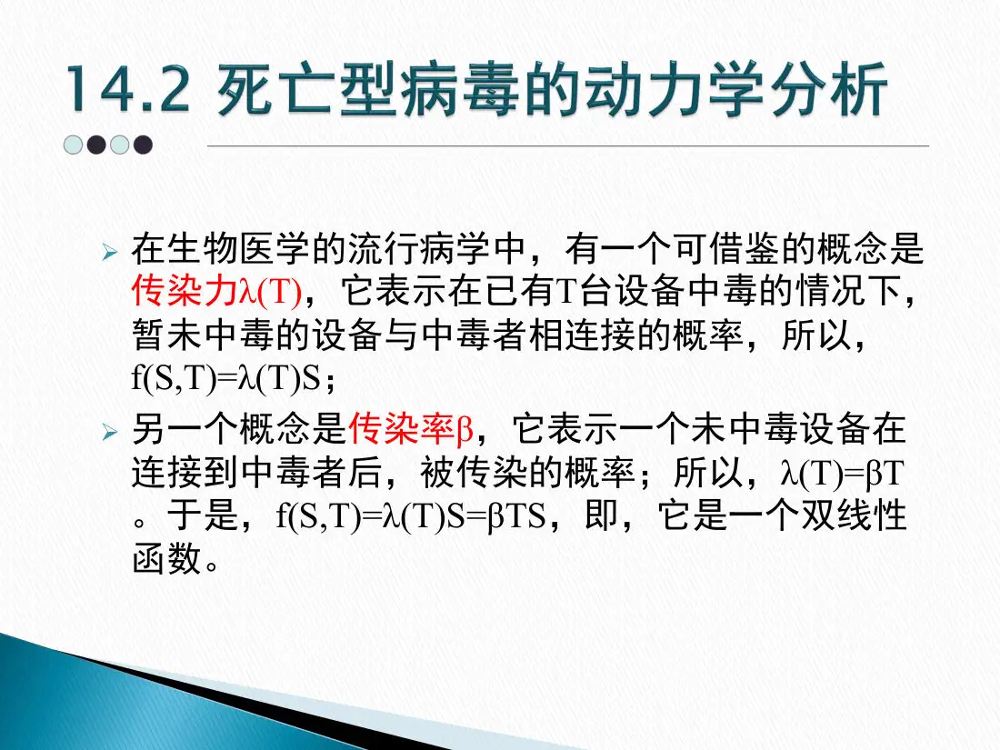

原文：

14.2死亡型病毒的动力学分析

在生物医学的流行病学中，有一个可借鉴的概念是传染力λ(T)，它表示在已有T台设备中毒的情况下，暂未中毒的设备与中毒者相连接的概率，所以，f(S,T)=λ(T)S；

另一个概念是传染率β，它表示一个未中毒设备在连接到中毒者后，被传染的概率；所以，λ(T)=βT。于是，f(S,T)=λ(T)S=βTS，即，它是一个双线性函数。

### 14.2死亡型病毒的动力学分析

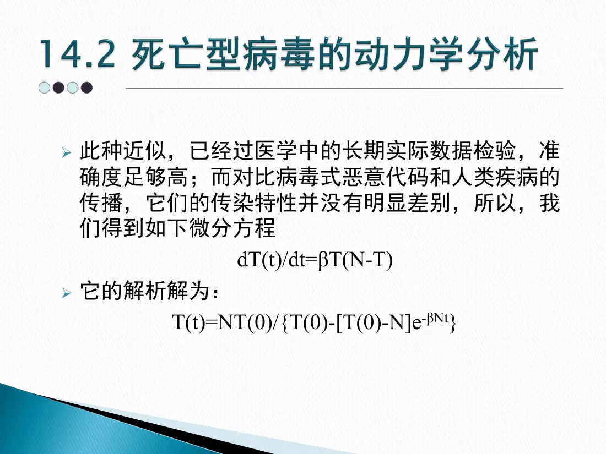

原文：

14.2死亡型病毒的动力学分析

➢ 此种近似，已经过医学中的长期实际数据检验，准确度足够高；而对比病毒式恶意代码和人类疾病的传播，它们的传染特性并没有明显差别，所以，我们得到如下微分方程

$$
\mathrm{dT(t)} / \mathrm{dt} = \beta \mathrm{T(N-T)}
$$

➢ 它的解析解为：

$$
\mathrm{T} (t) = \mathrm{NT} (0) / \{\mathrm{T} (0) - [ \mathrm{T} (0) - \mathrm{N} ] \mathrm{e} ^ {- \beta \mathrm{N} t} \}
$$

### 14.2死亡型病毒的动力学分析

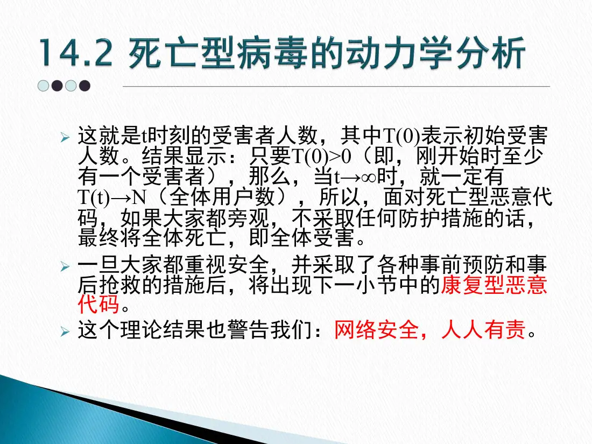

原文：

14.2死亡型病毒的动力学分析

➢ 这就是t时刻的受害者人数，其中T(0)表示初始受害人数。结果显示：只要T(0)>0（即，刚开始时至少有一个受害者），那么，当t→∞时，就一定有T(t)→N（全体用户数），所以，面对死亡型恶意代码，如果大家都旁观，不采取任何防护措施的话，最终将全体死亡，即全体受害。

➢ 一旦大家都重视安全，并采取了各种事前预防和事后抢救的措施后，将出现下一小节中的康复型恶意代码。

这个理论结果也警告我们：网络安全，人人有责。

### 14.3 康复型病毒的动力学分析

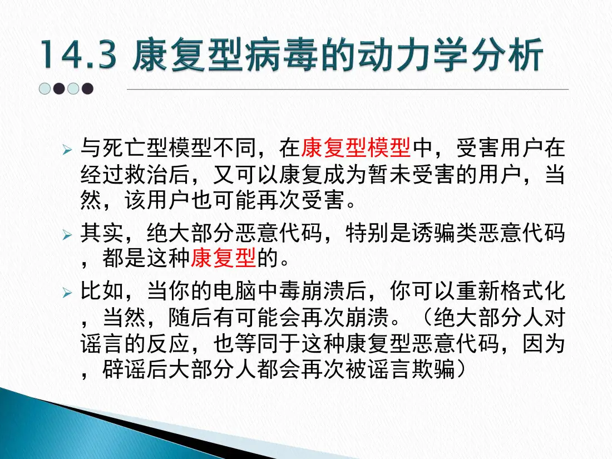

原文：

14.3 康复型病毒的动力学分析

与死亡型模型不同，在康复型模型中，受害用户在经过救治后，又可以康复成为暂未受害的用户，当然，该用户也可能再次受害。

➢ 其实，绝大部分恶意代码，特别是诱骗类恶意代码，都是这种康复型的。

➢ 比如，当你的电脑中毒崩溃后，你可以重新格式化，当然，随后有可能会再次崩溃。（绝大部分人对谣言的反应，也等同于这种康复型恶意代码，因为，辟谣后大部分人都会再次被谣言欺骗）

### 14.3 康复型病毒的动力学分析

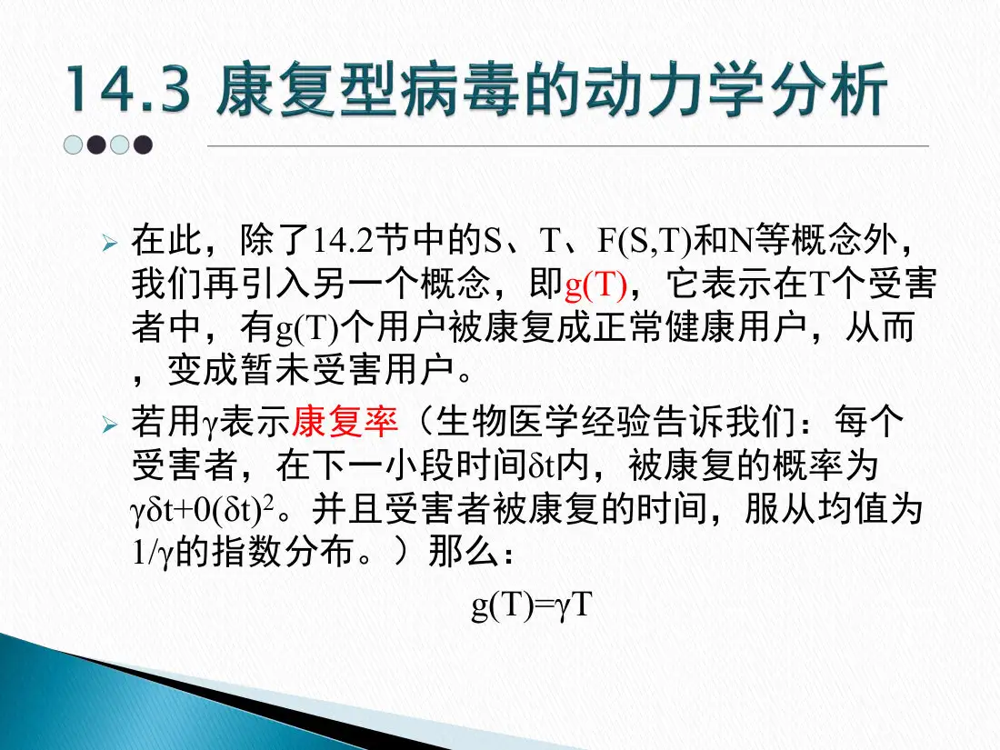

原文：

14.3 康复型病毒的动力学分析

➢ 在此，除了14.2节中的S、T、F(S,T)和N等概念外，我们再引入另一个概念，即g(T)，它表示在T个受害者中，有g(T)个用户被康复成正常健康用户，从而，变成暂未受害用户。

若用γ表示康复率（生物医学经验告诉我们：每个受害者，在下一小段时间δt内，被康复的概率为γδt+0(δt)2。并且受害者被康复的时间，服从均值为1/γ的指数分布。）那么：

$$
\mathbf {g} (\mathrm{T}) = \gamma \mathrm{T}
$$

### 14.3 康复型病毒的动力学分析

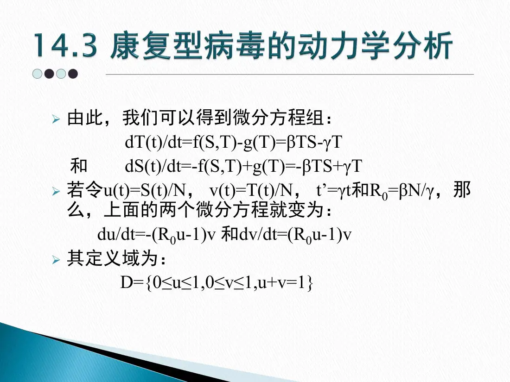

原文：

14.3 康复型病毒的动力学分析

➢ 由此，我们可以得到微分方程组：

$$
\mathrm{dT(t)} / \mathrm{dt} = \mathrm {f(S,T) - g(T) = \beta TS- \gamma T}
$$

和 $\mathrm { d } \mathrm { S ( t ) } / \mathrm { d t - f ( \mathrm { S } , \mathrm { T } ) } + \mathrm { g ( \mathrm { T } ) } = - \mathrm { \beta } \mathrm { T } \mathrm { S } + \gamma \mathrm { T }$

➢ 若令u(t)=S(t)/N， $\mathrm { v ( t ) { = } T ( t ) / N }$ $t ^ { \prime } { = } \gamma 1$ t和 $R _ { 0 } = \beta \Nu / \gamma$ ，那么，上面的两个微分方程就变为：

$$
\mathrm{du} / \mathrm{dt} = - (\mathrm{R} _ {0} \mathrm{u} - 1) \mathrm{v} \text {和} \mathrm{dv} / \mathrm{dt} = (\mathrm{R} _ {0} \mathrm{u} - 1) \mathrm{v}
$$

其定义域为：

$$
\mathrm{D} = \{0 \leq \mathrm{u} \leq 1, 0 \leq \mathrm{v} \leq 1, \mathrm{u} + \mathrm{v} = 1 \}
$$

### 14.3 康复型病毒的动力学分析

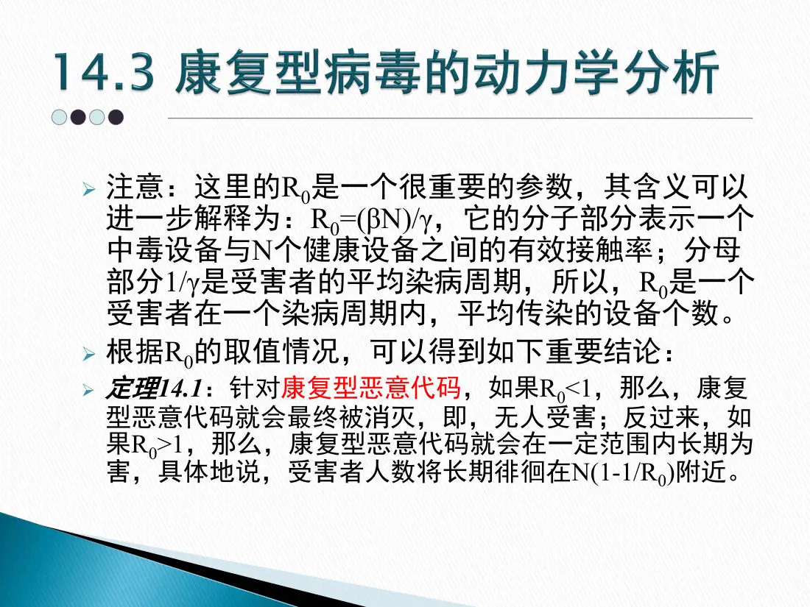

原文：

14.3 康复型病毒的动力学分析

注意：这里的 $\mathrm { R } _ { 0 }$ 是一个很重要的参数，其含义可以进一步解释为： $\mathrm { R } _ { 0 } { = } ( \beta \mathrm { N } ) / \gamma$ 它的分子部分表示一个中毒设备与N个健康设备之间的有效接触率；分母部分1/γ是受害者的平均染病周期，所以， $\mathrm { R } _ { 0 }$ 是一个受害者在一个染病周期内，平均传染的设备个数。

➢ 根据 $\mathrm { R } _ { 0 }$ 的取值情况，可以得到如下重要结论：

定理14.1：针对康复型恶意代码，如果 $\mathrm { R } _ { 0 } { < } 1$ ，那么，康复型恶意代码就会最终被消灭，即，无人受害；反过来，如果 $\mathrm { R } _ { 0 } { > } 1$ 那么，康复型恶意代码就会在一定范围内长期为害，具体地说，受害者人数将长期徘徊在 $\mathrm { N } ( 1 - 1 / \mathrm { R } _ { 0 } )$ 附近。

### 14.3 康复型病毒的动力学分析

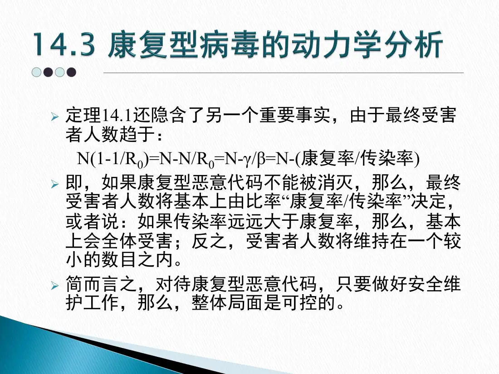

原文：

14.3 康复型病毒的动力学分析

➢ 定理14.1还隐含了另一个重要事实，由于最终受害者人数趋于：

$$
\mathrm{N} (1 - 1 / \mathrm{R} _ {0}) = \mathrm{N} - \mathrm{N} / \mathrm{R} _ {0} = \mathrm{N} - \gamma / \beta = \mathrm{N} - (\text {康复率/传染率})
$$

即，如果康复型恶意代码不能被消灭，那么，最终受害者人数将基本上由比率“康复率/传染率”决定，或者说：如果传染率远远大于康复率，那么，基本上会全体受害；反之，受害者人数将维持在一个较小的数目之内。

➢ 简而言之，对待康复型恶意代码，只要做好安全维护工作，那么，整体局面是可控的。

### 14.3 康复型病毒的动力学分析

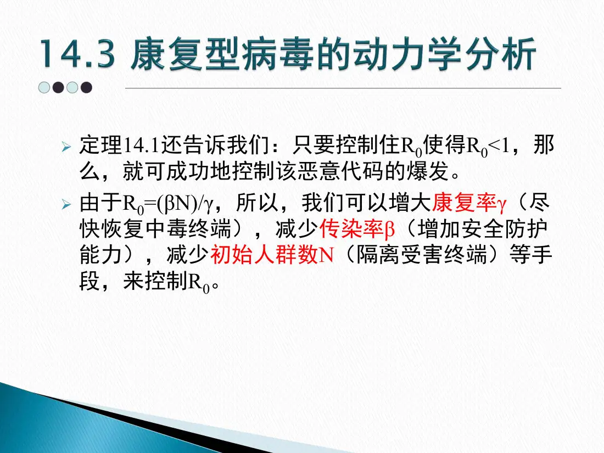

原文：

14.3 康复型病毒的动力学分析

➢ 定理14.1还告诉我们：只要控制住 $\mathrm { R } _ { 0 }$ 使得 $\mathrm { R } _ { 0 } { < } 1$ ，那么，就可成功地控制该恶意代码的爆发。

由于 $\mathrm { R } _ { 0 } { = } ( \beta \mathrm { N } ) / \gamma$ ，所以，我们可以增大康复率γ（尽快恢复中毒终端），减少传染率β（增加安全防护能力），减少初始人群数N（隔离受害终端）等手段，来控制 $\mathrm { R } _ { 0 }$ 。

### 14.4免疫型病毒的动力学分析

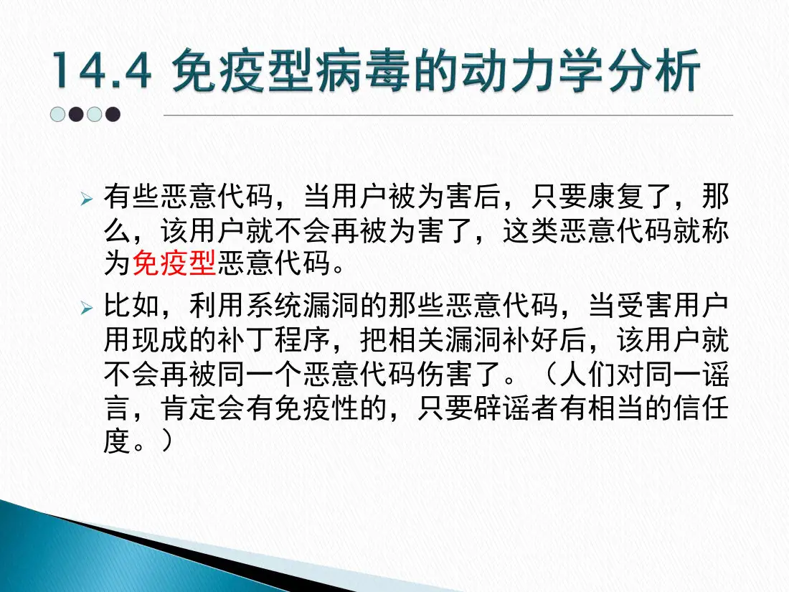

原文：

14.4免疫型病毒的动力学分析

有些恶意代码，当用户被为害后，只要康复了，那么，该用户就不会再被为害了，这类恶意代码就称为免疫型恶意代码。

➢ 比如，利用系统漏洞的那些恶意代码，当受害用户用现成的补丁程序，把相关漏洞补好后，该用户就不会再被同一个恶意代码伤害了。（人们对同一谣言，肯定会有免疫性的，只要辟谣者有相当的信任度。）

### 14.4免疫型病毒的动力学分析

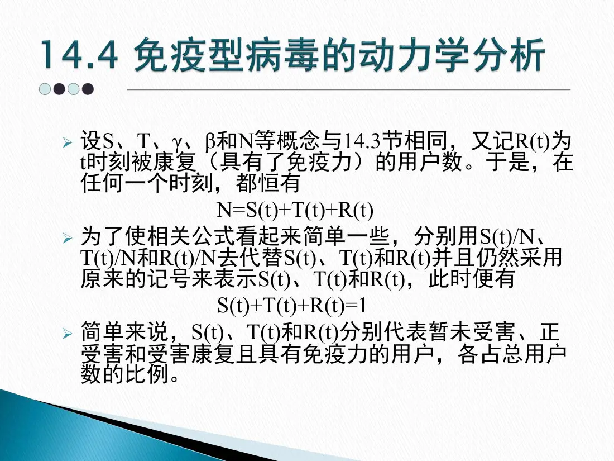

原文：

14.4免疫型病毒的动力学分析

➢ 设S、T、γ、β和N等概念与14.3节相同，又记R(t)为t时刻被康复（具有了免疫力）的用户数。于是，在任何一个时刻，都恒有

$$
\mathrm{N} = \mathrm{S} (t) + \mathrm{T} (t) + \mathrm{R} (t)
$$

为了使相关公式看起来简单一些，分别用S(t)/N、T(t)/N和R(t)/N去代替S(t)、T(t)和R(t)并且仍然采用原来的记号来表示S(t)、T(t)和R(t)，此时便有S(t)+T(t)+R(t)=1

➢ 简单来说，S(t)、T(t)和R(t)分别代表暂未受害、正受害和受害康复且具有免疫力的用户，各占总用户数的比例。

### 14.4免疫型病毒的动力学分析

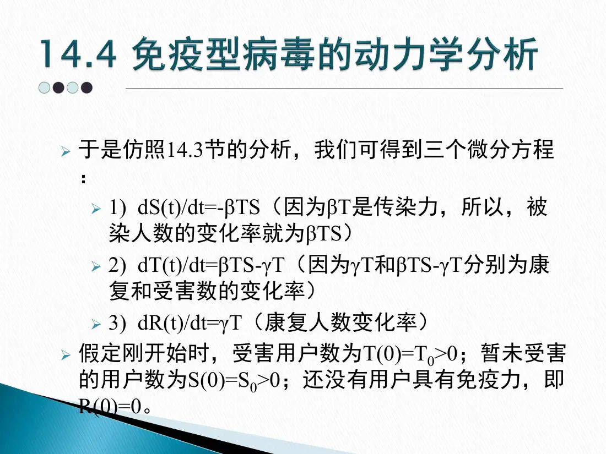

原文：

14.4免疫型病毒的动力学分析

➢ 于是仿照14.3节的分析，我们可得到三个微分方程：

➢ 1) $\mathrm { d } \mathrm { S ( t ) } / \mathrm { d t } { = } { \cdot } \mathrm { \beta } \mathrm { T S }$ （因为βT是传染力，所以，被染人数的变化率就为βTS）

➢ 2) $\mathrm { d } \mathrm { T } ( \mathrm { t } ) / \mathrm { d } \mathrm { t } { = } \mathrm { \beta } \mathrm { T } \mathrm { S } { - } \gamma \mathrm { T }$ （因为γT和βTS-γT分别为康复和受害数的变化率）

➢ 3) $\mathrm { d } \mathrm { R } ( \mathrm { t } ) / \mathrm { d } \mathrm { t } { = } \gamma \mathrm { T }$ （康复人数变化率）

➢ 假定刚开始时，受害用户数为 $\mathrm { T } ( 0 ) { = } \mathrm { T } _ { 0 } { > } 0$ ；暂未受害的用户数为 $\mathrm { S } ( 0 ) { = } \mathrm { S } _ { 0 } { > } 0$ ；还没有用户具有免疫力，即$\mathrm { R } ( 0 ) { = } 0$

### 14.4免疫型病毒的动力学分析

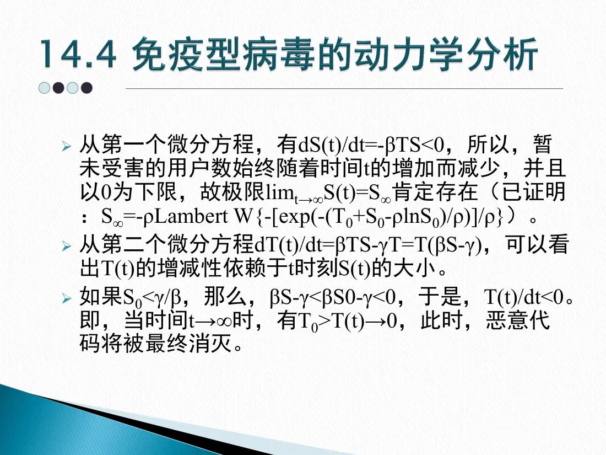

原文：

14.4免疫型病毒的动力学分析

从第一个微分方程，有 $\mathrm { d } \mathrm { S ( t ) } / \mathrm { d t } { = } { \mathrm { - } } \mathrm { \beta } \mathrm { T S } { < } 0$ 所以，暂未受害的用户数始终随着时间t的增加而减少，并且以0为下限，故极限 $\dim _ { \mathrm { t } \to \infty } \mathrm { S } ( \mathrm { t } ) { = } \mathrm { S } _ { \infty }$ 肯定存在（已证明$: \mathrm { \Delta S _ { \infty } ^ { \mathrm { ~ ~ - } } \mathrm { \Delta } \mathrm { \cdot } \mathrm { \Delta } P ^ { \mathrm { ~ L } \mathrm { a m b e r t } } W \left\{ - [ \mathrm { e x p ( - ( T _ { 0 } + S _ { 0 } \mathrm { - } \mathrm { \ p l n S _ { 0 } ) / p ) } ] / p } } \ : }\right$

从第二个微分方程 $\mathrm { d } \mathrm { T } ( \mathrm { t } ) / \mathrm { d } \mathrm { t } { = } \beta \mathrm { T } \mathrm { S } { \cdot } \gamma \mathrm { T } { = } \mathrm { T } ( \beta \mathrm { S } { - } \gamma )$ ，可以看出T(t)的增减性依赖于t时刻S(t)的大小。

➢ 如果 $\mathrm { S } _ { 0 } { < } \gamma / \beta$ 那么， $\mathrm { 3 S - } \gamma { < } \beta \mathrm { S } 0 { - } \gamma { < } 0$ 于是， $\mathrm { T } ( \mathrm { t } ) / \mathrm { d t } { < } 0$ 即，当时间t→∞时，有 $\mathrm { T } _ { 0 } { \mathrm { > T } } ( \mathrm { t } ) { \mathrm { \to } } 0$ ，此时，恶意代码将被最终消灭。

### 14.4免疫型病毒的动力学分析

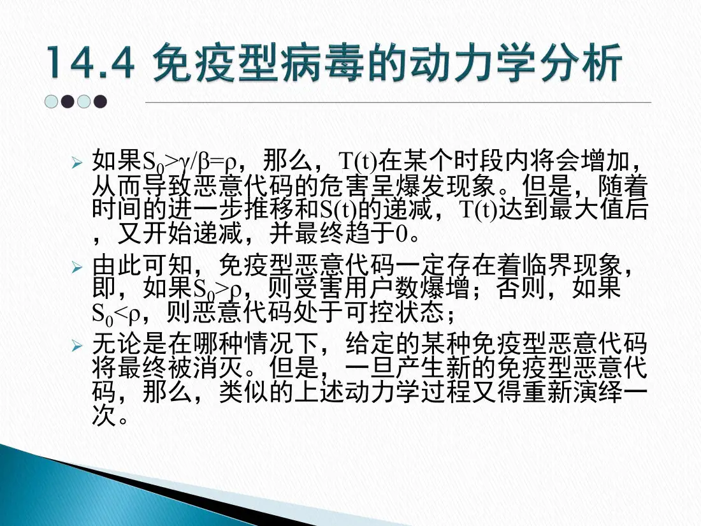

原文：

14.4免疫型病毒的动力学分析

➢ 如果 $\mathrm { S } _ { \mathrm { 0 } } { > } \gamma / \beta { = } \rho$ 那么，T(t)在某个时段内将会增加，从而导致恶意代码的危害呈爆发现象。但是，随着时间的进一步推移和S(t)的递减，T(t)达到最大值后，又开始递减，并最终趋于0。

➢ 由此可知，免疫型恶意代码一定存在着临界现象，即，如果 $\mathrm { \Delta S _ { 0 } > _ { \rho } }$ 则受害用户数爆增；否则，如果$\mathrm { S } _ { 0 } { < } \rho$ ，则恶意代码处于可控状态；

➢ 无论是在哪种情况下，给定的某种免疫型恶意代码将最终被消灭。但是，一旦产生新的免疫型恶意代码，那么，类似的上述动力学过程又得重新演绎次。

### 14.4免疫型病毒的动力学分析

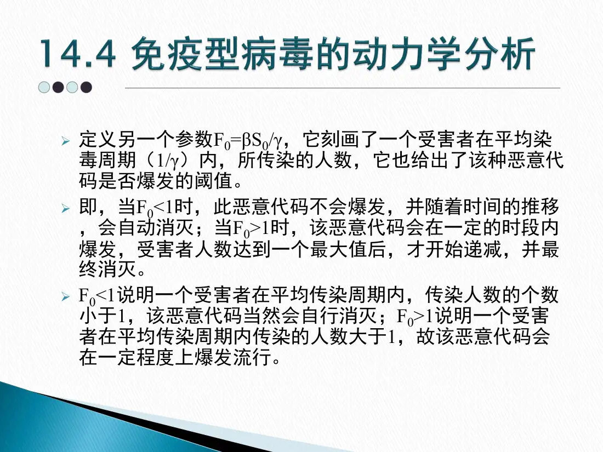

原文：

14.4免疫型病毒的动力学分析

➢ 定义另一个参数 $\mathrm { F _ { 0 } { = } } \mathrm { \beta S _ { 0 } } / \gamma$ 它刻画了一个受害者在平均染毒周期（1/γ）内，所传染的人数，它也给出了该种恶意代码是否爆发的阈值。

➢ 即，当 $\mathrm { F } _ { 0 } { < } 1$ 时，此恶意代码不会爆发，并随着时间的推移，会自动消灭；当F $_ 0 > 1$ 时，该恶意代码会在一定的时段内爆发，受害者人数达到一个最大值后，才开始递减，并最终消灭。

$\mathrm { F } _ { 0 } { < } 1$ 说明一个受害者在平均传染周期内，传染人数的个数小于1，该恶意代码当然会自行消灭； $\mathrm { F } _ { 0 } { > } 1$ 说明一个受害者在平均传染周期内传染的人数大于1，故该恶意代码会在一定程度上爆发流行。

### 14.4免疫型病毒的动力学分析

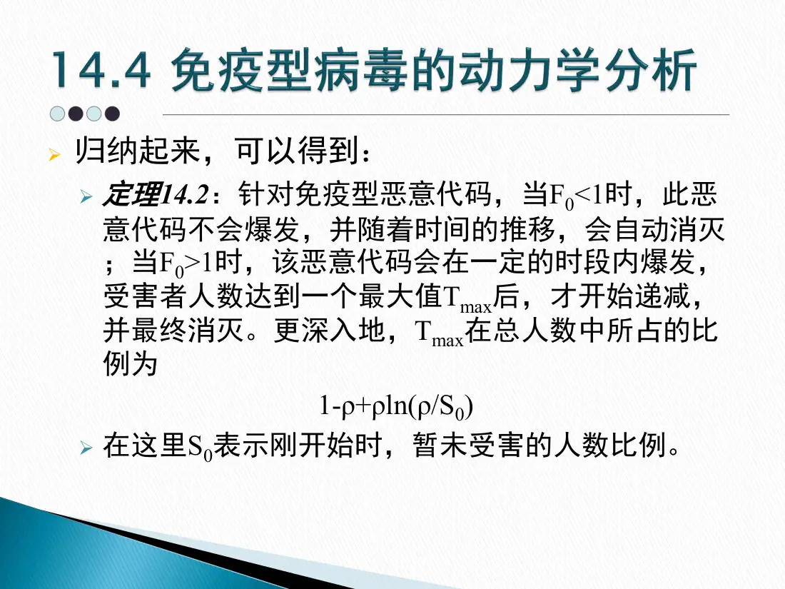

原文：

14.4免疫型病毒的动力学分析

归纳起来，可以得到：

定理14.2：针对免疫型恶意代码，当 $\mathrm { F } _ { 0 } { < } 1$ 时，此恶意代码不会爆发，并随着时间的推移，会自动消灭；当 $\mathrm { F } _ { 0 } { > } 1$ 时，该恶意代码会在一定的时段内爆发，受害者人数达到一个最大值 $\mathrm { T } _ { \mathrm { m a x } }$ 后，才开始递减，并最终消灭。更深入地， $\mathrm { T } _ { \mathrm { m a x } }$ 在总人数中所占的比例为

$$
1 - \rho + \rho \ln (\rho / S _ {0})
$$

➢ 在这里 $\mathrm { S } _ { 0 }$ 表示刚开始时，暂未受害的人数比例。

### 14.6 预防措施的效果分析

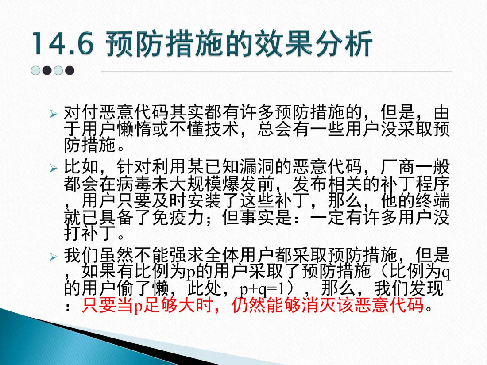

原文：

14.6 预防措施的效果分析

➢ 对付恶意代码其实都有许多预防措施的，但是，由于用户懒惰或不懂技术，总会有一些用户没采取预防措施。

➢ 比如，针对利用某已知漏洞的恶意代码，厂商一般都会在病毒未大规模爆发前，发布相关的补丁程序用户只要及时安装了这些补丁，那么，他的终端就已具备了免疫力；但事实是：一定有许多用户没打补丁。

我们虽然不能强求全体用户都采取预防措施，但是如果有比例为p的用户采取了预防措施（比例为q的用户偷了懒，此处，p+q=1），那么，我们发现：只要当p足够大时，仍然能够消灭该恶意代码。

### 14.6预防措施的效果分析

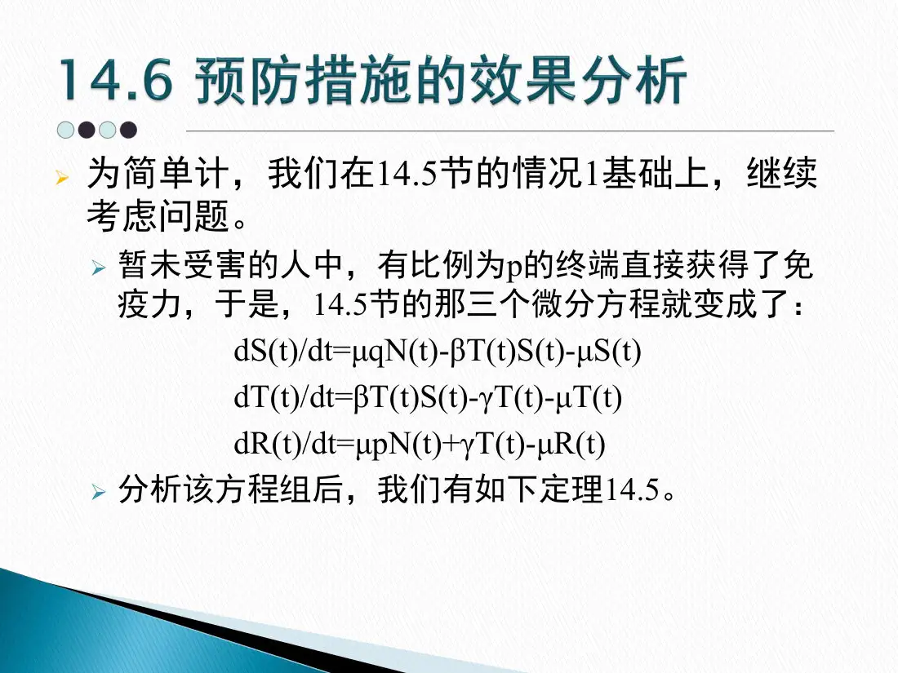

原文：

14.6预防措施的效果分析

➢ 为简单计，我们在14.5节的情况1基础上，继续考虑问题。

暂未受害的人中，有比例为p的终端直接获得了免疫力，于是，14.5节的那三个微分方程就变成了：

$$
\mathrm{d} S (t) / \mathrm{d} t = \mu q N (t) - \beta T (t) S (t) - \mu S (t)
$$

$$
\mathrm{dT(t)} / \mathrm{dt} = \beta \mathrm{T(t)S(t)} - \gamma \mathrm{T(t)} - \mu \mathrm{T(t)}
$$

$$
\mathrm{dR} (t) / \mathrm{dt} = \mu \mathrm{pN} (t) + \gamma \mathrm{T} (t) - \mu \mathrm{R} (t)
$$

➢ 分析该方程组后，我们有如下定理14.5。

### 14.6 预防措施的效果分析

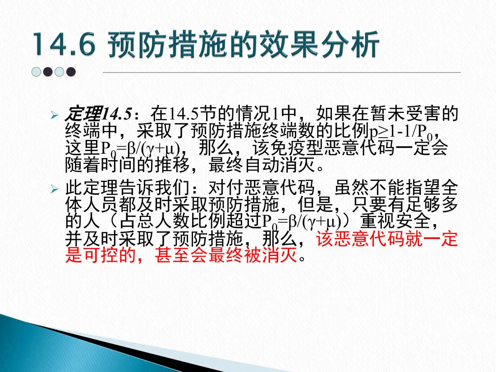

原文：

14.6 预防措施的效果分析

定理14.5：在14.5节的情况1中，如果在暂未受害的终端中，采取了预防措施终端数的比例 $\mathrm { p { = } 1 { - } 1 / P _ { 0 } } ,$ 这里 $\mathrm { P _ { 0 } { = } } \beta / ( \gamma { + } \mu )$ 那么，该免疫型恶意代码一定会随着时间的推移，最终自动消灭。

此定理告诉我们：对付恶意代码，虽然不能指望全体人员都及时采取预防措施，但是，只要有足够多的人（占总人数比例超过 $\underline { { \mathrm { P } } } _ { 0 } \mathrm { = } \{ 1 ( \gamma + \mu ) \}$ 重视安全，并及时采取了预防措施，那么，该恶意代码就一定是可控的，甚至会最终被消灭。

### 14.8它山石的启示

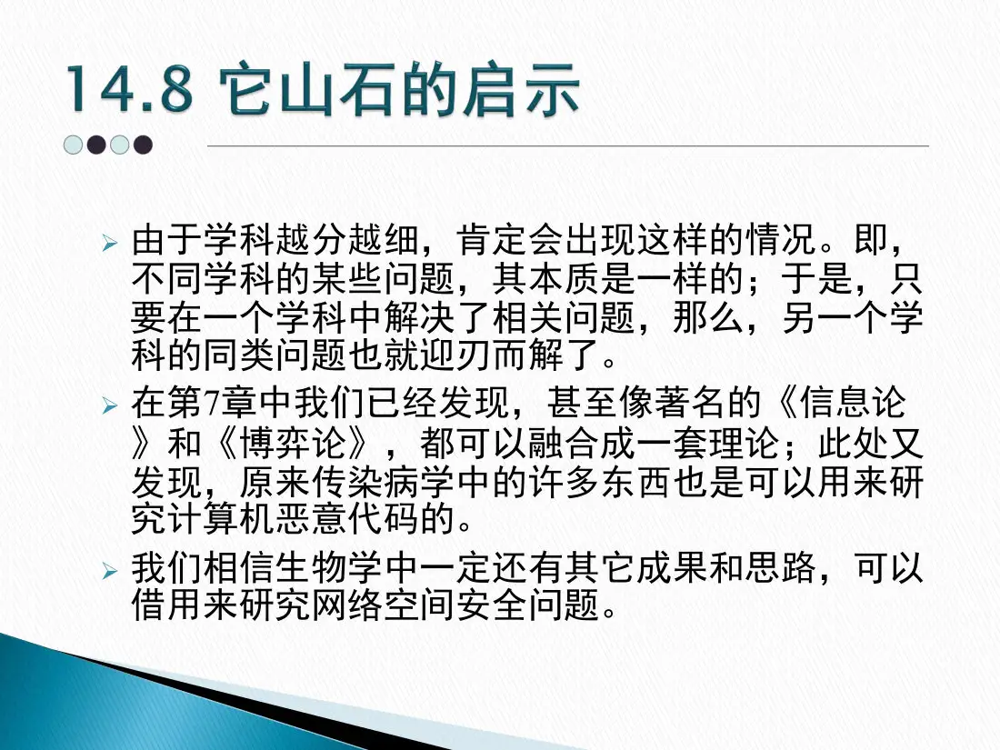

原文：

14.8它山石的启示

➢ 由于学科越分越细，肯定会出现这样的情况。即，不同学科的某些问题，其本质是一样的；于是，只要在一个学科中解决了相关问题，那么，另一个学科的同类问题也就迎刃而解了。

在第7章中我们已经发现，甚至像著名的《信息论》和《博弈论》，都可以融合成一套理论；此处又发现，原来传染病学中的许多东西也是可以用来研究计算机恶意代码的。

我们相信生物学中一定还有其它成果和思路，可以借用来研究网络空间安全问题。

### 14.8它山石的启示

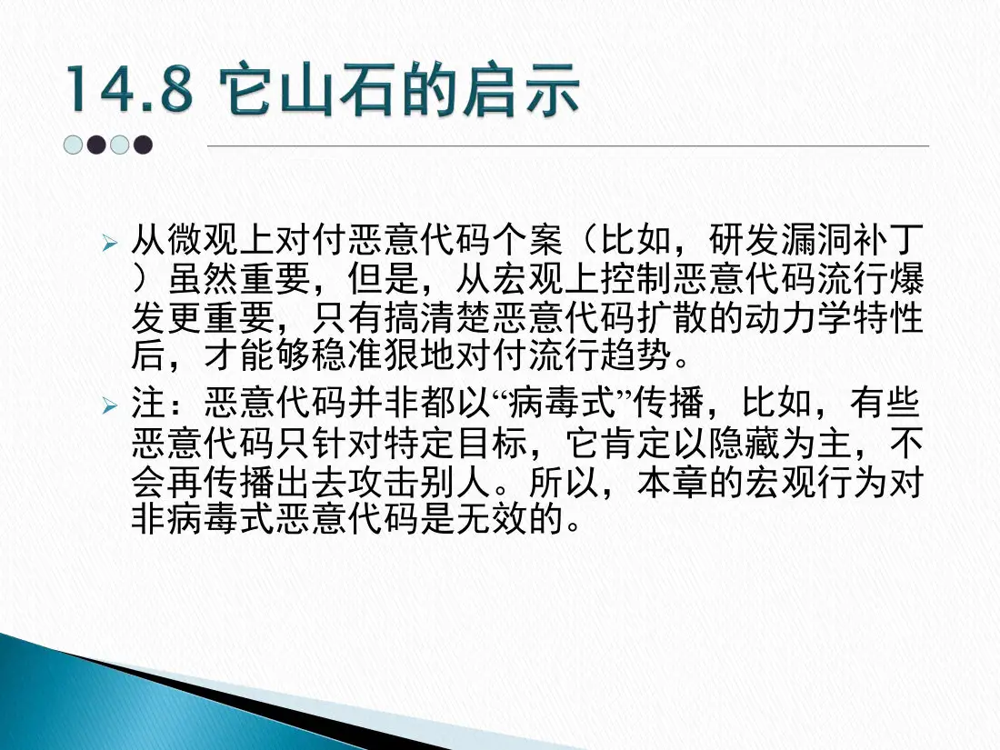

原文：

14.8它山石的启示

从微观上对付恶意代码个案（比如，研发漏洞补丁）虽然重要，但是，从宏观上控制恶意代码流行爆发更重要，只有搞清楚恶意代码扩散的动力学特性后，才能够稳准狠地对付流行趋势。

注：恶意代码并非都以“病毒式”传播，比如，有些恶意代码只针对特定目标，它肯定以隐藏为主，不会再传播出去攻击别人。所以，本章的宏观行为对非病毒式恶意代码是无效的。

### 本章结束，谢谢

原文：

本章结束，谢谢
