# 《安全通论》第15章 谣言的传播规律（课件）

原件的每一页，下面附识别出的文字。

### 第15章---谣言的传播规律

原文：

第15章---谣言的传播规律

### 第15章谣言的传播规律

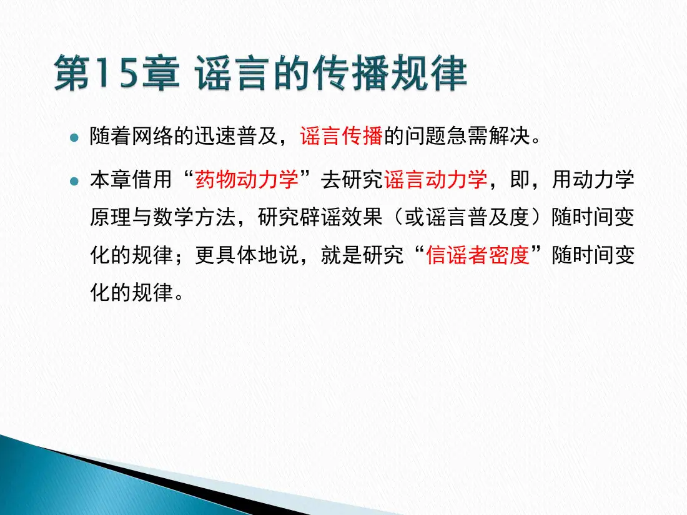

原文：

第15章谣言的传播规律

⚫ 随着网络的迅速普及，谣言传播的问题急需解决。

⚫ 本章借用“药物动力学”去研究谣言动力学，即，用动力学原理与数学方法，研究辟谣效果（或谣言普及度）随时间变化的规律；更具体地说，就是研究“信谣者密度”随时间变化的规律。

### 第15章谣言的传播规律

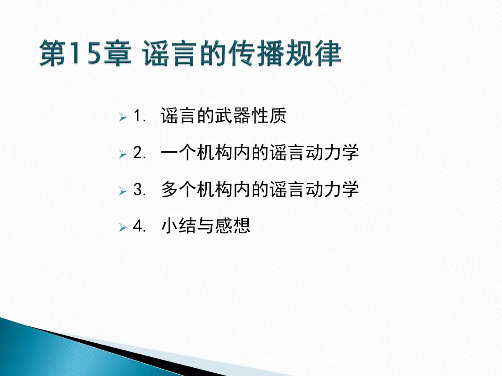

原文：

第15章谣言的传播规律

1. 谣言的武器性质
2. 一个机构内的谣言动力学
3. 多个机构内的谣言动力学
4. 小结与感想

### 15.1谣言的武器性质

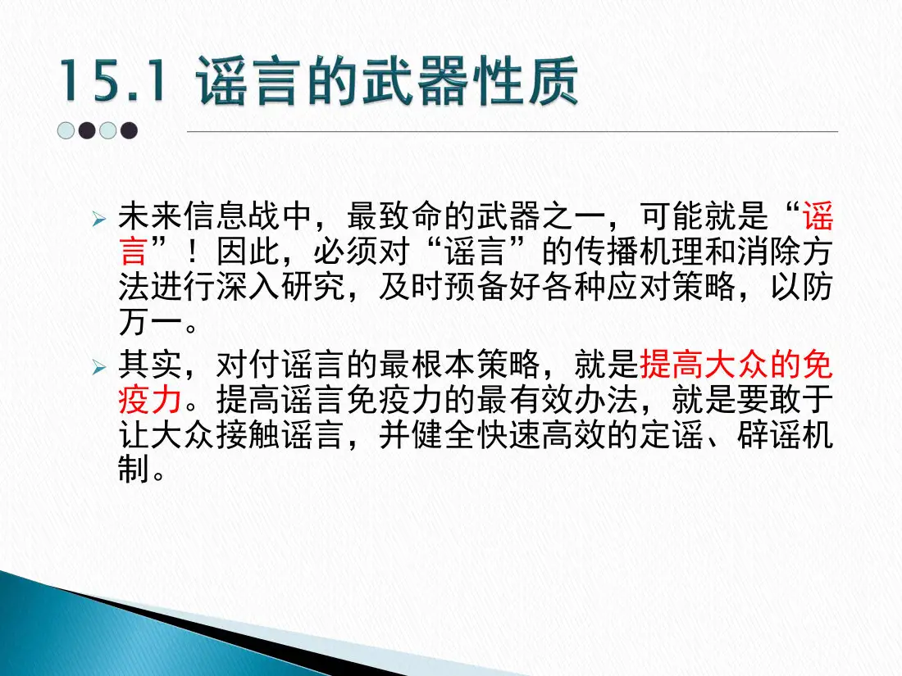

原文：

15.1谣言的武器性质

未来信息战中，最致命的武器之一，可能就是“谣言”！因此，必须对“谣言”的传播机理和消除方法进行深入研究，及时预备好各种应对策略，以防万一。

其实，对付谣言的最根本策略，就是提高大众的免疫力。提高谣言免疫力的最有效办法，就是要敢于让大众接触谣言，并健全快速高效的定谣、辟谣机制。

### 15.1谣言的武器性质

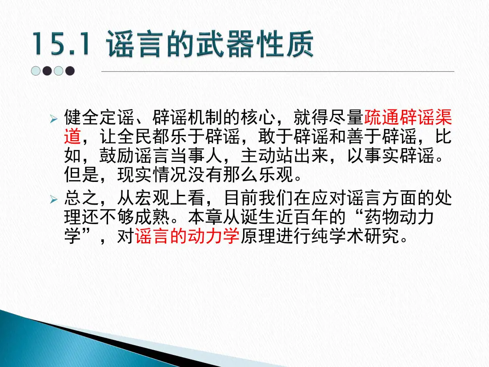

原文：

15.1谣言的武器性质

健全定谣、辟谣机制的核心，就得尽量疏通辟谣渠道，让全民都乐于辟谣，敢于辟谣和善于辟谣，比如，鼓励谣言当事人，主动站出来，以事实辟谣。但是，现实情况没有那么乐观。

总之，从宏观上看，目前我们在应对谣言方面的处理还不够成熟。本章从诞生近百年的“药物动力学”，对谣言的动力学原理进行纯学术研究。

### 15.2一个机构内的谣言动力学

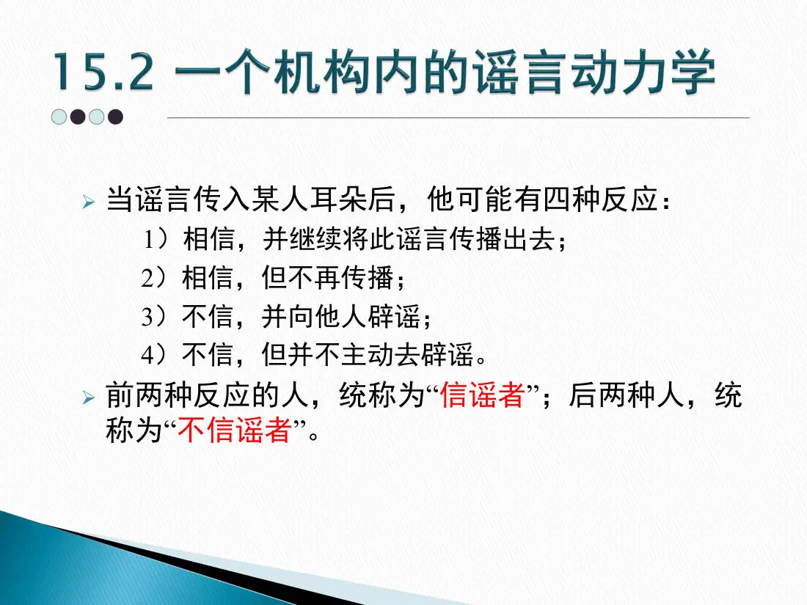

原文：

15.2一个机构内的谣言动力学

➢ 当谣言传入某人耳朵后，他可能有四种反应：

1）相信，并继续将此谣言传播出去；

2）相信，但不再传播；

3）不信，并向他人辟谣；

4）不信，但并不主动去辟谣。

➢ 前两种反应的人，统称为“信谣者”；后两种人，统称为“不信谣者”。

### 15.2一个机构内的谣言动力学

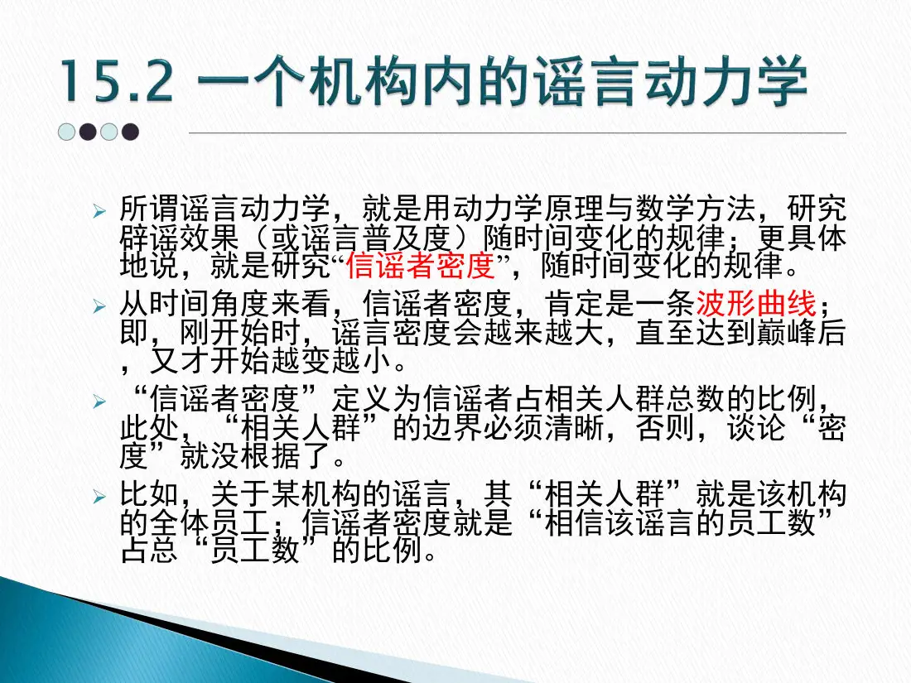

原文：

15.2一个机构内的谣言动力学

所谓谣言动力学，就是用动力学原理与数学方法，研究辟谣效果（或谣言普及度）随时间变化的规律；更具体地说，就是研究“信谣者密度”，随时间变化的规律。

➢ 从时间角度来看，信谣者密度，肯定是一条波形曲线；即，刚开始时，谣言密度会越来越大，直至达到巅峰后，又才开始越变越小。

➢ “信谣者密度”定义为信谣者占相关人群总数的比例，此处，“相关人群”的边界必须清晰，否则，谈论“密度”就没根据了。

➢ 比如，关于某机构的谣言，其“相关人群”就是该机构的全体员工；信谣者密度就是“相信该谣言的员工数”占总“员工数”的比例。

### 15.2一个机构内的谣言动力学

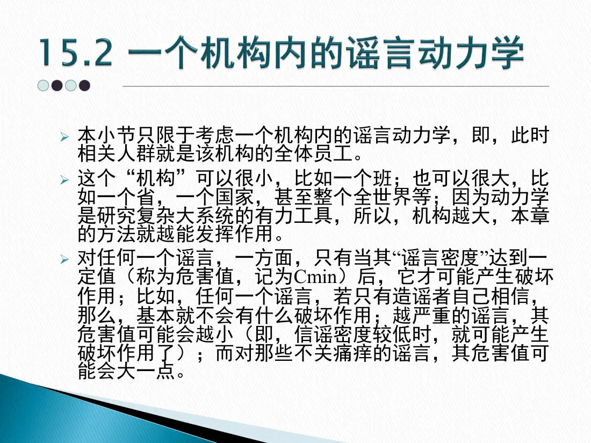

原文：

15.2一个机构内的谣言动力学

➢ 本小节只限于考虑一个机构内的谣言动力学，即，此时相关人群就是该机构的全体员工。

➢ 这个“机构”可以很小，比如一个班；也可以很大，比个国家，甚至整个全世界等；因为动力学是研究复杂大系统的有力工具，所以，机构越大，本章的方法就越能发挥作用。

➢ 对任何一个谣言， 一方面，只有当其“谣言密度”达到一定值（称为危害值，记为Cmin）后，它才可能产生破坏其生能会大一点。

### 15.2一个机构内的谣言动力学

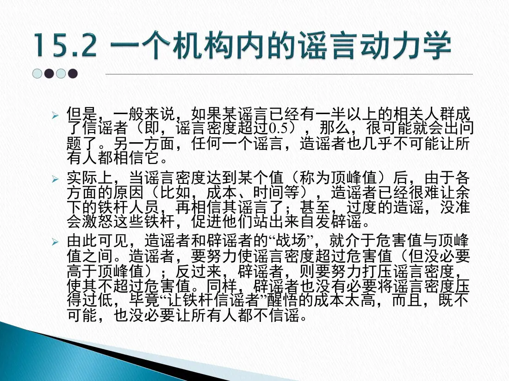

原文：

15.2一个机构内的谣言动力学

➢ 但是，一般来说，如果某谣言已经有一半以上的相关人群成了信谣者（即，谣言密度超过0.5），那么，很可能就会出问题了。另一方面，任何一个谣言，造谣者也几乎不可能让所有人都相信它。

实际上，当谣言密度达到某个值（称为顶峰值）后，由于各方面的原因（比如，成本、时间等），造谣者已经很难让余下的铁杆人员，再相信其谣言了；甚至，过度的造谣，没准会激怒这些铁杆，促进他们站出来自发辟谣。

由此可见，造谣者和辟谣者的“战场”，就介于危害值与顶峰值之间。造谣者，要努力使谣言密度超过危害值（但没必要高于顶峰值）；反过来，辟谣者，则要努力打压谣言密度，使其不超过危害值。同样，辟谣者也没有必要将谣言密度压得过低，毕竟 让铁杆信谣者 醒悟的成本太高，而且，既不可能，也没必要让所有人都不信谣。

### 15.2一个机构内的谣言动力学

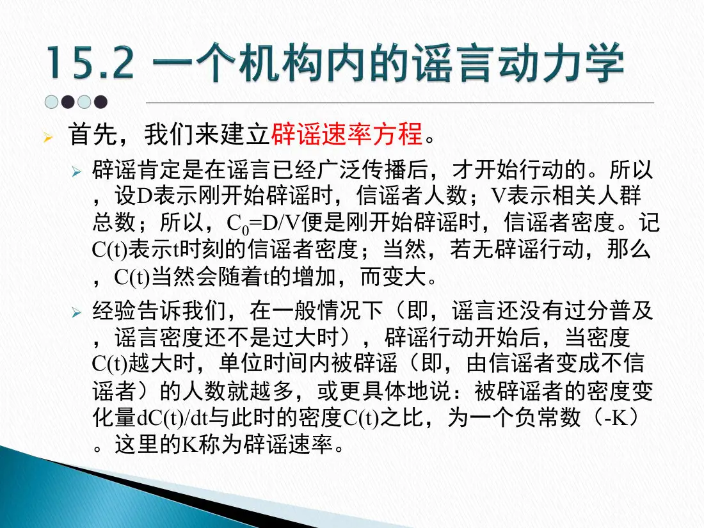

原文：

15.2一个机构内的谣言动力学

首先，我们来建立辟谣速率方程。

辟谣肯定是在谣言已经广泛传播后，才开始行动的。所以，设D表示刚开始辟谣时，信谣者人数；V表示相关人群总数；所以， $\mathrm { C _ { 0 } \mathrm { = D / V } }$ 便是刚开始辟谣时，信谣者密度。记C(t)表示t时刻的信谣者密度；当然，若无辟谣行动，那么，C(t)当然会随着t的增加，而变大。

经验告诉我们，在一般情况下（即，谣言还没有过分普及，谣言密度还不是过大时），辟谣行动开始后，当密度C(t)越大时，单位时间内被辟谣（即，由信谣者变成不信谣者）的人数就越多，或更具体地说：被辟谣者的密度变化量dC(t)/dt与此时的密度C(t)之比，为一个负常数（-K）。这里的K称为辟谣速率。

### 15.2一个机构内的谣言动力学

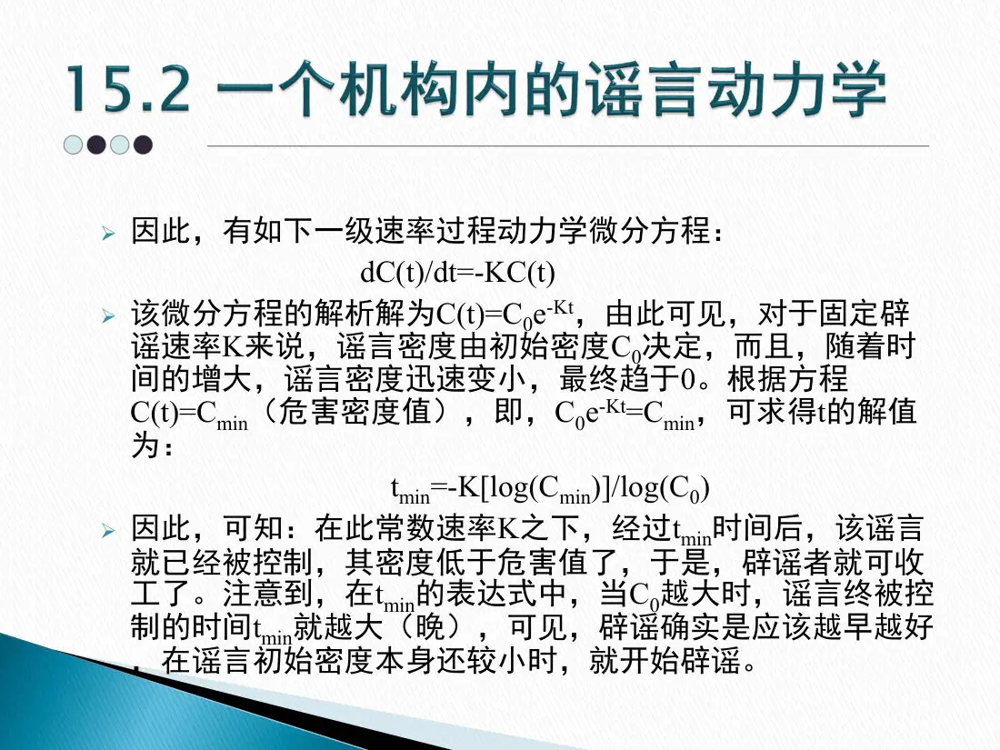

原文：

15.2一个机构内的谣言动力学

➢ 因此，有如下一级速率过程动力学微分方程：

$$
\mathrm{dC} (t) / \mathrm{dt} = - \mathrm{KC} (t)
$$

➢ 该微分方程的解析解为 ${ \mathrm { C } } ( { \mathrm { t } } ) { = } { \mathrm { C } } _ { 0 } { \mathrm { e } } ^ { - { \mathrm { K t } } }$ 由此可见，对于固定辟谣速率K来说，谣言密度由初始密度 $\mathrm { C } _ { 0 }$ 决定，而且，随着时间的增大，谣言密度迅速变小，最终趋于0。根据方程$\mathrm { C ( t ) } { = } \mathrm { C } _ { \operatorname* { m i n } }$ （危害密度值），即， ${ \mathrm { C } } _ { 0 } { \mathrm { e } } ^ { - { \mathrm { K } } \mathrm { t } } { = } { \mathrm { C } } _ { \operatorname* { m i n } }$ ，可求得t的解值为：

$$
\mathrm{t} _ {\min} = - \mathrm{K} [ \log (\mathrm{C} _ {\min}) ] / \log (\mathrm{C} _ {0})
$$

➢ 因此，可知：在此常数速率K之下，经过 $\mathfrak { t } _ { \operatorname* { m i n } }$ 时间后，该谣言就已经被控制，其密度低于危害值了，于是，辟谣者就可收工了。注意到，在 $\mathfrak { t } _ { \operatorname* { m i n } }$ 的表达式中，当 $\mathrm { C } _ { 0 }$ 越大时，谣言终被控制的时间 $\mathfrak { t } _ { \operatorname* { m i n } }$ 就越大（晚），可见，辟谣确实是应该越早越好在谣言初始密度本身还较小时，就开始辟谣。

### 15.2一个机构内的谣言动力学

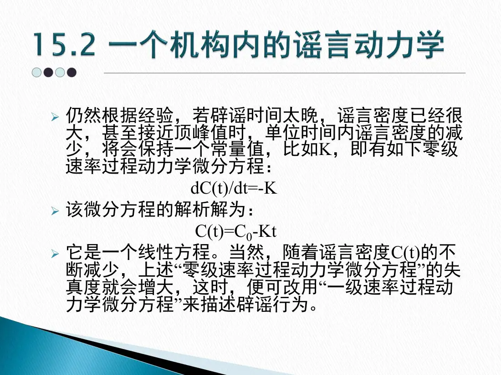

原文：

15.2一个机构内的谣言动力学

➢ 仍然根据经验，若辟谣时间太晚，谣言密度已经很大，甚至接近顶峰值时，单位时间内谣言密度的减少，将会保持一个常量值，比如K，即有如下零级速率过程动力学微分方程：

$$
\mathrm{dC(t)} / \mathrm{dt} = - \mathrm{K}
$$

➢ 该微分方程的解析解为：

$$
\mathrm{C(t)} = \mathrm{C} _ {0} - \mathrm{Kt}
$$

它是一个线性方程。当然，随着谣言密度C(t)的不断减少，上述“零级速率过程动力学微分方程”的失真度就会增大，这时，便可改用“一级速率过程动力学微分方程”来描述辟谣行为。

### 15.2一个机构内的谣言动力学

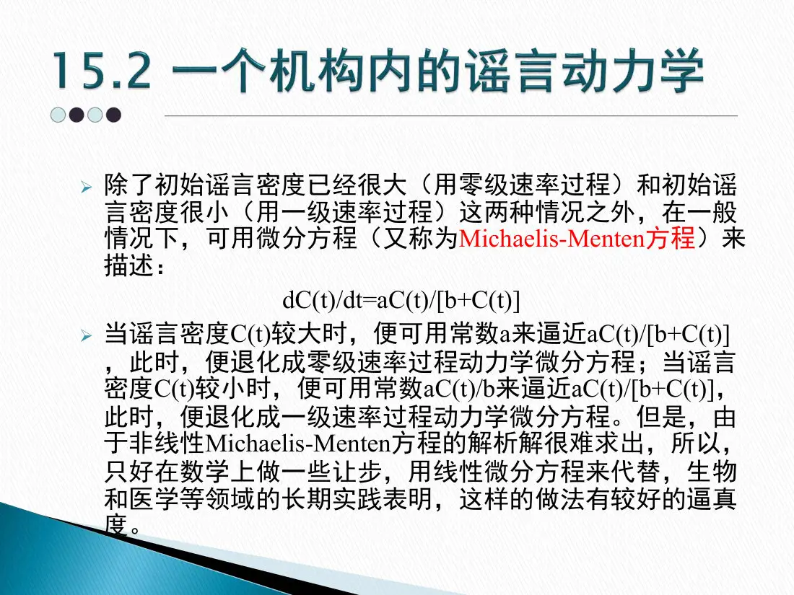

原文：

15.2一个机构内的谣言动力学

➢ 除了初始谣言密度已经很大（用零级速率过程）和初始谣言密度很小（用一级速率过程）这两种情况之外，在一般情况下，可用微分方程（又称为Michaelis-Menten方程）来描述：

$$
\mathrm{dC(t)} / \mathrm{dt} = \mathrm{aC(t)} / [ \mathrm{b} + \mathrm{C(t)} ]
$$

当谣言密度C(t)较大时，便可用常数a来逼近aC(t)/[b+C(t)]此时，便退化成零级速率过程动力学微分方程；当谣言密度C(t)较小时，便可用常数aC(t)/b来逼近aC(t)/[b+C(t)]，此时，便退化成一级速率过程动力学微分方程。但是，由于非线性Michaelis-Menten方程的解析解很难求出，所以，只好在数学上做一些让步，用线性微分方程来代替，生物和医学等领域的长期实践表明，这样的做法有较好的逼真度。

### 15.2一个机构内的谣言动力学

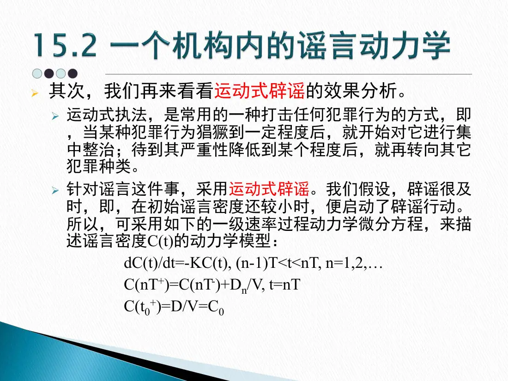

原文：

15.2一个机构内的谣言动力学

其次，我们再来看看运动式辟谣的效果分析。

运动式执法，是常用的一种打击任何犯罪行为的方式，即当某种犯罪行为猖獗到一定程度后，就开始对它进行集中整治；待到其严重性降低到某个程度后，就再转向其它犯罪种类。

➢ 针对谣言这件事，采用运动式辟谣。我们假设，辟谣很及时，即，在初始谣言密度还较小时，便启动了辟谣行动。所以，可采用如下的一级速率过程动力学微分方程，来描述谣言密度C(t)的动力学模型：

$$
\mathrm{dC} (t) / \mathrm{dt} = - \mathrm{KC} (t), (n - 1) \mathrm{T} <   t <   n \mathrm{T}, n = 1, 2, \dots
$$

$$
\mathrm{C} (\mathrm{nT} ^ {+}) = \mathrm{C} (\mathrm{nT} ^ {-}) + \mathrm{D} _ {\mathrm{n}} / \mathrm{V}, t = \mathrm{nT}
$$

$$
\mathbf {C} (t _ {0} ^ {+}) = \mathbf {D} / \mathbf {V} = \mathbf {C} _ {0}
$$

### 15.2一个机构内的谣言动力学

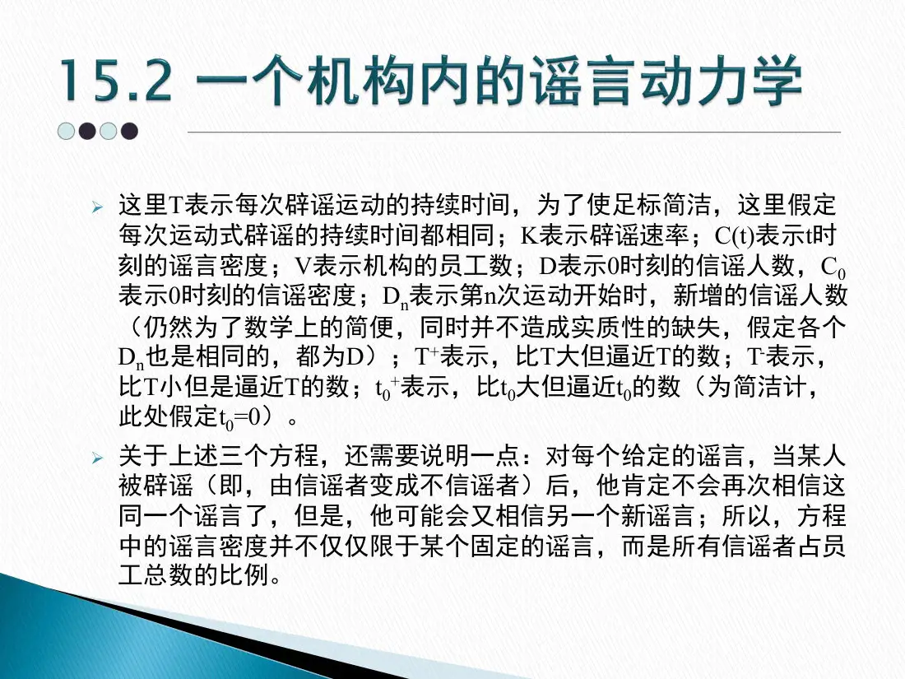

原文：

15.2一个机构内的谣言动力学

这里T表示每次辟谣运动的持续时间，为了使足标简洁，这里假定每次运动式辟谣的持续时间都相同；K表示辟谣速率；C(t)表示t时刻的谣言密度；V表示机构的员工数；D表示0时刻的信谣人数， $\mathrm { C } _ { 0 }$ 表示0时刻的信谣密度； $\mathrm { D } _ { \mathrm { n } }$ 表示第n次运动开始时，新增的信谣人数（仍然为了数学上的简便，同时并不造成实质性的缺失，假定各个$\mathrm { D } _ { \mathrm { n } }$ 也是相同的，都为D）；T+表示，比T大但逼近T的数；T-表示，比T小但是逼近T的数； $\mathbf { t } _ { 0 } ^ { + }$ 表示，比 $\mathfrak { t } _ { 0 } .$ 大但逼近 $\mathfrak { t } _ { 0 }$ 的数（为简洁计，此处假定 $\mathfrak { t } _ { 0 } \mathrm { = } 0 )$

关于上述三个方程，还需要说明一点：对每个给定的谣言，当某人被辟谣（即，由信谣者变成不信谣者）后，他肯定不会再次相信这同一个谣言了，但是，他可能会又相信另一个新谣言；所以，方程中的谣言密度并不仅仅限于某个固定的谣言，而是所有信谣者占员工总数的比例。

### 15.2一个机构内的谣言动力学

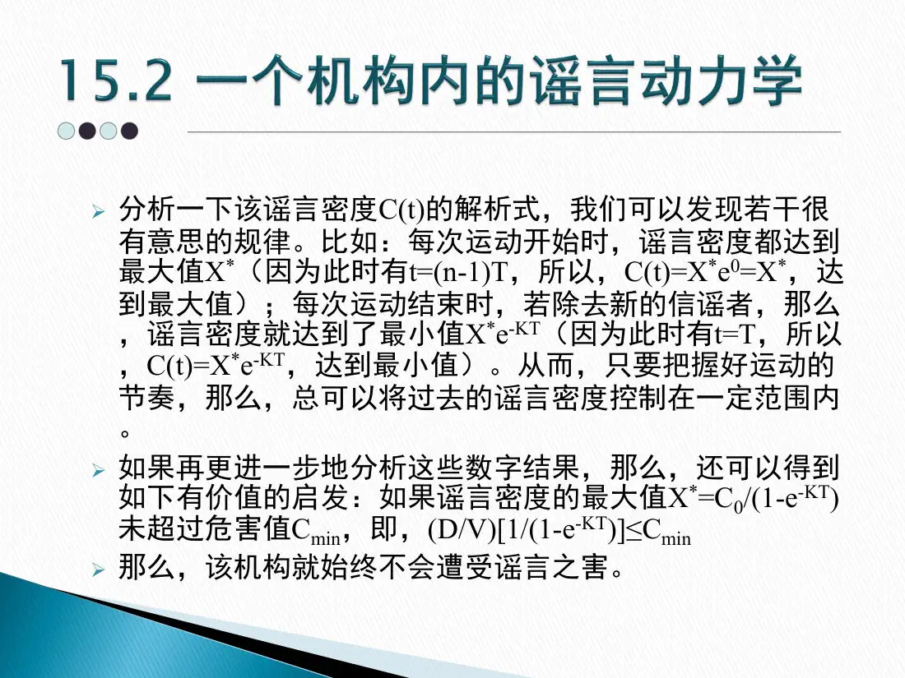

原文：

15.2一个机构内的谣言动力学

分析一下该谣言密度C(t)的解析式，我们可以发现若干很有意思的规律。比如：每次运动开始时，谣言密度都达到最大值X\*（因为此时有t=(n-1)T，所以， $\mathrm { C ( t ) { = } X ^ { \ast } e ^ { 0 } { = } X ^ { \ast } }$ 达到最大值）；每次运动结束时，若除去新的信谣者，那么，谣言密度就达到了最小值 $\mathbf { X ^ { \ast } e ^ { - K T } }$ （因为此时有t=T，所以$\mathrm { C ( t ) } { = } \mathrm { X } ^ { \ast } \mathrm { e } ^ { - \mathrm { K T } }$ 达到最小值）。从而，只要把握好运动的节奏，那么，总可以将过去的谣言密度控制在一定范围内

➢ 如果再更进一步地分析这些数字结果，那么，还可以得到如下有价值的启发：如果谣言密度的最大值 $\mathrm { X ^ { \ast } { = } C _ { 0 } / ( 1 { - } e ^ { - } { \mathrm { K } T } ) }$ 未超过危害值 $\mathbf { C } _ { \mathrm { m i n } }$ ，即， $( \mathrm { D } / \mathrm { V } ) [ 1 / ( 1 \mathrm { - e } ^ { \mathrm { - K T } } ) ] { \leq } C _ { \mathrm { m i n } }$

➢ 那么，该机构就始终不会遭受谣言之害。

### 15.2一个机构内的谣言动力学

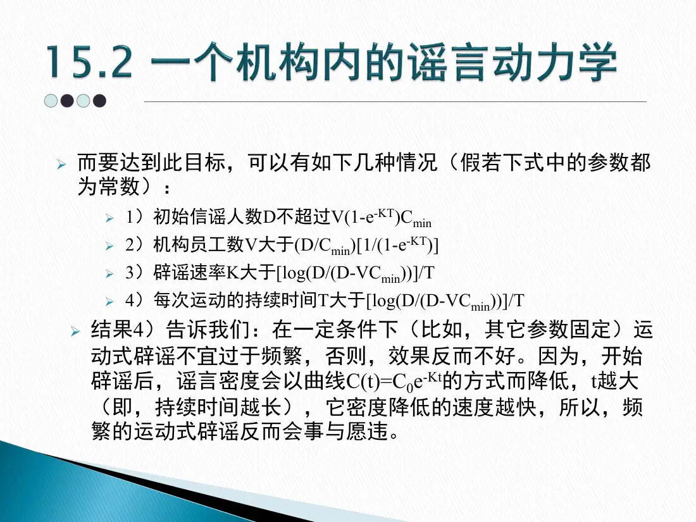

原文：

15.2一个机构内的谣言动力学

➢ 而要达到此目标，可以有如下几种情况（假若下式中的参数都为常数）：

1）初始信谣人数D不超过 $\mathrm { V } ( \mathrm { l } - \mathrm { e } ^ { - \mathrm { K T } } ) \mathrm { C } _ { \mathrm { m i n } }$

2）机构员工数V大于 $( \mathrm { D } / \mathrm { C _ { \mathrm { m i n } } } ) [ 1 / ( 1 - \mathrm { e } ^ { - \mathrm { K T } } ) ]$

3）辟谣速率K大于 $[ \mathrm { l o g ( D / ( D \mathrm { - } V C _ { \mathrm { m i n } } ) ) } ] / \mathrm { T }$

4）每次运动的持续时间T大于 $[ \mathrm { l o g ( D / ( D \mathrm { - } V C _ { \mathrm { m i n } } ) ) } ] / \mathrm { T }$

结果4）告诉我们：在一定条件下（比如，其它参数固定）运动式辟谣不宜过于频繁，否则，效果反而不好。因为，开始辟谣后，谣言密度会以曲线 $\mathrm { C ( t ) = C _ { 0 } e ^ { - K t } }$ 的方式而降低，t越大（即，持续时间越长），它密度降低的速度越快，所以，频繁的运动式辟谣反而会事与愿违。

### 15.2一个机构内的谣言动力学

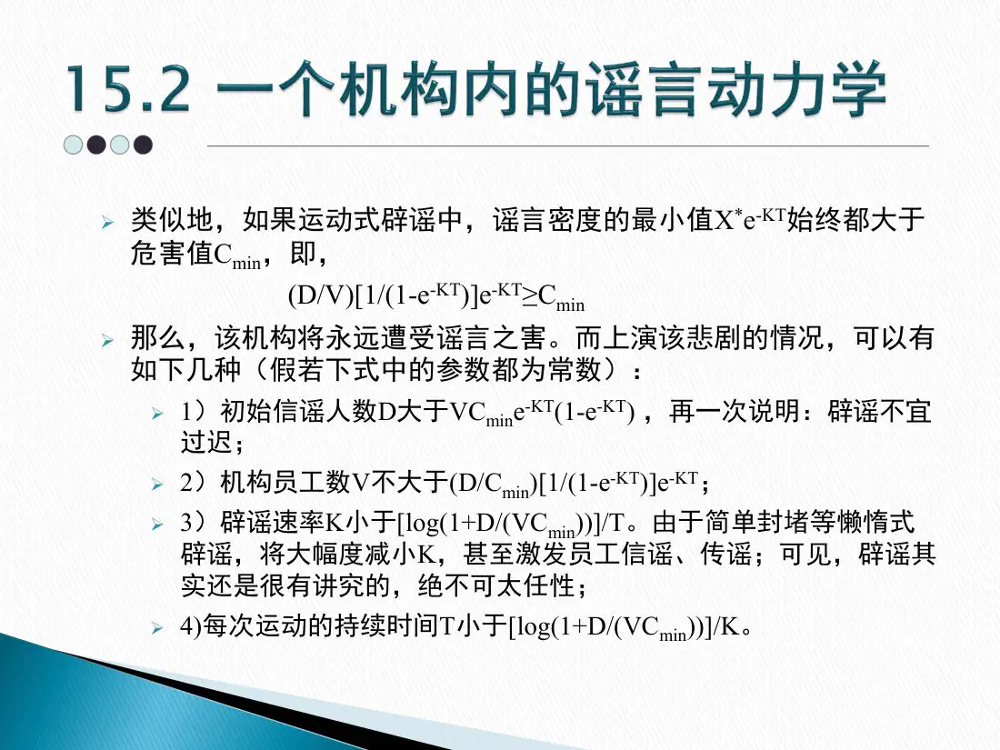

原文：

15.2一个机构内的谣言动力学

➢ 类似地，如果运动式辟谣中，谣言密度的最小值 $\mathbf { X } ^ { \ast } \mathrm { e } ^ { - \mathrm { K T } }$ 始终都大于危害值 $\mathbf { C } _ { \mathrm { m i n } }$ ，即，

$$
(\mathrm{D} / \mathrm{V}) [ 1 / (1 - \mathrm{e} ^ {- \mathrm{KT}}) ] \mathrm{e} ^ {- \mathrm{KT}} \geq \mathrm{C} _ {\min}
$$

那么，该机构将永远遭受谣言之害。而上演该悲剧的情况，可以有如下几种（假若下式中的参数都为常数）：

➢ 1）初始信谣人数D大于 $\mathrm { V C } _ { \mathrm { m i n } } \mathrm { e } ^ { - \mathrm { K T } } ( 1 \mathrm { - e } ^ { - \mathrm { K T } } )$ ，再一次说明：辟谣不宜过迟；

2）机构员工数V不大于 $( \mathrm { D } / \mathrm { C _ { \mathrm { m i n } } } ) [ 1 / ( 1 \mathrm { - e ^ { - \mathrm { K I } } } ) ] \mathrm { e ^ { - \mathrm { K I } } }$

3）辟谣速率K小于 $[ \log ( 1 + \mathrm { D } / ( \mathrm { V C } _ { \operatorname* { m i n } } ) ) ] / \mathrm { T }$ 。由于简单封堵等懒惰式辟谣，将大幅度减小K，甚至激发员工信谣、传谣；可见，辟谣其实还是很有讲究的，绝不可太任性；

4)每次运动的持续时间T小于 $[ \log ( 1 { + } \mathrm { D } / ( \mathrm { V } \mathrm { C } _ { \mathrm { m i n } } ) ) ] / \mathrm { K }$ o

### 15.2一个机构内的谣言动力学

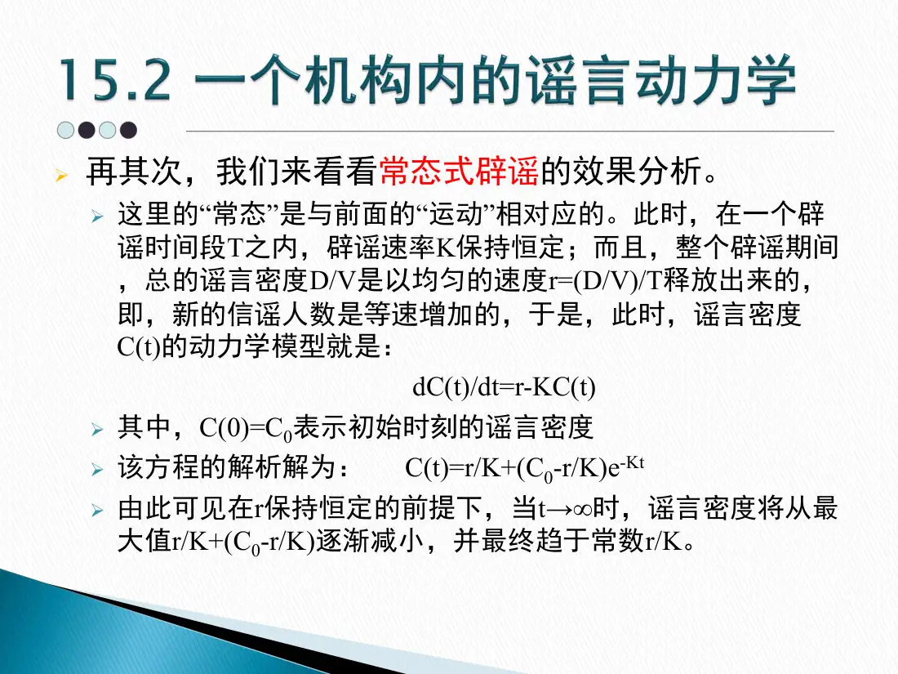

原文：

15.2一个机构内的谣言动力学

再其次，我们来看看常态式辟谣的效果分析。

➢ 这里的“常态”是与前面的“运动”相对应的。此时，在一个辟谣时间段T之内，辟谣速率K保持恒定；而且，整个辟谣期间，总的谣言密度D/V是以均匀的速度r=(D/V)/T释放出来的，即，新的信谣人数是等速增加的，于是，此时，谣言密度C(t)的动力学模型就是：

$$
\mathrm{dC(t)} / \mathrm{dt} = \mathrm{r-KC(t)}
$$

➢ 其中， $\mathrm { C ( 0 ) } { = } \mathrm { C } _ { 0 }$ 表示初始时刻的谣言密度

➢ 该方程的解析解为： $\mathrm { C ( t ) = r / K + ( C _ { 0 } - r / K ) e ^ { - K t } }$

➢ 由此可见在r保持恒定的前提下，当t→∞时，谣言密度将从最大值 $\mathrm { r } / \mathrm { K } + ( \mathrm { C } _ { 0 } \mathrm { - r } / \mathrm { K } )$ 逐渐减小，并最终趋于常数r/K。

### 15.2一个机构内的谣言动力学

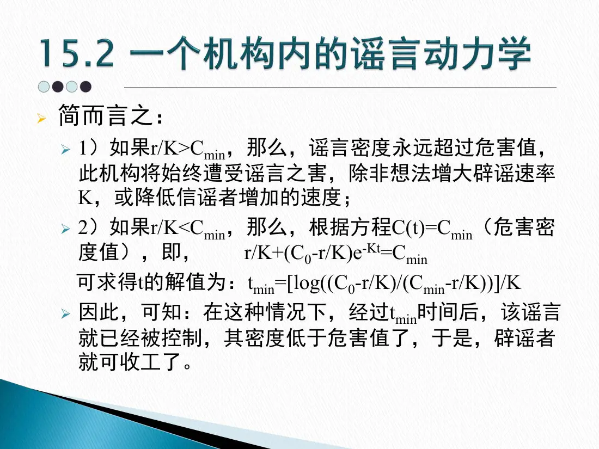

原文：

15.2一个机构内的谣言动力学

简而言之：

➢ 1）如果 $\mathrm { { r } / { K } > C _ { \mathrm { { m i n } } } }$ ，那么，谣言密度永远超过危害值，此机构将始终遭受谣言之害，除非想法增大辟谣速率K，或降低信谣者增加的速度；

➢ 2）如果 $\mathrm { { r } / \mathrm { { K } < C _ { \mathrm { { m i n } } } } }$ ，那么，根据方程 $\mathrm { C ( t ) } { = } \mathrm { C } _ { \operatorname* { m i n } }$ （危害密度值），即， $\mathrm { r / K + ( C _ { 0 } - r / K ) e ^ { - K t } = C _ { \mathrm { m i n } } }$ 可求得t的解值为： $t _ { \mathrm { m i n } } { = } [ \log ( ( \mathrm { C _ { 0 } - r } / \mathrm { K } ) / ( \mathrm { C _ { m i n } - r } / \mathrm { K } ) ) ] / \mathrm { K }$

➢ 因此，可知：在这种情况下，经过 $\mathfrak { t } _ { \operatorname* { m i n } }$ 时间后，该谣言就已经被控制，其密度低于危害值了，于是，辟谣者就可收工了。

### 15.2一个机构内的谣言动力学

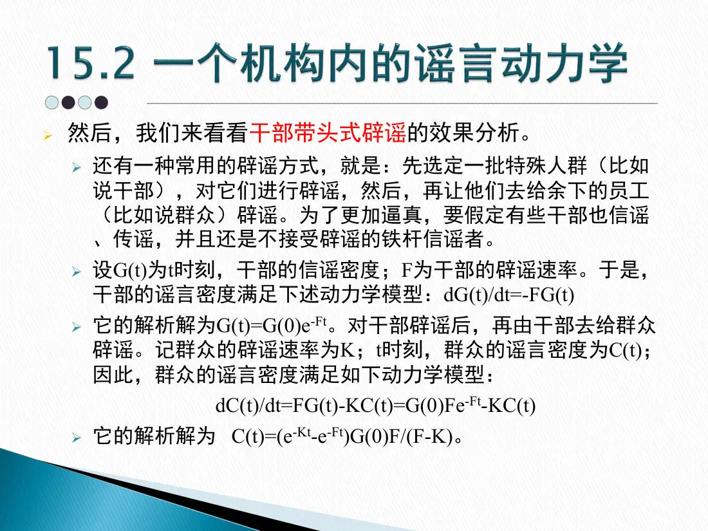

原文：

15.2一个机构内的谣言动力学

➢ 然后，我们来看看干部带头式辟谣的效果分析。

还有一种常用的辟谣方式，就是：先选定一批特殊人群（比如说干部），对它们进行辟谣，然后，再让他们去给余下的员工（比如说群众）辟谣。为了更加逼真，要假定有些干部也信谣、传谣，并且还是不接受辟谣的铁杆信谣者。

➢ 设G(t)为t时刻，干部的信谣密度；F为干部的辟谣速率。于是，干部的谣言密度满足下述动力学模型： $\mathrm { d G ( t ) / d t { = } { \mathrm { - } } F G ( t ) }$

它的解析解为 ${ \mathrm { G } } ( \mathrm { t } ) { = } { \mathrm { G } } ( 0 ) \mathrm { e } ^ { - \mathrm { F t } }$ 。对干部辟谣后，再由干部去给群众辟谣。记群众的辟谣速率为K；t时刻，群众的谣言密度为C(t)；因此，群众的谣言密度满足如下动力学模型：

$$
\mathrm{dC} (t) / \mathrm{dt} = \mathrm{FG} (t) - \mathrm{KC} (t) = \mathrm{G} (0) \mathrm{Fe} ^ {- \mathrm{Ft}} - \mathrm{KC} (t)
$$

它的解析解为 $\mathrm { C ( t ) } { = } ( \mathrm { e } ^ { { \mathrm { - } } \mathrm { K t } } { - } \mathrm { e } ^ { { - } \mathrm { F t } } ) \mathrm { G } ( 0 ) \mathrm { F } / ( \mathrm { F - K } )$ 。

### 15.2一个机构内的谣言动力学

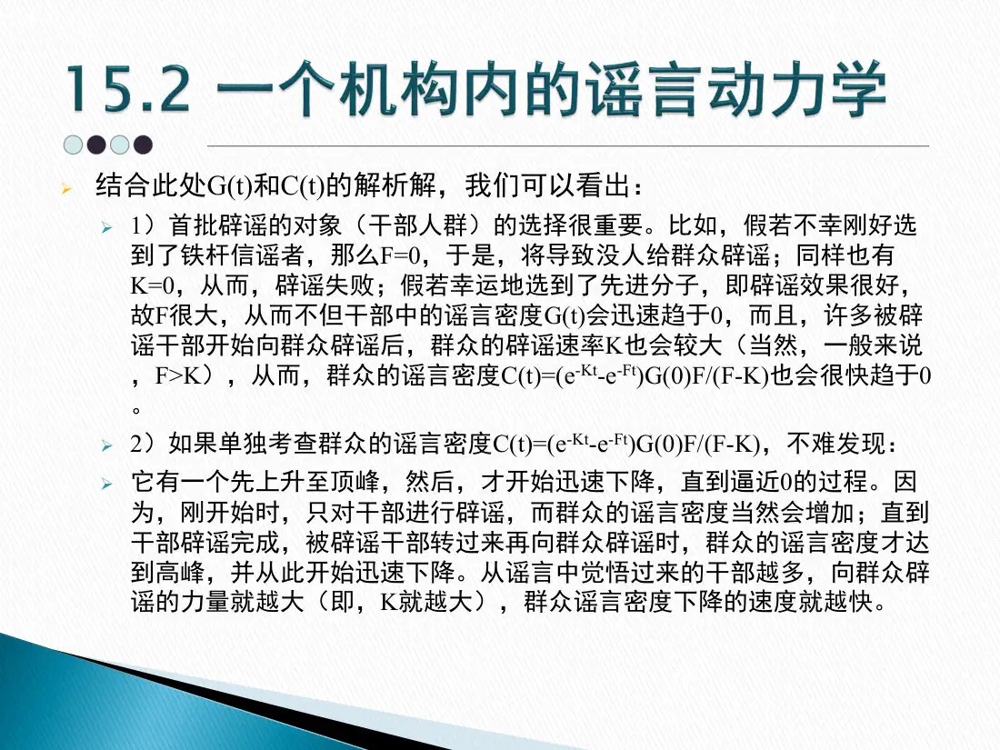

原文：

15.2一个机构内的谣言动力学

结合此处G(t)和C(t)的解析解，我们可以看出：

➢ 1）首批辟谣的对象（干部人群）的选择很重要。比如，假若不幸刚好选到了铁杆信谣者，那么F=0，于是，将导致没人给群众辟谣；同样也有K=0，从而，辟谣失败；假若幸运地选到了先进分子，即辟谣效果很好，故F很大，从而不但干部中的谣言密度G(t)会迅速趋于0，而且，许多被辟谣干部开始向群众辟谣后，群众的辟谣速率K也会较大（当然，一般来说，F>K），从而，群众的谣言密度 $\mathrm { C ( t ) } { = } ( \mathrm { e } ^ { { \mathrm { - } } \mathrm { K t } } { - } \mathrm { e } ^ { { - } \mathrm { F t } } ) \mathrm { G } ( 0 ) \mathrm { F } / ( \mathrm { F - K } )$ 也会很快趋于0

➢ 2）如果单独考查群众的谣言密度 $\mathrm { C ( t ) } { = } ( \mathrm { e } ^ { { \mathrm { - } } \mathrm { K t } } { - } \mathrm { e } ^ { { - } \mathrm { F t } } ) \mathrm { G } ( 0 ) \mathrm { F } / ( \mathrm { F - K } )$ ，不难发现：

它有一个先上升至顶峰，然后，才开始迅速下降，直到逼近0的过程。因为，刚开始时，只对干部进行辟谣，而群众的谣言密度当然会增加；直到干部辟谣完成，被辟谣干部转过来再向群众辟谣时，群众的谣言密度才达到高峰，并从此开始迅速下降。从谣言中觉悟过来的干部越多，向群众辟谣的力量就越大（即，K就越大），群众谣言密度下降的速度就越快。

### 15.2一个机构内的谣言动力学

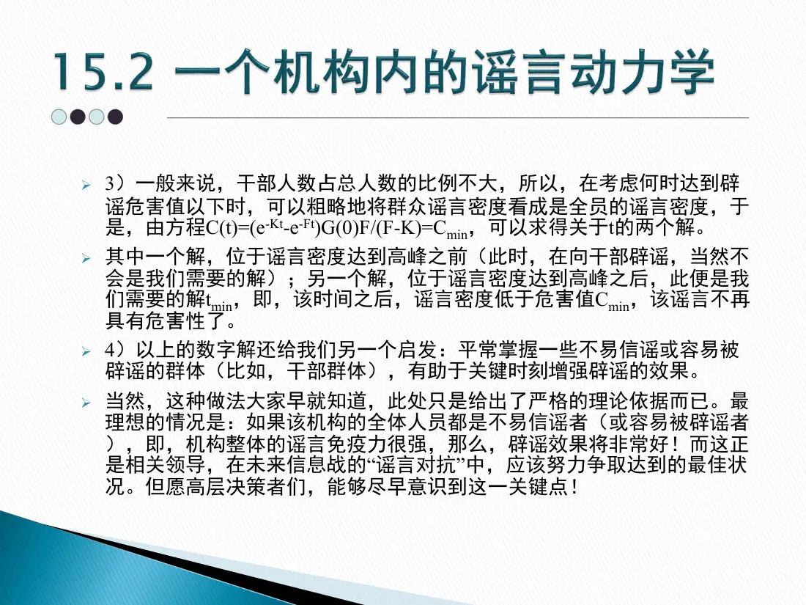

原文：

15.2一个机构内的谣言动力学

3）一般来说，干部人数占总人数的比例不大，所以，在考虑何时达到辟谣危害值以下时，可以粗略地将群众谣言密度看成是全员的谣言密度，于是，由方程 $\mathrm { C ( t ) } { = } ( \mathrm { e } ^ { { \mathrm { - } } \mathrm { K t } } { - } \mathrm { e } ^ { { - } \mathrm { F t } } ) \mathrm { G } ( 0 ) \mathrm { F } / ( \mathrm { F } { - } \mathrm { K } ) { = } \mathrm { C } _ { \mathrm { m i n } }$ ，可以求得关于t的两个解。

➢ 其中一个解，位于谣言密度达到高峰之前（此时，在向干部辟谣，当然不会是我们需要的解）；另一个解，位于谣言密度达到高峰之后，此便是我们需要的解 ${ \mathfrak { t } } _ { \operatorname* { m i n } } .$ ，即，该时间之后，谣言密度低于危害值 $C _ { \mathrm { m i n } }$ ，该谣言不再具有危害性了。

4）以上的数字解还给我们另一个启发：平常掌握一些不易信谣或容易被辟谣的群体（比如，干部群体），有助于关键时刻增强辟谣的效果。

当然，这种做法大家早就知道，此处只是给出了严格的理论依据而已。最理想的情况是：如果该机构的全体人员都是不易信谣者（或容易被辟谣者），即，机构整体的谣言免疫力很强，那么，辟谣效果将非常好！而这正是相关领导，在未来信息战的“谣言对抗”中，应该努力争取达到的最佳状况。但愿高层决策者们，能够尽早意识到这一关键点！

### 15.2一个机构内的谣言动力学

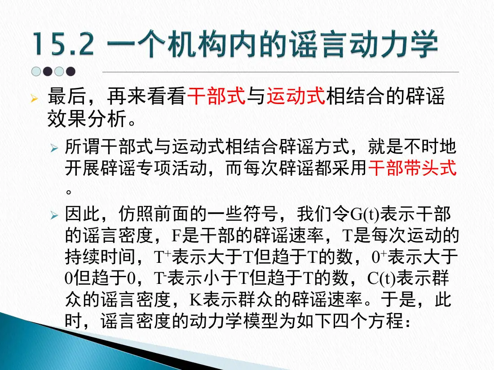

原文：

15.2一个机构内的谣言动力学

➢ 最后，再来看看干部式与运动式相结合的辟谣效果分析。

所谓干部式与运动式相结合辟谣方式，就是不时地开展辟谣专项活动，而每次辟谣都采用干部带头式

因此，仿照前面的一些符号，我们令G(t)表示干部的谣言密度，F是干部的辟谣速率，T是每次运动的持续时间，T+表示大于T但趋于T的数，0+表示大于0但趋于0，T-表示小于T但趋于T的数，C(t)表示群众的谣言密度，K表示群众的辟谣速率。于是，此时，谣言密度的动力学模型为如下四个方程：

### 15.4小结与感想

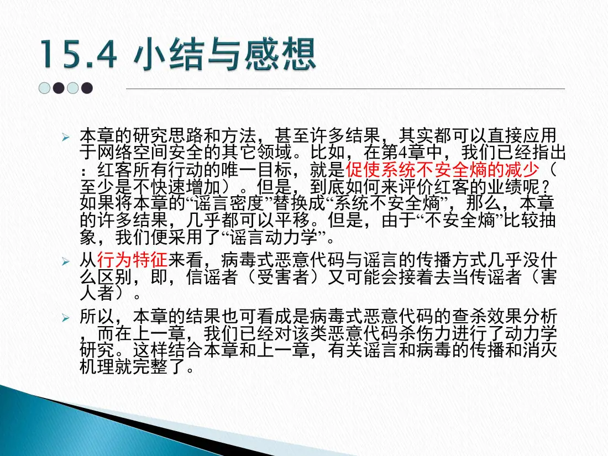

原文：

15.4小结与感想

网络空间安全的其它领域。比如，在第4章中，我们已经指出：红客所有行动的唯一目标，就是促使系统不安全熵的减少（至 但是， 到底如何来评价红客的业绩呢？如果将本章的“谣言密度”替换成“系统不安全熵”，那么，本章的许多结果，几乎都可以平移。但是，由于“不安全熵”比较抽象，我们便采用了“谣言动力学”。

从行为特征来看，病毒式恶意代码与谣言的传播方式几乎没什么区别，即，信谣者（受害者）又可能会接着去当传谣者（害人者）。

所以，本章的结果也可看成是病毒式恶意代码的查杀效果分析而在上一章，我们已经对该类恶意代码杀伤力进行了动力学研究。这样结合本章和上一章，有关谣言和病毒的传播和消灭机理就完整了。

### 15.4小结与感想

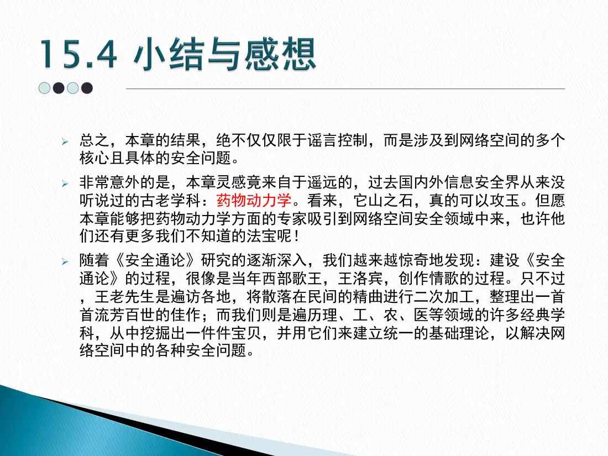

原文：

15.4小结与感想

总之，本章的结果，绝不仅仅限于谣言控制，而是涉及到网络空间的多个核心且具体的安全问题。

非常意外的是，本章灵感竟来自于遥远的，过去国内外信息安全界从来没听说过的古老学科：药物动力学。看来，它山之石，真的可以攻玉。但愿本章能够把药物动力学方面的专家吸引到网络空间安全领域中来，也许他们还有更多我们不知道的法宝呢！

➢ 随着《安全通论》研究的逐渐深入，我们越来越惊奇地发现：建设《安全通论》的过程，很像是当年西部歌王，王洛宾，创作情歌的过程。只不过，王老先生是遍访各地，将散落在民间的精曲进行二次加工，整理出一首首流芳百世的佳作；而我们则是遍历理、工、农、医等领域的许多经典学科，从中挖掘出一件件宝贝，并用它们来建立统一的基础理论，以解决网络空间中的各种安全问题。

### 本章结束，谢谢

原文：

本章结束，谢谢
