# 《安全通论》第16章 民意的演化规律（课件）

原件的每一页，下面附识别出的文字。

### 第16章---民意的演化规律

原文：

第16章---民意的演化规律

### 第16章民意的演化规律

原文：

第16章民意的演化规律

➢ 如今，在网络战争中突然出现了一种新武器，而且还是马上就能投入实战的武器，即，通过网络影响民意，从而颠倒选举结果。随着自媒体的迅速发展，这种武器对某类政体的国家，将具有越来越大的杀伤力，因此，无论是从攻，还是从守的角度来看，都必须对它进行认真研究。

### 1. 一个传说的启发

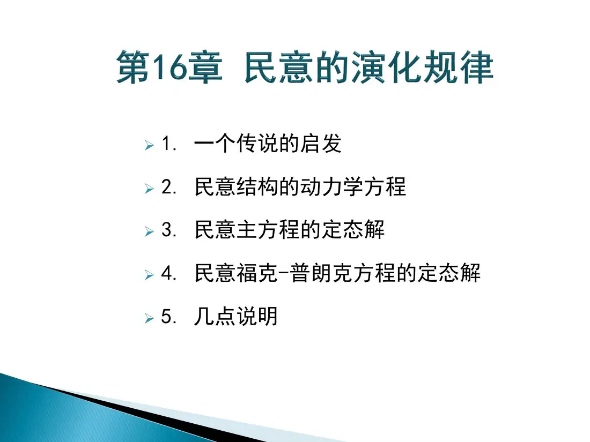

原文：

1. 一个传说的启发
2. 民意结构的动力学方程
3. 民意主方程的定态解
4. 民意福克-普朗克方程的定态解
5. 几点说明

第16章 民意的演化规律

### 16.1一个传说的启发

原文：

16.1一个传说的启发

➢ 最近，有这样一个传说：俄国总统普京，通过网络手段影响美国选情民意，在关键时刻“黑了”希拉里一把，从而让川普成功当选美国总统，让铁女人欲哭无泪。

➢ 如果此事属实，那么，“民意”就已成为网络战的现役武器了。特别是对那些民意决定一切的“非自信国家”，该武器的杀伤力更大。即使这个故事是杜撰的，但从理论上说，借助社交媒体等现代手段来影响民意，也是可行的。

### 16.1一个传说的启发

原文：

16.1一个传说的启发

➢ 因此，只要在合适的时机，暴出合适的“猛料”那么，就完全可能在瞬间改变民意。哪怕这种“变态民意”仅能持续很短一段时期，但是，在关键时刻，它就已经足以影响包括总统选举、地区独立公决等重大事件的结果了。由此可见，“民意者，国之大事，生死之地，存亡之道，不可不察也”。

### 16.1一个传说的启发

原文：

16.1一个传说的启发

我们所研究的民意至少应有如下特点：

➢ （1）针对某件事情，每个人都可以完全根据自己的意愿（而不是领导或组织的安排）公开表达“同意”或“反对”的态度；

➢ （2）无论是谁，他们的态度都有相同的重要性，不存在“主人”被“公仆”一票否决的情况，因此，整体民意的情况，就可仅仅根据“同意”或“反对”的票数而定；

### 16.1一个传说的启发

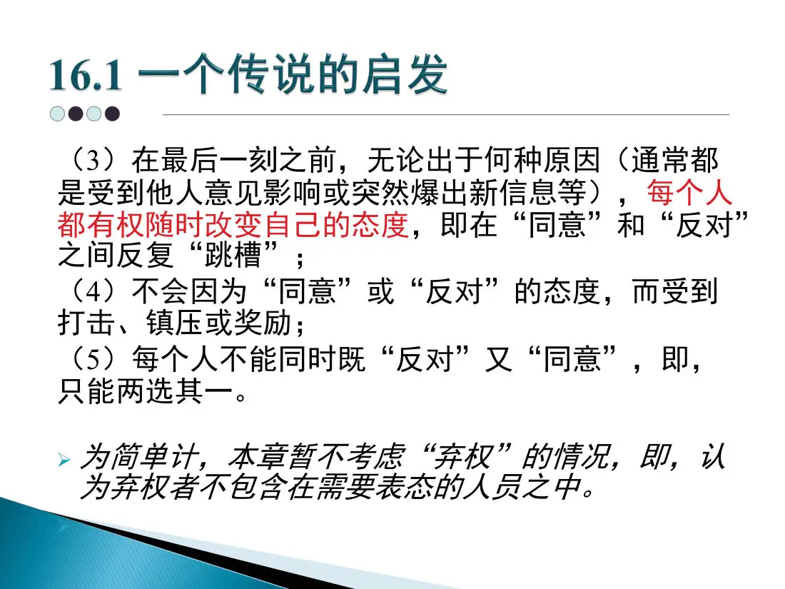

原文：

16.1一个传说的启发

（3）在最后一刻之前，无论出于何种原因（通常都是受到他人意见影响或突然爆出新信息等），每个人都有权随时改变自己的态度，即在“同意”和“反对”之间反复“跳槽”；

（4）不会因为“同意”或“反对”的态度，而受到打击、镇压或奖励；

（5）每个人不能同时既“反对”又“同意”，即，只能两选其一。

➢ 为简单计， 本章暂不考虑 “弃权” 的情况， 即， 认为弃权者不包含在需要表态的人员之中。

### 16.2 民意结构的动力学方程

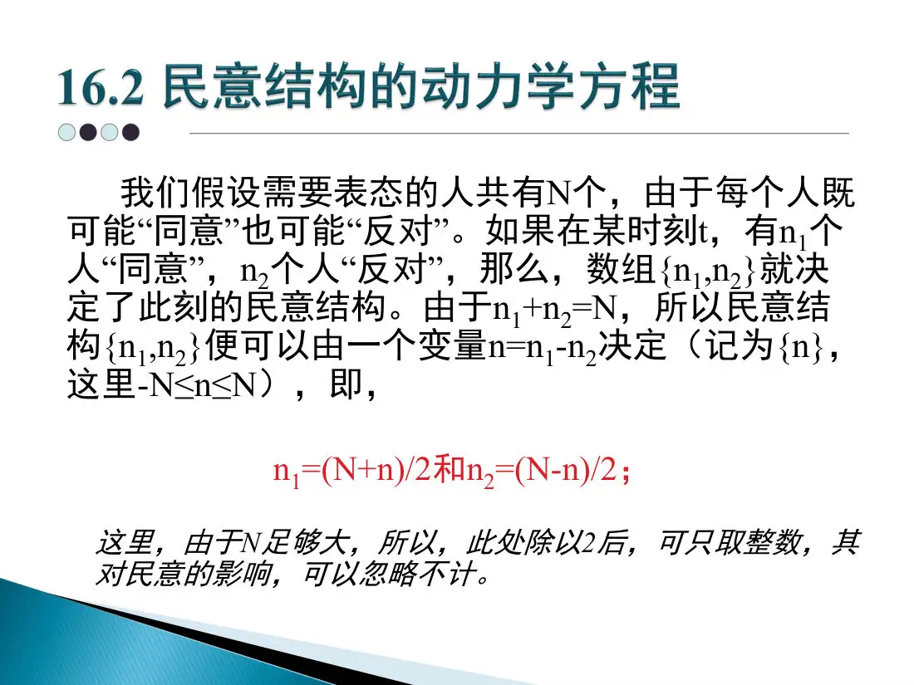

原文：

16.2 民意结构的动力学方程

我们假设需要表态的人共有N个，由于每个人既可能“同意”也可能“反对”。如果在某时刻t，有 $\mathbf { \bar { n } } _ { 1 }$ 个人“同意”， $\boldsymbol { \mathrm { n } } _ { 2 }$ 个人“反对”，那么，数组 $\{ \mathtt { n } _ { 1 } , \mathtt { n } _ { 2 } \}$ 就决定了此刻的民意结构。由于 $\mathrm { \ n } _ { 1 } + \mathrm { \ n } _ { 2 } { = } \mathrm { N }$ 所以民意结构 $\{ \mathtt { n } _ { 1 } , \mathtt { n } _ { 2 } \}$ 便可以由一个变量 $\mathfrak { n } { = } \mathfrak { n } _ { 1 } { = } \mathfrak { n } _ { 2 }$ 决定（记为{n}，这里 $\scriptstyle - \mathrm { N } \leq \mathrm { n } \leq \mathrm { N } )$ ，即，

$$
\mathrm{n} _ {1} = (\mathrm{N} + \mathrm{n}) / 2 \text {和} \mathrm{n} _ {2} = (\mathrm{N} - \mathrm{n}) / 2;
$$

这里，由于N足够大，所以，此处除以2后，可只取整数，其对民意的影响，可以忽略不计。

### 16.2 民意结构的动力学方程

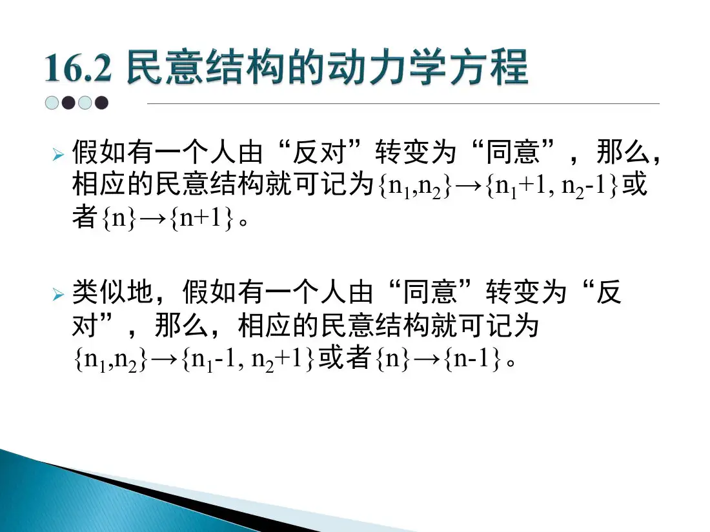

原文：

16.2 民意结构的动力学方程

假如有一个人由“反对”转变为“同意”，那么，相应的民意结构就可记为 $\{  { \mathrm { n } } _ { 1 } ,  { \mathrm { n } } _ { 2 } \}  \{  { \mathrm { n } } _ { 1 } + 1 ,  { \mathrm { n } } _ { 2 } - 1 \}$ 或者 $\{ { \mathfrak { n } } \} \longrightarrow \{ { \mathfrak { n } } + 1 \}$

➢ 类似地，假如有一个人由“同意”转变为“反对”，那么，相应的民意结构就可记为$\{ \mathrm { n } _ { 1 } , \mathrm { n } _ { 2 } \}  \{ \mathrm { n } _ { 1 } - 1 , \mathrm { n } _ { 2 } + 1 \}$ 或者 $\{ { \mathfrak { n } } \} \longrightarrow \{ { \mathfrak { n } } - 1 \}$

### 16.2 民意结构的动力学方程

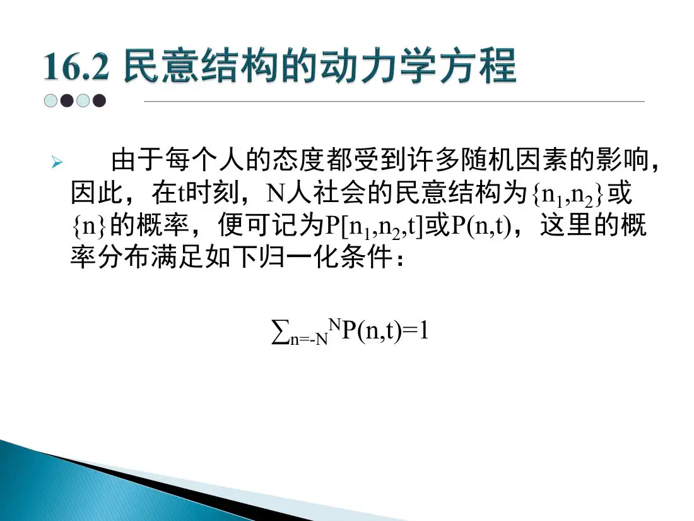

原文：

16.2 民意结构的动力学方程

➢ 由于每个人的态度都受到许多随机因素的影响，因此，在t时刻，N人社会的民意结构为 $\{ \mathtt { n } _ { 1 } , \mathtt { n } _ { 2 } \}$ 或{n}的概率，便可记为 $\mathrm { P } [ \mathfrak { n } _ { 1 } , \mathfrak { n } _ { 2 }$ ,t]或P(n,t)，这里的概率分布满足如下归一化条件：

$$
\sum_ {n = - N} ^ {N} P (n, t) = 1
$$

### 16.2 民意结构的动力学方程

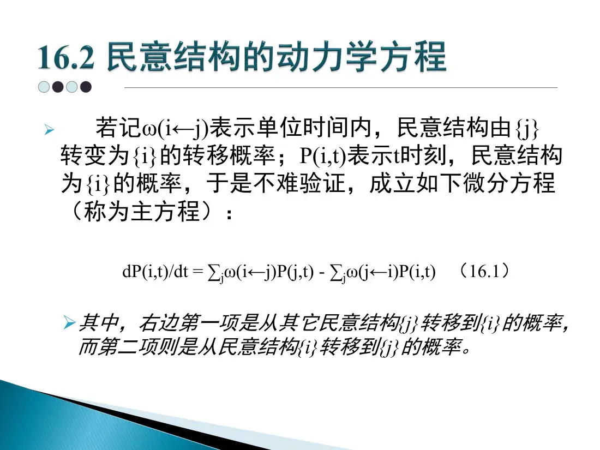

原文：

16.2 民意结构的动力学方程

➢ 若记ω(i←j)表示单位时间内，民意结构由{j}转变为{i}的转移概率；P(i,t)表示t时刻，民意结构为{i}的概率，于是不难验证，成立如下微分方程（称为主方程）：

$$
\mathrm{dP} (\mathrm{i}, \mathrm{t}) / \mathrm{dt} = \sum_ {\mathrm{j}} \omega (\mathrm{i} \leftarrow \mathrm{j}) \mathrm{P} (\mathrm{j}, \mathrm{t}) - \sum_ {\mathrm{j}} \omega (\mathrm{j} \leftarrow \mathrm{i}) \mathrm{P} (\mathrm{i}, \mathrm{t})\tag{16.1}
$$

➢ 其中， 右边第一项是从其它民意结构{j}转移到{i}的概率，而第二项则是从民意结构{i}转移到{j}的概率。

### 16.2 民意结构的动力学方程

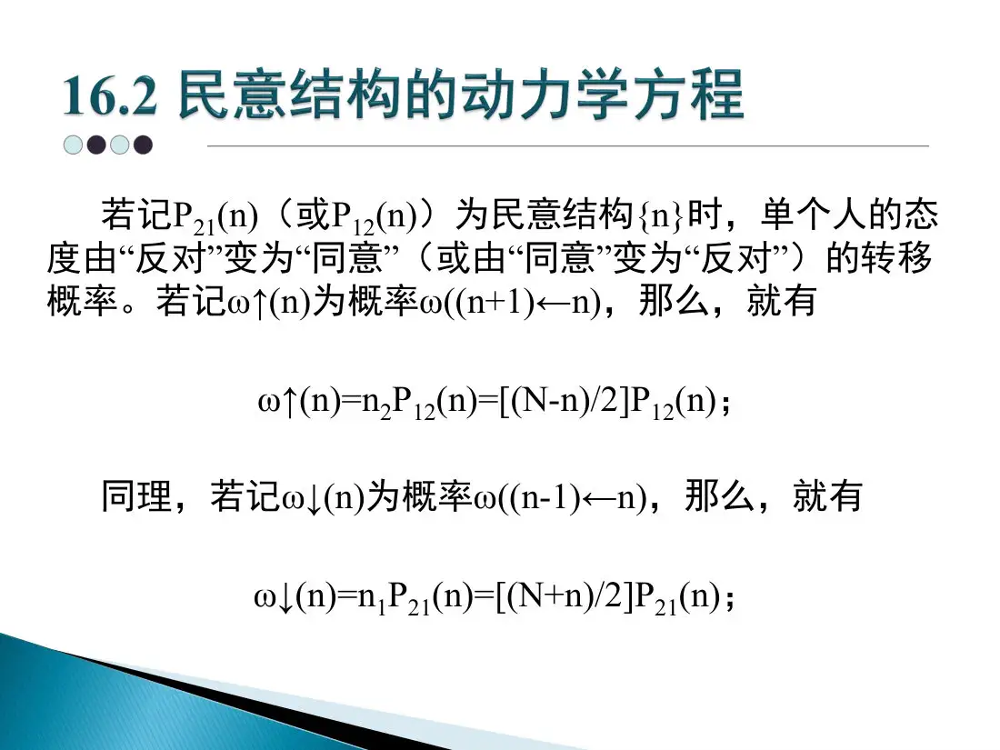

原文：

16.2 民意结构的动力学方程

若记 $\mathrm { P } _ { 2 1 } ( \mathrm { n } )$ （或 $\mathrm { \Delta P _ { 1 2 } ( n ) } )$ ）为民意结构{n}时，单个人的态度由“反对”变为“同意”（或由“同意”变为“反对”）的转移概率。若记ω↑(n)为概率 $\mathfrak { o } ( ( \mathtt { n } + 1 ) {  } \mathtt { n } )$ ，那么，就有

$$
\omega \uparrow (\mathrm{n}) = \mathrm{n} _ {2} \mathrm{P} _ {1 2} (\mathrm{n}) = [ (\mathrm{N} - \mathrm{n}) / 2 ] \mathrm{P} _ {1 2} (\mathrm{n});
$$

同理，若记 ${ \mathfrak { o } } \downarrow ( { \mathfrak { n } } )$ 为概率 $\mathfrak { o } ( ( \mathtt { n - 1 } ) {  } \mathtt { n } )$ ，那么，就有

$$
\omega \downarrow (\mathrm{n}) = \mathrm{n} _ {1} \mathrm{P} _ {2 1} (\mathrm{n}) = [ (\mathrm{N} + \mathrm{n}) / 2 ] \mathrm{P} _ {2 1} (\mathrm{n});
$$

### 16.2 民意结构的动力学方程

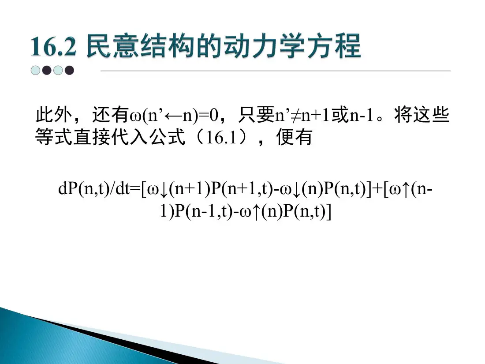

原文：

16.2 民意结构的动力学方程

此外，还有 $\mathrm { { c o } ( n ^ { \prime } - n ) { = } 0 }$ ，只要 $\mathrm { n } ^ { \prime } { \neq } \mathrm { n } { + } 1$ 或n-1。将这些等式直接代入公式（16.1），便有

$$
\begin{array}{c} \mathrm{dP(n,t)/dt=[} \omega \downarrow (\mathrm{n+1}) \mathrm{P(n+1,t)-} \omega \downarrow (\mathrm{n}) \mathrm{P(n,t)} ] + [ \omega \uparrow (\mathrm{n-} \\ 1) \mathrm{P(n-1,t)-} \omega \uparrow (\mathrm{n}) \mathrm{P(n,t)} ] \end{array}
$$

### 16.2 民意结构的动力学方程

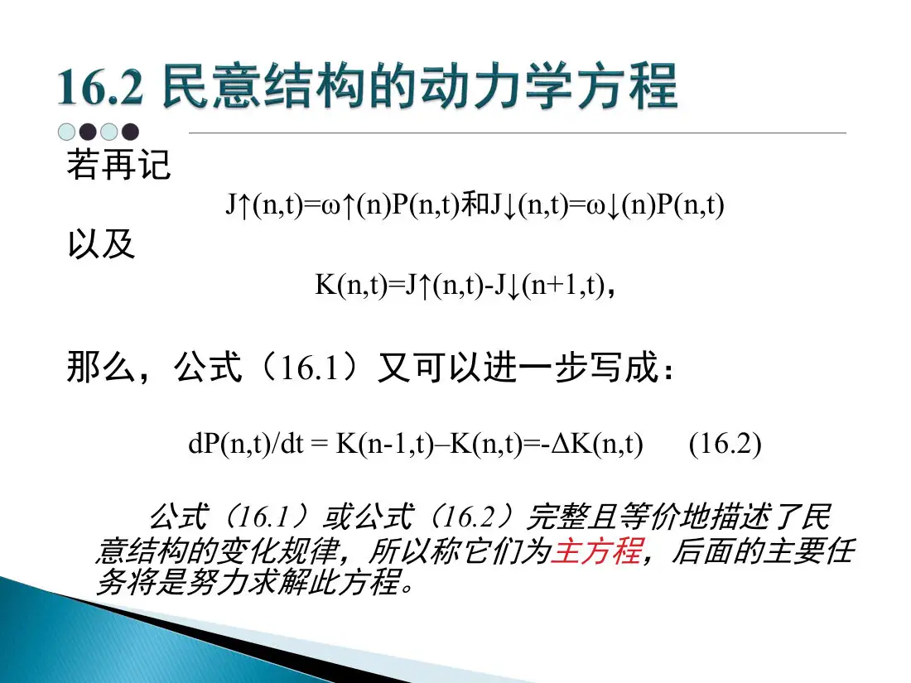

原文：

16.2 民意结构的动力学方程

若再记

$$
\mathrm{J} \uparrow (\mathrm{n}, \mathrm{t}) = \omega \uparrow (\mathrm{n}) \mathrm{P} (\mathrm{n}, \mathrm{t}) \text {和} \mathrm{J} \downarrow (\mathrm{n}, \mathrm{t}) = \omega \downarrow (\mathrm{n}) \mathrm{P} (\mathrm{n}, \mathrm{t})
$$

以及

$$
\mathrm{K} (\mathrm{n}, \mathrm{t}) = \mathrm{J} \uparrow (\mathrm{n}, \mathrm{t}) - \mathrm{J} \downarrow (\mathrm{n} + 1, \mathrm{t}),
$$

那么，公式（16.1）又可以进一步写成：

$$
\mathrm{dP} (\mathrm{n}, \mathrm{t}) / \mathrm{dt} = \mathrm{K} (\mathrm{n} - 1, \mathrm{t}) - \mathrm{K} (\mathrm{n}, \mathrm{t}) = - \Delta \mathrm{K} (\mathrm{n}, \mathrm{t})\tag{16.2}
$$

公式（16.1）或公式（16.2）完整且等价地描述了民意结构的变化规律，所以称它们为主方程，后面的主要任务将是努力求解此方程。

### 16.2 民意结构的动力学方程

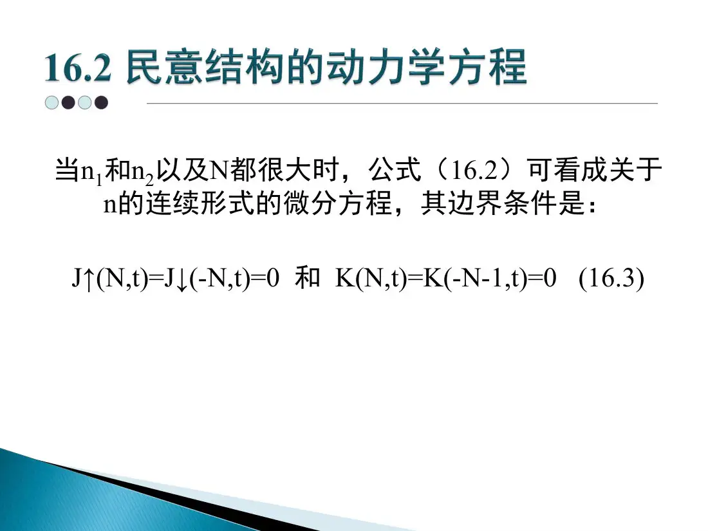

原文：

16.2 民意结构的动力学方程

当 $\mathfrak { n } _ { 1 }$ 和 $ { \mathbf { n } } _ { 2 }$ 以及N都很大时，公式（16.2）可看成关于n的连续形式的微分方程，其边界条件是：

$$
\mathrm{J} \uparrow (\mathrm{N}, \mathrm{t}) = \mathrm{J} \downarrow (- \mathrm{N}, \mathrm{t}) = 0 \text {和} \mathrm{K} (\mathrm{N}, \mathrm{t}) = \mathrm{K} (- \mathrm{N} - 1, \mathrm{t}) = 0\tag{16.3}
$$

### 16.2 民意结构的动力学方程

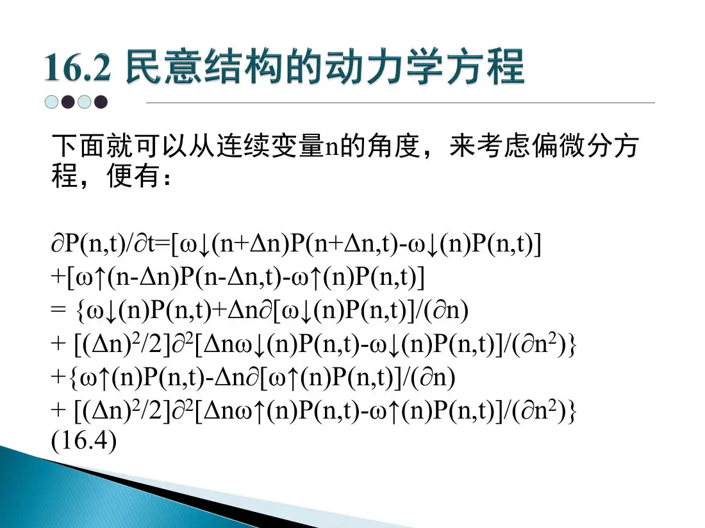

原文：

16.2 民意结构的动力学方程

下面就可以从连续变量n的角度，来考虑偏微分方程，便有：

$$
\begin{array}{r l} & {\partial \mathrm{P} (\mathrm{n}, \mathrm{t}) / \partial \mathrm{t} = [ \omega \downarrow (\mathrm{n} + \Delta \mathrm{n}) \mathrm{P} (\mathrm{n} + \Delta \mathrm{n}, \mathrm{t}) - \omega \downarrow (\mathrm{n}) \mathrm{P} (\mathrm{n}, \mathrm{t}) ]} \\ & {+ [ \omega \uparrow (\mathrm{n} - \Delta \mathrm{n}) \mathrm{P} (\mathrm{n} - \Delta \mathrm{n}, \mathrm{t}) - \omega \uparrow (\mathrm{n}) \mathrm{P} (\mathrm{n}, \mathrm{t}) ]} \\ & {= \{\omega \downarrow (\mathrm{n}) \mathrm{P} (\mathrm{n}, \mathrm{t}) + \Delta \mathrm{n} \partial [ \omega \downarrow (\mathrm{n}) \mathrm{P} (\mathrm{n}, \mathrm{t}) ] / (\partial \mathrm{n})} \\ & {+ [ (\Delta \mathrm{n}) ^ {2} / 2 ] \partial^ {2} [ \Delta \mathrm{n} \omega \downarrow (\mathrm{n}) \mathrm{P} (\mathrm{n}, \mathrm{t}) - \omega \downarrow (\mathrm{n}) \mathrm{P} (\mathrm{n}, \mathrm{t}) ] / (\partial \mathrm{n} ^ {2}) \}} \\ & {+ \{\omega \uparrow (\mathrm{n}) \mathrm{P} (\mathrm{n}, \mathrm{t}) - \Delta \mathrm{n} \partial [ \omega \uparrow (\mathrm{n}) \mathrm{P} (\mathrm{n}, \mathrm{t}) ] / (\partial \mathrm{n})} \\ & {+ [ (\Delta \mathrm{n}) ^ {2} / 2 ] \partial^ {2} [ \Delta \mathrm{n} \omega \uparrow (\mathrm{n}) \mathrm{P} (\mathrm{n}, \mathrm{t}) - \omega \uparrow (\mathrm{n}) \mathrm{P} (\mathrm{n}, \mathrm{t}) ] / (\partial \mathrm{n} ^ {2}) \}} \\ & {(1 6. 4)} \end{array}
$$

### 16.2 民意结构的动力学方程

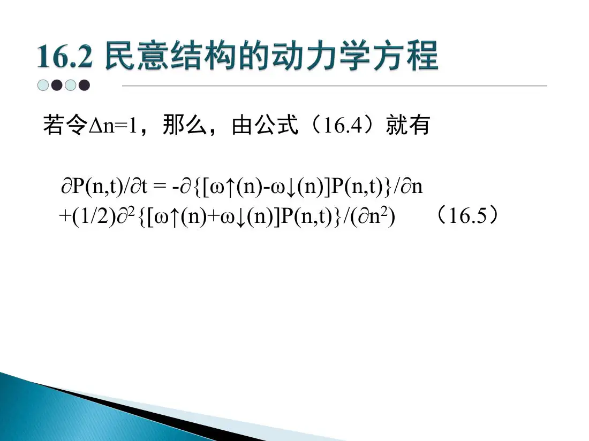

原文：

16.2 民意结构的动力学方程

若令 $\Delta \mathbf { n } { = } 1$ ，那么，由公式（16.4）就有

$$
\begin{array}{r l} & {\partial \mathrm{P} (\mathrm{n}, \mathrm{t}) / \partial \mathrm{t} = - \partial \left\{\left[ \omega \uparrow (\mathrm{n}) - \omega \downarrow (\mathrm{n}) \right] \mathrm{P} (\mathrm{n}, \mathrm{t}) \right\} / \partial \mathrm{n}} \\ & {+ (1 / 2) \partial^ {2} \left\{\left[ \omega \uparrow (\mathrm{n}) + \omega \downarrow (\mathrm{n}) \right] \mathrm{P} (\mathrm{n}, \mathrm{t}) \right\} / (\partial \mathrm{n} ^ {2})} \end{array}\tag{16.5}
$$

### 16.2 民意结构的动力学方程

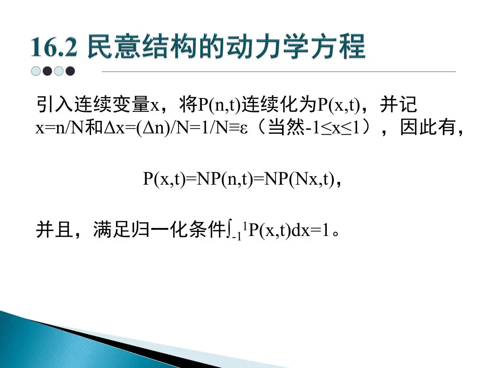

原文：

16.2 民意结构的动力学方程

引入连续变量x，将 $\mathrm { P ( n , t ) }$ 连续化为 $\mathrm { P ( x , t ) }$ ，并记$\mathrm { { { x } = n / N } }$ 和 $\Delta \mathrm { x } { = } ( \Delta \mathrm { n } ) / \mathrm { N } { = } 1 / \mathrm { N } { \equiv } \mathfrak { E }$ （当然- $- 1 { \le } \mathbf { X } { \le } 1 )$ ，因此有，

$$
\mathrm{P} (\mathrm{x}, \mathrm{t}) = \mathrm{NP} (\mathrm{n}, \mathrm{t}) = \mathrm{NP} (\mathrm{Nx}, \mathrm{t}),
$$

并且，满足归一化条件 $\int _ { - 1 } 1 \mathrm { P } ( \mathrm { x } , \mathrm { t } ) \mathrm { d } \mathrm { x } = 1$

### 16.2 民意结构的动力学方程

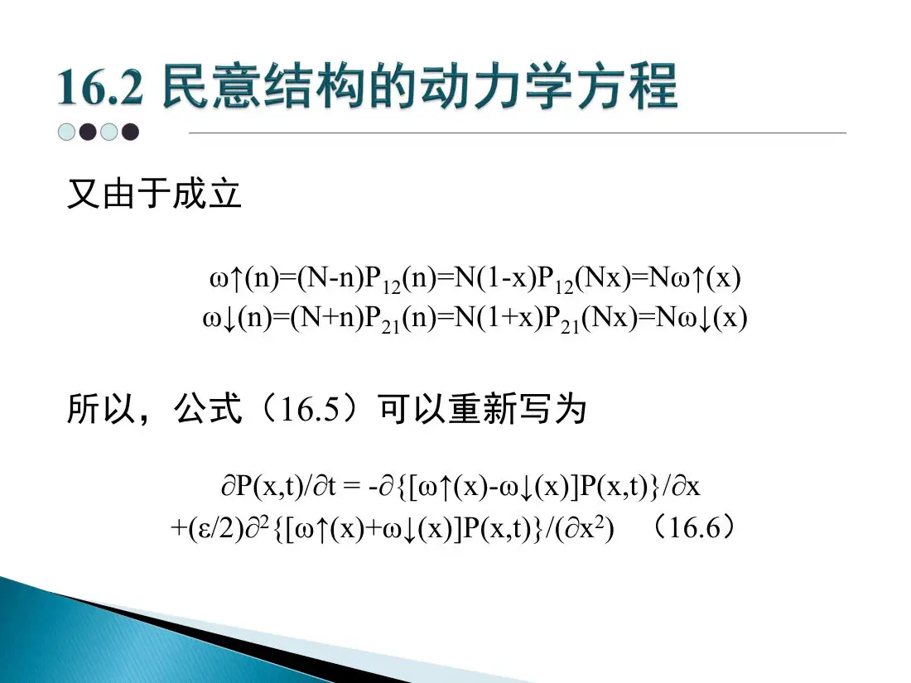

原文：

16.2 民意结构的动力学方程

又由于成立

$$
\begin{array}{r} \omega \uparrow (n) = (N - n) P _ {1 2} (n) = N (1 - x) P _ {1 2} (N x) = N \omega \uparrow (x) \\ \omega \downarrow (n) = (N + n) P _ {2 1} (n) = N (1 + x) P _ {2 1} (N x) = N \omega \downarrow (x) \end{array}
$$

所以，公式（16.5）可以重新写为

$$
\begin{array}{c} \partial \mathrm{P} (\mathrm{x}, \mathrm{t}) / \partial \mathrm{t} = - \partial \left\{\left[ \omega \uparrow (\mathrm{x}) - \omega \downarrow (\mathrm{x}) \right] \mathrm{P} (\mathrm{x}, \mathrm{t}) \right\} / \partial \mathrm{x} \\ + (\varepsilon / 2) \partial^ {2} \left\{\left[ \omega \uparrow (\mathrm{x}) + \omega \downarrow (\mathrm{x}) \right] \mathrm{P} (\mathrm{x}, \mathrm{t}) \right\} / (\partial \mathrm{x} ^ {2}) \end{array} (1 6. 6)
$$

### 16.2 民意结构的动力学方程

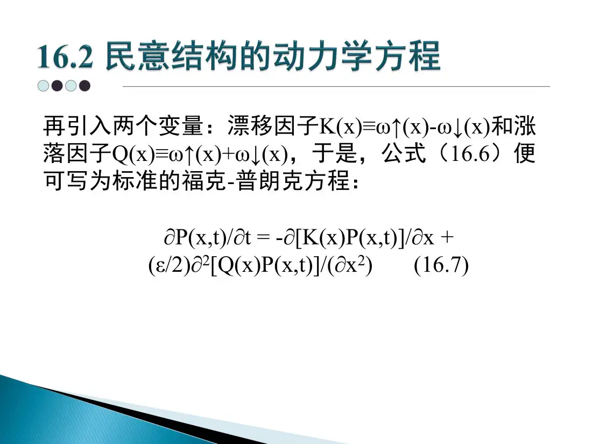

原文：

16.2 民意结构的动力学方程

再引入两个变量：漂移因子 $\mathrm { K ( x ) } { \equiv } \omega \uparrow ( \mathrm { x ) } { - } \omega \downarrow ( \mathrm { x ) }$ 和涨落因子 $\mathrm { Q ( x ) } { \equiv } \omega \uparrow ( \mathrm { x ) } { + } \omega \downarrow ( \mathrm { x } )$ ，于是，公式（16.6）便可写为标准的福克-普朗克方程：

$$
\begin{array}{r} \partial \mathrm{P} (\mathrm{x}, t) / \partial t = - \partial [ \mathrm{K} (\mathrm{x}) \mathrm{P} (\mathrm{x}, t) ] / \partial \mathrm{x} + \\ (\varepsilon / 2) \partial^ {2} [ \mathrm{Q} (\mathrm{x}) \mathrm{P} (\mathrm{x}, t) ] / (\partial \mathrm{x} ^ {2}) \end{array} (1 6. 7)
$$

### 16.2 民意结构的动力学方程

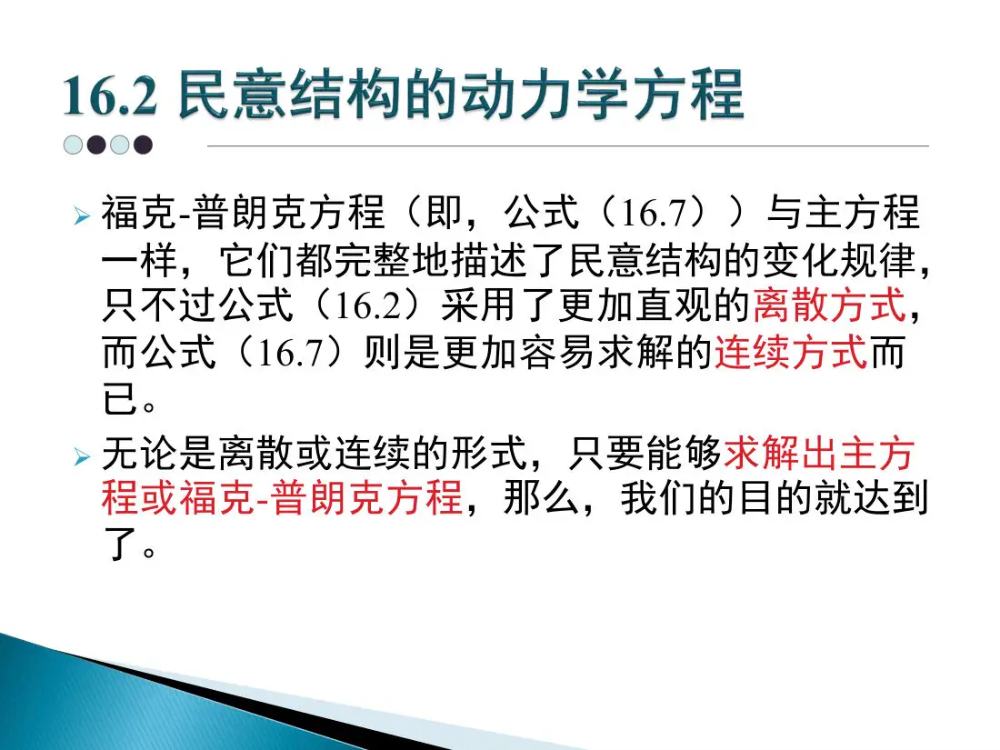

原文：

16.2 民意结构的动力学方程

➢ 福克-普朗克方程（即，公式（16.7））与主方程一样，它们都完整地描述了民意结构的变化规律，只不过公式（16.2）采用了更加直观的离散方式，而公式（16.7）则是更加容易求解的连续方式而已。

➢ 无论是离散或连续的形式，只要能够求解出主方程或福克-普朗克方程，那么，我们的目的就达到了。

### 16.2 民意结构的动力学方程

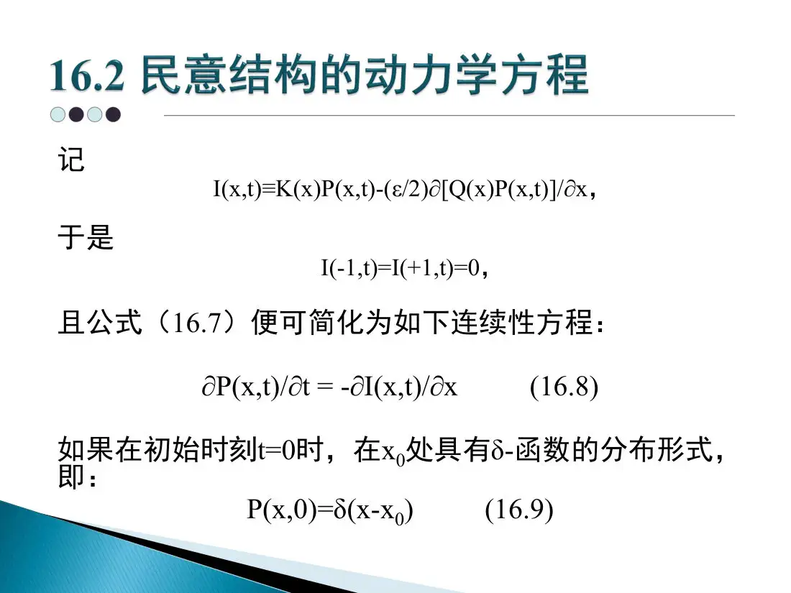

原文：

16.2 民意结构的动力学方程

记

$$
\mathrm{I} (\mathrm{x}, \mathrm{t}) \equiv \mathrm{K} (\mathrm{x}) \mathrm{P} (\mathrm{x}, \mathrm{t}) - (\varepsilon / 2) \partial [ \mathrm{Q} (\mathrm{x}) \mathrm{P} (\mathrm{x}, \mathrm{t}) ] / \partial \mathrm{x},
$$

于是

$$
\mathrm{I} (- 1, \mathrm{t}) = \mathrm{I} (+ 1, \mathrm{t}) = 0,
$$

且公式（16.7）便可简化为如下连续性方程：

$$
\partial \mathrm{P} (\mathrm{x}, \mathrm{t}) / \partial \mathrm{t} = - \partial \mathrm{I} (\mathrm{x}, \mathrm{t}) / \partial \mathrm{x}\tag{16.8}
$$

如果在初始时刻t=0时，在 $\mathbf { \Delta x } _ { 0 }$ 处具有 $\delta \mathbf { - }$ 函数的分布形式，即：

$$
\mathrm{P} (\mathrm{x}, 0) = \delta (\mathrm{x} - \mathrm{x} _ {0})\tag{16.9}
$$

### 16.2 民意结构的动力学方程

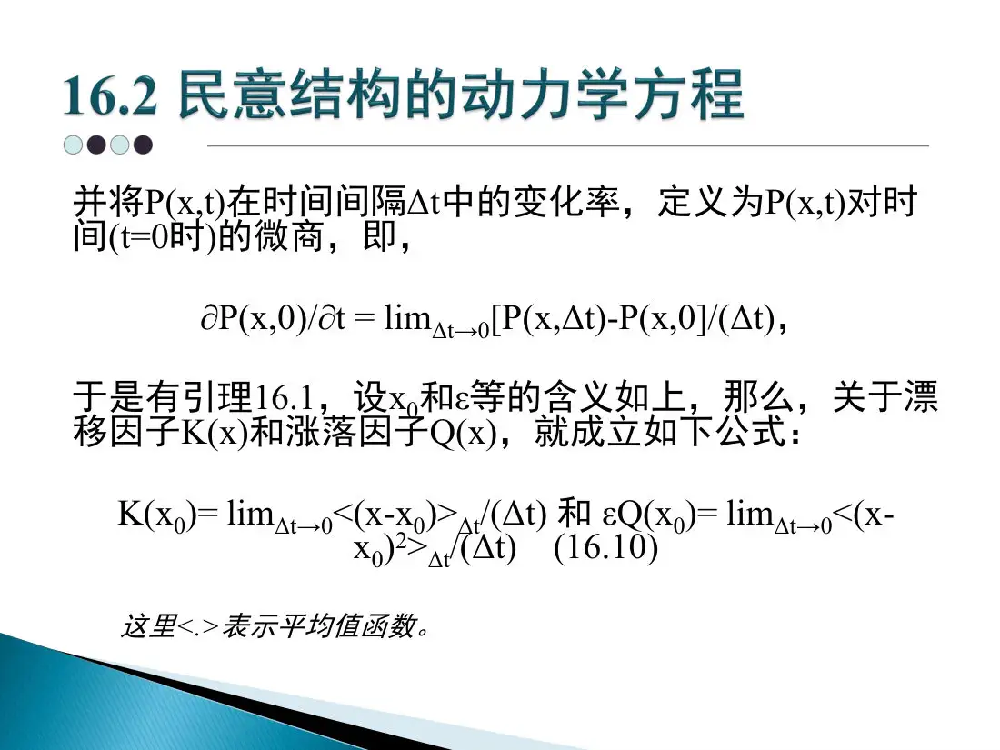

原文：

16.2 民意结构的动力学方程

并将P(x,t)在时间间隔 $\Delta \mathfrak { t }$ 中的变化率，定义为 $\mathrm { P ( x , t ) }$ 对时间(t=0时)的微商，即，

$$
\partial \mathrm{P} (\mathrm{x}, 0) / \partial \mathrm{t} = \lim _ {\Delta \mathrm{t} \rightarrow 0} [ \mathrm{P} (\mathrm{x}, \Delta \mathrm{t}) - \mathrm{P} (\mathrm{x}, 0) ] / (\Delta \mathrm{t}),
$$

于是有引理16.1，设 $\mathbf { X } _ { 0 }$ 和ε等的含义如上，那么，关于漂移因子 $\operatorname { K } ( \mathbf { x } )$ 和涨落因子Q(x)，就成立如下公式：

$$
\begin{array}{r}\mathrm{K} (\mathrm{x} _ {0}) = \lim _ {\Delta t \rightarrow 0} <   (\mathrm{x} - \mathrm{x} _ {0}) > _ {\Delta t} / (\Delta t) \text {和} \varepsilon Q (\mathrm{x} _ {0}) = \lim _ {\Delta t \rightarrow 0} <   (\mathrm{x} -\\\mathrm{x} _ {0}) ^ {2} > _ {\Delta t} / (\Delta t) (1 6. 1 0)\end{array}
$$

这里<.>表示平均值函数。

### 16.2 民意结构的动力学方程

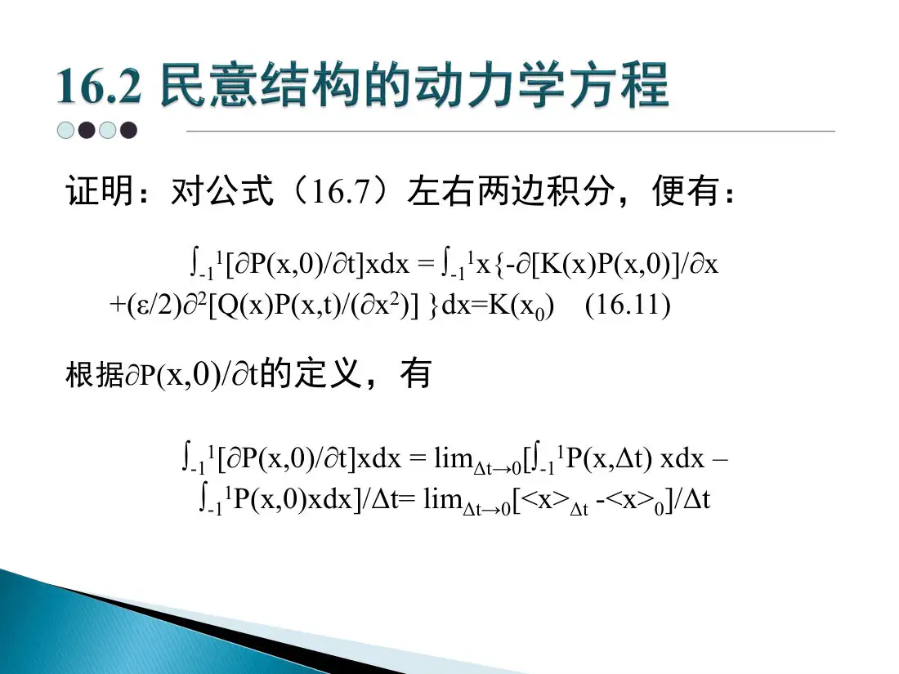

原文：

16.2 民意结构的动力学方程

证明：对公式（16.7）左右两边积分，便有：

$$
\begin{array}{c} \int_ {- 1} ^ {1} [ \partial \mathrm{P} (\mathrm{x}, 0) / \partial \mathrm{t} ] \mathrm{x} \mathrm{dx} = \int_ {- 1} ^ {1} \mathrm{x} \left\{- \partial [ \mathrm{K} (\mathrm{x}) \mathrm{P} (\mathrm{x}, 0) ] / \partial \mathrm{x} \right. \\ + (\varepsilon / 2) \partial^ {2} [ \mathrm{Q} (\mathrm{x}) \mathrm{P} (\mathrm{x}, \mathrm{t}) / (\partial \mathrm{x} ^ {2}) ] \} \mathrm{dx} = \mathrm{K} (\mathrm{x} _ {0}) \quad (1 6. 1 1) \end{array}
$$

根据 $\partial \mathrm { P } ( \mathrm { x } , 0 ) / \partial \mathrm { t }$ 的定义，有

$$
\begin{array}{r l} & {\int_ {- 1} ^ {1} [ \partial \mathrm{P} (\mathrm{x}, 0) / \partial t ] \mathrm{x} \mathrm{d} \mathrm{x} = \lim _ {\Delta t \to 0} [ \int_ {- 1} ^ {1} \mathrm{P} (\mathrm{x}, \Delta t) \mathrm{x} \mathrm{d} \mathrm{x} -} \\ & {\int_ {- 1} ^ {1} \mathrm{P} (\mathrm{x}, 0) \mathrm{x} \mathrm{d} \mathrm{x} ] / \Delta t = \lim _ {\Delta t \to 0} [ <   \mathrm{x} > _ {\Delta t} - <   \mathrm{x} > _ {0} ] / \Delta t} \end{array}
$$

### 16.2 民意结构的动力学方程

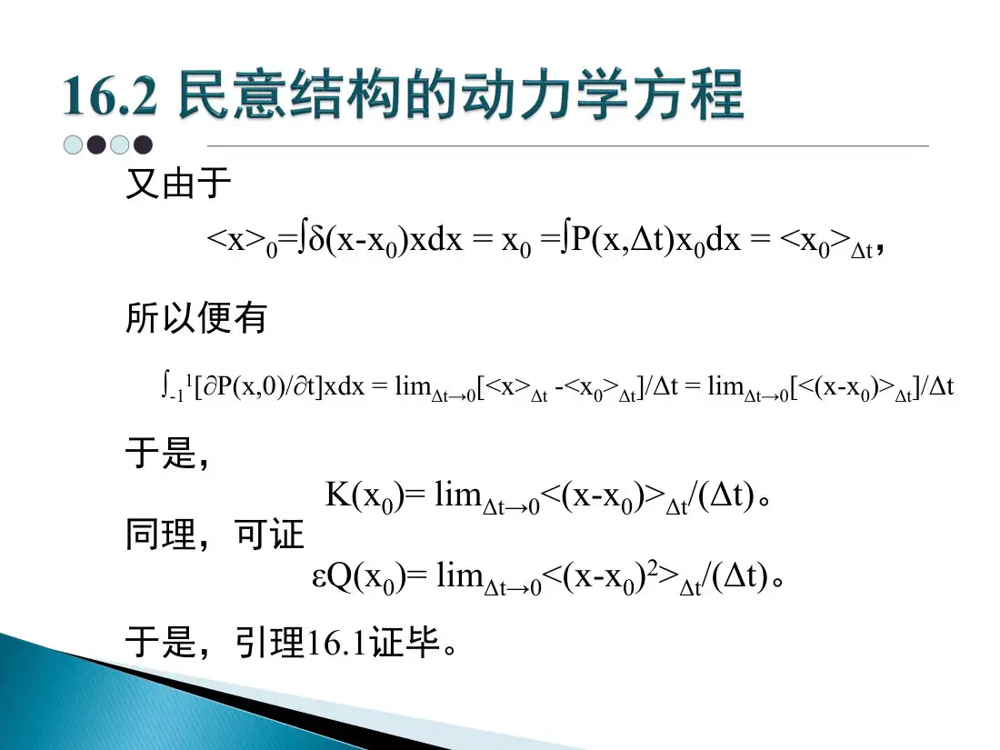

原文：

16.2 民意结构的动力学方程

又由于

$$
<   \mathrm{x} > _ {0} = \int \delta (\mathrm{x} - \mathrm{x} _ {0}) \mathrm{x} \mathrm{dx} = \mathrm{x} _ {0} = \int P (\mathrm{x}, \Delta t) \mathrm{x} _ {0} \mathrm{dx} = <   \mathrm{x} _ {0} > _ {\Delta t},
$$

所以便有

$$
\int_ {- 1} ^ {1} [ \partial \mathrm{P} (\mathrm{x}, 0) / \partial t ] \mathrm{x} \mathrm{dx} = \lim _ {\Delta t \to 0} [ \langle \mathrm{x} \rangle_ {\Delta t} - \langle \mathrm{x} _ {0} \rangle_ {\Delta t} ] / \Delta t = \lim _ {\Delta t \to 0} [ \langle (\mathrm{x} - \mathrm{x} _ {0}) \rangle_ {\Delta t} ] / \Delta t
$$

于是，

$$
\mathrm{K} \left(\mathrm{x} _ {0}\right) = \lim _ {\Delta t \rightarrow 0} <   \left(\mathrm{x} - \mathrm{x} _ {0}\right) > _ {\Delta t} / (\Delta t) 。
$$

同理，可证

$$
\varepsilon Q (x _ {0}) = \lim _ {\Delta t \rightarrow 0} <   (x - x _ {0}) ^ {2} > _ {\Delta t} / (\Delta t) 。
$$

于是，引理16.1证毕。

### 16.2 民意结构的动力学方程

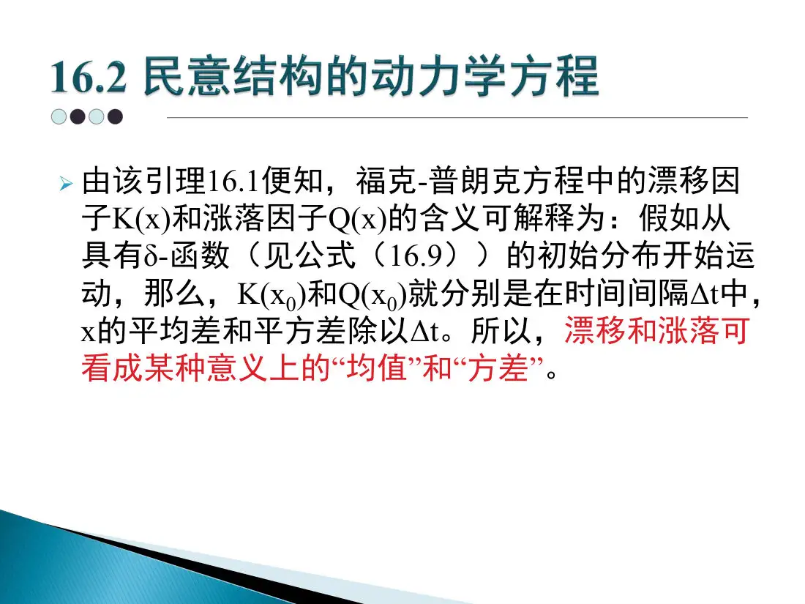

原文：

16.2 民意结构的动力学方程

➢ 由该引理16.1便知，福克-普朗克方程中的漂移因子K(x)和涨落因子Q(x)的含义可解释为：假如从具有δ-函数（见公式（16.9））的初始分布开始运动，那么， $\mathrm { K } ( \mathrm { x } _ { 0 } )$ 和 $\mathrm { Q } ( \mathrm { x } _ { 0 } )$ 就分别是在时间间隔 $\Delta \mathfrak { t }$ 中，x的平均差和平方差除以 $\Delta \mathfrak { t }$ 。所以，漂移和涨落可看成某种意义上的“均值”和“方差”。

### 16.3 民意主方程的定态解

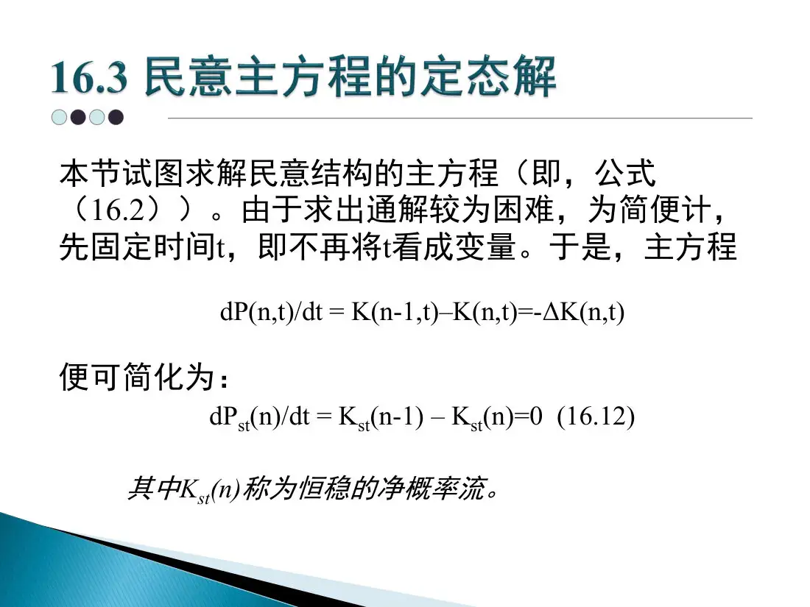

原文：

16.3 民意主方程的定态解

本节试图求解民意结构的主方程（即，公式（16.2））。由于求出通解较为困难，为简便计，先固定时间t，即不再将t看成变量。于是，主方程

$$
\mathrm{dP} (\mathrm{n}, \mathrm{t}) / \mathrm{dt} = \mathrm{K} (\mathrm{n} - 1, \mathrm{t}) - \mathrm{K} (\mathrm{n}, \mathrm{t}) = - \Delta \mathrm{K} (\mathrm{n}, \mathrm{t})
$$

便可简化为：

$$
\mathrm{dP} _ {\mathrm{st}} (\mathrm{n}) / \mathrm{dt} = \mathrm{K} _ {\mathrm{st}} (\mathrm{n} - 1) - \mathrm{K} _ {\mathrm{st}} (\mathrm{n}) = 0\tag{16.12}
$$

其中 ${ \cal K } _ { s t } ( n )$ 称为恒稳的净概率流。

### 16.3 民意主方程的定态解

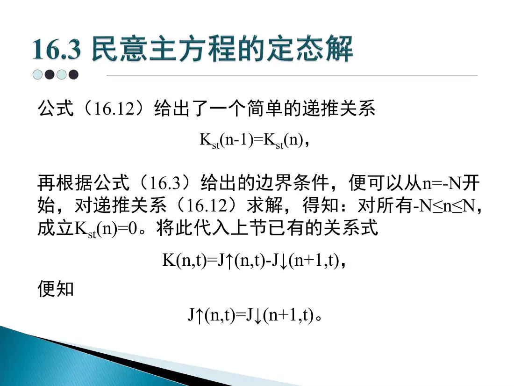

原文：

16.3 民意主方程的定态解

公式（16.12）给出了一个简单的递推关系

$$
\mathrm{K} _ {\mathrm{st}} (\mathrm{n-1}) = \mathrm{K} _ {\mathrm{st}} (\mathrm{n}),
$$

再根据公式（16.3）给出的边界条件，便可以从 $\mathrm { \ n = \mathrm { - N } }$ 开始，对递推关系（16.12）求解，得知：对所有 $\scriptstyle - \mathrm { N } \leq \mathrm { n } \leq \mathrm { N }$ 成立 ${ \mathrm { K } } _ { \mathrm { s t } } ( \mathbf { n } ) { = } 0$ 。将此代入上节已有的关系式

$$
\mathrm{K} (\mathrm{n}, \mathrm{t}) = \mathrm{J} \uparrow (\mathrm{n}, \mathrm{t}) - \mathrm{J} \downarrow (\mathrm{n} + 1, \mathrm{t}),
$$

便知

$$
\mathrm{J} \uparrow (\mathrm{n}, \mathrm{t}) = \mathrm{J} \downarrow (\mathrm{n} + 1, \mathrm{t}) 。
$$

### 16.3 民意主方程的定态解

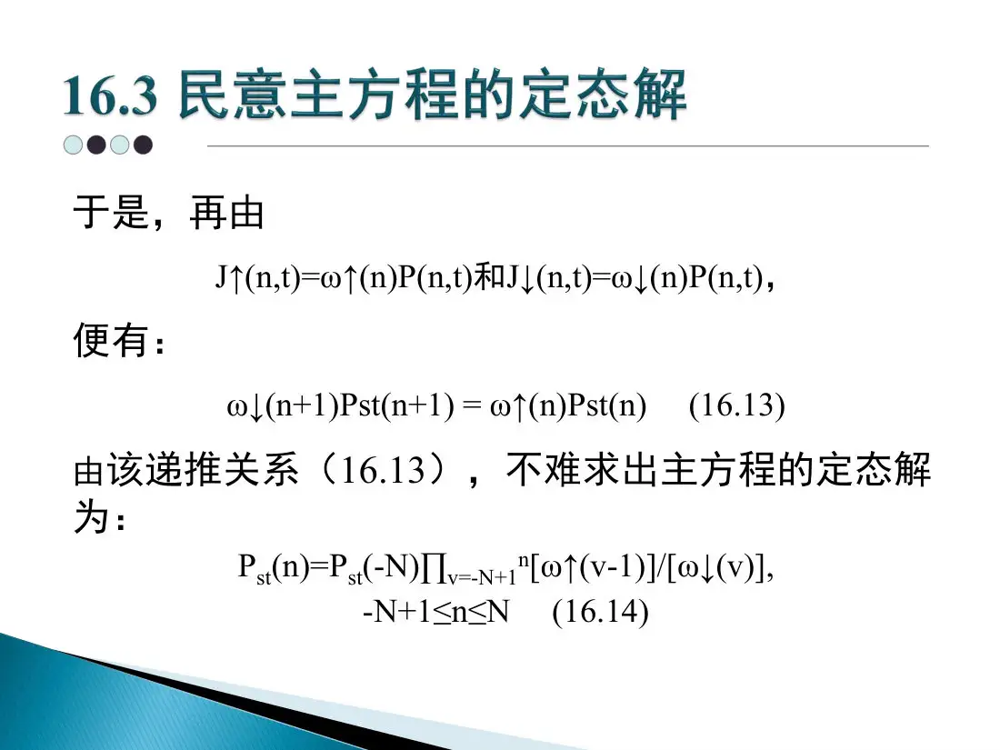

原文：

16.3 民意主方程的定态解

于是，再由

$$
\mathrm{J} \uparrow (\mathrm{n}, \mathrm{t}) = \omega \uparrow (\mathrm{n}) \mathrm{P} (\mathrm{n}, \mathrm{t}) \text {和} \mathrm{J} \downarrow (\mathrm{n}, \mathrm{t}) = \omega \downarrow (\mathrm{n}) \mathrm{P} (\mathrm{n}, \mathrm{t}),
$$

便有：

$$
\omega \downarrow (\mathrm{n} + 1) \operatorname{Pst} (\mathrm{n} + 1) = \omega \uparrow (\mathrm{n}) \operatorname{Pst} (\mathrm{n})\tag{16.13}
$$

由该递推关系（16.13），不难求出主方程的定态解为：

$$
\begin{array}{c} \mathrm {P_ {st} (n) = P_ {st} (-N)\prod_ {v = - N + 1} n[ \omega\uparrow(v - 1)] / [\omega\downarrow(v)],} \\ - \mathrm {N+ 1\leqn\leqN} \end{array} \tag {16.14}
$$

### $$

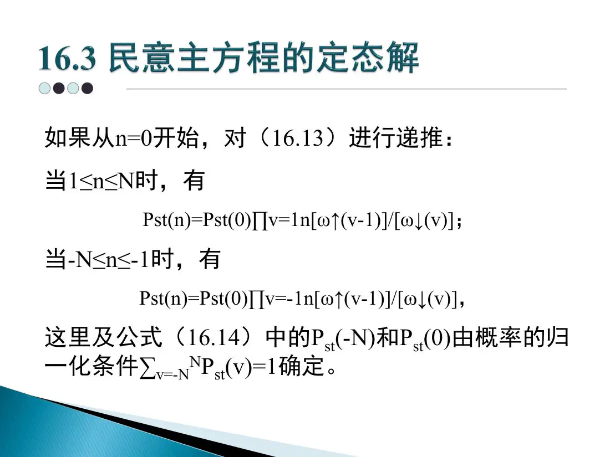

原文：

如果从 $\mathrm { \Omega } _ { \mathrm { n { = } 0 } }$ 开始，对（16.13）进行递推：

当 $1 { \leq } \mathrm { n } { \leq } \mathrm { N }$ 时，有

$$
\operatorname{Pst} (n) = \operatorname{Pst} (0) \prod v = 1 n [ \omega \uparrow (v - 1) ] / [ \omega \downarrow (v) ];
$$

当- $- \mathrm { N } { \leq } \mathrm { n } { \leq } - 1$ 时，有

$$
\operatorname{Pst} (n) = \operatorname{Pst} (0) \prod v = - 1 n [ \omega \uparrow (v - 1) ] / [ \omega \downarrow (v) ],
$$

这里及公式（16.14）中的 $\mathrm { P _ { s t } ( - N ) }$ 和 $\mathrm { P _ { s t } ( 0 ) }$ 由概率的归一化条件 $\scriptstyle \sum _ { \mathrm { v = - N } } \mathrm { N P } _ { \mathrm { s t } } ( \mathrm { v } ) = 1$ 确定。

○●〇

16.3 民意主方程的定态解

### 16.3 民意主方程的定态解

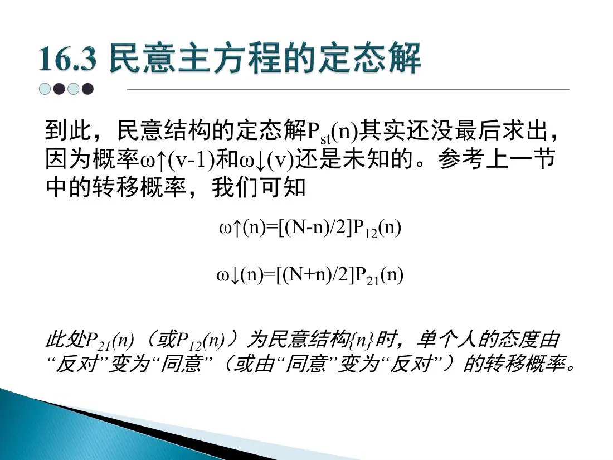

原文：

16.3 民意主方程的定态解

到此，民意结构的定态解 $\mathrm { P _ { s t } ( n ) }$ 其实还没最后求出，因为概率ω↑(v-1)和 $\omega \downarrow ( \nu )$ 还是未知的。参考上一节中的转移概率，我们可知

$$
\omega \uparrow (\mathrm{n}) = [ (\mathrm{N} - \mathrm{n}) / 2 ] \mathrm{P} _ {1 2} (\mathrm{n})
$$

$$
\omega \downarrow (\mathrm{n}) = [ (\mathrm{N} + \mathrm{n}) / 2 ] \mathrm{P} _ {2 1} (\mathrm{n})
$$

此处 ${ \bf \dot { \cdot } } P _ { 2 l } ( n ) ~ ( \bar { \underline { { { \sigma } } } } { \dot { \ell } } P _ { l 2 } ( n ) )$ 为民意结构{n}时，单个人的态度由“反对”变为“同意” （或由“同意”变为“反对”） 的转移概率。

### 16.3 民意主方程的定态解

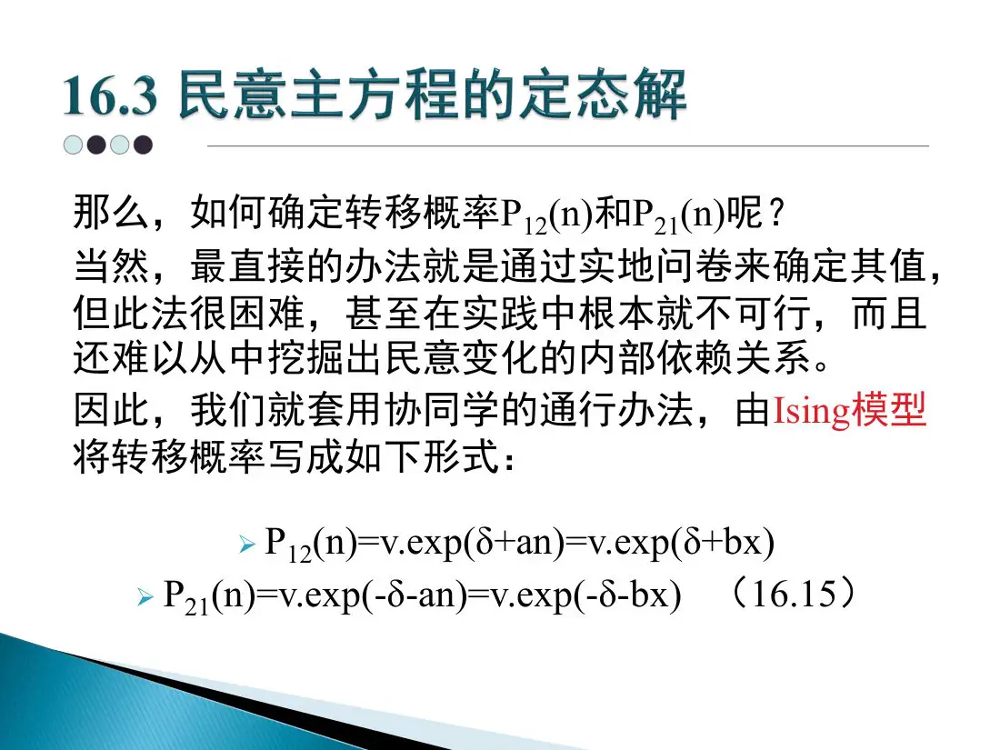

原文：

16.3 民意主方程的定态解

那么，如何确定转移概率 $\mathrm { P _ { 1 2 } ( n ) }$ 和 $\mathrm { P } _ { 2 1 } ( \mathrm { n } )$ 呢？

当然，最直接的办法就是通过实地问卷来确定其值，但此法很困难，甚至在实践中根本就不可行，而且还难以从中挖掘出民意变化的内部依赖关系。

因此，我们就套用协同学的通行办法，由Ising模型将转移概率写成如下形式：

$$
\begin{array}{r l} & \triangleright P _ {1 2} (n) = v. e x p (\delta + a n) = v. e x p (\delta + b x) \\ & \triangleright P _ {2 1} (n) = v. e x p (- \delta - a n) = v. e x p (- \delta - b x) \quad (1 6. 1 5) \end{array}
$$

### 16.3 民意主方程的定态解

原文：

16.3 民意主方程的定态解

在公式（16.15）中，b=aN，δ和v是三个待定参数，称为趋势参数，它们的含义分别是：

参数δ是偏好参数，它反映了某些人对“同意”或“反对”这两种态度的偏好。该偏好可能是由其固有的经验而形成的，比如，本党成员对本党候选人就更偏好于“同意”。当δ为正值时，态度从“反对”跳槽到“同意”的概率就增加，当然，从“同意”跳槽到“反对”的概率就减少。当δ为负时，情况刚好相反。

### 16.3 民意主方程的定态解

原文：

16.3 民意主方程的定态解

➢ 参数b为顺从参数。根据n和x的定义，当b为正时，增强了“跟风”（即，赞成多数人意见）的转移概率，同时，减少了“顶风”（即，违背多数人的意见）的转移概率，即，正参数b反映了“跟风”或“顶风”的趋向。该趋向将使多数人的意见越来越占优势，这显然是一种顺应倾向，它由各人固有的性格决定。

参数v为灵活参数，它决定着民意反转（或颠倒）的频率。

### 16.3 民意主方程的定态解

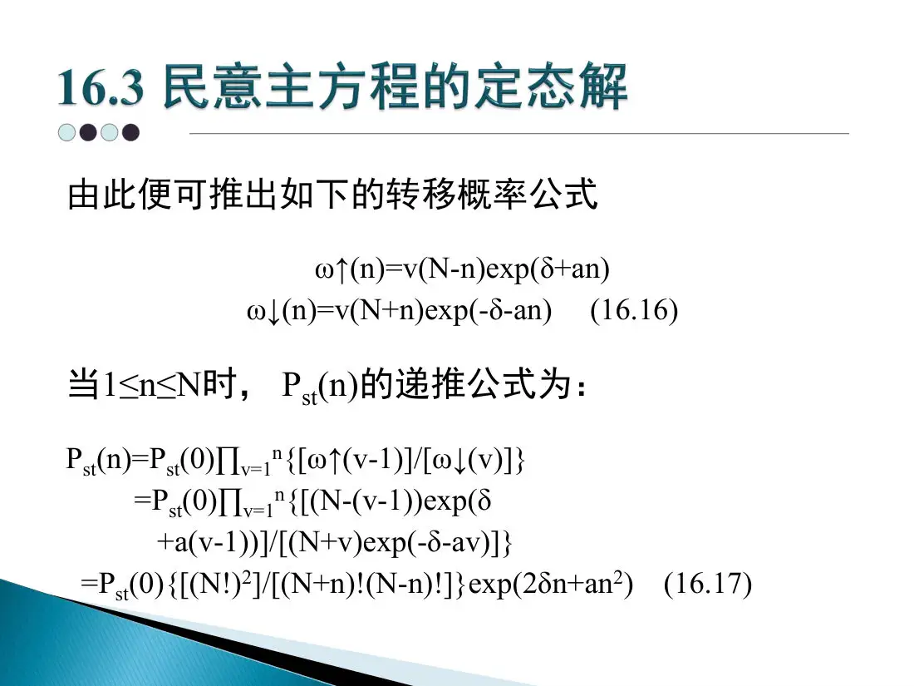

原文：

16.3 民意主方程的定态解

由此便可推出如下的转移概率公式

$$
\begin{array}{c} \omega \uparrow (n) = v (N - n) \exp (\delta + a n) \\ \omega \downarrow (n) = v (N + n) \exp (- \delta - a n) \end{array} \tag {16.16}
$$

当 $1 { \leq } \mathrm { n } { \leq } \mathrm { N }$ 时， $\mathrm { P _ { s t } ( n ) }$ 的递推公式为：

$$
\begin{array}{r l} & {\mathrm {P_ {st} (n) = P_ {st} (0)\prod_ {v = 1} ^ {n} \{[ \omega\uparrow(v - 1)] / [\omega\downarrow(v)]\}}} \\ & {\qquad = \mathrm {P_ {st} (0)\prod_ {v = 1} ^ {n} \{[(N - (v - 1))\exp(\delta}} \\ & {\qquad + a (v - 1)) ] / [ (N + v) \exp (- \delta - a v) ] \}} \\ & {\qquad = \mathrm {P_ {st} (0) \{[(N!) ^ {2} ] / [(N + n)!(N - n)!]} \exp (2 \delta n + a n ^ {2})} \end{array}\tag{16.17}
$$

### 16.3 民意主方程的定态解

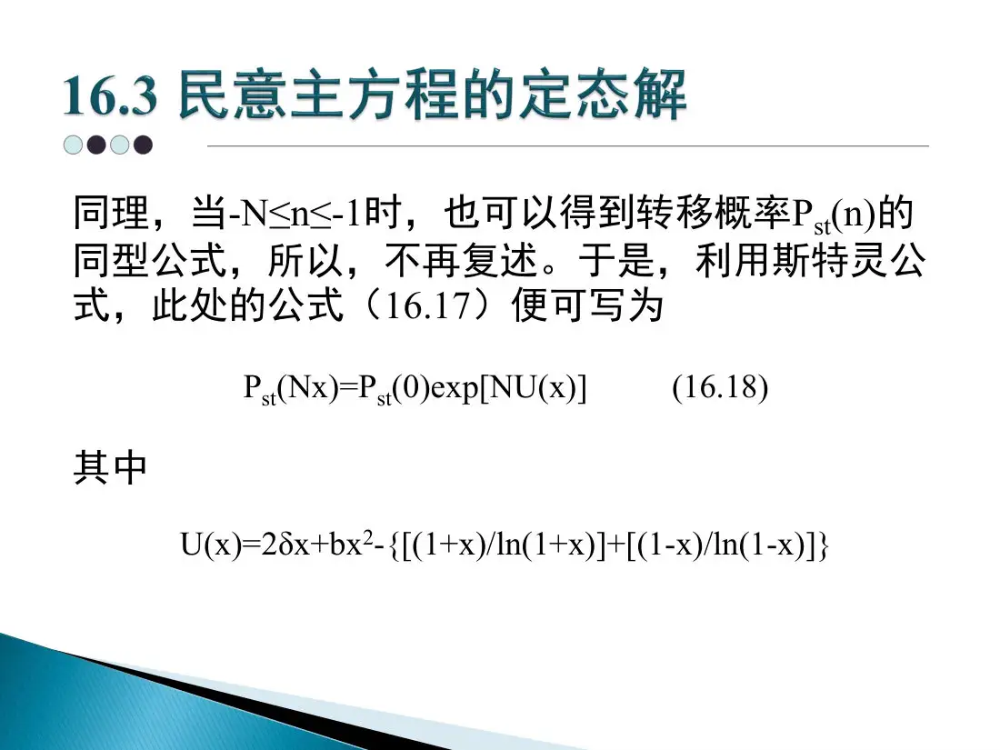

原文：

16.3 民意主方程的定态解

同理，当 $- \mathrm { N } { \leq } \mathrm { n } { \leq } - 1$ 时，也可以得到转移概率 $\mathrm { P _ { s t } ( n ) }$ 的同型公式，所以，不再复述。于是，利用斯特灵公式，此处的公式（16.17）便可写为

$$
\mathrm{P} _ {\mathrm{st}} (\mathrm{Nx}) = \mathrm{P} _ {\mathrm{st}} (0) \exp [ \mathrm{NU(x)} ]\tag{16.18}
$$

其中

$$
\mathrm{U} (\mathrm{x}) = 2 \delta \mathrm{x} + \mathrm{bx} ^ {2} - \left\{\left[ (1 + \mathrm{x}) / \ln (1 + \mathrm{x}) \right] + \left[ (1 - \mathrm{x}) / \ln (1 - \mathrm{x}) \right] \right\}
$$

### 16.3 民意主方程的定态解

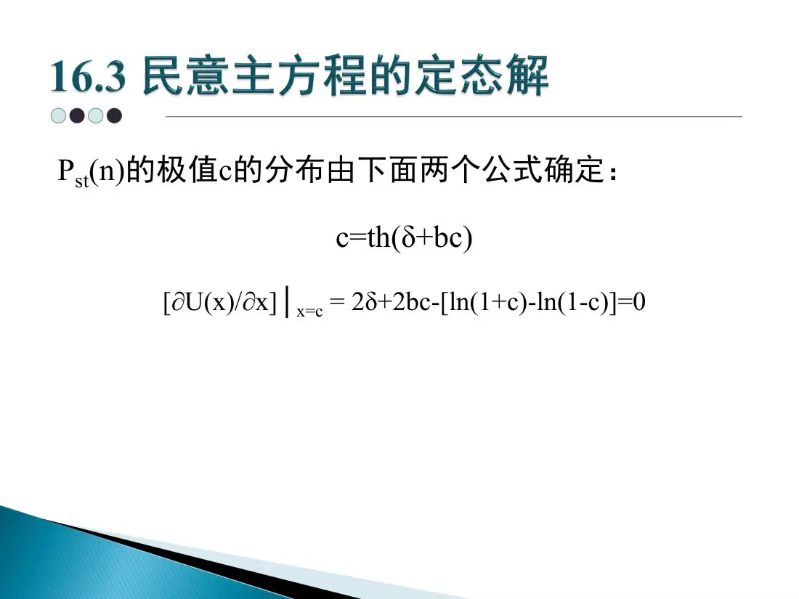

原文：

16.3 民意主方程的定态解

$\mathrm { P _ { s t } ( n ) }$ 的极值c的分布由下面两个公式确定：

$$
\mathbf {c} = \operatorname{th} (\delta + \mathbf {b c})
$$

$$
\left. \left[ \partial \mathrm{U} (\mathrm{x}) / \partial \mathrm{x} \right] \right| _ {\mathrm{x} = \mathrm{c}} = 2 \delta + 2 \mathrm{bc} - [ \ln (1 + \mathrm{c}) - \ln (1 - \mathrm{c}) ] = 0
$$

### 16.3 民意主方程的定态解

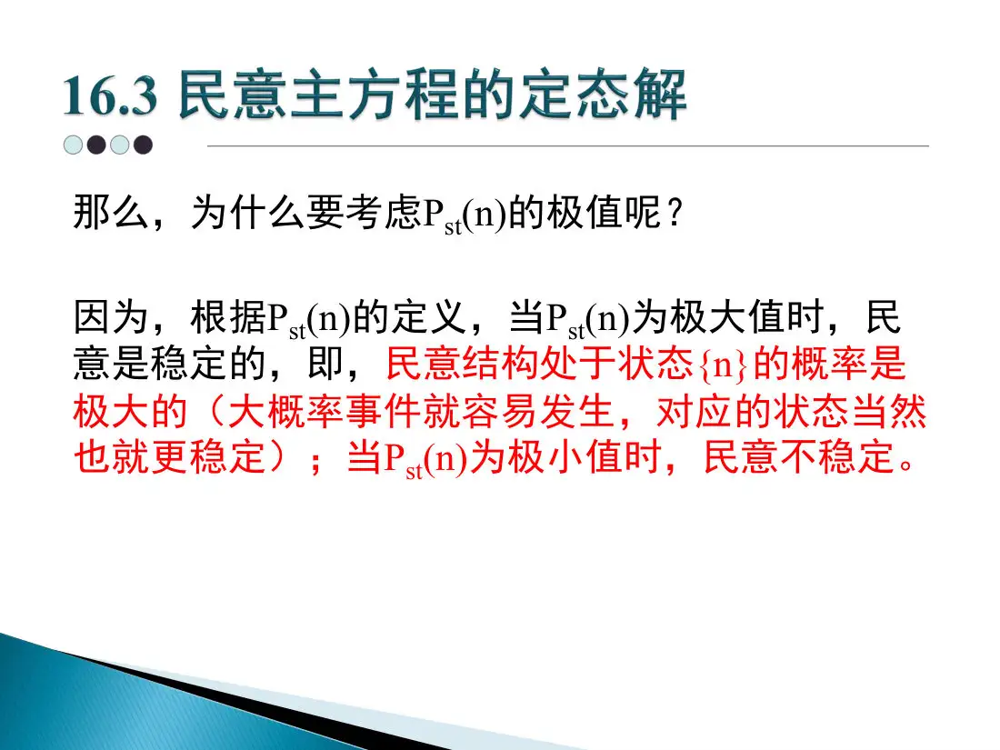

原文：

16.3 民意主方程的定态解

那么，为什么要考虑 $\mathrm { \mathrm { P _ { s t } ( n ) } }$ 的极值呢？

因为，根据 $\mathrm { P _ { s t } ( n ) }$ 的定义，当 $\mathrm { P _ { s t } ( n ) }$ 为极大值时，民意是稳定的，即，民意结构处于状态{n}的概率是极大的（大概率事件就容易发生，对应的状态当然也就更稳定）；当 $\mathrm { { P _ { s t } ( n ) } }$ 为极小值时，民意不稳定。

### 16.3 民意主方程的定态解

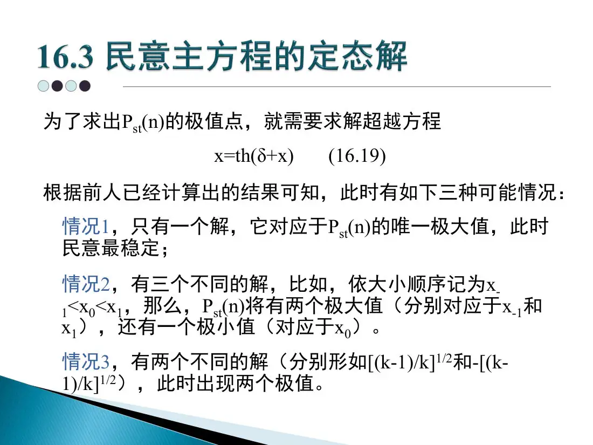

原文：

16.3 民意主方程的定态解

为了求出 $\mathrm { P _ { s t } ( n ) }$ 的极值点，就需要求解超越方程x=th(δ+x) (16.19)根据前人已经计算出的结果可知，此时有如下三种可能情况：情况1，只有一个解，它对应于 $\mathrm { \mathrm { P _ { s t } ( n ) } }$ 的唯一极大值，此时民意最稳定；情况2，有三个不同的解，比如，依大小顺序记为x${ \bf \tau } _ { 1 } { < } { \bf X } _ { 0 } { < } { \bf X } _ { 1 } ,$ 那么， $\mathrm { P _ { s t } ( n ) }$ 将有两个极大值（分别对应于 $\mathbf { \Delta x _ { - 1 } }$ 和$\mathbf { x } _ { 1 } )$ ，还有一个极小值（对应于 $\mathbf { \sigma } _ { \mathbf { X } _ { 0 } } )$ 情况3，有两个不同的解（分别形如 $[ ( \mathrm { k } { - } 1 ) / \mathrm { k } ] ^ { 1 / 2 }$ 和 $- [ ( k -$ $\underline { { 1 } } ) /  { \mathrm { k } } \beth ^ { 1 / 2 } )$ ，此时出现两个极值。

### 16.4 民意福克-普朗克方程的定态解

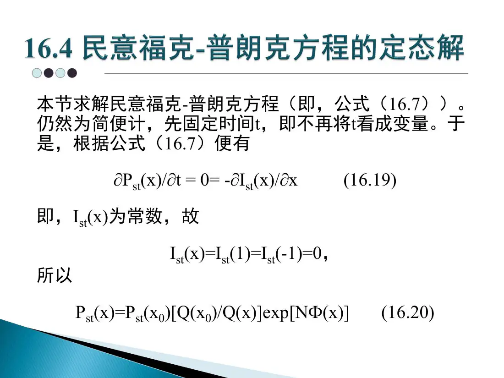

原文：

16.4 民意福克-普朗克方程的定态解

本节求解民意福克-普朗克方程（即，公式（16.7））。仍然为简便计，先固定时间t，即不再将t看成变量。于是，根据公式（16.7）便有

$$
\partial \mathrm{P} _ {\mathrm{st}} (\mathrm{x}) / \partial \mathrm{t} = 0 = - \partial \mathrm{I} _ {\mathrm{st}} (\mathrm{x}) / \partial \mathrm{x}\tag{16.19}
$$

即， $\mathrm { I } _ { \mathrm { s t } } ( \mathrm { x } )$ 为常数，故

$$
\mathrm{I} _ {\mathrm{st}} (\mathrm{x}) = \mathrm{I} _ {\mathrm{st}} (1) = \mathrm{I} _ {\mathrm{st}} (- 1) = 0,
$$

所以

$$
\mathrm{P} _ {\mathrm{st}} (\mathrm{x}) = \mathrm{P} _ {\mathrm{st}} (\mathrm{x} _ {0}) [ \mathrm{Q} (\mathrm{x} _ {0}) / \mathrm{Q} (\mathrm{x}) ] \exp [ \mathrm{N} \Phi (\mathrm{x}) ]\tag{16.20}
$$

### 16.4民意福克-普朗克方程的定态解

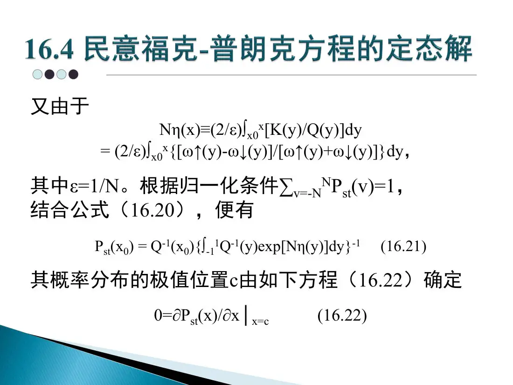

原文：

16.4民意福克-普朗克方程的定态解

又由于

$$
\begin{array}{c} \mathrm {N\eta(x)\equiv(2/ \varepsilon) \int_ {x0} ^ {x} [K(y)/ Q(y)] dy} \\ = (2 / \varepsilon) \int_ {x 0} ^ {x} \{[ \omega \uparrow (y) - \omega \downarrow (y) ] / [ \omega \uparrow (y) + \omega \downarrow (y) ] \} d y, \end{array}
$$

其中ε=1/N。根据归一化条件 $\scriptstyle \sum _ { \mathrm { v = - N } } \mathrm { N P } _ { \mathrm { s t } } ( \mathrm { v } ) = 1$ 结合公式（16.20），便有

$$
\mathrm{P} _ {\mathrm{st}} (\mathrm{x} _ {0}) = \mathrm{Q} ^ {- 1} (\mathrm{x} _ {0}) \{\int_ {- 1} ^ {1} \mathrm{Q} ^ {- 1} (\mathrm{y}) \exp [ \mathrm{N} \eta (\mathrm{y}) ] \mathrm{dy} \} ^ {- 1}\tag{16.21}
$$

其概率分布的极值位置c由如下方程（16.22）确定

$$
0 = \partial \mathrm{P} _ {\mathrm{st}} (\mathrm{x}) / \partial \mathrm{x} \mid_ {\mathrm{x} = \mathrm{c}} \tag {16.22}
$$

### 16.4民意福克-普朗克方程的定态解

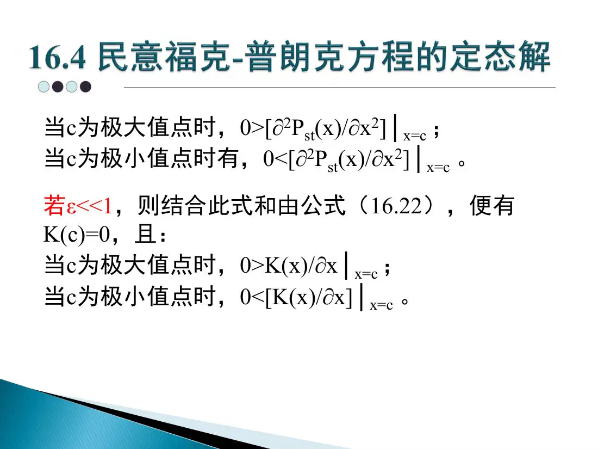

原文：

16.4民意福克-普朗克方程的定态解

当c为极大值点时， $0 { > } [ \hat { \mathcal { O } } ^ { 2 } \mathrm { P } _ { \mathrm { s t } } ( \mathrm { x } ) / \hat { \mathcal { O } } \mathrm { x } ^ { 2 } ] \mid _ { \mathrm { x } = \mathrm { c } }$

当c为极小值点时有， $0 { < } [ \hat { \sigma } ^ { 2 } \mathrm { P } _ { \mathrm { s t } } ( \mathrm { x } ) / \hat { \sigma } \mathrm { x } ^ { 2 } ] \mid _ { \mathrm { x } = \mathrm { c } }$ o

若 $\varepsilon { < } { < } 1$ ，则结合此式和由公式（16.22），便有$\mathrm { K } ( \mathrm { c } ) { = } 0$ ，且：

当c为极大值点时， $0 { > } \mathrm { K } ( \mathrm { x } ) / \hat { \sigma } \mathrm { x } | _ { \mathrm { x } = \mathrm { c } }$

当c为极小值点时， $0 { < } [ \mathrm { K } ( \mathbf { x } ) / \hat { \sigma } \mathrm { x } ] \mid _ { \mathbf { x } = \mathbf { c } }$ o

### 16.4民意福克-普朗克方程的定态解

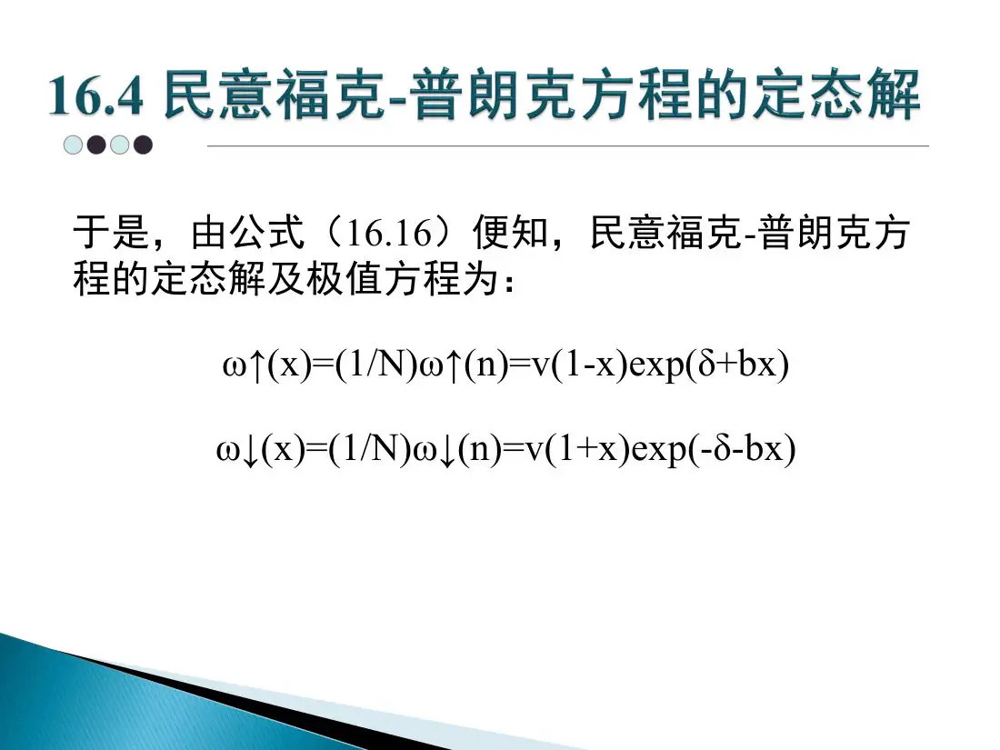

原文：

16.4民意福克-普朗克方程的定态解

于是，由公式（16.16）便知，民意福克-普朗克方程的定态解及极值方程为：

$$
\omega \uparrow (\mathrm{x}) = (1 / \mathrm{N}) \omega \uparrow (\mathrm{n}) = \mathrm{v} (1 - \mathrm{x}) \exp (\delta + \mathrm{bx})
$$

$$
\omega \downarrow (\mathrm{x}) = (1 / \mathrm{N}) \omega \downarrow (\mathrm{n}) = \mathrm{v} (1 + \mathrm{x}) \exp (- \delta - \mathrm{bx})
$$

### 16.4 民意福克-普朗克方程的定态解

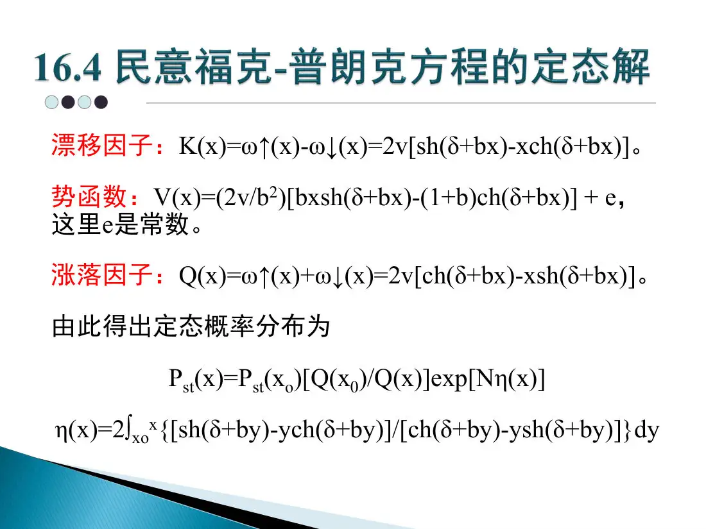

原文：

16.4 民意福克-普朗克方程的定态解

漂移因子： $\mathrm { K ( x ) { = } \omega \uparrow ( x ) { \mathrm { - } } \omega \downarrow ( x ) { = } 2 v [ s h ( \delta +  { \mathbf { b } } x ) { \mathrm { - } } x c h ( \delta +  { \mathbf { b } } x ) ] }$

势函数： $\mathrm { V ( x ) { = } ( 2 v / b ^ { 2 } ) [ b x s h ( \delta \delta \delta \mathrm { + } b x ) - ( 1 \mathrm { + } b ) c h ( \delta \delta \delta \mathrm { + } b x ) ] + e , }$ 这里e是常数。

涨落因子： $\mathrm { Q ( x ) { = } \infty \uparrow ( x ) { + } \infty \downarrow ( x ) { = } 2 v [ c h ( \delta { + } \mathrm { b x } ) { - } \mathrm { x s h ( \delta { + } \mathrm { b x } ) } ] }$ 0

由此得出定态概率分布为

Pst(x)=Pst(xo)[Q(x0)/Q(x)]exp[Nη(x)] η(x)=2∫xox{[sh(δ+by)-ych(δ+by)]/[ch(δ+by)-ysh(δ+by)]}dy

### 16.4 民意福克-普朗克方程的定态解

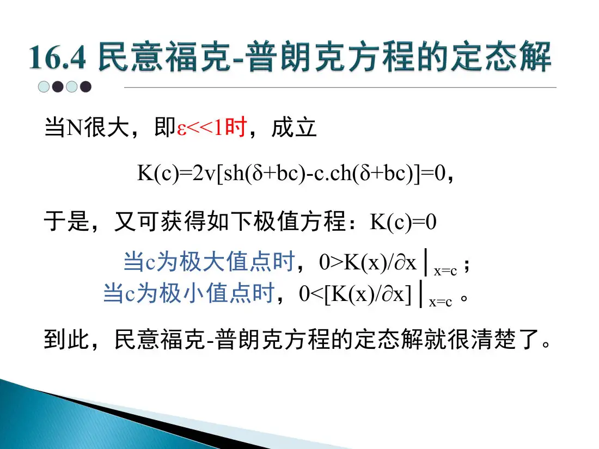

原文：

16.4 民意福克-普朗克方程的定态解

当N很大，即 $\varepsilon { < } { < } 1$ 时，成立

$$
\mathrm{K} (\mathrm{c}) = 2 \mathrm{v} [ \mathrm{sh} (\delta + \mathrm{bc}) - \mathrm{c.ch} (\delta + \mathrm{bc}) ] = 0,
$$

于是，又可获得如下极值方程： $\mathrm { K } ( \mathrm { c } ) { = } 0$

当c为极大值点时， $0 { > } \mathrm { K } ( \mathrm { x } ) / \hat { \sigma } \mathrm { x } | _ { \mathrm { x } = \mathrm { c } }$ 当c为极小值点时， $0 { < } [ \mathrm { K } ( \mathrm { x } ) / \hat { \varpi } \mathrm { x } ] \mid _ { \mathrm { x } = \mathrm { c } }$ 。到此，民意福克-普朗克方程的定态解就很清楚了。

### 16.5 几点说明

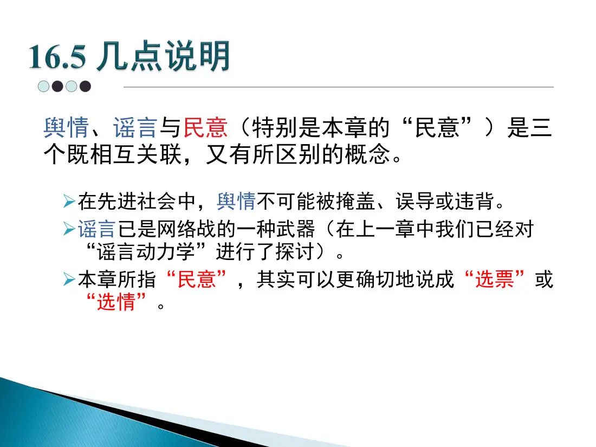

原文：

16.5 几点说明

舆情、谣言与民意（特别是本章的“民意”）是三个既相互关联，又有所区别的概念。

➢在先进社会中，舆情不可能被掩盖、误导或违背。

➢谣言已是网络战的一种武器（在上一章中我们已经对“谣言动力学”进行了探讨）。

➢本章所指“民意”，其实可以更确切地说成“选票”或“选情”。

### 16.5 几点说明

原文：

16.5 几点说明

➢ 无论你是否愿意承认，网络手段已能在紧要关头影响选举结果了，因此，当事各方必须认真考虑两个问题：

1）如何影响对手的选举结果；

2）如何防止自己的选举结果，被对手恶意影响。

### 16.5 几点说明

原文：

16.5 几点说明

先探讨第一个问题：

首先，由于概率P(n,t)是t时刻，意见相左人数为n的概率，所以， $\scriptstyle \mathbf { n } = 0$ （即“同意”与“反对”的人数相等）是最佳攻击点，特别是：如果 $\mathrm { P ( 0 , t ) }$ 刚好达到了概率的极大值点时，而且t也刚好是投票时间点，那么，只要成功影响哪怕一票，整个攻击可能就算成功了！如果P(0,t)是概率的极小值点（特别是如果P(0,t)=0）时，那么，此时选情已经“一边倒”，外力就很难影响选举结果了，除非此时t离最后的投票时间还很遥远，因此，攻击者还有机会翻盘。如果对某个远离0的正或负数E，使得概率P(E,t)很大，那么，选举结果基本确定，外力只能望洋兴叹了，哪怕此时远离最后的投票时间点。

### 16.5 几点说明

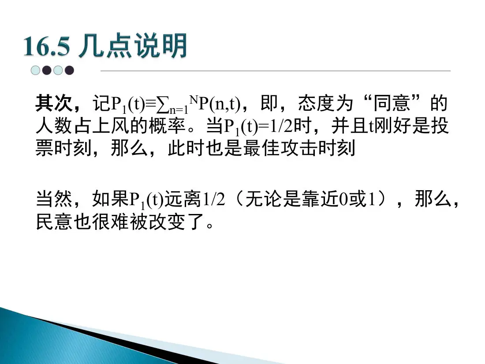

原文：

16.5 几点说明

其次，记 $\begin{array} { r } { \mathrm { P } _ { 1 } ( \mathrm { t } ) { \equiv } { \sum } _ { \mathrm { n } = 1 } \mathrm { N P } ( \mathrm { n } , \mathrm { t } ) } \end{array}$ ，即，态度为“同意”的人数占上风的概率。当 $\mathrm { P _ { 1 } } ( \mathrm { t } ) { = } 1 / 2$ 时，并且t刚好是投票时刻，那么，此时也是最佳攻击时刻

当然，如果 $\mathrm { P _ { 1 } ( t ) }$ 远离1/2（无论是靠近0或1），那么，民意也很难被改变了。

### 16.5 几点说明

原文：

16.5 几点说明

最后，根据已知条件：在投票时刻，P(n,t)的极值只可能出现三种情况（即，1个极值、2个极值、3个极值）。因此，应该特别关注极值的出现情况，比如：若只有一个极大值，而且该值还很大，而且还远离n=0，那攻击者基本上就无计可施了；如果有两个极大值和一个极小值，虽然极小值在n=0附近，但两个极大值分别位于n的正负两端还很靠近n=0，那么，此时攻击方还是有机可乘的；如果只有两个极值，那么它们必定分别出现在正负两端，如果刚好是一个极大值和一个极小值，那么，此时的选情就已经“一边倒”，就很难改变现状了。

### 16.5 几点说明

原文：

16.5 几点说明

➢关于第二个问题：怎样才能成功影响选举结果呢？

首先，根据偏好参数δ的定义，我们可知：当δ远离0（无论是正或负）时，选民的态度就已基本明确了，即，攻击者很难有所作为了。但是若δ=0或很靠近0，那么此时选民就基本上没有偏见，也是攻击者的最佳冲锋时机。因此，事先了解选民的偏好，以改变δ的正负走向为目标，是影响最终结果的有效途径之一。

### 16.5 几点说明

原文：

16.5 几点说明

其次，提前了解选民的顺从参数b，又是攻击者的另一个“可备战”的捷径（提醒：可备战性其实非常重要，它有助于攻击者（或防御者）提前做好准备，以便在网络战中处于主动地位。

### 16.5 几点说明

原文：

16.5 几点说明

最后，灵活参数v是第三条“可备战”的有效攻击捷径，因为它决定着民意反转（或颠倒）的频率。即，v越大，变数就越多。为了把握并利用好该参数，必须根据不同的人，在不同的时间段，有计划地发动攻击。

### 本章结束，谢谢

原文：

本章结束，谢谢
