# 《安全通论》第17章 跋（课件）

原件的每一页，下面附识别出的文字。

### 第17章---跋

原文：

第17章---跋

### 第17章跋

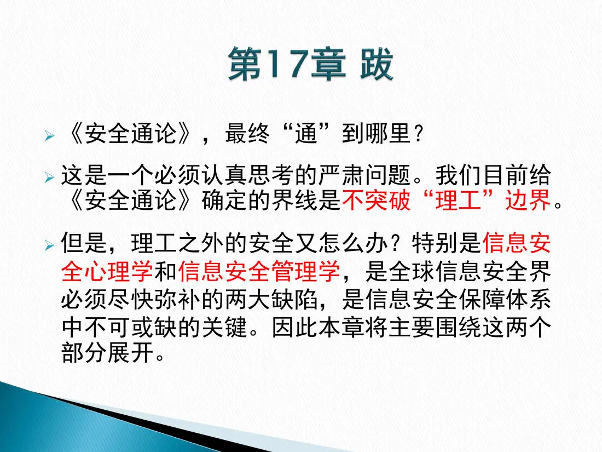

原文：

第17章跋

➢ 《安全通论》，最终“通”到哪里？

这是一个必须认真思考的严肃问题。我们目前给《安全通论》确定的界线是不突破“理工”边界。

但是，理工之外的安全又怎么办？特别是信息安全心理学和信息安全管理学，是全球信息安全界必须尽快弥补的两大缺陷，是信息安全保障体系中不可或缺的关键。因此本章将主要围绕这两个部分展开。

### 第17章跋

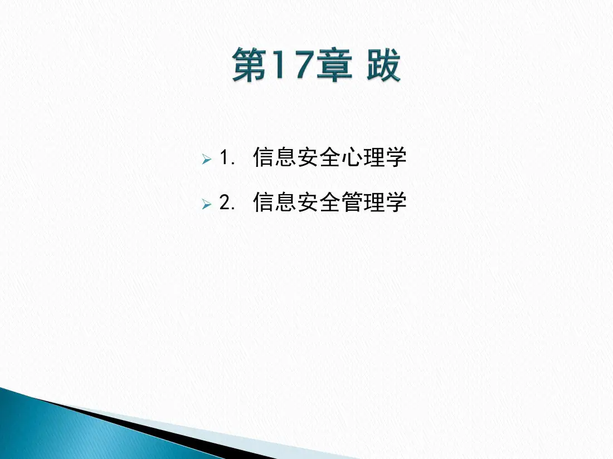

原文：

第17章跋

➢ 1. 信息安全心理学

➢ 2. 信息安全管理学

### 17.1 信息安全心理学

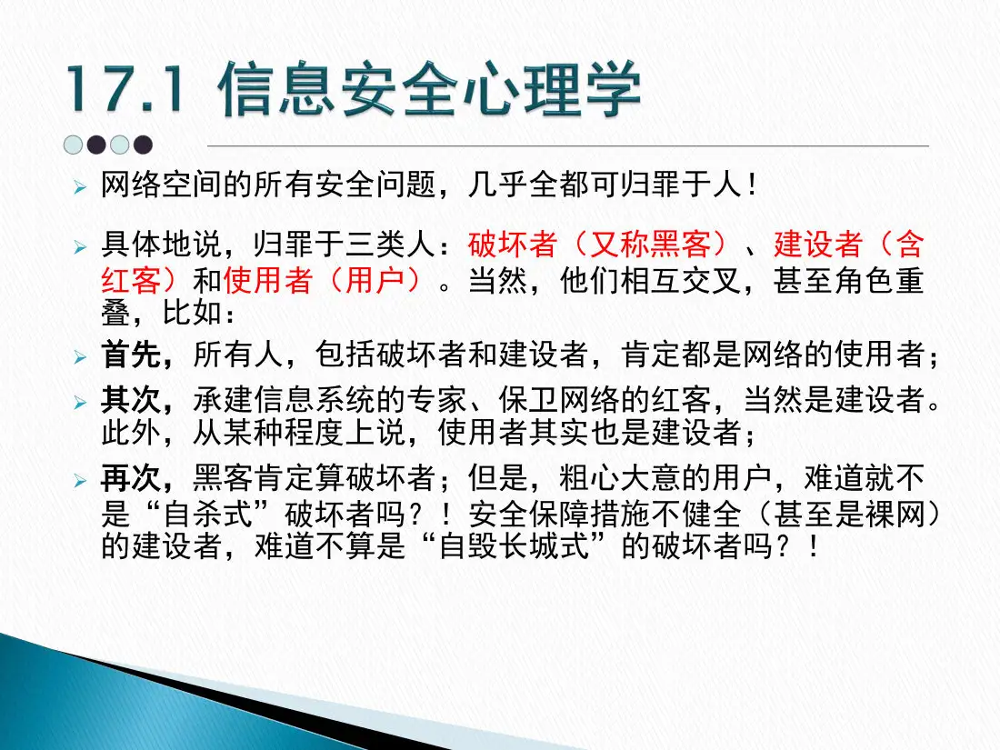

原文：

17.1 信息安全心理学

➢ 网络空间的所有安全问题，几乎全都可归罪于人！

具体地说，归罪于三类人：破坏者（又称黑客）、建设者（含红客）和使用者（用户）。当然，他们相互交叉，甚至角色重叠，比如：

首先，所有人，包括破坏者和建设者，肯定都是网络的使用者；

其次，承建信息系统的专家、保卫网络的红客，当然是建设者。此外，从某种程度上说，使用者其实也是建设者；

➢ 再次，黑客肯定算破坏者；但是，粗心大意的用户，难道就不是“自杀式”破坏者吗？！安全保障措施不健全（甚至是裸网）的建设者，难道不算是“自毁长城式”的破坏者吗？！

### 17.1 信息安全心理学

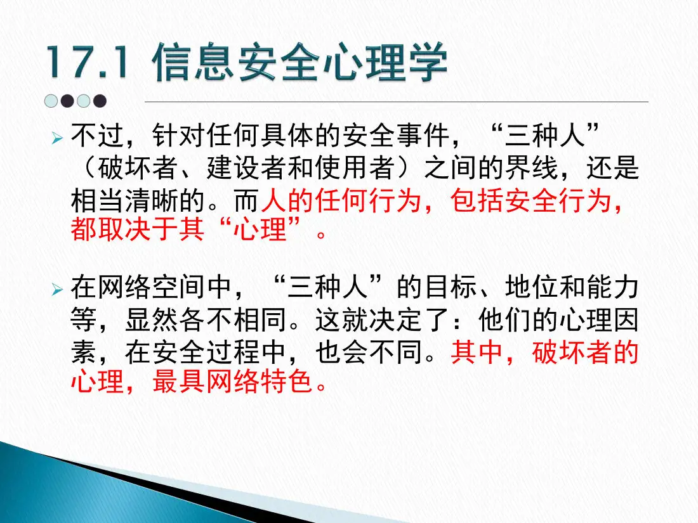

原文：

17.1 信息安全心理学

不过，针对任何具体的安全事件，“三种人”（破坏者、建设者和使用者）之间的界线，还是相当清晰的。而人的任何行为，包括安全行为，都取决于其“心理”。

在网络空间中，“三种人”的目标、地位和能力等，显然各不相同。这就决定了：他们的心理因素，在安全过程中，也会不同。其中，破坏者的心理，最具网络特色。

### 17.1 信息安全心理学

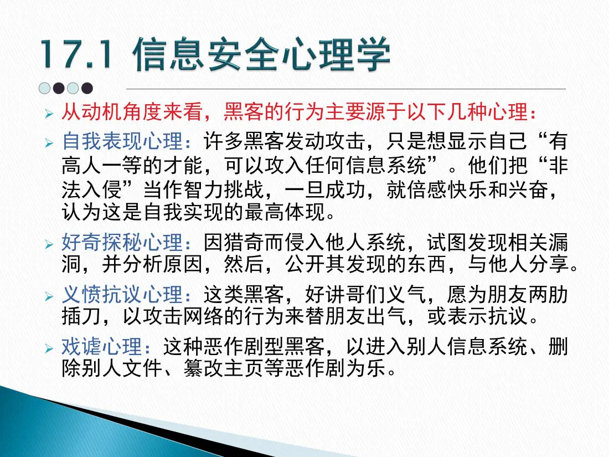

原文：

17.1 信息安全心理学

➢ 从动机角度来看，黑客的行为主要源于以下几种心理：

➢ 自我表现心理：许多黑客发动攻击，只是想显示自己“有高人一等的才能，可以攻入任何信息系统”。他们把“非法入侵”当作智力挑战，一旦成功，就倍感快乐和兴奋，认为这是自我实现的最高体现。

➢ 好奇探秘心理：因猎奇而侵入他人系统，试图发现相关漏洞，并分析原因，然后，公开其发现的东西，与他人分享。

义愤抗议心理：这类黑客，好讲哥们义气，愿为朋友两肋插刀，以攻击网络的行为来替朋友出气，或表示抗议。

戏谑心理：这种恶作剧型黑客，以进入别人信息系统、删除别人文件、纂改主页等恶作剧为乐。

### 17.1 信息安全心理学

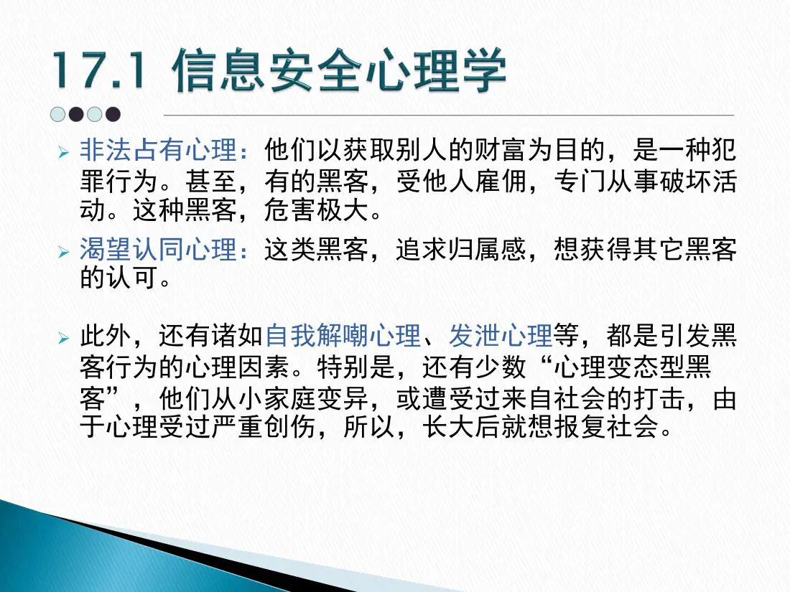

原文：

17.1 信息安全心理学

➢ 非法占有心理：他们以获取别人的财富为目的，是一种犯罪行为。甚至，有的黑客，受他人雇佣，专门从事破坏活动。这种黑客，危害极大。

➢ 渴望认同心理：这类黑客，追求归属感，想获得其它黑客的认可。

此外，还有诸如自我解嘲心理、发泄心理等，都是引发黑客行为的心理因素。特别是，还有少数“心理变态型黑客”，他们从小家庭变异，或遭受过来自社会的打击，由于心理受过严重创伤，所以，长大后就想报复社会。

### 17.1信息安全心理学

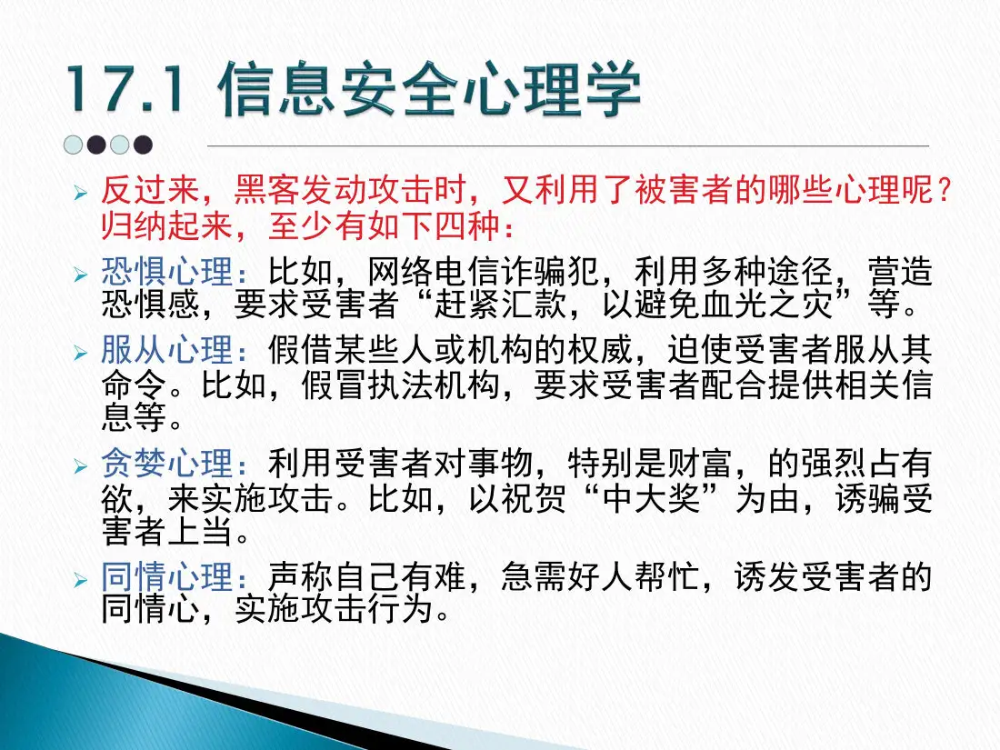

原文：

17.1信息安全心理学

反过来，黑客发动攻击时，又利用了被害者的哪些心理呢？归纳起来，至少有如下四种：

➢ 恐惧心理：比如，网络电信诈骗犯，利用多种途径，营造恐惧感，要求受害者“赶紧汇款，以避免血光之灾”等。

➢ 服从心理：假借某些人或机构的权威，迫使受害者服从其命令。比如，假冒执法机构，要求受害者配合提供相关信息等。

贪婪心理：利用受害者对事物，特别是财富，的强烈占有欲，来实施攻击。比如，以祝贺“中大奖”为由，诱骗受害者上当。

同情心理：声称自己有难，急需好人帮忙，诱发受害者的同情心，实施攻击行为。

### 17.1 信息安全心理学

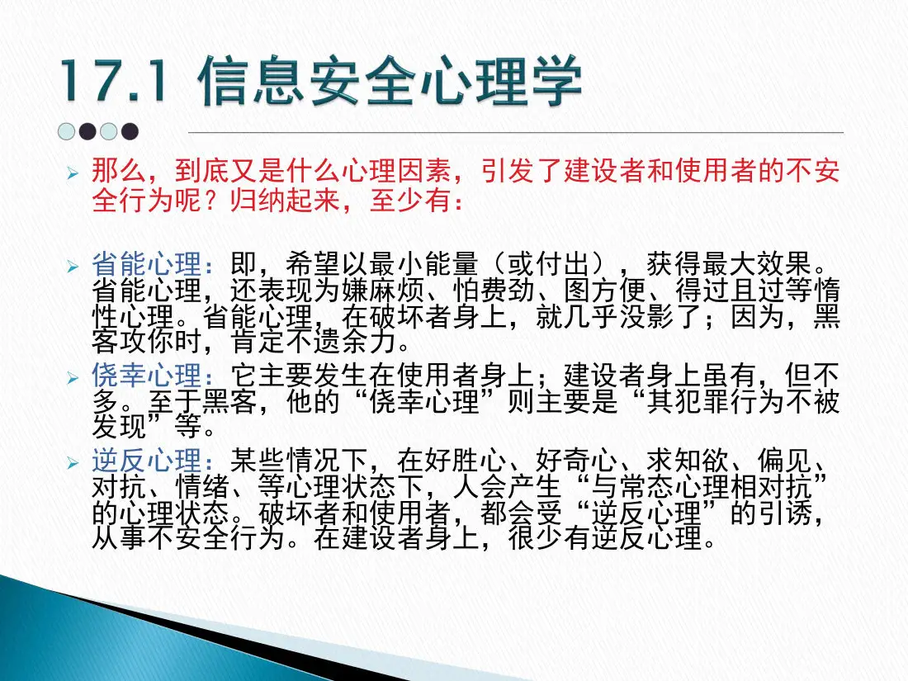

原文：

17.1 信息安全心理学

那么，到底又是什么心理因素，引发了建设者和使用者的不安全行为呢？归纳起来，至少有：

➢ 省能心理：即，希望以最小能量（或付出），获得最大效果。省能心理，还表现为嫌麻烦、怕费劲、图方便、得过且过等惰性心理。省能心理，在破坏者身上，就几乎没影了；因为，黑客攻你时，肯定不遗余力。

➢ 侥幸心理：它主要发生在使用者身上；建设者身上虽有，但不多。至于黑客，他的“侥幸心理”则主要是“其犯罪行为不被发现”等。

逆反心理：某些情况下，在好胜心、好奇心、求知欲、偏见、对抗、情绪、等心理状态下，人会产生“与常态心理相对抗”的心理状态。破坏者和使用者，都会 的引诱，从事不安全行为。在建设者身上，很少有逆反心理。

### 17.1 信息安全心理学

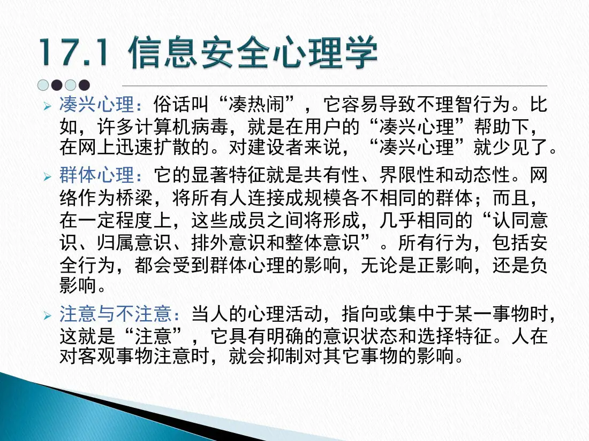

原文：

17.1 信息安全心理学

➢ 凑兴心理：俗话叫“凑热闹”，它容易导致不理智行为。比如，许多计算机病毒，就是在用户的“凑兴心理”帮助下，在网上迅速扩散的。对建设者来说，“凑兴心理”就少见了。

➢ 群体心理：它的显著特征就是共有性、界限性和动态性。网络作为桥梁，将所有人连接成规模各不相同的群体；而且，在一定程度上，这些成员之间将形成，几乎相同的“认同意识、归属意识、排外意识和整体意识”。所有行为，包括安全行为，都会受到群体心理的影响，无论是正影响，还是负影响。

➢ 注意与不注意：当人的心理活动，指向或集中于某一事物时，这就是“注意”，它具有明确的意识状态和选择特征。人在对客观事物注意时，就会抑制对其它事物的影响。

### 17.1信息安全心理学

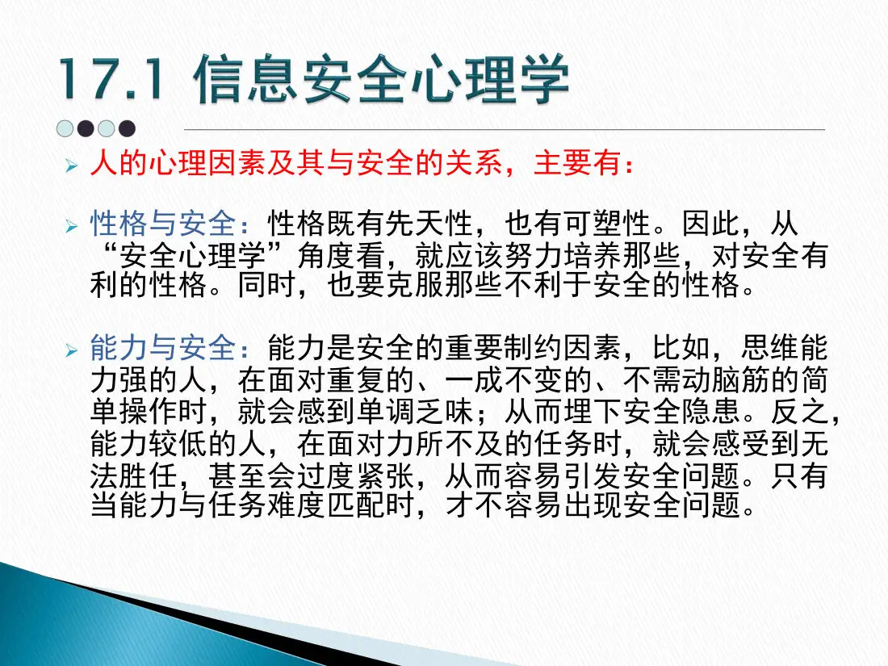

原文：

17.1信息安全心理学

➢ 人的心理因素及其与安全的关系，主要有：

性格与安全：性格既有先天性，也有可塑性。因此，从“安全心理学”角度看，就应该努力培养那些，对安全有利的性格。同时，也要克服那些不利于安全的性格。

能力与安全：能力是安全的重要制约因素，比如，思维能力强的人，在面对重复的、一成不变的、不需动脑筋的简单操作时，就会感到单调乏味；从而埋下安全隐患。反之能力较低的人，在面对力所不及的任务时，就会感受到无法胜任，甚至会过度紧张，从而容易引发安全问题。只有当能力与任务难度匹配时，才不容易出现安全问题。

### 17.1 信息安全心理学

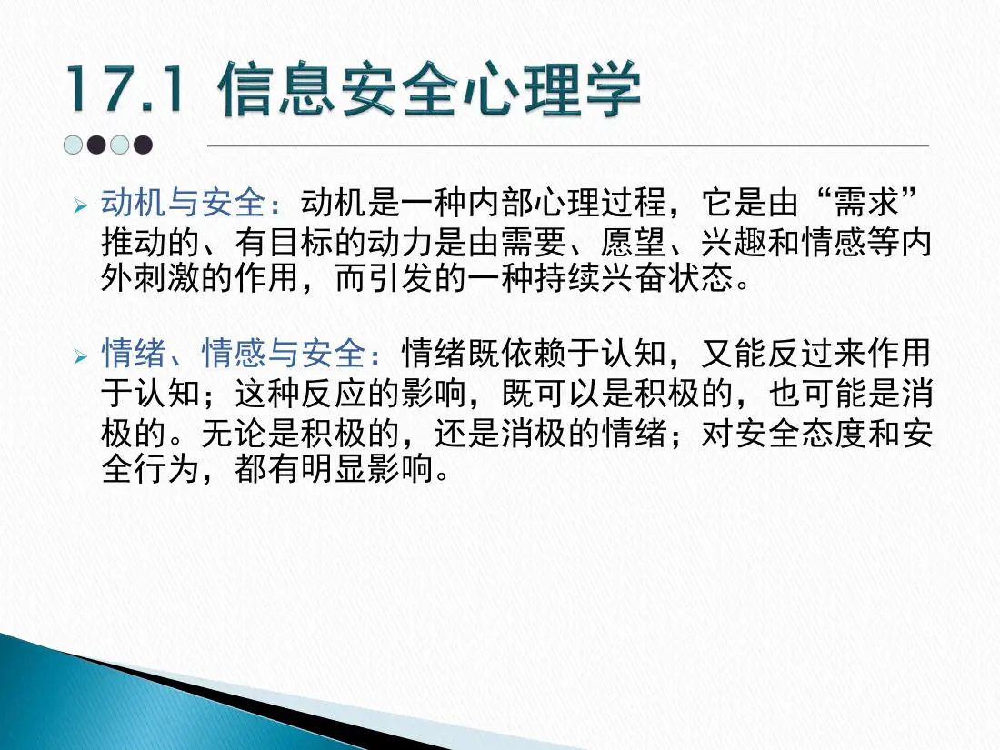

原文：

17.1 信息安全心理学

动机与安全：动机是一种内部心理过程，它是由“需求”推动的、有目标的动力是由需要、愿望、兴趣和情感等内外刺激的作用，而引发的一种持续兴奋状态。

➢ 情绪、情感与安全：情绪既依赖于认知，又能反过来作用于认知；这种反应的影响，既可以是积极的，也可能是消极的。无论是积极的，还是消极的情绪；对安全态度和安全行为，都有明显影响。

### 17.1 信息安全心理学

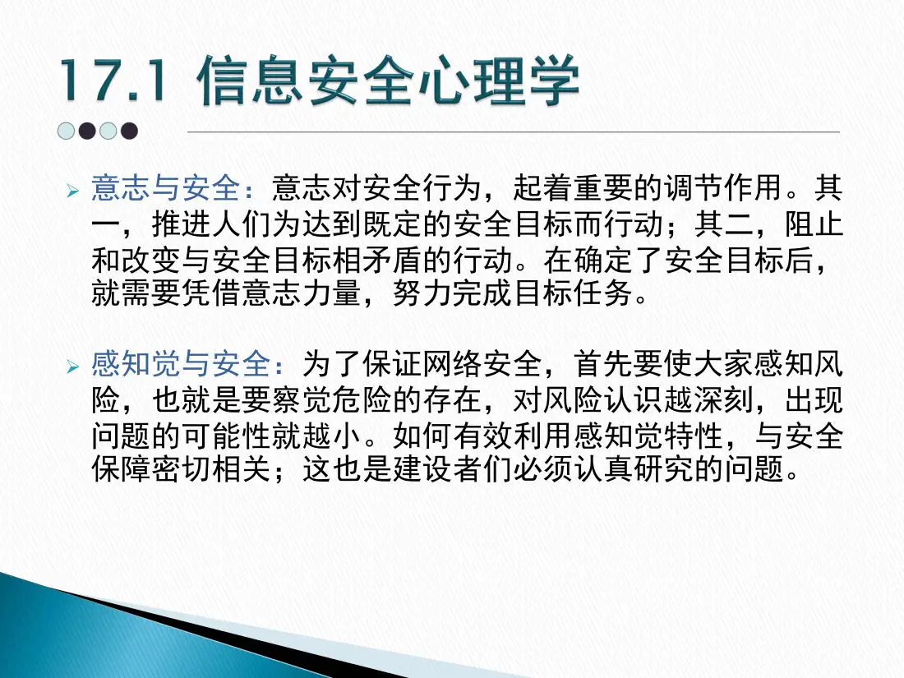

原文：

17.1 信息安全心理学

意志与安全：意志对安全行为，起着重要的调节作用。其一，推进人们为达到既定的安全目标而行动；其二，阻止和改变与安全目标相矛盾的行动。在确定了安全目标后，就需要凭借意志力量，努力完成目标任务。

感知觉与安全：为了保证网络安全，首先要使大家感知风险，也就是要察觉危险的存在，对风险认识越深刻，出现问题的可能性就越小。如何有效利用感知觉特性，与安全保障密切相关；这也是建设者们必须认真研究的问题。

### 17.1信息安全心理学

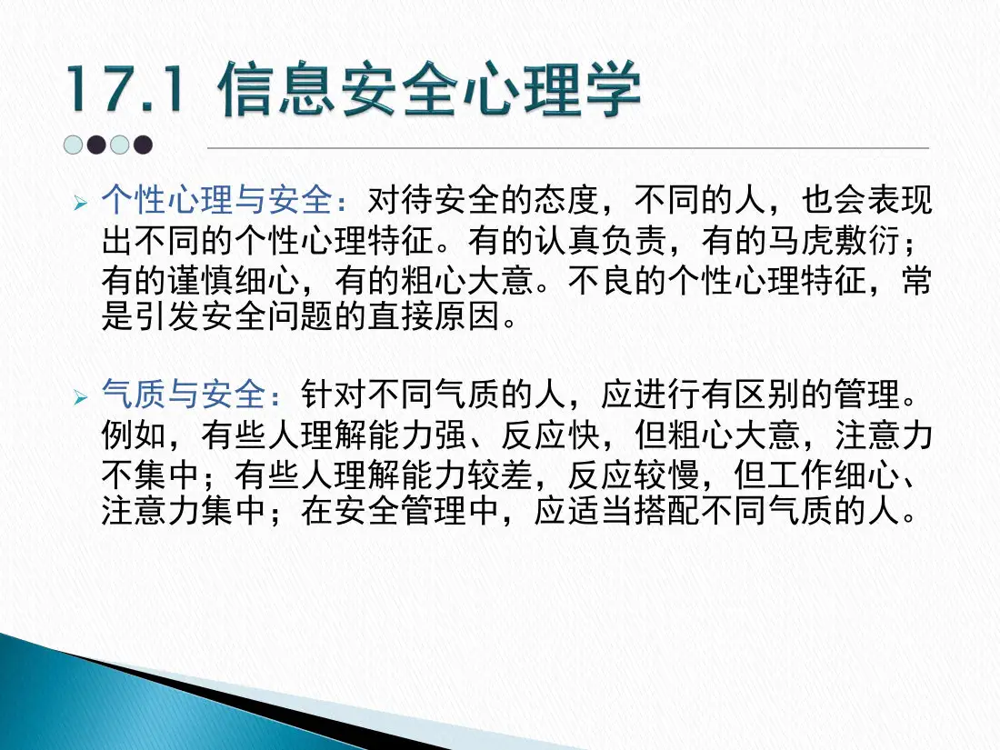

原文：

17.1信息安全心理学

➢ 个性心理与安全：对待安全的态度，不同的人，也会表现出不同的个性心理特征。有的认真负责，有的马虎敷衍；有的谨慎细心，有的粗心大意。不良的个性心理特征，常是引发安全问题的直接原因。

➢ 气质与安全：针对不同气质的人，应进行有区别的管理。例如，有些人理解能力强、反应快，但粗心大意，注意力不集中；有些人理解能力较差，反应较慢，但工作细心、注意力集中；在安全管理中，应适当搭配不同气质的人。

### 17.1信息安全心理学

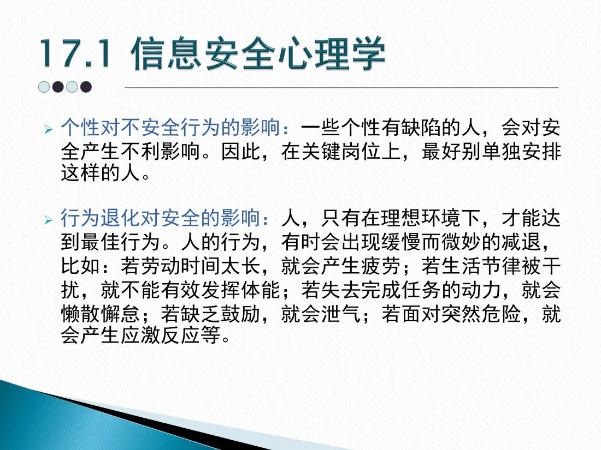

原文：

17.1信息安全心理学

个性对不安全行为的影响：一些个性有缺陷的人，会对安全产生不利影响。因此，在关键岗位上，最好别单独安排这样的人。

➢ 行为退化对安全的影响：人，只有在理想环境下，才能达到最佳行为。人的行为，有时会出现缓慢而微妙的减退，比如：若劳动时间太长，就会产生疲劳；若生活节律被干扰，就不能有效发挥体能；若失去完成任务的动力，就会懒散懈怠；若缺乏鼓励，就会泄气；若面对突然危险，就会产生应激反应等。

### 17.1 信息安全心理学

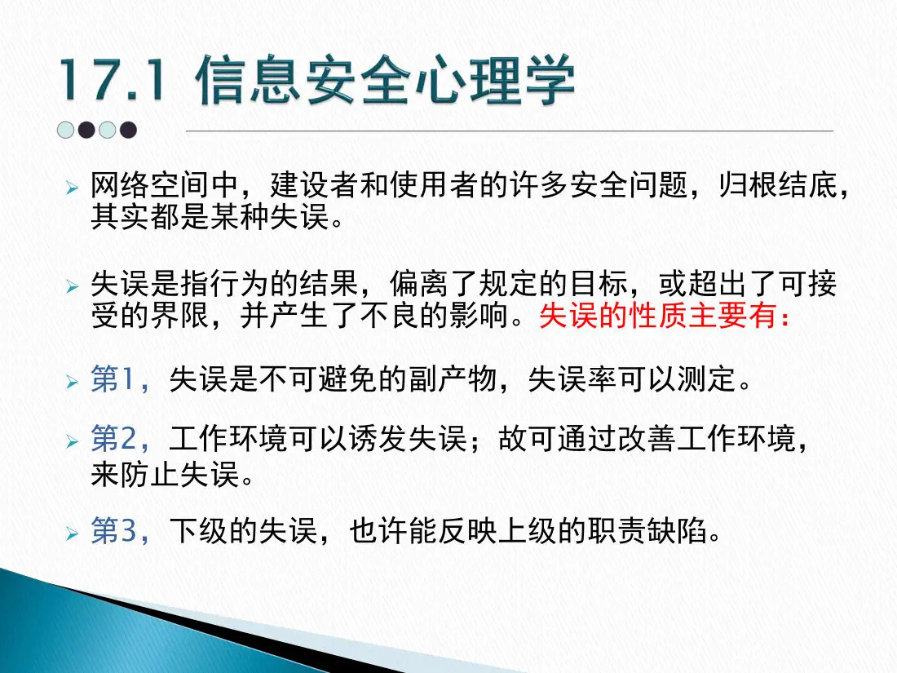

原文：

17.1 信息安全心理学

网络空间中，建设者和使用者的许多安全问题，归根结底，其实都是某种失误。

失误是指行为的结果，偏离了规定的目标，或超出了可接受的界限，并产生了不良的影响。失误的性质主要有：

➢ 第1，失误是不可避免的副产物，失误率可以测定。

➢ 第2，工作环境可以诱发失误；故可通过改善工作环境，来防止失误。

➢ 第3，下级的失误，也许能反映上级的职责缺陷。

### 17.1信息安全心理学

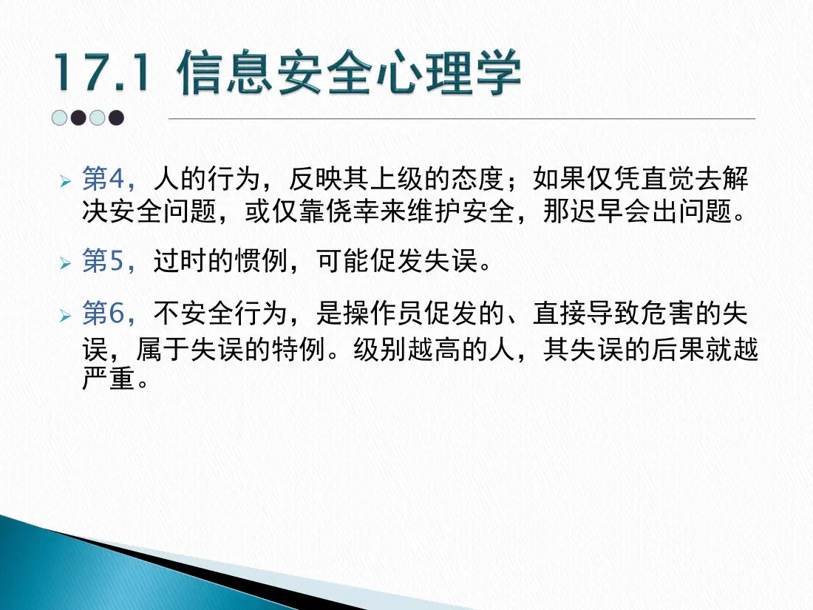

原文：

17.1信息安全心理学

第4，人的行为，反映其上级的态度；如果仅凭直觉去解决安全问题，或仅靠侥幸来维护安全，那迟早会出问题。

第5，过时的惯例，可能促发失误。

第6，不安全行为，是操作员促发的、直接导致危害的失误，属于失误的特例。级别越高的人，其失误的后果就越严重。

### 17.1 信息安全心理学

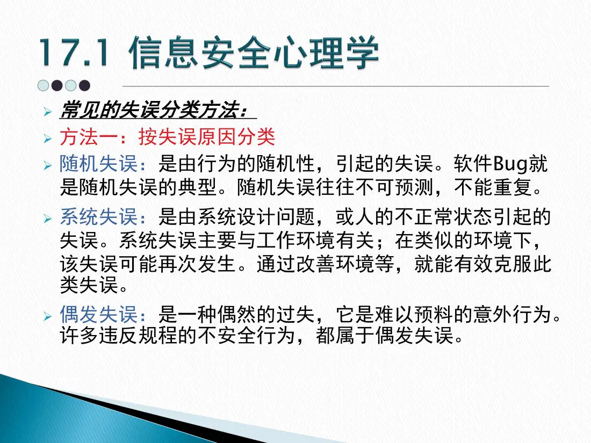

原文：

17.1 信息安全心理学

➢ 常见的失误分类方法：

方法一：按失误原因分类

➢ 随机失误：是由行为的随机性，引起的失误。软件Bug就是随机失误的典型。随机失误往往不可预测，不能重复。

系统失误：是由系统设计问题，或人的不正常状态引起的失误。系统失误主要与工作环境有关；在类似的环境下，该失误可能再次发生。通过改善环境等，就能有效克服此类失误。

偶发失误：是一种偶然的过失，它是难以预料的意外行为。许多违反规程的不安全行为，都属于偶发失误。

### 17.1信息安全心理学

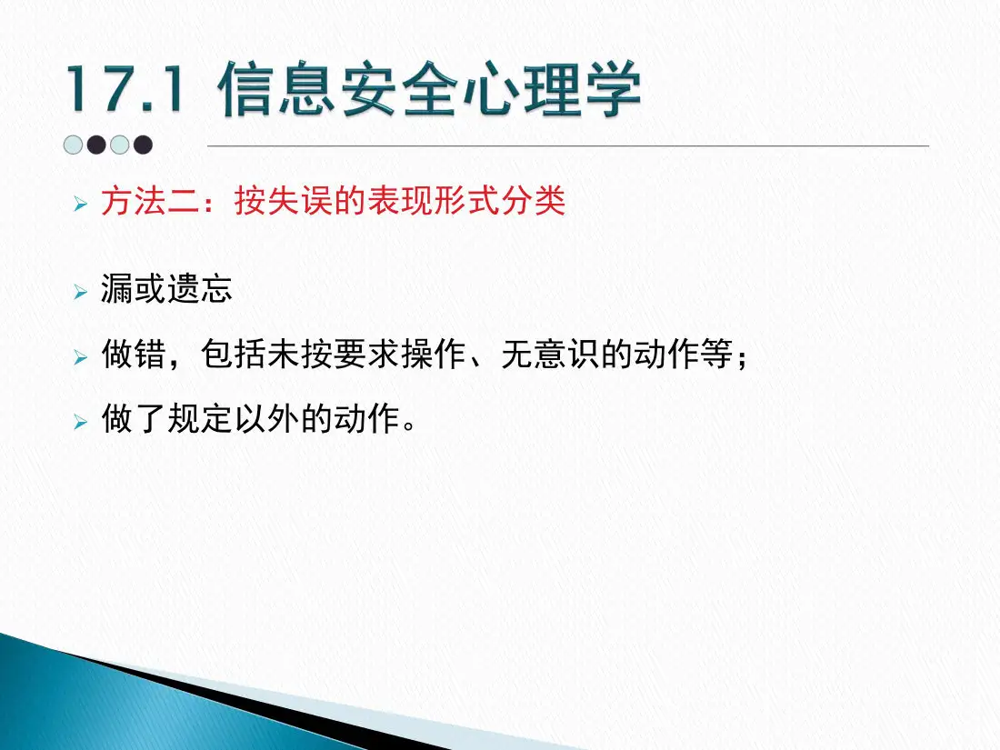

原文：

17.1信息安全心理学

➢ 方法二：按失误的表现形式分类

➢ 漏或遗忘

➢ 做错，包括未按要求操作、无意识的动作等；

做了规定以外的动作。

### 17.1 信息安全心理学

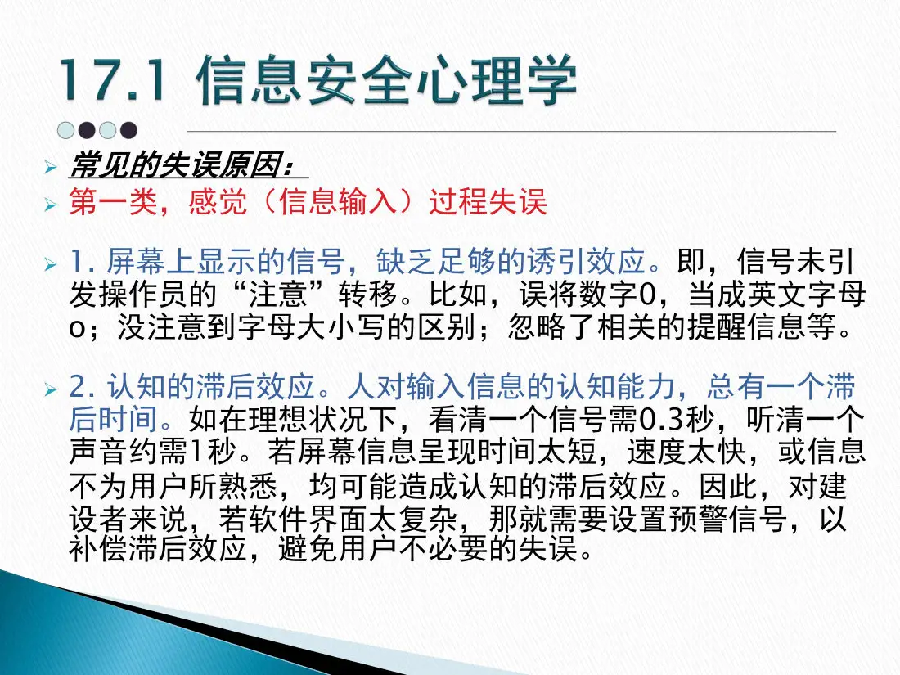

原文：

17.1 信息安全心理学

常见的失误原因：

➢ 第一类，感觉（信息输入）过程失误

1. 屏幕上显示的信号，缺乏足够的诱引效应。即，信号未引发操作员的“注意”转移。比如，误将数字0，当成英文字母o；没注意到字母大小写的区别；忽略了相关的提醒信息等。

2. 认知的滞后效应。人对输入信息的认知能力，总有一个滞后时间。如在理想状况下，看清一个信号需0.3秒，听清一个声音约需1秒。若屏幕信息呈现时间太短，速度太快，或信息不为用户所熟悉，均可能造成认知的滞后效应。因此，对建设者来说，若软件界面太复杂，那就需要设置预警信号，以补偿滞后效应，避免用户不必要的失误。

### 17.1 信息安全心理学

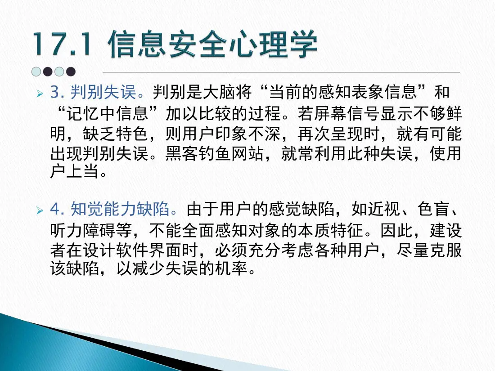

原文：

17.1 信息安全心理学

3. 判别失误。判别是大脑将“当前的感知表象信息”和“记忆中信息”加以比较的过程。若屏幕信号显示不够鲜明，缺乏特色，则用户印象不深，再次呈现时，就有可能出现判别失误。黑客钓鱼网站，就常利用此种失误，使用户上当。

4. 知觉能力缺陷。由于用户的感觉缺陷，如近视、色盲、听力障碍等，不能全面感知对象的本质特征。因此，建设者在设计软件界面时，必须充分考虑各种用户，尽量克服该缺陷，以减少失误的机率。

### 17.1信息安全心理学

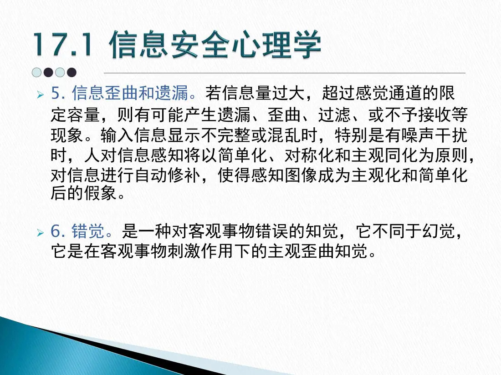

原文：

17.1信息安全心理学

5. 信息歪曲和遗漏。若信息量过大，超过感觉通道的限定容量，则有可能产生遗漏、歪曲、过滤、或不予接收等现象。输入信息显示不完整或混乱时，特别是有噪声干扰时，人对信息感知将以简单化、对称化和主观同化为原则，对信息进行自动修补，使得感知图像成为主观化和简单化后的假象。

6. 错觉。是一种对客观事物错误的知觉，它不同于幻觉，它是在客观事物刺激作用下的主观歪曲知觉。

### 17.1信息安全心理学

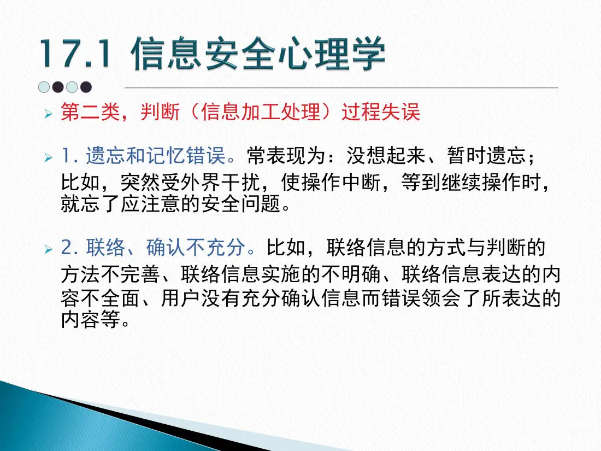

原文：

17.1信息安全心理学

➢ 第二类，判断（信息加工处理）过程失误

1. 遗忘和记忆错误。常表现为：没想起来、暂时遗忘；比如，突然受外界干扰，使操作中断，等到继续操作时，就忘了应注意的安全问题。

2. 联络、确认不充分。比如，联络信息的方式与判断的方法不完善、联络信息实施的不明确、联络信息表达的内容不全面、用户没有充分确认信息而错误领会了所表达的内容等。

### 17.1信息安全心理学

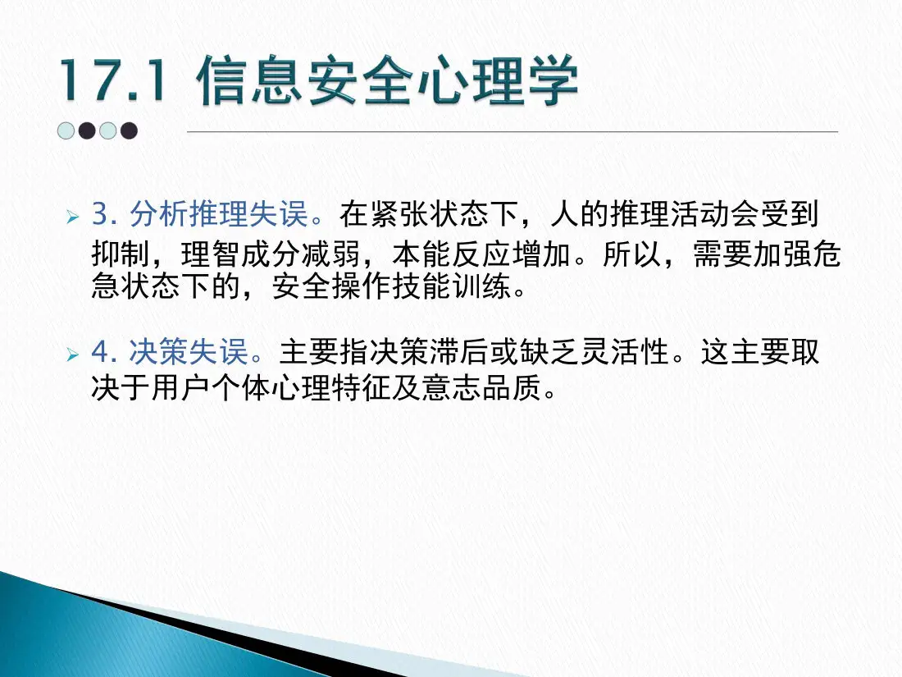

原文：

17.1信息安全心理学

➢ 3. 分析推理失误。在紧张状态下，人的推理活动会受到抑制，理智成分减弱，本能反应增加。所以，需要加强危急状态下的，安全操作技能训练。

4. 决策失误。主要指决策滞后或缺乏灵活性。这主要取决于用户个体心理特征及意志品质。

### 17.1 信息安全心理学

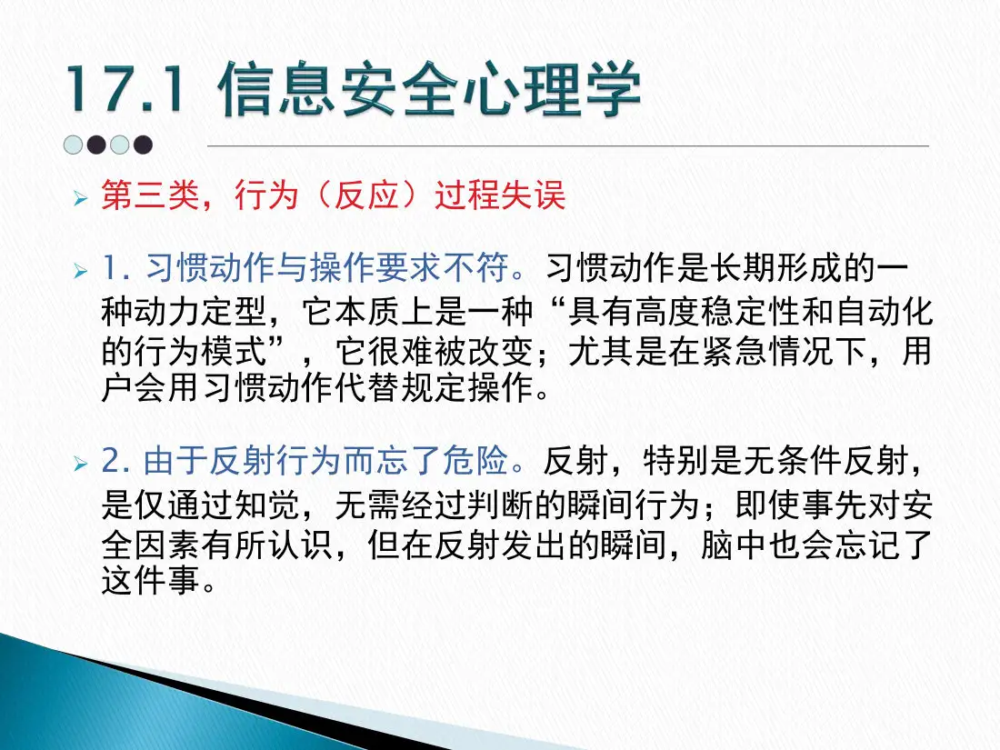

原文：

17.1 信息安全心理学

第三类，行为（反应）过程失误

➢ 1. 习惯动作与操作要求不符。习惯动作是长期形成的一种动力定型，它本质上是一种“具有高度稳定性和自动化的行为模式”，它很难被改变；尤其是在紧急情况下，用户会用习惯动作代替规定操作。

➢ 2. 由于反射行为而忘了危险。反射，特别是无条件反射，是仅通过知觉，无需经过判断的瞬间行为；即使事先对安全因素有所认识，但在反射发出的瞬间，脑中也会忘记了这件事。

### 17.1信息安全心理学

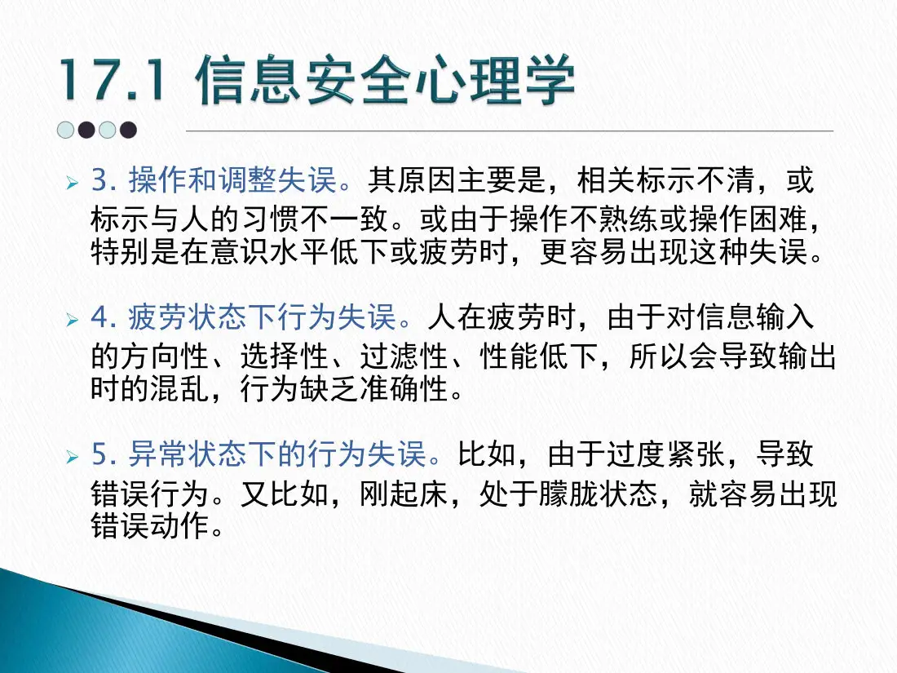

原文：

17.1信息安全心理学

➢ 3. 操作和调整失误。其原因主要是，相关标示不清，或标示与人的习惯不一致。或由于操作不熟练或操作困难，特别是在意识水平低下或疲劳时，更容易出现这种失误。

4. 疲劳状态下行为失误。人在疲劳时，由于对信息输入的方向性、选择性、过滤性、性能低下，所以会导致输出时的混乱，行为缺乏准确性。

5. 异常状态下的行为失误。比如，由于过度紧张，导致错误行为。又比如，刚起床，处于朦胧状态，就容易出现错误动作。

### 17.2 信息安全管理学

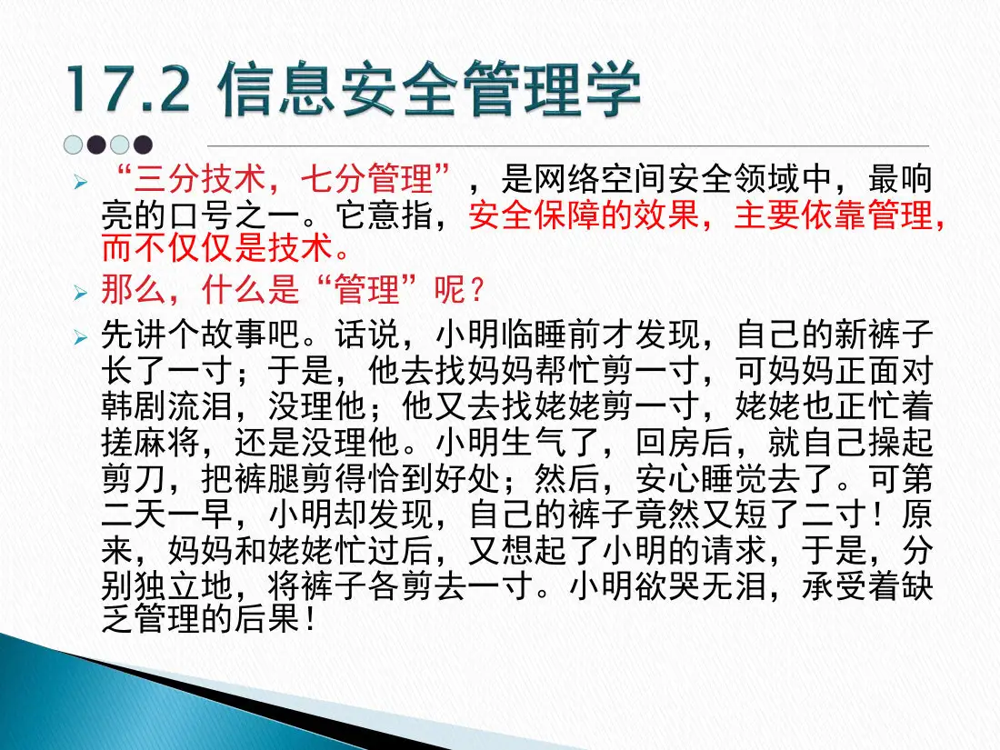

原文：

17.2 信息安全管理学

“三分技术，七分管理”，是网络空间安全领域中，最响亮的口号之一。它意指，安全保障的效果，主要依靠管理，而不仅仅是技术。

那么，什么是“管理”呢？

➢ 先讲个故事吧。话说，小明临睡前才发现，自己的新裤子长了一寸；于是，他去找妈妈帮忙剪一寸，可妈妈正面对韩剧流泪，没理他；他又去找姥姥剪一寸，姥姥也正忙着搓麻将，还是没理他。小明生气了，回房后，就自己操起剪刀，把裤腿剪得恰到好处；然后，安心睡觉去了。可第二天一早，小明却发现，自己的裤子竟然又短了二寸！原来，妈妈和姥姥忙过后，又想起了小明的请求，于是，分别独立地，将裤子各剪去一寸。小明欲哭无泪，承受着缺乏管理的后果！

### 17.2信息安全管理学

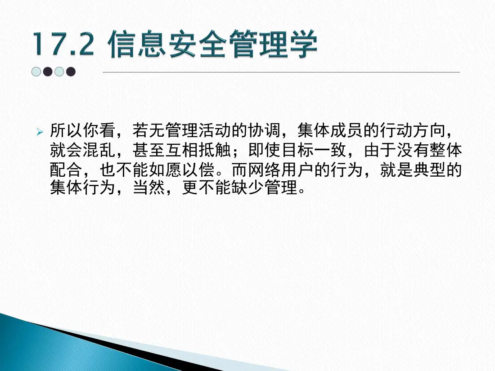

原文：

17.2信息安全管理学

所以你看，若无管理活动的协调，集体成员的行动方向，就会混乱，甚至互相抵触；即使目标一致，由于没有整体配合，也不能如愿以偿。而网络用户的行为，就是典型的集体行为，当然，更不能缺少管理。

### 17.2信息安全管理学

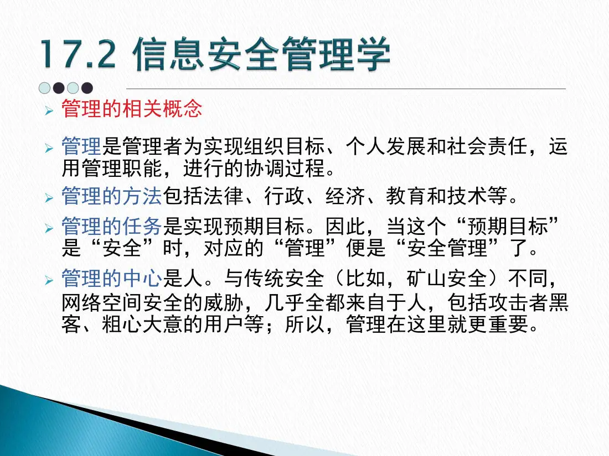

原文：

17.2信息安全管理学

管理的相关概念

管理是管理者为实现组织目标、个人发展和社会责任，运用管理职能，进行的协调过程。

➢ 管理的方法包括法律、行政、经济、教育和技术等。

➢ 管理的任务是实现预期目标。因此，当这个“预期目标”是“安全”时，对应的“管理”便是“安全管理”了。

管理的中心是人。与传统安全（比如，矿山安全）不同，网络空间安全的威胁，几乎全都来自于人，包括攻击者黑客、粗心大意的用户等；所以，管理在这里就更重要。

### 17.2 信息安全管理学

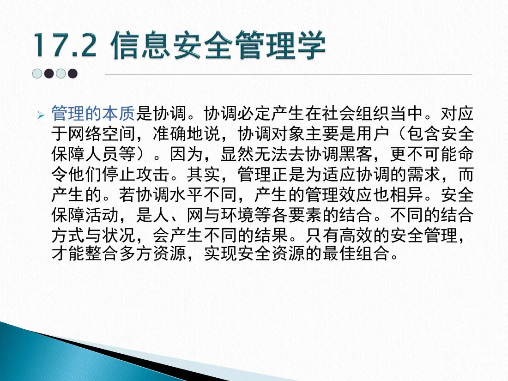

原文：

17.2 信息安全管理学

管理的本质是协调。协调必定产生在社会组织当中。对应于网络空间，准确地说，协调对象主要是用户（包含安全保障人员等）。因为，显然无法去协调黑客，更不可能命令他们停止攻击。其实，管理正是为适应协调的需求，而产生的。若协调水平不同，产生的管理效应也相异。安全保障活动，是人、网与环境等各要素的结合。不同的结合方式与状况，会产生不同的结果。只有高效的安全管理，才能整合多方资源，实现安全资源的最佳组合。

### 17.2信息安全管理学

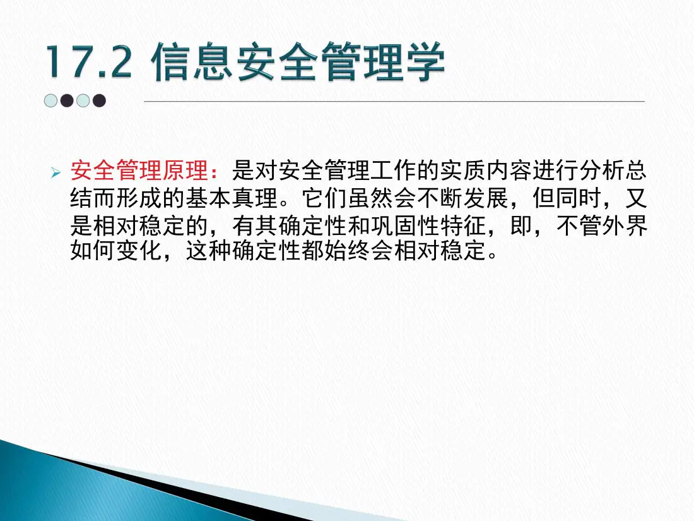

原文：

17.2信息安全管理学

安全管理原理：是对安全管理工作的实质内容进行分析总结而形成的基本真理。它们虽然会不断发展，但同时，又是相对稳定的，有其确定性和巩固性特征，即，不管外界如何变化，这种确定性都始终会相对稳定。

### 17.2 信息安全管理学

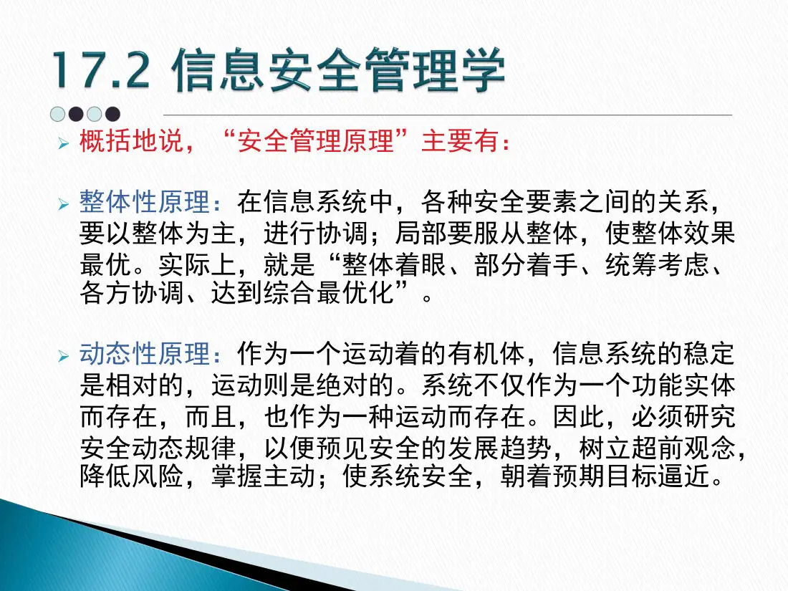

原文：

17.2 信息安全管理学

➢ 概括地说，“安全管理原理”主要有：

➢ 整体性原理：在信息系统中，各种安全要素之间的关系，要以整体为主，进行协调；局部要服从整体，使整体效果最优。实际上，就是“整体着眼、部分着手、统筹考虑、各方协调、达到综合最优化”。

动态性原理：作为一个运动着的有机体，信息系统的稳定是相对的，运动则是绝对的。系统不仅作为一个功能实体而存在，而且，也作为一种运动而存在。因此，必须研究安全动态规律，以便预见安全的发展趋势，树立超前观念，降低风险，掌握主动；使系统安全，朝着预期目标逼近。

### 17.2信息安全管理学

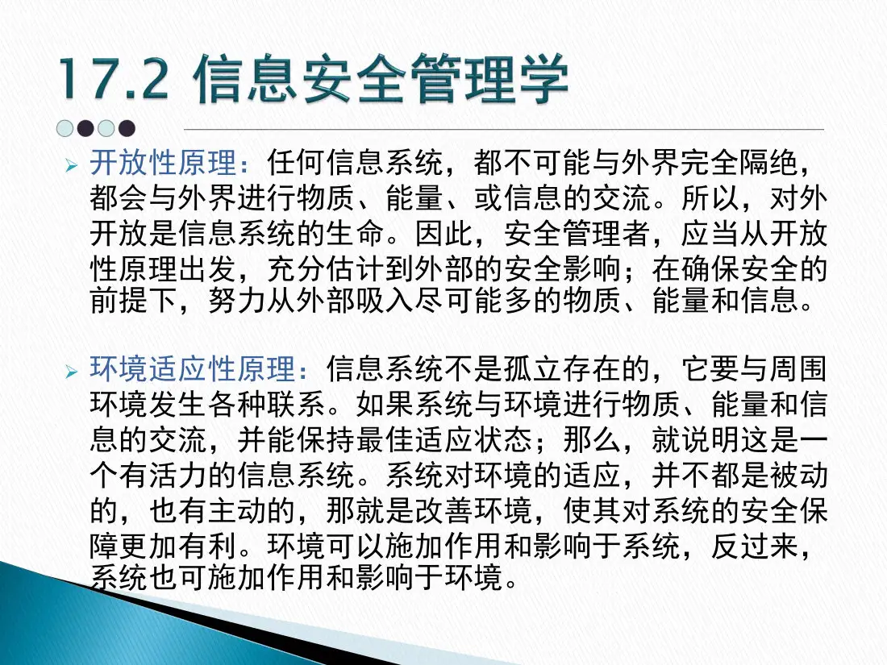

原文：

17.2信息安全管理学

开放性原理：任何信息系统，都不可能与外界完全隔绝，都会与外界进行物质、能量、或信息的交流。所以，对外开放是信息系统的生命。因此，安全管理者，应当从开放性原理出发，充分估计到外部的安全影响；在确保安全的前提下，努力从外部吸入尽可能多的物质、能量和信息。

环境适应性原理：信息系统不是孤立存在的，它要与周围环境发生各种联系。如果系统与环境进行物质、能量和信息的交流，并能保持最佳适应状态；那么，就说明这是一个有活力的信息系统。系统对环境的适应，并不都是被动的，也有主动的，那就是改善环境，使其对系统的安全保障更加有利。环境可以施加作用和影响于系统，反过来，系统也可施加作用和影响于环境。

### 17.2信息安全管理学

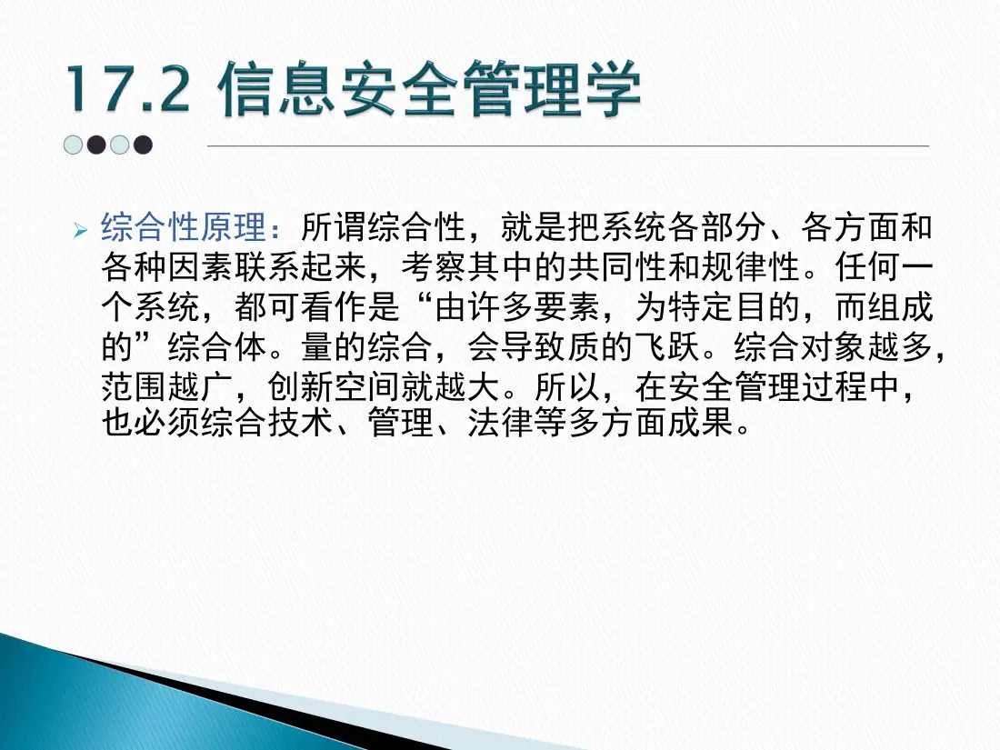

原文：

17.2信息安全管理学

➢ 综合性原理：所谓综合性，就是把系统各部分、各方面和各种因素联系起来，考察其中的共同性和规律性。任何一个系统，都可看作是“由许多要素，为特定目的，而组成的”综合体。量的综合，会导致质的飞跃。综合对象越多，范围越广，创新空间就越大。所以，在安全管理过程中，也必须综合技术、管理、法律等多方面成果。

### 17.2信息安全管理学

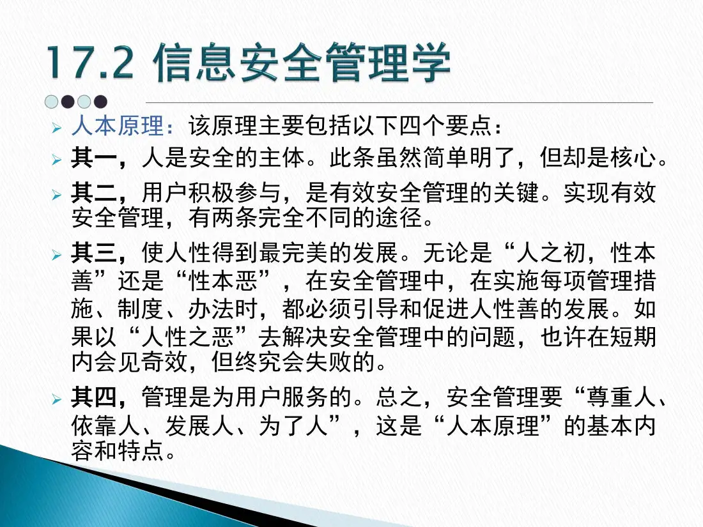

原文：

17.2信息安全管理学

➢ 人本原理：该原理主要包括以下四个要点：

➢ 其一，人是安全的主体。此条虽然简单明了，但却是核心。

其二，用户积极参与，是有效安全管理的关键。实现有效安全管理，有两条完全不同的途径。

其三，使人性得到最完美的发展。无论是“人之初，性本善”还是“性本恶”，在安全管理中，在实施每项管理措施、制度、办法时，都必须引导和促进人性善的发展。如果以“人性之恶”去解决安全管理中的问题，也许在短期内会见奇效，但终究会失败的。

➢ 其四，管理是为用户服务的。总之，安全管理要“尊重人、依靠人、发展人、为了人”，这是“人本原理”的基本内容和特点。

### 17.2信息安全管理学

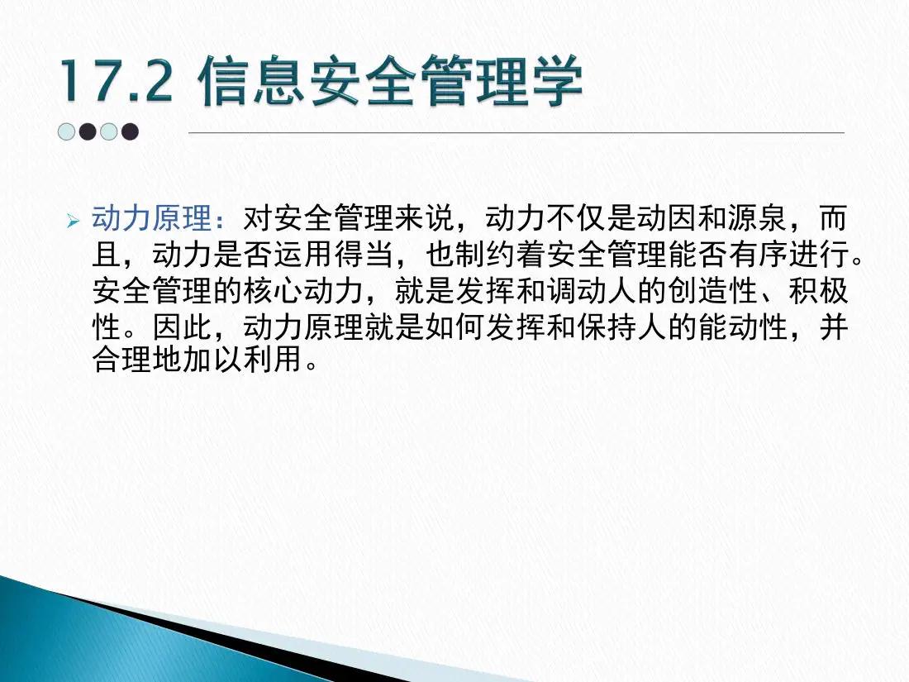

原文：

17.2信息安全管理学

动力原理：对安全管理来说，动力不仅是动因和源泉，而且，动力是否运用得当，也制约着安全管理能否有序进行。安全管理的核心动力，就是发挥和调动人的创造性、积极性。因此，动力原理就是如何发挥和保持人的能动性，并合理地加以利用。

### 17.2 信息安全管理学

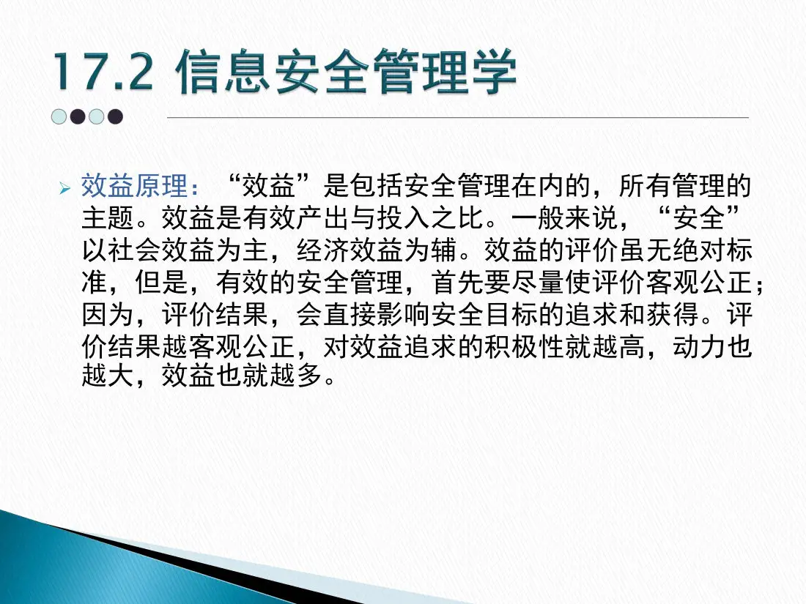

原文：

17.2 信息安全管理学

效益原理：“效益”是包括安全管理在内的，所有管理的主题。效益是有效产出与投入之比。一般来说，“安全”以社会效益为主，经济效益为辅。效益的评价虽无绝对标准，但是，有效的安全管理，首先要尽量使评价客观公正；因为，评价结果，会直接影响安全目标的追求和获得。评价结果越客观公正，对效益追求的积极性就越高，动力也越大，效益也就越多。

### 17.2信息安全管理学

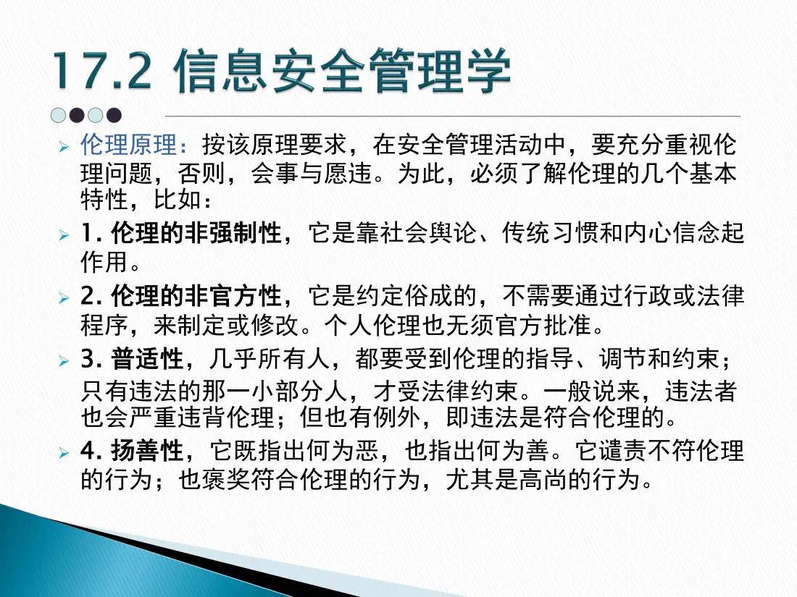

原文：

17.2信息安全管理学

伦理原理：按该原理要求，在安全管理活动中，要充分重视伦理问题，否则，会事与愿违。为此，必须了解伦理的几个基本特性，比如：

1. 伦理的非强制性，它是靠社会舆论、传统习惯和内心信念起作用。

2. 伦理的非官方性，它是约定俗成的，不需要通过行政或法律程序，来制定或修改。个人伦理也无须官方批准。

➢ 3. 普适性，几乎所有人，都要受到伦理的指导、调节和约束；只有违法的那一小部分人，才受法律约束。一般说来，违法者也会严重违背伦理；但也有例外，即违法是符合伦理的。

4. 扬善性，它既指出何为恶，也指出何为善。它谴责不符伦理的行为；也褒奖符合伦理的行为，尤其是高尚的行为。

### 本章结束，谢谢

原文：

本章结束，谢谢
