# 《安全通论》第1章 安全通论——刷新您的安全观念（课件）

原件的每一页，下面附识别出的文字。

### 安全通论---刷新您的安全观念

原文：

安全通论---刷新您的安全观念

王志伟，教授

南京邮电大学计算机学院

zhwwang@njupt.edu.cn

###  学时：32课时

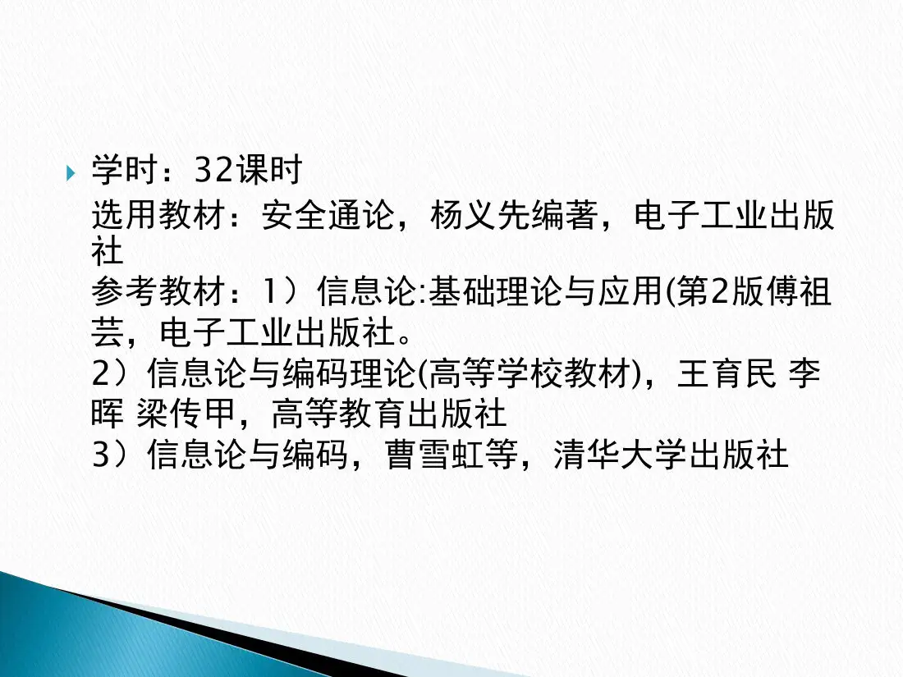

原文：

 学时：32课时

选用教材：安全通论，杨义先编著，电子工业出版社

参考教材：1）信息论:基础理论与应用(第2版傅祖芸，电子工业出版社。

2）信息论与编码理论(高等学校教材)，王育民 李晖 梁传甲，高等教育出版社

3）信息论与编码，曹雪虹等，清华大学出版社 课程介绍：难度较大，涉及数学基础较多，例如概率论，信息论，博弈论，控制论等。

###  答疑地点：计算机学院学科楼233

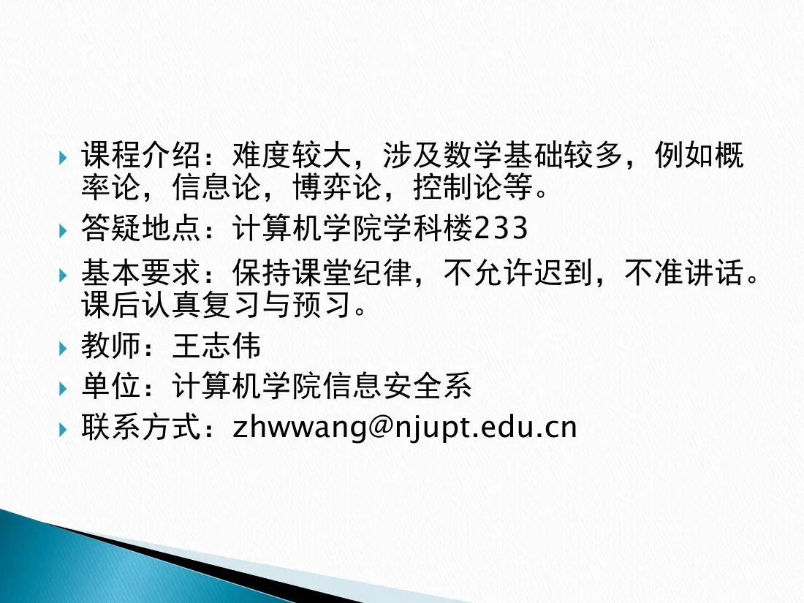

原文：

 答疑地点：计算机学院学科楼233

 基本要求：保持课堂纪律，不允许迟到，不准讲话。课后认真复习与预习。

教师：王志伟

单位：计算机学院信息安全系

联系方式：zhwwang@njupt.edu.cn

### 第1章---信息安全再认识

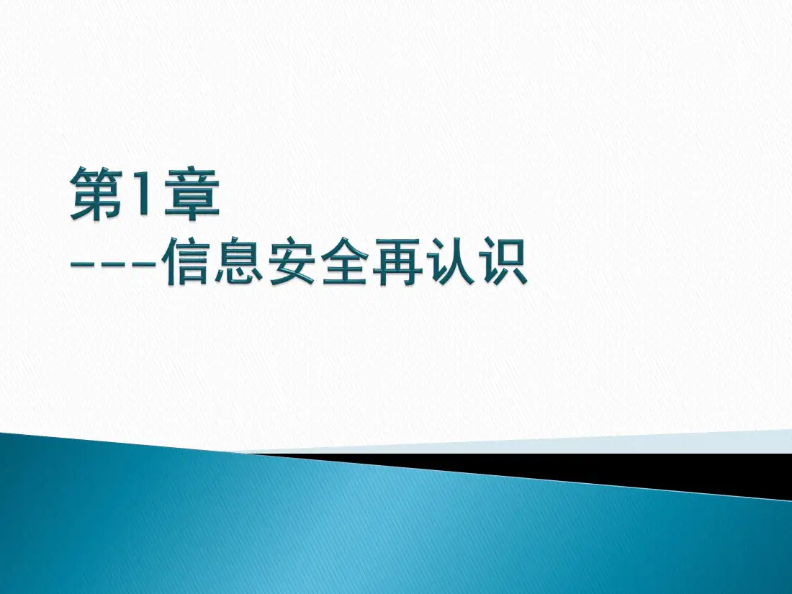

原文：

第1章---信息安全再认识

### 三、香农信息的度量

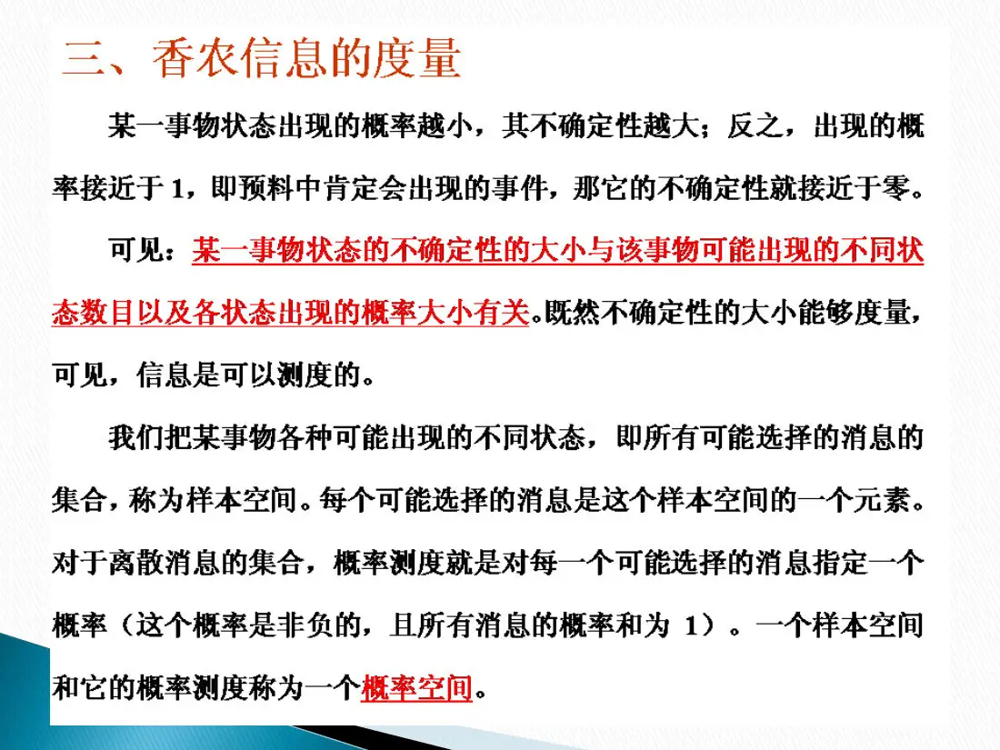

原文：

三、香农信息的度量

某一事物状态出现的概率越小，其不确定性越大；反之，出现的概率接近于1，即预料中肯定会出现的事件，那它的不确定性就接近于零。

可见：某一事物状态的不确定性的大小与该事物可能出现的不同状态数目以及各状态出现的概率大小有关。既然不确定性的大小能够度量可见，信息是可以测度的。

我们把某事物各种可能出现的不同状态，即所有可能选择的消息的集合，称为样本空间。每个可能选择的消息是这个样本空间的一个元素。对于离散消息的集合，概率测度就是对每一个可能选择的消息指定一个概率（这个概率是非负的，且所有消息的概率和为1）。一个样本空间和它的概率测度称为一个概率空间。

### $$

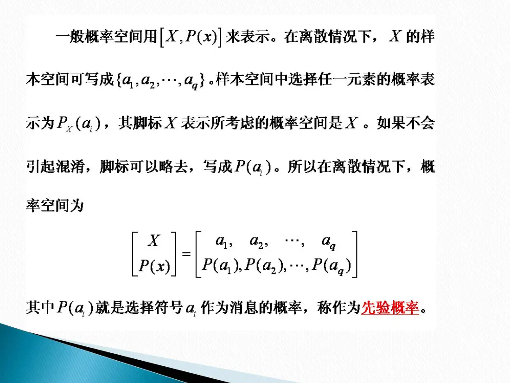

原文：

一般概率空间用 $\big [ X , P ( x ) \big ]$ 来表示。在离散情况下，X的样本空间可写成 $\{ a _ { 1 } , a _ { 2 } , \cdots , a _ { q } \}$ 。样本空间中选择任一元素的概率表示为 $P _ { \chi } ( a _ { i } )$ ，其脚标X表示所考虑的概率空间是X。如果不会引起混淆，脚标可以略去，写成 $P ( a _ { i } )$ 。所以在离散情况下，概率空间为

$$
\left[ \begin{array}{c} X \\ P (x) \end{array} \right] = \left[ \begin{array}{c c c c} a _ {1}, & a _ {2}, & \dots , & a _ {q} \\ P (a _ {1}), & P (a _ {2}), & \dots , & P (a _ {q}) \end{array} \right]
$$

其中 $P ( a _ { i } )$ 就是选择符号 $\pmb { a } _ { i }$ 作为消息的概率，称作为先验概率。

### 以“离散情况”为例。

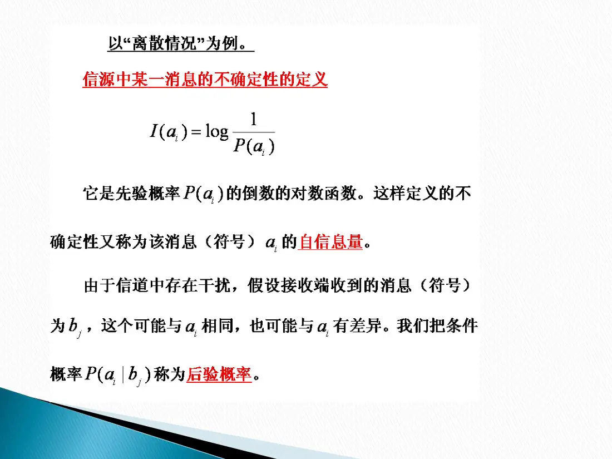

原文：

以“离散情况”为例。

信源中某一消息的不确定性的定义

$$
I \left(a _ {i}\right) = \log \frac {1}{P \left(a _ {i}\right)}
$$

它是先验概率 $P ( a _ { i } )$ 的倒数的对数函数。这样定义的不确定性又称为该消息（符号） $\pmb { a } _ { i }$ 的自信息量。

由于信道中存在干扰，假设接收端收到的消息（符号）为 $b _ { _ { j } }$ ，这个可能与 $\pmb { a } _ { i }$ 相同，也可能与 $\pmb { \mathscr { a } } _ { i }$ 有差异。我们把条件概率 $P ( a _ { i } \mid b _ { j } )$ 称为后验概率。

### 单符号离散信源熵

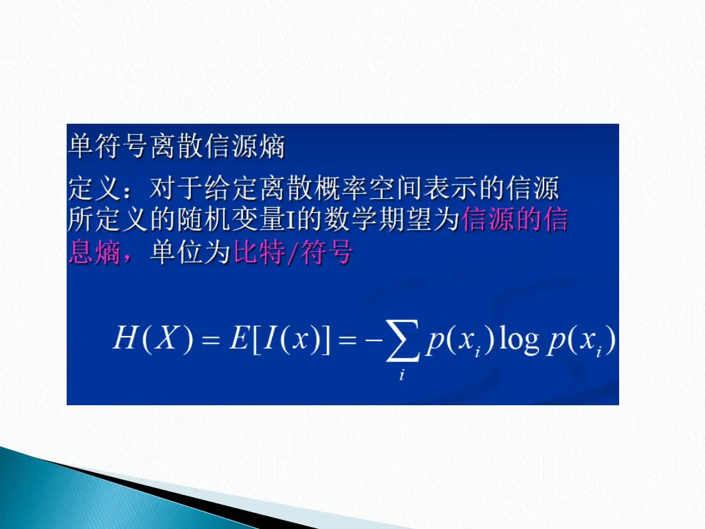

原文：

单符号离散信源熵

定义：对于给定离散概率空间表示的信源所定义的随机变量I的数学期望为信源的信息熵，单位为比特/符号

H(X) = E[I(x)]=−∑p(xi)log p(xi)

### 2、平均自信息量H(X)

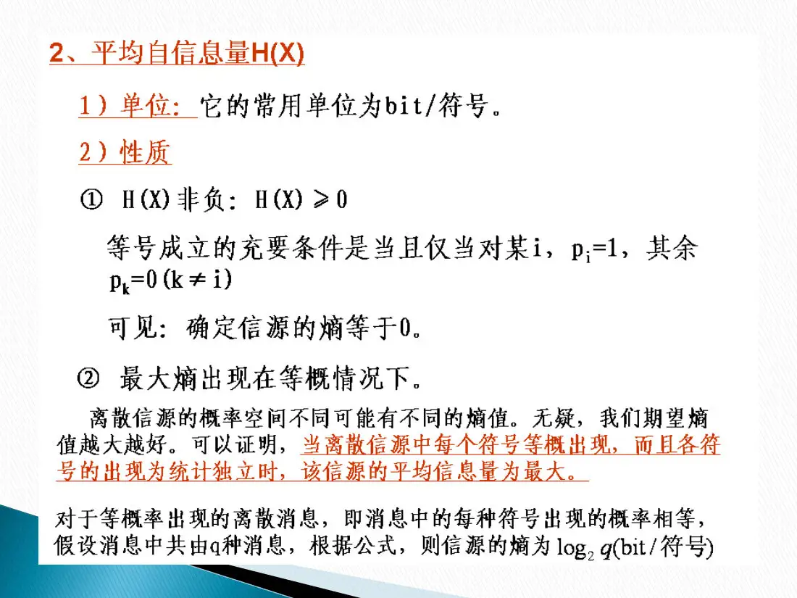

原文：

2、平均自信息量H(X)

1）单位：它的常用单位为bit/符号。

2）性质

① H(X)非负： $\mathbb { H } \left( \mathbb { X } \right) \geqslant \mathbb { 0 }$

等号成立的充要条件是当且仅当对某i， $\mathfrak { p } _ { \mathrm { i } } { = } 1$ ，其余$\mathfrak { p } _ { \mathbf { k } } \mathbf { = } \mathbf { 0 } \left( \mathbf { k } \neq \mathbf { i } \right)$

可见：确定信源的熵等于0。

② 最大熵出现在等概情况下。

离散信源的概率空间不同可能有不同的熵值。无疑，我们期望熵值越大越好。可以证明，当离散信源中每个符号等概出现，而且各符号的出现为统计独立时，该信源的平均信息量为最大。

对于等概率出现的离散消息，即消息中的每种符号出现的概率相等，假设消息中共由q种消息，根据公式，则信源的熵为 $\log _ { 2 }$ q(bit/符号)

### 第 10 页

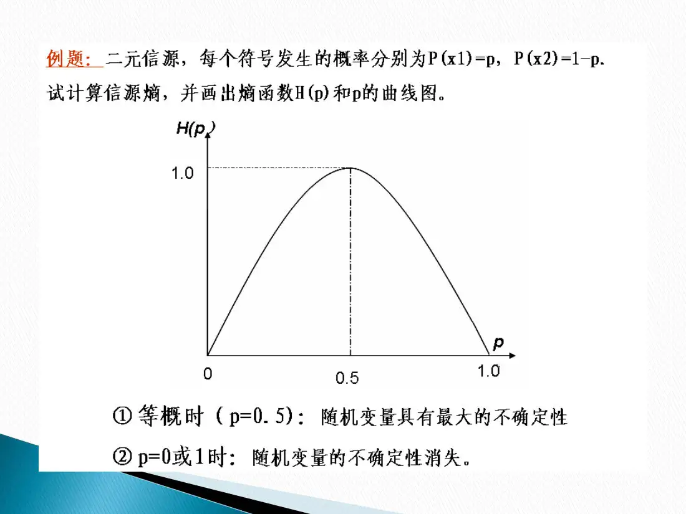

原文：

例题：二元信源，每个符号发生的概率分别为P(x1)=p， $\mathbf { P } \left( \mathbf { x } 2 \right) { = } 1 { - } \mathbf { p }$ 试计算信源熵，并画出熵函数H(p)和p的曲线图。

①等概时 $( \mathfrak { p } \mathrm { = } \mathfrak { d } . 5 )$ ：随机变量具有最大的不确定性

② $\scriptstyle { \mathfrak { p } } = 0$ 或1时：随机变量的不确定性消失。

### 第1章：信息安全再认识

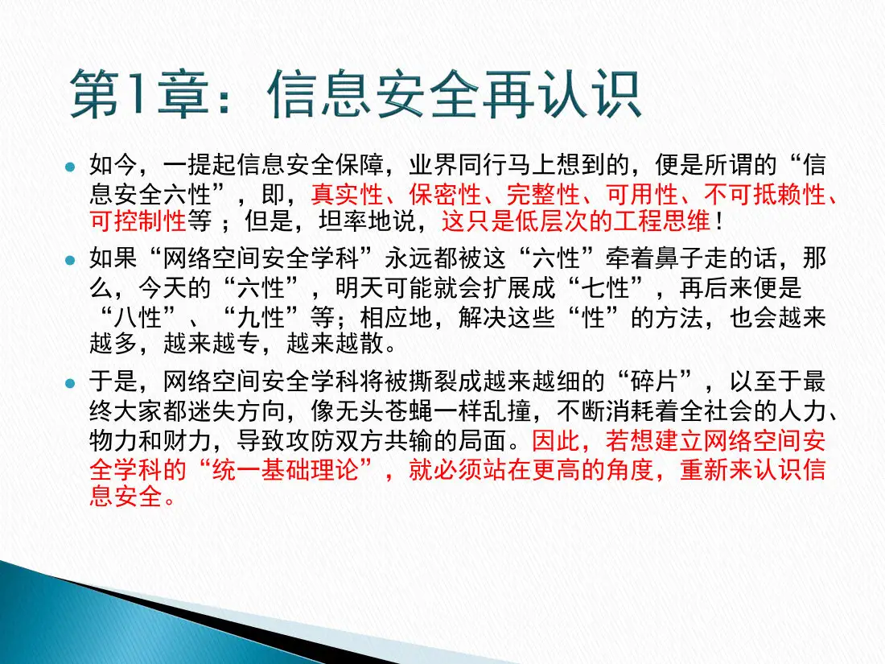

原文：

第1章：信息安全再认识

如今，一提起信息安全保障，业界同行马上想到的，便是所谓的“信息安全六性”，即，真实性、保密性、完整性、可用性、不可抵赖性、可控制性等 ；但是，坦率地说，这只是低层次的工程思维！

如果“网络空间安全学科”永远都被这“六性”牵着鼻子走的话，那么，今天的“六性”，明天可能就会扩展成“七性”，再后来便是“八性”、“九性”等；相应地，解决这些“性”的方法，也会越来越多，越来越专，越来越散。

于是，网络空间安全学科将被撕裂成越来越细的“碎片”，以至于最终大家都迷失方向，像无头苍蝇一样乱撞，不断消耗着全社会的人力、物力和财力，导致攻防双方共输的局面。因此，若想建立网络空间安全学科的“统一基础理论”，就必须站在更高的角度，重新来认识信息安全。

### 第1章：信息安全再认识

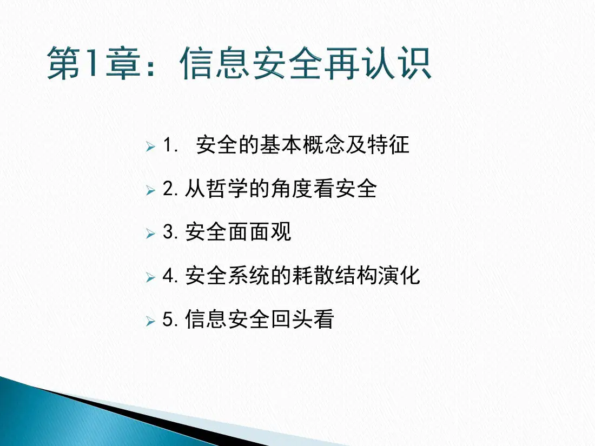

原文：

第1章：信息安全再认识

1. 安全的基本概念及特征
2. 从哲学的角度看安全
3. 安全面面观
4. 安全系统的耗散结构演化
5. 信息安全回头看

### 1.1 安全的基本概念以及特征

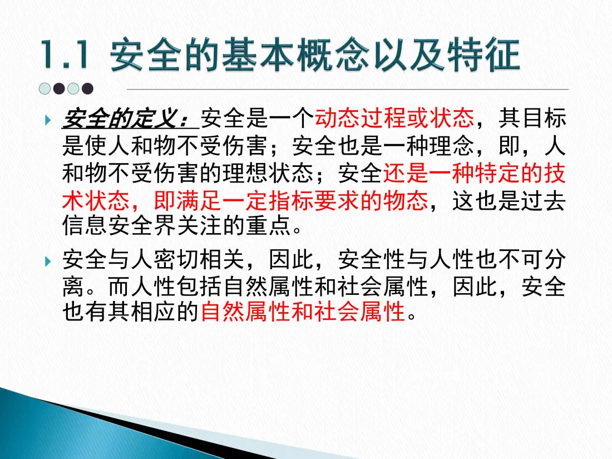

原文：

1.1 安全的基本概念以及特征

安全的定义： 安全是一个动态过程或状态，其目标是使人和物不受伤害；安全也是一种理念，即，人和物不受伤害的理想状态；安全还是一种特定的技术状态，即满足一定指标要求的物态，这也是过去信息安全界关注的重点。

安全与人密切相关，因此，安全性与人性也不可分离。而人性包括自然属性和社会属性，因此，安全也有其相应的自然属性和社会属性。

### 1.1 安全的基本概念以及特征

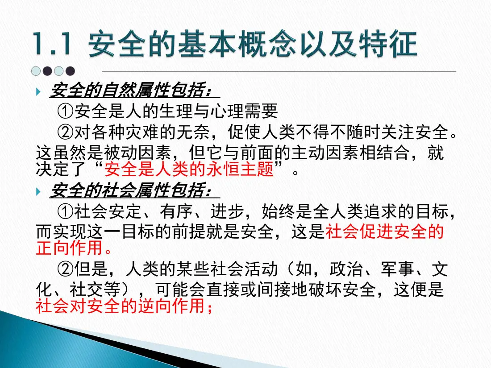

原文：

1.1 安全的基本概念以及特征

安全的自然属性包括：

①安全是人的生理与心理需要

②对各种灾难的无奈，促使人类不得不随时关注安全。这虽然是被动因素，但它与前面的主动因素相结合，就决定了“安全是人类的永恒主题”。

安全的社会属性包括：

①社会安定、有序、进步，始终是全人类追求的目标，而实现这一目标的前提就是安全，这是社会促进安全的正向作用。

②但是，人类的某些社会活动（如，政治、军事、文化、社交等），可能会直接或间接地破坏安全，这便是社会对安全的逆向作用；

### 1.1 安全的基本概念以及特征

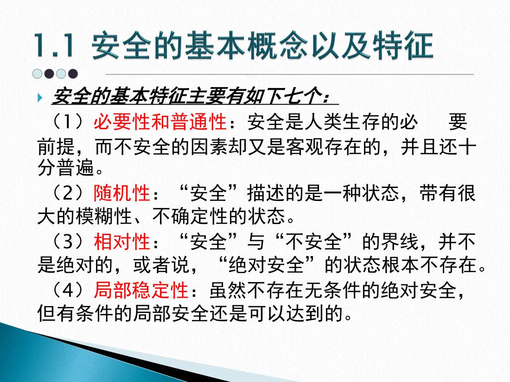

原文：

1.1 安全的基本概念以及特征

安全的基本特征主要有如下七个：

（1）必要性和普通性：安全是人类生存的必 要前提，而不安全的因素却又是客观存在的，并且还十分普遍。

（2）随机性：“安全”描述的是一种状态，带有很大的模糊性、不确定性的状态。

（3）相对性：“安全”与“不安全”的界线，并不是绝对的，或者说，“绝对安全”的状态根本不存在。

（4）局部稳定性：虽然不存在无条件的绝对安全，但有条件的局部安全还是可以达到的。

### 1.1 安全的基本概念以及特征

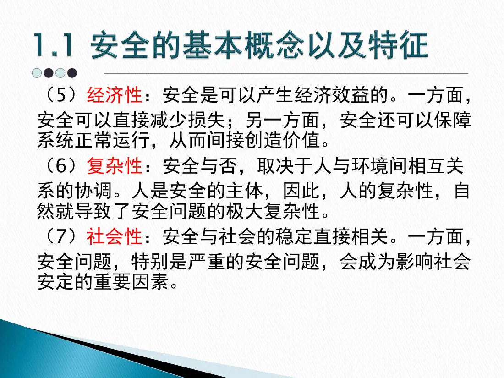

原文：

1.1 安全的基本概念以及特征

（5）经济性：安全是可以产生经济效益的。一方面，安全可以直接减少损失；另一方面，安全还可以保障系统正常运行，从而间接创造价值。

（6）复杂性：安全与否，取决于人与环境间相互关系的协调。人是安全的主体，因此，人的复杂性，自然就导致了安全问题的极大复杂性。

（7）社会性：安全与社会的稳定直接相关。一方面，安全问题，特别是严重的安全问题，会成为影响社会安定的重要因素。

### 1.1 安全的基本概念以及特征

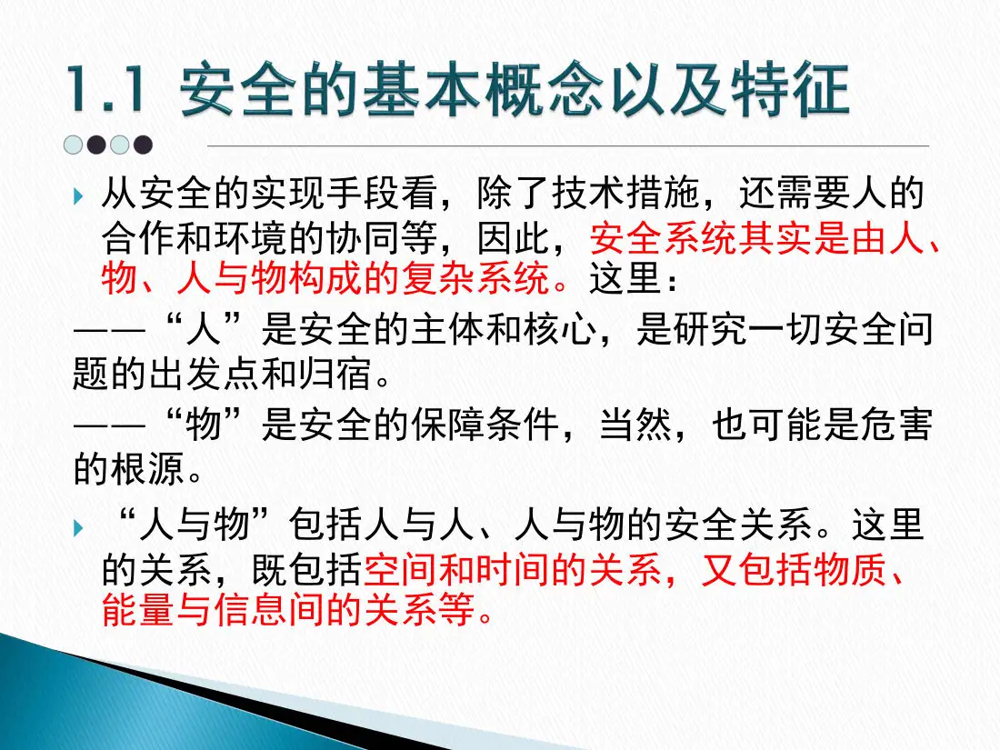

原文：

1.1 安全的基本概念以及特征

从安全的实现手段看，除了技术措施，还需要人的合作和环境的协同等，因此，安全系统其实是由人、物、人与物构成的复杂系统。这里：

“人”是安全的主体和核心，是研究一切安全问题的出发点和归宿。

“物”是安全的保障条件，当然，也可能是危害的根源。

“人与物”包括人与人、人与物的安全关系。这里的关系，既包括空间和时间的关系，又包括物质、能量与信息间的关系等。

### 1.2 从哲学角度看安全

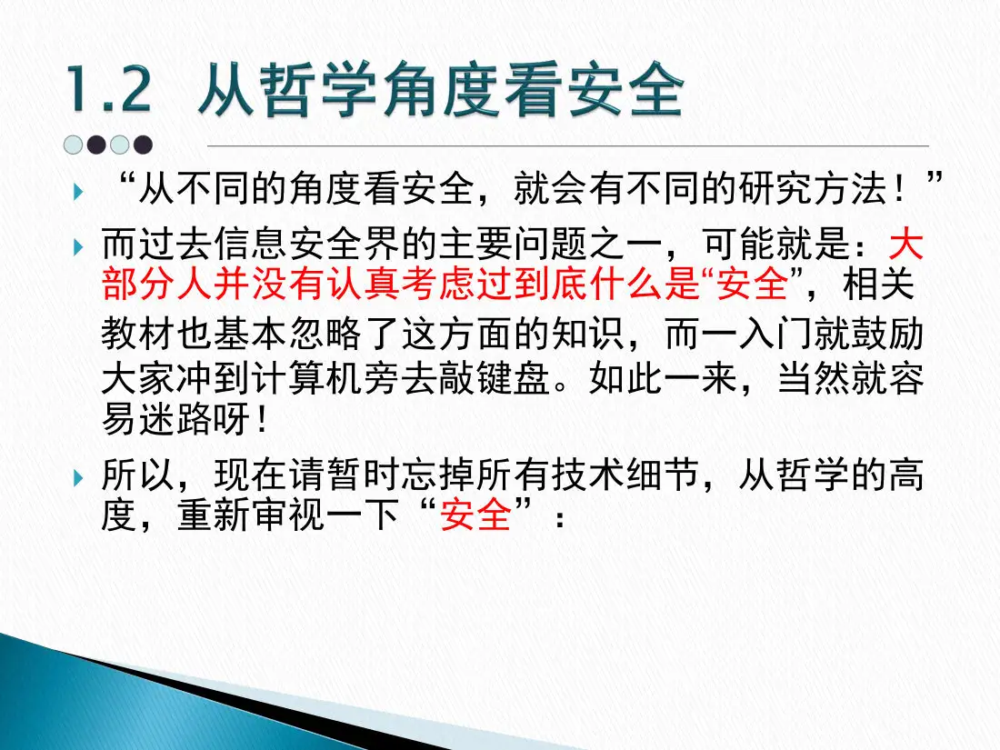

原文：

1.2 从哲学角度看安全

“从不同的角度看安全，就会有不同的研究方法！”

而过去信息安全界的主要问题之一，可能就是：大部分人并没有认真考虑过到底什么是“安全”，相关教材也基本忽略了这方面的知识，而一入门就鼓励大家冲到计算机旁去敲键盘。如此一来，当然就容易迷路呀！

 所以，现在请暂时忘掉所有技术细节，从哲学的高度，重新审视一下“安全”：

### 1.2 从哲学角度看安全

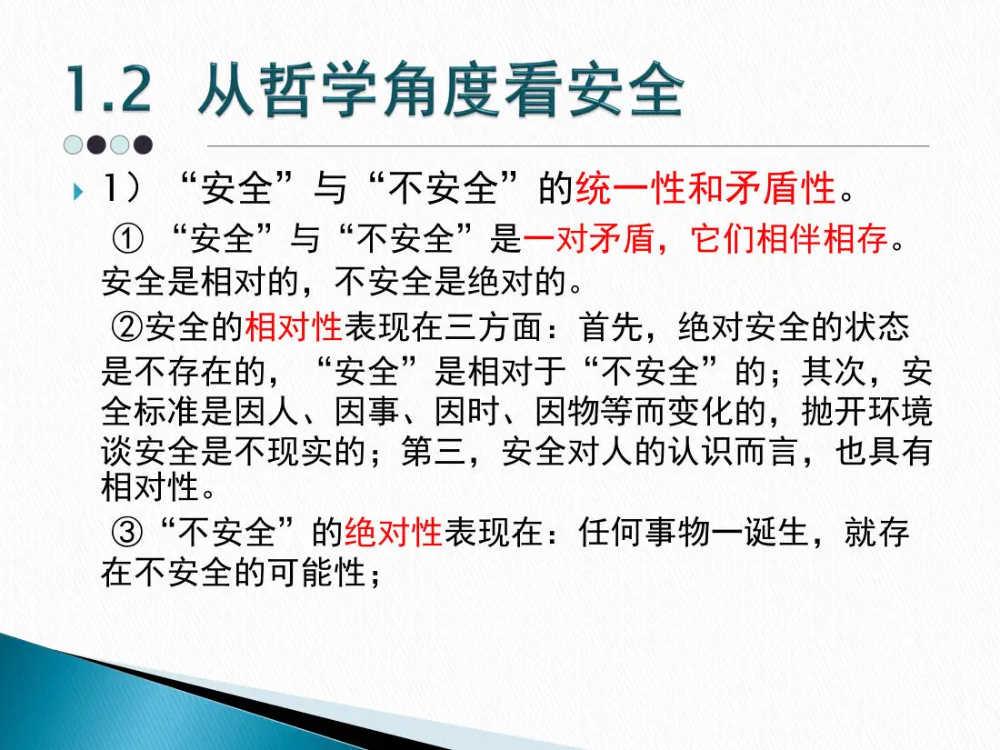

原文：

1.2 从哲学角度看安全

 1）“安全”与“不安全”的统一性和矛盾性。

① “安全”与“不安全”是一对矛盾，它们相伴相存。安全是相对的，不安全是绝对的。

②安全的相对性表现在三方面：首先，绝对安全的状态是不存在的，“安全”是相对于“不安全”的；其次，安全标准是因人、因事、因时、因物等而变化的，抛开环境谈安全是不现实的；第三，安全对人的认识而言，也具有相对性。

③“不安全”的绝对性表现在：任何事物一诞生，就存在不安全的可能性；

### 1.2 从哲学角度看安全

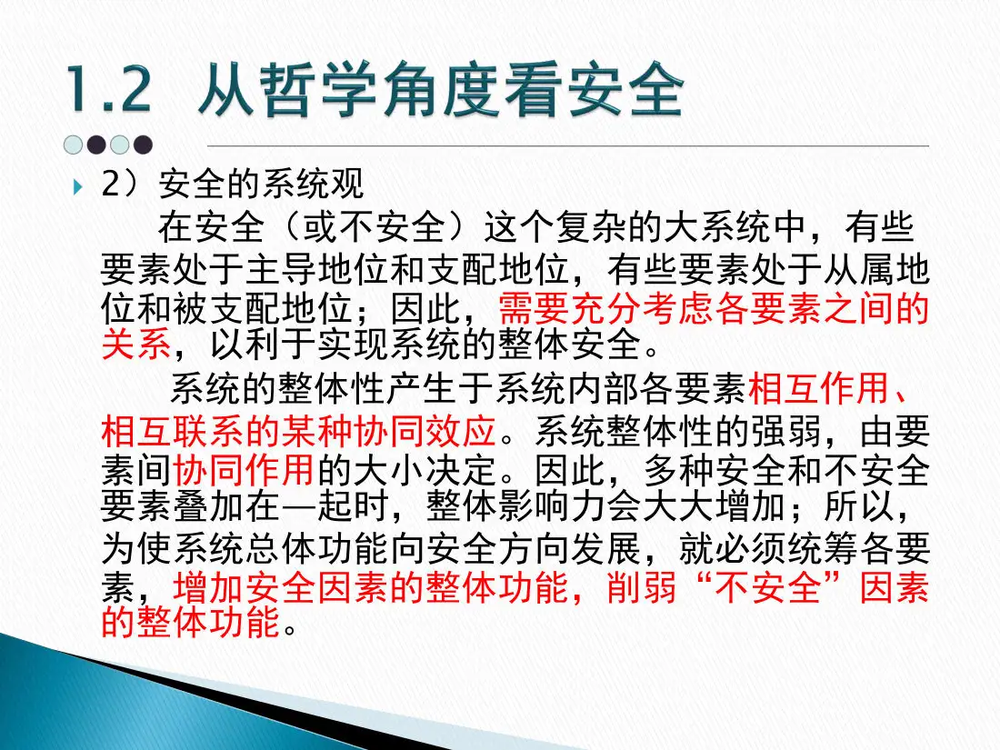

原文：

1.2 从哲学角度看安全

2）安全的系统观

在安全（或不安全）这个复杂的大系统中，有些要素处于主导地位和支配地位，有些要素处于从属地位和被支配地位；因此，需要充分考虑各要素之间的关系，以利于实现系统的整体安全。

系统的整体性产生于系统内部各要素相互作用、相互联系的某种协同效应。系统整体性的强弱，由要素间协同作用的大小决定。因此，多种安全和不安全要素叠加在—起时，整体影响力会大大增加；所以，为使系统总体功能向安全方向发展，就必须统筹各要素，增加安全因素的整体功能，削弱“不安全”因素的整体功能。

### 1.2 从哲学角度看安全

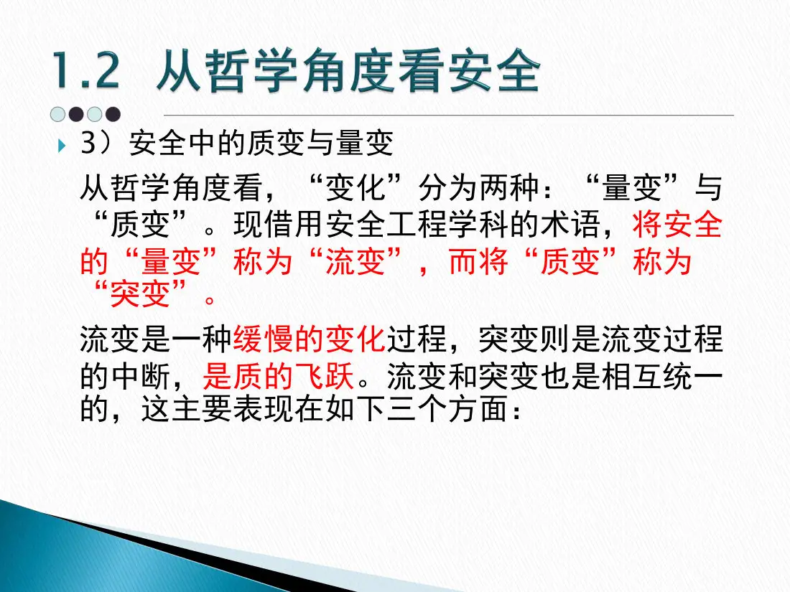

原文：

1.2 从哲学角度看安全

3）安全中的质变与量变

从哲学角度看，“变化”分为两种：“量变”与“质变”。现借用安全工程学科的术语，将安全的“量变”称为“流变”，而将“质变”称为“突变”。

流变是一种缓慢的变化过程，突变则是流变过程的中断，是质的飞跃。流变和突变也是相互统一的，这主要表现在如下三个方面：

### 1.2 从哲学角度看安全

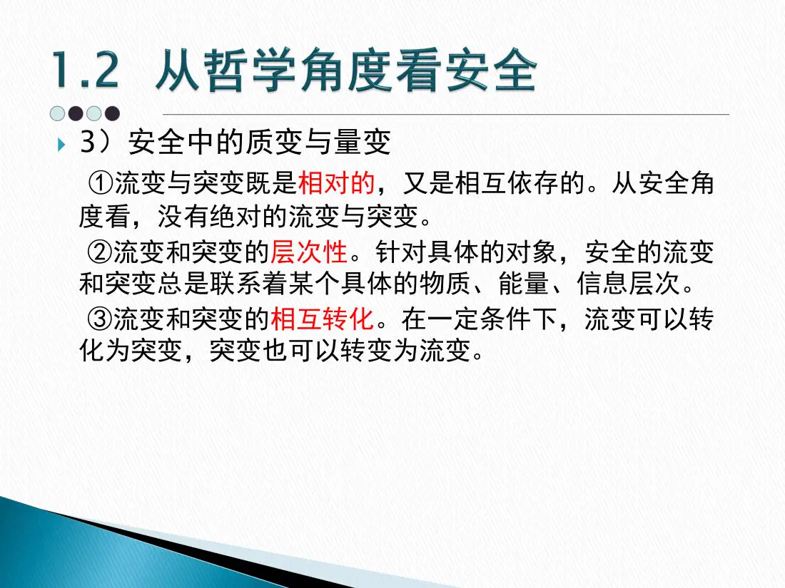

原文：

1.2 从哲学角度看安全

3）安全中的质变与量变

①流变与突变既是相对的，又是相互依存的。从安全角度看，没有绝对的流变与突变。

②流变和突变的层次性。针对具体的对象，安全的流变和突变总是联系着某个具体的物质、能量、信息层次。

③流变和突变的相互转化。在一定条件下，流变可以转化为突变，突变也可以转变为流变。

### 1.2 从哲学角度看安全

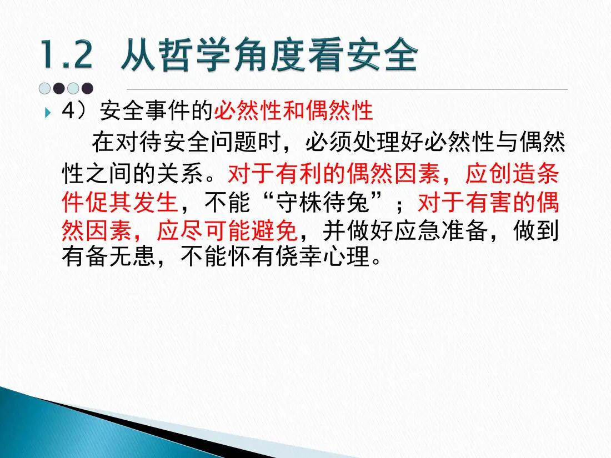

原文：

1.2 从哲学角度看安全

 4）安全事件的必然性和偶然性

在对待安全问题时，必须处理好必然性与偶然性之间的关系。对于有利的偶然因素，应创造条件促其发生，不能“守株待兔”；对于有害的偶然因素，应尽可能避免，并做好应急准备，做到有备无患，不能怀有侥幸心理。

### 1.2 从哲学角度看安全

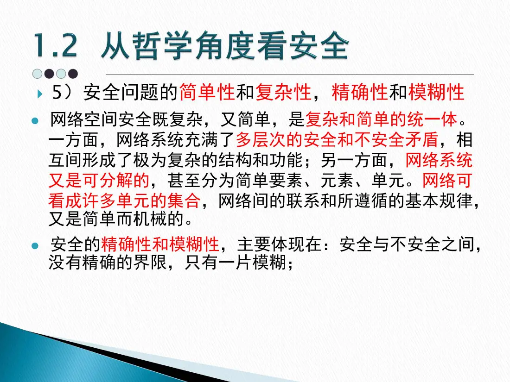

原文：

1.2 从哲学角度看安全

 5）安全问题的简单性和复杂性，精确性和模糊性

网络空间安全既复杂，又简单，是复杂和简单的统一体。一方面，网络系统充满了多层次的安全和不安全矛盾，相互间形成了极为复杂的结构和功能；另一方面，网络系统又是可分解的，甚至分为简单要素、元素、单元。网络可看成许多单元的集合，网络间的联系和所遵循的基本规律，又是简单而机械的。

安全的精确性和模糊性，主要体现在：安全与不安全之间，没有精确的界限，只有一片模糊；

### 1.2 从哲学角度看安全

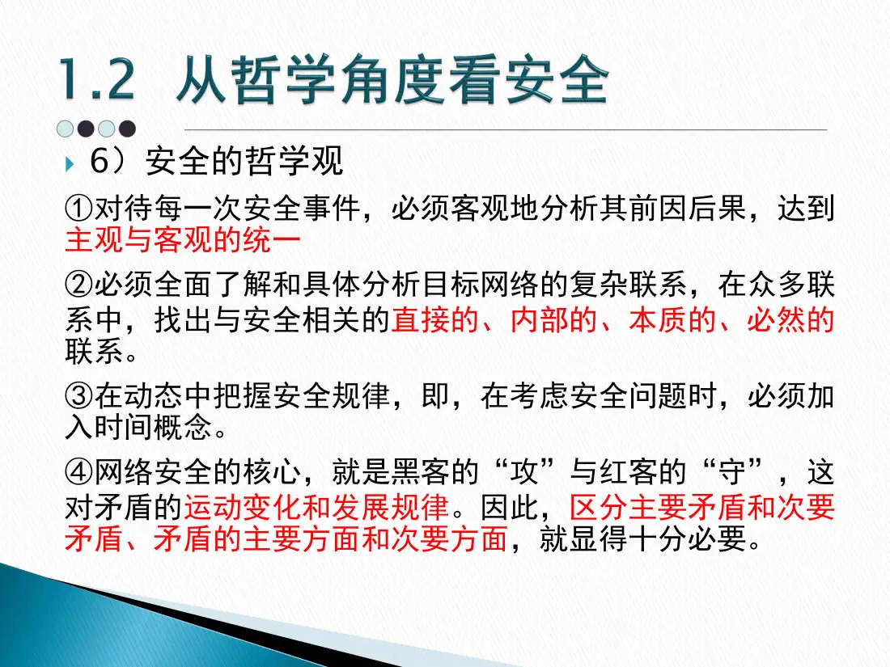

原文：

1.2 从哲学角度看安全

 6）安全的哲学观

①对待每一次安全事件，必须客观地分析其前因后果，达到主观与客观的统一

②必须全面了解和具体分析目标网络的复杂联系，在众多联系中，找出与安全相关的直接的、内部的、本质的、必然的联系。

③在动态中把握安全规律，即，在考虑安全问题时，必须加入时间概念。

④网络安全的核心，就是黑客的“攻”与红客的“守”，这对矛盾的运动变化和发展规律。因此，区分主要矛盾和次要矛盾、矛盾的主要方面和次要方面，就显得十分必要。

### 1.3 安全面面观

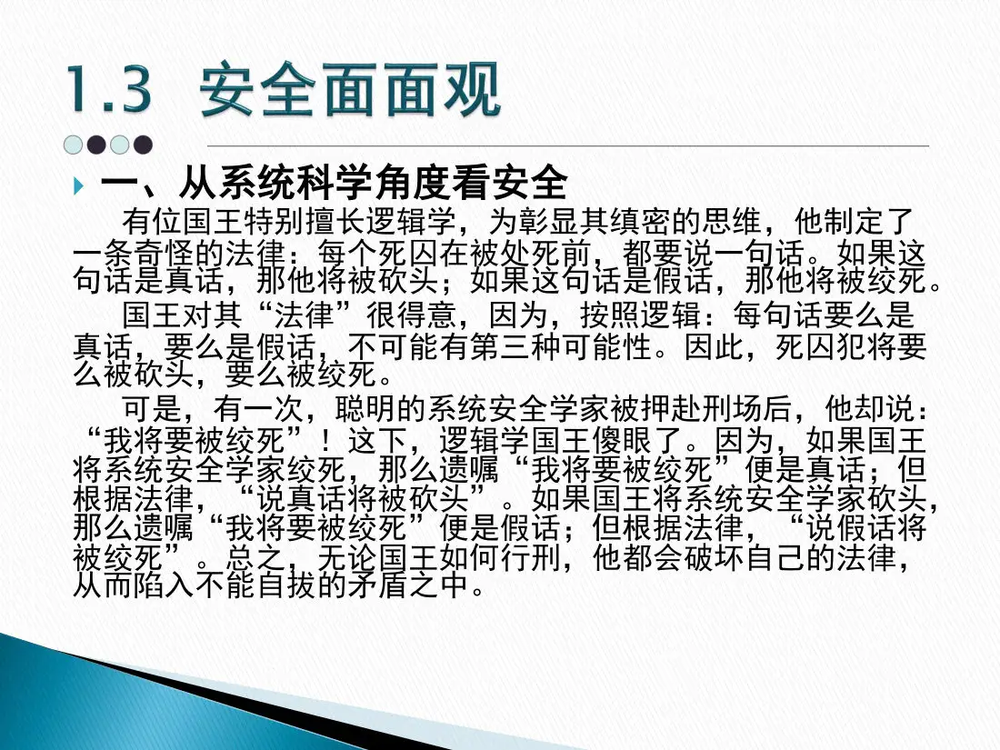

原文：

1.3 安全面面观

 一、从系统科学角度看安全

有位国王特别擅长逻辑学，为彰显其缜密的思维，他制定了一条奇怪的法律：每个死囚在被处死前，都要说一句话。如果这句话是真话，那他将被砍头；如果这句话是假话，那他将被绞死。

国王对其“法律”很得意，因为，按照逻辑：每句话要么是真话，要么是假话，不可能有第三种可能性。因此，死囚犯将要么被砍头，要么被绞死。

可是，有一次，聪明的系统安全学家被押赴刑场后，他却说：“我将要被绞死”！这下，逻辑学国王傻眼了。因为，如果国王将系统安全学家绞死，那么遗嘱“我将要被绞死”便是真话；但根据法律，“说真话将被砍头”。如果国王将系统安全学家砍头，那么遗嘱“我将要被绞死”便是假话；但根据法律，“说假话将被绞死” 之，无论国王如何行刑，他都会破坏自己的法律，从而陷入不能自拔的矛盾之中。

### 1.3 安全面面观

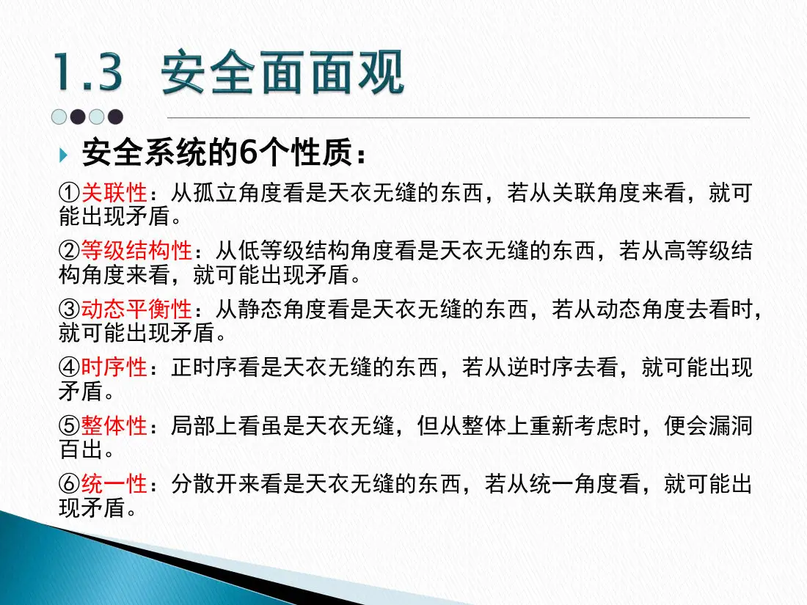

原文：

1.3 安全面面观

安全系统的6个性质：

①关联性：从孤立角度看是天衣无缝的东西，若从关联角度来看，就可能出现矛盾。

②等级结构性：从低等级结构角度看是天衣无缝的东西，若从高等级结构角度来看，就可能出现矛盾。

③动态平衡性：从静态角度看是天衣无缝的东西，若从动态角度去看时，就可能出现矛盾。

④时序性：正时序看是天衣无缝的东西，若从逆时序去看，就可能出现矛盾。

⑤整体性：局部上看虽是天衣无缝，但从整体上重新考虑时，便会漏洞百出。

⑥统一性：分散开来看是天衣无缝的东西，若从统一角度看，就可能出现矛盾。

### 1.3 安全面面观

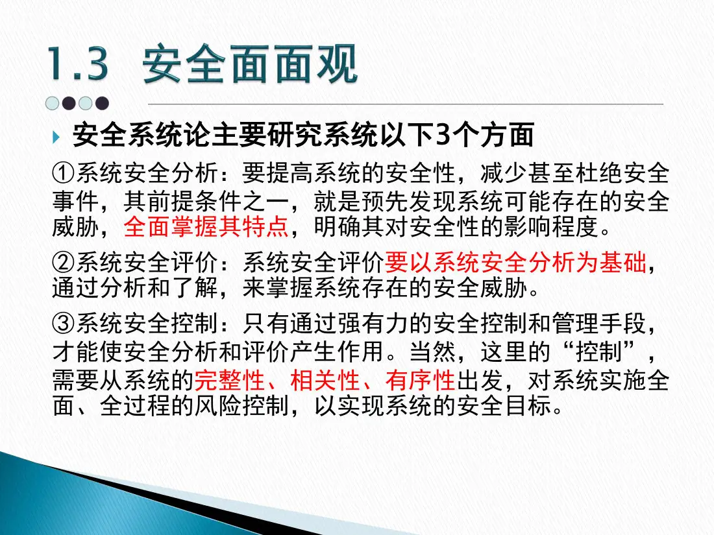

原文：

1.3 安全面面观

 安全系统论主要研究系统以下3个方面

①系统安全分析：要提高系统的安全性，减少甚至杜绝安全事件，其前提条件之一，就是预先发现系统可能存在的安全威胁，全面掌握其特点，明确其对安全性的影响程度。

②系统安全评价：系统安全评价要以系统安全分析为基础，通过分析和了解，来掌握系统存在的安全威胁。

③系统安全控制：只有通过强有力的安全控制和管理手段，才能使安全分析和评价产生作用。当然，这里的“控制”需要从系统的完整性、相关性、有序性出发，对系统实施全面、全过程的风险控制，以实现系统的安全目标。

### 1.3 安全面面观

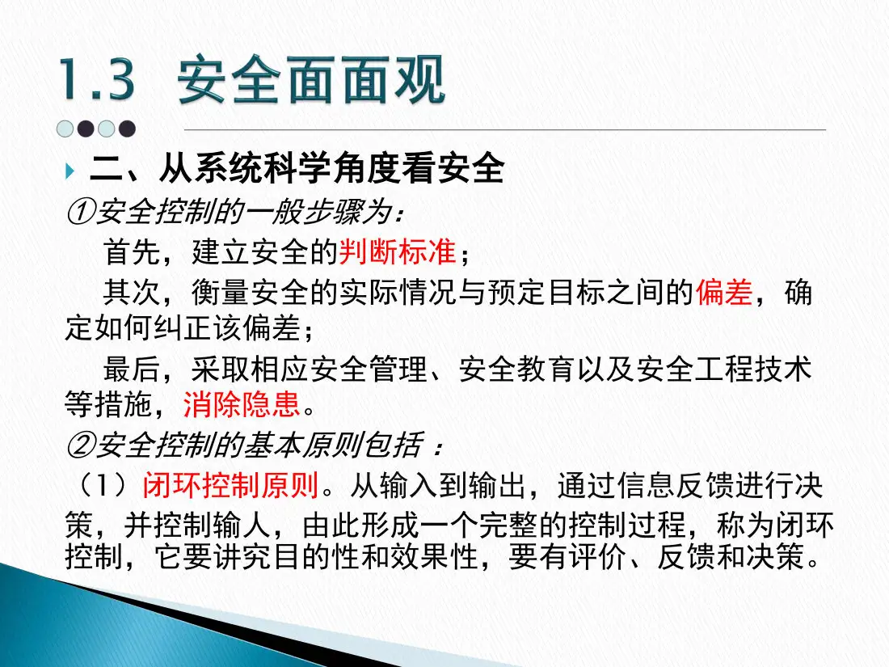

原文：

1.3 安全面面观

二、从系统科学角度看安全

①安全控制的一般步骤为：

首先，建立安全的判断标准；

其次，衡量安全的实际情况与预定目标之间的偏差，确定如何纠正该偏差；

最后，采取相应安全管理、安全教育以及安全工程技术等措施，消除隐患。

②安全控制的基本原则包括：

（1）闭环控制原则。从输入到输出，通过信息反馈进行决策，并控制输人，由此形成一个完整的控制过程，称为闭环控制，它要讲究目的性和效果性，要有评价、反馈和决策。

### 1.3 安全面面观

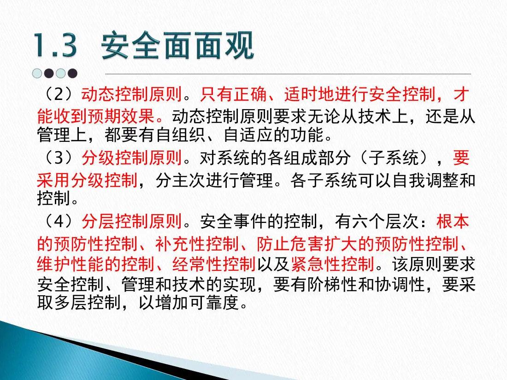

原文：

1.3 安全面面观

（2）动态控制原则。只有正确、适时地进行安全控制，才能收到预期效果。动态控制原则要求无论从技术上，还是从管理上，都要有自组织、自适应的功能。

（3）分级控制原则。对系统的各组成部分（子系统），要采用分级控制，分主次进行管理。各子系统可以自我调整和控制。

（4）分层控制原则。安全事件的控制，有六个层次：根本的预防性控制、补充性控制、防止危害扩大的预防性控制、维护性能的控制、经常性控制以及紧急性控制。该原则要求安全控制、管理和技术的实现，要有阶梯性和协调性，要采取多层控制，以增加可靠度。

### 1.3 安全面面观

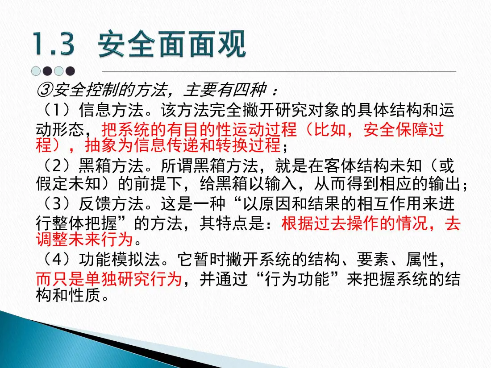

原文：

1.3 安全面面观

③安全控制的方法，主要有四种：

（1）信息方法。该方法完全撇开研究对象的具体结构和运动形态，把系统的有目的性运动过程（比如，安全保障过程），抽象为信息传递和转换过程；

（2）黑箱方法。所谓黑箱方法，就是在客体结构未知（或假定未知）的前提下，给黑箱以输入，从而得到相应的输出；

（3）反馈方法。这是一种“以原因和结果的相互作用来进行整体把握”的方法，其特点是：根据过去操作的情况，去调整未来行为。

（4）功能模拟法。它暂时撇开系统的结构、要素、属性，而只是单独研究行为，并通过“行为功能”来把握系统的结构和性质。

### 1.4 安全系统的耗散结构演化

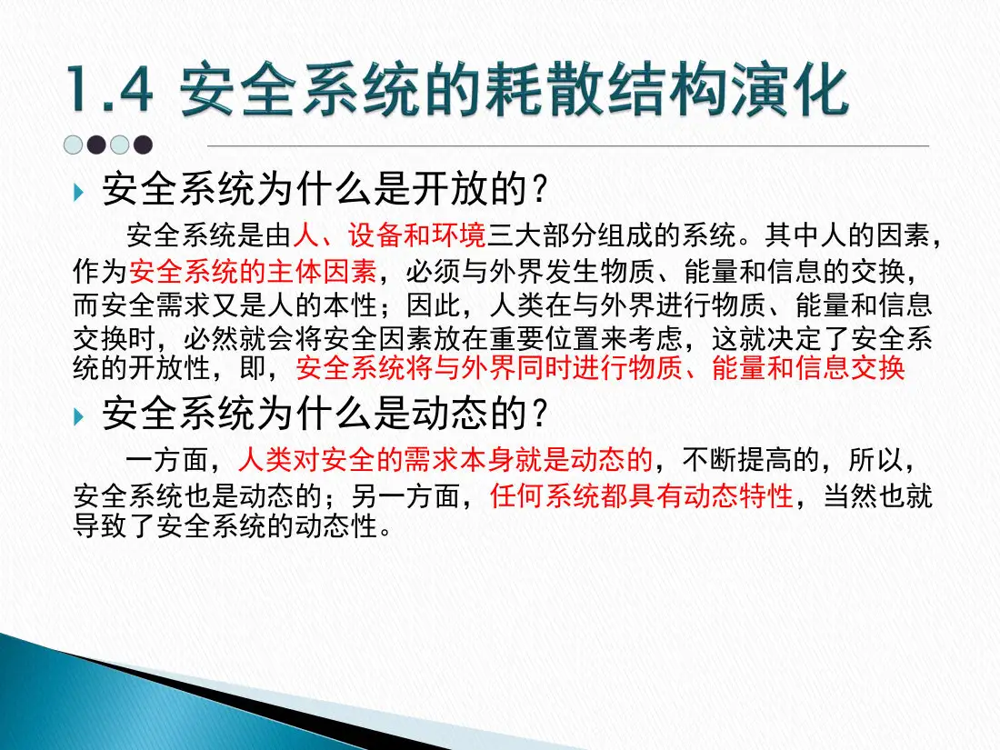

原文：

1.4 安全系统的耗散结构演化

安全系统为什么是开放的？

安全系统是由人、设备和环境三大部分组成的系统。其中人的因素，作为安全系统的主体因素，必须与外界发生物质、能量和信息的交换，而安全需求又是人的本性；因此，人类在与外界进行物质、能量和信息交换时，必然就会将安全因素放在重要位置来考虑，这就决定了安全系统的开放性，即，安全系统将与外界同时进行物质、能量和信息交换

安全系统为什么是动态的？

一方面，人类对安全的需求本身就是动态的，不断提高的，所以，安全系统也是动态的；另一方面，任何系统都具有动态特性，当然也就导致了安全系统的动态性。

### 1.4 安全系统的耗散结构演化

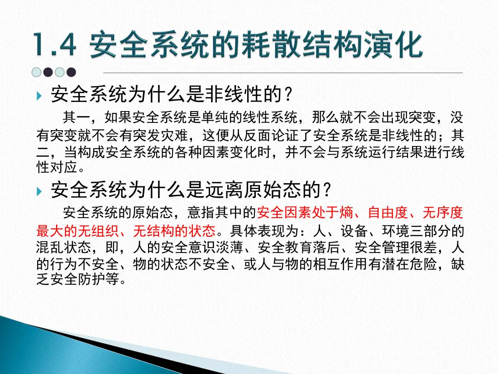

原文：

1.4 安全系统的耗散结构演化

安全系统为什么是非线性的？

其一，如果安全系统是单纯的线性系统，那么就不会出现突变，没有突变就不会有突发灾难，这便从反面论证了安全系统是非线性的；其二，当构成安全系统的各种因素变化时，并不会与系统运行结果进行线性对应。

 安全系统为什么是远离原始态的？

安全系统的原始态，意指其中的安全因素处于熵、自由度、无序度最大的无组织、无结构的状态。具体表现为：人、设备、环境三部分的混乱状态，即，人的安全意识淡薄、安全教育落后、安全管理很差，人的行为不安全、物的状态不安全、或人与物的相互作用有潜在危险，缺乏安全防护等。

### 1.4 安全系统的耗散结构演化

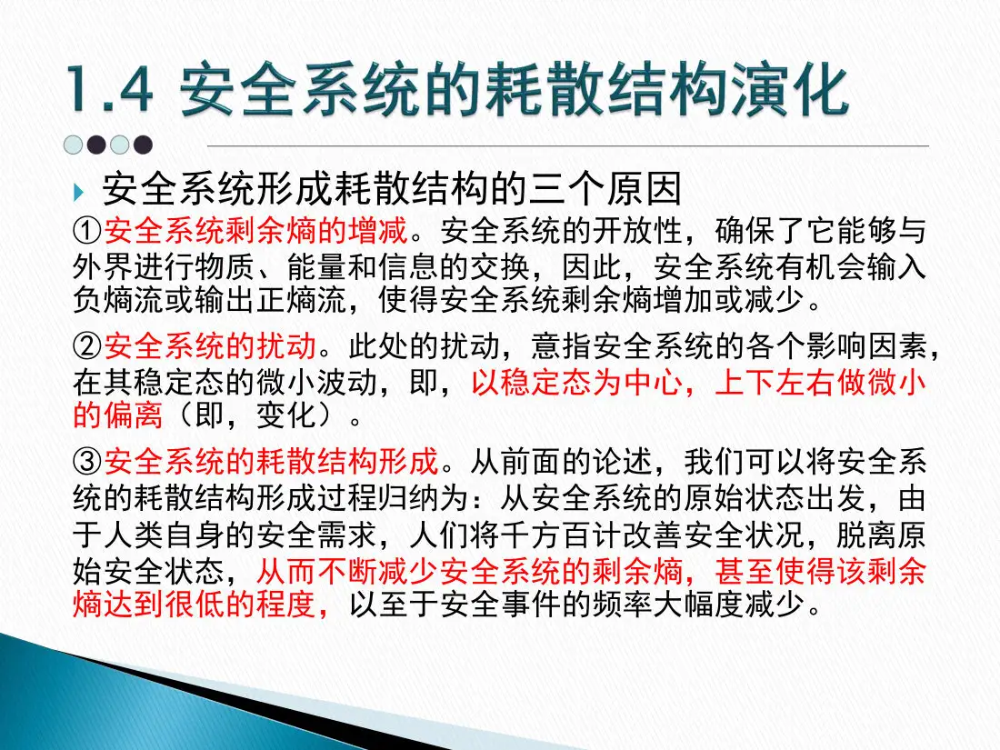

原文：

1.4 安全系统的耗散结构演化

 安全系统形成耗散结构的三个原因

①安全系统剩余熵的增减。安全系统的开放性，确保了它能够与外界进行物质、能量和信息的交换，因此，安全系统有机会输入负熵流或输出正熵流，使得安全系统剩余熵增加或减少。

②安全系统的扰动。此处的扰动，意指安全系统的各个影响因素，在其稳定态的微小波动，即，以稳定态为中心，上下左右做微小的偏离（即，变化）。

③安全系统的耗散结构形成。从前面的论述，我们可以将安全系统的耗散结构形成过程归纳为：从安全系统的原始状态出发，由于人类自身的安全需求，人们将千方百计改善安全状况，脱离原始安全状态，从而不断减少安全系统的剩余熵，甚至使得该剩余熵达到很低的程度，以至于安全事件的频率大幅度减少。

### 1.4 安全系统的耗散结构演化

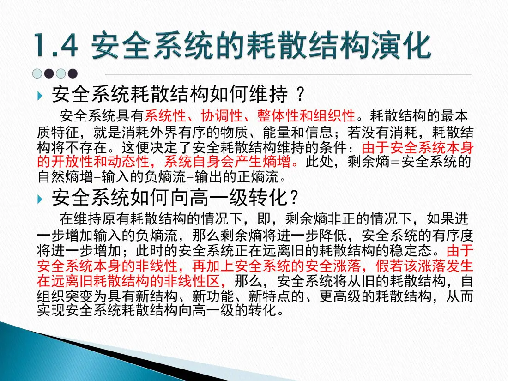

原文：

1.4 安全系统的耗散结构演化

 安全系统耗散结构如何维持 ？

安全系统具有系统性、协调性、整体性和组织性。耗散结构的最本质特征，就是消耗外界有序的物质、能量和信息；若没有消耗，耗散结构将不存在。这便决定了安全耗散结构维持的条件：由于安全系统本身的开放性和动态性，系统自身会产生熵增。此处，剩余熵=安全系统的自然熵增-输入的负熵流-输出的正熵流。

安全系统如何向高一级转化？

在维持原有耗散结构的情况下，即，剩余熵非正的情况下，如果进一步增加输入的负熵流，那么剩余熵将进一步降低，安全系统的有序度将进一步增加；此时的安全系统正在远离旧的耗散结构的稳定态。由于安全系统本身的非线性，再加上安全系统的安全涨落，假若该涨落发生在远离旧耗散结构的非线性区，那么，安全系统将从旧的耗散结构，自组织突变为具有新结构、新功能、新特点的、更高级的耗散结构，从而实现安全系统耗散结构向高一级的转化。

### 1.4 安全系统的耗散结构演化

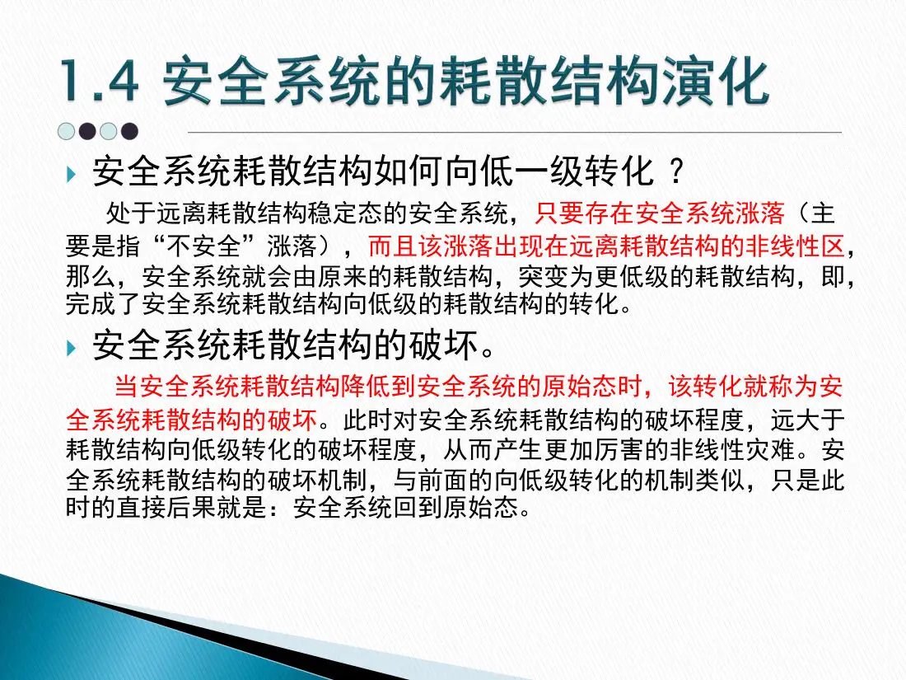

原文：

1.4 安全系统的耗散结构演化

 安全系统耗散结构如何向低一级转化 ？

处于远离耗散结构稳定态的安全系统，只要存在安全系统涨落（主要是指“不安全”涨落），而且该涨落出现在远离耗散结构的非线性区那么，安全系统就会由原来的耗散结构，突变为更低级的耗散结构，即，完成了安全系统耗散结构向低级的耗散结构的转化。

 安全系统耗散结构的破坏。

当安全系统耗散结构降低到安全系统的原始态时，该转化就称为安全系统耗散结构的破坏。此时对安全系统耗散结构的破坏程度，远大于耗散结构向低级转化的破坏程度，从而产生更加厉害的非线性灾难。安全系统耗散结构的破坏机制，与前面的向低级转化的机制类似，只是此时的直接后果就是：安全系统回到原始态。

### 1.5 信息安全回头看

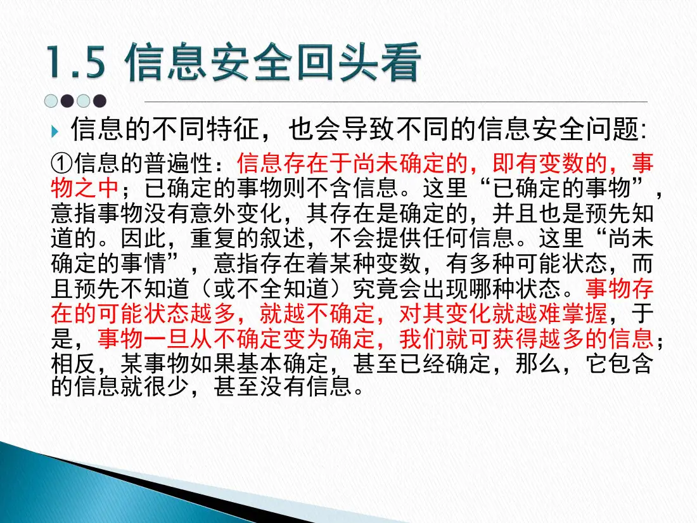

原文：

1.5 信息安全回头看

信息的不同特征，也会导致不同的信息安全问题:①信息的普遍性：信息存在于尚未确定的，即有变数的，事物之中；已确定的事物则不含信息。这里“已确定的事物”意指事物没有意外变化，其存在是确定的，并且也是预先知道的。因此，重复的叙述，不会提供任何信息。这里“尚未确定的事情”，意指存在着某种变数，有多种可能状态，而且预先不知道（或不全知道）究竟会出现哪种状态。事物存在的可能状态越多，就越不确定，对其变化就越难掌握，于是，事物一旦从不确定变为确定，我们就可获得越多的信息；相反，某事物如果基本确定，甚至已经确定，那么，它包含的信息就很少，甚至没有信息。

### 1.5 信息安全回头看

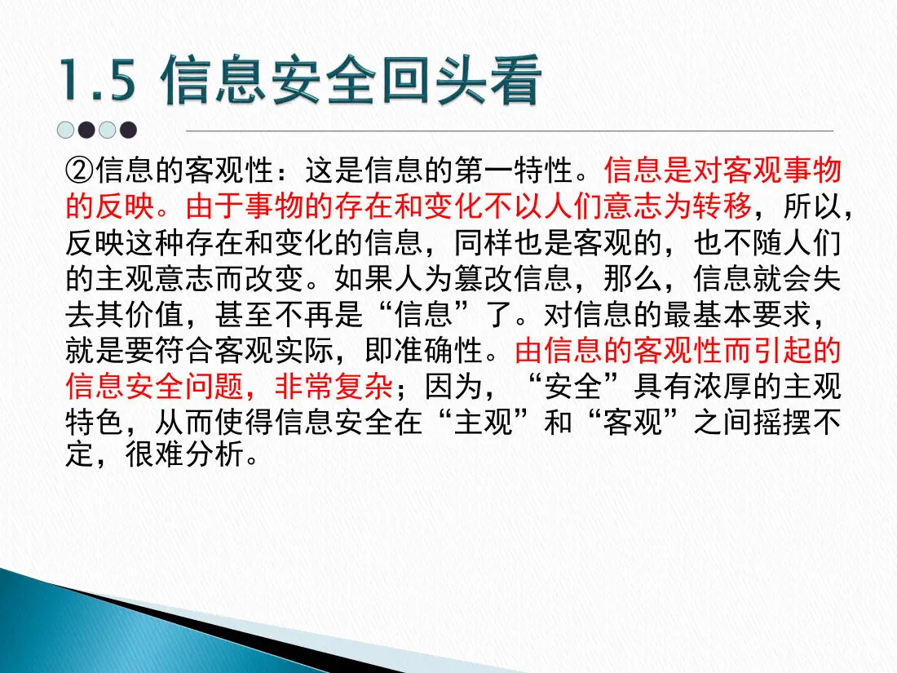

原文：

1.5 信息安全回头看

②信息的客观性：这是信息的第一特性。信息是对客观事物的反映。由于事物的存在和变化不以人们意志为转移，所以，反映这种存在和变化的信息，同样也是客观的，也不随人们的主观意志而改变。如果人为篡改信息，那么，信息就会失去其价值，甚至不再是“信息”了。对信息的最基本要求，就是要符合客观实际，即准确性。由信息的客观性而引起的信息安全问题，非常复杂；因为，“安全”具有浓厚的主观特色，从而使得信息安全在“主观”和“客观”之间摇摆不定，很难分析。

### 1.5 信息安全回头看

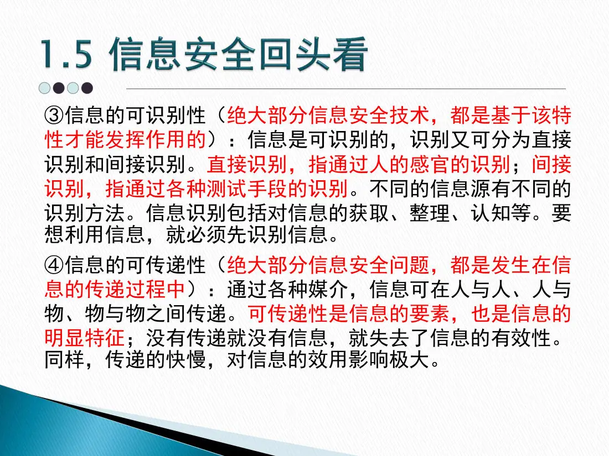

原文：

1.5 信息安全回头看

③信息的可识别性（绝大部分信息安全技术，都是基于该特性才能发挥作用的）：信息是可识别的，识别又可分为直接识别和间接识别。直接识别，指通过人的感官的识别；间接识别，指通过各种测试手段的识别。不同的信息源有不同的识别方法。信息识别包括对信息的获取、整理、认知等。要想利用信息，就必须先识别信息。

④信息的可传递性（绝大部分信息安全问题，都是发生在信息的传递过程中）：通过各种媒介，信息可在人与人、人与物、物与物之间传递。可传递性是信息的要素，也是信息的明显特征；没有传递就没有信息，就失去了信息的有效性。同样，传递的快慢，对信息的效用影响极大。

### 1.5 信息安全回头看

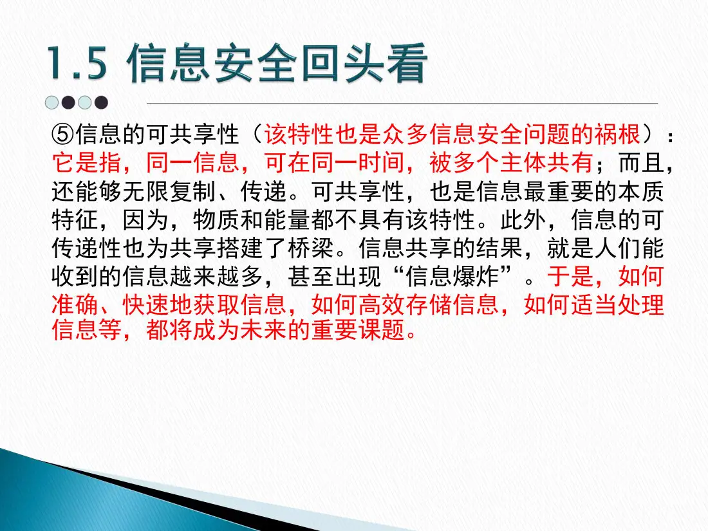

原文：

1.5 信息安全回头看

⑤信息的可共享性（该特性也是众多信息安全问题的祸根）它是指，同一信息，可在同一时间，被多个主体共有；而且，还能够无限复制、传递。可共享性，也是信息最重要的本质特征，因为，物质和能量都不具有该特性。此外，信息的可传递性也为共享搭建了桥梁。信息共享的结果，就是人们能收到的信息越来越多，甚至出现“信息爆炸”。于是，如何准确、快速地获取信息，如何高效存储信息，如何适当处理信息等，都将成为未来的重要课题。

### 1.5 信息安全回头看

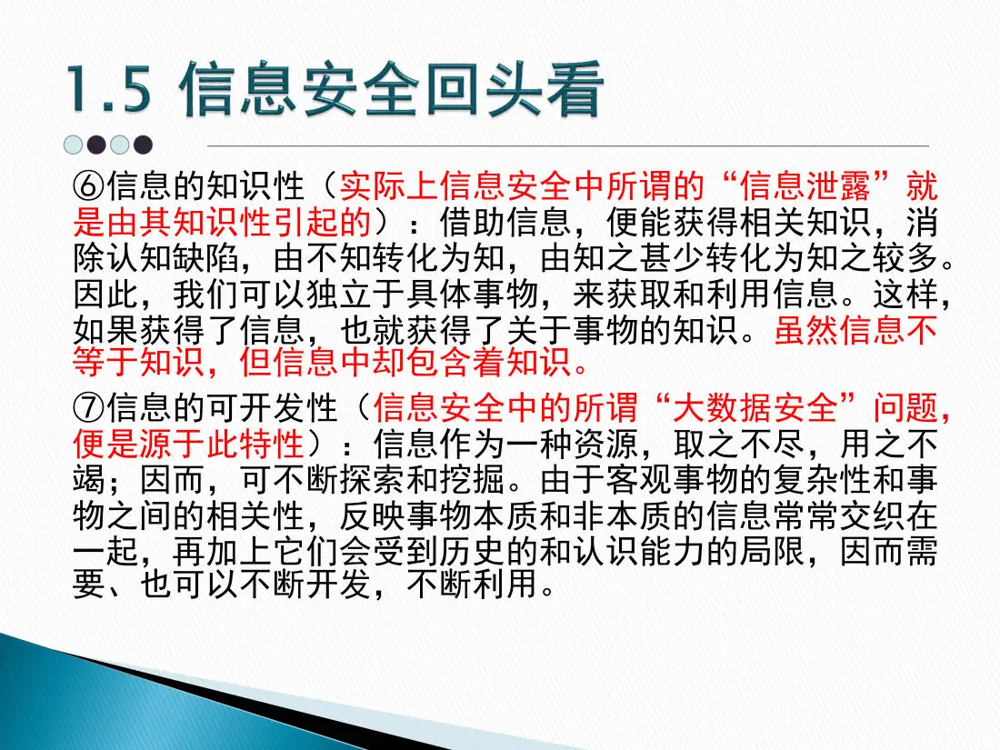

原文：

1.5 信息安全回头看

⑥信息的知识性（实际上信息安全中所谓的“信息泄露”就是由其知识性引起的）：借助信息，便能获得相关知识，消除认知缺陷，由不知转化为知，由知之甚少转化为知之较多。因此，我们可以独立于具体事物，来获取和利用信息。这样，如果获得了信息，也就获得了关于事物的知识。虽然信息不等于知识，但信息中却包含着知识。

⑦信息的可开发性（信息安全中的所谓“大数据安全”问题，便是源于此特性）：信息作为一种资源，取之不尽，用之不竭；因而，可不断探索和挖掘。由于客观事物的复杂性和事物之间的相关性，反映事物本质和非本质的信息常常交织在一起，再加上它们会受到历史的和认识能力的局限，因而需要、也可以不断开发，不断利用。

### 本章结束，谢谢

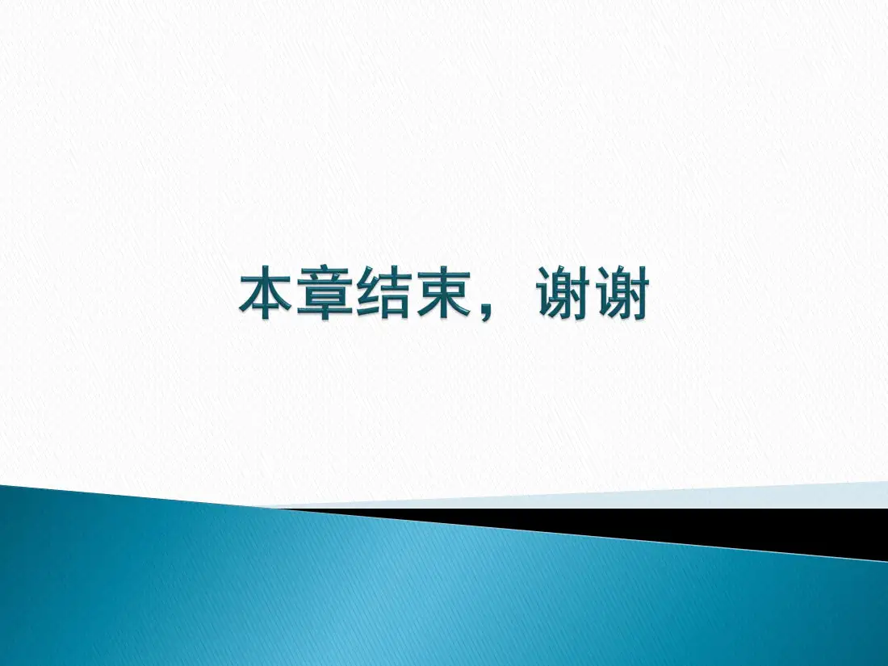

原文：

本章结束，谢谢
